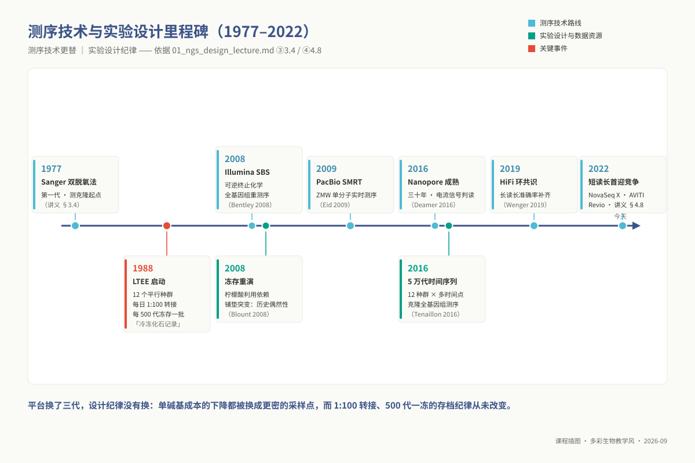
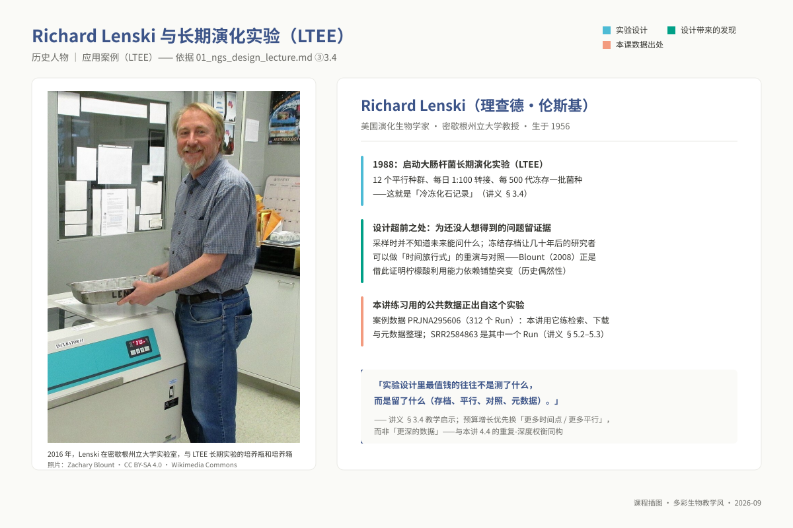
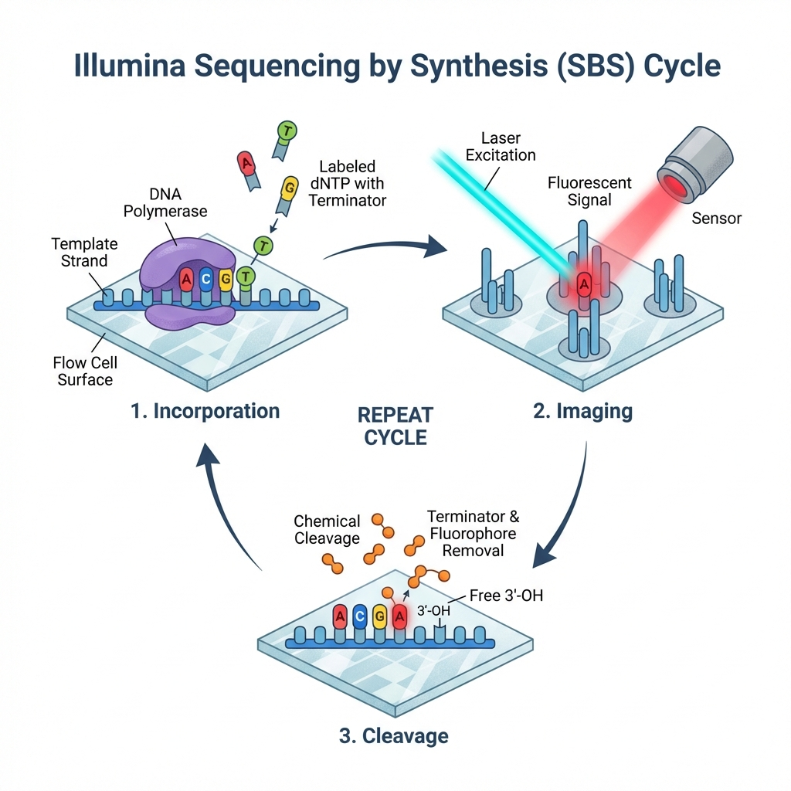
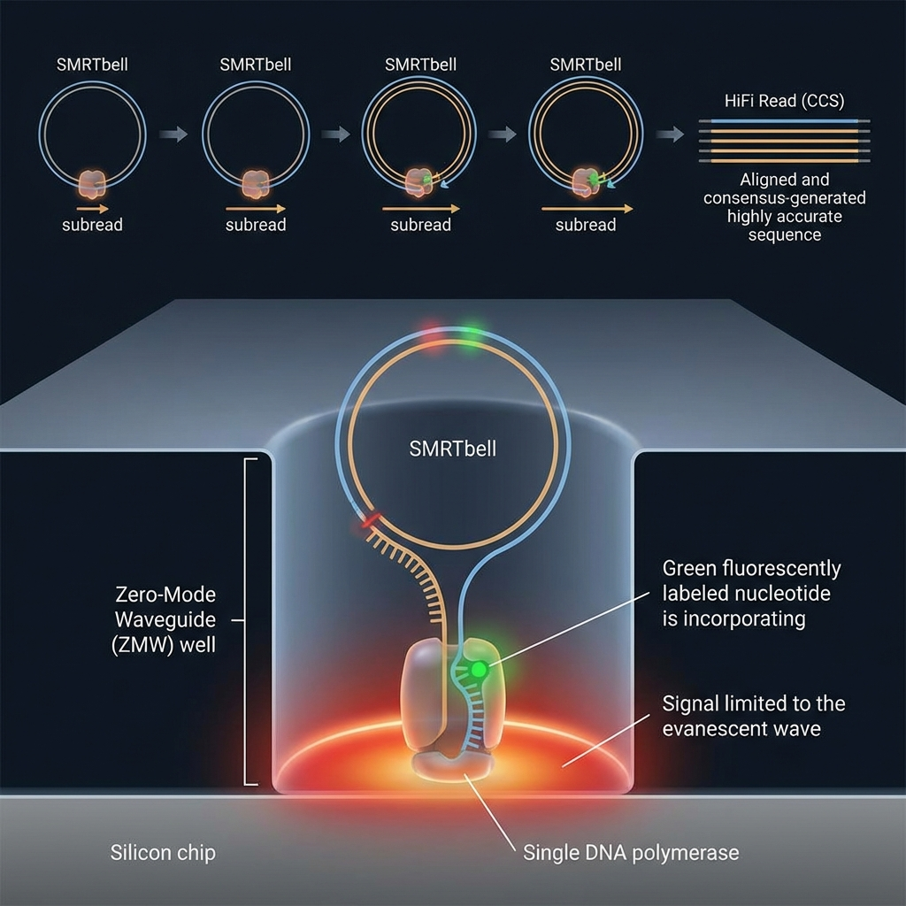
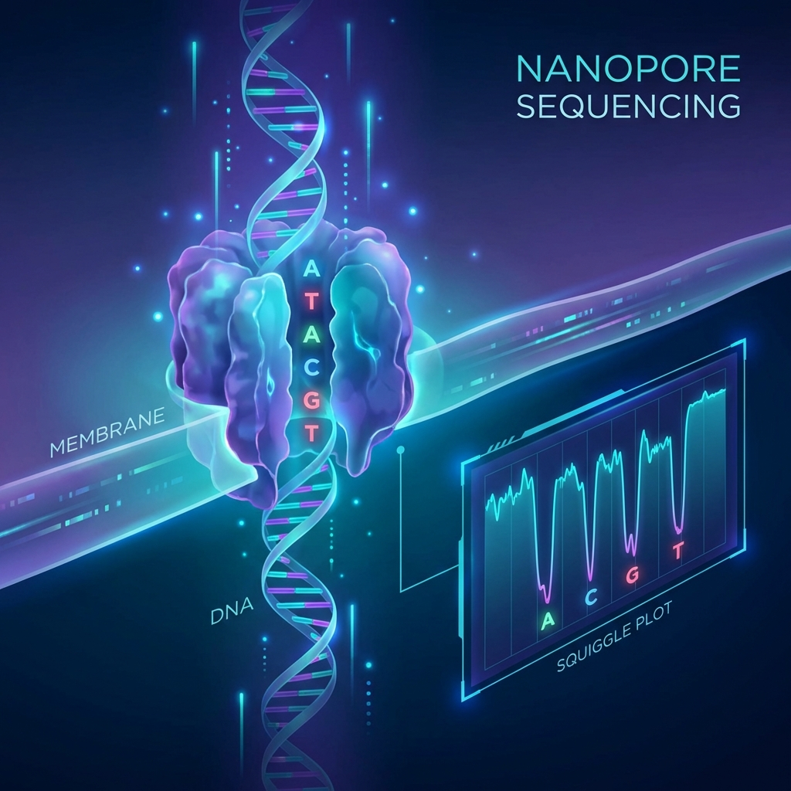

# 专题 m01：高通量测序原理与实验设计

> **适用对象**：硕士研究生，4 学时（2 h 理论 + 2 h 实践）。
>
> **阅读重点**：从科学问题反推平台、文库、重复与深度；本讲以设计判据和数据验收为出口。

| 项目 | 内容 |
|------|------|
| **专题 id** | `m01` ｜ 目录 `topic01_ngs_design` ｜ 4 学时（2 h 理论 + 2 h 实践） |
| **核心工具** | 无分析工具。实践用 `sra-tools` / `kingfisher` / `pysradb` 做数据检索与下载 |
| **运行环境 / 脚本** | `ngs_ms_base`（`conda env create -f 07_envs/conda/env_master_base.yml`）｜ 配套脚本 `03_code/master/scripts/01_fetch_sra.sh` |
| **本讲重心** | ⑥ 结果解读 + 参数选择依据。**这一讲没有可跑的分析流程，考的是判断力**——学完你要能为自己的课题写出一份能被审稿人接受的测序方案 |
<!-- 最后更新：2026-08-29（按 `00_design/course_contract.yaml` 的 11 章节模板改写） -->

## ① 学习目标

学完本专题，你应当**能够**：

1. **说出** Illumina / PacBio HiFi / Nanopore 三条技术路线各自的信号来源，并**解释**各自的错误模式（Illumina 以替换为主、CLR 以 InDel 为主、Nanopore 以同聚物长度误判为主）如何反过来决定下游分析选型。
2. **判断** 一个给定课题该选哪个平台，并用「读长 / 准确率 / 错误模式 / 成本」四维中至少两维**写出可辩护的理由**——不接受"长读长更好"这类无判据的表述。
3. 选择 文库类型：DNA-seq（PCR-free vs PCR）、RNA-seq（polyA 富集 vs rRNA 去除）、链特异性、富集型（ChIP / CUT&Tag / ATAC）、扩增子，并说明选错会丢失什么信息。
4. **估算** 一个课题需要的生物学重复数与测序深度，并**说明**在固定预算下"加重复"与"加深度"该往哪边倾斜、依据是什么。
5. **识别** 一份实验设计中的混杂（confounding）：给定设计表能指出批次与处理是否共线，并**给出**区组化 / 随机化的修正方案。
6. **检索** NCBI SRA / EBI ENA：从关键词或文献定位到 BioProject → BioSample → Experiment → Run，并**读懂**返回的元数据字段。
7. **下载并验收** 公共数据：完成 `prefetch` + `fasterq-dump` 或 `kingfisher` 下载，**核对** MD5、read 数、双端配对与读长，判断下载是否完整。
8. **产出** 一份标准 sample sheet（`m02`–`m08` 全部复用该格式：样本 id、分组、重复号、批次、平台、run accession），并**撰写**一份实验设计方案：科学问题 → 平台与文库 → 样本量与重复 → 深度 → 批次与随机化 → 预算，每一项都附判据。

## ② 前置检查

本讲依赖以下 L0 模块。**跟不上时按下表回查**，不要硬啃。

| 依赖模块 id | 本讲哪里用到 | 不过关的典型症状 | 对应自测题号 |
|---|---|---|---|
| `l0_04_formats` | ④ 三平台原理与错误模式；⑤ 下载后验收 FASTQ；⑥ 从 FASTQ 头解析仪器与 lane | 拿到 FASTQ 说不出四行各是什么、Q30 到底在说什么 | `L0-4-Q1`（平台选择，与本讲 ④ 4.2 同题型）、`L0-4-Q2`（FASTQ 结构与计数陷阱）、`L0-4-Q3`（Phred 分数）、`L0-4-Q5`（判断这是什么文件） |
| `l0_06_stats` | ④ 4.4 重复与功效；④ 4.6 批次效应的数学本质；⑥ 6.5 设计表验收 | 说不清生物学重复与技术重复的差别，或认为"ComBat 能洗掉批次" | `L0-6-Q6`（批次、混杂与协变量，2×2 完全混杂表）、`L0-6-Q7`（重复与功效，含"6 样本 × 30 M vs 3 样本 × 60 M"选择题）、`L0-6-Q8`（上机：从 PCA 上诊断批次结构） |
| `l0_01_linux` | ⑤ 全部命令在集群执行；下载、校验、批量整理元数据 | 不会用管道与 `awk` 把检索结果整理成表 | `L0-1-Q5`（登录节点 vs `qsub` vs `qrsh` 的分工）、`L0-1-Q8`（上机：批量处理文件 + 文本处理）、`L0-1-Q10`（上机：组织项目目录） |
| `l0_03_conda` | ⑤ `sra-tools` / `kingfisher` 的安装与环境隔离 | `conda activate ngs_ms_base` 后 `prefetch: command not found` | `L0-3-Q9`（上机：建环境并导出 `environment.yml`）、`L0-3-Q10`（上机：在 SGE 作业里正确激活环境） |

**30 秒自查**（三条都跑通再往下看）：

```bash
conda activate ngs_ms_base
prefetch --version            # 期望：prefetch : 3.x.x
esearch -version 2>/dev/null || echo "entrez-direct 未装，⑤ 5.2 走 ENA REST 方案"
python -c "import pandas; print(pandas.__version__)"   # 整理 sample sheet 用
```

## ③ 背景与科学问题

### 3.1 这一讲要回答的问题不是"怎么测"，是"测什么、测多少、怎么排"

后面七个专题都假定你手上已经有一批合格的数据。而现实里大多数失败的组学课题，失败点不在分析——分析可以重跑——而在数据产生的那一刻就已经注定：重复数不够、批次与处理共线、深度不足以支撑要下的结论、文库类型丢掉了你真正关心的 RNA。这些错误没有任何一种统计方法能事后挽救。

本讲要回答三个问题：

1. **这个生物学问题需要哪一类数据？**（组学类型 → 文库类型 → 平台）
2. **需要多少？**（样本量 × 重复数 × 深度，且受预算约束）
3. **怎么安排才能把"处理效应"和"技术噪音"拆开？**（批次、随机化、元数据）

### 3.2 一个真实的失败案例（本讲的反面教材，贯穿 ④ 与 ⑥）

某实验室研究干旱胁迫对叶片转录组的影响：对照组 3 个重复在 1 月建库送测，处理组 3 个重复在 3 月建库送测，同一家公司完成。

结果：PCA 第一主成分把样本按**送测日期**完美分开；差异表达最显著的前 10 个基因里 5 个与叶绿素合成相关——那是季节光照漂移，不是干旱。

这个设计的致命之处在于：处理与批次完全共线（completely confounded）。数据里 `处理效应` 与 `批次效应` 是同一个自由度，无论用 ComBat、`limma::removeBatchEffect` 还是在 DESeq2 的 design 里加 `+ batch`，都无法把它们拆开——不是方法不够好，是信息在采样时就没被采到。这份数据只能重做。

### 3.3 为什么硕士阶段要讲到物理层

不需要背化学式，但需要知道每种平台的错误**从哪来**，因为错误模式会改变下游参数。R2 末端质量下降，通常与簇内分子相位失同步有关，决定质控切除策略；AT/GC 极端区覆盖度低，常与文库 PCR 偏好有关，可能导致该区域变异漏检（见 `m03` ⑦）。PacBio CLR 的 InDel 错误与单分子信号驻留时间抖动有关，通常需要纠错；Nanopore 的同聚物长度误判来自均聚区电流难以区分相邻长度，可能造成移码假阳性。

### 3.4 应用案例：LTEE——一份从 1988 年跑到现在、跨越三代测序仪的实验设计

**研究问题**：适应性演化有没有尽头？1988 年起，Lenski 在大肠杆菌上启动长期演化实验（LTEE）：12 个平行种群、每日 1:100 转接、**每 500 代冻存一批菌种**（"冷冻化石记录"）。这个设计超前之处在于：采样时并不知道未来能问什么问题——冻结存档让几十年后的研究者可以做"时间旅行式"的重演与对照。

**测序设计的演进**：早期只有表型与少数基因座；全基因组时代到来后，采样点随平台更替逐步加密（Sanger 测克隆 → Illumina 测时间序列）。Tenaillon 等（2016）对 12 个种群 × 多时间点的克隆测序发现：保持祖先突变率的群体中，中性替换以近恒定速率累积，有益突变的占比随适应度上升而下降；多个群体演化出 DNA 修复缺陷、突变率放大的谱系。

**平台换了三代，设计纪律没有换**：每一代平台的"单碱基成本下降"都被换成了更密的采样点，而 1:100 转接、500 代一冻的存档纪律从未改变——后者才是这个实验最贵的资产。

**一个只有这种设计才可能做出的发现**：Blount 等（2008）利用冻结存档"重演"演化，证明 Ara-3 群体约 3 万代后才出现的柠檬酸利用能力依赖此前的"铺垫突变"——历史偶然性。没有 500 代一冻，这个结论根本无法做出。

**教学启示**：① 实验设计里最值钱的往往不是测了什么，而是**留了什么**（存档、平行、对照、元数据）；② 预算增长优先换"更多时间点 / 更多平行"而非"更深的数据"，与 4.4 的重复-深度权衡同构；③ 本讲案例数据 `PRJNA295606` 正是这个实验的公共数据集——你练检索下载的对象，本身就是一份经典设计（见 ⑤ 5.2）。



*图 m01-5：测序技术与实验设计双轨里程碑（1977–2022）：平台换三代，设计纪律未换。*



*图 m01-6：Richard Lenski 与长期演化实验（LTEE）：本课案例数据正出自这里（照片：Zachary Blount，CC BY-SA 4.0，Wikimedia Commons）。*

> **人物故事与科学长征：35 年坚守一万多天的演化守望者**
> 
> 照片中在密歇根州立大学实验室里与培养瓶合影的学者，是演化生物学名家**理查德·伦斯基（Richard Lenski，1956– ）**。1988 年 2 月 15 日，伦斯基在 12 个小三角烧瓶中接种了大肠杆菌，开启了大肠杆菌长期演化实验（LTEE）。这原本只是一项预计进行几年的探索，却最终持续了 35 年以上、跨越了 75,000 多个细菌世代。
> 
> 伦斯基团队在数千个周末与节假日里从未间断过每日 1:100 的转接，更坚持每隔 500 代将活菌株深度冻存，创造了一座能够随时“时间旅行”的活性化石库。当团队在 31,500 代后发现细菌罕见进化出有氧利用柠檬酸（$\text{Cit}^+$）的全新复杂性状时，面对保守派学者对其真实性的公开质疑，伦斯基以极为严谨且风度翩翩的长信回应，并大度地表示可随时寄送冷冻原始菌株供第三方独立复现验证。这种对实验留痕与完全可复现性的极致坚持，正是本专题“实验设计最值钱的是留了什么”的最高典范。

## ④ 核心原理

> 硕士层深度：**讲清算法/技术思路与适用边界**，不推导公式。要更深的物理见 ⑪ 的 Bentley (2008)、Eid (2009)、Deamer (2016)。

### 4.1 三条技术路线的信号生成与物理极限

任何测序技术在本质上都是把微观核酸分子转换成宏观可记录物理信号的传感器系统。理解仪器底层的物理与化学过程，是看懂一切上游质控异常与下游算法选型的根基。

**Illumina 边合成边测序（SBS）**：文库单链在流动槽（flowcell）表面经桥式 PCR（新一代 NovaSeq X 采用排除扩增 ExAmp）局部扩增为数以千计的同源分子克隆簇（cluster）。克隆簇提供可被成像系统读取的同步信号，是该平台获得高信噪比的关键。

测序过程以“掺入—成像—切除”三步循环进行：每轮只掺入一个带可逆阻断基团和特异荧光基团的 dNTP。完成四通道或双通道成像后，化学试剂切除荧光分子与 3' 阻断基团，暴露自由的 3'-OH，进入下一轮。
这一物理机制也决定了平台的极限与典型错误模式。酶促掺入和化学裂解不可能达到 100% 的效率；随着 cycle 增加，部分分子会因未完全掺入而落后（phasing），也有少数分子因阻断基团提前脱落而抢跑（pre-phasing）。

两类失同步会使信号逐渐混入前后 cycle 的杂光，R2 尾端的碱基质量因此通常下降。读长受失同步累积限制，是 PE150 需要关注的物理边界；它不只是一个可以无限靠工程优化解决的问题。



*图 1：SBS 的三步循环——掺入、成像、切割。*

**PacBio 单分子实时测序（SMRT）与 HiFi**：它避开克隆扩增，直接观测单分子尺度上的 DNA 聚合酶合成过程。其核心结构是零模波导孔（Zero-Mode Waveguide, ZMW）：金属薄膜上的纳米微孔形成局部倏逝场，把有效激发体积压缩到约 20 仄升（zeptoliter, $10^{-21}$ L）。

荧光标记的 dNTP 在孔底被聚合酶捕获并催化结合时，会产生可记录的荧光脉冲；反应完成后，游离染料离开激发区。这样即使底物背景较高，也能实时记录单分子反应。
早期的单通读长（CLR）单次测序错误率高达 10%–15%，但在环化共识测序（CCS）模式下，文库两端被接上发夹形接头形成闭合环状 SMRTbell，耐受性强的聚合酶得以沿着同一条双链模板绕圈合成数次至数十次。由于单分子的荧光检测错误在空间与时间上呈现严格的独立泊松分布，将多次绕圈读段做多重序列比对取共识，随机错误便以指数级被迅速稀释，最终产出长度 15–20 kb、准确率超过 Q30（99.9%）的 HiFi 读长。

HiFi 的性能权衡在于：聚合酶的酶活寿命是有限的物理量，若插入片段过长（如 >25 kb），在有限时间内绕圈次数下降，单分子共识深度不足，准确率便显著回落。



*图 2：ZMW 原理与 CCS 环化共识。*

**Oxford Nanopore 纳米孔电测序**：放弃了光学信号，直接测量单分子穿过蛋白质纳米孔时引起的皮安级（pA）微弱离子电流阻断。DNA 分子在马达蛋白的精确步进控制下以恒定速率穿过孔道，占据孔道狭窄处的几个核苷酸（约 5–6 bp 的 k-mer 空间）共同阻碍孔内离子的自由通行，引起具有时序特征的电流台阶（squiggle）。
因此，Nanopore 的碱基识别（basecalling）在数学上是一个非平稳一维连续信号到离散符号序列的翻译问题。早期的隐马尔可夫模型难以区分复杂的电流组合，而现代以 Dorado/Guppy 为代表的深度神经网络（CRF-RNN 或 Transformer 架构）极大提升了解码精度。

Nanopore 技术的物理特性带来了两个极具科研价值的特性：第一，读长上限完全取决于实验人员提取高分子量（HMW）DNA 时的物理剪切程度，只要分子完整，测出数百 kb 甚至 Mb 级的超长读长并不存在仪器瓶颈；第二，天然胞嘧啶与 5-甲基胞嘧啶（5mC）、6-甲基腺嘌呤（6mA）等修饰基团穿孔时引起的电流台阶与未修饰碱基存在微妙且固定的电导差异，因此神经网络可以直接在原始电流中同时识别碱基序列与表观修饰，完全跳过了亚硫酸氢盐（Bisulfite）等严重破坏 DNA 模板的化学预处理。



*图 3：电流信号（squiggle）→ basecalling。*

### 4.2 平台选型的四维决策逻辑与科学问题映射

选择测序平台不是追赶仪器参数的时髦竞赛，而是严格基于“科学问题—物理误差模式—预算约束”的工程权衡。评判一个平台适用性的四个底层维度构成了选型的完整判据链：

1. **读长与连通性**：短读长（Illumina 2×150 bp）提供了极高的通量和单碱基分辨率，但对于任何跨度大于插入片段（通常 300–500 bp）的基因组重复序列、转座子簇、rRNA 操纵子以及复杂的基因融合事件，在信息论意义上无法建立无歧义的跨越证据。此时长读长（HiFi 15–25 kb，ONT 10–100 kb+）能够直接读穿重复区，成为染色体级别从头组装、全长转录本可变剪接鉴定和基因组结构变异（SV）检测的不可替代选择。
2. **错误分布模型**：Illumina 几乎只有单碱基替换错误（mismatch），极少产生假插入缺失（InDel），因此在 SNP 变异检出中假阳性极低；PacBio HiFi 经多次环化校正后残留错误极其微弱且呈随机分布；Nanopore 的特征错误则高度集中在均聚物区域（Homopolymers，如连续多个 A 或 T 通过孔道时电流几乎无阶跃变化，难以精确定位长度），常产生人工的单碱基移码。因此，纯 Nanopore 数据做编码区 ORF 预测常被截断，往往需要结合短读长进行二次抛光或采用精度更高的 duplex 模式。
3. **表观修饰与天然状态保留**：若课题需要同时探究基因组结构和表观遗传图谱，长读长平台（尤其是 ONT）能够原汁原味地输出未扩增分子的天然修饰信号，使表观组分析与变异分析在同一张 BAM 文件中实现单倍型相位锁定。
4. **单位碱基成本与样本起始门槛**：短读长凭借工业级的海量通量将 Gb 级数据成本压到极低，且对起始 DNA 量极为宽容（低至纳克级），因而在数十至数百个样本的群体遗传重测序、宏基因组全群落扫描和常规转录组定量中占据着绝对的经济性优势；长读长文库则通常要求微克级、高质量且未发生显著物理降解的高分子量 DNA，这对难以富集的微量样本或田间风化样品形成了天然限制。

在科研方案设计中，混合策略（长读长搭骨架 + 短读长校正）是经典的做法。而在高保真 HiFi 普及之后，对于中小型基因组（如细菌与模式真核），单一长读长平台即可闭环；但对于高杂合、高重复的大型植物或海洋无脊椎动物基因组，长短读长的协同仍然是保障组装连续性与单碱基精度的稳健防线。

### 4.3 文库构建机制：分子生物学操作如何决定数据生命线

从组织抽提的核酸到能够在测序仪上产生信号的文库，中间经历了一系列复杂的酶促化学反应。每一个操作步骤都在特定程度上决定了数据的偏好性，若对文库机制缺乏理解，往往会在上游埋下无法通过生信算法弥补的硬伤。

**全基因组测序（WGS）中的 PCR-free vs PCR 文库**：普通 WGS 文库由于起始 DNA 量受限，在连接测序接头后必须进行若干个循环的 PCR 扩增。PCR 酶不仅在极高 GC（如 CpG 岛）或极低 GC 区域存在扩增动力学停滞，导致这部分区域在后续比对中覆盖度骤降，更会把同一个早期突变模板扩增出成千上万份分子，在生信变异识别中伪造出极高置信度。相比之下，PCR-free 文库直接将足够量的基因组打断片段连接特定平端接头后进行测序，杜绝了扩增引入的分子复制偏差与 GC 倾斜，基因组覆盖均匀度极为优秀，但代价是必须投入微克级的优质起始 DNA。

**链特异性转录组（Stranded RNA-seq）的 dUTP 机制**：常规非链特异性转录组在合成双链 cDNA 并扩增后，原本由正义链还是反义链转录的信息被彻底对称化。在真核生物普遍存在反义长非编码 RNA（antisense lncRNA）或重叠阅读框的复杂基因座上，一条比对到该区段的 read 无法判断究竟来自上游正义基因还是下游反义基因，导致重叠区表达量定量彻底失真。现代通用的 dUTP 链特异性建库法巧妙地利用了分子生物学工具：在反转录生成第一链 cDNA 之后，第二链合成反应中故意用 dUTP 替代一部分 dTTP；完成接头连接后，在 PCR 之前加入尿嘧啶 DNA 糖基化酶（UDG），专一性降解含有尿嘧啶的第二链，最终只有第一链（即原初单链 RNA 的反相互补链）得以进入扩增。这一精巧设计使得测序得到的 R1/R2 reads 能被严格溯源至染色体的原始转录方向，成为解析反义转录、可变剪接和重叠基因不可或缺的标准配置。

**核糖体 RNA 去除（rRNA Depletion）vs PolyA 富集**：真核细胞总 RNA 中超过 90%–95% 都是结构性的核糖体 RNA（rRNA）。若不加干预直接测序，绝大多数数据量将被极少种类的无用 rRNA 读段吞噬。mRNA 捕获通过带有磁珠的 oligo(dT) 探针抓取成熟真核 mRNA 尾部的 poly(A) 尾，效率高且背景干净；但这一方法会完全丢失没有 poly(A) 尾的原核 mRNA、环状 RNA（circRNA）、非编码 lncRNA 以及组蛋白转录本。因此，在宿主-病原互作（如植物被细菌或真菌侵染）或宏转录组研究中，必须使用基于探针杂交与 RNase H 消化（或反向捕获）的 rRNA 剔除法，保留未带 poly(A) 尾的全部转录本，哪怕其有效编码区数据的产出比低于 poly(A) 富集。

### 4.4 样本量与重复：方差分解定理与“加重复优先于加深度”

在实验设计中，研究生最常纠结的核心矛盾是预算有限时：**究竟是测更多的样本（加生物学重复），还是把每个样本测得更深（加测序深度）？**

答案直接由统计学中的方差分解定理所决定。我们在生物学实验中所观测到的某个基因表达量或变异频率的总方差 $\sigma^2_{total}$，可以严格解构为两部分：
$$\sigma^2_{total} = \sigma^2_{bio} + \sigma^2_{sys} + \frac{\sigma^2_{shot}}{d}$$
其中，$\sigma^2_{bio}$ 代表真实生物个体之间的内在异质性（如不同植株的生长状态、基因表达微涨落），$\sigma^2_{shot}$ 是随深度按 $1/d$ 收敛的随机抽样噪声，$\sigma^2_{sys}$ 是建库偏差、批次、比对伪影等**不随深度下降**的系统性技术噪声，$d$ 为测序深度。

仔细审视这一公式便会发现：

1. **测序深度 $d$ 只能压缩抽样噪声项 $\sigma^2_{shot} / d$**，压不动批次等系统误差。当测序深度达到惯例区间（如转录组 20–30 M reads、重测序 20–30×，属综述惯例而非收敛判据，Sims et al. 2014）时，技术抽样误差在均方误差中的占比已经迅速收敛至极小值。此时哪怕再投入双倍预算将深度翻倍，总方差也几乎纹丝不动，因为主要矛盾早已完全转移到了内在的生物学变异 $\sigma^2_{bio}$ 上。
2. **生物学变异 $\sigma^2_{bio}$ 是样本体系的内在属性，与测序仪性能无关**。要降低统计检验中组间差异均值估计的标准误 $SE = \sqrt{\sigma^2_{total} / n}$，分母上的样本量 $n$（生物学重复数）是**唯一能同时等比例压缩生物学方差与技术方差的杠杆**。

这就是为什么在固定科研经费下，“6 个生物学重复 × 20 M reads”通常优于“3 个生物学重复 × 40 M reads”（方向性结论；按固定预算 $B=2nd$ 的合成模型设例，功效约 0.32 vs 0.15，见 `textbook/demos/ch13_variance_partition.py`）。Schurch et al.（2016）是在固定深度下改变重复数：建议至少 6 个重复，3 个重复只对 >4 倍变化有 >85% 的检出。只有在极少数依赖极端绝对读段数的科学问题上（例如检测发生率低于 1% 的稀有剪接事件或超低频体细胞嵌合突变），加深单样本测序深度才具有不可替代的意义。

混淆技术重复（同一管提取物分两次建库）与生物学重复（独立的实验处理个体），把技术重复当成增加的 $n$ 算进检验模型，会导致组内方差被虚假低估，产生大量无法被生物学实验证实的假阳性 p 值。

### 4.5 测序深度规划：从信息论需求到实测下单换算

为课题设定测序深度，切忌简单套用他人论文中的整数经验值，而应建立从“检测阈值—统计检出功效”推导至“下单总碱基量”的严谨算账逻辑：

对于全基因组重测序（WGS），目标深度的下限受制于杂合变异的二项分布检出概率。若位点为杂合（基因型 0/1），每一条覆盖该位点的 read 来自突变等位基因的概率为 0.5。若实际测序深度仅为 10×，依据二项分布，突变等位基因被观测到的期望次数为 5，约 1.1% 的杂合位点只见到 $\le 1$ 条突变 read（$P(X\le1)=1.07\%$）；若以 ≥2 条支持为检出线，约 5.5% 达不到（$P(X\le2)=5.47\%$），这些位点极易被当作测序错误过滤掉。

按理想二项模型，约 14× 时 $P(X\le1)$ 就降到 0.1% 以下；实践中常用 25–30×，是给比对、碱基质量与等位偏差留出的余量。对于多倍体作物（如普通小麦为异源六倍体），等位基因剂量比低至 1/6，要稳定分离出单拷贝亚基因组变异，有效深度必须进一步提升至 60–80×。

对于转录组与宏基因组，深度需求则取决于转录本丰度的动态范围和群落丰度谱的偏态。常规组织中表达丰度前 10% 的高表达管家基因往往霸占了 70% 以上的测序 reads。若只需进行常规主干代谢通路差异表达分析，20–30 M 单端或双端 reads 即可达到饱和；若需要组装全长新转录本、挖掘低丰度长非编码 RNA 或鉴定罕见选择性剪接事件，则需提升至 60–100 M 并配合双端较长读长（PE150）。

在将目标深度转换为与测序公司对接的下单合同时，必须扣除通量损耗项：
$$\text{下单数据量 (Gb)} = \frac{\text{基因组大小 (Gb)} \times \text{目标覆盖深度}}{\text{预期有效比对率} \times (1 - \text{预期 PCR 重复率})}$$
在植物或环境样本中，若预实验显示存在 20% 的叶绿体/线粒体高丰度非目标污染或 15% 的重复率，下单量必须在此基础上乘上相应的膨胀系数，否则实际可用于下游分析的有效深度将大打折扣。

### 4.6 批次效应的代数本质与实验区组化设计

在大型组学项目中，导致数月心血全盘皆输的头号杀手往往不是生信命令打错，而是实验设计中埋下的不可逆批次效应（Batch Effect）。

从广义线性模型的代数视角来看，观测到的分子表达矩阵可以简化表达为：
$$Y_{ij} = \mu + \beta_{treatment} X_{ij} + \gamma_{batch} Z_{ij} + \varepsilon_{ij}$$
其中 $X$ 是指示处理分组（如处理组 vs 对照组）的设计列，$Z$ 是指示批次来源（如第一批提取 vs 第二批提取，或测序仪的 Lane 1 vs Lane 2）的设计列。

如果在实验实施阶段，为了“操作省事”，第一周处理并提取了全部 6 个对照样本，第二周处理并提取了全部 6 个实验组样本并分别送测，那么在数学设计矩阵中，处理列向量 $X$ 与批次列向量 $Z$ 呈现完全共线（Perfect Multicollinearity），设计矩阵的代数秩严重亏损（Rank Deficient）。

此时，处理效应 $\beta$ 与批次系统性偏移 $\gamma$ 在数学上彻底不可解耦。任何差异分析软件（无论是 DESeq2 还是线性模型）面对这种完全混杂（Confounding），要么直接抛出不可满秩错误拒不运行，要么强行把批次差异全盘当成处理引起的生物学差异——产出的所谓“差异基因”本质上只是两次实验试剂批号、环境温湿度或测序芯片细微漂移的人造幻觉。

彻底防范批次效应的黄金法则是**实验设计阶段的区组化（Block Design）与随机化**：
若实验涉及多个处理组，在每一个操作批次（同一天取样、同一批试剂盒提取、同一块 96 孔板建库、同一个测序 Lane）中，必须强制性按比例包含所有处理组与对照组的样本。如此一来，批次列与处理列在矩阵空间中相互正交，软件便能准确拟合出批次效应的主效应系数并干净地扣除，将真实的生物学效应从系统误差中剥离。

对于无法完全均匀分配的复杂大型队列，则必须严格采用计算机随机数分配样本处理与上机顺序，打破时间或空间带来的伪信号。记住：在样本送进测序仪的那一刻，批次效应的命运就已经被物理锁定了，再先进的生信批次校正算法（如 Combat-seq、Harmony）也只能消除不完全混杂的残余方差，面对彻底混杂的糟糕设计只能束手无策。

### 4.7 深度-覆盖度-准确度：写方案前先算的三本账

**第一本：覆盖度账（回答"有没有测到"）**。设随机测序深度为 C，某碱基一条 read 都没被观测到的概率为 e^(−C)：C = 10 时约 4.5×10⁻⁵，C = 30 时已可忽略——这就是"常规 WGS 30×"这一惯例的来源（Lander–Waterman 模型的直觉，不必推导）。注意它只保证"观测过"，不保证"观测对了"。

第二本：准确度账（回答"测对了没有"）。设单 read 错误率 ε（Illumina 约 1%）、深度 d，则"半数以上 read 在同一位点犯同一个错"的概率按二项分布计算：ε = 1%、d = 20 时低于 10⁻¹⁰——随机错误在共识层面被指数级压制，这是 20× 深度足以稳定检出 SNP 的原因。

但这本账只在错误相互独立时成立：PCR 重复把同一个错误复制 20 份（4.3）、上下文相关的系统性偏倚（BQSR 的靶子，见 `m03` 4.4）、比对伪影让错 read 系统性堆在同一位置——三者都让"共识"整体出错。深度能修随机错误，修不了系统性错误；这半句是 4.5 那张表里所有"判据"背后的物理。

**第三本：换算账（把前两本写成下单数字）**。`目标数据量 = 基因组大小 × 目标深度 ÷ 有效数据比例`（4.5）。HiFi 的多圈共识与 Nanopore duplex 正是第二本账的直接应用：用同一分子的多次独立观测压随机错误——duplex 更是让互补链互为对方的"技术重复"；圈数 × 读长的权衡见 4.1，duplex 的代价是有效数据近乎减半。

三本账是递进的：第一本定"下单多少"，第二本定"结果能不能信"，第三本把两者折成预算——⑥ 6.5 的方案验收表会逐条检查它们。

### 4.8 技术前沿（2023–2026）

**短读长：成本曲线继续下探，供应格局首次出现竞争**。Illumina NovaSeq X（2022 年发布，XLEAP-SBS 化学）把 Q40+ 作为出厂口径；Element AVITI（2022 年发布）以 avidity 亲和化学成为第一个规模化的短读长竞争者，多家机构的头对头评估显示其变异检出质量与 NovaSeq X 相当、重复率更低。对选型的直接影响：短读长单价仍在下降，"加样本"相对"加深度"的账（4.4）进一步向样本数倾斜。

**长读长：准确率追平短读长**。PacBio Revio（2022 年发布）以日产 480 Gb HiFi、瞄准千美元级人类基因组把 HiFi 推向规模化；ONT 的 R10.4.1 孔 + Kit14 化学使单链读达 Q20+、duplex 接近 Q30，PromethION 单 flowcell 产出超过 100 Gb。2023–2026 的变化是质变性的：`m02` 的完成图组装与 `m03` 的长读长 SV 检测从"预算奢侈"变成"常规选项"，4.2 四维权衡中长读长侧的"准确率"短板已基本补齐。

**单细胞与空间：表达测量的分辨率革命**。Chromium X（2022）把单细胞通量推到百万细胞级；Xenium（2023，原位成像、靶向面板）与 Visium HD（2024 年上市，2 µm 网格全转录组）把"测表达"从组织均值推进到"细胞类型 × 空间坐标"。这些平台的数据形态（极度稀疏、强组成性）与 4.4 的经典设计账不同，在博士层 `p02` 展开。

**不变的判据**：平台代际以年为单位更替，但 4.2 的"读长 / 准确率 / 错误模式 / 成本"四维与"你要回答什么"的第一判据不会过时——写方案时引用判据，不引用平台名。

## ⑤ 操作步骤

> 本讲无分析流程，实践是**检索 → 下载 → 验收 → 整理 → 写方案**。全部命令在 `ngs_ms_base` 下执行，脚本封装见 `03_code/master/scripts/01_fetch_sra.sh`。

### 5.1 SRA / ENA 的层级：先搞清你要的是哪一层

```text
BioProject (PRJNA/PRJEB) 项目 → BioSample (SAMN/SAMEA) 样本 → Experiment (SRX/ERX) 文库+平台 → Run (SRR/ERR) 数据文件
   一篇文章通常一个        品种/组织/处理挂这层      文库类型、插入片段、仪器型号在这层    你最终要下载的编号
```

**常见误区**：一个 BioSample 可能对应多个 Run（同一文库跑了多个 lane）。**把多个 Run 当成多个生物学重复，就是把技术重复当生物学重复**——下载前必须先看清 BioSample 与 Run 的对应关系。

### 5.2 检索：两条路，优先 ENA REST（无需 API key，返回即表格）

> 下面用的 `PRJNA295606` 是真实项目——Lenski 大肠杆菌长期演化实验（LTEE，312 个 Run），
> 也是 `SRR2584863` 所属的项目。**动手前先确认登录号真实存在**：课程提供
> `bash 06_data/verify_accessions.sh PRJNA295606` 一条命令核验。
> 【2026-08-30 订正】本节原写的 `PRJNA294222` 在 NCBI 与 ENA 均查无此项——
> 这正是本讲要教的教训：**登录号不能凭印象写，必须实查**。

```bash
# 方案 A（推荐）：ENA Portal API，直接返回 TSV，字段可自选
curl -s "https://www.ebi.ac.uk/ena/portal/api/filereport?accession=PRJNA295606&result=read_run&fields=run_accession,sample_accession,sample_title,instrument_model,library_strategy,library_layout,read_count,base_count,fastq_md5,fastq_ftp&format=tsv" \
    -o runinfo_ena.tsv
#   accession : BioProject / BioSample / Run 都可以
#   result    : read_run 表示以 Run 为一行；read_experiment 则以 Experiment 为一行
#   fields    : 全部可用字段见 https://www.ebi.ac.uk/ena/portal/api/returnFields?dataPortal=ena&result=read_run
#   fastq_md5 : 【关键】下载校验用，方案 B 拿不到这个字段

# 方案 B：NCBI Entrez Direct（需 entrez-direct，返回 SRA runinfo CSV）
esearch -db sra -query 'PRJNA295606' | efetch -format runinfo > runinfo_ncbi.csv

# 方案 C：pysradb（Python，适合批量与二次筛选）
pysradb metadata PRJNA295606 --detailed --saveto runinfo_pysradb.tsv
```

### 5.3 下载：两条路线与参数含义

```bash
# 路线一：SRA Toolkit（官方，稳定，断点续传好）
prefetch SRR2584863 -O ./sra --max-size 100G
#   -O  输出目录；不给则落到 ~/ncbi/public，家目录配额容易爆（⑨ E2）
#   --max-size  默认 20G，大 run 必须放大，否则静默跳过
fasterq-dump ./sra/SRR2584863 --split-3 -e 8 -O ./fastq -t /d3/scratch/$USER/tmp
#   --split-3  双端拆成 _1/_2、孤儿 read 单列一个文件；写 --split-files 会丢失配对判断
#   -e 8  线程数，须与 qsub 申请核数一致 ｜ -t  临时目录，需约 10 倍于最终 FASTQ 的空间（⑨ E3）
pigz -p 8 ./fastq/*.fastq          # fasterq-dump 不压缩，务必自行压

# 路线二：kingfisher（自动在 ENA / AWS / NCBI 间挑最快源，通常快数倍）
kingfisher get -r SRR2584863 -m ena-ascp aws-http prefetch --output-format-possibilities fastq.gz
#   -m  方法优先级列表，按顺序尝试直到成功；ena-ascp 需要 aspera，无则自动降级
```

### 5.4 验收：下载完必须做的四件事

```bash
# ① MD5（唯一能证明文件完整的手段）：与 runinfo_ena.tsv 的 fastq_md5 列逐一比对
md5sum fastq/SRR2584863_1.fastq.gz && awk -F'\t' 'NR>1{print $9}' runinfo_ena.tsv
# ② read 数：应等于元数据 read_count
echo $(( $(zcat fastq/SRR2584863_1.fastq.gz | wc -l) / 4 ))
# ③ 双端行数必须相等
[[ $(zcat fastq/SRR2584863_1.fastq.gz|wc -l) -eq $(zcat fastq/SRR2584863_2.fastq.gz|wc -l) ]] && echo PAIRED_OK
# ④ 读长与平台自洽：PE150 应为 151（含换行）
zcat fastq/SRR2584863_1.fastq.gz | head -2 | tail -1 | wc -c
```

### 5.5 整理为标准 sample sheet（后续专题全部复用此格式）

```bash
awk -F'\t' 'BEGIN{OFS="\t"; print "sample_id","group","replicate","batch","platform","layout","run_accession","depth_gb"}
     NR>1{print $3, "TBD", "TBD", $4, $4, $6, $1, $8/1e9}' runinfo_ena.tsv > sample_sheet.tsv
```

`group`、`replicate` 与 `batch` 三列都需**人工回填**——这一步没法自动化，也正是本讲练习的核心：公共数据的分组信息经常只写在正文里，元数据字段是空的。

> ⚠ **注意 `batch` 列不是自动填好的**：上面的 `awk` 把 `$4`（`instrument_model`）同时写进了 `platform` 与 `batch`，那只是个**占位种子**——同一 BioProject 里出现两种机型是"潜在批次"的第一条线索，但真正的批次还可能来自送样时间、建库人员、测序中心。确认后必须把 `batch` 改写成真正的批次标签；直接拿机型当批次送进下游 `~ batch + condition`，会在只有一种机型时得到一个恒定列（设计矩阵不满秩，见 `m04` ⑨-E5）。

### 5.6 写方案：六段式模板

```text
1 科学问题与假设（一句话，必须可证伪）  2 平台与文库选型（四维判据取两维 + 放弃了什么）
3 样本量与重复数（生物学重复定义 + φ 从何而来）  4 测序深度（目标深度→数据量换算 + 有效比例来源）
5 批次与随机化（组 × 批次交叉表 + 元数据字段清单）  6 预算与风险（单价 × 数据量 + 失败重测预留）
```

每一段的验收标准见 ⑥ 6.5。

## ⑥ 结果解读

> **本讲的重心。** 没有分析输出可看，要"读"的是：别人的实验设计表、检索返回的元数据、下载的验收结果、以及你自己写的方案。

### 6.1 读一篇文章的实验设计表：六个判据

拿到 Methods 与 Supplementary Table，按顺序问：

| # | 问题 | 合格的样子 | **不合格的信号** |
|---|---|---|---|
| 1 | 重复是生物学的还是技术的？ | 明确写"independent biological replicates"并说明独立性来源 | 只写 "n = 3"，或写 "three technical replicates" 却当生物学重复用 |
| 2 | 重复数够吗？ | 只关注大倍数（>4 倍）变化时 n ≥ 3 勉强够；一般 n ≥ 6，要覆盖全部倍数变化需 ≥ 12（Schurch 2016）；异质材料（田间、临床）更多 | 临床样本 n = 3 且未做功效说明 |
| 3 | 批次与处理正交吗？ | 每批含全部处理组，或明确写了随机化 | **各组分不同日期/不同 lane 送测**——见 3.2 |
| 4 | 深度支持结论吗？ | 深度与所下结论匹配（例：宣称检出低表达 lncRNA 却只有 15 M reads） | 深度未报告，或只报"约 6 G 数据"不说 read 长度与配对 |
| 5 | 对照选得对吗？ | 有阴性对照 / input / 载体对照 | ChIP 无 input、ATAC 无对照区域 |
| 6 | 元数据完整吗？ | GEO/SRA 上能查到批次、平台、组织、处理 | BioSample 描述全是 "sample 1"…"sample 12" |

**判据 3 是最高频的致命伤，也是唯一完全无法事后补救的一项。**

### 6.2 读检索返回的元数据：五个字段决定数据能不能用

| 字段 | 怎么读 | 读错的后果 |
|---|---|---|
| `library_strategy` | WGS / RNA-Seq / AMPLICON / ChIP-Seq / ATAC-Seq | 把 AMPLICON 当 WGS 下载，比对率会低到离谱 |
| `library_layout` | SINGLE / PAIRED | 单端数据用 `--split-3` 不报错，但你会等一个永远不出现的 `_2.fastq` |
| `instrument_model` | HiSeq 2500 / NovaSeq 6000 / MinION… | **同一 BioProject 里出现两种机型 = 潜在批次**，必须记进 sample sheet |
| `read_count` / `base_count` | `base_count ÷ 基因组大小` = 名义深度 | 不算这一步，就会拿 5× 的数据去做杂合位点检测 |
| `library_selection` | PCR / PCR-free / cDNA / RANDOM | 决定要不要去重（PCR-free 数据去重意义有限） |

### 6.3 验收结果怎么读

正常：MD5 全部匹配；`_1` 与 `_2` 行数相等；read 数 = `read_count`（双端时每个文件各为 `read_count`，注意 ENA 的 `read_count` 对双端数据计的是片段数）；读长与 `instrument_model` 自洽。

### 6.4 结果不对时长什么样（反例集）

| 症状 | 真实原因 | 怎么确认 |
|---|---|---|
| `fasterq-dump` 只产出一个 `.fastq`，没有 `_1`/`_2` | 该 Run 本来就是单端；或用了 `--split-spot` | 查元数据 `library_layout`；不要靠猜 |
| 下载的 read 数只有元数据的一半 | 双端数据你只数了一个文件 | 两个文件都数；或看 `base_count` 反推 |
| MD5 不匹配但文件大小接近 | 断点续传拼接错误 / 传输截断 | 删掉重下，**不要**接着用；`gzip -t` 也能查出截断 |
| `zcat` 报 `unexpected end of file` | 下载未完成就被中断 | `ls -l` 与 ENA 的 `fastq_bytes` 字段比对 |
| 同一"重复组"的样本在 PCA 上分成两簇 | 多个 Run 属同一 BioSample（技术重复）被当成生物学重复 | 回查 BioSample→Run 映射（见 5.1） |
| 比对率异常低（< 60%） | 下错物种 / 该数据是扩增子或宏基因组 | 查 `library_strategy`；取 1 万条未比对 read 做 BLAST |
| sample sheet 里 `group` 与 `batch` 完全一一对应 | **设计本身就是混杂的** | 交叉表一看便知；此时该换数据集，不是换方法 |

### 6.5 你自己方案的验收表（作业按此评分）

- [ ] 科学问题是**可证伪**的陈述，不是"研究 X 的机制"
- [ ] 平台选型给了**至少两维**判据，并写明"这个选择放弃了什么"
- [ ] 明确区分生物学重复与技术重复，并说明生物学独立性从何而来
- [ ] 重复数有依据（预实验离散度 / 同类文献 / 功效计算），不是"一般都用 3"
- [ ] 深度做了 `基因组大小 × 深度 ÷ 有效比例` 的换算，有效比例注明来源
- [ ] 给出**组 × 批次交叉表**，且每个批次含全部处理组
- [ ] 元数据字段清单 ≥ 6 项（建库日期、操作人、试剂批号、仪器与 lane…），预算含失败重测预留

## ⑦ 统计插件

**本讲无独立统计要点。**

原因：`m01` 不在 `00_design/course_contract.yaml` 的 `stats_plugin_topics` 名单内。实验设计所需的统计能力——检验方法选择、样本量与统计功效估算、批次与协变量的识别、多重检验的基本含义——**已整体归入前置模块 `l0_06_stats`**（见 `00_design/prerequisite_packs.md` 中该模块的 scope，"样本量与统计功效"是其五个主题之一）。

本讲对这些内容只做**应用与核查**：④ 4.4 用它判断"加重复还是加深度"，④ 4.6 用它解释混杂为何不可解，⑥ 6.1 用它做设计表的验收，不重复讲统计原理。

学生若在 `l0_06_stats` 自测的 Q6（批次与混杂）、Q7（重复与功效）上错题集中，请在首课 15–20 分钟的错题复盘环节提出——**这两题正是本讲的地基**。需要写实统计要点的相邻专题：变异过滤阈值与假阳性率见 `m03`，负二项与 FDR 见 `m04`。

> ⑧ AI 辅助任务：硕士层不适用（仅博士层 `ai_task_topics` 名单内的 7 个专题强制）。本讲从 ⑦ 直接跳到 ⑨，章节编号与模板保持一一对应。

## ⑨ 常见错误与排查

> 报错原文取自 `sra-tools 3.x` / `kingfisher 0.4.x`；版本不同措辞略有出入，关键词一致。

**E1 — prefetch 找不到 accession**

```text
2026-08-29T10:12:31 prefetch.3.0.7 err: name not found while resolving query within virtual file system module - failed to resolve accession 'SRR999999999'
```

编号打错，或该 Run 尚未公开（文章接收前 SRA 数据常处于 embargo）。**解法**：先用 5.2 的 ENA API 查一次——查不到就是没公开，不是网络问题。

**E2 — 家目录配额爆掉**

```text
prefetch.3.0.7 int: directory not found while opening directory - can't open '/home/user/ncbi/public/sra'
```

或直接 `Disk quota exceeded`。`prefetch` 默认写 `~/ncbi/public`。**解法**：永远显式给 `-O /d3/scratch/$USER/...`，或一次性 `vdb-config --prefetch-to-cwd`。

**E3 — fasterq-dump 磁盘写满**

```text
fasterq-dump.3.0.7 err: storage exhausted while writing file within file system module
```

`fasterq-dump` 的临时空间需求约为最终 FASTQ 的 10 倍，默认落在输出目录。**解法**：`-t /d3/scratch/$USER/tmp` 指向大容量分区，并先 `df -h` 确认余量。

**E4 — 下载在登录节点跑了几小时被杀**（无报错，进程消失）：集群限制登录节点 CPU 时间。**解法**：`qsub` 提交（见 `01_fetch_sra.sh` 的 SGE 头）或 `qrsh` 进交互节点；`l0_01_linux` 第 5 题就是这个判断。

**E5 — 作业脚本里 `prefetch: command not found`**：SGE 作业不继承登录终端的环境。**解法**：脚本内 `source /opt/miniconda3/bin/activate && conda activate ngs_ms_base`（机理见 `l0_01_linux`，写法见 `l0_03_conda` 的 `L0-3-Q10`）。

**E6 — kingfisher 全部方法失败**

```text
ERROR: Method ena-ascp failed to download SRR2584863, trying next method
Exception: Failed to download SRR2584863 with any method
```

多为 aspera 未装 + 出口带宽受限。**解法**：`-m aws-http prefetch` 去掉 ascp；仍失败则直接从 `runinfo_ena.tsv` 的 `fastq_ftp` 列用 `wget -c` 下载，最原始但最可控。

**E7 — 拿到的 FASTQ 只有一半 read**（静默错误，无报错）：`--split-files` 与 `--split-3` 混用，或只下了 `_1`。**解法**：坚持 5.4 的四步验收，并把验收写进脚本而不是靠记忆。

**E8 — 元数据里 `group` 是空的**：公共数据最常见的坑，BioSample 只写 "sample_01"。**解法**：回文章正文与 Supplementary 手工映射；映射不出来的数据集**不要用**——分组不明的数据做不出任何可信结论。

### 排查决策树

```text
下载失败：name not found → E1（编号错或未公开）｜ quota/storage exhausted → E2/E3（路径与临时空间）
          无报错但进程消失 → E4（登录节点被杀）｜ command not found → E5（作业里没激活环境）
          kingfisher 全方法失败 → E6（降级到 wget fastq_ftp）
数据不对：只有一个 fastq → 查 library_layout（6.4）｜ read 数对不上 → E7（验收没走完）
          MD5 不匹配 → 删掉重下，不要将就 ｜ group 字段空 → E8（回文章手工映射，或换数据集）
```

## ⑩ 思考练习

1. **平台选型辩护**：一株 5 Mb 的病原细菌，含 6 个近乎相同的 rRNA 操纵子拷贝，要拼出完成图。有人主张"Illumina 便宜，测 200× 就够了"。用**信息层面**（不是成本层面）反驳，一句话说清为什么深度再高也解决不了。
2. **文库选型**：研究一种原核病原菌在侵染过程中的转录响应。能不能用 polyA 富集建库？如果不能，替代方案是什么，代价是什么？
3. **预算分配**：预算固定为 180 M reads。方案 A：3 组 × 3 重复 × 20 M；方案 B：3 组 × 6 重复 × 10 M。若目标是中高表达基因的差异表达，选哪个？若目标改为"发现新的低丰度 lncRNA"呢？两问答案不同——说清分界线在哪。
4. **混杂诊断**：设计表为「CK 与 Drought 各 4 个样本，CK 全在 lane1、Drought 全在 lane2，但同一天同一批试剂建库」。这算完全混杂吗？如果建库同批但测序分 lane，风险有多大？给出你的判断与理由。
5. **深度换算**：物种基因组 380 Mb，目标 30×，预期比对率 90%、重复率 8%，需要下单多少 Gb 原始数据？把换算式写出来。
6. **元数据取证**：一个 12 样本的 BioProject，`instrument_model` 有 8 个 NovaSeq 6000、4 个 HiSeq X Ten。分三种情形（机型与分组正交 / 部分相关 / 完全共线）分别给对策。
7. 迁移到自己课题（开放题，必做）：为你自己（或你感兴趣）的课题写一份不超过 400 字的测序方案，六段式（见 5.6）。硬性要求：① 平台选型给出至少两维判据并写明放弃了什么；② 重复数给出依据的来源（预实验 / 文献 / 同类数据的离散度），不接受"一般用 3"；③ 附一张组 × 批次交叉表，并说明若样本必须分两批送测，你怎么排；④ 指出这份数据最终会走进本课程的哪一讲（m02–m08）。

## ⑪ 参考资料

### 原始文献与综述（DOI 逐条核验）

| 文献 | 出处 | DOI |
|---|---|---|
| Bentley DR, et al. Accurate whole human genome sequencing using reversible terminator chemistry (2008) | Nature 456:53–59，Illumina SBS 原始描述 | DOI: 10.1038/nature07517 |
| Eid J, et al. Real-time DNA sequencing from single polymerase molecules (2009) | Science 323(5910):133–138，ZMW / SMRT 原始论文 | DOI: 10.1126/science.1162986 |
| Wenger AM, et al. Accurate circular consensus long-read sequencing improves variant detection and assembly of a human genome (2019) | Nature Biotechnology 37:1155–1162，HiFi | DOI: 10.1038/s41587-019-0217-9 |
| Deamer D, Akeson M, Branton D. Three decades of nanopore sequencing (2016) | Nature Biotechnology 34:518–524 | DOI: 10.1038/nbt.3423 |
| Goodwin S, McPherson JD, McCombie WR. Coming of age: ten years of next-generation sequencing technologies (2016) | Nature Reviews Genetics 17:333–351，平台综述首选 | DOI: 10.1038/nrg.2016.49 |
| Logsdon GA, Vollger MR, Eichler EE. Long-read human genome sequencing and its applications (2020) | Nature Reviews Genetics 21:597–614 | DOI: 10.1038/s41576-020-0236-x |
| Sims D, Sudbery I, Ilott NE, Heger A, Ponting CP. Sequencing depth and coverage: key considerations in genomic analyses (2014) | Nature Reviews Genetics 15:121–132，④ 4.5 的依据 | DOI: 10.1038/nrg3642 |
| Liu Y, Zhou J, White KP. RNA-seq differential expression studies: more sequence or more replication? (2014) | Bioinformatics 30(3):301–304，④ 4.4 的直接依据 | DOI: 10.1093/bioinformatics/btt688 |
| Schurch NJ, et al. How many biological replicates are needed in an RNA-seq experiment and which differential expression tool should you use? (2016) | RNA 22(6):839–851 | DOI: 10.1261/rna.053959.115 |
| Leek JT, et al. Tackling the widespread and critical impact of batch effects in high-throughput data (2010) | Nature Reviews Genetics 11:733–739，④ 4.6 的依据 | DOI: 10.1038/nrg2825 |
| Leinonen R, Sugawara H, Shumway M. The Sequence Read Archive (2011) | Nucleic Acids Research 39:D19–D21 | DOI: 10.1093/nar/gkq1019 |
| Tenaillon O, et al. Tempo and mode of genome evolution in a 50,000-generation experiment (2016) | Nature 536:165–170，LTEE 12 种群全基因组时间序列（③ 3.4 应用案例） | DOI: 10.1038/nature18959 |
| Blount ZD, Borland CZ, Lenski RE. Historical contingency and the evolution of a key innovation in an experimental population of *Escherichia coli* (2008) | PNAS 105(23):7899–7906，LTEE 冻结存档重演实验（③ 3.4 应用案例） | DOI: 10.1073/pnas.0803151105 |

### 官方文档与检索入口

- NCBI SRA 文档总入口：https://www.ncbi.nlm.nih.gov/sra/docs/
- SRA Toolkit 源码与用法：https://github.com/ncbi/sra-tools ｜ Wiki：https://github.com/ncbi/sra-tools/wiki
- EBI ENA 浏览器：https://www.ebi.ac.uk/ena/browser/home ｜ Portal API 文档：https://www.ebi.ac.uk/ena/portal/api/
- ENA `read_run` 可用字段全表：https://www.ebi.ac.uk/ena/portal/api/returnFields?dataPortal=ena&result=read_run
- kingfisher：https://github.com/wwood/kingfisher-download ｜ pysradb：https://github.com/saketkc/pysradb ｜ BioProject：https://www.ncbi.nlm.nih.gov/bioproject/

### 课内交叉引用

- 前置：`00_design/prerequisite_packs.md` 的 `l0_04_formats`、`l0_06_stats`、`l0_01_linux`、`l0_03_conda`
- 本讲产出的 sample sheet 是 `m02`–`m08` 全部实践的统一输入格式；深度与检出功效的定量推导在 `m03` ⑦，批次效应在表达数据中的表现与校正在 `m04`
- 视频策展清单（B 站优先）见 `01_syllabus/syllabus_master.md`；自制录屏「从 BioProject 到 sample sheet」待录制，见 `05_videos/master/`

### 案例数据

案例数据（已确定 2026-08-30）：`PRJNA295606`——Lenski 大肠杆菌长期演化实验（LTEE），312 个 Run。本讲不做分析，只用它练检索、下载与元数据整理。`SRR2584863` 是其中一个 Run（⑤ 5.3 用到）。动手前先核验：`bash 06_data/verify_accessions.sh PRJNA295606`。数据说明见 `06_data/master/README.md`。
