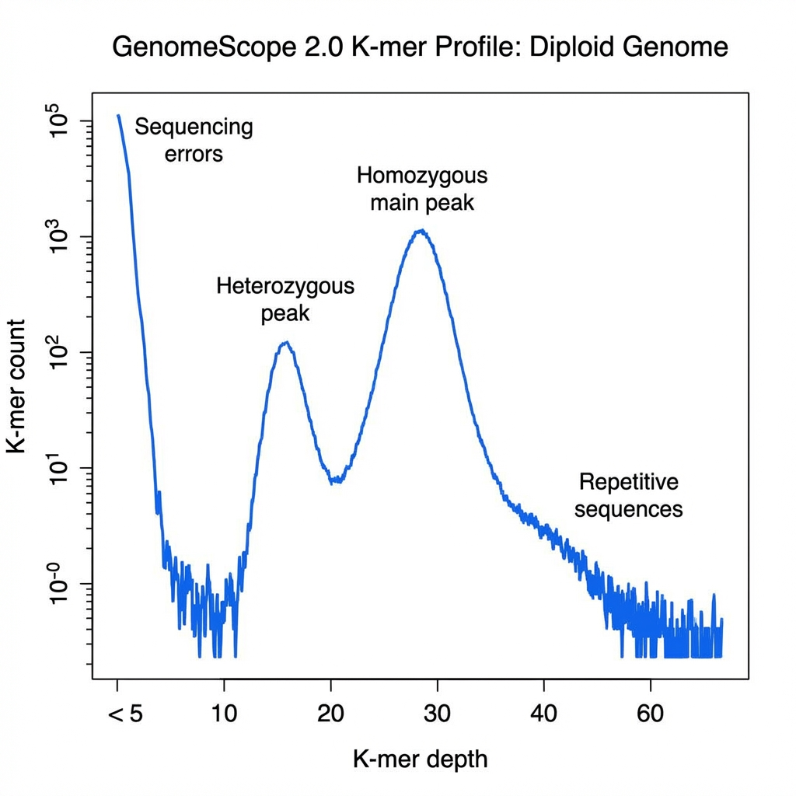
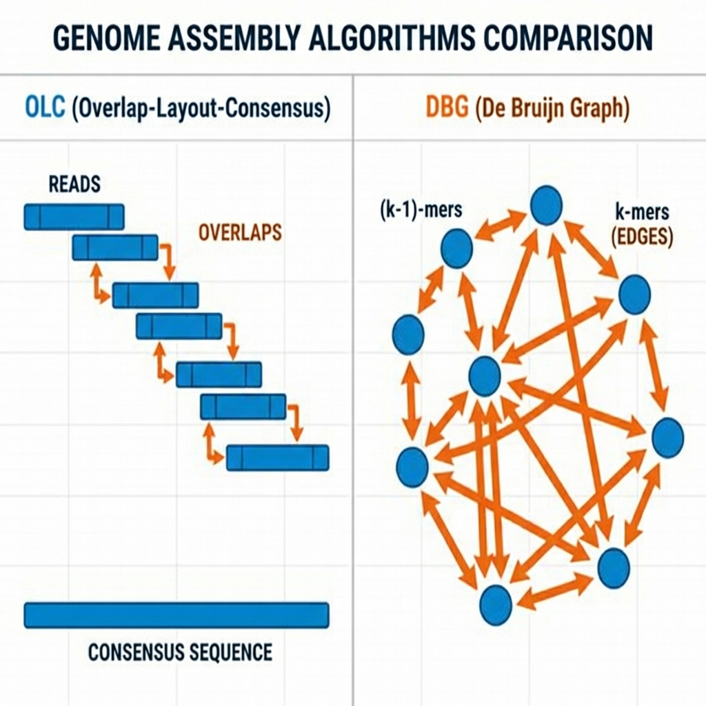
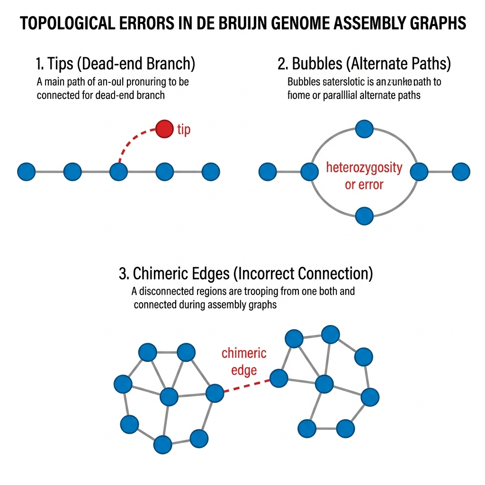
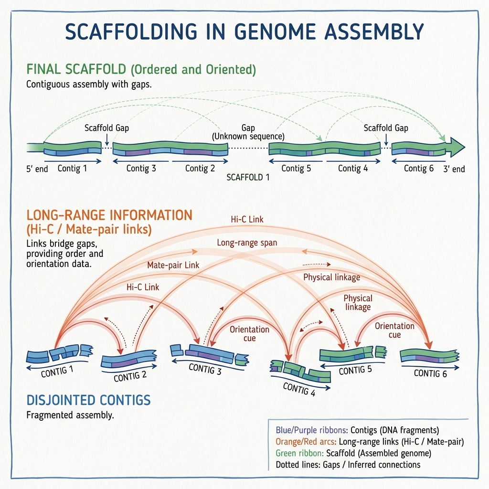
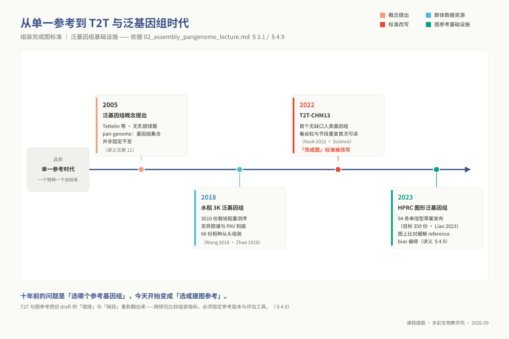

# 专题 02：基因组组装与比较 / 泛基因组

**课程层次**：硕士研究生（`m02`） ｜ **学时**：4 学时（2 h 理论 + 2 h 实践）
**环境**：`ngs_ms_base` + `ngs_ms_genome`
**本讲由原专题 02（基因组组装）与原专题 07（泛基因组与基因家族）合并而成。**

> **适用对象**：硕士研究生，4 学时（2 h 理论 + 2 h 实践）。
>
> **阅读重点**：先用 k-mer 和组装质量指标判断结果，再把多个基因组连接到直系同源、泛基因组与家族演化问题。

> **两条工程约束，先说在前面**：① **只做 ≤ 50 Mb 规模**（细菌 / 真菌 / 卵菌）——真核大基因组组装在 4 学时的课堂算力下不可行，也不是本层次的能力定位；② **组装与 OrthoFinder 两步提供预跑 checkpoint**，课堂上跑的是降采样数据，凡标注 `[checkpoint]` 的步骤跑不完就直接用 `checkpoints/` 下的现成输出——**本讲的重心是读懂结果，不是等进度条**。

---

## ① 学习目标

完成本讲后，你能够：

1. **运行** Jellyfish + GenomeScope2 估出基因组大小、杂合度与重复含量，并说明该估计值与最终组装长度不一致时的三种成因。
2. **运行** Flye 完成 ≤ 50 Mb 基因组的从头组装，并说明读长类型参数（`--pacbio-hifi` / `--nano-raw`）选错时结果长什么样。
3. **解释** QUAST 的 N50 / L50 / misassembly 与 BUSCO 的 C / S / D / F / M 各自度量哪一件事，并判断"连续性好但完整性差"这类组合意味着什么。
4. **能够判断** 一组 orthogroup 中哪些是单拷贝直系同源、哪些是物种特异基因，并在 OrthoFinder 输出目录中把对应文件逐个指出来。
5. **能够设计** 一次泛基因组划分（core / shell / cloud / unique）与稀释曲线分析，并说明基因组数量与选样方式如何改变结论。
6. **能够解释** CAFE5 家族级 p 值在检验什么、**不能**推出什么，并对"显著扩张家族"名单给出可信度边界。

## ② 前置检查

跟不上时回查对应 L0 模块，不要硬啃本讲。

| L0 模块 id | 本讲哪里用到 | 不过关的后果 | 自测题号 |
|---|---|---|---|
| `l0_01_linux` | ⑤ 全部：绝对路径、`qsub`/`qstat`、看作业日志；组装与 OrthoFinder 必须投作业 | 在登录节点跑 Flye 被杀掉，且不知道去哪看错误 | L0-1-Q6（SGE 脚本头）、L0-1-Q9（上机：提交集群作业） |
| `l0_03_conda` | ⑤ 两个环境的切换；⑨ 的 `command not found` 系列 | 分不清"工具没装"与"环境没激活"，把时间耗在装软件上 | L0-3-Q7、L0-3-Q8、L0-3-P2（上机：SGE 作业里正确激活环境） |
| `l0_05_qc` | ⑤ 组装前的数据判据：长读长该看什么、要不要修剪 | 拿 FastQC 的红灯去判断长读长数据，或修剪掉长读长的跨重复能力 | L0-5-Q7（长读长该看/不该看哪些指标）、L0-5-Q10（上机：算 read N50 与深度） |
| `l0_06_stats` | ⑦ 统计插件全部：p 值语义、多重检验 | 把 CAFE5 的家族级 p 值当成"这个家族重要"的证据 | L0-6-Q4（p 值语义）、L0-6-Q5（多重检验）、L0-6-Q10（上机：2 万次检验的校正效果） |

**同层前置**：`m01`（测序平台与实验设计——本讲的读长类型选择建立在那一讲的平台对照表上）。
**下游依赖**：`m03` 的变异检测直接建立在本讲产出的参考基因组上；博士 `p03`（宿主-病原互作组学）经 `l1_p03` 指向本讲的 **§4.5 比较基因组与直系同源**。

## ③ 背景与科学问题

你手上有同一种病原菌的 10 株分离物，它们在致病力、寄主范围和抗药性上明显不同。**差异从哪来？** 要回答这个问题必须依次跨过三道坎：

1. **得有基因组**。非模式物种没有现成参考，必须自己从头组装；而测序仪给你的不是完整染色体，是几十万条带错误的片段。
2. **得有可比的基因集合**。10 个基因组各有各的编号，`gene_00123` 在 A 株和 B 株里毫无关系。必须先算出"哪些基因彼此对应"——这就是**直系同源推断**。
3. **才能问差异**。哪些基因所有菌株都有（核心，多管基本生存）？哪些只有强致病株有（可变 / 特有，是表型差异的候选解释）？哪些家族在某一支上明显变多（扩张，可提机制假说）？

这三步是**一条链**而不是两件事——泛基因组分析的输入本来就是多个组装基因组。本讲把这条链完整走一遍，规模限定在 ≤ 50 Mb。

**本讲不回答的问题**：某个候选基因是否**真的导致**了表型差异。基因组学只能给候选名单与优先级，因果需要敲除 / 回补实验。这个边界在 §⑦ 会反复出现。

### 3.1 应用案例：水稻 3K 泛基因组——把"参考基因组之外"的变异变成育种资源

**研究问题**：2018 年以前，水稻研究的参考坐标系只有日本晴一个基因组。品种之间大量存在"参考里没有"的序列，基因有无可变性（presence/absence variation，PAV）远超预期；而基于单一参考的重测序对这类变异是盲的——GWAS 里找不到的"缺失遗传力"，有相当一部分藏在这里。

**测序与分析路线**：3K Rice Genome Project 对来自 89 个国家和地区的 3010 份栽培稻做全基因组重测序（Wang 等，2018，*Nature*），构建亚洲栽培稻的变异图谱：数百万 SNP/小 InDel 之外，系统刻画了品种间大规模的片段获得与丢失，并把整套变异做成公共数据库供检索。同期 Zhao 等（2018，*Nature Genetics*，即 ⑪ 文献 12）对 66 份极端分化稻种从头组装，直接数出"参考基因组之外还有多少基因"——Nipponbare 只是水稻基因库的一个子集。

**关键结果与育种衔接**：驯化瓶颈对候选变异池的收窄被定量刻画；籼粳亚种分化的基因组坐标有了系统版本；这批 SNP/PAV 资源此后被广泛用于关联分析与候选基因筛选——泛基因组从 2005 年的概念（⑪ 文献 11）变成了育种可用的基础设施。

**教学启示**：① 4.6 的 core/shell/unique 划分、Heaps' law 的开放/封闭判定，与 3010 份水稻用的是同一套方法，只差规模；② 本讲的西非 Xoo 群体（`PRJEB100987`）就是病原菌版的同一问题：菌株之间"参考之外"的变异，正是毒力差异的第一批候选解释。

## ④ 核心原理

### 4.1 组装为什么难：重复序列与读长的信息论关系

设读长 $L$，基因组中有一段长度 $R$ 的重复序列（rRNA 操纵子、转座子、串联重复）。$L < R$ 时**读长跨不过重复**，重复两侧的序列在图上无法区分归属，组装图打结、contig 只能断开——这不是算法不够好，而是**数据里根本没有区分所需的信息**；$L > R$ 时有 read 从重复一侧读到另一侧，归属唯一确定，图可以解开。

这就是长读长改变基因组组装的根本原因。细菌里最难的通常是 5 kb 左右的 rRNA 操纵子——read N50 上万就基本能跨过去，所以细菌"完成图"在 HiFi 时代成了常规操作。**覆盖度需求**（经验值，越复杂越要往上加）：HiFi 20–30×、ONT 40–60×、Illumina 100× 也未必够；注意"够"指的是**能不能解开重复**，不是"够不够纠错"。

### 4.2 K-mer 频谱：花钱之前先侦察

把 reads 切成长度 k 的所有子串并计数，横轴取深度、纵轴取"该深度上的 k-mer 种类数"，得到频谱。



*图 1：典型二倍体基因组的 k-mer 频谱：测序错误峰、杂合峰、纯合主峰与重复序列尾。*

**主峰位置 λ** = 测序覆盖深度，**峰的个数**告诉你倍性 / 杂合状况；**λ/2 处的小峰** = 杂合区（杂合位点的 k-mer 只有一半深度），峰越高杂合度越高——细菌应当**没有**这个峰，出现了先怀疑混合菌；**2λ、3λ 处的隆起** = 重复序列；**深度 < 3 的陡降区** = 测序错误产生的低频 k-mer，估算时要扣掉。

朴素估计 $G = (K_{total} - K_{error}) / \lambda$；GenomeScope2 做的是对这条曲线的**模型拟合**，输出基因组大小、杂合度、重复率及其置信区间。**k 值选择**：k 小则唯一性差（短重复把不同位置混为一谈），k 大则更易被测序错误打断；细菌常用 21，**取奇数**是为避免 k-mer 与自身反向互补相同。

**这一步的真正价值**：若侦察结果说数据只有 10× 或重复含量 45%，那么用什么组装软件都拼不好——**这个判断必须在花掉几十核时之前做出来**。

#### 4.3 三类组装算法的图论本质：为什么长读长使算法回归 OLC

从散乱的短测序读段还原出完整的基因组，在离散数学上本质是一个图论路径遍历问题。几十年来组装算法的演进，实际上是测序读长物理特征与算法计算复杂度之间的一场持久博弈。



*图 2：OLC（节点=read，边=重叠）与 DBG（节点=(k-1)-mer，边=k-mer）的建图逻辑。*

**Overlap-Layout-Consensus（OLC）与哈密顿路径的计算代价**：
OLC 将每一条测序读段（read）作为图的一个顶点（vertex）。若两条 read 存在重叠且错配率在容忍阈值内，就在两点之间连一条带方向和权重的边（edge）。在这个重叠图中，拼出原始染色体序列等价于寻找一条**经过且仅经过每个顶点恰好一次的通路**——即哈密顿路径（Hamiltonian Path）。

哈密顿路径问题属于 NP-complete 问题；节点增加时，穷举搜索的计算代价会快速上升。短读长时代，一个常规真核基因组可产生数亿条 read（$10^8$ 规模），全对全计算因此难以扩展。于是，短读长组装更多采用 DBG 等以 `k`-mer 为单位的图模型。

**de Bruijn Graph（DBG）与重复序列的限制**：
DBG 把每条 read 切成长度为 $k$ 的滑动子串（$k$-mer）。图的顶点是唯一的 $(k-1)$-mer；每条有向边代表一个在数据中观测到的 $k$-mer，由其前缀指向后缀。

在该模型中，组装转化为寻找一条**经过图中每条边恰好一次的有向通路**，即欧拉路径（Eulerian Path）。节点规模主要受唯一的 $(k-1)$-mer 集合和基因组复杂度控制，而不是 read 总数；这解释了 SPAdes、MEGAHIT 能处理大量短读长的原因。代价是长程连接信息被切分：当重复序列长于 $k$（例如约 5 kb 的 rRNA 操纵子）时，不同位置的拷贝会在图中合并，路径无法确定正确的进出配对，组装可能因此断裂为较短 contig。

**长读长回归与 Flye 重复图（Repeat Graph）的破局**：
三代测序（PacBio 与 Nanopore）的读长跃升到了 10–100 kb 以上，足以无歧义地跨越绝大部分复杂的结构重复区。更重要的是，长读长数据的分子总数仅有数十万至数百万条，顶点规模比二代测序低了三到四个数量级。哈密顿路径的算力诅咒被读段总数的骤降所打破，组装算法理所当然地重新回归到能够保留完整长程物理连接的 OLC 体系（如 Canu、hifiasm）。
而本讲采用的核心工具 Flye，则开创了一种兼具鲁棒性与超高效率的**重复图（Repeat Graph）**思想。Canu 这类传统 OLC 算法在开始拼装前，必须花费极其昂贵的算力进行“全对全比对纠错”，将所有高错误率的原始 reads 互相纠错洗净，导致运算极其漫长。Flye 则采取了一种先抓主干的宏观工程思维：它首先放过局部测序错误，利用频繁出现的低频错配容忍机制，快速把明显来自同一基因组区段的 reads 聚拢压缩为初始的无歧义多聚体重叠片段（disjointigs）；随后，Flye 将这些片段组织成一张显式建模重复序列的高阶重复图——图中的节点直接代表基因组中的重复单元，并准确标定出重复拷贝数与连接拓扑。

最终，Flye 仅在重复图的拓扑分叉关键点上，回溯调取跨越该分歧的长读长单分子证据进行解环。这种“先建宏观骨架、只在难点处精修”的架构，使得 Flye 在保持高连续性的同时，运行速度相比传统 Canu 提高了整整一个数量级，非常适合在课堂与常规服务器上快速交付高质量的环状基因组完成图。

### 4.4 组装质量评估的三维坐标：连续性、正确性与完整性

评价一套基因组组装的优劣，生信新手最常犯的错误是死盯 N50 这一个数字。实际上，连续性、正确性和完整性是三个完全正交的质量维度，任何单一维度的拔高都可能掩盖其他维度的致命缺陷。

1. **连续性（Continuity）**：回答“拼出的片段有多长”。常用指标为 QUAST 报告的 contig 数量、最大 contig 长度以及 N50（将所有 contig 按长度由长到短累加，累计长度达到组装总长 50% 时对应的那条 contig 的长度；此时所用 contig 序号即为 L50）。对于原核生物，理想的连续性终点是单个无 gap 的环状染色体（$N50 \approx$ 染色体全长，$L50 = 1$）。但必须牢记：N50 只反映统计长度，完全不衡量序列是否拼接正确。如果组装算法将两条完全无关的染色体臂通过非特异重复区强行误拼在一起（misassembly），N50 在数学上会不降反升，呈现出虚假的高质量繁荣。
2. **正确性（Correctness / Accuracy）**：回答“拼接的碱基顺序和结构对不对”。在有近缘高质量参考基因组时，可以通过 QUAST 的 `-r` 参数检测嵌合断点、倒位（inversion）与局部异位（translocation）。然而，在探索全新的野生分离物或未知物种时，真实基因组是未知的，此时必须借助无参考评估手段：例如使用 Merqury 统计未剪切的二代高精度 k-mer 频谱，评估单碱基共识质量值（QV，QV40 代表单碱基错误率低于 $10^{-4}$）；或者将长测序读段回贴到组装序列上，若组装结构正确，覆盖深度应当如平原般均匀平缓，任何覆盖度骤降为零的断崖或陡增数倍的峰丛，都无情指证着错误连接（chimeric join）或重复区塌缩。
3. **完整性（Completeness）**：回答“基因组里该有的功能基因是否拼齐全了”。最经典的标尺是 BUSCO。它基于系统发育演化理论，在特定演化类群（如整个细菌界 `bacteria_odb10`，或更细分的目级库）中挑选出在绝大多数物种中几乎严格以单拷贝保守存在的进化标记基因集。通过 HMMER 隐马尔可夫模型在组装序列中搜索这些保守基因，统计完整单拷贝（S）、完整多拷贝（D）、碎片化（F）与缺失（M）的比例。如果组装序列连最核心的生存底线基因都存在大量缺失或碎片化，哪怕 N50 拼得再长，也是一套毫无科研利用价值的残缺骨架。

### 4.5 比较基因组与直系同源

> **本节是 L1 锚点**：博士 `p03`（宿主-病原互作组学）经 `l1_p03` 直接送到这里补课，因此本节独立成篇，不依赖前面小节也能读懂。

#### 4.5.1 四个同源概念的演化机制判别与 RBH 的贪心陷阱

在比较基因组学中，“同源”是一个常被滥用却含义严格的系统发育概念。两个基因之所以具有序列相似性，其背后存在截然不同的演化动力学轨迹，对下游生物学功能推断的可靠性有着决定性影响：

- **同源基因（Homolog）**：这是一个总称，唯一确定的生物学事实是它们起源于演化历史上某个远古祖先序列。单纯的同源关系只能证明它们具有血缘关联，完全不足以用来断定它们行使相同的生化功能。
- **直系同源基因（Ortholog）**：由**物种分化事件（Speciation）**直接产生的对应基因。当一个祖先物种分化为两个独立物种时，原本在祖先体内的基因分别遗传给子代。在漫长的演化岁月中，由于物种分化后该基因往往承担着相同的生理生化支柱功能，通常承受着强烈的纯化选择压力（Purifying selection），序列漂移较慢。因此，直系同源基因之间进行功能外推（例如将模式大肠杆菌中的酶功能注释外推到水稻白叶枯病菌）的可靠性是最高的。
- **旁系同源基因（Paralog）**：由**基因复制事件（Duplication）**产生的拷贝。由于染色体不等交换、转座子携带或全基因组加倍，同一个基因组内部复制出了双份甚至多份拷贝。此时，其中一个拷贝继续维持原初功能，另一个拷贝由于摆脱了纯化选择的生存枷锁，基因序列开始积累中性突变与适应性突变，极易发生亚功能化（Subfunctionalization，两个拷贝各自承担原祖先功能的一部分）甚至新功能化（Neofunctionalization，突变出全新活性的功能）。盲目将旁系同源拷贝的功能视为一致，是功能注释翻车的重灾区。
- **异源同源基因（Xenolog）**：通过**水平基因转移（Horizontal Gene Transfer, HGT）**从远缘甚至不同门的物种中直接捕获的基因。这类基因在细菌和真菌病原体中极为活跃，它们常常打破正常的生命进化树拓扑，镶嵌在基因组的毒力岛（Pathogenicity island）或耐药质粒中，是介导宿主致病性和抗生素抗性的关键先锋。

长久以来，生信领域流行着一种看似简便的同源推断策略——**BLAST 双向最佳命中（Reciprocal Best Hit, RBH）**。其算法逻辑是：拿物种 A 的基因 1 搜物种 B，找到最相似的基因甲；再拿基因甲搜物种 A，如果搜出来的最相似基因也是 1，就判定 1 和甲是直系同源。
RBH 的致命缺陷在于其背后预设了一个武断的前提：物种间的直系同源关系永远严格是一对一的单射。然而，真实的生物演化历史远比这种机械假设丰富得多：
第一，如果祖先基因在物种 A 分化后发生了一次基因复制，那么物种 B 中的那个单拷贝基因与物种 A 中的两个新拷贝之间，在演化树上共同构成 **“一对二” 的协同直系同源（co-orthologs）**。RBH 由于只能保留一个所谓的“最佳命中”，会依据随机打分波动武断地丢弃另一个，人为抹杀了真实的演化结构。
第二，更为隐蔽的系统性偏差在于：如果在物种 A 中原本与物种 B 的基因甲成对存在的真正直系同源基因，由于组装断裂、测序缺失或者在物种 A 演化谱系中发生了真实丢失，那么在物种 A 基因库中得分最高的，必然是某个在远古时期由基因复制产生的旁系同源拷贝。此时，RBH 会极其自信地将这个远亲旁系同源挑选出来戴上“最佳命中”的帽子。**RBH 的错误不是偶发的统计噪声，而是其算法贪心本质导致的结构性缺陷。**

#### 4.5.2 Orthogroup：从系统发育树调和视角重塑同源分组

为了终结 RBH 的缺陷，现代比较基因组学全面转向了由 OrthoFinder 所建立的 **Orthogroup（直系同源群）** 框架。

直系同源群的严格定义是：**所研究的一批物种中，起源于它们最近共同祖先（MRCA）体内同一个单一祖先基因的全部后代基因集合。**
理解这一定义必须抓住三个核心要义：

1. **Orthogroup 在概念上天然包含了直系同源与旁系同源**。它完整包裹了某一个祖先基因在数百万年物种分化与基因复制历史中所繁衍的所有子孙分子，因此它是“一对多”和“多对多”复杂同源网络的集合载体，彻底打破了一对一的局限。
2. **Orthogroup 的拓扑边界直接取决于物种集合的树状范围**。如果分析体系仅包含十字花科内部物种，其 MRCA 较为年轻，分组较为精细；一旦向体系中加入水稻作为远缘外类群，MRCA 的时间节点将被推向远古单双子叶分化的时期，许多原本独立的 Orthogroup 将合并为一个更为庞大的远古家族。因此，跨越不同论文直接比对 OG 编号是毫无意义的，每次比较分析都必须在明确定义的物种集合内统一重新聚类。
3. **基因树—物种树调和（Gene Tree - Species Tree Reconciliation）是区分分化与复制的试金石**。OrthoFinder 之所以超越传统的 MCL 序列相似性聚类，在于它为每一个 Orthogroup 构建最大似然基因发育树，并将基因树与推导出的物种进化树进行拓扑比对调和。当基因树的分支拓扑与物种树完全一致时，该节点被判定为物种形成事件（直系同源）；当基因树上的分支在同一物种分支内部发生分叉，或者在同一物种内呈现多个并行子树时，该节点被确定为一次基因复制事件（旁系同源）。正是这种基于进化事件历史的解析，让直系同源判定真正建立在严密的系统发育学理论之上。

#### 4.5.3 OrthoFinder 输出矩阵的拓扑导引与数据分流

OrthoFinder 运行结束后会生成庞大的目录群，理解关键产物的数据流向是进行泛基因组划分与后续系统演化建模的前提：

在输出的 `Orthogroups/` 目录下，`Orthogroups.GeneCount.tsv` 是最重要的核心矩阵。该表以每个 Orthogroup 为一行，各物种为一列，单元格记录该物种在该家族中的基因拷贝数。这个计数矩阵是下游 CAFE5 基因家族演化建模和泛基因组核心/可变基因划分的直接输入。
目录中的 `Orthogroups_SingleCopyOrthologues.txt` 记录了在每一个测试物种中均存在且**仅有单一拷贝**的珍贵直系同源家族列表。这类基因在所有谱系中均未经历基因复制或丢失，演化历史最接近纯粹的中性或纯化物种分化过程。生信分析的标准做法是将 `Single_Copy_Orthologue_Sequences/` 下的所有单拷贝基因分别进行多重序列比对（如 MAFFT），修剪后首尾相接拼接成超大级联矩阵（Supermatrix），随后使用 IQ-TREE 依据最大似然法或同质性模型构建高精度的物种树。

这棵物种树不仅构成了整个课题系统发育关系的骨架，更是后续所有分子钟定年与性状关联分析的唯一基准。

#### 4.5.4 比较基因组在宿主-病原互作中的科研推演逻辑

在植物病理、昆虫与微生物互作研究中，比较基因组学绝不是为了画一张彩色的同源韦恩图交差，而是为了直接锁定介导致病力分化的关键分子武器：

**单拷贝树提供系统发育中性骨架**：利用单拷贝直系同源超矩阵构建的物种树，排除了基因复制和不对称演化的干扰，能够真实还原病原菌株的分化年代与亲缘拓扑，成为衡量性状表型是否伴随演化分枝共分离的标尺。
**物种或菌株特异性基因的毒力挖掘**：在强致病力与弱致病力菌株的对比中，那些仅在致病株中特异存在、在非致病或弱致病亲属中完全缺失的基因，往往是演化战场上用于攻破寄主防线的效应蛋白（Effectors）或次级代谢毒素合成基因。为了从海量假特异基因中筛选出高可信度的候选分子，必须建立多重正交证据链：首先，候选基因通常编码 N 端带有分泌信号肽的蛋白（如通过 SignalP 预测），使其具备分泌至胞外或寄主细胞内的物理通路；其次，在染色体空间分布上，这些基因往往聚集在 GC 含量异常偏离全基因组背景的“毒力岛”或近端粒亚端粒脆弱区，提示其通过噬菌体整合或水平转移快速获得的演化起源；最后，结合宿主侵染时序转录组（Dual RNA-seq），确认这些基因在侵染早期或寄主防御反应被触发的关键时间窗口内呈现特异性的暴发性转录上调。

### 4.6 泛基因组结构与稀释曲线的生态演化动力学

随着群体组装数据量的膨胀，用单一“参考基因组”代表整个物种的传统范式彻底破灭。一个物种的全部遗传库被称为泛基因组（Pan-genome），它在结构上可以清晰解构为五个功能层次：

- **核心基因组（Core genome）**：存在于 100%（或设定 99% 容忍极个别注释缺失）基因组中的基因。它们构成了物种生存繁衍的绝对代谢底盘，涵盖 DNA 复制、转录翻译、细胞壁合成与中心三羧酸循环，极少发生结构缺失。
- **软核心基因组（Soft-core genome）**：存在于 95%–99% 基因组中。在实际生信分析中，许多真实的核心基因往往因为个别组装草图的 gap 或预测工具的起始密码子错位而掉出 100% 阈值，设立软核心可以大幅增强统计分析的抗噪声能力。
- **可变基因组（Shell genome）**：存在于 15%–95% 基因组中。这是物种适应多变生态位、响应特定环境压力（如抗生素压力、寄主免疫排斥、极端温湿度）的功能基因库，具有高度的可塑性。
- **云基因组（Cloud genome）**：存在于低于 15% 的极少数个体中，富集了大量的噬菌体外源插入、转座子残余以及近期自发突变形成的假基因。
- **独有基因（Unique / Strain-specific genome）**：仅在一个分离株中被观测到的孤儿基因，往往是挖掘菌株特异性致病特性的第一候选池。

**Heaps' law 与泛基因组开放性的生态动力学诠释**：
在数学上，评估一个物种泛基因组规模的常用手段是通过随机多次重抽样绘制稀释曲线（Rarefaction curve），并利用 Heaps' 定律进行非线性最小二乘拟合：
$$P(N) \approx \kappa N^{\gamma}$$
其中 $N$ 为抽样的基因组数量，$P(N)$ 为累积发现的泛基因组基因总数，$\gamma$ 为幂律指数。

- 当 $\gamma > 0$（通常在经验上 $\alpha = 1 - \gamma < 1$）时，随着抽样基因组数量的持续增加，累积曲线永远向上延伸且斜率永不归零，被称为**开放型泛基因组（Open pan-genome）**。这种物种在生态学上通常是典型的“泛化种”（Generalist），自由生活在复杂多变的外界土壤、水体或动植物多重宿主交替环境中（如大肠杆菌、西非水稻白叶枯病菌、假单胞菌属）。它们具有极其活跃的水平基因转移机制，整个种群在开放的自然界中共享一个几乎无限大的全局基因池，每新测一个独特的野生分离物，几乎总能发现前所未见的崭新功能基因。
- 相反，如果曲线随着测序个体的增加迅速趋近水平渐近线，$\gamma \to 0$，则被称为**封闭型泛基因组（Closed pan-genome）**。这类物种在生态演化上往往属于高度专一的“特化种”（Specialist），长期定居在极其狭窄稳定的专性寄生环境中（如结核分枝杆菌、炭疽杆菌）。在漫长的演化史中，它们为了适应宿主细胞内部的特化营养环境，基因组经历了剧烈的精简与退化（Genome reduction），并建立了严密的限制修饰系统阻止外源核酸侵入。对于封闭型物种，往往仅需测序数十株即可彻底饱和并穷尽其种群内所有的基因变异。

### 4.7 基因家族动态演化：CAFE5 出生-死亡马尔可夫链模型

表型的剧烈分化往往不仅源于单个核苷酸的突变，更常常伴随着整条代谢通路或受体基因家族的大规模拷贝数扩张或收缩。CAFE5（Computational Analysis of gene Family Evolution）是评估基因家族在演化谱系中发生非随机扩张与收缩的标准工具。

CAFE5 的底层统计物理基础是连续时间的**生灭过程马尔可夫链（Birth-Death Markov Chain）**。设某个基因家族在时刻 $t$ 拥有 $n$ 个拷贝的概率为 $P(n, t)$，模型假定在微小时间增量 $dt$ 内：
每个已有基因拷贝独立发生复制加倍的概率为 $\lambda dt$（出生率），每个已有拷贝独立发生假基因化或缺失丢失的概率为 $\mu dt$（死亡率）。由此，系统状态转移由差分微分方程严格支配：
$$\frac{dP(n, t)}{dt} = \lambda (n-1)P(n-1, t) + \mu (n+1)P(n+1, t) - (\lambda + \mu) n P(n, t)$$
在全局零假设下，模型假定整棵物种树的所有分枝共享恒定的基因复制与丢失速率（通常设定 $\lambda = \mu$）。通过对观测到的现存所有物种中该家族的拷贝数进行最大似然估计，计算出全树的联合概率。随后，模型对每一个独立的进化分枝进行蒙特卡洛似然比检验，当某一分枝上观测到的拷贝数剧烈膨胀（如从祖先的 2 个拷贝暴增到后代的 15 个拷贝）在全局出生率下出现的概率低于显著性阈值（$p < 0.05$）时，CAFE5 便宣告在该分枝上发生了一次具有统计学显著性的**适应性基因家族扩张**。

**超度量时间树（Ultrametric Tree）的绝对必要性**：
必须向初学者反复强调的是，CAFE5 算法中转移矩阵的唯一核心自变量是时间乘积 $\lambda \times t$。普通分子进化树（如 RAxML 或 IQ-TREE 输出的原始树）的分枝长度代表的是**每个位点的核苷酸替换数（Substitutions per site）**。

在自然界中，不同物种的分子钟走速差异巨大（例如短世代周期的草本植物或寄生菌突变速率远超木本宿主）。如果直接将替换数树喂给 CAFE5，那些演化走速极快的“长枝”物种，其分枝长度在数学上会被模型错误地解读为“经历了漫长的时间沉淀”，从而导致其基因家族的变化被系统性地判定为中性漂变；而短枝物种的轻微变化却会被误判为剧烈的暴发扩张。

因此，必须先通过外部化石证据或已知分化时间校准点，利用 `r8s`、`treePL` 或 MCMCTree 等工具将物种树转化为所有叶节点到根节点物理距离完全平齐的超度量时间树（各分枝长度严格代表百万年分化时间），CAFE5 的数学推演才具有立足的现实根基。

### 4.8 扩展与延伸：单倍型分辨与组装图深层质检

在 4 学时的理论与上机时段内，课程主线聚焦在高质量单倍体细菌完成图与比较基因组核心分析。但在真实科学研究中，当你迈向更高难度的研究对象时，以下技术栈是必须提前建立认知的延伸武器：

**复杂二倍体与多倍体的单倍型分辨组装（Phased Assembly）**：高等植物（如水稻、玉米、茶树）和昆虫中，同源染色体之间往往存在高达 1%–3% 的杂合度。传统组装软件在杂合区会将两条单倍型拼成两条独立的 contigs（导致 BUSCO 的 Duplicate 比例异常飙升），而在纯合区又塌缩成一条，形成杂合塌缩与冗余交织的嵌合体。利用新一代 hifiasm 结合三代长读长与超长 Hi-C 染色体三维构象捕获（或父母本 Trio 信息），组装器能够直接在图论层面上追踪单分子杂合突变的顺式相位关联，最终输出两套分别代表父本与母本单倍型的完全独立组装（Haplotype 1 与 Haplotype 2），彻底攻克等位基因特异性表达与杂种优势研究的序列基座。

**基于图的组装拓扑质检（Bandage 与 GFA 分析）**：当组装输出的指标令人沮丧——例如预测为 4 Mb 的细菌总长拼出了 6 Mb，contig 数量多达上百条且 N50 极短——不要盲目尝试更换不同软件乱跑一通。此时最专业的动作是打开组装过程中生成的 `assembly_graph.gfa` 文件，使用 Bandage 软件进行交互式图可视化。在图上，真实的基因组结构问题会一览无余：断头死胡同（Tips）往往代表测序深度不足引起的覆盖断崖；纺锤状的分叉与汇合（Bubbles）清晰揭示了未被正确压缩的杂合单倍型差异或种内多态性微结构；而若干个环状大环通过一条极细的中心节点相互绞杀缠绕（Chimeric knot），则直接指明了高拷贝转座子或核糖体 RNA 操纵子引发的拓扑死结。学会“读图”，是组装专家与普通命令敲击者最本质的水平分水岭。

| **purge_dups 去冗余** | BUSCO 的 D > 10% 且物种不是多倍体——多半是两套单倍型都被组装出来了 | purge_dups 文档 |
| **polishing**（Racon / Medaka / Pilon） | 用 ONT 而非 HiFi，或下游要做单碱基级别的分析（如 SNP、基因预测） | Medaka（ONT 专用）；HiFi 通常不需要 |
| **组装图异常结构清洗**（tip / bubble / 嵌合边） | 组装结果异常（总长远超预期、contig 数暴涨），需要打开 `assembly_graph.gfa` 查因 | Bandage 可视化；见图 3 |
| **真核大基因组组装** | 对象是植物/昆虫（> 500 Mb） | 课堂算力不可行，需上机时申请；策略见 T2T 论文 |
| **MCL 算法数学推导** | 你要自己调 inflation 参数或改造聚类流程 | OrthoFinder 论文方法部分 |
| **HMMER 自定义家族搜索** | 你关心的是一个**已知**家族（如 NLR、CAZy、效应蛋白），而不是全基因组无偏聚类 | Pfam + hmmsearch |
| **dN/dS 正选择分析** | 要论证某个基因**在适应性上**受选择——CAFE5 的扩张结论给不了这个 | PAML codeml、HyPhy |
| **graph-based pangenome**（minigraph / PGGB） | 需要保留结构变异与非参考序列，做群体层面的变异检测 | 本讲只作概念提及：用图（节点=序列片段，边=连接）代替"基因列表"表示泛基因组 |

 

*图 3、图 4（延伸阅读）：左，组装图中的 tip / bubble / 嵌合边；右，用 Hi-C 或 mate-pair 的长距离信息把 contig 排序定向为 scaffold。*

### 4.9 技术前沿（2023–2026）

**"完成图"的标准被 T2T 抬升**。T2T-CHM13（Nurk 等，2022）给出第一个端粒到端粒、无缺口的人类基因组，着丝粒与节段重复首次可读——"什么算完成"的定义从"还有 gap 的 draft"改写为"每个碱基都有着落"。本讲的细菌完成图（染色体成环 + 质粒齐全）是同一标准在小基因组上的落地。

**图形泛基因组参考从概念变成基础设施**。HPRC 联盟（Liao 等，2023）发布 47 份二倍体 / 94 条单倍型的图形泛基因组参考草案（联盟既定目标 350 份），图上比对显著缓解 reference bias、系统性回收参考外序列——以它为底座的群体分析正在人类遗传学中成为常规。

**工具格局**：组装侧 hifiasm（⑪ 文献 4）把单倍型分辨与端粒到端粒组装做成常规选项；建图侧 minigraph 与 pggb（⑪ 官方文档）是两条主流路线；下游的图比对 / 图基因分型（vg 等）在人类数据上成熟最快，非模式物种仍以小基因组为入门场景——这正是本讲的规模定位。

**选型含义**：十年前的问题是"选哪个参考基因组"，今天开始变成"选或建图参考"。当你的群体里非参考序列占比可观（病原菌的毒力岛、作物地方种的特异区间），直接建图比"换一个更好的参考"更彻底。

**对评估的连带影响**：T2T 与图参考把旧 draft 的"错接"与"缺段"翻了出来——跨研究比较组装指标必须锁定参考版本与评估工具，本讲 4.4 的"三把尺"在 T2T 时代只会更严格，不会更宽松。



*图 m02-5：从单一参考到泛基因组：2005 概念 → 水稻 3K → 2022 T2T → 2023 HPRC。*

## ⑤ 操作步骤

**案例数据（已确定 2026-08-30）**：西非水稻白叶枯病菌 *Xanthomonas oryzae* pv. *oryzae*，项目 `PRJEB100987`（54 株，每株 Illumina + ONT）。① 组装侧——菌株 CIX2779：ONT `ERR15732374`（425 MB）作 Flye 输入，Illumina `ERR15732332` 作抛光与 QC；基因组仅 ~4.8 Mb，4 核 20 分钟内可组完。② 比较/泛基因组侧——已发表完整基因组 `GCA_004322815`（CIX2374）、`GCA_004322835`（CIX298）、`GCA_029204245`（CIX4509），统一用 Prokka 重注释后再进 Roary / OrthoFinder（注释流程必须统一，否则会造出大批假的"物种特异基因"，见 ⑨-2）。**③ 标准答案**——CIX2779 有已发表完整基因组 `GCA_024981335`，**组装完直接比对就知道自己组得对不对**，这是自学场景下最重要的一点。下载：`bash 06_data/master/download_master.sh --topic m02`（约 0.6 GB）。详见 `06_data/master/README.md`。

完整脚本见 `03_code/master/scripts/02_assembly_pipeline.sh` 与 `02_orthofinder_cafe.sh`（含 SGE 作业头）。以下为关键命令与参数含义。

### 5.1 环境与集群规矩

```bash
source /opt/miniconda3/bin/activate
conda activate ngs_ms_genome          # 组装/评估/比较基因组全部工具在此环境；R 绘图用 ngs_ms_base
command -v flye orthofinder >/dev/null || { echo "[FATAL] 环境没激活成功"; exit 1; }
```

**组装与 OrthoFinder 必须 `qsub` 提交，不要在登录节点跑**（原因见 `l0_01_linux`）。

### 5.2 步骤一：K-mer 特征估计（15 min）

```bash
# -C 正反链合并计数（DNA 双链，不合并等于把每个 k-mer 数成两半）
# -m 21  k 值   -s 2G 哈希槽数（非字节）   -t 16 线程   -o 二进制计数文件
jellyfish count -C -m 21 -s 2G -t 16 -o reads.jf <(zcat reads.fq.gz)
jellyfish histo -t 16 reads.jf > reads.histo          # 两列：深度 / 该深度的 k-mer 种类数
genomescope2 -i reads.histo -o genomescope_out -k 21 -p 1   # -p 1 单倍体；二倍体用 -p 2
```

### 5.3 步骤二：长读长组装 `[checkpoint]`（25 min）

```bash
flye --pacbio-hifi reads.fq.gz --out-dir asm_flye --threads 16
#    ^ 读长类型必须与数据匹配：HiFi 用 --pacbio-hifi；ONT 普通数据用 --nano-raw；
#      ONT 新化学 + Dorado 高精度用 --nano-hq。选错的后果见 ⑨-4。
#    --genome-size 在 Flye 2.8 以后是可选项，不写它会自行估计。

# 对照演示（不在课堂跑，仅看日志理解 OLC 的代价）：
# canu -p asm -d asm_canu genomeSize=5m -pacbio-hifi reads.fq.gz
```

关键输出：`asm_flye/assembly.fasta`、`assembly_info.txt`（每条 contig 的长度/覆盖度/**是否成环**）、`assembly_graph.gfa`。

### 5.4 步骤三：组装评估（15 min）

```bash
# QUAST：给 -r/-g 才有 misassembly 与基因覆盖统计；不给就只有连续性指标
quast.py asm_flye/assembly.fasta -r reference.fasta -g reference.gff -o quast_out -t 8

# BUSCO：-l 选谱系库。--offline + --download_path 用预下载的库（计算节点无外网，见 ⑨-1）
busco -i asm_flye/assembly.fasta -l bacteria_odb10 -m genome -o busco_out -c 8 \
      --offline --download_path /data/db/busco_downloads
```

### 5.5 步骤四：直系同源聚类 `[checkpoint]`（25 min）

```bash
# 输入：proteomes/ 下每个基因组一个 .faa，文件名（去扩展名）即输出中的物种名
# -t  并行的 BLAST/DIAMOND 线程   -a 分析步骤线程   -M msa 用比对建基因树（比 dendroblast 准但慢）
# -S diamond 用 DIAMOND 代替 BLAST 做全对全搜索，在 10 个细菌基因组规模上快 1–2 个数量级
orthofinder -f proteomes/ -t 16 -a 4 -M msa -S diamond
```

真核物种**必须先只保留每个基因的最长转录本**（`seqkit`/`agat` 均可），否则不同基因组的可变剪接注释深度差异会被算成拷贝数差异。

### 5.6 步骤五：泛基因组统计与可视化（25 min，`ngs_ms_base`）

```r
library(tidyverse); library(UpSetR)
counts <- read_tsv("Orthogroups.GeneCount.tsv")
pres   <- counts |> select(-Orthogroup, -Total) |> mutate(across(everything(), ~ as.integer(.x > 0)))
n_sp   <- ncol(pres); k <- rowSums(pres)
counts$Class <- case_when(k == n_sp ~ "core", k == 1 ~ "unique",
                          k / n_sp >= 0.95 ~ "softcore",
                          k / n_sp >= 0.15 ~ "shell", TRUE ~ "cloud")
table(counts$Class)
upset(as.data.frame(pres), nsets = n_sp, order.by = "freq")   # 共享模式
# 稀释曲线：对每个 N 做 100 次无放回抽样，画 core 数与 pan 总量的中位数与四分位区间
```

### 5.7 步骤六：基因家族扩张收缩（15 min）

```bash
# CAFE5 输入：第 1 列描述、第 2 列家族 ID、其后每物种一列计数（列序须与树叶名对应）
awk 'BEGIN{FS=OFS="\t"} NR==1{$1="Desc"OFS$1; print; next} {$1="(null)"OFS$1; print}' \
    Orthogroups.GeneCount.tsv | cut -f1-$((NSP+2)) > cafe_input.tsv

# 上面只整理格式、不过滤。全 0 家族与单物种 ≥100 拷贝的超大家族（CAFE5 文档建议先剔除，会拖垮 λ，见 ⑨-6）在 02_orthofinder_cafe.sh 里过滤
cafe5 -i cafe_input.tsv -t tree_ultrametric.nwk -p -o cafe_out
#      -t 必须是超度量树（必要不充分：时间校准错了 λ 照样错）  -p 即 --poisson（根节点家族大小用泊松分布），不是输出 p 值的开关
```

## ⑥ 结果解读

### 6.1 GenomeScope 报告

`summary.txt` 看三项：Genome Haploid Length、Heterozygosity、Percent Repeat。**结果不对时长什么样**：

- **Model Fit < 90%**：拟合没收敛，`min`/`max` 区间宽得离谱，**三个数全部无意义**——先查是不是深度太低或数据混了别的物种。
- **细菌数据出现 λ/2 杂合峰**：单倍体不该有杂合峰，多半是**混合菌株或污染**，直接组装会得到一个"缝合怪"。
- **估计值与最终组装长度差 > 20%**（经验警戒线，非文献阈值）的三种成因：① 组装把重复区坍缩了（组装 < 估计）；② 两套单倍型都被组装出来（组装 ≈ 2× 估计，且 BUSCO 的 D 很高）；③ 共生菌 / 质粒污染（组装 > 估计，且 GC 分布双峰）。

### 6.2 QUAST：连续性，以及 N50 的陷阱

`report.html` 看 `# contigs`、`Total length`、`N50`、`L50`、`# misassemblies`。**N50** = contig 从长到短累加达总长 50% 时那条的长度，越大越连续；**L50** = 达到 N50 所需的 contig 数，越小越好。细菌理想值：`# contigs` = 1（加若干质粒），`assembly_info.txt` 的 `circ.` 列为 `Y`。

**结果不对时长什么样**：

- **N50 变大但 misassembly 同步变多** → 不是组装变好，是**错接**变多。N50 对错接是奖励而非惩罚，这是它最大的陷阱。
- **`# contigs` 上千、Total length 远超估计** → 读长类型参数选错或数据污染（§⑨-4）。
- **不给 `-r` 时 misassembly 一栏是空的**，报告只有连续性——别把这种报告当成"正确性检查通过"。

### 6.3 BUSCO：完整性

形如 `C:98.4%[S:97.6%,D:0.8%],F:0.8%,M:0.8%,n:124`（计数 121+1+1+1；百分比必须能由 n 的整数计数换算出来）。**C = S + D** 是解读的入口：C 高但主要来自 D，含义与来自 S 完全不同（§⑦-4）。**F 偏高** → 组装碎片化或基因预测参数与该谱系不匹配；**M 偏高** → 覆盖度不足、丢失区域，或 lineage 选得太窄导致该物种真的没有那些基因。

### 6.4 泛基因组组成与稀释曲线

细菌近缘菌株的经验范围：core 30%–60%、shell 30%–50%、unique 10%–20%。**偏离很多时先怀疑输入而不是生物学**：core 特别少 → 物种跨度太大（泛基因组分析通常限定在种或属内）或某个基因组注释质量明显差；unique 特别多 → 注释流程不统一（§⑨-2）。**稀释曲线怎么读**：pan 曲线持续上升不收敛 = 开放型；core 曲线在最后几个点仍明显下降，说明**基因组数还不够、当前 core 名单还会缩水**——这是能不能下结论的直接判据。

### 6.5 CAFE5 输出

`Base_family_results.txt` 给家族级 p 值与变化方向，`Base_branch_probabilities.tab` 给分支级概率，`Base_asr.tre` 给祖先状态重建。**结果不对时长什么样**：

- **显著家族占比异常高（如 > 20%，课程经验警戒线）** → 输入里多半混进了超大家族或注释不统一，λ 被拉偏，整张表都不可信。
- **λ 极大且几乎全部家族显著** → 检查树是不是真的超度量（§⑨-3）。
- **换一棵标定不同的树，Top 名单大幅改变** → 你的结论其实建立在分歧时间估计上，报告里必须写明。

## ⑦ 统计插件

**焦点：基因家族扩张/收缩的显著性检验（CAFE5）与 BUSCO 完整性的解读边界。**

> `l0_06_stats` 已讲过 p 值语义、FDR 与 BUSCO 百分比的**通用**判据（命中率不是完整度、看同类经验分布）。这里讲的是本专题**专属**的深度。

1. **CAFE5 在检验什么**。零假设是：该家族的拷贝数分布可以由**全局单一速率 λ** 下的出生-死亡过程生成。家族级 p 值小，只说明"这个家族的变化用单一 λ 解释不了"，**不等于**"这个家族在适应性上重要"。要论证适应性需要独立证据（dN/dS、表达、功能实验），CAFE5 给不了。
2. **p 值从哪来**。CAFE5 先用最大似然在全部家族上估出 λ（和可选的 μ），再对每个家族做**蒙特卡洛模拟**：在估出的 λ 与给定树下生成大量随机家族，看观察到的分布落在模拟分布的什么位置。因此 **p 值的可信度完全继承自 λ 的估计质量**——λ 被少数超大家族带偏，所有 p 值一起偏。
3. 多重检验怎么处理。一次分析动辄上千个 orthogroup，按家族级 `p < 0.05` 筛选，仅靠随机就会产生数十到上百个假阳性（`l0_06_stats` Q5 的算术在这里直接适用）。必须对家族级 p 值做 BH 校正后报告 FDR，并在正文中明确写的是 p 还是 q。用 Bonferroni 还是 BH 取决于下游：候选家族要逐个做敲除验证 → Bonferroni；要拿一批候选去做 GO 富集 → BH。
4. **BUSCO 的解读边界（一）：C = S + D 的分解意义**。C 是"找到的完整拷贝数占谱系单拷贝基因集的比例"，S 是其中只出现一次的，D 是出现 ≥ 2 次的。谱系库里的基因**按定义应当是单拷贝**，所以 **D 是异常信号而不是加分项**：`C:99%[S:52%,D:47%]` 和 `C:99%[S:98%,D:1%]` 的 C 一样，但前者的组装大概率是错的。只报 C 而不报 S/D 的表格是无法解读的。
5. **BUSCO 的解读边界（二）：D 偏高的三种成因**。① **单倍型冗余**——二倍体的两套单倍型都被组装出来，组装总长约为估计值的 2 倍，用 purge_dups 处理；② **真实的多倍体或近期全基因组复制**——这是生物学事实，不该"修"，此时应换用支持多倍体的评估策略；③ **组装冗余/污染**——同一区域被拼成多条 contig，或混入了近缘物种序列。**三者的处理完全相反**，所以必须先用 GenomeScope 的倍性与组装总长把它们区分开，再动手。
6. BUSCO 的解读边界（三）：lineage 选择如何改变结果。同一套组装用 `bacteria_odb10`（n≈124）与 `enterobacterales_odb10`（n≈440）跑，分数不同且不可比：库越窄，n 越大、基因越特异，分数通常更低但信息量更大（宽库的高分很可能只是因为它要求的基因太少太保守）。同时注意 **n 是分母**：n=124 时一个基因的得失就是 0.8 个百分点，**C 相差 1 个百分点以内的两套组装不能据此分高下**。报告中必须写明库名与版本。
7. **"BUSCO 高不等于组装对"**。BUSCO 检验的是"该有的基因在不在"，**完全不检测结构正确性**：把两条染色体错接成一条，所有基因仍然都在，BUSCO 分数纹丝不动。正确性必须用独立证据——有参考时看 QUAST 的 misassembly，无参考时用 Merqury 的 QV / k-mer 完整性，或把 reads 回贴看覆盖度断点与异常读对。
8. **稀释曲线的脆弱性**。core 基因数随基因组数单调下降，因此"核心基因组"这个数**没有基因组数量就不可解释**。报告泛基因组结论时必须同时给出：基因组个数、菌株的选样方式（是否覆盖不同宿主/地域，还是同一批近缘分离物）、以及 core 曲线是否已接近平台。
9. **误差的上游来源**：λ 完全依赖超度量树的分歧时间，而分歧时间来自化石标定或分子钟，不确定度很大且会**直接传导到显著家族名单**。作业要求：用两棵不同标定的树各跑一次，报告 Top 20 名单的重叠率。

## ⑨ 常见错误与排查

**1. BUSCO 谱系库下载失败（计算节点无外网）**

```text
ERROR:busco.BuscoDownloadManager:Cannot reach https://busco-data.ezlab.org/v5/data/file_versions.tsv
urllib.error.URLError: <urlopen error [Errno -3] Temporary failure in name resolution>
```

- **原因**：BUSCO 默认在运行时联网拉取 lineage 数据集，而集群计算节点通常不通外网。`Errno -3` 是 DNS 都解析不了，不是 BUSCO 的 bug。
- 解法：登录节点先 `busco --download bacteria_odb10 --download_path /data/db/busco_downloads`，作业里再加 `--offline --download_path /data/db/busco_downloads`。若解压目录名带日期（`bacteria_odb10.2024-01-08`），`-l` 直接给解压后目录的绝对路径最稳。

**2. 各基因组注释流程不统一，产生大批假的"物种特异基因"**

没有报错——这是**静默偏差**，只能靠体检发现：

```text
Statistics_PerSpecies.tsv（构造的说明性数字，非实测基准）：strain_A  strain_B  strain_C
Number of genes                            5124      5098      7642
Number of species-specific orthogroups       31        27      1188
```

- **原因**：`strain_C` 用了另一套注释流程（别人用 Prokka、你的用 RefSeq PGAP；或真核里 C 保留了全部可变剪接转录本而 A/B 只留最长转录本）。基因数差 2500 个，绝大多数是注释口径差异，不是生物学。
- **怎么发现**：跑完 OrthoFinder **第一件事**就是看 `Statistics_PerSpecies.tsv` 的基因数与 species-specific 计数，**某一列明显离群就是警报**。
- **解法**：全部基因组用**同一流程、同一版本、同一参数**重注释（细菌统一 Prokka 或 Bakta，真核统一 BRAKER），真核额外做"每基因只留最长转录本"。重注释很花时间，但这一步省不掉。

**3. CAFE5 拒绝非超度量树**

```text
Error: Tree is not ultrametric
```

（不同版本措辞略有出入，关键词是 `ultrametric`；也可能表现为 `Failed to initialize any models!`）

- **原因**：直接把 OrthoFinder 的 `SpeciesTree_rooted.txt` 喂给了 CAFE5——那棵树的分支长度是**每位点替换数**而非时间，根到各叶的路径长度不等。
- **自查**：`R -e 'library(ape); is.ultrametric(read.tree("tree.nwk"))'` 返回 `FALSE` 即确诊。
- **解法**：用 `r8s` / `treePL` / MCMCtree 定标为时间树；无标定信息时可用 `ape::chronos()` 做相对时间近似，但绝对速率无意义，必须在方法里写明。

**4. Flye 读长类型参数选错**

```text
Total length: 41,238,772        # 预期约 5 Mb
Contigs: 3127                   # 预期个位数
```

- **原因**：HiFi 数据用了 `--nano-raw`（或反之）。Flye 按声明的错误率决定重叠判据：把 HiFi 当高错误率数据会保留大量假重叠，把 ONT 当 HiFi 会因判据过严而无法合并——两个方向都让 contig 数暴涨、总长远超估计。
- **解法**：HiFi → `--pacbio-hifi`；ONT 普通 → `--nano-raw`；ONT 高精度（R10 + Dorado sup）→ `--nano-hq`。改对参数重跑，别指望后处理挽救。

**5. `jellyfish count` 在 SGE 作业里报语法错误**

```text
/opt/sge/spool/node03/job_scripts/482391: line 27: syntax error near unexpected token `('
```

- **原因**：`<(zcat ...)` 是 bash 的进程替换，而 SGE 默认 shell 不是 bash。**解法**：作业头写 `#$ -S /bin/bash`（参见 `l0_01_linux` 第 6 题）。

**6. CAFE5 参数估计失败或 λ 异常大**

```text
Failed to initialize any models! Run with --help for more information.
```

- **原因**：输入表含**在所有物种中都是 0** 的家族（格式转换时容易带进来，让似然无定义），或含单物种拷贝数上百的超大家族（转座酶、ABC 转运蛋白，把 λ 拉到极端值）。
- **解法**：转换后先过滤掉行和为 0 的家族，把单物种计数 > 100 的家族单独做描述性分析而不进模型。同时确认**输入表的物种列顺序与树的叶名完全对应**——列错位不会报错，只会给出一整张错误的结果。

## ⑩ 思考练习

1. **（计算）** 6 条 contig：2.0 / 1.2 / 0.8 / 0.5 / 0.3 / 0.2 Mb。求 N50 与 L50。若把最长两条**错误地**连成一条 3.2 Mb 的 contig，N50 与 L50 各变成多少？这说明用 N50 评价组装有什么风险？
2. **（判读）** `C:99.2%[S:51.4%,D:47.8%],F:0.4%,M:0.4%,n:255`，QUAST 总长 62 Mb，GenomeScope 估计 31 Mb，杂合度 1.8%。给出最可能的解释、两条支持它的额外证据、以及你的处理方案。
3. **（概念）** 你用 10 个菌株跑 OrthoFinder，得到 12 000 个 orthogroup。同事用其中 6 个菌株加 4 个更远缘的物种重跑，说"OG0000123 在两次分析里成员不一样，OrthoFinder 不稳定"。他的说法对吗？为什么？
4. **（判据）** 某扩张家族的 CAFE5 家族级 `p = 0.003`，BH 校正后 `q = 0.21`。你在论文里能写什么、不能写什么？如果审稿人要求"证明这个家族的扩张与致病力增强有关"，你需要补哪些证据？
5. **（设计）** 只有 8 个基因组时 core = 2 100，加到 20 个时 core = 1 750，且曲线仍在下降。你会如何在论文里表述核心基因组的大小？需要补充哪些信息读者才能判断这个数的可信度？
6. **（🔬 迁移到自己课题 · 开放题）** 就你自己（或本实验室）在做的物种，回答：① 从头组装选哪种测序策略、需要多少覆盖度、依据是什么？② BUSCO 该选哪个 lineage 库，为什么不能直接用最宽的那个？③ 若要做比较基因组，你能拿到几个可比基因组？它们的注释是不是同一流程？如果不是，你打算怎么处理？④ 你最想验证的一个"物种特异基因 → 表型"假说是什么？用什么实验证据把它从相关推到因果？

## ⑪ 参考资料

**核心文献**

1. Marçais G, Kingsford C. A fast, lock-free approach for efficient parallel counting of occurrences of k-mers. *Bioinformatics*, 2011, 27(6):764–770. doi:10.1093/bioinformatics/btr011
2. Ranallo-Benavidez TR, Jaron KS, Schatz MC. GenomeScope 2.0 and Smudgeplot for reference-free profiling of polyploid genomes. *Nature Communications*, 2020, 11:1432. doi:10.1038/s41467-020-14998-3
3. Kolmogorov M, Yuan J, Lin Y, Pevzner PA. Assembly of long, error-prone reads using repeat graphs. *Nature Biotechnology*, 2019, 37(5):540–546. doi:10.1038/s41587-019-0072-8
4. Cheng H, Concepcion GT, Feng X, et al. Haplotype-resolved de novo assembly using phased assembly graphs with hifiasm. *Nature Methods*, 2021, 18(2):170–175. doi:10.1038/s41592-020-01056-5（延伸阅读：单倍型分辨组装）
5. Koren S, Walenz BP, Berlin K, et al. Canu: scalable and accurate long-read assembly via adaptive k-mer weighting and repeat separation. *Genome Research*, 2017, 27(5):722–736. doi:10.1101/gr.215087.116
6. Gurevich A, Saveliev V, Vyahhi N, Tesler G. QUAST: quality assessment tool for genome assemblies. *Bioinformatics*, 2013, 29(8):1072–1075. doi:10.1093/bioinformatics/btt086
7. Manni M, Berkeley MR, Seppey M, et al. BUSCO update: novel and streamlined workflows along with broader and deeper phylogenetic coverage. *Molecular Biology and Evolution*, 2021, 38(10):4647–4654. doi:10.1093/molbev/msab199
8. Rhie A, Walenz BP, Koren S, Phillippy AM. Merqury: reference-free quality, completeness, and phasing assessment for genome assemblies. *Genome Biology*, 2020, 21:245. doi:10.1186/s13059-020-02134-9
9. Emms DM, Kelly S. OrthoFinder: phylogenetic orthology inference for comparative genomics. *Genome Biology*, 2019, 20:238. doi:10.1186/s13059-019-1832-y
10. Mendes FK, Vanderpool D, Fulton B, Hahn MW. CAFE 5 models variation in evolutionary rates among gene families. *Bioinformatics*, 2020, 36(22–23):5516–5518. doi:10.1093/bioinformatics/btaa1022
11. Tettelin H, Masignani V, Cieslewicz MJ, et al. Genome analysis of multiple pathogenic isolates of *Streptococcus agalactiae*: implications for the microbial "pan-genome". *PNAS*, 2005, 102(39):13950–13955.（泛基因组概念的提出）
12. Zhao Q, Feng Q, Lu H, et al. Pan-genome analysis highlights the extent of genomic variation in cultivated and wild rice. *Nature Genetics*, 2018, 50(2):278–284.（作物泛基因组示例；旧讲义把这条引成「2022, *Nature*」，年份与期刊均误，此处已订正）
13. Benjamini Y, Hochberg Y. Controlling the false discovery rate: a practical and powerful approach to multiple testing. *JRSS: Series B*, 1995, 57(1):289–300.
14. Wang W, Mauleon R, Hu Z, et al. Genomic variation in 3,010 diverse accessions of Asian cultivated rice. *Nature*, 2018, 557:43–49. doi:10.1038/s41586-018-0063-9（③ 3.1 应用案例）
15. Nurk S, Koren S, Rhie A, et al. The complete sequence of a human genome. *Science*, 2022, 376:44–53. doi:10.1126/science.abj6987（T2T-CHM13；④ 4.9）
16. Liao WW, Asri M, Ebler J, et al. A draft human pangenome reference. *Nature*, 2023, 617:312–324. doi:10.1038/s41586-023-05896-x（HPRC 图形泛基因组；④ 4.9）

**官方文档**（出问题时的第一去处）：Jellyfish https://github.com/gmarcais/Jellyfish ｜ GenomeScope 2.0 https://github.com/tbenavi1/genomescope2.0 ｜ Flye https://github.com/fenderglass/Flye ｜ Canu https://canu.readthedocs.io/ ｜ QUAST https://quast.sourceforge.net/ ｜ BUSCO（含 `--offline` 与 lineage 列表）https://busco.ezlab.org/ ｜ OrthoFinder（输出目录逐文件说明在 README）https://github.com/davidemms/OrthoFinder ｜ CAFE5 https://github.com/hahnlab/CAFE5 ｜ 延伸：purge_dups https://github.com/dfguan/purge_dups 、minigraph https://github.com/lh3/minigraph 、PGGB https://github.com/pangenome/pggb

**视频策展**：主题「基因组组装原理」与「OrthoFinder 使用」的源与观看区间按大纲 §八的策展规范另行发布，此处**不预填未经核实的链接**。

**课程内材料**：配套脚本 `03_code/master/scripts/02_assembly_pipeline.sh`、`02_orthofinder_cafe.sh`；环境 `07_envs/conda/env_master_base.yml`、`07_envs/conda/env_master_genome.yml`。

> **环境提示**：CAFE5 的 bioconda 包名就是 `cafe`（`cafe=5.1.0` 即 CAFE5，装出的命令是 `cafe5`）；`jellyfish` solve 失败时试改 `kmer-jellyfish`。装不上时按 `l0_03_conda` 的排查顺序定位，不要直接换 channel。
