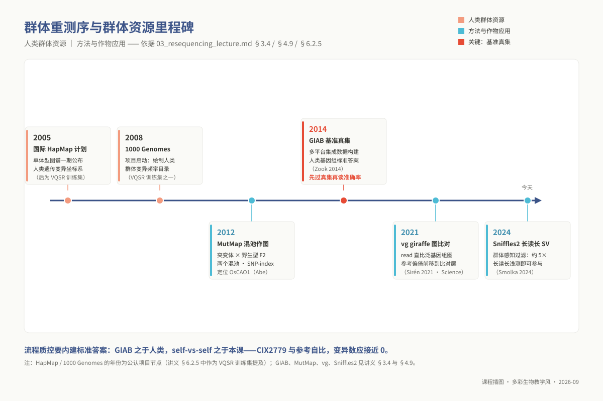
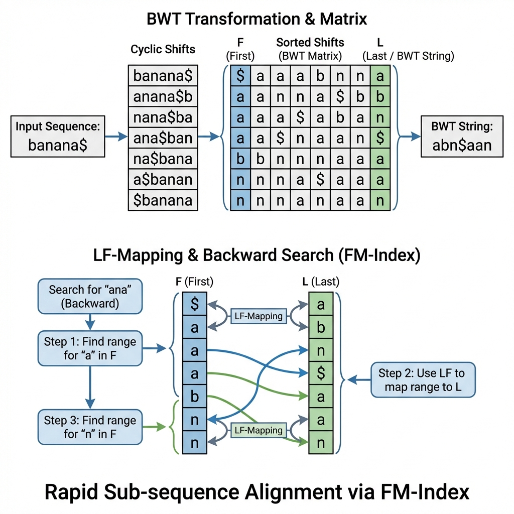
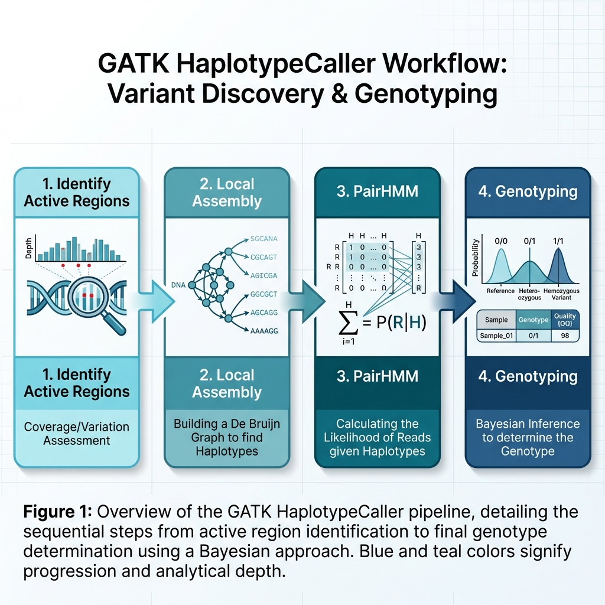

# 专题 m03：重测序与变异检测

> **适用对象**：硕士研究生，4 学时（2 h 理论 + 2 h 实践）。
>
> **阅读重点**：把比对、前处理和变异过滤连成证据链；每个阈值都要能说明它拦截的偏差及其代价。

| 项目 | 内容 |
|------|------|
| **专题 id** | `m03` ｜ 目录 `topic03_resequencing` ｜ 4 学时（2 h 理论 + 2 h 实践） |
| **核心工具** | `bwa-mem2` `samtools` `gatk4` `bcftools` `snpeff`；`annovar` 作为替代注释方案 |
| **运行环境 / 脚本** | `ngs_ms_variant`（`conda env create -f 07_envs/conda/env_master_variant.yml`）+ `ngs_ms_base`（作图与报告）｜ 配套脚本 `03_code/master/scripts/03_gatk_pipeline.sh`、`03_filter_sensitivity.sh` |
| **⚠ L1 锚点** | 本讲 **⑥ 6.2「VCF 格式与变异过滤」** 是博士 `p04`（群体基因组）与 `p05`（GWAS）的前置补课入口（契约 `prerequisite_packs.L1.mappings`）。该节按**可独立阅读**编写：没上过本课的博士生直接读 6.2 即可补齐 |
| **本讲重心** | ⑥ 结果解读 + 参数选择依据。流程谁都能抄，**能对每一条阈值说出它在拦什么**才是本讲的出口 |
<!-- 最后更新：2026-08-29（按 `00_design/course_contract.yaml` 的 11 章节模板改写） -->

## ① 学习目标

学完本专题，你应当**能够**：

1. **判断** 一个课题该走重测序还是从头组装，**说明**参考基因组质量如何影响假阳性率；**解释** BWT / FM-index 为什么能把"查一条 read"的代价与基因组大小解耦，以及 BWA-MEM2 的种子—扩展策略在什么数据上会失灵。
2. **写出** 完整的 `@RG` 行并**说明** 缺了它 GATK 会在哪一步失败；**运行** GATK Best Practices 前处理（MarkDuplicates →（可选）BQSR），并说明非模式物种无已知位点集时的两条替代路径。
3. **解释** HaplotypeCaller 的"活跃区域 + 局部重组装 + PairHMM + 贝叶斯定型"四层逻辑及其在 InDel 附近的优势；**执行** gVCF + 联合调用，并说明它为何比逐样本调用更准。
4. **逐列读懂** VCF：8 个固定列 + FORMAT/样本列，能从 `GT:AD:DP:GQ:PL` 判断一个基因型可不可信。
5. **为每一条硬过滤阈值说出它在拦什么**（QD / FS / MQ / SOR / MQRankSum / ReadPosRankSum），并**判断** GATK 默认值在自己的物种与深度下是否适用。
6. **估算** 给定深度下杂合位点的漏检概率，并**说明** 深度不足时杂合为何会被误判为纯合、这一偏差在群体层会放大成什么。
7. **产出** 一份变异检测报告：比对率、重复率、callable region 比例、过滤前后变异数、Ti/Tv、阈值敏感性表、HIGH 影响变异清单。

## ② 前置检查

本讲依赖以下 L0 模块。**跟不上时按下表回查**，不要硬啃。

| 依赖模块 id | 本讲哪里用到 | 不过关的典型症状 | 对应自测题号 |
|---|---|---|---|
| `l0_01_linux` | ⑤ 全部命令；`qsub` 提交 GATK 作业；`awk`/管道处理 VCF | 把 HaplotypeCaller 直接在登录节点跑到被杀 | `L0-1-Q5`（登录节点 / `qsub` / `qrsh` 的分工）、`L0-1-Q6`（SGE 作业脚本查错）、`L0-1-Q9`（上机：提交集群作业） |
| `l0_04_formats` | ④ 比对与 SAM 结构；⑥ 6.1 读 flagstat；6.2 VCF 与 SAM 的关系 | 拿到一行 SAM 说不出 FLAG 与 MAPQ 是第几列 | `L0-4-Q4`（解读一行 SAM）、`L0-4-Q6`（BED/GFF/GTF/VCF 用途四选一）、`L0-4-Q9`（上机：拆解 FLAG 163，并证明 `M` 不等于完全匹配） |
| `l0_05_qc` | ⑤ 比对输入必须是 clean 数据；⑥ 6.4 比对率异常回溯质控 | 用未去接头的 raw FASTQ 比对，再困惑于大量软剪切与低比对率 | `L0-5-Q4`（红灯辨析）、`L0-5-Q5`（接头污染）、`L0-5-Q9`（上机：fastp 清洗并解释"变差了却正常"的指标） |
| `l0_06_stats` | ⑦ 阈值与假阳性率；深度—功效估算；⑥ 6.2 群体层过滤的 HWE 与缺失率 | 说不清"过滤更严"为什么会同时降低假阳性和提高假阴性 | `L0-6-Q4`（p 值语义）、`L0-6-Q5`（多重检验与校正）、`L0-6-Q7`（重复与功效） |

**30 秒自查**（四条都跑通再往下看）：

```bash
conda activate ngs_ms_variant
bwa-mem2 version                 # 2.2.x ｜ gatk --version → GATK v4.4.x
gatk --version | head -2 ; bcftools --version | head -1 ; samtools --version | head -1
```

## ③ 背景与科学问题

### 3.1 重测序回答的不是"这是什么序列"，是"它跟参考差在哪"

有参考基因组时，测序的任务从"拼图"变成"找茬"：把 read 贴回参考（比对），再判断每一处差异是**真实变异**还是**测序错误 / 比对错误**。难点全在第二步——30× 深度下，3 Gb 基因组上测序错误的绝对数量比真实变异多好几个数量级，**变异检测本质上是一个极端不平衡的分类问题**。典型应用：群体变异图谱与系统发育、突变体定位（BSA / MutMap）、抗药性与致病性位点鉴定、菌株鉴别、系谱分析。

### 3.2 这一讲与前后的关系

`m02` 建立参考（从头组装），`m03` 在参考上找差异——**顺序不能颠倒**。参考的三类缺陷会直接变成系统误差：**gap 区**完全无法检出；**错误组装**把正常序列判成变异；单倍型坍缩（杂合区被压成一条）制造大批假杂合位点。所以报告里必须写清用的是哪个版本的参考、它的 BUSCO 与连续性指标是多少。向后，本讲产出的 VCF 是博士 `p04` 群体基因组与 `p05` GWAS 的唯一输入——这也是 6.2 被定为 L1 锚点的原因：**下游做得再漂亮，也救不了一个过滤策略说不清的 VCF**。

### 3.3 你要的是"位点"还是"基因型"

两者的质量要求完全不同：做**位点发现**（有没有这个 SNP），低深度大样本可行；做**个体基因型**（这个个体是 0/0 还是 0/1），每个个体的深度必须足够——GWAS 与群体遗传学要的是后者。这个区分决定了你的深度预算（见 ⑦）。

### 3.4 应用案例：MutMap——两个混池把"找因果突变"压成一个重测序流程

**研究问题**：诱变育种产生大量突变体，有用表型（半矮秆、早熟、抗病）的因果突变藏在成千上万个背景突变里；传统连锁作图要大群体加多年表型记录，遗传分析本身成为育种的瓶颈。

**测序与分析路线**：Abe 等（2012，*Nature Biotechnology*）把问题做成两个混池：突变体与野生型杂交，取 F2 中 20 株隐性表型个体的等量 DNA 混成一个 pool，与野生型亲本各测一轮。分析只算一个量——每个 SNP 位点上突变型等位基因的占比（SNP-index）：全基因组绝大多数区间停在 0.5 附近，与表型完全连锁的因果区段显著偏离。不构建连锁图、不逐株分型，就把水稻淡绿叶 / 半矮秆表型的因果基因定位到 *OsCAO1*。

**后续影响**：衍生出免杂交的 MutMap+、补参考外序列的 MutMap-Gap、面向数量性状的 QTL-seq，成为作物快速作图的事实标准——它们共享同一个统计内核：混池等位频率对 0.5 的偏离。

**教学启示**：① 混池是 ⑦ 深度-功效账的极端情形——分辨率由混池内等位频率的抽样方差决定，"20 株 × 每株深度"是显式权衡而不是凑数；② 流程质控同样需要**内建标准答案**：GIAB 项目用多平台集成数据构建人类基因组基准真集（Zook 等，2014），任何 caller 先过真集再谈准确率；本课主线给了你自制版——CIX2779 与参考基因组 self-vs-self，变异数应接近 0（见文末案例数据）。跑完流程先看这一眼，胜过任何"感觉没问题"。



*图 m03-5：群体资源与方法双轨：HapMap → 1000G → GIAB；MutMap → vg giraffe → Sniffles2。*

## ④ 核心原理

> 硕士层深度：**讲清算法思路与适用边界**。要公式见 ⑪ 的 Li & Durbin (2009)、DePristo (2011)。

### 4.1 比对：FM-index + 种子扩展，以及它在哪里失灵

**BWT / FM-index**：把参考所有循环轮转排序后取最后一列得到可逆的 BWT 串，配上字符计数表即为 FM-index。查询时**从右向左**逐字符缩小候选区间，每步只做常数次查表——**查询代价正比于 read 长度，与基因组大小基本无关**。代价是索引必须常驻内存：`bwa-mem2` 的索引比 `bwa` 大得多，这是它更快的原因，也是建索引作业被 OOM killer 杀掉的原因（⑨ E9）。



*图 1：BWT 与 LF-mapping —— 反向搜索的基础。*

**种子—扩展**：FM-index 只能精确匹配，而 read 上有错误与真实变异。BWA-MEM 先找 **SMEM**（不能再向两侧延长的最大精确匹配）作种子（`-k`，默认 19），把参考上共线的种子链起来，再在候选区内做带 gap 的 Smith–Waterman 扩展。**`bwa-mem2` 是 BWA-MEM 的重实现，算法与结果一致**，只是索引结构与向量化不同，参数含义完全通用。

失灵的边界（写方法学时必须交代）：① 变异密集区（高度分化的品系间、病原效应子区）找不到足够长的精确种子，read 直接丢失，表现为"该区域没有变异"——其实是没有覆盖；② 重复区多处等分，MAPQ 被压到 0，默认被 caller 忽略——`MAPQ = -10 log10 P(位置放错)` 衡量的是位置唯一性而非匹配质量，一条 read 完美匹配 5 个拷贝时匹配满分而 MAPQ = 0，而 HaplotypeCaller 默认只用 MAPQ ≥ 20 的 read（`--minimum-mapping-quality`），这就是变异在重复区系统性缺失的直接原因；③ read 末端的真实 InDel 常被软剪切（`S`）而非写成 `I`/`D`。

### 4.2 测序文库的身份证：为什么 `@RG` 头信息是分析强制项

在处理比对得到的 BAM 文件时，新手常以为 `@RG`（Read Group）只是一个随意的文本标记。实际上，在现代变异检测流程中，`@RG` 是统领底层统计模型与实验来源映射的核心元数据。

一条标准的规范形如 `@RG\tID:s01_L1\tSM:SampleA\tPL:ILLUMINA\tLB:Lib1`，其中四个标签各自承担着不可替代的独立职责：

- **SM（Sample Name）**：明确界定该读段属于哪一个真实的生物学个体。在后续多样本联合变异调用（Joint Genotyping）中，GATK 会将所有具有相同 `SM` 标签的数据合并至 VCF 的同一列。如果同一批次不同样本的 `SM` 被误写为同一个名字，不同样本的测序数据会在无报错状态下被当作同一个个体的多次测序强行叠加；
- **LB（Library）**：界定文库构建的物理边界。在分子生物学上，只有来源于同一次建库操作（同一管反应体系）的核酸分子才可能产生 PCR 重复；来自不同文库的分子哪怕比对到了完全一致的染色体坐标，也是由于随机断裂碰撞产生的独立天然分子。MarkDuplicates 正是通过 `LB` 标签来划分去重的逻辑边界，`LB` 写错会导致文库重复率被严重高估或低估；
- **ID（Read Group Identifier）**：指示最小的测序仪器物理通道单元（通常对应特定样本在特定测序 Flowcell 的特定 Lane）。由于测序仪各个物理通道的光学器件、温控单元和试剂流速存在微小的系统性漂移，下游的基础质量分数重校准（BQSR）会以 `ID` 为独立分组单位，分别拟合不同通道的系统性误差模型；
- **PL（Platform）**：告知下游分析软件该数据源自何种测序技术（如 ILLUMINA、PACBIO、ONT），这直接决定了算法内部加载何种生化错误先验模型。

若 BAM 文件中缺失 `@RG` 标签，GATK 会出于防范系统性混杂的安全机制直接终止运行并报错。

### 4.3 MarkDuplicates：PCR 重复如何伪造变异置信度及其识别机理

变异检测的统计学信心建立在“来自原始细胞群体的多个**独立**生物学分子互相印证”的基础之上。然而在常规建库过程中，物理打断后的微量 DNA 必须经过若干轮循环的 PCR 扩增。

设想一个原始 DNA 模板在文库构建早期被 DNA 聚合酶引入随机错配。后续 PCR 可能把这个分子扩增数十次乃至上百次。若不去重，变异检出器会看到许多 reads 一致支持该碱基，并可能在二项分布或贝叶斯模型下给出较高 QUAL 与 GQ，从而产生假阳性。

**MarkDuplicates 的统计作用**是区分“读段拷贝总数”和“原始分子模板数”，避免把同一个模板的复制结果当成独立证据。

识别 PCR 重复依赖核酸物理打断的随机性。不同原始模板恰好拥有相同的染色体起始坐标、方向和插入片段长度的概率通常很低。MarkDuplicates 对坐标排序后的 BAM 比较双端 reads 的 5' 起始坐标与方向，把一致的 reads 判为重复，保留碱基质量最高的一对，并给其余 reads 加上 `0x400` FLAG。NovaSeq 等 patterned flowcell 还可能产生光学重复；这类重复可根据流动槽上的像素距离进一步识别。

### 4.4 BQSR：系统性化学偏差的经验贝叶斯校正

测序仪出厂时附带的碱基质量分数（Phred Q score）是根据光学传感器测得的原始波形参数估算出来的理论值。然而在实际工业运行中，这个名义 Q 值与真实的碱基错误概率之间往往存在显著的经验漂移。

这种偏差具有明显的系统性特征，通常紧密依附于三个协变量（Covariates）：

1. **测序循环（Cycle）**：随着循环推进，因 phasing 与 pre-phasing 累积导致信号衰减，末端循环的真实错误率通常显著高于仪器报告值；
2. **局部序列上下文（Dinucleotide context）**：例如当某个碱基紧随连续的 G/C 之后时，由于化学荧光淬灭或空间位阻效应，某些特定双核苷酸组合的错误倾向显著升高；
3. **物理机台与通道（Read Group）**：特定批次的试剂活性与光学元件状态直接决定基准线的高低。

基础质量分数重校准（BQSR）通过统计建模消解这一系统性失真。它的核心假定是：在已知单核苷酸多态性数据库（如人类 dbSNP）之外的所有错配，其本质均属于测序技术引入的系统性错误。通过对全基因组非变异位点进行全局扫描，算法统计出在不同协变量组合下的经验错误率，建立一个多维经验误差查找表，并对 BAM 文件中每一个碱基的原始 Q 值进行平滑校正。
在水稻、昆虫或病原菌等缺乏成熟 dbSNP 数据库的非模式物种研究中，强行运行 BQSR 往往存在风险。若未经谨慎筛选就将真实的自然突变当作测序错误送入校正模型，模型会将真实变异位点的质量值暴力压低。此时学界的标准做法有二：要么严格按照第一轮初筛结果挑选出最高置信度的变异集作为虚拟的 `--known-sites` 迭代自举，直到前后两轮校正表收敛（GATK 文档只说重复至收敛，没有固定轮数；且存在用自己的结果校正自己的循环依赖，本课 Xoo 主线选择跳过），要么在方法学中明确声明跳过 BQSR，转而在下游依靠严密的位点级硬过滤保障最终质量。

### 4.5 HaplotypeCaller 的局部重组装与 Pair-HMM 状态机模型

传统的早期变异检测工具（如早期 Samtools/mpileup）本质上是按染色体坐标逐列进行碱基堆叠（pileup）并统计碱基频数。这种基于单点比对的策略在面对单碱基替换（SNP）时表现尚可，但在处理插入缺失（InDel）及其周边区域时会遭遇灾难性崩溃。由于全局比对器（如 BWA-MEM）为了最大化比对得分并减少空位罚分（gap penalty），经常会将一个真实的微小 InDel 及其紧邻的错配，错误地解释为一段分布在不同比对坐标上的连续假 SNP，导致 InDel 边界假突变丛生。

GATK HaplotypeCaller 彻底抛弃了单纯的列堆叠思想，引入了精密的局部微环境重组装框架，其运算经历四层严密的逻辑推进：

1. **活跃区域探测（Active Region Detection）**：算法使用轻量级的错配打分滑动窗口快速扫描全基因组，一旦发现某区段内错配密度与插入缺失信号显著超过测序噪声背景，便将其标定为一个“活跃区域”（通常跨度数百至数千碱基），仅对这些高度可疑的活跃区域启动下游昂贵的深度计算。
2. 局部 de Bruijn 图微重组装：在活跃区域内部，算法暂时剥离原有的比对坐标，直接从覆盖该区域的所有测序 reads 中重新提取 k-mer 构建局部的 de Bruijn 图。在图上通过类似组装算法的拓扑清理，重组装出所有在生物学上可能存在的候选单倍型序列（Candidate Haplotypes）。这一机制使得无论插入缺失有多复杂，在图论上都能直接作为一个完整的单倍型实体被显式解出，彻底终结了比对错位引起的假变异。
3. **Pair-HMM 隐马尔可夫模型似然计算**：算法构建一个经典的双序列比对隐马尔可夫模型（Pair-HMM），模型内部包含 Match、Insertion 与 Deletion 三种隐状态，碱基质量值（Q 值）决定 Match 状态下观测碱基的**发射概率**，进出插入/缺失状态的**转移概率**则由插入/缺失质量（BI/BD）与空位延伸罚分（gap continuation penalty）决定。利用该模型，算法计算出每一条测序 read 在以特定候选单倍型为模板产生时的全概率似然值 $P(\text{Read} \mid \text{Haplotype})$。
4. **经典贝叶斯基因型定型**：结合单倍型似然与群体先验概率（由杂合度参数 `--heterozygosity` 设定），利用贝叶斯后验概率公式推导出每个样本在每个位点上的基因型后验分布：
$$P(\text{Genotype} \mid \text{Data}) \propto P(\text{Data} \mid \text{Genotype}) \times P(\text{Genotype})$$
`-ploidy` 是染色体拷贝数：单倍体病原菌（本课 Xoo 主线）必须显式声明 `-ploidy 1`（GATK 默认 2）；**自交纯系植物仍是二倍体，应保持 `-ploidy 2`**，高度纯合只体现在基因型结果里，不能改成 1，否则残余杂合与旁系同源坍缩造成的假杂合都会被强行定成纯合、丢掉诊断信号；多倍体按实际拷贝数设。`--heterozygosity` 是群体层面的非参考先验，不是样本杂合率。



*图 3：活跃区域 → 局部组装 → PairHMM → 贝叶斯定型。*

### 4.6 gVCF 与联合调用：群体借力与区分“未变异”与“未测到”

在群体多样本测序中，最朴素的分析思路往往是“对每个样本分别运行变异检测生成独立 VCF，再用脚本把各样本的 VCF 合并”。这种做法隐藏着严重的逻辑漏洞。

常规单样本 VCF 是稀疏记录的：它仅仅输出那些被软件判定为存在突变的位点；而对于那些没有任何变异的绝大多数基因组区域，VCF 中不留下任何字符。当试图合并 100 个样本时，如果某个样本在第 10,000 号位点没有记录，生信人员在数学上根本无法判断：**该个体在这个位点究竟是高覆盖度下确认无误的纯合参考（0/0），还是因为测序深度为零、接头污染丢掉所导致的未测到（./. 缺失）？** 这种混淆直接剥夺了下游群体计算次等位基因频率（AF）和检出功效的准确性。

gVCF（Genomic VCF）格式以一种极其优雅的块压缩策略解决了这一困境。在生成 gVCF 时，软件不仅记录突变位点，更对所有未发生突变的单调区域，按照置信度区间合并输出为连续的非变异记录块（`<NON_REF>` 区块），明确给出该区间内支持“纯合参考基因型”的经验深度与置信度上限。

当利用 `GenomicsDBImport` 与 `GenotypeGVCFs` 进行多样本联合变异调用（Joint Calling）时，算法获得了巨大的**群体借力**优势：
一方面，由于所有样本在全部坐标上的证据完整在案，群体等位基因频率与变异位点总深度的计算建立在包含全部样本证据（含非变异块的参考证据）的完整矩阵之上；
另一方面，对于群体中某个测序深度较低的样本，它在某个边缘位点原本仅有 2 条支持突变的 reads，在单样本模式下通常会被当成测序错误直接舍弃；但在联合调用模式下，如果算法发现群体中有其他 20 个同质样本在同一位置高度一致地支持该突变，群体强信号能够跨样本提供后验先验支撑，将弱样本的边缘信号推过判定阈值；反之，若某个个体的孤证突变在全群体其他 99 个深度达 50× 的样本中全部为 0，该孤证便会被果断判定为测序伪影予以压制。这种跨样本的统计信息借用，极大地提高了整个队列变异检测的灵敏度与特异性。

### 4.7 结构变异（SV）检测的物理信号与长读长优势

结构变异（Structural Variants, SV）通常指长度超过 50 bp 的大片段基因组重排，包括大片段插入缺失、染色体倒位（Inversion）、易位（Translocation）以及拷贝数变异（CNV）。与单核苷酸多态性不同，单个短测序 read 极难完整跨越动辄几千碱基的结构断裂点。因此，基于二代测序的 SV 检出软件（如 LUMPY、Manta）不得不依赖于四大间接物理信号的联合推断：

1. **双端读对异常（Read-pair Discordancy）**：已知建库插入片段长度遵循正态分布（如 $400 \pm 50$ bp）。若某对双端 reads 在基因组上的比对跨度暴增至数千 bp，强烈提示其中间发生了大片段缺失；若两端 reads 比对方向反常（如变成同向 ++ 或 --），则直接指示了染色体片段的物理倒位；
2. **断裂比对（Split-read）**：当一条 read 恰好横跨在 SV 的重组断裂点上时，其前缀部分比对在断裂点左侧，后缀部分则只能比对到染色体的远端或其他染色体，在 CIGAR 串中表现为显著的软剪切（S）；
3. **测序深度突变（Read-depth Fluctuation）**：对于大片段串联重复或缺失，区域内的局部平均覆盖深度会呈倍数级的台阶式跃升或骤降；
4. **从头局部组装（Local Assembly）**：将未比对或异常读段提取出来进行局部组装，再与参考序列进行局部对齐。

二代测序在 SV 检测中的根本痛点在于：真实的基因组结构重组断裂点极其偏好发生在转座子或节段重复序列（Segmental duplications）内部。短读长一旦落入高度相似的重复区，其比对质量值（MAPQ）直接坍缩为 0，导致双端距离和 split-read 信号瞬间失去定位能力，产生极高的假阳性与大量漏检。正是基于这一物理约束，随着第三代长读长技术的成熟，单条长达数十 kb 的单分子 reads 能够轻松锚定断裂点两侧的非重复特异序列，直接读穿复杂结构变异，使得长读长（如使用 Sniffles2 算法）迅速成为了全基因组 SV 鉴定的绝对黄金标准。

### 4.8 变异检出难度的梯级递进逻辑

从单核苷酸突变（SNP）、小插入缺失（InDel）到大型结构变异（SV），生物信息学变异识别的算法难度呈现断层式的跃升：

- **SNP 最易**：因为任何一条覆盖该位点的合格 read 都天然携带了完整的突变证据，只需在比对矩阵上清点特定位置的碱基频率并结合泊松/二项分布即可完成判断；测序的随机替换错误在数十倍的独立深度叠加下会被指数级稀释；
- **InDel 居中**：难点在于序列对齐时“空位插入”与“连续错配”之间的评分竞争歧义，加之均聚物（Homopolymer）在测序过程中普遍存在的滑移合成错误，往往需要依赖昂贵的局部重组装与隐马尔可夫模型消除对齐假象；
- **SV 最难**：短读长单分子证据严重碎片化，必须融合跨读对物理距离、断裂剪切、覆盖度统计等跨尺度的间接物理线索，并深受全基因组高重复序列与复杂着丝粒区域的强烈干扰。深刻理解这一由“单分子证据携带量”所决定的难度梯度，是在实验方案中合理搭配技术手段的前提。

### 4.9 技术前沿（2023–2026）

机器学习 calling 成为主流选项。DeepVariant（⑪ Poplin 2018）把"读 pileup 图像做分类"跑成了生产标准并持续迭代：v1.5 起提供 ONT R10 模型、PacBio 模型纳入 Revio HiFi 训练数据；v1.8 引入小模型（small model）与 pangenome-aware 模式（配合泛基因组图输入）。边界没变：模型在人类数据上训练，非模式物种迁移仍需自建真集验证——与 6.2.5 对 CNNScoreVariants 的提醒同理。

**长读长 SV calling 成熟**。Sniffles2（Smolka 等，2024，*Nature Biotechnology*）用"每样本独立的误检模型 + 群体感知过滤"重写了长读长 SV 检测：约 5× 的长读长数据即可参与，且同时面向 mosaic 与群体尺度变异。对选型的意义：SV 检测从"长读长大数据的专属"变成"长读长浅测即可介入"，4.8 末尾的难度排序在长读长侧被大幅压平。

**图感知 calling**。vg giraffe 把 read 直接比对到泛基因组图再行 calling（Sirén 等，2021，*Science*），DeepVariant 已支持图输入——参考偏倚的解法从"比对后补救"前移到比对层。非模式物种的可行路径仍是 `m02` 4.9 的"小基因组自建图参考"。

## ⑤ 操作步骤

> 全流程封装在 `03_code/master/scripts/03_gatk_pipeline.sh`（含 SGE 作业头）。课堂跑脚本，作业里要能**解释每个参数为什么这么设**。

### 5.1 准备与比对

```bash
conda activate ngs_ms_variant
bwa-mem2 index reference.fasta                    # 比对索引（内存大户，⑨ E9）
samtools faidx reference.fasta                    # .fai：随机取区间
gatk CreateSequenceDictionary -R reference.fasta  # .dict：GATK 校验 contig 一致性（⑨ E1）

bwa-mem2 mem -t 16 -M -R '@RG\tID:s01_lane1\tSM:sample01\tPL:ILLUMINA\tLB:lib_s01' \
    reference.fasta s01_R1.clean.fq.gz s01_R2.clean.fq.gz \
  | samtools sort -@ 4 -m 2G -T tmp_s01 -o sample01.sorted.bam -
samtools index sample01.sorted.bam && samtools flagstat sample01.sorted.bam > sample01.flagstat
```

`-t` 比对线程（与 `qsub` 申请核数一致）；`-M` 把 split 比对的次要记录标为 secondary（Picard 系工具的传统要求）；`-R` **必须用单引号**，否则 `\t` 被 shell 吃掉（⑨ E10）；`sort -m` 是**每线程**内存，实际占用 = `-@` × `-m`。三套索引缺一不可。

### 5.2 标记重复与（可选）BQSR

```bash
gatk MarkDuplicates -I sample01.sorted.bam -O sample01.dedup.bam -M sample01.dup_metrics.txt \
    --CREATE_INDEX true --OPTICAL_DUPLICATE_PIXEL_DISTANCE 2500     # NovaSeq patterned flowcell

# 仅当有可信已知位点集时执行；无则跳过并在方法学写明（见 4.4）
gatk BaseRecalibrator -R reference.fasta -I sample01.dedup.bam \
    --known-sites known_sites.vcf.gz -O sample01.recal.table
gatk ApplyBQSR -R reference.fasta -I sample01.dedup.bam \
    --bqsr-recal-file sample01.recal.table -O sample01.bqsr.bam
gatk AnalyzeCovariates -bqsr sample01.recal.table -plots sample01.bqsr.pdf   # 校正效果自证
```

`-M` 输出的 `PERCENT_DUPLICATION` 是**文库复杂度的直接指标**，必须进报告（解读见 6.1）。

### 5.3 变异检测与联合调用

```bash
gatk --java-options "-Xmx16g" HaplotypeCaller \
    -R reference.fasta -I sample01.dedup.bam -O sample01.g.vcf.gz \
    -ERC GVCF -ploidy 1 --native-pair-hmm-threads 4 -L chr01   # Xoo 单倍体；二倍体物种写 2

gatk GenomicsDBImport --sample-name-map samples.map \
    --genomicsdb-workspace-path gvcf_db_chr01 -L chr01 --batch-size 50
gatk GenotypeGVCFs -R reference.fasta -V gendb://gvcf_db_chr01 -O raw_chr01.vcf.gz
```

`-ploidy`：原核/单倍体写 1，多倍体按实际写；`-L` 既并行也限定 callable 区域，按染色体切分是最有效的提速手段；`--java-options -Xmx` 不给足会 OOM（⑨ E5）。样本多时用 `--sample-name-map`（两列：样本名 + gVCF 路径）而非几十个 `-V`；workspace 目录必须不存在，追加样本用 `--genomicsdb-update-workspace-path`。

### 5.4 硬过滤：SNP 与 InDel 必须分开

```bash
gatk SelectVariants -V raw_chr01.vcf.gz -select-type SNP -O raw_snp.vcf.gz
gatk VariantFiltration -V raw_snp.vcf.gz -O filt_snp.vcf.gz \
    --filter-name "QD2"  --filter-expression "QD < 2.0"    --filter-name "FS60" --filter-expression "FS > 60.0" \
    --filter-name "MQ40" --filter-expression "MQ < 40.0"   --filter-name "SOR3" --filter-expression "SOR > 3.0" \
    --filter-name "MQRS" --filter-expression "MQRankSum < -12.5" \
    --filter-name "RPRS" --filter-expression "ReadPosRankSum < -8.0"

gatk SelectVariants -V raw_chr01.vcf.gz -select-type INDEL -O raw_indel.vcf.gz
gatk VariantFiltration -V raw_indel.vcf.gz -O filt_indel.vcf.gz \
    --filter-name "QD2" --filter-expression "QD < 2.0"  --filter-name "FS200" --filter-expression "FS > 200.0" \
    --filter-name "RPRS20" --filter-expression "ReadPosRankSum < -20.0"
```

`--filter-name` 与 `--filter-expression` **必须成对且顺序对应**。分开写多条比塞进一个 `||` 表达式好——过滤后才能看出每条阈值各拦掉多少（6.2.7 的诊断依赖这一点）。InDel 的 FS 阈值宽 3 倍多，理由见 6.2.4。

### 5.5 注释、提取与阈值敏感性

```bash
gatk MergeVcfs -I filt_snp.vcf.gz -I filt_indel.vcf.gz -O filt_all.vcf.gz
bcftools view -f PASS filt_all.vcf.gz -Oz -o pass.vcf.gz && bcftools index pass.vcf.gz
snpEff -v <genome_db> pass.vcf.gz > annotated.vcf          # 无现成库需自建，见 ⑨ E8
bcftools query -f '%CHROM\t%POS\t%REF\t%ALT\t%INFO/ANN\n' annotated.vcf | grep -w HIGH > high_impact.tsv

bash 03_code/master/scripts/03_filter_sensitivity.sh -v raw_snp.vcf.gz -o sens_out
# QD（1/2/3/5）× FS（30/60）共 8 组阈值各过滤一次，输出变异数、Ti/Tv、平均深度对照表（作业必做）
```

ANNOVAR 是等价替代，但**不在 conda 环境中**（契约 `env_exempt_tools`：需官网注册下载），课堂用 SnpEff。

## ⑥ 结果解读

> **本讲重心。** 6.2 是 L1 锚点，按可独立阅读编写。

### 6.1 比对与前处理：四个必须进报告的数字

| 指标 | 来源 | 正常范围 | **不正常时说明什么** |
|---|---|---|---|
| 比对率 | `flagstat` 的 `mapped (%)` | 同种参考 > 90% | < 70%：物种选错、样本污染、接头未去（回 `l0_05_qc`）；单个样本异常而其他正常 → 样本问题而非流程问题 |
| properly paired | `flagstat` | > 85% | 偏低：插入片段异常、参考错误组装、大量结构变异 |
| 重复率 | `dup_metrics.txt` 的 `PERCENT_DUPLICATION` | PCR 文库 5%–20% | > 30%：起始量不足导致文库复杂度低，**去重后有效深度骤降**，需重新评估功效；PCR-free 却 > 10% 也不正常 |
| callable 比例 | `gatk CallableLoci` 或 `samtools depth` 统计 ≥ 阈值深度的碱基占比 | 视深度而定 | **必须报告**：没有这个数，"某基因无变异"的结论无法成立（见 ⑦ 第 5 条） |

### 6.2 VCF 格式与变异过滤 ⚠ L1 锚点

> **本节可独立阅读。** 博士 `p04`（群体基因组）、`p05`（GWAS）经 L1 映射直达此处：你只需要知道"上游有人跑完了比对与 GATK，交给你一个 VCF"，本节解释这个文件是什么、哪些字段可信、以及在你自己分析之前必须再做哪些过滤。

#### 6.2.1 VCF 是什么

VCF（Variant Call Format）记录的是**样本相对参考基因组的差异**，不是序列本身。一行 = 一个位点；一列（第 10 列起）= 一个样本。文件头 `##` 行定义了后面所有字段的含义——**读 VCF 的第一件事永远是 `bcftools view -h`**，因为 INFO/FORMAT 里有哪些标签完全取决于上游用了什么 caller 与参数。

```text
##fileformat=VCFv4.2
##INFO=<ID=QD,Number=1,Type=Float,Description="Variant Confidence/Quality by Depth">
##FORMAT=<ID=PL,Number=G,Type=Integer,Description="Normalized, Phred-scaled likelihoods for genotypes">
#CHROM POS    ID  REF ALT QUAL   FILTER  INFO                              FORMAT       s01            s02
chr01  12345  .   A   G   1832.6 PASS    AC=3;AF=0.75;AN=4;DP=88;QD=14.2;MQ=60.0;FS=1.1;SOR=0.7  GT:AD:DP:GQ:PL 0/1:22,20:42:99:512,0,548  1/1:0,25:25:75:900,75,0
```

#### 6.2.2 8 个固定列的设计哲学

VCF 的前 8 列是全群体共享的位点级元数据，构成了变异识别的公共坐标系：

- CHROM 与 POS（1-based 物理坐标）：标定变异在参考基因组上的绝对物理位置。需要特别注意：BED 文件采用 0-based 左闭右开坐标，而 VCF 采用 1-based 完全闭区间坐标；对于插入缺失（InDel），`POS` 严格指向变异发生位置前一个未改变的锚定碱基，这是解析复杂变异坐标转换最常踩坑的细节；
- **ID（外部数据库编号）**：在人类数据中通常对应 dbSNP 的 `rs` 编号，非模式物种普遍用 `.` 占位；
- **REF 与 ALT（等位基因）**：参考基因组碱基与该位点观测到的所有非参考等位基因。若存在多个替代等位基因，ALT 列以逗号分隔（如 `G,T`）。后续几乎所有群体遗传与 GWAS 算法都假定数据为二元双等位位点，因此多等位位点必须在初筛阶段进行专门分流（见 6.2.6）；
- **QUAL（位点变异置信度）**：衡量“该位点存在任何变异”的 Phred 质量分数（$QUAL = -10 \log_{10} P(\text{该位点纯合参考})$）。注意它只证明位点存在多态性，绝不衡量具体某个个体的基因型精度；
- **FILTER（质量状态门禁）**：`VariantFiltration` 打上的标签。若位点通过所有过滤条件则标记为 `PASS`；若触发了某项规则，则记录该规则的名称。**必须铭记：GATK 的过滤步骤仅仅是打标签，文件内被过滤的行并未被物理删除，真正的提取必须依靠 `bcftools view -f PASS`**；
- **INFO（位点级多维统计注解）**：容纳了 GATK 在变异调用过程中计算出的数十项统计检验指标（见 6.2.4）。

#### 6.2.3 FORMAT 与样本列：解构单样本基因型的置信度

从第 9 列 `FORMAT` 开始，VCF 实现了“位点级信息”与“个体样本级信息”的彻底解耦。第 10 列及以后的每一列对应一个实际送测的样本，其内部数据项严格按照第 9 列声明的子字段键名顺序排列，最经典的五联结构为 `GT:AD:DP:GQ:PL`：

- **GT（Genotype）**：算法推断出的离散基因型。`0/0` 表示纯合参考，`0/1` 表示杂合，`1/1` 表示纯合突变，`./.` 表示数据缺失；斜杠 `/` 代表未定相，竖线 `|` 代表已知染色体单倍型相位。
- **AD（Allelic Depth，最真实的底层证据）**：分别支持各个等位基因的真实过滤后 read 计数（如 `22,20`）。**AD 是 VCF 里最诚实的字段**——GT 只是统计学推断，AD 才是实验观测到的第一手事实。在杂合位点上，突变等位基因支持度小于 3 的位点极不可信，且等位平衡比值 $AD_{alt} / (AD_{ref} + AD_{alt})$ 若严重偏离 0.5（如在二倍体中落在 0.1 左右），极可能源于比对偏差、拷贝数扩增或组织嵌合污染。
- **DP 与 GQ（深度与基因型置信度）**：`DP` 是覆盖该位点的有效测序深度；`GQ`（Genotype Quality）代表次优候选基因型相对最优基因型的 Phred 似然差距。GQ 达到 20 代表推断错误的概率低于 1%，GQ 达到 30 则低于 0.1%。在群体遗传学计算中，任何 `GQ < 20` 的基因型都应果断置为缺失（`./.`）。
- **PL（Normalized Phred-scaled Likelihoods）**：候选所有可能基因型的归一化似然。算法将最优基因型的 PL 强制归一化为 0，其余基因型的数值越高代表越不可能。例如 `512,0,548` 代表杂合极度确定，而 `40,0,35` 则说明最优基因型与次优基因型在统计学上仅存在微弱差异，不可作为铁证。

#### 6.2.4 硬过滤的六大 INFO 指标：每一项在阻击何种系统性失真

GATK 在 INFO 列写入的统计量不是随意的数值，而是针对二代测序六种典型的系统性伪影分别设立的物理防线：

1. **QD（QualByDepth）**：位点置信度除以支持变异的未过滤测序深度（$QUAL / DP$）。由于 QUAL 随测序深度的累加呈线性膨胀，在高覆盖区域哪怕低频的测序噪声也能堆叠出惊人的高 QUAL。通过深度归一化，QD 能够无情揪出那些“纯靠海量深度撑起来的假阳性”（GATK 推荐切点：$QD < 2.0$ 过滤）。
2. **FS 与 SOR（FisherStrand 与 StrandOddsRatio）**：链偏好性（Strand Bias）检测。真实的生物学突变同时存在于 DNA 正反双链上，测序 reads 应当均匀覆盖正负两链；如果某突变几乎 100% 只被正向（或反向）read 所支持，这几乎完全是由于 PCR 扩增滞后、特定发卡结构或局部比对伪影造成的假象。FS 通过 Fisher 精确检验 p 值进行拦截（$FS > 60.0$），SOR 则利用优势比算法在高深度与外显子边界区提供更具平滑抗噪性的互补检验（$SOR > 3.0$）。
3. **MQ 与 MQRankSum（比对质量与比对质量秩和检验）**：MQ 为位点所有 reads 的均方根比对质量，直接反映该位点是否坐落在全基因组高度相似的重复序列或转座子荒漠；MQRankSum 则进一步对支持突变的 reads 与支持参考的 reads 进行 Wilcoxon 秩和检验。如果发现支持突变的 reads 其比对得分系统性偏低，往往直接暴露了旁系同源区域的跨位点错误比对（$MQ < 40.0$ 或 $MQRankSum < -12.5$ 过滤）。
4. **ReadPosRankSum（读长位置偏好秩和检验）**：检验变异碱基是否异常聚集在测序 reads 的两端。由于 Illumina 测序末端的失同步衰减（phasing）以及局部比对的末端软剪切倾向，测序错误极度富集在读段末尾。若某变异始终只出现在 reads 的尾部，几乎必然属于技术测序伪影（$ReadPosRankSum < -8.0$ 过滤）。

阈值的科学认知：GATK 官方推荐切点源自人类千人基因组高深度黄金真集。在动植物与微生物重测序中，切忌盲目硬套这套数字，必须先在自己数据集上绘制这六个参数的全局经验分布直方图，进行多梯度阈值敏感性对照分析。此外，因为 InDel 自身容易在比对中引起局部的单链偏好，其 FS 阈值通常需要放宽至 200，故SNP 与 InDel 必须严格拆分独立进行硬过滤。

#### 6.2.5 VQSR 还是硬过滤

VQSR 用高斯混合模型在上述指标构成的多维空间里学习"真变异长什么样"，比人工切点更细致。**适用前提有两条硬条件**：① 有可靠的训练/真集（人类的 HapMap、1000G、Omni）；② 样本量足够（经验上外显子 ≥ 30 个样本、WGS ≥ 1 个高深度样本）。**非模式物种两条都不满足，所以只能硬过滤**——这不是水平问题，是数据条件问题，方法学里要写明。GATK 新版提供的 `VariantRecalibrator` 替代方案（如基于深度学习的 `CNNScoreVariants`）同样依赖人类训练模型，跨物种迁移需谨慎。

#### 6.2.6 交给群体分析之前：位点级过滤之外还必须做的四件事

位点级硬过滤只保证"这个变异是真的"，而 `p04` 群体基因组与 `p05` GWAS 要求"**每个个体的基因型都可信**"。下面四步在几乎所有群体论文的方法学里都会出现：

```bash
# ① 只留双等位 SNP（多数群体遗传软件不接受多等位）
bcftools view -m2 -M2 -v snps pass.vcf.gz -Oz -o biallelic.vcf.gz
# ② 低质量基因型置为缺失（不是删位点，是把不可信的个体基因型设为 ./.）
bcftools filter -S . -e 'FMT/DP<5 | FMT/GQ<20' biallelic.vcf.gz -Oz -o gtmask.vcf.gz
# ③ 位点缺失率与次等位基因频率
bcftools view -i 'F_MISSING<0.1 && MAF>0.05' gtmask.vcf.gz -Oz -o clean.vcf.gz
# ④ 个体缺失率（先算再决定剔除谁）
bcftools stats -s - clean.vcf.gz | grep '^PSC'
```

四个阈值的取舍：**`FMT/DP<5`** —— 低于 5× 的杂合几乎必然被误判（见 ⑦）；**`GQ<20`** —— 允许 1% 的基因型错误率；**`F_MISSING<0.1`** —— 缺失率高的位点通常落在覆盖不良区，其"缺失模式"与群体结构相关，会伪造出关联信号；**`MAF>0.05`** —— GWAS 对低频变异功效极低，但**群体遗传学（如 π、Tajima's D、SFS）绝不能滤 MAF**，那会直接破坏频谱。**这一条是 p04 与 p05 分道扬镳的地方，切勿照抄别人的过滤脚本。**

哈迪-温伯格检验（`--hwe`）在**随机交配群体**里可用于剔除基因分型错误（强烈偏离常提示拷贝数变异或旁系同源坍缩），但在自交系、克隆群体、有明显群体结构的样本里，偏离 HWE 是**真实的生物学**，此时不能用它过滤。

#### 6.2.7 过滤做对了长什么样、做错了长什么样

```bash
bcftools stats pass.vcf.gz | grep -E '^SN|^TSTV'    # 变异数与 Ti/Tv
bcftools query -f '%FILTER\n' filt_snp.vcf.gz | sort | uniq -c | sort -rn   # 每条阈值各拦了多少
```

| 现象 | 说明什么 | 怎么办 |
|---|---|---|
| Ti/Tv 接近随机期望 0.5 | 假阳性大量混入（随机测序错误的 Ti/Tv ≈ 0.5） | 过滤过松；先查 QD 与 MQ 分布 |
| Ti/Tv 明显高于本物种经验值 | 过滤过严，或只剩下了保守区的变异 | 放宽阈值重跑敏感性分析 |
| 某一条 filter 拦掉 > 50% 的位点 | 该指标的分布与 GATK 假设不符（常见于低深度或非模式物种的 MQ / RankSum） | 画该指标的直方图，按自己数据的分布重定切点 |
| 过滤后变异数只降了 < 2% | 阈值形同虚设，或**表达式里的标签在 VCF 里不存在** | 查日志有无 `undefined variable`（⑨ E7） |
| 杂合位点占比异常高（如二倍体 > 60%） | 参考单倍型坍缩、样本污染、旁系同源坍缩 | 看 AD 等位平衡分布；双峰或偏移即为证据 |
| `bcftools stats` 的 `number of samples` 少于预期 | 多个 BAM 的 `@RG SM` 写重了，被当成同一样本 | 回 4.2 检查 `@RG` |

### 6.3 注释结果怎么读

SnpEff 在 INFO 加 `ANN` 字段，管道符分隔：`ANN=G|missense_variant|MODERATE|GENE_ID|...|p.Ala123Val|...`。影响等级 **HIGH**（`stop_gained`、`frameshift_variant`、剪接位点破坏）→ **MODERATE**（`missense_variant`、`inframe_indel`）→ **LOW**（`synonymous_variant`）→ **MODIFIER**（基因间、内含子深部）。

**解读的两条纪律**：① 影响等级是基于注释文件的形式推断，不是功能验证——`stop_gained` 也可能落在一个本就不表达的假基因上；② 一个变异可能有多条 ANN（不同转录本），默认第一条是"最严重"的那条，统计 HIGH 变异数量时不要重复计数。注释质量完全取决于 GFF3 的质量，非模式物种的自建库要先核对基因数与 CDS 完整性。

### 6.4 常见的"结果不对"

| 症状 | 真实原因 | 怎么确认 |
|---|---|---|
| VCF 里样本名是 `sample1` 而不是你的样本名 | `@RG` 的 `SM` 写成了固定值 | `samtools view -H x.bam \| grep '^@RG'` |
| 变异全部集中在少数几个 contig | 其余 contig 覆盖不足或参考含大量小 scaffold | `samtools depth -a` 统计各 contig 覆盖 |
| 过滤后 `bcftools view -f PASS` 结果为空 | `FILTER` 列是 `.`（从未跑过 VariantFiltration） | `bcftools query -f '%FILTER\n' \| sort \| uniq -c` |
| 某个已知的抗性位点"没有变异" | 该区域根本没有 callable 覆盖 | 查 callable region；这是漏检不是阴性结论 |

## ⑦ 统计插件

**焦点（契约 `stats_plugin_topics` 指定）：变异过滤阈值与假阳性率、测序深度对检出功效的影响。**

### 7.1 每一条阈值都是一次显式的错误权衡

变异检测是极端不平衡的二分类：3 Gb 基因组、30× 深度下，候选位点里真变异是少数、噪音是多数。**过滤阈值就是这个分类器的判决边界**——往严处调，假阳性下降、假阴性上升；往松处调，反之。六个指标各自拦一类错误（含义见 6.2.4），彼此不可替代：QD 拦深度伪装的置信度，FS/SOR 拦链偏好，MQ/MQRankSum 拦比对不可靠区，ReadPosRankSum 拦 read 末端伪影。

**必须能回答的问题**：你论文里写的每一条阈值，它拦的是哪一类错误？为什么这个数值？"照抄 GATK 文档"不是答案——GATK 的数值来自人类高深度数据的经验分布，你的物种、深度、比对器都不同（见 6.2.4）。

### 7.2 深度与检出功效：一个可以自己算的模型

杂合位点上，每条 read 独立地以约 0.5 的概率来自任一等位。设深度为 D，支持 ALT 的 read 数 X ~ Binomial(D, 0.5)：

| 深度 D | P(X=0)：完全测不到 ALT | P(X≤1)：ALT 证据 ≤ 1 条 | P(X≤2)：ALT 证据 ≤ 2 条 |
|---|---|---|---|
| 5× | 3.1% | 18.8% | 50.0% |
| 8× | 0.39% | 3.5% | 14.5% |
| 10× | 0.098% | 1.07% | 5.5% |
| 15× | 0.003% | 0.049% | 0.37% |
| 20× | 0.0001% | 0.002% | 0.020% |
| 30× | ≈ 0 | ≈ 0 | 0.00004% |

为什么要看 P(X≤2) 而不只是 P(X=0)：caller 与后续过滤都要求最少若干条独立证据（HaplotypeCaller 的默认 `--min-base-quality-score`、AD 阈值、GQ 阈值共同起作用），只有 1–2 条 ALT read 的位点几乎必然被判成 `0/0` 或被过滤掉。所以 10× 下杂合位点的实际漏检率是百分之几量级，而不是表面上的千分之一。

**注意这是理想模型**，真实漏检率更高：① 参考偏倚——携带 ALT（尤其 InDel）的 read 比对得分略低，更容易被丢，等位抽样不是严格的 0.5；② GC 极端区、重复区、结构变异断点区的覆盖远低于全基因组均值；③ 建库 PCR 偏好进一步放大不均匀。

### 7.3 深度不足时，杂合为什么被误判为纯合

链条是这样的：深度低 → ALT 证据条数少 → PairHMM 给出的 `P(数据 | 0/1)` 与 `P(数据 | 0/0)` 差距小 → 再乘上偏向纯合参考的先验（`--heterozygosity` 默认 0.001，即模型本来就认为杂合是罕见事件）→ 后验最大的基因型落在 `0/0` → **GT 被写成纯合参考，且因为证据本来就少，GQ 还可能不低**。这就是**等位基因缺失（allelic dropout）**。

**方向性偏差，不是随机噪音**：漏掉的永远是杂合，被保留的是纯合，因此低深度样本的杂合度被系统性低估。在群体层的后果是连锁的：观测杂合度偏低 → 表现为偏离 HWE（若据此过滤，会把真位点当成基因分型错误剔掉）；近交系数 F 被高估；群体结构（PCA / ADMIXTURE）的第一主成分可能反映的是测序深度差异而不是遗传结构（这是 `p04` 最常见的陷阱）；GWAS 中基因型错误分类会让效应量向零收缩，功效下降（`p05`）。

**操作上的三条防线**：① 群体样本的深度要尽量均衡，深度差异大时必须在 PCA 上核查它是否与主成分相关；② 用 `bcftools filter -S . -e 'FMT/DP<5'` 把低深度基因型置为缺失，而不是让它以 `0/0` 的身份进入下游；③ 低深度大样本设计（如 1–3× 的 lcWGS）不能用硬 GT，必须走基因型似然（GL/PL）的方法（`ANGSD`、`Beagle` 填补），这条路线在 `p04` 展开。

### 7.4 假阳性率怎么估（没有真集时的三条路）

1. **Ti/Tv 比值**：转换（A↔G、C↔T）与颠换的比值。随机测序错误的期望约 0.5；人类全基因组约 2.0–2.1、外显子约 3.0。**非模式物种没有公认基线，必须自己建**：用同一物种的高深度样本、或用严格阈值得到的高置信集算出参考值，再看不同阈值下 Ti/Tv 怎么变。Ti/Tv 只是**代理指标**，它下降说明混入了随机错误，但它正常并不证明没有系统性假阳性。
2. **孟德尔错误率**：有亲子三联体或 F1 群体时最有力——子代出现父母都没有的等位即为错误，可直接给出错误率上界。
3. 多 caller 交集：用 `bcftools call` 或 DeepVariant 独立跑一遍，取交集作为高置信集；两者算法假设不同（pileup / 局部组装 / 深度学习），系统误差不完全重叠。交集之外的部分不等于全是假阳性，只能作为上界估计。

### 7.5 报告纪律：没有 callable region 就没有阴性结论

低覆盖区的缺失不是随机的——GC 极端区、重复区、SV 断点区的漏检率远高于全基因组平均。因此"某基因没有变异"往往是覆盖度问题而非生物学结论。变异报告必须同时给出：使用的参考版本、平均深度与深度分布、callable region 占基因组的比例、以及关注基因/区域在该样本中的实际覆盖。作业的「方法选择与结果可信度说明」（占 30%）就按这一条评分。

> ⑧ AI 辅助任务：硕士层不适用（仅博士层 `ai_task_topics` 名单内的 7 个专题强制）。本讲从 ⑦ 直接跳到 ⑨，章节编号与模板保持一一对应。

## ⑨ 常见错误与排查

> 报错原文取自 `GATK 4.4.0.0` / `bwa-mem2 2.2.1` / `bcftools 1.17`；版本不同措辞可能微调，关键词一致。

**E1 — 缺少序列字典** ｜ `A USER ERROR has occurred: Fasta dict file file:///data/ref/reference.dict for reference /data/ref/reference.fasta does not exist.`
只建了 `bwa-mem2 index` 与 `faidx`，忘了 `CreateSequenceDictionary`。**解法**：补跑 5.1 的第三条索引；三套索引缺一不可。

**E2 — BAM 没有 Read Group** ｜ `A USER ERROR has occurred: Bad input: SAM/BAM/CRAM file sample01.sorted.bam is malformed. Error details: Read HWI-D00360:5:H814YADXX:1:1106:14724:23543 is missing the read group (RG) tag, which is required by the GATK.`
比对时漏了 `-R`。**解法**：重新比对（推荐），或用 `gatk AddOrReplaceReadGroups` 补加——但补加只能给整个文件一个 RG，会丢失 lane 级信息，BQSR 的分组因此失真。

**E3 — 参考与 BAM 的 contig 不一致** ｜ `A USER ERROR has occurred: Input files reference and reads have incompatible contigs: No overlapping contigs found.`
比对与 GATK 用的不是同一个参考（版本不同，或一个带 `chr` 前缀一个不带）。**解法**：全流程锁定同一 FASTA 及其 `.fai`/`.dict`；用 `samtools view -H x.bam | grep '^@SQ' | head` 与参考对照。

**E4 — 缺 BAM 索引** ｜ `A USER ERROR has occurred: Traversal by intervals was requested but some input files are not indexed.`
用了 `-L` 但 BAM 没建索引。**解法**：`samtools index`，或 MarkDuplicates 时加 `--CREATE_INDEX true`。

**E5 — Java 堆内存不足** ｜ `Exception in thread "main" java.lang.OutOfMemoryError: Java heap space`
GATK 默认堆很小。**解法**：`gatk --java-options "-Xmx16g" ...`，且 `qsub` 申请的内存要**大于** `-Xmx`（JVM 另有开销，留 20%）。

**E6 — MarkDuplicates 崩在配对信息上** ｜ `Exception in thread "main" htsjdk.samtools.SAMException: Value was put into PairInfoMap more than once.`
同一 read 名出现多次——常见于把多个 lane 的 BAM 直接 `cat` 合并，或同一 FASTQ 被比对了两次。**解法**：用 `samtools merge` / `gatk MergeSamFiles` 正确合并，并确保各 lane 的 `@RG ID` 唯一。

**E7 — 过滤表达式引用了不存在的标签（最隐蔽的坑）** ｜ `WARN  JexlEngine - ![0,7]: 'MQRankSum < -12.5;' undefined variable MQRankSum`
只有 `WARN`，退出码 0，但**这条阈值一条位点也没拦**——低深度或单样本调用时 RankSum 类标签经常缺失。**解法**：过滤前 `bcftools view -h raw_snp.vcf.gz | grep INFO=` 确认标签存在；过滤后按 6.2.7 统计每条 filter 拦掉多少，全是 0 即说明没生效。

**E8 — SnpEff 找不到数据库** ｜ `java.lang.RuntimeException: ERROR: Cannot read file '.../share/snpeff-5.1/data/my_genome/snpEffectPredictor.bin'`
非模式物种没有现成库。**解法**：自建——在 `snpEff.config` 注册基因组名，把 `sequences.fa` 与 `genes.gff` 放进 `data/<genome>/`，跑 `snpEff build -gff3 -v <genome>`；建完必须核对日志里的基因数与 CDS 数是否与 GFF3 一致。

**E9 — `bwa-mem2 index` 被杀** ｜ 无报错，只有 `Killed`（或 `std::bad_alloc`）
`bwa-mem2` 的索引远大于 `bwa`，大基因组建索引需要数十 GB 内存。**解法**：`qsub` 申请足够内存；内存受限时退回 `bwa index` + `bwa mem`（结果等价，只是慢）。

**E10 — `@RG` 里的 `\t` 被 shell 吃掉** ｜ `[E::bwa_set_rg] no ID within the read group line`
`-R` 用了双引号，`\t` 被解释成字面 `t` 或空格。**解法**：一律用单引号 `-R '@RG\tID:...'`。

### 排查决策树

```text
跑不起来：dict does not exist → E1 ｜ missing the read group → E2 ｜ incompatible contigs → E3
          not indexed → E4 ｜ OutOfMemoryError → E5 ｜ PairInfoMap more than once → E6
          只有 Killed（建索引时）→ E9 ｜ no ID within the read group line → E10
跑完了但不对：过滤几乎没拦住 → E7（undefined variable）｜ 注释报 .bin 读不到 → E8
              样本名不对 / PASS 为空 / 某基因"无变异" → 见 6.4 的对照表
```

## ⑩ 思考练习

1. **阈值解释**：你的论文方法学写着 `QD < 2.0 || FS > 60.0 || MQ < 40.0`。审稿人问："为什么是这三个数？"逐条回答：它拦的是哪类错误、这个数值来自哪里、你验证过它在你的数据上合适吗。
2. **深度决策**：课题要在 120 个田间菌株上做群体基因组，预算只够 120 × 8× 或 60 × 16×。若目标是**群体结构与选择信号**，选哪个？若目标是**每个个体的准确基因型**（如做 GWAS），又选哪个？用 7.2 的表说明分界线。
3. **杂合度异常**：一个二倍体样本 15× 深度，杂合位点占比 62%。列出至少三种可能原因，并各给一条**能区分它们**的检验（不是"再测一遍"）。
4. **倍性参数**：研究对象是可自交的植物纯系，与野外捕获的昆虫个体，HaplotypeCaller 的 `-ploidy` 与 `--heterozygosity` 该怎么设？设错会在结果里表现成什么？
5. **联合调用**：为什么多样本联合调用比逐样本调用更准？只有 3 个样本时还值得走 gVCF 路线吗？（提示：gVCF 的可复用性与 QUAL 的可比性）
6. **过滤顺序**：有人把 `MAF > 0.05` 写进了群体遗传多样性分析（π、Tajima's D）的过滤脚本里。这会造成什么后果？为什么同样一条过滤在 GWAS 里却是标准做法？
7. **静默失效**：`VariantFiltration` 跑完，日志有 `undefined variable ReadPosRankSum` 的 WARN，退出码 0。你怎么发现"这条阈值其实没生效"？写出具体命令。
8. **迁移到自己课题（开放题，必做）**：为你自己（或感兴趣）的课题设计一条变异检测方案，写成 200–300 字：① 参考基因组用哪个版本、它的已知缺陷是什么、会怎样影响你的结论；② 深度定多少，用 7.2 的表说明这个深度下你能接受多大的杂合漏检率；③ 做不做 BQSR，不做的话怎么在方法学里交代；④ 硬过滤用哪几条阈值，你打算用什么证据（Ti/Tv？孟德尔错误？双 caller 交集？）证明它们合适；⑤ 你的 VCF 最终要交给哪种下游分析，因此 6.2.6 的四步里哪几步是必须做的、哪几步一定不能做。

## ⑪ 参考资料

### 原始文献（DOI 逐条核验）

| 文献 | 出处 | DOI |
|---|---|---|
| Li H, Durbin R. Fast and accurate short read alignment with Burrows–Wheeler transform (2009) | Bioinformatics 25(14):1754–1760 | DOI: 10.1093/bioinformatics/btp324 |
| Li H. Aligning sequence reads, clone sequences and assembly contigs with BWA-MEM (2013) | arXiv:1303.3997，BWA-MEM 算法原始描述 | DOI: 10.48550/arXiv.1303.3997 |
| McKenna A, et al. The Genome Analysis Toolkit: a MapReduce framework for analyzing next-generation DNA sequencing data (2010) | Genome Research 20(9):1297–1303 | DOI: 10.1101/gr.107524.110 |
| DePristo MA, et al. A framework for variation discovery and genotyping using next-generation DNA sequencing data (2011) | Nature Genetics 43:491–498，Best Practices 的原始论文 | DOI: 10.1038/ng.806 |
| Danecek P, et al. The variant call format and VCFtools (2011) | Bioinformatics 27(15):2156–2158，**VCF 格式的原始论文** | DOI: 10.1093/bioinformatics/btr330 |
| Danecek P, et al. Twelve years of SAMtools and BCFtools (2021) | GigaScience 10(2):giab008 | DOI: 10.1093/gigascience/giab008 |
| Cingolani P, et al. A program for annotating and predicting the effects of single nucleotide polymorphisms, SnpEff (2012) | Fly 6(2):80–92 | DOI: 10.4161/fly.19695 |
| Wang K, Li M, Hakonarson H. ANNOVAR: functional annotation of genetic variants from high-throughput sequencing data (2010) | Nucleic Acids Research 38(16):e164 | DOI: 10.1093/nar/gkq603 |
| Poplin R, et al. A universal SNP and small-indel variant caller using deep neural networks (2018) | Nature Biotechnology 36:983–987，DeepVariant，7.4 的第三条路径 | DOI: 10.1038/nbt.4235 |
| Nielsen R, Paul JS, Albrechtsen A, Song YS. Genotype and SNP calling from next-generation sequencing data (2011) | Nature Reviews Genetics 12:443–451，**低深度下基因型似然方法的依据（7.3）** | DOI: 10.1038/nrg2986 |
| Abe A, Kosugi S, Yoshida K, et al. Genome sequencing reveals agronomically important loci in rice using MutMap (2012) | Nature Biotechnology 30:174–178，③ 3.4 应用案例 | DOI: 10.1038/nbt.2095 |
| Zook JM, Chapman B, Wang J, et al. Integrating human sequence data sets provides a resource of benchmark SNP and indel genotype calls (2014) | Nature Biotechnology 32:246–251，GIAB 基准真集（③ 3.4 应用案例） | DOI: 10.1038/nbt.2835 |
| Sirén J, Monlong J, Chang X, et al. Pangenomics enables genotyping of known structural variants in 5202 diverse genomes (2021) | Science，图感知 calling（④ 4.9） | DOI: 10.1126/science.abg8871 |
| Smolka M, et al. Detection of mosaic and population-level structural variants with Sniffles2 (2024) | Nature Biotechnology 42:1571–1580，长读长 SV（④ 4.9） | DOI: 10.1038/s41587-023-02024-y |

### 官方文档与规范

- GATK Best Practices（germline short variant discovery，本讲 ⑤ 的来源）：https://gatk.broadinstitute.org/hc/en-us/sections/360007226651-Best-Practices-Workflows
- GATK 硬过滤官方说明（6.2.4 阈值的出处）：https://gatk.broadinstitute.org/hc/en-us/articles/360035890471-Hard-filtering-germline-short-variants
- GATK 源码：https://github.com/broadinstitute/gatk ｜ bwa-mem2：https://github.com/bwa-mem2/bwa-mem2 ｜ SnpEff 文档：https://pcingola.github.io/SnpEff/
- VCF v4.2 / v4.3 格式规范（6.2 的权威定义）：https://samtools.github.io/hts-specs/VCFv4.2.pdf ｜ https://samtools.github.io/hts-specs/VCFv4.3.pdf
- bcftools 手册（含表达式语法）：https://samtools.github.io/bcftools/bcftools.html ｜ 常用配方：https://samtools.github.io/bcftools/howtos/index.html
- ANNOVAR（需官网注册下载，见契约 `env_exempt_tools`）：https://annovar.openbioinformatics.org/en/latest/

### 课内交叉引用

- 前置：`00_design/prerequisite_packs.md` 的 `l0_01_linux`、`l0_04_formats`、`l0_05_qc`、`l0_06_stats`
- 上游：`m01` 的深度与批次设计决定本讲能得到什么；`m02` 的参考基因组质量决定本讲的假阳性下限
- 下游（**L1 映射入口**）：博士 `p04` 群体遗传学与群体基因组、`p05` GWAS，两者都以本讲 ⑥ 6.2 为前置补丁
- 视频策展与自制录屏清单见 `01_syllabus/syllabus_master.md` 与 `05_videos/master/`

### 案例数据

**案例数据（已确定 2026-08-30）**：同 `PRJEB100987`，取 12 株西非 Xoo 的 Illumina 数据：`ERR15732323` `ERR15732331` `ERR15732332` `ERR15732346` `ERR15732333` `ERR15732324` `ERR15732325` `ERR15732334` `ERR15732326` `ERR15732303` `ERR15732304` `ERR15732305`。参考基因组用 `GCA_024981335`（CIX2779 完整基因组），注释由 Prokka 产出。这批数据的发表目的就是群体结构分析，过滤阈值一改群体结论就变，正是 ⑦ 阈值敏感性的现成材料。**内置阴性对照**：CIX2779 既在这 12 株里、又是参考基因组，**它跟自己比变异数应接近 0**——务必跑一遍，这是最好的流程自检。下载：`--topic m03`（约 4.0 GB）。
