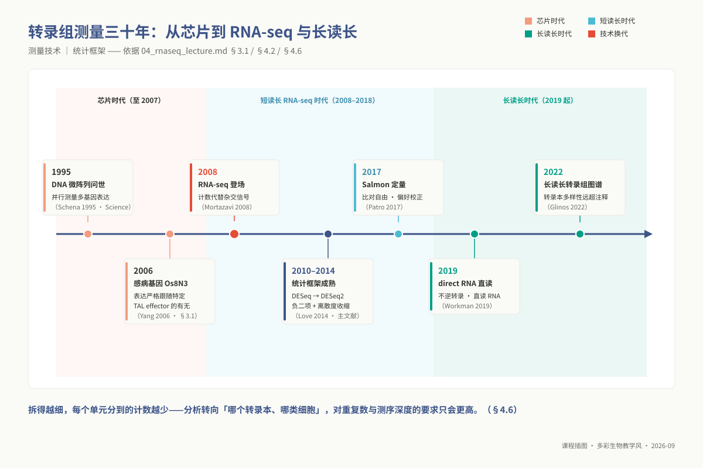

# 专题 m04：转录组分析

> **适用对象**：硕士研究生，4 学时（2 h 理论 + 2 h 实践）。
>
> **阅读重点**：先判断建库与定量策略，再用设计矩阵、负二项模型和输出诊断支撑差异表达结论。

| 项目 | 内容 |
|------|------|
| **专题 id** | `m04` ｜ 目录 `topic04_rnaseq` ｜ 4 学时（2 h 理论 + 2 h 实践） |
| **核心工具** | `STAR` `Salmon` `DESeq2` `clusterProfiler`（`tximport` 是上下游之间的桥） |
| **运行环境** | `ngs_ms_base` + `ngs_ms_transcriptome`（`conda env create -f 07_envs/conda/env_master_transcriptome.yml`）。**m04 与 m05 共用一个环境**：m05 的差异 peak 要与本讲的差异基因取交集，分环境会被迫跨环境搬矩阵 |
| **配套脚本** | `03_code/master/scripts/04_rnaseq_quant.sh`（上游定量，含 SGE 作业头）、`03_code/master/scripts/04_deseq2_analysis.R`（下游统计与富集） |
| **L1 锚点** ⚠ | **§4.3 差异表达分析**（博士 p03 依赖）与 **§4.4 表达矩阵与 DESeq2 输出**（博士 p06 依赖）被契约 `prerequisite_packs.L1.mappings` 直接引用，按"可脱离全文单独阅读"写 |

## ① 学习目标

学完本专题，你应当**能够**：

1. **判断** 一个课题该用 polyA 富集还是 rRNA 去除、该不该做链特异性文库，**说出**选错会丢失哪一类转录本；并**解释** `-l A`、`--gcBias`、`--validateMappings`、`--sjdbOverhang` 各自在校正什么。
2. **写出** `~ condition` 与 `~ batch + condition` 两种设计公式，**说出**二者估计的是什么、`results()` 默认报告的是哪个系数、完全混杂时为什么无解。
3. **区分** Wald 检验与 LRT 的适用场景，并**判断**一个时序侵染实验该用哪一个。
4. **逐列解释** `results()` 输出的六列，**说出** `padj` 为 `NA` 的三种成因各自对应哪一步处理。
5. **区分** `counts` / `vst` / `rlog` / `TPM` 四种矩阵形态，并**为给定下游方法（WGCNA、GSEA、热图、差异检验）选出正确的那一种**。
6. **读出** `plotDispEsts()` 图并**判断**离散度估计是否正常；**解释** `lfcShrink()` 收缩了什么、为什么它不改变 `padj`。
7. **选对** 富集分析的背景基因集，并**说明**用全基因组当背景为什么会系统性放大显著性。
8. **迁移** 上述判断到自己课题的表达数据，写出经得起审稿人追问的方法学说明。

## ② 前置检查

本专题依赖以下 L0 模块，**跟不上时按下表回查**，不要硬啃——本讲一多半时间在 R 里，R 不熟会全程卡在语法而非统计上。

| 依赖模块 id | 本讲哪里用到 | 不过关的典型症状 | 对应自测题 |
|---|---|---|---|
| `l0_02_r` | ⑤ 全部下游代码；⑥ 结果表筛选与作图 | 拿到 `res` 不知道怎么按 `padj` 排序筛选；`ggsave` 出来的图全是方块字 | 第 3 题（按 `padj` 筛选，该题原文用的就是差异表达结果表）、第 4 题（`group_by`/`summarise` 与 `.groups`）、第 6 题（宽表转长表——画表达量分面图的前提）、第 8–10 题（上机） |
| `l0_04_formats` | ④ 转录本 FASTA vs 基因组 FASTA；⑤ 从 GTF/GFF3 生成 `tx2gene` | 把 `genome.fa` 当成 `transcripts.fa` 去建索引；不知道 GTF 第 9 列的 `transcript_id`/`gene_id` 在哪 | 第 5 题（凭条数与平均长度判断文件是 reads 还是参考序列）、第 6 题（GFF3 的父子层级——`tx2gene` 就是这层关系）、第 7 题（1-based vs 0-based） |
| `l0_05_qc` | ⑤ 步骤 1 的 fastp / MultiQC；⑥ 低映射率回溯质控 | 看到 RNA-seq 重复率 60% 就去做 `MarkDuplicates` | 第 4 题 (a)（RNA-seq 前 12 bp 报 FAIL 是随机六聚体偏好，**不该处理**）、第 4 题 (c)（**RNA-seq 不做去重**）、第 3 题 (b)（GC 双峰 = 污染）、第 8 题（上机） |
| `l0_06_stats` | ④ 全部统计推断；⑦ 统计插件整节 | 说不出为什么不能对 counts 做 t 检验；分不清 `pvalue` 与 `padj` | **Q3**（counts 的均值-方差、反推 α）、**Q5**（多重检验规模与 Bonferroni/BH 取舍）、**Q6**（批次与混杂）、**Q7**（生物学 vs 技术重复）、**Q9**（上机·契约点名必考：为什么不能对原始 counts 做 t 检验）、**Q10**（上机：那 985 个假阳性） |

`l0_06_stats` Q10 里那 985 个假阳性，本讲会以真实数据的形式再遇见一次——那正是 §⑦ 讲 `independentFiltering` 的起点。**30 秒自查**（四条都过再往下）：

```bash
conda activate ngs_ms_transcriptome
salmon --version                                # salmon 1.10.3
STAR --version                                  # 2.7.10b
Rscript -e 'packageVersion("DESeq2")'           # 1.4x.x
Rscript -e 'packageVersion("tximport")'         # 若报错见 ⑨-E0：本环境需补装
```

## ③ 背景与科学问题

RNA-seq 回答的是**"在这个条件下，哪些基因的稳态 mRNA 丰度变了、变了多少"**。三个限定词各有代价：**稳态丰度** = 转录 − 降解，观察到上调可能是转录激活也可能是 mRNA 更稳定，RNA-seq 分不开（要分开得做 GRO-seq / SLAM-seq）；**相对丰度**——测序产出的是组成性数据，少数基因暴涨会把其余基因的相对值一起压下去，看起来像"全基因组普遍下调"，这是归一化要处理的第一件事（§4.2）；**它不回答"谁让它变的"**，上游调控者要靠 m05 的 ChIP-seq / ATAC-seq 定位，这正是大纲把 m05 紧接在 m04 之后的原因。

一份站得住的差异表达结论要同时扛住三个追问，本讲结构就按这三问搭：**数字对不对**（定量有没有把 read 归给正确的转录本——§4.1；错了会让多基因家族如植物 NLR、病原 effector 的表达量系统性错配）；**比较公不公平**（组间差的是生物学还是文库深度与组成——§4.2 + §4.3；错了会报出一堆"下调基因"，其实只是对照组测得更深）；**可信度多少**（这 800 个差异基因里有多少是噪声——§4.3 + ⑦；错了富集出来的通路全是假的，审稿人第一刀就砍这里）。

**案例数据（已确定 2026-08-30）**：`PRJDB36269`「水稻根复氮后 2 小时内的时序 ATAC-seq 与**配套 RNA-seq**」——**与 m05 的 ATAC 出自同一批样本**，这正是 m05 做"差异 peak ∩ 差异基因"的前提。取 Z 基因型、对照(K) 与复氮(N) 都有的配对时间点 30/60/120 分钟，得 `2 处理 × 3 时间 × 2 重复 = 12 个样本`。**⚠ 只有 2 个生物学重复**（不是 3）：设计公式用 **`~ rep + time + treatment`**，`rep`(A/B) 正好充当本讲 4.3 要教的 **batch**；时序对比用 **LRT**（对照 `~ rep + time`）。残差自由度 7，DESeq2 可稳定估离散度。**样本量的限制不要回避**——⑦ 正要求学生说明"结论的边界在哪"。参考基因组 `GCA_001433935`（IRGSP-1.0）。全集 32 GB，**必须降采样**：`bash 06_data/master/download_master.sh --topic m04 --subsample 3000000`（约 2 GB）。详见 `06_data/master/README.md`。

### 3.1 应用案例：转录组如何找到感病基因——SWEET 的发现与"编辑抗病"

**研究问题**：水稻白叶枯病菌（Xoo，本科层与 `m02`/`m03` 的主线病原）侵入后并不直接杀死细胞，而是用 TAL effector "劫持"宿主的糖转运基因为自己供糖。哪些宿主基因被病原**特异地**激活？这份清单就是感病基因的候选池。

**转录组给出的答案**：Yang 等（2006，*PNAS*）比较了携带不同 TAL effector 组合的菌株侵染后的水稻基因表达：大部分上调是普遍的胁迫响应，唯 *Os8N3*（SWEET 家族糖转运蛋白）的表达严格跟随特定 effector 的有无——"菌株 × 基因"的诱导模式把上万基因缩到一个候选。后续遗传实验证实：*Os8N3* 突变后植株抗病——它不是防御基因，而是被病原收买的**感病基因**。

**从候选到产品**：TAL effector 的 DNA 识别密码破译后，靶基因变得可预测；Li 等（2012，*Nature Biotechnology*）用 TALEN 编辑 *OsSWEET14* 启动子上的 effector 结合位点——保留基因自身功能、只拆掉病原的"把手"——得到抗病而不牺牲产量的水稻。这是"转录组定位 → 基因编辑落地"的完整闭环。

**教学启示**：① 4.3 的设计公式教的就是"对照怎么排，才能把特异响应从背景里拆出来"——Yang 等的结论完全依赖对照组选得对；② 转录组给候选与机制假设，因果必须靠遗传或编辑实验——与 `m02` ⑦ 的边界同款；③ 本课主线（`PRJDB36269` 复氮时序）用同一套定量与 LRT 找时序响应基因，得到的候选同样要走完验证才算数。

## ④ 核心原理

> 硕士层深度：**讲清算法思路与适用边界**，不做推导。要公式见 ⑪ 的原始文献。

### 4.1 建库与定量：两个决定"数字对不对"的选择

| 建库选择 | 保留什么 | 代价 | 什么时候必须这么选 |
|---|---|---|---|
| **polyA 富集** | 成熟 mRNA | 丢非编码 RNA、原核转录本；样本降解时 3' 偏倚严重 | 真核、RIN ≥ 7、只关心蛋白编码基因 |
| **rRNA 去除** | mRNA + lncRNA + 未成熟转录本 + 原核 mRNA | 需更高测序量（rRNA 去不干净等于白测） | 原核、FFPE/降解样本、关心 lncRNA 或内含子滞留 |
| **链特异性** | 转录方向；不选则反义转录本与基因组上重叠的基因对无法拆分（细菌尤其严重） | 几乎无代价，成本略高 | **默认应该选**。Salmon 的 `-l A` 会自动侦测并写进 `lib_format_counts.json`（§6.1 必看） |

**比对器的选择。** RNA read 可能跨内含子，DNA 比对器（BWA/Bowtie2）会把跨剪接位点的 read 判为不匹配或大段软剪切。**STAR** 采用剪接感知比对：寻找最大可映射前缀（MMP），在剪接位点断开后继续搜索下一个外显子；`--sjdbGTFfile` 配合 `--sjdbOverhang`（取读长−1）可把已知剪接位点预先注册进索引。

**Salmon** 不追求碱基级坐标，而是判断 read 与哪些转录本**兼容**，再用 EM 算法按当前丰度估计分摊多重兼容的 read。与“STAR + featureCounts”相比，它不会默认丢弃这类 read；这对 NLR、effector 等同源基因家族尤其重要。**decoy-aware 索引**还把基因组序列加入索引，使内含子残留、gDNA 污染和未注释区的 reads 有机会被归入 decoy，而不是被强行分配给相似转录本。

**EM 在分摊什么：多重分配的直觉**。一条 read 与多个转录本兼容时（多重比对），Salmon 不能"扔"也不能"全给"：它按当前丰度估计把这条 read **按比例伪计数**到各候选转录本，再用分配结果重估每个转录本的丰度，反复迭代直到份额不再变化——EM 的不动点正是似然的极大值点。起点由唯一比对 read 决定，唯一比对越多、多重 read 越少，结果越稳。**EM 治不了的退化**：一组转录本若与 read 完全等价兼容（等价类），组内怎么分都改变不了似然，信息天花板就在那里——这正是 5.2 `--numBootstraps` 存在的理由：给定量值配上不确定度。

顺带解释一个常见困惑：Salmon 与 STAR + featureCounts 对同一基因给出不同 counts，第一嫌疑就是多重比对 read 的归宿——后者默认丢弃、前者按比例分摊，两者都不是 bug，只是对"分不出去的证据"采取不同策略（对多基因家族，Salmon 的做法更接近真实）。

**`--gcBias` / `--seqBias` 各在校正什么**。建库不是均匀采样：片段被观测的概率会随 GC 含量变化，片段从转录本哪个位置断开也有位置偏好。Salmon 将“给定 GC 或位置的片段被观测到的概率”作为模型条件项，并用观测数据估计偏好曲线，再校正丰度。

这些开关只能处理可建模的偏差。建库失败或 rRNA 污染无法靠它们修复，所以仍需核查 6.1 的 mapping rate 与 library format。

**选型结论**：只要表达量 → **Salmon**（比「比对+计数」快一个数量级以上、内存远低于 STAR 建索引、多重比对更诚实；具体倍数以本机实测为准）；需要坐标 BAM（rMATS 可变剪接、IGV、与 m05 联合）→ **STAR**；非模式物种注释很差 → **STAR + StringTie** 先组装转录本再定量（Salmon 依赖已有转录本序列）。

### 4.2 归一化困局：为什么 TPM 无法胜任组间差异表达检验

在转录组分析中，初学者最常犯的一个经典概念错误是：“既然 TPM 既校正了基因物理长度又校正了样本测序深度，那我直接拿各样本的 TPM 矩阵去做两组之间的 t 检验或 Wilcoxon 检验不就行了吗？”

这一做法在统计学上是彻底站不住脚的，其背后隐藏着两个致命的数理硬伤：

**第一，TPM 彻底抛弃了样本计数的方差信息（抽样置信度丢失）**。
在统计推断中，要判断两组样本的均值差异是否显著，分母必须除以估计的标准误。而在高通量测序的离散抽样体系中，测序计数（counts）的随机波动方差严格依附于原始计数的绝对数值。以一个具体的极端场景为例：

- 在样本 A（小文库，总深度 1 M reads）中，某基因观测到了 1 个 read；
- 在样本 B（大文库，总深度 100 M reads）中，同一基因观测到了 100 个 reads。
若计算 CPM 或 TPM，该基因在两个样本中的数值是完全相同的。然而，在统计证据的刚性层面，基于 1 个 read 算出的数值具有巨大的泊松抽样随机震荡（真实值可能恰好是 0，也可能是 3，变异系数高达 100%）；而基于 100 个 reads 算出的数值则具有极高的测量置信度（变异系数仅为 10%）。

DESeq2 和 edgeR 等专业差异分析软件，其底层负二项广义线性模型（NB-GLM）必须以原始未稀释的**非负整数 counts** 作为输入，因为只有整数 counts 才能还原出真实的二项抽样方差结构；而 TPM 作为一个被强行连续化、除权后的相对点估计，将所有的方差信息彻底抹杀，使其丧失了进行严格假设检验的数理资格。

**第二，TPM 的组成性闭合约束伪造了人工负相关（Simplex 几何失真）**。
TPM 的计算公式强制要求每一个样本内所有基因的表达量总和归一化为常数 $10^6$。这种“常数和约束”使得数据脱离了自由的欧氏空间，被强行投影到了一个被称为单纯形（Simplex）的闭合流形中。在组成性数据中，任何一个或少数几个高丰度基因的剧烈转录爆发（例如植物在遭受病原菌侵染时防卫蛋白或病程相关蛋白转录量暴增，或者某些样本中核糖体 RNA 剔除不彻底导致少量 rRNA 占据了 30% 的通量），必然会导致样本内其余成千上万个表达量完全未变的背景管家基因在 TPM 上的分母被动膨胀、数值集体断崖式下挫。

若直接对比 TPM，这些完全无辜的基因将被生信软件错误地宣判为“显著下调”。

**DESeq2 的 median-of-ratios 是如何巧妙解耦的**：
为了规避组成性偏差，DESeq2 提出了中位数比值归一化算法（Median-of-Ratios）。其算法思路极其优雅：
首先，对每个基因跨所有样本计算其几何平均值，构建出一个虚拟的“伪参考样本”（Pseudo-reference sample）；
其次，计算每个样本中每个基因的原始计数相对于该伪参考的比值；
最后，**取该样本所有基因比值的中位数**，作为该样本的文库大小因子（Size Factor）。
中位数是一个极具鲁棒性的稳健统计量（Breakdown point 高达 50%）。只要细胞中至少有一半的基底基因在处理前后保持稳定表达，无论少数几个极端基因如何暴涨或残存 rRNA 如何狂飙，它们引起的剧烈波动都只落在分布的两端，完全无法动摇中位数的数值。edgeR 所采用的 TMM（Trimmed Mean of M-values，截尾均值）算法则是基于同样的思想，通过在对数表达比值与绝对丰度两个维度上剔除极端上下分位数后再取加权均值，有效抵御组成性畸变。

### 4.3 差异表达分析

> **提示**：这是 **L1 锚点（博士 p03 宿主-病原互作组学）**。本节按可单独阅读编写：只需 `l0_06_stats` 的负二项与 FDR 概念，**不必读本讲的上游定量部分**。p03 的时序侵染实验要用本节最后的 **LRT**，请读到该小节结束。

#### 4.3.1 负二项广义线性模型（NB-GLM）与泊松-伽马混合直觉

差异表达检验的本质是在特定的统计分布假设下，判断处理因素引起的均值位移是否显著超越了随机变异。

在转录组测序中，为什么经典的泊松分布（Poisson Distribution）会彻底失效？
泊松分布是描述稀有随机事件的数学模型，它拥有一个极其刚性的理论假设：**方差严格等于均值（$\text{Var}(Y) = \mu$）**。如果我们在同一管 RNA 提取物中连续进行多次技术重复建库测序，由于仅仅涉及分子的随机物理抽样，测序数据的散布确实极其精准地契合泊松分布。然而，生命科学实验面向的是真实的**生物学重复（Biological Replicates）**。

即使是处于同一生长箱内相同光照处理下的同一批近交系植株，个体细胞内部的微环境涨落、转录爆发（Transcriptional bursting）以及个体发育状态的微小差异，都会导致该基因在不同生物个体体内的真实表达浓度 $\lambda$ 本身不再是一个固定常数，而是一个在群体中波动的连续随机变量。

在概率论中，如果假定技术抽样服从均值为 $\lambda$ 的泊松分布，而真实生物个体的表达量 $\lambda$ 本身服从以 $\mu$ 为中心、参数为 $\alpha$ 的伽马分布（Gamma Distribution），那么将这两个随机过程进行积分复合（Poisson-Gamma Mixture），得到的边际分布在数学上精确推导出了**负二项分布（Negative Binomial, NB）**：
$$K_{ij} \sim \text{NB}(\mu_{ij}, \alpha_i)$$
其方差函数被严格刻画为：
$$\text{Var}(K_{ij}) = \mu_{ij} + \alpha_i \mu_{ij}^2$$
这个简洁优美的二次多项式揭示了转录组数据的根本规律：方差由两部分构成，第一项 $\mu_{ij}$ 来自测序仪随机抽样的技术泊松散布，第二项 $\alpha_i \mu_{ij}^2$ 则精确刻画了生物个体之间异质性引起的**超额离散（Overdispersion）**。参数 $\alpha_i$ 即为离散度参数（Dispersion parameter）。对于低表达基因，二次项微乎其微，方差由泊松主导；对于高表达基因，平方项 $\mu^2$ 迅速占据压倒性主导，真实生物学离散度成为了决定方差的绝对支配力量。

#### 4.3.2 离散度的经验贝叶斯收缩（Empirical Bayes Shrinkage）

在真实的科研实验中，受限于经费与样本获取难度，研究者通常只能提供 3 到 5 个生物学重复。在样本量如此贫乏的条件下，要在单个基因上同时无偏估计均值 $\mu_i$ 和离散度 $\alpha_i$，在纯数学上是不可能的任务——单个基因经验方差的抽样波动极其剧烈，极易因为个别样本的随机扰动产生极小或极大的方差估计，从而在假设检验中引发毁灭性的假阳性（误以为方差极小而将微弱差异判为显著）或假阴性。

DESeq2 开创性地利用全基因组信息共享机制，设计了**三步经验贝叶斯离散度收缩算法**：

1. **单基因最大似然估计**：首先仅根据每个基因自身 3–5 个重复的实际数据，独立拟合出一个原始的最大似然离散度估计值（`dispGeneEst`）；
2. **全局均值-离散度趋势线拟合**：将全基因组数万个基因的均值与其原始离散度绘制在二维平面上，利用局部平滑回归（parametric 或 local regression）拟合出一条代表全基因组平均离散水平的均值-离散度光滑趋势线（`dispFit`）；
3. **经验贝叶斯经验收缩**：以全局趋势线作为经验先验分布，利用经验贝叶斯框架，将每个基因自身的离散度估计值向趋势线进行收缩压缩，得到最终用于假设检验的稳健离散度（`dispersion`）。
收缩的幅度在数学上与基因的表达量和离散度的标准误挂钩：低表达基因由于数据量稀疏、单基因方差不可信，会被强力拉向全局趋势线，有效消除了低丰度下的人造假阳性；例外是基因级离散度估计远高于趋势线的离群基因（`plotDispEsts` 中带蓝圈的点）：它们不被收缩、保留基因级估计，避免检验过于激进。这与 Cook's 距离是两回事：Cook's 距离查的是单个样本的离群计数，触发时 `results()` 把该基因 p 值置 NA（每组仅 2 个样本时不做此检查）。

#### 4.3.3 设计矩阵与协变量解耦：`~ condition` vs `~ batch + condition`

广义线性模型（GLM）通过设计公式将实验因素转化为线性代数方程：
$$\log_2(\mu_{ij}) = x_{j \cdot} \beta_i + \log_2(s_j)$$
其中 $s_j$ 是文库大小因子（以模型 offset 形式进入，从源头避免了除法破环方差结构），$\beta_i$ 是待估计的效应系数向量。

设计公式的书写直接映射着统计假设的空间结构：

- **`design = ~ condition`**：模型将所有未被处理解释的样本间差异一概当成组内随机残差。如果实验中存在未被声明的批次效应，原本由批次引起的系统性偏移将被强行揉碎吞入残差项，导致离散度参数 $\alpha$ 被系统性拔高，模型检验效能极度保守，大量真实的差异基因被无辜漏网；
- **`design = ~ batch + condition`**：模型将批次作为一个独立的主效应列向量纳入回归矩阵，处理效应 $\beta$ 此时是在“固定批次基准线”之后推导出的净生物学差异。其代价是消耗 1 个统计自由度，但对于存在明显批次偏移的数据，它能极大压低残差方差，释放出巨大的统计检出功效；
- **排布陷阱与完全混杂警示**：在 R 语言的公式系统中，默认最后声明的变量为主研究变量。若误写为 `~ condition + batch`，`results()` 函数在不加参数时会默认报告批次引起的差异；更严重的致命错误是处理与批次的完全混杂（如对照全在批次 1，处理全在批次 2），此时两列线性共线，设计矩阵代数秩亏，DESeq2 会抛出 `model matrix is not full rank` 错误并直接拒不运行。

#### 4.3.4 假设检验的选择：Wald 检验 vs 似然比检验（LRT）

面对推导出的回归系数，选择何种统计检验直接取决于科学问题的结构：

**Wald 检验（两组对比的标准武器）**：
针对某一个特定的对比系数 $\beta_k$（例如处理组相对对照组的 $\log_2 \text{Fold Change}$），计算 Wald 统计量 $W = \hat{\beta}_k / \text{SE}(\hat{\beta}_k)$。在零假设 $\beta_k = 0$ 成立时，统计量渐近服从标准正态分布（或卡方分布）。Wald 检验的特点是针对性极强，能够直接为每一个基因输出具体的倍数变化方向与标准误，非常适合用于离散的两水平处理比较（如敲除株 vs 野生型）。

**似然比检验（LRT，时序与复杂因子的全局标尺）**：
针对涉及多于两个水平的因子、连续侵染时序（如 0, 6, 12, 24, 48 小时）或基因型与处理的交互效应（`genotype:treatment`），Wald 逐对比较不仅会引发严峻的多重检验次数膨胀，更无法回答“该基因在整个时间轴上是否存在任何显著的动态表达变化”。
此时必须采用 LRT。LRT 的数学逻辑是比较两个嵌套模型：完整模型（Full model，似然为 $L_{full}$）与剔除了**待检验项**的简化模型（Reduced model，似然为 $L_{reduced}$）。LRT 检验的就是被剔除的那一项：剔除时间项，检验「时间整体效应」；本课脚本 full=`~rep+time+treatment`、reduced=`~rep+time`，检验的是处理项。检验统计量为对数似然比的两倍：
$$D = 2 \ln\left(\frac{L_{full}}{L_{reduced}}\right)$$
在零假设下，$D$ 渐近服从卡方分布，自由度等于两个模型参数量的差值。若剔除的是时间项，LRT 的 p 值回答的就是“时间因子作为一个整体，是否对该基因的表达有不可忽略的作用”；结果表的 `log2FoldChange` 列只是完整模型最后一个系数的估计，不代表 LRT 检验的整体变化。在拿到 LRT 显著基因集之后，再利用模糊 C 均值或 `degPatterns` 对时序表达谱进行模式聚类，是植物与病原物时序侵染研究的标准范式。

#### 4.3.5 独立过滤（Independent Filtering）：多重假设检验的解绑术

在测序得到的两万多个基因中，低表达或未表达基因（如 counts 长期处于个位数或零）不仅自身信噪比极差、缺乏统计功效，更会在全基因组层面上形成巨大的多重检验负担。

在经典的 Benjamini-Hochberg（BH）FDR 校正算法中，校正后 p 值的计算公式为：
$$p_{adj(i)} = \min_{k \ge i} \left\{ \frac{m}{k} \cdot p_{(k)} \right\}$$
其中 $m$ 是全基因组参与检验的基因总数，$k$ 为原始 p 值的升序排名序号。可以看到，每一个基因的真实 p 值在换算为 $p_{adj}$ 时，都要被乘上一个巨大的放大系数 $m / k$。如果基因组中充斥着上万个原本就毫无差异表达希望的超低丰度基因，全基因组的检验总量 $m$ 被极度虚高，导致所有处于边缘临界的真实差异基因被残酷地压制在 $p_{adj} < 0.05$ 门槛之外。

DESeq2 的独立过滤算法在多重检验校正前，引入了一个与检验统计量（比值及其正态性）在零假设下在统计上互相独立的**过滤变量——全样本归一化均值 `baseMean`**。
算法自动扫描不同的 `baseMean` 过滤分位数阈值：随着阈值的逐步提升，低表达噪音基因被逐步剔除，检验总数 $m$ 迅速缩小；算法精准寻找使全基因组通过显著性阈值（$p_{adj} < \alpha$）的基因总数达到全局极大值的那个最优切点。被独立过滤机制拦截的基因，其原始 `pvalue` 是正常存在的，但 `padj` 会被规范性地赋予 `NA`。**这是算法为了拯救高表达真实基因而主动实施的数理减负，绝非软件故障，严禁在事后用原始 p 值私自打捞。**

### 4.4 表达矩阵与 DESeq2 输出

> **提示**：这是 **L1 锚点（博士 p06 多组学整合分析）**。本节按可单独阅读编写：p06 假定表达矩阵已经在手，**上游定量 §4.1 可整段跳过**。若你只上 p06 不上 p03，§4.3 里补读「`results()` 六列」与「`padj` 为什么是 NA」两小段即可（约 10 分钟）。

**（1）`dds` 对象里装着什么**：`counts(dds)` 原始整数矩阵（基因 × 样本）；`counts(dds, normalized = TRUE)` 除以 size factor 后仍在计数尺度上的矩阵；`colData(dds)` / `design(dds)` 样本元数据与设计公式；`sizeFactors(dds)` 每样本一个校正因子；`mcols(dds)` 基因层面的中间量（`dispGeneEst` / `dispFit` / `dispersion` 与各 β）；`assay(vst(dds, blind = FALSE))` 方差稳定化矩阵。

**（2）四种矩阵形态，各自是什么、去哪里**

| 形态 | 怎么来 | 尺度与性质 | **正确去向** | **喂错了会怎样** |
|---|---|---|---|---|
| **raw counts** | `counts(dds)` / `txi$counts` | 非负整数，方差随均值增长 | DESeq2 / edgeR 的**唯一合法输入** | 拿去做 PCA、聚类、相关网络：高表达基因的方差碾压一切 |
| **normalized counts** | `counts(dds, normalized=TRUE)` | 校正了深度，方差仍随均值增长 | 画单个基因的表达柱状图 | 被当成"可以直接做相关分析的矩阵" |
| **vst / rlog** | `vst(dds, blind=FALSE)` / `rlog(dds)` | log₂ 尺度，**方差与均值近似无关** | PCA、样本聚类、热图、**WGCNA**、MOFA2 等一切基于距离/相关的方法 | —— |
| **TPM** | `quant.sf` 的 `TPM` 列 / `txi$abundance` | 组成性（每样本和 = 10⁶），未做方差稳定 | 同一样本内跨基因比较、给人看的表达量表 | 见下方 ⚠ |

`vst` 与 `rlog` 怎么选：**`vst` 快得多（DESeq2 vignette：约 20 个样本时 rlog 约 30 s、vst 不到 1 s）；n ≥ 30 时 `rlog` 会提示耗时并建议改用 `vst`**。两者都要写 `blind = FALSE`——默认的 `blind = TRUE` 会忽略 design 重新估离散度，那是给纯质控探索用的。

**不要用 `log2(counts+1)` 代替**：加常数取对数在低表达端**放大**方差（counts 1→2 与 1000→2000 在 log2 上一样是差 1），结果是一堆表达量个位数的噪声基因在 PCA 与相关矩阵里获得了与真高表达基因同等的话语权；vst / rlog 做的正是把低表达端的方差压回去。

**（3）⚠ p06 最常踩的坑：WGCNA 的输入首选 vst 或 rlog**

**喂 raw counts 给 WGCNA，软阈值曲线往往上不去**（WGCNA FAQ 推荐 vst，也允许对 normalized counts 做 `log2(x+1)`；FAQ 未提 TPM，下文 TPM 的问题是机制推理）。 表现是 `pickSoftThreshold()` 扫描 power 1–30，无标度拓扑拟合优度 `SFT.R.sq` 始终上不去（常年卡在 0.3–0.6，够不到常用的 0.8），`estimate` 返回 `NA`；于是有人把 power 硬调到 24、30 交差，得到的模块结构是噪声。原因是 WGCNA 整条链路建立在**基因间 Pearson 相关**上，而相关系数对方差结构极度敏感：**raw counts** 的方差随均值增长，少数高表达基因主导整个相关矩阵，且所有基因都跟着文库深度一起动，全基因组相关系数被推向正值且高度集中，相关矩阵几乎没有结构，自然拟合不出无标度拓扑；**TPM** 的组成性约束（每样本和恒为 10⁶）人为制造负相关，同时低表达基因的 TPM 抖动极大（一条 read 的差别就能让 TPM 翻倍），这些噪声基因被塞进模块，模块 eigengene 与性状的关联随之变成假信号。

```r
vsd <- vst(dds, blind = FALSE)
mat <- assay(vsd)
mat <- mat[order(rowVars(mat), decreasing = TRUE)[1:5000], ]  # 按方差取 top N，不是按均值
datExpr <- t(mat)                                             # WGCNA 要 样本 × 基因（转置！）
```

三个连带易错点：① **不要**在 vst 之后再取一次 log；② 取子集按**方差**排序而不是均值（WGCNA 找的是共变，不是高表达）；③ WGCNA 的矩阵方向与 DESeq2 相反，忘记 `t()` 时报错发生在很后面，极难回溯。

**（4）下游要什么，取决于下游方法的假设**

| 下游 | 要的输入 | 一句话理由 |
|---|---|---|
| DESeq2 / edgeR 差异检验 | raw counts | 负二项模型要计数与文库大小 |
| PCA / 样本聚类 / 热图 | vst 或 rlog（热图再做行中心化） | 基于欧氏距离，需要方差齐 |
| **WGCNA / MOFA2 / 相关网络（p06）** | **vst 或 rlog** | 基于相关，见上 |
| ORA 富集（GO/KEGG） | **基因 ID 列表** + 明确的背景基因集 | 超几何检验只看"在不在列表里" |
| GSEA | 全部基因的**排序向量**（不设阈值） | 见 §4.5 |

### 4.5 功能富集：ORA 与 GSEA 的分工

**ORA**（超几何检验，`enrichGO` / `enrichKEGG`）问："我这 800 个差异基因里属于通路 P 的比例，是否显著高于背景里的比例？"它**依赖你先卡阈值**，阈值一动结论就动。**GSEA** 不卡阈值：把全部基因按某统计量排序（推荐用 `lfcShrink` 后的 log2FC 或 `stat` 列），检验通路成员是否在排序两端聚集。**当效应是"整条通路轻微协同变化"时，ORA 一个基因都富集不出来，而 GSEA 能抓到**——这是两者最实质的分工。

**背景基因集（`universe`）是 ORA 最容易出错的参数**：不传 `universe` 时 clusterProfiler 用 OrgDb 里**全部**注释基因当背景，但你的实验根本没检测到其中大半（低表达、组织特异不表达）。分母被人为放大 → `GeneRatio / BgRatio` 虚高 → p 值系统性偏小。**正确背景是"本次分析中被检验过的基因"**，即 `rownames(res)`，且这条必须写进论文方法学部分。另有一层系统性偏差：长基因、高表达基因更容易达到显著，差异列表天然富集长基因，含长基因多的通路（如"细胞骨架组织"）总排在前面；`goseq` 用长度加权的 Wallenius 分布校正它，非模式物种做 GO 富集时值得跑一遍对照。

### 4.6 技术前沿（2023–2026）

**长读长把"转录本"变成直接观测对象**。Iso-Seq（PacBio 全长 cDNA）与 ONT direct RNA（不逆转录、直读 RNA 分子，Workman 等，2019）能观测完整的转录本组合——剪接位点成对出现、融合基因不再靠短读长拼图推断。2022 年发布的人类多组织长读长转录组图谱（Glinos 等，2022）表明，每个组织的转录本多样性远超现有注释。**选型边界**：direct RNA 能直读碱基修饰但产量低、对 RNA 完整性要求高；当前最务实的组合是"短读长定量 + 长读长更新注释"，把 Salmon 的索引换成经长读长校正的转录本集。

**单核 RNA-seq：解离不了的组织怎么办**。植物原生质体制备会诱导伤口响应基因、且只适用于幼嫩组织；单核测序（snRNA-seq）绕过解离，可用于冷冻保存样本与木质化组织。代价是核内 mRNA 谱与胞质不同（未成熟转录本占比高、3′ 偏倚更强），与常规 RNA-seq 的定量口径不可直接混用。

**DTU：基因总量不变、转录本配比变了**。差异表达（DE）检验基因的总计数，检测不到"总量不变、isoform 配比切换"的调控——这在逆境与免疫响应中常见。差异转录本使用（DTU）分析用 Dirichlet-multinomial 框架直接检验转录本占比（Nowicka 与 Robinson 的 DRIMSeq，2016），其输入正是 4.1 保留下来的转录本水平估计——这是"用 Salmon、不丢多重比对 read"的又一个下游理由。

三个方向的共同点：都在把"基因总量"这个粗粒度拆细——分析重心从"哪个基因变了"转向"哪个转录本、哪类细胞、哪个位置"。但拆得越细，每个单元分到的计数越少，对重复数与测序深度的要求只会更高——4.4 的矩阵选型与 4.5 的富集分工在这样的数据上依旧成立，只是粒度变了。



*图 m04-2：从芯片到转录组图谱：1995 微阵列 → 2008 RNA-seq → DESeq2 → 长读长 direct RNA。*

## ⑤ 操作步骤

> 完整脚本见 `03_code/master/scripts/04_rnaseq_quant.sh` 与 `04_deseq2_analysis.R`。此处给关键命令与**每个参数为什么取这个值**。

### 5.1 质控（沿用 `l0_05_qc`，不重讲）

```bash
fastp -i ${S}_R1.fq.gz -I ${S}_R2.fq.gz -o clean/${S}_R1.fq.gz -O clean/${S}_R2.fq.gz \
      --detect_adapter_for_pe --cut_tail --cut_mean_quality 20 --length_required 50 \
      -w 4 -h qc/${S}.html -j qc/${S}.json
multiqc qc/ -o qc/multiqc
```

**RNA-seq 专属的两条纪律**：① **不做去重**（`l0_05_qc` 第 4 题 (c)：高表达基因的重复 read 是真信号）；② 前 10–15 bp 的 per-base sequence content 异常**不处理**（随机六聚体引物偏好，Hansen et al. 2010）。

### 5.2 Salmon：decoy-aware 索引与定量

```bash
grep '^>' genome.fa | cut -d ' ' -f1 | sed 's/^>//' > decoys.txt
cat transcripts.fa genome.fa > gentrome.fa           # 顺序不能反：转录本必须在前
salmon index -t gentrome.fa -d decoys.txt -i salmon_idx -k 31 -p 16
#   -k 31  最小可接受匹配长度；读长 ≥ 75 bp 用默认 31，读长 < 50 bp 才下调到 21~25
salmon quant -i salmon_idx -l A -1 clean/${S}_R1.fq.gz -2 clean/${S}_R2.fq.gz \
             -p 8 --validateMappings --gcBias --seqBias --numBootstraps 30 -o quant/${S}
#   -l A               自动侦测文库类型，结果写进 lib_format_counts.json（必须核对，§6.1）
#   --validateMappings 用选择性比对给候选打分、滤掉伪比对；1.0.0 起为默认，显式写以自证
#   --gcBias --seqBias GC 与序列偏好校正；样本间 GC 分布有差异时不开会造成系统性偏倚
#   --numBootstraps 30 产出定量不确定度，转录本水平分析（sleuth/swish）需要，基因水平可省
```

### 5.3 STAR：需要坐标 BAM 时（可变剪接 / IGV / 与 m05 联合）

```bash
STAR --runMode genomeGenerate --genomeDir star_idx --genomeFastaFiles genome.fa \
     --sjdbGTFfile anno.gtf --sjdbOverhang 149 --runThreadN 16      # sjdbOverhang = 读长-1
STAR --genomeDir star_idx --readFilesIn clean/${S}_R1.fq.gz clean/${S}_R2.fq.gz \
     --readFilesCommand zcat --runThreadN 8 --outSAMtype BAM SortedByCoordinate \
     --quantMode GeneCounts --outFileNamePrefix star/${S}_
#   --quantMode GeneCounts 产出 ReadsPerGene.out.tab，三列分别对应 无链/正链/反链；
#     选哪一列由文库链特异性决定——选错会得到一份几乎全是噪声的矩阵
```

### 5.4 tximport → DESeq2 → 富集（R）

```r
library(tximport); library(DESeq2); library(clusterProfiler)
files <- file.path("quant", samples$id, "quant.sf"); names(files) <- samples$id
txi <- tximport(files, type = "salmon", tx2gene = tx2gene, ignoreTxVersion = TRUE)
#   ignoreTxVersion=TRUE 去掉 AT1G01010.1 里的 ".1"；GTF 与转录本 FASTA 版本号不一致
#   是 tx2gene 匹配失败最常见的原因（⑨-E1）
coldata <- samples[, c("condition", "batch")]; rownames(coldata) <- samples$id
coldata$condition <- relevel(factor(coldata$condition), ref = "control")  # 显式定参考水平
coldata <- coldata[colnames(txi$counts), , drop = FALSE]                  # 显式对齐顺序
stopifnot(identical(colnames(txi$counts), rownames(coldata)))             # 自检（⑨-E2）

dds <- DESeqDataSetFromTximport(txi, colData = coldata, design = ~ batch + condition)
dds <- dds[rowSums(counts(dds) >= 10) >= 3, ]  # 预过滤：≥3 个样本 counts≥10；
dds <- DESeq(dds)                              # 3 取自"最小组的重复数"，不是拍脑袋
res <- results(dds, contrast = c("condition", "treat", "control"), alpha = 0.05)
res <- lfcShrink(dds, coef = "condition_treat_vs_control", type = "apeglm", res = res)
vsd <- vst(dds, blind = FALSE)                 # PCA / 热图 / 交给 p06 做 WGCNA 的那一份

deg <- subset(as.data.frame(res), !is.na(padj) & padj < 0.05 & abs(log2FoldChange) > 1)
ego <- enrichGO(rownames(deg), OrgDb = org.db, keyType = "GID", ont = "BP",
                universe = rownames(res),   # ← 背景 = 本次被检验过的基因，不是全基因组
                pAdjustMethod = "BH", minGSSize = 10, qvalueCutoff = 0.05)
```

## ⑥ 结果解读

> **本层重心**。硕士层的价值不在会敲命令，而在**拿到输出能判断它对不对**。以下每节都给"正常长什么样"与"不对时长什么样"。

### 6.1 Salmon 的两个必看输出

`quant/${S}/logs/salmon_quant.log` 里的 **mapping rate** 正常为 70–90%（模式物种可达 90%+）。`quant/${S}/lib_format_counts.json` 的 `expected_format` **必须全样本一致**（如都是 `ISR`）；若某个样本单独跑出 `IU`（非链特异），说明它的建库与其他样本不同——这是必须在分析开始前解决的问题，不是可以忽略的小差异。

| 映射率 | 最可能的原因 | 怎么验证 |
|---|---|---|
| < 30% | 索引建错了（用了 `genome.fa` 而不是 `transcripts.fa`） | `grep -c '^>' transcripts.fa` 看数量级：转录本应是几万条、平均 1–3 kb |
| 30–50% | rRNA 未去干净、gDNA 污染、注释不全（非模式物种） | 取未映射 read 去 BLAST；若富集到 rRNA 则是建库问题 |
| 各样本相差 > 20 个百分点 | 样本间质量不齐 | 回看 MultiQC；差的样本考虑剔除并在报告里写明理由 |

### 6.2 PCA：先回答"批次还是处理主导"

| `plotPCA(vsd, intgroup=c("condition","batch"))` 长什么样 | 结论与下一步 |
|---|---|
| PC1 按 condition 分开，重复聚在一起 | 理想，直接往下 |
| **PC1 按 batch 分开、condition 混在一起** | 批次主导 → 用 `~ batch + condition`；若批次与处理完全混杂则**无解**（`l0_06_stats` Q6） |
| 某一重复远离同组另外两个 | 离群样本 → 查 QC、size factor、Cook's distance；决定剔除要在报告里写明理由 |
| PC1 只解释 15%，点云无结构 | 处理效应弱或噪声大 → 别急着降阈值凑基因数，先确认实验本身 |

### 6.3 `plotDispEsts()`：这张图不看等于没做质控

**正常形态**：黑点（基因水平 MLE 估计）呈云状散布；红线（拟合趋势）自左上向右下单调下降后趋平，即**低表达基因离散度高、高表达基因离散度低**；蓝点（收缩后的最终值）明显向红线收拢；少数留在红线上方远处并被标蓝圈的黑点是离群基因，**故意不收缩**以防假阳性。

| 不对时的现象 | 含义 |
|---|---|
| 黑点云极度发散、蓝点被拉成一条线 | 组内异质性大（样本混杂、标注错误），收缩过度掩盖了真实变异 |
| 红线几乎水平且很高（α ≈ 0.5+） | 重复间一致性差；野外/临床样本属正常，同批细胞培养则需查实验 |
| 红线接近 0 且平坦 | 疑似把**技术重复**当成生物学重复（`l0_06_stats` Q7），下游 p 值将严重偏小 |
| `fitType='parametric' ... not well captured` | DESeq2 自动改用 local 回归。**提示不是错误**，但要连着看图确认拟合合理 |

### 6.4 结果表、火山图与富集结果

| 现象 | 通常意味着 |
|---|---|
| 差异基因数为 0，但 PCA 明明分得开 | 先查 `resultsNames(dds)` 与 contrast 方向，再查 design 最后一项是否写错（§4.3） |
| 差异基因 8000+（占检测基因一半以上） | 归一化失败（组成性偏差）或组间有系统性技术差异；先看 size factor 是否跨样本差 3 倍以上 |
| `log2FoldChange` 出现 ±20 这类极值 | 一组几乎全 0、另一组有表达；收缩前正常，**收缩后仍是极值**才需单独核查原始 counts |
| 火山图左右严重不对称 | 可能是真实生物学（逆境下大规模关闭生长基因），也可能归一化没做好——用 MA 图交叉验证，正常 MA 图应围绕 y=0 对称 |

富集结果里 `GeneRatio` = 命中该通路的差异基因数 / 差异基因总数，`BgRatio` = 该通路在**背景集**中的基因数 / 背景集大小，判据是 `p.adjust`。**不对时长什么样**：① 富集出来的全是 "cellular process""metabolic process" 这类最顶层 GO term——差异基因太多太杂，或背景集用了全基因组；② `Count` 只有 2–3 个基因却排在最前——小 term 的显著性不稳，必须设 `minGSSize`（常用 10）；③ 上调与下调基因合在一起做一次富集——生物学上无意义，必须分开做。

## ⑦ 统计插件

**契约焦点：负二项分布、离散度估计、GLM 与 FDR 在差异表达中的作用。**

> **与 `l0_06_stats` 的分工**：L0 已讲完"为什么计数数据用负二项而不是正态、不是泊松"（均值-方差关系、过离散、`Var = μ + αμ²`）、"p 值与 FDR 是什么"、"BH vs Bonferroni 怎么选"、"批次效应与功效"。**这些本节一律不重复。** 本节只讲它们**怎么落到 DESeq2 里**——α 具体怎么估、为什么必须收缩、设计矩阵长什么样、独立过滤如何制造 `padj = NA`、log2FC 收缩解决什么。

**1. 离散度的三步估计：为什么不能一个基因一个 α**

n = 3 时单基因方差估计本身的方差极大，用它算出来的 p 值不可信。DESeq2 的解法是"用全基因组信息给单基因估计打补丁"：

| 步 | 做什么 | 存在 `mcols(dds)` 的哪一列 |
|---|---|---|
| ① **基因水平估计** | 每个基因单独做最大似然，得到粗糙的 α̂ | `dispGeneEst` |
| ② **拟合趋势** | 拟合 α 关于 baseMean 的曲线（`dispersion = a/μ + b`），描述"这个表达水平的基因通常离散度多大" | `dispFit` |
| ③ **经验贝叶斯收缩** | 以趋势线为先验把每个基因的 α̂ 向它拉，拉多少取决于该基因估计的不确定度 | `dispersion` |

**为什么必须收缩**：偶然低估 α 的基因会得到虚高的显著性，这是低重复数实验假阳性的主要来源；收缩用一点偏差换大幅方差下降。**收缩也有代价**：真实离散度确实很高的基因会被拉低而产生假阳性——所以 DESeq2 保留"离群基因不收缩"的例外规则（`plotDispEsts` 图上那些带蓝圈、留在红线上方的点）。这条例外正是 §6.3 那张图要看的东西。

**2. GLM 的设计矩阵长什么样**

```r
model.matrix(~ batch + condition, coldata)
#     (Intercept)  batchb2  conditiontreat
# S1       1          0           0        ← batch1 的对照 = 参考水平，被 Intercept 吸收
# S4       1          0           1
```

① **Intercept 代表参考水平的组合**，其余每列是"相对参考水平的偏移"；② 参考水平由 factor 的 `levels` 第一项决定，默认按字母序——`control` 恰好排在 `treat` 前面纯属运气，`KO` 排在 `WT` 前面就会让所有 log2FC 反号且**不报错**，所以**永远显式写 `relevel()`**；③ 若某列是其他列的线性组合（批次与处理完全混杂），矩阵不满秩、模型不可识别，DESeq2 拒绝拟合（⑨-E5）。

**3. `independentFiltering` 如何影响 `padj` 的 `NA`**

BH 校正的功效取决于检验总数 m。两万个基因里有几千个几乎不表达，它们**不可能**显著却照样占着分母，把所有基因的 `padj` 一起抬高。DESeq2 的独立过滤：以 `baseMean` 为过滤统计量（它在零假设下与检验统计量独立，这正是"独立"的含义），扫描一系列分位数阈值，**选出使 `padj < alpha` 的基因数最多的那个**，被过滤基因的 `padj` 置为 `NA`。

两个实操后果：① `results(alpha = 0.05)` 里的 `alpha` **必须与你实际筛选用的阈值一致**——写 `alpha=0.05` 却按 `padj<0.1` 筛，过滤阈值是按 0.05 优化的，功效并非最优；② 被过滤的基因有 `pvalue` 没有 `padj`，**用 `pvalue` 把它们捞回来等于放弃 FDR 控制**（`l0_06_stats` Q10 演示过后果）。

诊断用 `metadata(res)$filterThreshold` 看阈值实际卡在哪个 baseMean 上。

**4. `lfcShrink()` 解决什么、不解决什么**

某基因对照组 counts 是 (1, 0, 2)、处理组是 (12, 9, 15)：log2FC ≈ 3，但证据薄得可怜，`lfcSE` 极大。**MLE 的 log2FC 在低表达基因上方差爆炸**，直接拿它排序或画火山图，前排会被一堆低表达噪声占满。`apeglm` 用重尾先验做收缩：低表达、高不确定度的估计被显著拉向 0，高表达、证据充分的几乎不动。

**它不改变 `pvalue` 与 `padj`**（那两列来自 Wald 检验，收缩只作用于效应量估计）。所以：**排序、火山图、热图选基因、GSEA 排序向量 → 用收缩后的 log2FC；显著性判断 → 仍看 `padj`。**

**5. 两个阈值是两件事**

`padj < 0.05` 是**统计判据**（这差异不太可能是噪声），`|log2FC| > 1` 是**效应量判据**（这差异大到值得关注）。二者独立，同时用是常规做法，但要清楚它对高表达基因有偏——高表达基因即使 1.2 倍变化也容易显著。若想把效应量并入检验本身（更严格也更正确），用 `results(dds, lfcThreshold = 1)`：零假设变成 `|β| ≤ 1`，得到的 `padj` 才真正对应"倍数变化大于 2 且显著"。

**报告里必须写清三件事**：用了什么模型与设计公式、`padj` 与 log2FC 阈值各是多少、富集分析的背景基因集是什么——这三条正是本次作业「方法选择与结果可信度说明」（占 30%）的评分点。

## ⑨ 常见错误与排查

> 下列 R 报错原文均在 `DESeq2 1.42.0` / `clusterProfiler 4.18.4` 下实测复现；版本不同措辞可能微调，关键词一致。

**E0 — 环境里没有 `tximport` / `apeglm`** ｜ `Error in library(tximport) : there is no package called 'tximport'`
`env_master_transcriptome.yml` 目前只列了 `bioconductor-deseq2` 与 `bioconductor-clusterprofiler`。**解法**：`mamba install -n ngs_ms_transcriptome -c bioconda bioconductor-tximport bioconductor-apeglm bioconductor-enhancedvolcano`，并把这几行补进 yml（⑩ 练习 1）。

**E1 — tx2gene 对不上** ｜ `None of the transcripts in the quantification files are present in the first column of tx2gene.`
`quant.sf` 里是 `AT1G01010.1`、`tx2gene` 里是 `AT1G01010`，或 GTF 带版本号而转录本 FASTA 不带。**解法**：`head -3 quant/S1/quant.sf` 与 `head -3 tx2gene.csv` 逐字比对，版本号不一致时加 `ignoreTxVersion = TRUE`。**本条也可能不报错**——只匹配上一小部分时 `tximport` 会成功返回一个大部分为 0 的矩阵，务必用 `sum(txi$counts)` 核对总量级。

**E2 — 样本顺序不一致（最高频）**

```text
Error in DESeqDataSetFromMatrix(cts, coldata, ~condition) :
  rownames of the colData:
   S2,S1,S3,S4,S5,S6
  are not in the same order as the colnames of the countData:
   S1,S2,S3,S4,S5,S6
```

元数据表是手工排的、counts 矩阵按文件名排序，集合相同但顺序不同。**DESeq2 在这里报错是在救你**：集合都不同（少一个样本）时会先撞上 `ncol(countData) == nrow(colData) is not TRUE`；而若矩阵**根本没有列名**，DESeq2 会直接把 colData 的行名贴上去，**不报任何错、样本标签全错**。

**解法**：`coldata <- coldata[colnames(cts), , drop = FALSE]` 显式重排，再 `stopifnot(identical(colnames(cts), rownames(coldata)))`。

**E3 — 把 TPM / FPKM 喂给 DESeq2** ｜ `Error in DESeqDataSet(se, design = design, ignoreRank) : some values in assay are not integers`
**真正危险的是它有时不报错**：`round(tpm)` 之后全是整数，DESeq2 只打印一句 `converting counts to integer mode` 就照跑，产出一份看起来完全正常、实则彻底错误的结果——TPM 已把长度和深度都除掉了，负二项的方差结构被破坏，size factor 全是 1。**解法**：只用 `txi$counts`（或 `quant.sf` 的 `NumReads`、STAR 的 `ReadsPerGene`）。想让长度校正参与建模，走 `DESeqDataSetFromTximport()`，它把有效长度作为 offset 正确放进模型，**而不是**让你先除一遍。

**E4 — 只有 1 个重复**

```text
Error in checkForExperimentalReplicates(object, modelMatrix) :
  The design matrix has the same number of samples and coefficients to fit,
  so estimation of dispersion is not possible. Treating samples
  as replicates was deprecated in v1.20 and no longer supported since v1.22.
```

1 vs 1 时残差自由度为 0，α 无法估计——**这不是软件限制，是信息量不够**。旧版本允许"把所有样本当重复"估一个共同 α，因太容易被误用而移除。**解法**：补重复。确实无法补时（珍贵临床样本），只能报告倍数变化并明确写"未做统计显著性检验"，不要用任何工具伪造 p 值。

**E5 — 设计矩阵不满秩**

```text
Error in checkFullRank(modelMatrix) :
  the model matrix is not full rank, so the model cannot be fit as specified.
  One or more variables or interaction terms in the design formula are linear
  combinations of the others and must be removed.
```

批次与处理完全混杂（批次 1 全对照、批次 2 全处理），或加了一个每个样本取值都不同的变量。**解法**：`table(coldata$batch, coldata$condition)` 打出 2×2 表，出现 0 格就是混杂，**数学上无法校正**，只能改用 `~ condition` 并在报告中声明该局限（`l0_06_stats` Q6 的标准答案）。

**E6 — log2FC 方向反了（不报错）**
`results()` 默认取 factor `levels` 的"最后一个 vs 第一个"。`levels(dds$condition)` 是 `c("KO","WT")` 时默认结果是 **WT vs KO**，与你以为的正好反号。**解法**：建 dds 前 `relevel(factor(x), ref = "control")`；取结果显式写 `contrast = c("condition","treat","control")`；核对 `mcols(res)$description[2]`（会写明 `log2 fold change (MLE): condition treat vs control`）。

用 `lfcShrink(coef=)` 时系数名必须来自 `resultsNames(dds)`，写错报 `coef %in% resultsNamesDDS is not TRUE`。

**E7 — 富集分析背景基因集用错（不报错，结论全错）**
`enrichGO(deg)` 不传 `universe` → 背景是 OrgDb 里全部注释基因（可能三万多），而你实际只检验了一万五。分母虚高 → p 值系统性偏小 → 富集出一堆通路。**解法**：`universe = rownames(res)`（过滤后进入检验的基因），并在方法学里写明。ID 类型不匹配时会先看到 `Warning message: In bitr(...) : 43.2% of input gene IDs are fail to map...`——超过 10% 就必须停下来查 `keyType`，而不是接着往下跑。

**E8 — Salmon 映射率极低 / STAR 内存不足** ｜ `[warning] Only 8.5% fragments were mapped ...` ｜ `EXITING because of FATAL ERROR: not enough memory for BAM sorting`
前者多半是 `salmon index` 用了 `genome.fa` 而不是 `transcripts.fa`，或物种搞错、rRNA 未去除：`grep -c '^>'` 检查参考条数量级（转录本几万条 vs 基因组几条到几十条），并取一批未映射 read 做 BLAST 定性。后者是大基因组建索引需 30 GB+ 而 SGE 申请不足：`qsub -l h_vmem=40G`，或加 `--limitBAMsortRAM`，或改用 Salmon（4–8 GB 即可）——**这本身就是 §4.1 选型的现实依据之一**。

## ⑩ 思考练习

1. **补齐环境（必做）**：把 ⑨-E0 里缺的三个 R 包按格式补进 `07_envs/conda/env_master_transcriptome.yml`，并说明为什么 `apeglm` 不能省（提示：`lfcShrink` 的默认 type）。
2. **设计公式**：样本有 `condition`（处理/对照）、`sex`、`batch` 三个变量，你关心处理效应是否在两性间不同。写出 design 公式与检验方式（Wald 还是 LRT，reduced 模型是什么）。
3. **NA 排查**：给定一份 `res`，写出三行代码分别数出「baseMean=0」「离群值致 NA」「独立过滤致 NA」各有多少基因，并说出判据。
4. **矩阵选型**：有人把 `counts(dds, normalized=TRUE)` 直接交给 WGCNA，`pickSoftThreshold` 的 `SFT.R.sq` 最高只到 0.55。写出诊断结论与修正代码（§4.4）。
5. **LRT 的读法**：时序 LRT 结果里某基因 `padj = 1e-8` 而 `log2FoldChange = 0.1`。这矛盾吗？这一列在 LRT 里代表什么？
6. **阈值的代价**：同一份数据分别用 `padj<0.05 & |log2FC|>1` 与 `results(lfcThreshold=1)` 筛一次，比较基因数并解释差异来源。哪一种写进论文更经得起追问？
7. **富集对照实验**：同一份差异基因列表，分别用「全基因组」和「本次检验过的基因」当背景跑 GO 富集，比较显著 term 数量与排序变化，写 150 字说明为什么必须报告背景集。
8. **迁移到自己课题（开放题）**：针对你自己的（或计划中的）表达数据写 200–250 字方案，必须回答：① 建库选 polyA 还是 rRNA 去除、要不要链特异性，理由是什么；② 生物学重复几个、有无批次、design 公式怎么写、有无混杂风险；③ 定量选 Salmon 还是 STAR，与后续是否做 m05 联合分析的关系；④ 打算用什么阈值、背景集是什么，以及你预期审稿人会追问哪一条。**必须给具体数值，不要写"看情况"。**

## ⑪ 参考资料

### 原始文献（DOI 已核验）

| 文献 | 出处 | DOI |
|---|---|---|
| Love MI, Huber W, Anders S. Moderated estimation of fold change and dispersion for RNA-seq data with DESeq2 (2014) | Genome Biology 15:550 —— **本讲主文献**，离散度收缩与 GLM | DOI: 10.1186/s13059-014-0550-8 |
| Anders S, Huber W. Differential expression analysis for sequence count data (2010) | Genome Biology 11:R106 —— DESeq 原始论文，负二项与均值-方差 | DOI: 10.1186/gb-2010-11-10-r106 |
| Zhu A, Ibrahim JG, Love MI. Heavy-tailed prior distributions for sequence count data (2019) | Bioinformatics 35(12):2084–2092 —— `apeglm`，§⑦-4 的出处 | DOI: 10.1093/bioinformatics/bty895 |
| Robinson MD, McCarthy DJ, Smyth GK. edgeR (2010) | Bioinformatics 26(1):139–140 —— 另一条负二项路线，TMM 归一化 | DOI: 10.1093/bioinformatics/btp616 |
| Dobin A, et al. STAR: ultrafast universal RNA-seq aligner (2013) | Bioinformatics 29(1):15–21 | DOI: 10.1093/bioinformatics/bts635 |
| Patro R, Duggal G, Love MI, Irizarry RA, Kingsford C. Salmon provides fast and bias-aware quantification of transcript expression (2017) | Nature Methods 14:417–419 | DOI: 10.1038/nmeth.4197 |
| Soneson C, Love MI, Robinson MD. Differential analyses for RNA-seq: transcript-level estimates improve gene-level inferences (2015) | F1000Research 4:1521 —— `tximport` 与有效长度 offset | DOI: 10.12688/f1000research.7563.2 |
| Wu T, Hu E, Xu S, et al. clusterProfiler 4.0 (2021) | The Innovation 2(3):100141 | DOI: 10.1016/j.xinn.2021.100141 |
| Subramanian A, et al. Gene set enrichment analysis (2005) | PNAS 102(43):15545–15550 —— GSEA 原始论文 | DOI: 10.1073/pnas.0506580102 |
| Young MD, Wakefield MJ, Smyth GK, Oshlack A. Gene ontology analysis for RNA-seq: accounting for selection bias (2010) | Genome Biology 11:R14 —— `goseq`，长度偏好校正 | DOI: 10.1186/gb-2010-11-2-r14 |
| Langfelder P, Horvath S. WGCNA: an R package for weighted correlation network analysis (2008) | BMC Bioinformatics 9:559 —— §4.4 的下游，博士 p06 用 | DOI: 10.1186/1471-2105-9-559 |
| Hansen KD, Brenner SE, Dudoit S. Biases in Illumina transcriptome sequencing caused by random hexamer priming (2010) | Nucleic Acids Research 38(12):e131 —— §5.1「前 12 bp 不处理」的依据 | DOI: 10.1093/nar/gkq224 |
| Conesa A, et al. A survey of best practices for RNA-seq data analysis (2016) | Genome Biology 17:13 —— 全流程综述 | DOI: 10.1186/s13059-016-0881-8 |
| Yang B, Sugio A, White FF. *Os8N3* is a host disease-susceptibility gene for bacterial blight of rice (2006) | PNAS 103(27):10503–10508 —— ③ 3.1 应用案例 | DOI: 10.1073/pnas.0604088103 |
| Li T, Liu B, Spalding MH, et al. High-efficiency TALEN-based gene editing produces disease-resistant rice (2012) | Nature Biotechnology 30:390–392 —— ③ 3.1 应用案例 | DOI: 10.1038/nbt.2199 |
| Workman RE, et al. Nanopore native RNA sequencing of a human poly(A) transcriptome (2019) | Nature Methods 16:1297–1305 —— ④ 4.6 技术前沿 | DOI: 10.1038/s41592-019-0617-2 |
| Glinos DA, et al. Transcriptome variation in human tissues revealed by long-read sequencing (2022) | Nature 608:353–359 —— ④ 4.6 技术前沿 | DOI: 10.1038/s41586-022-05035-y |
| Nowicka M, Robinson MD. DRIMSeq: a Dirichlet-multinomial framework for multivariate count outcomes in genomics (2016) | F1000Research 5:1356 —— ④ 4.6 技术前沿（DTU） | DOI: 10.12688/f1000research.8900.1 |

### 官方文档与课内交叉引用

- DESeq2 vignette（**设计公式、LRT、独立过滤、`padj` 为 NA 的权威说明**）：https://bioconductor.org/packages/release/bioc/vignettes/DESeq2/inst/doc/DESeq2.html
- Bioconductor `rnaseqGene` 工作流（Salmon → 富集的完整可跑示例）：https://bioconductor.org/packages/release/workflows/vignettes/rnaseqGene/inst/doc/rnaseqGene.html
- tximport vignette：https://bioconductor.org/packages/release/bioc/vignettes/tximport/inst/doc/tximport.html ｜ Salmon 文档（`-l` 文库类型代码表、decoy 索引）：https://salmon.readthedocs.io/en/latest/salmon.html
- STAR 手册：https://github.com/alexdobin/STAR/blob/master/doc/STARmanual.pdf ｜ clusterProfiler 电子书：https://yulab-smu.top/biomedical-knowledge-mining-book/
- WGCNA FAQ（**"输入该用什么矩阵"的官方答复**，§4.4 的出处）：https://edo98811.github.io/WGCNA_official_documentation/faq.html（原 UCLA 站 2023-11 起下线，此为镜像）
- 前置 `l0_02_r`、`l0_04_formats`、`l0_05_qc`、`l0_06_stats`（见 `00_design/prerequisite_packs.md`）；后续 **m05 转录调控与表观组**（差异 peak ∩ 本讲差异基因，共用 `ngs_ms_transcriptome` 环境）与 **m08**（把本讲流程写成 Snakemake）
- 博士层引用本讲：`l1_p03` → §4.3 差异表达分析；`l1_p06` → §4.4 表达矩阵与 DESeq2 输出。映射表见 `02_lectures/prerequisites/l1_phd/l1_phd.md`
