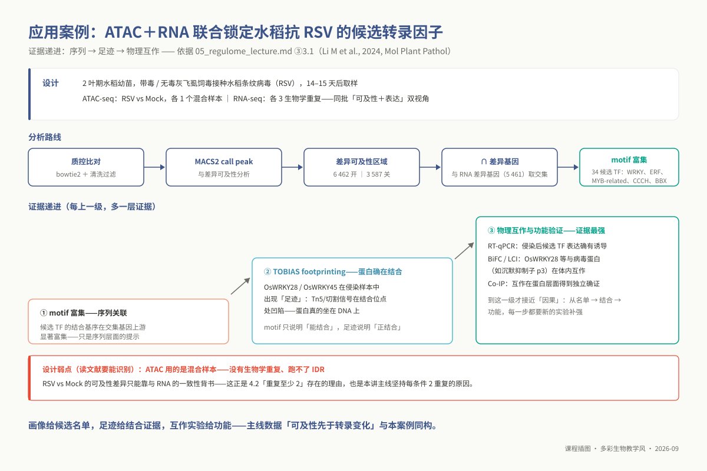
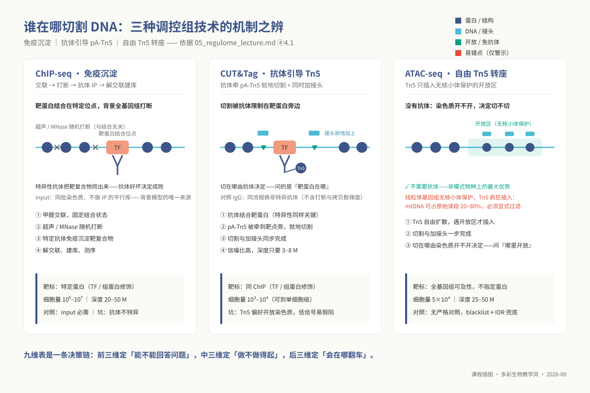
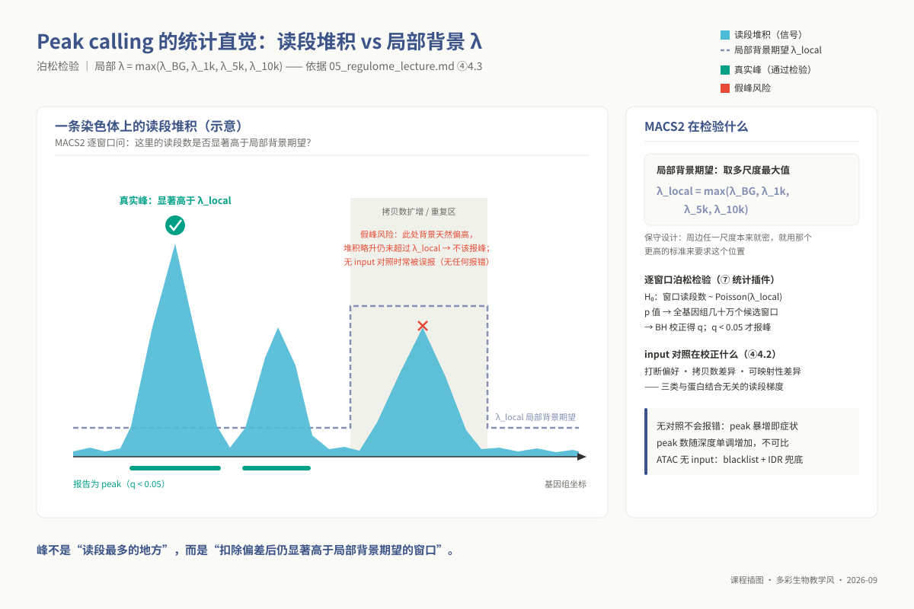
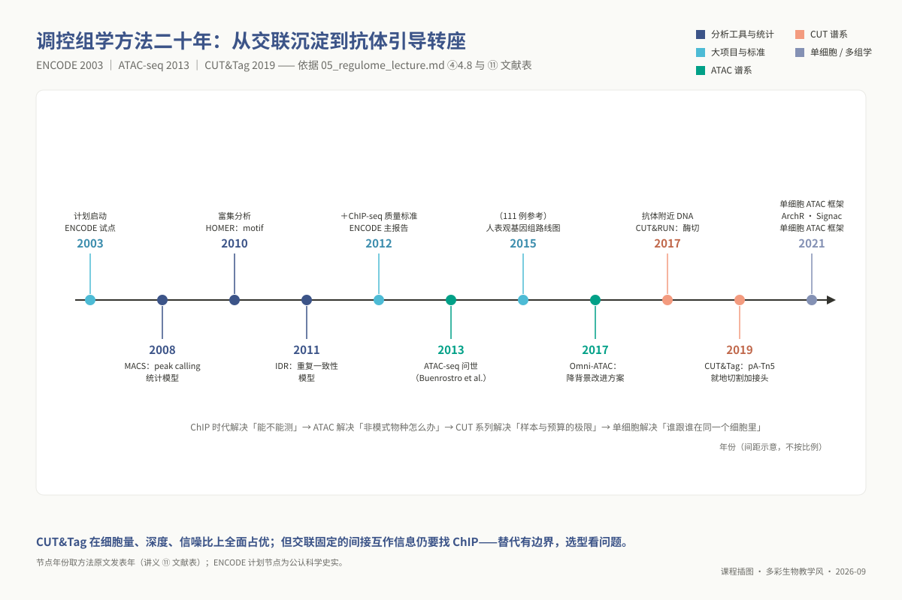
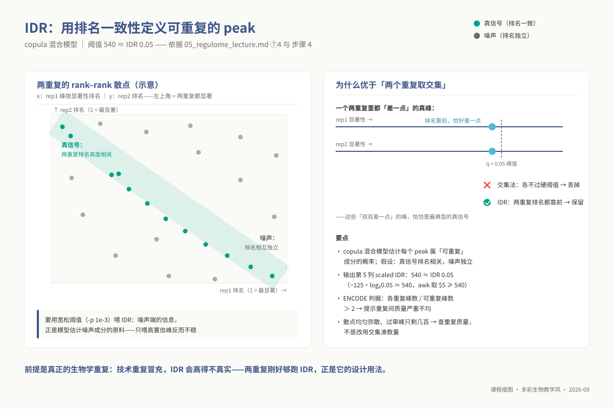

# 专题 5：转录调控与表观组（ChIP-seq / ATAC-seq / CUT&Tag）

> **适用对象**：硕士研究生，4 学时（2 h 理论 + 2 h 实践）。
>
> **阅读重点**：根据问题选调控组技术，以对照、重复和峰质量指标约束 RNA-seq 联合解释。

> **id** `m05` ｜ **4 学时**（理论 2 + 实践 2）｜ **前置** `l0_01_linux`、`l0_04_formats`、`l0_05_qc`、`l0_06_stats`
> **环境** `ngs_ms_base` + `ngs_ms_transcriptome`（与 m04 共用一个环境，见 `07_envs/conda/env_master_transcriptome.yml`）
> **配套脚本** `03_code/master/scripts/05_peak_calling.sh`、`03_code/master/scripts/05_peak_annotation.R`
> **本专题为本轮新增**：`00_design/guide.md` 把硕士层定位为"RNA-seq / ChIP-seq 实战"；原八个专题对调控层与表观层覆盖不足，因此本讲补上"基因如何被调控"这条线。学时来自原 topic02（组装）与 topic07（泛基因组）合并腾出的 4 学时。
> **必须紧接 m04 讲授**：RNA-seq 回答"哪些基因变了"，本专题回答"谁让它变的"。

## ① 学习目标

学完本讲，你应当能够：

1. **判断**一个具体课题该选 ChIP-seq、CUT&Tag 还是 ATAC-seq，并用 ④4.1 三技术对比中的至少三个维度写出选型理由；
2. **设计**一次调控组实验的对照与重复方案（input / IgG、生物学重复数、测序深度），并说明缺了对照会发生什么；
3. **运行** Bowtie2 → 去重过滤 → MACS2 的完整上游流程，并针对 narrow / broad / ATAC 三种场景**分别写出**正确的 `macs2 callpeak` 命令；
4. **计算并解释** FRiP、NRF、TSS enrichment、重复间 Spearman 相关，判断一个样本能不能进下游分析；
5. **运行** IDR 得到 reproducible peaks，并解释它为什么优于"两个重复取交集"；
6. **用** ChIPseeker 完成 peak 注释，并**指出**"最近基因 = 靶基因"这一默认规则在什么情况下会给出错误结论；
7. **运行** HOMER motif 分析，并**判断**一个 Top motif 结果是真信号还是背景序列没匹配好导致的假象；
8. **完成**差异 peak 与 m04 差异基因的交集，并用置换检验给出交集大小的经验 p 值，而不是直接宣称"重叠显著"。

## ② 前置检查

本讲**不重讲** L0 已覆盖的内容。下表逐条给出：依赖哪个 L0 模块、对应哪道自测题、在本讲哪一步会咬人。自测题号对应 `08_assessment/prerequisites/` 下的实际题目。

| L0 模块 | 自测题号 | 本讲哪一步用到 | 跟不上的症状 |
|---|---|---|---|
| `l0_01_linux` | 第 6 题（SGE 脚本 `Eqw` 排错）、第 9 题（上机 · 提交 SGE 作业） | ⑤ 全部七步都在集群上跑，`05_peak_calling.sh` 是标准 `#$` 作业脚本 | 在登录节点直接跑 bowtie2，被管理员 kill；作业卡 `Eqw` 不会看 `qstat -j` |
| `l0_04_formats` | 第 4 题（读一行 SAM）、第 9 题（上机 · 拆解 FLAG 163）、第 5 题（判断这是什么文件） | ⑤ 步骤 1 的 `-F 1804` 过滤位、`-q 30` MAPQ；步骤 5 的 narrowPeak / GFF3 坐标系换算 | 不知道 1804 过滤掉了什么就照抄；把 GFF3 的 1-based 坐标直接当 BED 用 |
| `l0_04_formats` | 第 10 题（上机 · 判断格式并统计） | ⑥ 读 narrowPeak 的十列、判断 broadPeak 少了哪一列 | 把 `--broad` 的输出喂给需要第 10 列 summit 的工具 |
| `l0_05_qc` | 第 4 题（红灯辨析）、第 8 题（上机 · 判断红灯是否真问题） | ⑤ 步骤 0 的原始数据质控；⑥ 判断"重复性差"是数据问题还是这类数据本来如此 | 看到 FastQC 报 Duplication 红灯就删数据——ChIP 富集区本来就高重复 |
| `l0_06_stats` | Q5（多重检验与校正方法选择）、Q10（上机 · 2 万个基因的多重检验） | ⑦ MACS2 的 q 值从哪来、为什么 `-q 0.05` 与 `-q 0.01` 差 30–50% 的 peak | 把 MACS2 的 p 值当结论，不理解 q 值是 BH 校正后的量 |
| `l0_06_stats` | Q7（重复与功效）、Q6（批次与混杂） | ④ 重复数为什么至少 2；⑦ 深度不同不能比 peak 数 | 用技术重复冒充生物学重复去跑 IDR |

**⚠ 本讲还依赖 m04 的产出。** ⑤ 步骤 7「与 RNA-seq 联合解读」的输入是 **m04 差异表达分析的结果表**（`02_lectures/master/topic04_rnaseq/`，DESeq2 `results()` 的输出表；基因 ID 在行名或 `gene_id` 列，另需 `log2FoldChange` 与 `padj`）。**没有 m04 的结果表，第 7 步做不了。** 上课前请确认你手上有这张表，且它对应的处理条件与本讲的调控组数据是同一套（见 ③ 的案例数据约束）。

## ③ 背景与科学问题

### 有了转录组，为什么还要看调控层

RNA-seq 给你的是**结果**：某个基因在处理组里表达量高了 4 倍。它不告诉你**为什么**高。上游至少有三种可能：某个转录因子结合到它的启动子上了；那段染色质原本是关闭的、现在打开了；组蛋白修饰状态从抑制型变成了激活型。这三种可能各自对应一种可测量的实验：

| 你想问的问题 | 对应技术 | 直接测量的物理量 |
|---|---|---|
| 谁结合在哪 | TF ChIP-seq / CUT&Tag | 蛋白-DNA 结合位点 |
| 哪些区域是开放的 | ATAC-seq | 染色质可及性（Tn5 可插入性） |
| 染色质处于什么状态 | 组蛋白修饰 ChIP-seq / CUT&Tag | 特定修饰的基因组分布 |

**一个可检验的假说（不是结论）。** 昆虫、农药方向常见的课题情境：抗性品系中解毒酶基因（P450、GST、酯酶）转录水平上调。一个可以用本专题方法检验的假说是——*这些基因的上调是否伴随其启动子区染色质可及性升高，或某个特定转录因子在该区域结合增强*。注意这句话的形式：它是待检验的**假说**，不是"抗药性由启动子可及性升高导致"这样的断言。调控组数据能提供的最强证据是**共变关系**（可及性升高与表达上调同时出现），因果仍需功能验证——报告基因实验、CRISPR 敲除该调控元件、EMSA 验证结合。**讲义、报告、论文里都必须保持这个措辞边界。**

### 案例数据（已确定 2026-08-30）

本讲走**方案 B（染色质可及性）**：`PRJDB36269` 的 ATAC-seq 部分，**与 m04 的 RNA-seq 是同一批样本**（同基因型、同处理、同时间点、同重复）——第 7 步的联合解读因此成立，不需要任何"来自同一处理体系"的假设。

具体样本：12 个 ATAC-seq run，与 m04 的 12 个 RNA-seq 一一对应——
`DRR737541` `DRR737554` `DRR737542` `DRR737555` `DRR737543` `DRR737556`（对照 K，30/60/120 min，重复 A/B）、
`DRR737550` `DRR737563` `DRR737551` `DRR737564` `DRR737552` `DRR737565`（复氮 N，同上）。
参考基因组 `GCA_001433935`（水稻 IRGSP-1.0）。全集 43 GB，**必须降采样**：
`bash 06_data/master/download_master.sh --topic m05 --subsample 3000000`。

**关于本讲为什么不走方案 A / C**：方案 A（TF 的 ChIP-seq / CUT&Tag）与方案 C（组蛋白修饰）
的原理仍在 ④ 讲全（4.1 三技术对比），只是**实践走 ATAC**——因为公共数据里能同时满足
"与 RNA-seq 同批样本 + 有对照 + 有重复 + 体量可控"的，只有这套。方案 A/C 的分析差异
（input 对照怎么用、broad 与 narrow peak 的 caller 参数差异）在 ⑤ 与 ⑥ 以对照方式讲，
学生做自己课题时按 ④ 的判据选型。

**三点必须在课堂讲明**：

- **ATAC 不需要 input 对照**——它不是 ChIP，没有抗体特异性问题。MACS2 用
  无对照模式即可（双端 `-f BAMPE` 直接用实际片段，不需建模；单端才用 `--nomodel --shift -100 --extsize 200`）。方案 A 才必须有 input / IgG。

- **每条件 2 个生物学重复（A/B），刚好够跑 IDR**，而这正是 IDR 的设计用法（两重复间的
  一致性排序）。重复数是 2 不是 3，⑥ 的判读要按此调整。

- **植物 ATAC 的叶绿体 / 线粒体比例很高**，必须先滤掉再算 FRiP，否则 FRiP 被系统性低估。课程参考 IRGSP-1.0 只有 12 条核染色体、不含 chrM/chrCp，细胞器读段在比对时就成了 unmapped，线粒体比例无法从 BAM 计算，质量判断改看 FRiP 与 TSS 富集。

### 3.1 应用案例：ATAC + RNA 联合锁定水稻抗病毒的候选转录因子

主线问的是"氮响应由谁调控"；同一套方法换个语境，就是调控组学在植物病理上的高频用法——**病毒侵染后染色质
哪里开了、哪些转录因子被启用**。Li M et al., 2024（*Mol Plant Pathol*，⑪）是一个与本讲第 7 步完全同构的
已发表案例：

- **设计**：2 叶期水稻幼苗，用带毒 / 无毒灰飞虱饲毒接种水稻条纹病毒（RSV），14–15 天后取样；ATAC-seq
  （RSV vs Mock，各一个混合样本）与 RNA-seq（各 3 生物学重复）同批进行——即"同一处理体系的可及性 + 表达"双视角。

- **路线**：质控比对 → MACS2 call peak → 差异可及性区域（6 462 个开放 / 3 587 个关闭）→ 与差异基因（5 461 个）
  取交集 → 对交集基因上游做 motif 富集，锁定 34 个候选转录因子（WRKY、ERF、MYB-related、CCCH、BBX 家族为主）。

- **证据递进**：motif 富集（序列关联）→ TOBIAS footprinting 显示 OsWRKY28 / OsWRKY45 在侵染样本中出现"足迹"
  （蛋白确在结合）→ RT-qPCR、BiFC/LCI 与 Co-IP 证实 OsWRKY28 等与病毒蛋白物理互作（如与沉默抑制子 p3）。

- **读文献时识别设计弱点**：该文的 ATAC 用的是混合样本，**没有生物学重复、跑不了 IDR**，RSV vs Mock 的可及性
  差异只能靠与 RNA 的一致性背书——这正是 4.2"重复至少 2"存在的理由，也解释了本讲主线为何坚持每条件 2 重复。



*图 m05-6：水稻抗 RSV 案例：ATAC ∩ RNA-seq → 34 个候选转录因子。*

主线数据（PRJDB36269）出自 Li W et al., 2025（*Plant Commun*，⑪）：复氮后 2 小时内的 ATAC + RNA 时序，其核心发现
——**染色质可及性的变化在时间上先于转录变化**——与本案例合读，正好构成"调控层先动、转录层跟上"的实证。

## ④ 核心原理

### 4.1 三大调控组学技术的分子捕获机制与物理空间位阻

解析基因组转录调控，本质是探测染色质特定区域在三维细胞核内的物理开放状态与特定转录调控蛋白的结合坐标。ChIP-seq、CUT&Tag 与 ATAC-seq 代表了三种截然不同的分子生物学捕获逻辑：

**ChIP-seq（染色质免疫共沉淀测序）：经典的体外物理抓取**。
细胞首先用甲醛进行化学交联，将瞬时结合在 DNA 上的转录因子或组蛋白修饰共价冻结在染色质上；随后利用高频超声波（Sonication）或微球菌核酸酶（MNase）将全基因组染色质打断为 200–500 bp 的碎片；接着加入特异性单克隆抗体，通过抗体与靶标蛋白的抗原决定簇结合，利用蛋白 A/G 磁珠将“DNA-蛋白复合体”物理共沉淀下拉；最后经高温逆转交联并消化蛋白质，回收纯化出的富集 DNA 进行常规建库测序。
ChIP-seq 的最大软肋在于其漫长而粗暴的体外物理操作：超声波不仅极易破坏抗原表位，更会在开放松散染色质与紧密异染色质之间产生巨大的物理断裂偏好；更重要的是，抗体在数以亿计的非特异 DNA 碎片泥潭中打捞目标，非特异吸附背景极其高昂。因此，传统 ChIP-seq 必须消耗上千万级（$10^6 - 10^7$）的巨量起始细胞，且信噪比往往不尽如人意。

**CUT&Tag（原位转座打靶测序）：抗体导向的高保真分子刀**。
CUT&Tag 彻底颠覆了体外交联打断的传统范式。它在完整的天然细胞核内部原位进行：细胞通透后，直接将一抗和二抗渗透进核内特异性识别靶蛋白；随后加入与原核蛋白 A/G 融合的转座酶（pA-Tn5），该融合酶能像制导导弹一样精准锚定到抗体恒定区；激活镁离子后，Tn5 就地在靶蛋白结合位点两侧的裸露 DNA 上发生转座切割，并在切口两端原位缝合上 Illumina 测序接头。
这一精巧设计的革命性在于：未结合抗体的全基因组绝大多数染色质完全保持完整，只有抗体靶向的微小区域会被就地剪切并加接头。PCR 扩增时，唯有带接头的目标片段能够被指数级放大，未切割的基因组大分子在离心时直接被沉淀丢弃。因此，CUT&Tag 具有近乎零背景的超高信噪比，测序深度仅需 3–8 M reads 即可达到传统 ChIP 数千万 reads 的峰型质量，起始样本量更是断崖式下降到数百至数千个细胞，极大地解放了微量稀有细胞群体的表观组研究。

**ATAC-seq（微量转座酶染色质可及性测序）：自由扩散的无偏开放扫描**。
与前两者针对特定已知蛋白不同，ATAC-seq 的科学目标是全基因组范围内的**染色质开放程度（Chromatin Accessibility）**。它不依赖任何特异性抗体，而是利用经过高活性改造的高浓度游离 Tn5 转座酶。在细胞核内，被八聚体核小体紧密缠绕包裹的异染色质区域存在强烈的立体空间位阻，Tn5 酶无法物理接近；而处于转录起始位点（TSS）、增强子等被转录机器激活而暴露的裸露 DNA 区域，游离的 Tn5 酶能够自由扩散进入，发生高效的“剪切—粘贴”转座反应，在切割 DNA 的同时插入测序接头。
ATAC-seq 的最大优势在于其全基因组无偏性与极高的通用性，在缺乏高质量抗体的昆虫、真菌和非模式植物中，它几乎是唯一能够规模化探索转录调控景观的利器。然而，其代价也是显著的：由于缺乏抗体牵引，无核小体包裹的线粒体 DNA（mtDNA）和植物叶绿体 DNA 同样极易被 Tn5 疯狂转座，在原始测序数据中细胞器 reads 占比往往高达 20%–80%，必须在生信过滤端严格清除。



*图 m05-2：三种调控组技术的机制之辨：ChIP-seq / CUT&Tag / ATAC-seq。*

### 4.2 实验设计基石：对照依赖、生物学重复与峰型先验

在调控组学实验方案中，实验设计的严谨性直接决定了下游 Peak Calling 的生死存亡：

**对照样品的本质：为什么 input 是背景模型的唯一真理**。
MACS2 等软件判断染色质上某个位置是否存在真实的结合峰（Peak），数学逻辑绝非单纯计算该处的 reads 绝对数值，而是严格检验该处的 reads 堆叠是否显著超越了**局部背景的统计期望**。
对于 ChIP-seq，**input 对照（同批打断、未经免疫沉淀直接建库的染色质 DNA）是重要基准**。input 记录了常染色质与异染色质的打断差异、CNV 区域的拷贝数差异，以及 GC 含量和非特异比对造成的测序偏好。可信结合峰应是在扣除这些 input 背景后仍保留的富集窗口。

同型对照 IgG 主要衡量抗体的非特异吸附，不能替代 input 对打断和拷贝数背景的控制。缺少 input 时，转录活跃区的高信号可能被误判为结合峰。

**生物学重复与不可重复发现率（IDR）的刚性约束**。
由于调控组实验涉及多次微量沉淀与酶促切割，批次间的技术波动不可忽视。任何调控组研究必须至少包含 2 个独立的生物学重复。ENCODE 联盟制定的行业黄金标尺 **IDR（Irreproducible Discovery Rate，不可重复发现率）** 正是依托双重复样本运行：它利用二元 Copula 混合模型，检验两个重复样本在按显著性排名的候选 Peak 列表中何处开始丧失相关性（真实信号在两重复间高度共线，假阳性噪声在两重复间相关性崩塌归零）。没有双重复，IDR 质量控制体系便完全无法运行。

**峰型（Peak Profile）先验与模型选择**：
必须根据生物学靶标在染色质上的分布物理特征，预先锁定正确的算法模式：

- **窄峰（Narrow peaks）**：由定点结合的转录因子（TF）、介导转录起始的组蛋白标记（如 H3K4me3、H3K27ac）以及 ATAC-seq 开放位点所产生。其物理跨度通常仅有几百个碱基，具有极其陡峭的峰脊，适合使用默认模型精细定点；
- **宽峰（Broad peaks）**：由负责染色质异染色质化封闭或全基因体延伸的组蛋白修饰（如兼性异染色质标记 H3K27me3、组成型异染色质标记 H3K9me3、转录延伸标记 H3K36me3）所产生。其信号弥漫在数个 kb 乃至数十个 kb 的广袤结构域（Domains）。如果错误地使用窄峰模型去调用 broad 信号，连续的染色质结构域会被算法粗暴切碎为数十个毫无生物学意义的假碎峰；反之，若用 broad 模型去跑转录因子，相邻的两个独立结合元件会被强行粘连合并。

### 4.3 MACS2 的双峰位移几何机理与多尺度局部泊松背景模型

MACS2 是调控组学数据处理中使用最为广泛的 Peak Calling 工具，其算法核心包含两项极具洞察力的数学与几何设计：

**单端测序中双峰偏移（Strand Shift）与片段长度 $d$ 的自相关推算**：
在单端短读长测序中，仪器只测定物理 DNA 片段的 5' 起始端（通常 50–150 bp），而转录因子真实的物理结合中心落在这段 200–300 bp 片段的几何正中央。
因此，比对到染色体正链（+）的 reads 会系统性地富集在真实结合位点的**上游（5' 侧）**，而比对到负链（-）的 reads 则会系统性地富集在真实结合位点的**下游（3' 侧）**。当在染色体坐标轴上分别绘制正链与负链 reads 的覆盖密度时，会在结合位点两侧呈现出两座截然分开、镜像对称的“双峰”。
MACS2 巧妙地利用正负链密度曲线的互相关分析（Cross-correlation），在滞后坐标轴上寻找互相关系数达到全局极大值时的位移距离——这个距离在几何上恰好精准对应了建库 DNA 片段的物理平均长度 $d$。随后，算法将所有正链 reads 沿 3' 方向向右平移 $d/2$，将所有负链 reads 沿 3' 方向向左平移 $d/2$，使得两股读段的中心在结合靶点处形成高耸的单一物理共识峰。
需要特别注意：**ATAC-seq 并不存在这种正负链双峰结构**。由于 Tn5 转座酶是在开放染色质中心直接同时切断双链，Tn5 的两个催化亚基在两条单链上留下的是仅相隔 9 bp 的交错切口。因此在处理 ATAC 数据时，必须通过 `--nomodel --shift -100 --extsize 200` 强行关闭双峰位移建模，手动将读段向外回移 100 bp 并向内延伸 200 bp，使信号严格聚焦在转座切割切口上。



*图 m05-1：peak 是「扣除偏差后仍显著高于局部背景期望的窗口」；拷贝数扩增区是假峰高发区。*

**多尺度局部背景动态期望 $\lambda_{local}$ 的保守设计**：
为了判断某个微小滑动窗口（如 200 bp）内富集的 reads 计数 $k$ 是否具有统计显著性，MACS2 假定背景读段计数服从泊松分布：
$$P(X \ge k) = \sum_{x=k}^{\infty} \frac{\lambda^x e^{-\lambda}}{x!}$$
关键的算法创新在于背景参数 $\lambda$ 的估计方式。常规做法若采用全基因组平均密度 $\lambda_{BG}$，在转录活跃、常染色质原本就致密的区域，全城平均标准过低，会导致成千上万个局部假峰集体过关。
MACS2 引入了**多尺度局部动态平滑背景**：它不仅考量全基因组背景 $\lambda_{BG}$，更同时在候选位点周边按片段长度 $d$、1 kb（`--slocal`）与 10 kb（`--llocal`）窗口计算局部读段密度（MACS 1 原文另有 5 kb 窗口，MACS2 默认只用 1k/10k），并采用其**极大值**作为该位点的检验阈值：
$$\lambda_{local} = \max(\lambda_{BG}, \lambda_{d}, \lambda_{1k}, \lambda_{10k})$$
这种“取最大值”是一种高度精密的保守统计设计：如果某区域因为局部开放、染色质松散或者存在拷贝数重复导致周边 10 kb 范围内的读段本就普遍偏高，算法就会自动抬高此处的检验门槛，要求候选峰必须在克服了该高门槛之后仍有超常富集才予承认，从而以极高的特异性封死了常染色质假阳性的漏洞。

### 4.4 调控组数据质量评估的四大支柱指标

拿到比对与 call peak 结果后，必须通过四个核心量化指标验收文库与富集质量：

1. **FRiP（Fraction of Reads in Peaks，落峰比例）**：落在最终可信 Peak 区间内的有效 reads 占全基因组总比对 reads 的百分比。它可用于比较富集效率和背景水平，但阈值必须结合 assay、峰集定义和测序深度解释。转录因子 ChIP-seq 常以 $> 1\%$ 作为经验参考；部分 ATAC-seq 质控指南以 $> 20\%$ 作为高质量样本的参考。若 FRiP 低于 $5\%$，应结合文库复杂度、对照和峰数排查背景或抗体问题，不能只凭单一阈值判定实验失败。
2. **交叉相关系数（NSC 与 RSC）**：衡量链间交叉相关曲线在片段长度 $d$ 处峰高相对读长 phantom 峰（约 150 bp）的比例。$NSC > 1.05, RSC > 0.8$ 是富集成功的标志。若 RSC 远低于 0.8，通常伴随着假性读长峰高耸，提示文库中包含大量未特异富集的短读长断裂杂质。
3. **文库非冗余度（NRF 与 PBC1）**：唯一比对位置数除以总比对读段数。$NRF > 0.8$ 证明文库复杂度良好。若 NRF 偏低而重复率极高，说明起始细胞量过少，PCR 循环过度，测序仪只是在机械地复读同一批祖先模板分子。
4. **TSS 富集分（TSS Enrichment Score）**：针对 ATAC-seq 的首要生命线指标。计算在所有已知基因转录起始位点（TSS）中心上游 $\pm 2$ kb 范围内的信号强度，相对于侧翼背景基线的折叠倍数。在植物与动物组织中，合格的 ATAC-seq 该得分通常要求 $\ge 5$。若 TSS 富集分平坦贴地，说明染色质天然构象在细胞破碎或裂解阶段已经严重崩解，数据无法用于下游调控元件注释。

还有一件必须知道的事：**peak 数随测序深度单调增加、远未饱和**，因此不同深度的样本之间比 peak 数没有意义——⑦ 第 3 条展开。

### 4.5 Peak 注释：ChIPseeker 与「最近基因 ≠ 靶基因」

ChIPseeker 的逻辑很朴素：把每个 peak 投到基因组注释上，① 判断落在什么特征里（promoter / 5'UTR / exon / intron / 3'UTR / downstream / distal intergenic），② 算它到**最近 TSS** 的距离，③ 把最近的基因作为关联基因。`tssRegion = c(-3000, 3000)` 定义"算不算 promoter"的窗口。

**这套规则的局限必须讲清楚，否则学生会把注释表当靶基因表。** ① **增强子可远距离作用**——通过染色质环作用于几十 kb 外的基因是常态，中间可能隔着好几个无关基因，此时"最近基因"系统性地错。② **一个 peak 可调控多个基因，一个基因可被多个 peak 调控**，一对一的关联表把这层关系压平了。③ **基因密集区与基因荒漠区的可靠性完全不同**——紧凑基因组（很多真菌、昆虫）里最近基因规则反而更可靠，大基因组的基因荒漠区里几乎不可信。④ **正确的措辞**：注释表给的是"peak 的最近基因"，不是"该调控因子的靶基因"；要确认靶基因关系需要 Hi-C / HiChIP 的互作数据或功能验证。

**差异 peak 分析（概念介绍）**：比较两条件下的结合/可及性强度，不能直接比 peak 有无。主流思路是把 peak 当"基因"做计数建模——先取所有样本 peak 的并集作为一致区间集（consensus peakset），在每个区间上数每个样本的读段，再用 DESeq2 / edgeR 的负二项框架做差异检验。`DiffBind`（基于 consensus peakset）与 `csaw`（基于滑窗）就是这套思路的两种封装。**它复用的正是 m04 学过的统计模型，不是新东西。**

### 4.6 HOMER motif 分析与背景序列匹配

**known motif 富集**：拿已知 TF 的位置权重矩阵（PWM）库扫描 peak 序列，看哪些 motif 频率显著高于背景。**de novo 发现**：不依赖已知库，直接从序列中搜反复出现的短模式，再回头与已知库比对。

**背景序列的选择是决定性的。** peak 区通常 GC 高于基因组平均（启动子富含 CpG）、长度也与随机区间不同。背景若没做 **GC 含量与长度匹配**，你富集到的往往只是"peak 区 GC 偏高"这一事实——结果表上是一串 GC-rich motif（SP1、KLF 家族），p 值极小却没有生物学信息。HOMER 默认会生成匹配背景，**但你必须知道它在做这件事，并在报告里写明背景怎么来的**。

**motif 富集 ≠ 该 TF 直接结合。** 三种替代解释：① 富集到的是与靶 TF 共结合的另一因子的 motif；② 你的 TF 被间接招募，本身不接触 DNA；③ 同家族多个 TF 的 PWM 高度相似，HOMER 报的是家族而非具体成员。

### 4.7 与 RNA-seq 联合解读

这是本专题存在的理由，也是它与 m04 的接口。**交集的构造**：差异 peak 的最近基因集合 ∩ m04 的差异基因集合 → 候选直接调控关系。

| 结合 / 可及性 | 表达 | 候选解释 |
|---|---|---|
| 增强 | 上调 | 候选激活关系 |
| 增强 | 下调 | 候选抑制关系（或结合的是抑制元件） |
| 减弱 | 下调 | 候选激活因子的撤除 |
| 增强 | 无变化 | 结合发生但未转化为转录改变——**常见，不是"失败"** |

最后一行值得单独说：**大量结合事件不产生表达变化是调控生物学的常态**（预结合、冗余调控、需要额外信号才激活）。学生常把这类 peak 当噪声删掉，这是错的。

**证据强度的上限**：即使交集显著、方向一致，这仍是**相关性证据**。因果链条要靠功能实验补全（报告基因、CRISPR 敲除该元件、EMSA / ChIP-qPCR）。报告里写"候选直接调控靶标"，不写"证明了 X 调控 Y"。

### 4.8 技术前沿（2023–2026）



*图 m05-4：调控组方法时间线：ENCODE → MACS → ATAC → CUT&Tag → scATAC。*

**CUT&Tag / CUT&RUN 对 ChIP 的替代有明确的边界。** 已被替代的：起始量（10³–10⁴ 细胞 vs 10⁵–10⁷）、深度
（3–8 M vs 20 M+）、信噪比——即 ④4.1 对比里的起始量、测序深度与信噪比三项全部占优。尚未被替代的：

- **交联信息**：ChIP 的甲醛交联能固定"间接招募"的蛋白复合物；CUT&RUN/CUT&Tag 靠酶切抗体附近 DNA、不做交联，
  间接结合信号明显更弱。**两种技术报出的 peak 集合本来就不该完全一样**，差异本身携带信息。

- **低丰度靶蛋白**仍受抗体与酶活批间差制约；超大基因组与非模式物种上的成熟度仍在追赶。
  选型时直接看 ④4.1 对比里的起始量与成本两项：细胞量与预算受限、测表观修饰，优先 CUT&Tag；样本充足、关心间接互作全景，ChIP 仍有位置。

**单细胞 ATAC 与"同一细胞里同时看两层"。** 单细胞 ATAC 的分析栈已收敛为 ArchR 与 Signac 两大框架
（基因活性矩阵 + LSI 降维 + peak-to-gene 关联，文献见 ⑪），把本讲的"peak × 样本"问题改写成"peak × 细胞"的
稀疏矩阵问题。**10X Multiome**（同一细胞核同时测 scATAC 与 scRNA-seq）更进一步：4.7 的"差异 peak ∩ 差异基因"
从跨数据集求交集升级为**同一细胞内的共变检验**，不再需要"同批样本"假设。边界同样清楚——Multiome 单位成本高、
捕获核数有限，群体规模的问题（如本讲主线）仍以 bulk 为首选。

## ⑤ 操作步骤

> 全部在集群（`10.7.254.22`，SGE）上做。完整可提交版本见 `03_code/master/scripts/05_peak_calling.sh`（带 `#$` 作业头）与 `05_peak_annotation.R`；本节只给命令与**参数选择依据**。
> 环境：`conda activate ngs_ms_transcriptome`——**必须写在作业脚本里**，作业不继承终端的 conda 状态（`l0_01_linux` §5）。

约定变量：`GENOME=ref/genome.fa`（bowtie2 索引前缀 `ref/genome_idx`）、`GSIZE=3.0e8`、`EGS=300000000`（水稻 IRGSP-1.0 总长约 3.74e8，有效可比对约 3e8 量级；1.2e8 是 MACS2 内置的果蝇值，会压低 λ_BG、改变 peak 数）、`THREADS=16`。

**`-g` / `--effectiveGenomeSize` 怎么定**：它是"可唯一比对的碱基数"，不是基因组总长。MACS2 内置 `hs`/`mm`/`ce`/`dm`；非模式物种按 **0.8–0.9 × 基因组总长**估（重复序列多取下限）。**MACS2 与 deepTools 两处必须填同一个数**，否则 bigwig 归一化与 peak 显著性不在同一尺度。

### 步骤 1 ｜ Bowtie2 比对与清洗（20 min）

```bash
# --very-sensitive 提灵敏度；-X 2000 允许长片段（ATAC 的多核小体片段需要）
bowtie2 -p ${THREADS} -x ref/genome_idx --very-sensitive -X 2000 \
    -1 clean_R1.fq.gz -2 clean_R2.fq.gz 2> align.log | samtools sort -@ 8 -o raw.bam -
samtools index raw.bam
# 去 PCR 重复（env 里用 samtools；大纲示例的 picard MarkDuplicates 等价）
samtools sort -n -@ 8 raw.bam | samtools fixmate -m -@ 8 - - \
  | samtools sort -@ 8 - | samtools markdup -r -s -@ 8 - dedup.bam
samtools index dedup.bam
# MAPQ≥30 去多重比对；-F 1804 = 未比对(4)+配对未比对(8)+次要(256)+QC失败(512)+重复(1024)
# 同时只保留核基因组染色体，去线粒体（ATAC 必做）
CHRS=$(cut -f1 ${GENOME}.fai | grep -v -E "^(chrM|MT|Mt|mitochondrion)$")
samtools view -b -q 30 -F 1804 dedup.bam ${CHRS} > clean.bam && samtools index clean.bam
# 有 blacklist 再减一次：bedtools intersect -v -abam clean.bam -b blacklist.bed > clean.filt.bam
# ATAC 额外：片段长度分布，应见核小体阶梯
samtools view -f 66 clean.bam | awk '$9>0 && $9<1000 {print $9}' > fraglen.txt
```

### 步骤 2 ｜ MACS2 peak calling：三套参数（20 min）

**三条命令的差别不是风格问题，是三种数据的物理性质不同。**

```bash
# (a) TF ChIP / CUT&Tag —— narrow，带对照
macs2 callpeak -t treat.bam -c input.bam -f BAMPE -g ${GSIZE} -n TF_rep1 --outdir peaks -q 0.05
# (b) 组蛋白 broad mark（H3K27me3 / H3K9me3 / H3K36me3）
macs2 callpeak -t treat.bam -c input.bam -f BAMPE -g ${GSIZE} -n H3K27me3 --outdir peaks \
    --broad --broad-cutoff 0.1
# (c) ATAC —— 无对照；BAMPE 直接用成对读段的实际片段（--shift/--extsize 在此模式下被忽略）
macs2 callpeak -t atac.bam -f BAMPE -g ${GSIZE} -n ATAC --outdir peaks -q 0.05 \
    --keep-dup all
```

依据：(a) 有 input 就一定要给 `-c`，它是背景模型的唯一来源；(b) `--broad` 把相邻弱富集区连成结构域，连接阈值 `--broad-cutoff 0.1` 比主阈值宽松是刻意的；(c) BAMPE 下片段由读段对直接给出，不做双峰建模；只有单端（`-f BAM`）或只取切点时才用 `--nomodel --shift -100 --extsize 200` 把信号中心校正到 Tn5 插入位点，`--keep-dup all` 避免在已去重后再删一次真实读段。

```bash
# FRiP（每个样本都要算）
TOTAL=$(samtools view -c clean.bam)
INPEAK=$(bedtools intersect -a clean.bam -b peaks/TF_rep1_peaks.narrowPeak -u | samtools view -c)
echo "FRiP = $(echo "scale=4; ${INPEAK}/${TOTAL}" | bc)"
```

### 步骤 3 ｜ deepTools：bigwig + TSS 热图 + 重复相关性（25 min）

```bash
bamCoverage -b clean.bam -o rep1.bw --binSize 10 --normalizeUsing RPGC \
    --effectiveGenomeSize ${EGS} --extendReads -p ${THREADS}      # RPGC = 1x 覆盖度归一，跨样本可比
computeMatrix reference-point -S rep1.bw rep2.bw -R genes.bed --referencePoint TSS \
    -b 3000 -a 3000 --skipZeros -o matrix.gz -p ${THREADS}
plotHeatmap -m matrix.gz -o tss_heatmap.pdf --colorMap Blues --refPointLabel TSS
multiBigwigSummary bins -b rep1.bw rep2.bw input.bw -o summary.npz -p ${THREADS}
plotCorrelation -in summary.npz -c spearman -p heatmap --plotNumbers -o cor_heatmap.pdf
```

用 **Spearman** 而非 Pearson：bin 信号强烈右偏且有极端值（重复区、rDNA），秩相关更稳健。

### 步骤 4 ｜ IDR 重复一致性（15 min）

```bash
# 两个重复各自单独 call peak，且用宽松阈值保留足够多的候选
for r in rep1 rep2; do
  macs2 callpeak -t ${r}.bam -c input.bam -f BAMPE -g ${GSIZE} -n ${r}_loose --outdir idr_in -p 1e-3
  sort -k8,8nr idr_in/${r}_loose_peaks.narrowPeak > idr_in/${r}.sorted.narrowPeak
done
idr --samples idr_in/rep1.sorted.narrowPeak idr_in/rep2.sorted.narrowPeak \
    --input-file-type narrowPeak --rank p.value \
    --output-file idr_out.txt --plot --idr-threshold 0.05
awk '$5 >= 540' idr_out.txt > reproducible_peaks.bed    # 第5列 scaled IDR，540 ≈ IDR 0.05
```

**为什么用宽松阈值喂 IDR**：IDR 靠"排名靠后那部分噪声 peak"估计混合模型的噪声成分。只喂 `-q 0.05` 的高置信 peak，模型缺噪声端信息，估计不稳。

### 步骤 5 ｜ ChIPseeker 注释（20 min）

```r
library(ChIPseeker); library(GenomicFeatures)
txdb <- makeTxDbFromGFF("ref/annotation.gff3", format = "gff3")   # 必须用自己的注释，不用别的物种预置包
peak <- readPeakFile("reproducible_peaks.bed")
seqlevelsStyle(peak) <- seqlevelsStyle(txdb)[1]   # ⚠ 命名不一致会让注释全落 intergenic（见 ⑨ 错误 4）
anno <- annotatePeak(peak, tssRegion = c(-3000, 3000), TxDb = txdb)
plotAnnoPie(anno); plotDistToTSS(anno)
write.csv(as.data.frame(anno), "peak_annotation.csv", row.names = FALSE)
```

### 步骤 6 ｜ HOMER motif 分析（15 min）

```bash
# 用 summit ±100 bp（-size 200）而非整个 peak：TF 结合位点集中在 summit 附近
findMotifsGenome.pl peaks/TF_rep1_summits.bed ${GENOME} motif_out/ \
    -size 200 -p ${THREADS} -mask -preparsedDir /d3/scratch/${USER}/homer_preparsed
```

`-mask` 屏蔽重复序列（否则 Top motif 全是转座子共有序列）；`-preparsedDir` 指向自己的可写目录（公共参考目录通常只读）。HOMER 默认自动生成 **GC 与长度匹配**的背景序列——报告里要写明这一点。

### 步骤 7 ｜ bedtools 取差异 peak 与差异基因的交集（15 min）

```bash
# GFF3 是 1-based 闭区间，转 BED 时 start 必须减 1（l0_04_formats 出口能力 6）
awk 'BEGIN{OFS="\t"} $3=="gene" {print $1, $4-1, $5, $9, ".", $7}' ref/annotation.gff3 \
  | sort -k1,1 -k2,2n > genes.bed
sort -k1,1 -k2,2n diff_peaks.bed > diff_peaks.sorted.bed
bedtools closest -a diff_peaks.sorted.bed -b genes.bed -d > peak_nearest_gene.tsv
```

与 m04 差异基因表求交、以及交集的**置换检验**，在 `05_peak_annotation.R` 后半段完成（见 ⑦ 第 6 条）。

## ⑥ 结果解读

> 本节是硕士层的重心。每一项都给"正常长什么样"和**"不对的时候长什么样"**。

### 6.1 比对与清洗日志

`align.log` 的最后一行是总比对率。**正常**：ChIP/ATAC 在有参考基因组的物种上通常 > 80%。**不对的样子**：比对率 < 50% 且 `--very-sensitive` 也救不回来——先怀疑物种/品系搞错、索引建错、或接头没去干净（回 `l0_05_qc`），而不是调 bowtie2 参数。

`samtools markdup -s` 的统计里 DUPLICATE 比例：**正常** ChIP 10–30%。**不对的样子**：> 50% 且 NRF < 0.7，说明起始量太少或 PCR 循环过多，这批数据的有效信息量已经无法通过更深测序挽回。

ATAC 的线粒体比例：`samtools idxstats raw.bam | grep -E "chrM|MT"`（参考含线粒体序列时才可算；课程 IRGSP-1.0 不含，见 ② 数据说明）。**正常** Omni-ATAC 后 < 20%。**不对的样子**：> 60%，意味着你付费测的读段有六成是线粒体，核基因组的有效深度只有名义深度的 40%——此时**不能**按名义深度去和别的样本比 peak 数（见 ⑦ 第 3 条）。

ATAC 片段长度分布（`fraglen.txt` 画直方图）：**正常**是清晰的周期性阶梯，< 100 bp 一个大峰，~200 bp、~400 bp 各一个渐弱的峰。**不对的样子**：只有一个单峰、没有周期性 → 消化过度（Tn5 量过大或时间过长），染色质结构信息已丢失。

### 6.2 MACS2 输出

`*_peaks.narrowPeak` 十列：chrom / start / end / name / score / strand / **fold_enrichment** / **-log10(p)** / **-log10(q)** / **summit 相对偏移**。`--broad` 输出的 `broadPeak` **只有九列，没有第 10 列 summit**——需要 summit 的下游（HOMER 的 `-size 200` 策略）不能直接用 broadPeak。

`*_peaks.xls` 开头的注释行记录了**这次运行的全部参数与 MACS2 估计的片段长度**。这是复现的关键，不要删。

**peak 数与宽度分布**：TF narrow peak 典型宽度 200–800 bp、中位数几百 bp；broad mark 可到几 kb–几十 kb。**不对的样子（本讲最常见的一种）**：ATAC 用了默认 narrow 建模参数，得到 15 万个中位宽度 < 150 bp 的碎 peak——把 IGV 打开会看到本该是一个连续开放区的地方被切成了十几个小峰。正确参数下同一份数据通常是 3–6 万个、中位宽 400–800 bp 的 peak。

### 6.3 质控指标表（报告必附）

| 样本 | 比对率 | 重复率 | 线粒体% | NRF | FRiP | TSS enrich | 判定 |
|---|---|---|---|---|---|---|---|
| ATAC_ctrl_r1 | 92% | 18% | 12% | 0.86 | 0.31 | 8.4 | 通过 |
| ATAC_ctrl_r2 | 90% | 22% | 15% | 0.83 | 0.28 | 7.9 | 通过 |
| ATAC_trt_r1 | 88% | 51% | 68% | 0.61 | 0.06 | 2.1 | **不通过** |

第三行是典型的失败样本：线粒体吃掉大半读段 → 核基因组有效深度不足 → 富集稀薄 → FRiP 与 TSS enrichment 双双塌陷。**注意它的比对率仍有 88%**——只看比对率完全发现不了这个问题，这是必须看多个指标的理由。

### 6.4 TSS 热图与重复相关性

`tss_heatmap.pdf` **正常**：TSS 位置一条明显的深色纵带，两侧迅速衰减；ATAC 常见双侧对称的"双翼"（TSS 两侧第一个核小体的位置）。**不对的样子**：整张图均匀无结构（信号 = 背景，实验失败）；或深色带偏离 TSS 中心几百 bp（`--shift/--extsize` 或链信息设错，先查参数再怀疑生物学）。

`cor_heatmap.pdf` **正常**：同条件生物学重复间 Spearman > 0.8，处理组与对照组之间明显更低，input 与所有 IP 样本都低。**不对的样子**：① 重复间 < 0.6 → 别急着继续，先查是不是取样批次或个体差异过大；② **input 与某个 IP 样本的相关高于该 IP 与其重复的相关** → 那个 IP 基本没富集上，它测的就是 input。

### 6.5 IDR

`idr_out.txt` 的第 5 列是 scaled IDR（`min(int(-125*log2(IDR)), 1000)`，540 对应 IDR ≈ 0.05），第 11、12 列是局部/全局 IDR。`--plot` 出的图里，**正常**是两个重复的 rank 在高显著性区高度一致、低显著性区散开。**不对的样子**：整张图散点均匀弥散，通过 IDR 的 peak 只剩几百个——说明两个重复几乎不一致，这时**不能**改用"取交集"来凑数量，而应回头查是哪个重复出了问题。

ENCODE 的经验判据：两个重复各自 peak 数与 reproducible peak 数之比若超过 2 倍，提示重复间质量严重不均。

### 6.6 ChIPseeker 与 HOMER

`plotAnnoPie` **正常**（以 TF 为例）：promoter 占 20–50%，其余分布在 intron 与 distal intergenic。**不对的样子**：**> 95% 落在 Distal Intergenic** 且 `plotDistToTSS` 显示几乎全部 peak 距 TSS > 100 kb——这几乎一定是染色体命名不匹配（`chr1` vs `1`）导致的注释全失败，不是生物学发现（见 ⑨ 错误 4）。

HOMER 的 `knownResults.html`：看三列——`P-value`、`% of Targets`、`% of Background`。**正常**：Top motif 的 Targets 比例显著高于 Background（如 24% vs 6%），且 Top 几名属于同一 TF 家族、与你 IP 的蛋白吻合。

**不对的样子**：① Top motif 全是 GC-rich 低复杂度序列且 Targets/Background 只差 1–2 倍 → 背景没匹配好或 `-mask` 没加；② de novo 的 `p = 1e-120` 但 `Best Match` 一栏是"无已知匹配"且信息含量极低 → 搜索空间巨大造成的伪显著（见 ⑦ 第 5 条）。

## ⑦ 统计插件

**焦点（契约 `stats_plugin_topics` → m05）：peak calling 的统计模型、IDR 重复一致性、motif 富集的显著性。** 本节假定你已完成 `l0_06_stats`（尤其 Q5、Q7、Q10），不重复 p 值语义与 BH 校正的基础。

**1. MACS2 到底在做什么检验。** 在"该区域只有背景信号"的零假设下，把该窗口的读段数视为**泊松变量**，期望取局部 λ（§4.3），算出观察到当前读段数或更多的 p 值；全基因组几十万个候选窗口逐个检验后，用 **BH 校正**得到 q 值。所以 `-q 0.05` 的含义是"我报出的 peak 列表里，期望约 5% 是假阳性"——**这与 `l0_06_stats` Q10 里 2 万个基因的多重检验是同一件事，只是检验单位从基因换成了基因组窗口，数量从 2 万变成了几十万**。

**2. q 值阈值的实际影响必须报告。** `-q 0.05` 与 `-q 0.01` 之间 peak 数常差 30–50%。因此报告里必须写明用了哪个阈值，并做一次**敏感性检查**：换一个阈值重跑，看核心结论（Top motif、与差异基因的交集方向）变不变。结论对阈值敏感，就是结论不稳的证据。

**3. ⚠ 深度不同的样本不能直接比 peak 数。** peak 数同时被**测序深度、文库复杂度、IP 效率、q 值阈值**四个因素驱动，而且远未饱和——同一个样本测 20 M 和 40 M reads，后者的 peak 数几乎必然更多。"处理组比对照组多 8000 个 peak"这句话，在两组深度不同的时候没有任何信息量。正确做法有三条：① 用 `samtools view -s` **降采样到相同的有效深度**（ATAC 要按去线粒体后的核基因组读段数算，不是原始读段数）再比；② 改比 **FRiP** 与信号强度（bigwig 上的定量），它们对深度不敏感得多；③ 根本上放弃比 peak 数，改做**差异 peak 分析**（§4.5 的 consensus peakset + 负二项模型），把深度差异交给 size factor 去吸收。**这是本讲最容易被写进论文的一个错误。**

**4. IDR 的逻辑，以及它为什么优于取交集。** 把两个重复各自的 peak 按显著性排序。假设：真信号 peak 的**排名**在两个重复间高度相关，噪声 peak 的排名相互独立。IDR 用 copula 混合模型估计每个 peak 属于"可重复"成分的概率，输出 irreproducible discovery rate。相比"两个重复取交集"，它的优势在于**不依赖各自的硬阈值**——交集法会丢掉那些在两个重复里都排名靠前、但都恰好差一点没过 `-q 0.05` 的 peak，而这些 peak 恰恰是最典型的真信号。这也是步骤 4 要用宽松阈值（`-p 1e-3`）喂 IDR 的原因。**前提是真正的生物学重复**：技术重复会让 IDR 高得不真实（`l0_06_stats` Q7）。



*图 m05-5：IDR 的逻辑：rank–rank 散点上看真信号。*

**5. motif 富集的显著性，以及为什么不能按常规水平解读。** HOMER 用超几何/二项检验比较目标序列与背景序列中 motif 的出现频率。**背景选择是决定性的**：不做 GC 与长度匹配，你测到的是"peak 区 GC 偏高"，不是任何生物学信号。另外，**de novo motif 的 p 值经常小到 1e-50 以下，这不代表证据强 50 倍**——它是在巨大的序列模式空间里搜索出来的最优解，p 值没有针对搜索空间做校正，量级不可按常规显著性水平解读。判断一个 de novo motif 可不可信，靠三条：**是否匹配已知 TF family、是否在 summit 处（而非 peak 边缘）富集、是否在生物学重复间可重现**。

**6. ⚠ 差异 peak ∩ 差异基因的交集显著性要用置换检验。** 两侧的列表各自已经做过 FDR 校正，但**交集大小的零分布没有简单的封闭形式**——它取决于两个列表的长度、基因组上基因的密度分布、peak 的长度分布。"两个列表重叠了 137 个基因，看起来很多"不是统计陈述。做法（见 `05_peak_annotation.R`）：固定"差异 peak 关联基因"集合的大小 *n*，从**可检测基因全集**（m04 里实际参与了检验、`padj` 非 NA 的基因）中随机抽 *n* 个基因，与差异基因集求交，重复 1000 次得到交集大小的经验分布；经验 p 值 = (1 + 超过观察值的次数) / 1001。报告里写"观察到 137，置换零分布中位数 62，经验 p = 0.001"，而不是"重叠显著"。

> **这个置换的局限也要写进报告**：它打乱的是基因标签，因此假定了每个基因被 peak 关联的先验概率相同——而实际上基因密集区、启动子 CpG 岛区更容易被关联。更严格的零模型是用 `bedtools shuffle -incl mappable.bed -excl blacklist.bed -chrom` 打乱 **peak 坐标**后重新做最近基因注释，代价是计算量高一到两个量级。课堂上用基因标签置换，报告里注明用了哪一种。

## ⑨ 常见错误与排查

**错误 1 ｜ ATAC 数据用 MACS2 默认参数，peak 过碎**

```text
INFO  @ ... : #2 Build Peak Model...
WARNING @ ... : Fewer paired peaks (23) than 1000! Model may not be build well!
Error: Can't find enough pairs of symmetric peaks to build model!
```

**原因**：默认模式要从正负链读段的双峰偏移估计片段长度，这个双峰结构来自 ChIP 的交联-打断过程；ATAC 是 Tn5 直接转座，根本没有这种结构。即使建模侥幸成功（`--fix-bimodal` 时会用默认 200 bp 继续），信号中心也偏离了真实的 Tn5 插入位点，结果是十几万个中位宽 < 150 bp 的碎 peak。
**解法**：双端数据用 `-f BAMPE --keep-dup all`（实际片段，无需建模）；单端数据用 `-f BAM --nomodel --shift -100 --extsize 200 --keep-dup all`。改完对比 peak 数与中位宽度，应从"15 万 / 130 bp"变成"3–6 万 / 400–800 bp"。

**错误 2 ｜ 没给 input 对照，假阳性峰暴增（⚠ 无报错型故障）**

`macs2 callpeak` 不给 `-c` **不会报任何错**，正常跑完。判据在日志里：有对照时会出现形如 `#1.2 read input tags...` 与 `#1  total tags in control: ...` 的行，无对照时这两行完全消失。
**症状**：peak 数从 3 万暴涨到 20 万以上；FRiP 反而下降；IGV 上大量 peak 落在着丝粒周边、rDNA、高拷贝重复区；HOMER 的 Top motif 是低复杂度重复序列。
**原因**：§4.3——没有 input，局部 λ 只能从处理样本自己估计，超声偏好、拷贝数变异、开放染色质偏好造成的富集被当成信号。
**解法**：补上 `-c input.bam`。若实验确实没做 input（ATAC 属于此类），必须 ① 严格去 blacklist 区，② 报告里明确写"无对照，peak 集合含较高假阳性风险"，③ 用重复间 IDR 而不是单样本 peak 数作为主要证据。
**这是 `l0_04_formats` 反复强调的"不报错的错误最贵"在本讲的实例。**

**错误 3 ｜ HOMER 首次运行报找不到基因组配置**

```text
!!!!Genome hg38 not found in /opt/conda/envs/ngs_ms_transcriptome/share/homer/config.txt
	To check if is available, run "perl configureHomer.pl -list"
	To install, run "perl configureHomer.pl -install hg38"
```

**原因**：conda 装的 HOMER **只装了程序，不含任何基因组数据**，需要单独下载配置。
**解法**：本课程用非模式物种，**不要去下载 HOMER 的预置基因组**——直接把 FASTA 路径传给 `findMotifsGenome.pl`（`findMotifsGenome.pl peaks.bed ref/genome.fa out/`），HOMER 会自行预解析。此时会遇到第二个错误：

**报错**：`Could not open /opt/conda/.../share/homer/data/genomes/genome.fa/preparsed/ for writing`

**原因**：HOMER 默认把预解析结果写进基因组所在目录，集群上的公共参考目录通常只读。
**解法**：加 `-preparsedDir /d3/scratch/${USER}/homer_preparsed`（先 `mkdir -p`）。首次预解析耗时较长（几十分钟量级），作业时限要留够。

**错误 4 ｜ ChIPseeker 的 TxDb 物种/命名不匹配**

```text
Warning message:
In .Seqinfo.mergexy(x, y) :
  Each of the 2 combined objects has sequence levels not in the other:
    - in 'x': chr1, chr2, chr3
    - in 'y': 1, 2, 3
  Make sure to always combine/compare objects based on the same reference genome
```

**症状**：**只是 warning，脚本正常跑完**，但 `plotAnnoPie` 显示 > 95% Distal Intergenic，`plotDistToTSS` 几乎全部 > 100 kb。
**原因**：peak 文件的染色体名来自参考 FASTA（如 `chr1`），TxDb 的来自 GFF3（如 `1`），两者取交集为空，所有 peak 都找不到任何附近基因。**用错物种的 TxDb（比如拿现成的 `TxDb.Dmelanogaster...` 去注释自己测的昆虫）症状完全相同**，但更隐蔽——名字对得上，坐标全错，注释饼图看起来"正常"。
**解法**：① 命名不一致用 `seqlevelsStyle(peak) <- seqlevelsStyle(txdb)[1]`，或显式 `seqlevels(peak) <- sub("^chr", "", seqlevels(peak))`；② **TxDb 必须由你自己的 `annotation.gff3` 现场构建**（`makeTxDbFromGFF`），不要用 Bioconductor 上别的物种的预置包；③ 注释后立刻检查 `table(as.data.frame(anno)$annotation)` 的分布，intergenic > 95% 就是红灯。

**错误 5 ｜ IDR 读 gzip 输入**

**报错**：`UnicodeDecodeError: 'utf-8' codec can't decode byte 0x8b in position 1: invalid start byte`

**原因**：`idr` 按文本读输入，narrowPeak 被压成了 `.gz`（`0x1f 0x8b` 是 gzip 魔数）。**解法**：`gunzip -c rep1.narrowPeak.gz > rep1.narrowPeak` 后再跑。

**错误 6 ｜ 按染色体名过滤时报未知参考序列**

**报错**：`[main_samview] region "1" specifies an unknown reference name. Continue anyway.`

**原因**：`${GENOME}.fai` 里的名字与 BAM 头（`samtools view -H`）里的不一致——通常是索引用了带 `chr` 的 FASTA、比对用了不带的（或反之）。注意它只是 `Continue anyway`，**结果 BAM 会变空或缺染色体，不报错退出**。
**解法**：`samtools view -H clean.bam | grep ^@SQ | head` 与 `head ${GENOME}.fai` 对照；从头统一到同一份 FASTA。

## ⑩ 思考练习

1. 你的课题需要知道"某个 TF 在处理后结合位点变了没有"，但该物种买不到验证过的抗体。用 ④4.1 三技术对比中的**至少三个维度**论证你会怎么改设计，并写清这样做**回答不了**原来问题的哪一部分。
2. 一位同学报告："处理组 ATAC 有 68 000 个 peak，对照组只有 41 000 个，说明处理让染色质整体变开放。" 他的两个样本测序量分别是 52 M 和 31 M reads。指出这个结论的问题，并写出你会要求他补做的**三件事**（提示：⑦ 第 3 条）。
3. 你的 ChIPseeker 注释结果里，某个差异 peak 的最近基因距离是 47 kb。在什么条件下你仍然愿意把这个基因写进候选靶基因表？在什么条件下不愿意？需要什么额外数据才能把"愿意/不愿意"变成"确定"？
4. HOMER 的 known motif 结果中，Top 1 是 `SP1`（GC-box），`% of Targets = 41%`，`% of Background = 33%`，`P-value = 1e-18`。这是不是一个可信的生物学发现？给出你的判断依据，以及你会做的**一次**验证操作。
5. 差异 peak 关联基因有 512 个，m04 的差异基因有 1 843 个，交集 137 个。可检测基因全集是 12 400 个。手工估一下：如果两个列表完全独立，期望交集大约多少？把你的估算与 `05_peak_annotation.R` 跑出的置换零分布中位数对照，二者若不一致，可能是哪里出了问题？
6. **（迁移到自己课题）** 用不超过 400 字写一份本专题方法在你自己课题上的应用方案，必须包含：① 你要检验的**假说**（写成可证伪的形式，不要写成结论）；② 选哪种技术及三条选型理由；③ 对照与重复的具体安排；④ 与你已有或计划中的 RNA-seq 数据在**批次上如何对齐**；⑤ 这套方案**证明不了**什么，以及要补什么功能实验才能补上因果链。

## ⑪ 参考资料

### 方法原始文献

| 主题 | 文献 |
|---|---|
| MACS（peak calling） | Zhang Y, et al. Model-based analysis of ChIP-Seq (MACS). *Genome Biology*, 2008, 9(9):R137. [10.1186/gb-2008-9-9-r137](https://doi.org/10.1186/gb-2008-9-9-r137) |
| ATAC-seq 原始方法 | Buenrostro JD, et al. Transposition of native chromatin for fast and sensitive epigenomic profiling of open chromatin, DNA-binding proteins and nucleosome position. *Nature Methods*, 2013, 10(12):1213–1218. [10.1038/nmeth.2688](https://doi.org/10.1038/nmeth.2688) |
| Omni-ATAC（降背景改进方案） | Corces MR, et al. An improved ATAC-seq protocol reduces background and enables interrogation of frozen tissues. *Nature Methods*, 2017, 14(10):959–962. [10.1038/nmeth.4396](https://doi.org/10.1038/nmeth.4396) |
| CUT&RUN | Skene PJ, Henikoff S. An efficient targeted nuclease strategy for high-resolution mapping of DNA binding sites. *eLife*, 2017, 6:e21856. [10.7554/eLife.21856](https://doi.org/10.7554/eLife.21856) |
| CUT&Tag | Kaya-Okur HS, et al. CUT&Tag for efficient epigenomic profiling of small samples and single cells. *Nature Communications*, 2019, 10:1930. [10.1038/s41467-019-09982-5](https://doi.org/10.1038/s41467-019-09982-5) |
| ENCODE / modENCODE 质量标准 | Landt SG, et al. ChIP-seq guidelines and practices of the ENCODE and modENCODE consortia. *Genome Research*, 2012, 22(9):1813–1831. [10.1101/gr.136184.111](https://doi.org/10.1101/gr.136184.111) |
| IDR（重复一致性） | Li Q, Brown JB, Huang H, Bickel PJ. Measuring reproducibility of high-throughput experiments. *The Annals of Applied Statistics*, 2011, 5(3):1752–1779. [10.1214/11-AOAS466](https://doi.org/10.1214/11-AOAS466) |
| HOMER（motif） | Heinz S, et al. Simple combinations of lineage-determining transcription factors prime cis-regulatory elements required for macrophage and B cell identities. *Molecular Cell*, 2010, 38(4):576–589. [10.1016/j.molcel.2010.05.004](https://doi.org/10.1016/j.molcel.2010.05.004) |
| deepTools | Ramírez F, et al. deepTools2: a next generation web server for deep-sequencing data analysis. *Nucleic Acids Research*, 2016, 44(W1):W160–W165. [10.1093/nar/gkw257](https://doi.org/10.1093/nar/gkw257) |
| ChIPseeker | Yu G, Wang LG, He QY. ChIPseeker: an R/Bioconductor package for ChIP peak annotation, comparison and visualization. *Bioinformatics*, 2015, 31(14):2382–2383. [10.1093/bioinformatics/btv145](https://doi.org/10.1093/bioinformatics/btv145) |
| Bowtie 2 | Langmead B, Salzberg SL. Fast gapped-read alignment with Bowtie 2. *Nature Methods*, 2012, 9(4):357–359. [10.1038/nmeth.1923](https://doi.org/10.1038/nmeth.1923) |
| bedtools | Quinlan AR, Hall IM. BEDTools: a flexible suite of utilities for comparing genomic features. *Bioinformatics*, 2010, 26(6):841–842. [10.1093/bioinformatics/btq033](https://doi.org/10.1093/bioinformatics/btq033) |
| ArchR（单细胞 ATAC 框架） | Granja JM, et al. ArchR is a scalable software package for integrative single-cell chromatin accessibility analysis. *Nature Genetics*, 2021, 53(3):403–411. [10.1038/s41588-021-00790-6](https://doi.org/10.1038/s41588-021-00790-6) |
| Signac（单细胞 ATAC 框架） | Stuart T, et al. Single-cell chromatin state analysis with Signac. *Nature Methods*, 2021, 18(11):1333–1341. [10.1038/s41592-021-01282-5](https://doi.org/10.1038/s41592-021-01282-5) |
| 应用案例（③ 3.1） | Li M, et al. Integrated ATAC-seq and RNA-seq data analysis identifies transcription factors related to rice stripe virus infection in *Oryza sativa*. *Molecular Plant Pathology*, 2024, 25(3). [10.1111/mpp.13446](https://doi.org/10.1111/mpp.13446) |
| 主线数据出处（③ 案例数据） | Li W, et al. Chromatin accessibility dynamics and transcriptional regulatory networks underlying the primary nitrogen response in rice roots. *Plant Communications*, 2025, 6(7):101392. [10.1016/j.xplc.2025.101392](https://doi.org/10.1016/j.xplc.2025.101392) |

### 官方文档

- MACS2 https://github.com/macs3-project/MACS ｜ deepTools https://deeptools.readthedocs.io/ ｜ HOMER http://homer.ucsd.edu/homer/
- ChIPseeker https://bioconductor.org/packages/ChIPseeker/ ｜ IDR https://github.com/nboley/idr ｜ Bowtie 2 https://bowtie-bio.sourceforge.net/bowtie2/
- ENCODE 流程与质控口径：ATAC-seq https://www.encodeproject.org/atac-seq/ ｜ ChIP-seq https://www.encodeproject.org/chip-seq/

### 课程内部材料

- 前置：`l0_04_formats.md` §5（区间格式与坐标系）、`l0_06_stats.md` §3（p 值、FDR 与多重检验）；上游：`02_lectures/master/topic04_rnaseq/`（本讲第 7 步的输入）
- 脚本：`03_code/master/scripts/05_peak_calling.sh`、`05_peak_annotation.R`；环境：`07_envs/conda/env_master_transcriptome.yml`

*硕士 m05 讲义 v1.0 ｜ 依据 contract_version 1.1 ｜ 最后更新 2026-08-31*
