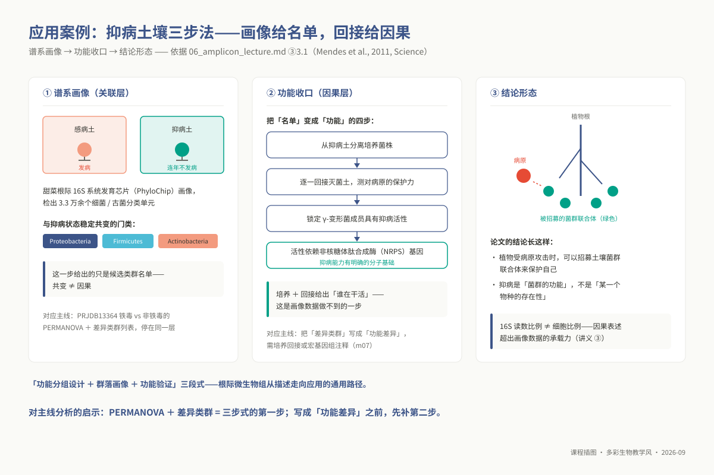
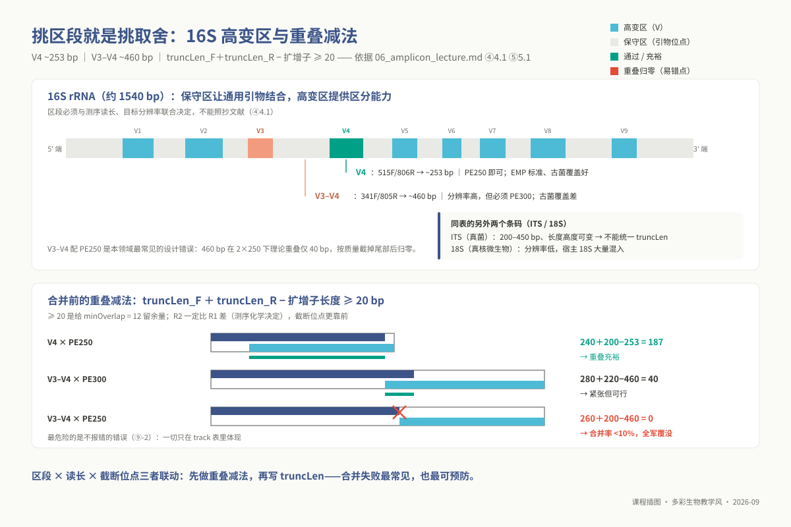
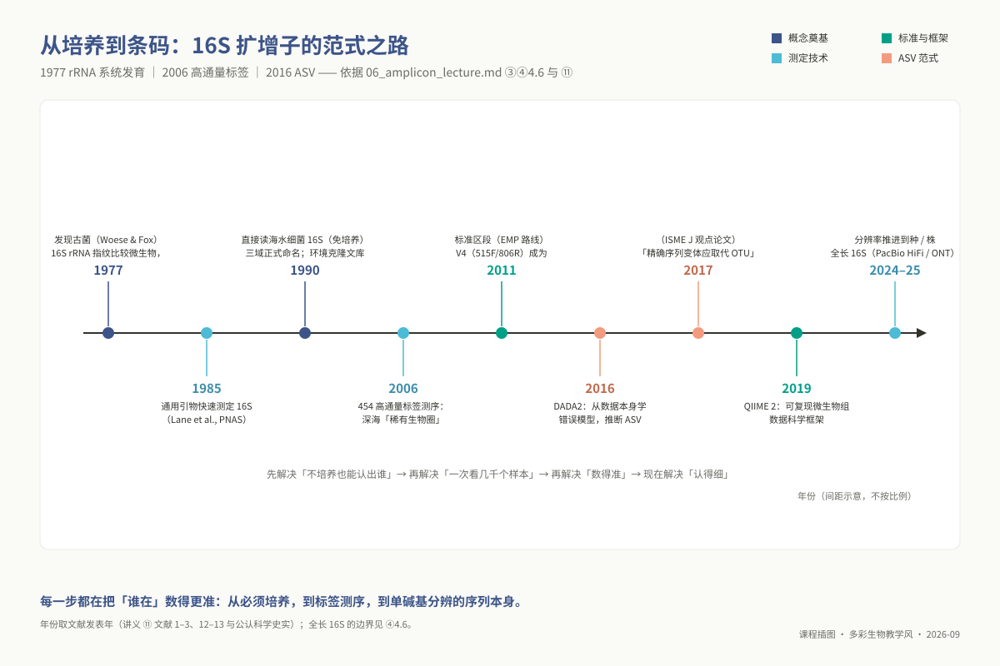
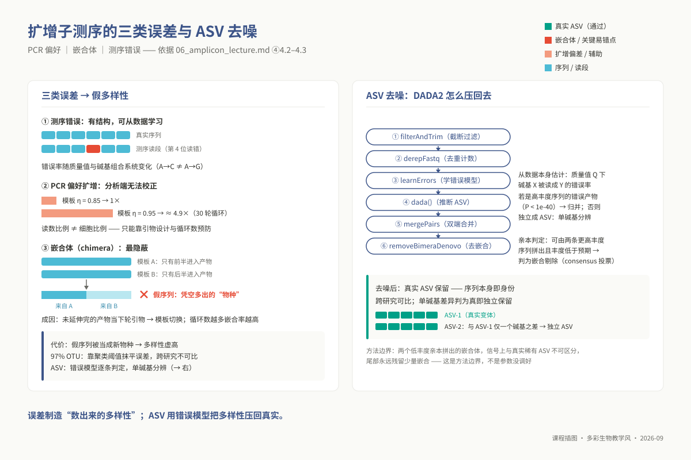
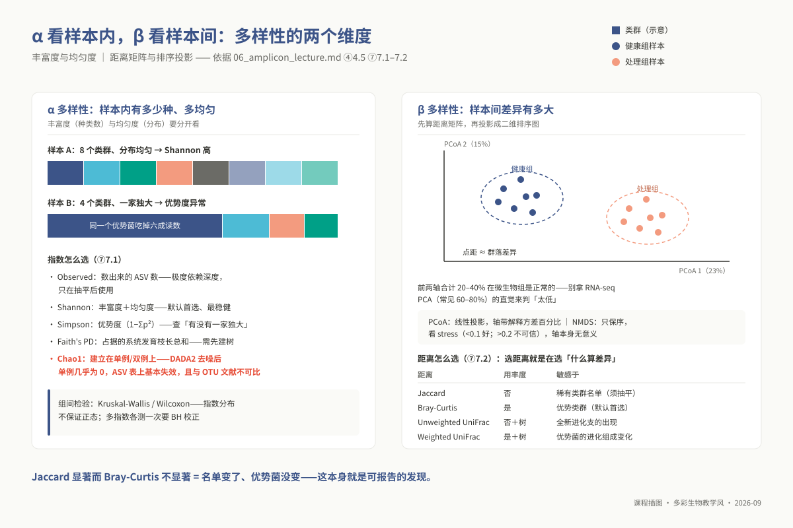
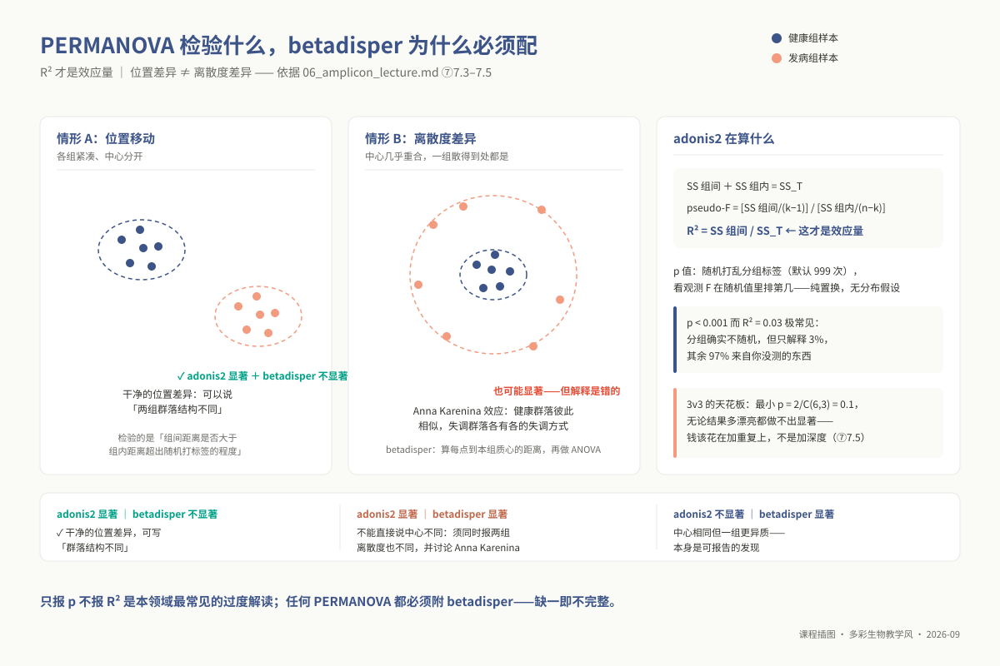

# 专题 06：扩增子测序分析

> **适用对象**：硕士研究生，4 学时（2 h 理论 + 2 h 实践）。
>
> **阅读重点**：从引物区段与错误模型出发，完成 DADA2 去噪，并把多样性检验的假设写进结果说明。

> **硕士生 ｜ 4 学时（2 h 理论 + 2 h 实践）｜ 环境：`conda activate ngs_ms_microbiome`**
> **主路径是 R 侧的 DADA2 + phyloseq + vegan**（已在 `env_master_microbiome.yml` 内）。
> **QIIME2 不在本环境里**——官方要求独立环境，见 ②「环境说明」。它是可选平行路径，
> 与主路径的科学内容一致，差别主要在封装形式。 **最后更新**：2026-08-31

## ① 学习目标

读完并做完本讲操作后，你应当**能够**：

1. **说明** 16S 的 V4 与 V3–V4、ITS1 与 ITS2 各自的读长要求与偏好性，并**为给定样本类型选出**引物区段、写出理由。
2. **解释** ASV 与 97% OTU 的本质差别，并**指出**这一差别如何影响跨研究比较与 Chao1 的可比性。
3. **运行**完整的 DADA2 六步去噪流程，**根据质量分布图给出** `truncLen` / `maxEE` 的取值及依据。
4. **判读** DADA2 的 `track` 表，**定位**样本是在过滤、去噪、合并还是去嵌合哪一步掉了 reads。
5. **选择** α 多样性指数与 β 距离度量，**说明**每个指数/距离对什么敏感、对什么不敏感。
6. **运行** `adonis2` 与 `betadisper`，**正确陈述** PERMANOVA 检验的是什么、R² 与 p 各自意味着什么。
7. **算出**给定重复数下置换检验的最小可能 p 值，据此**判断**该设计能否支持显著性结论。
8. **写出**一段可进方法学的「抽平决策说明」：深度、随机种子、被剔除样本、哪些分析抽平哪些不抽平。

## ② 前置检查

跟不上时回查对应 L0 模块，不要硬啃本讲。模块定义见 `00_design/prerequisite_packs.md`，自测题在 `08_assessment/prerequisites/`。

| L0 模块 id | 本讲哪里用到 | 不过关的后果 | 自测题号 |
|---|---|---|---|
| `l0_06_stats` | ⑦ 全部 | 报出"两组无显著差异"，而这个设计根本不可能显著 | L0-6 **第 2 题（3 vs 3 的 Wilcoxon 天花板，场景就是本讲）**、第 1、5、7 题 |
| `l0_02_r` | ⑤ 全部：读表、dplyr 汇总、ggplot2 出 PCoA 与箱线图并 `ggsave` | 拿到 ASV 表也画不出图；图里出现中文方块 | L0-2 第 3、4 题；**第 8、9、10 题（上机）** |
| `l0_05_qc` | ⑤ 5.1 看质量分布定 `truncLen`；⑨-1 与"清洗后指标反而变差"同一套推理 | 截断位点凭感觉设，合并率崩掉却不知为何 | L0-5 第 4 题（红灯辨析）、**第 6 题（参数推理）**、第 9 题（上机） |
| `l0_01_linux` | ⑤ 5.0：`qsub` 提交去噪作业、`/d3/scratch` 路径、`tail` 看日志 | 4 小时的 DADA2 跑在登录节点上被杀 | L0-1 第 5、6 题；第 8 题（上机） |
| `l0_03_conda` | 下方「环境说明」：QIIME2 为什么必须单独建环境 | 把 QIIME2 装进 `ngs_ms_microbiome`，把环境解崩 | L0-3 第 2、6 题（**第 6 题 F 选项就是 QIIME2**）、P1（上机） |

**环境说明（必读）**

| | 主路径（本课默认） | 可选路径 |
|---|---|---|
| 工具 / 环境 | DADA2 + phyloseq + vegan（R），在 `ngs_ms_microbiome` 里**已装好** | QIIME2，**不在本环境内，需自建** |
| 依据 / 怎么装 | — | 契约 `env_exempt_tools` 已声明"QIIME2 官方要求独立环境"；按 <https://docs.qiime2.org/> 当期版本 "Natively installing" 一节 `conda env create -n qiime2-amplicon-<版本> --file <官方 yml>` |

> **不要试图把 QIIME2 塞进 `ngs_ms_microbiome`。** 它把 scikit-learn、biom-format、pandas 的版本钉得很死，与 Bioconductor 栈的 Python 依赖互斥，硬解会让环境 solving 几小时后失败——这正是 L0-3 第 6 题考的东西。两条路径可在任意一步汇合：QIIME2 的 `.qza` 用 `qiime tools export` 导成 biom/tsv 后即可进本讲的 R 流程。

**开工前 30 秒自检**，三条都过再往下走：

```bash
conda activate ngs_ms_microbiome
Rscript -e 'library(dada2); library(phyloseq); library(vegan); cat("OK\n")'
ls -lh /d3/scratch/${USER}/ngs/amplicon/raw/*.fastq.gz | head
```

## ③ 背景与科学问题

你手上是 20 份根际土样，10 份来自发病植株、10 份来自健康植株。你要问的不是"这里有没有细菌"，而是：**①群落组成是否不同？②差异有多大——分组能解释多少比例的群落变异？③哪些类群在变？**

扩增子的做法是：不测全基因组，只测一个所有细菌都有、但序列因物种而异的片段（16S rRNA 的某个高变区），把它当身份条码，一份样本几万条条码，按条码把细菌数清楚。


*图 m06-5：Carl Woese（1928–2012），让 16S rRNA 成为生命之树的标尺（照片：Don Hamerman，CC BY 3.0，Wikimedia Commons）。*

> **人物故事与生命之树重构：暗室中手洗凝胶的革命者**
> 
> 图 m06-5 中的肖像属于美国微生物学家**卡尔·沃斯（Carl Woese，1928–2012）**。今天整个扩增子测序所依赖的 16S rRNA 标尺，正是他以近乎执拗的毅力一砖一瓦建立起来的。
> 
> 20 世纪 70 年代，微生物分类学仍深陷在宏观形态与生化培养的泥潭中。沃斯坚信只有细胞内最古老、最核心的信息分子才能真正反映演化渊源。在伊利诺伊大学的实验室里，他用了整整十年时间，将自己关在暗室中，用放射性同位素 $^{32}\text{P}$ 标记核糖体 RNA，并在巨大的双向电泳凝胶上分析数以千计的寡核苷酸斑点。1977 年，在比对产甲烷菌的 16S 指纹时，他震惊地发现这些生物在分子层面上与常规细菌的差异，丝毫不亚于细菌与哺乳动物的差异——他发现了生命历史中隐匿的第三分支：**古菌（Archaea）**。
> 
> 这一发现遭到了当时主流生物学界（包括演化泰斗恩斯特·迈尔）长达十几年的冷嘲热讽与激烈排挤，但他最终以无可辩驳的测序事实重绘了“生命三域树”。沃斯之所以笃定选择 16S rRNA，是因为它兼具“极致的保守性”（所有细胞生物共有，用于设计通用引物）与“充分的多样性”（高变区能区分近缘物种）——这正是本讲扩增子技术的灵魂所在。

**必须先说清楚它回答不了什么。** 它测的是"**谁在**"，不是"**谁在干活**"。16S 拷贝数在物种间从 1 到 15 不等，读数比例不等于细胞数比例；PCR 引物对不同类群有扩增偏好；短读长的分类分辨率上限通常在**属**。任何"某菌增加导致了发病"的因果表述都超出这份数据的承载力——这不是分析没做好，是数据类型的边界。

### 3.1 应用案例：根际标记基因画像定位抑病土壤的细菌名单

主线用 16S 问"铁毒田 vs 非铁毒田的根际有什么不同"；把分组换成"感病土 vs 抑病土"，就得到扩增子技术最经典的应用之一
——**抑病土壤（disease-suppressive soils）**：某些田块连年种植仍不发病，因为土壤菌群本身在压制病原。
Mendes R et al., 2011（*Science*，⑪ 文献 14）的三步做法至今仍是模板：

- **谱系画像（关联层）**：对抑病土与感病土的甜菜根际做 PhyloChip（16S 系统发育芯片）画像，检出 3.3 万余个细菌/古菌
  分类单元；**Proteobacteria、Firmicutes、Actinobacteria 与抑病状态稳定共变**。注意：这一步给出的只是候选类群名单。

- **功能收口（因果层）**：从抑病土分离培养菌株、逐一回接测保护力，锁定 γ-变形菌成员具有抑病活性，且活性依赖
  非核糖体肽合成酶（NRPS）基因——抑病是"菌群的功能"，不是某一个物种的存在性。

- **结论的形态**：植物受病原攻击时可以招募土壤菌群联合体来保护自己；画像给名单，培养与回接给因果。

**对主线分析的启示**：PRJDB13364 的 Fe vs nonFe 分析（PERMANOVA + 差异类群列表）停在 Mendes 三步式的第一步；
要把"差异类群"写成"功能差异"，需要第二步——培养回接，或至少宏基因组功能注释（m07 的 read/assembly-based 路线）。
"功能分组设计 + 群落画像 + 功能验证"这个三段式，是根际微生物组从描述走向应用的通用路径。



*图 m06-7：抑病土壤三步法：画像给名单，回接给因果。*

## ④ 核心原理

### 4.1 标记基因与引物区段设计的分子博弈

扩增子测序并不测定全基因组，而是针对生命演化长河中高度保守的“分子时钟”基因进行特异性 PCR 扩增与高通量测序。对于细菌和古菌，标准标尺是核糖体小亚基的 **16S rRNA 基因**（全长约 1540 bp）。

16S 分子在二级结构上由交替排列的保守区与高变区（V1–V9 共 9 个高变区）交织而成。这一结构特性为分子生态学带来了完美的双重属性：

- **两端的保守区（Conserved regions）**：由于直接维系核糖体的翻译催化构象，承受着极端强烈的纯化选择，全生命树绝大多数细菌共享几乎相同的核苷酸序列，使得研究人员能够设计出一对退化引物“通捕”整个微生物界；
- **夹在中间的高变区（Hypervariable regions）**：中性漂变积累了大量的特异性突变，提供了区分不同细菌门、纲、科、属的分子指纹分辨率。

在实验设计中，选择哪个高变区是一场测序读长、引物偏好性与拼接物理重叠的精细权衡：
最经典的地球微生物组计划（EMP）标准采用的是 **V4 区段（515F/806R，扩增子长约 253 bp）**。在常规 Illumina PE250 双端测序下，双端读段总长达到 500 bp，扣除 253 bp 扩增子后，中央物理重叠跨度接近 250 bp。充沛的重叠长度允许在质量过滤中大胆裁去末端低质量碱基，拼接成功率极高，且对古菌的通用捕获率优秀；
相比之下，**V3–V4 双区段（341F/805R，扩增子长约 460 bp）** 虽然序列较长、系统发育分辨率更高，但在 PE250 条件下理论重叠仅有微弱的 40 bp。若双端各截去 20 bp 的质量退化尾巴，重叠区瞬间清零，导致双端拼接率暴跌至 10% 以下，造成海量有效数据报废。因此测 V3–V4 必须严格配备 PE300 试剂。
对于真菌研究，由于 18S 保守度过高无法区分近缘种，通常靶向内部转录间隔区 **ITS1 或 ITS2**。必须特别注意的是，ITS 在真菌界内经历了剧烈的插入缺失演化，不同菌株的扩增子物理长度在 200–450 bp 之间极度离散。这意味着在下游质控中，**绝对不能像处理 16S 那样使用固定长度的 `truncLen` 进行机械截断**，否则短片段序列会被算法斩去 3' 接头后的真实编码区，导致人为的拼接失败。



*图 m06-2：16S V1–V9 与引物区段：重叠不够，拼不回全长。*

### 4.2 从 97% OTU 到单碱基 ASV：微生物组学的统计范式转移

在过去十余年里，微生物多样性分析一直笼罩在**操作分类单元（Operational Taxonomic Unit, OTU）** 的经验阴影下。理解为何学界全面淘汰 OTU 并转向扩增子序列变异体（ASV），是建立现代生信思维的关键一步。

**97% 相似度聚类的历史妥协与固有局限**：
早期经典的 OTU 聚类算法（如 UCLUST）以 97% 的序列相似性为阈值，将所有相似度超过该经验截点的 reads 粗暴打包为一个 OTU。97% 这一数字最早源于 20 世纪 90 年代细菌系统学中的一项经验观察（DNA-DNA 杂交相似度 70% 大致对应 16S 序列同一性 97%）。
然而在二代测序的高通量语境下，97% 聚类有两个需要说明的限制。它把低于 3% 的差异归入同一 OTU，可能合并真实的微多态性与测序噪音；在人类肠道或植物根际中，仅差 1–2 个碱基的菌株可能具有不同功能，聚类阈值无法区分它们。

此外，OTU 依赖贪心聚类，输入序列顺序改变时，代表序列与成员边界可能漂移。因此不同研究中的“OTU_1”不能直接视为同一个生物学实体，跨研究合并需要额外的序列和流程标准化。

**DADA2 算法的统计去噪革命**：
DADA2 彻底终结了人为相似度阈值，其核心突破在于将测序错误显式建模为一个参数化的概率生成过程。
测序错误在生化本质上绝非处处均匀的白噪声：转换（Transition，如 A↔G、C↔T）的发生频率天然远高于颠换（Transversion）；更重要的是，每个碱基的错误概率由测序仪给出的质量分数（Phred Q 值）精确指引。DADA2 首先从测试数据本身学习出 16 种核苷酸转移在所有 Q 值档位下的转移误差概率矩阵；
随后，算法以递推细分（Divisive）的方式遍历序列。对于任何一条低丰度可疑序列 $j$，算法将其比对到当前具有最高丰度的主干丰度序列 $i$ 上，并根据其错配位置的 Q 值，计算在当前测序错误模型下“纯粹由序列 $i$ 在扩增和测序中犯错而产生 $j$ 达到当前观测频数”的泊松累积极限概率。如果这一先验概率极其微小，突破了严格的显著性阈值（`OMEGA_A = 1e-40`），算法便断定该变异绝对不可能被测序仪器误差所解释，必须将其确认为一个独立的真实生物学实体——**ASV（Amplicon Sequence Variant）**。
ASV 赋予了扩增子分析前所未有的单核苷酸（1 bp）分辨率。由于 ASV 的名字就是那段确切无误的 DNA 序列本身，它成为了跨越不同批次、不同实验室、不同年份的全球统一学术通货。



*图 m06-6：从 16S 到 ASV 的范式时间线：OTU 聚类的时代结束了。*

### 4.3 DADA2 全流程去噪机理与嵌合体分子生成模型

DADA2 流程的六步推进体现了严密的质量控制链条：

1. **`filterAndTrim`（质量截断与最大期望错误过滤）**：除了根据质量曲线中位数跌破 Q30 的位置设定 `truncLen` 截去退化尾部外，最核心的参数是 `maxEE = 2`（最大期望错误数）。传统按平均质量值过滤容易放过在长序列中累积了过多单个错配的读段；期望错误数利用公式 $EE = \sum 10^{-Q/10}$ 将每个碱基的理论错误概率如实累加，从根本上剔除不可靠的读段。
2. **`learnErrors` 与 `dada`（错误率学习与推断）**：学习过程必须按**独立测序批次（Run）**分别执行。因为不同流动槽和试剂批次的物理错误率曲线存在细微偏移，混合学习会使误差模型的方差膨胀，降低罕见变异的判别信度。在 `dada()` 推断阶段，`pool = "pseudo"` 模式通过两轮迭代在各样本间共享低频信息，能够敏锐打捞那些在单个样本中丰度不足但跨样本稳定出现的稀有 ASV。
3. **`mergePairs`（双端拼接）**：基于无错配或极少错配的刚性要求将 R1 与 R2 拼回全长扩增子。在此步骤严禁为了贪图合并率而盲目放宽错配阈值，否则会把同源但非同质的异源片段强行粘合。
4. **`removeBimeraDenovo`（去嵌合体）**：**嵌合体（Chimeras）是 PCR 反应的固有副产物**。在多轮扩增的后期，随着引物逐渐耗竭，一条未完全延伸的单链 DNA 产物在变性后退火，由于高度保守区的同源引导，它会错误地结合到另一条不同序列模板的中段，充当起“大号引物”完成后续延伸。产出的嵌合分子前半段属于物种 A、后半段属于物种 B。DADA2 通过全样本拓扑比对，检验某候选 ASV 是否可以被两个丰度显著更高的“亲本 ASV”精确拼出，从而将这一人工扩增畸形序列彻底抹去。



*图 m06-1：三类误差制造假多样性，DADA2 用数据本身估计的错误模型把多样性压回真实 ASV。*

### 4.4 物种分类学注释的分辨率天花板

得到精炼的 ASV 特征表后，物种注释通常依托 RDP 朴素贝叶斯分类器（Naive Bayes Classifier）展开。算法将参考数据库（如 SILVA 或 GreenGenes2）的已知全长序列切分为固定长度的 8-mer 短串，训练各分类阶元下 8-mer 的条件概率分布；随后对目标 ASV 进行滑动评分并执行 100 次 Bootstrap 抽样，以检验置信度。

在阅读注释结果时，必须具备清醒的学术批判眼光：
短读长扩增子（如 250 bp 的 V4 区）包含的序列信息有限。在一些演化较近的属内，不同物种在目标区段可能完全相同。因此，**短读长 16S 扩增子的可靠分类分辨率常止于属（Genus）水平**。若报告频繁列出种名，应检查参考数据库、分类器置信度和是否存在过度注释，不能把分类器输出直接当作物种鉴定。

### 4.5 $\alpha$ 与 $\beta$ 多样性：生态群落度量的数学与几何本质

微生物组学在本质上是宏观生态学理论在微观群落中的投射，其核心指标分为两大观测维度：

**$\alpha$ 多样性（群落内部的复杂度）**：

- **物种丰富度（Richness）**：以 Observed ASVs 或 Chao1 为代表，单纯清点一个样本中究竟观测到了多少种不同的微生物，对稀有物种的微弱出现极其敏感；
- **综合多样性与均匀度（Evenness & Diversity）**：以 Shannon 熵（$-\sum p_i \ln p_i$）与 Gini-Simpson 指数（$1 - \sum p_i^2$）为代表。它们不仅度量种类数量，更将每种生物在群落中的相对多度所带来的信息熵或相遇相异概率纳入模型。一个由单一优势菌占据 99% 通量、其余 100 种菌各占 0.01% 的严重失衡群落，其 Shannon 指数将极低，真实反映出群落内部生态功能的脆弱性。

**$\beta$ 多样性（群落之间的距离空间与降维投影）**：
$\beta$ 多样性首先跨样本两两计算生态相异度矩阵。度量距离的选择映射着具体的生态学假说：

- **Bray-Curtis 距离**：综合考量分类单元的有无及相对丰度差异，由高丰度优势菌群主导距离的计算；
- **Jaccard 距离**：将丰度二值化为 0/1，仅度量群落间物种组成的共享与独有比例；
- **UniFrac 距离（系统发育加权）**：将进化树拓扑融入距离计算。若两个样本包含不同的物种，但这些物种在进化树上同属于一个极其紧密的近缘分支，UniFrac 认为它们的生态分化远小于分属不同远缘门的样本。Unweighted UniFrac 仅考虑进化分枝的有无（敏感于稀有物种的存在），Weighted UniFrac 则用丰度对各进化枝长进行加权（由优势菌群的演化距离主导）。

在降维可视化中，**主坐标分析（PCoA）** 是对原始相异度矩阵的特征值分解与欧氏线性投影，坐标轴具有明确的“解释方差贡献率”，点间欧氏距离严格近似原始相异度；而**非度量多维标度法（NMDS）** 放弃了对真实距离绝对数值的线性拟合，转而利用单调回归仅保持样本间相异度的排序秩次（Rank order）。

NMDS 的坐标轴没有任何绝对单位和方差解释度，降维效果的优劣完全由应力系数（Stress）决定（$\text{Stress} < 0.1$ 为极佳，$> 0.2$ 则提示在低维空间发生了严重的拓扑畸变，不可强行解读）。两者配合使用，构成了展示处理与群落更替关联的标准图谱。



*图 m06-3：α 与 β 多样性：样本内数种类，样本间比组成。*

### 4.6 技术前沿（2023–2026）

**全长 16S：用读长直接解决"分辨率到属就停"的问题。** PacBio HiFi 与 ONT 双链模式把单读准确度抬到 99% 以上后，
1491 bp 全长扩增子可以一次测完：分辨率从"属"推进到"种/株"，4.1 里纠结的"区段 × 读长 × 重叠"取舍在全长上整体消失，
也天然规避了 ⑨-2 的合并失败。两个平台各有 2024–2025 年的对照评测（PacBio 见 ⑪ 文献 12；ONT 见 ⑪ 文献 13），
结论方向一致：种水平的检出显著增加。**当前边界**：全长数据的错误模型与嵌合判定工具链仍在成熟中，
SILVA/UNITE 的全长训练集与短读长版并非一一对应，本讲的 DADA2 流程不能直接照搬到全长数据上。

**宏条形码 beyond 16S。** 以功能基因为条码——固氮 nifH、氨氧化 amoA、产甲烷 mcrA——把"谁在"推进到
"谁带着哪条通路的基因"；真菌之外，真核与病毒的通用条码仍是开放问题。选型逻辑与本讲完全一致：
保守区决定引物、高变区决定分辨率、读长决定能不能拼合；ITS 的长度可变问题（4.1）在功能基因条码上同样存在
且往往更严重，因为功能基因的保守/高变布局比 16S 松散得多。

## ⑤ 操作步骤

主路径全程在 R 中完成，作为 SGE 作业提交。配套脚本：`03_code/master/scripts/06_dada2_pipeline.R` 与 `06_run_dada2.sh`。

### 5.0 目录与作业提交

```bash
mkdir -p /d3/scratch/${USER}/ngs/amplicon/{raw,filtered,results,logs}
qsub 03_code/master/scripts/06_run_dada2.sh    # 路径与线程在脚本头部变量区改
qstat -u ${USER}                               # 看状态；Eqw 见 L0-1 第 6 题
tail -f /d3/scratch/${USER}/ngs/amplicon/logs/m06_dada2.o*
```

### 5.1 质量概览与截断位点决策

```r
library(dada2)
path <- "/d3/scratch/USER/ngs/amplicon/raw"
fnFs <- sort(list.files(path, pattern = "_R1.fastq.gz", full.names = TRUE))
fnRs <- sort(list.files(path, pattern = "_R2.fastq.gz", full.names = TRUE))
stopifnot(length(fnFs) == length(fnRs), length(fnFs) > 0)   # 数量对不上立刻停
ggplot2::ggsave("results/qual_F.pdf", plotQualityProfile(fnFs[1:4]), width = 8, height = 6)
ggplot2::ggsave("results/qual_R.pdf", plotQualityProfile(fnRs[1:4]), width = 8, height = 6)
```

**怎么读图定 `truncLen`**：看橙色实线（中位数；绿线是均值，虚线是四分位）跌破 Q30 的横坐标；R2 一定比 R1 差（测序化学决定），截断位点更靠前。然后**做一次减法**：

```text
(truncLen_F − trimLeft_F) + (truncLen_R − trimLeft_R) − 去引物扩增子长度 ≥ 20 bp（给 minOverlap=12 留余量；用含引物长度时不减 trimLeft）
V4（去引物 253 bp）：(240−19)+(200−20)−253 = 148 → 充裕 ｜ V3–V4（含引物约 460 bp）：280+220−460 = 40 → 紧张但可行；
若改成 260+200 则 = 0，全军覆没
```

### 5.2 过滤、去噪、合并、去嵌合

```r
filtFs <- file.path("filtered", basename(fnFs)); filtRs <- file.path("filtered", basename(fnRs))
out <- filterAndTrim(fnFs, filtFs, fnRs, filtRs,
        truncLen = c(240, 200),  # 由 5.1 的质量图 + 重叠减法决定，不是抄来的
        trimLeft = c(19, 20),    # 515F/806R 引物长度（19/20 nt）；已去引物则设 c(0, 0)
        maxEE    = c(2, 2),      # 期望错误数上限；R2 差时可放到 c(2, 5)，但必须记录
        truncQ = 2, maxN = 0, rm.phix = TRUE, compress = TRUE, multithread = 16)

errF <- learnErrors(filtFs, multithread = 16)   # 单批次写法；跨 run（本数据跨 3 年）见 ⑨-4 与脚本 BATCH_COL
errR <- learnErrors(filtRs, multithread = 16)
ggplot2::ggsave("results/err_F.pdf", plotErrors(errF, nominalQ = TRUE), width = 8, height = 6)
dadaFs <- dada(derepFastq(filtFs), err = errF, pool = "pseudo", multithread = 16)
dadaRs <- dada(derepFastq(filtRs), err = errR, pool = "pseudo", multithread = 16)
mergers <- mergePairs(dadaFs, derepFastq(filtFs), dadaRs, derepFastq(filtRs),
                      minOverlap = 12, maxMismatch = 0, verbose = TRUE)
seqtab.nochim <- removeBimeraDenovo(makeSequenceTable(mergers),
                      method = "consensus", multithread = 16, verbose = TRUE)
```

### 5.3 去噪追踪表（本流程最重要的一张表）

```r
getN  <- function(x) sum(getUniques(x))
track <- cbind(out, sapply(dadaFs, getN), sapply(dadaRs, getN),
               sapply(mergers, getN), rowSums(seqtab.nochim))
colnames(track) <- c("input","filtered","denoisedF","denoisedR","merged","nonchim")
write.csv(track, "results/dada2_track.csv")
```

### 5.4 注释、组装 phyloseq 对象、出图与检验

```r
library(phyloseq); library(vegan); library(ggplot2)
taxa <- assignTaxonomy(seqtab.nochim, "db/silva_nr99_toGenus_trainset.fa.gz",
                       minBoot = 80, multithread = 16)   # minBoot = 置信度阈值 × 100
ps <- phyloseq(otu_table(seqtab.nochim, taxa_are_rows = FALSE),
               sample_data(read.csv("metadata.csv", row.names = 1)), tax_table(taxa))

ps_rare <- rarefy_even_depth(ps, sample.size = 10000, rngseed = 20260829, replace = FALSE)
ggsave("results/alpha_diversity.pdf", width = 7, height = 4,      # 图中文字一律英文
  plot_richness(ps_rare, x = "group", measures = c("Observed","Shannon","Simpson")) +
    geom_boxplot(alpha = .4) + theme_bw() + labs(x = "Group", y = "Alpha diversity"))

ps_rel  <- transform_sample_counts(ps, function(x) x / sum(x))
d_bray  <- phyloseq::distance(ps_rel, method = "bray")
ggsave("results/pcoa_bray.pdf", width = 6, height = 5,
  plot_ordination(ps_rel, ordinate(ps_rel, "PCoA", distance = d_bray), color = "group") +
    stat_ellipse(level = .68) + theme_bw() +
    scale_color_manual(values = c(healthy = "#0072B2", diseased = "#D55E00")))

meta_df <- as(sample_data(ps_rel), "data.frame"); set.seed(20260829)
adonis2(d_bray ~ group, data = meta_df, permutations = 999)   # PERMANOVA：R² 与 p，详见 ⑦
anova(betadisper(d_bray, factor(meta_df$group)))              # 离散度齐性，必须同时报
kruskal.test(estimate_richness(ps_rare, measures = "Shannon")$Shannon ~ meta_df$group)
```

需要 UniFrac 时才建树（`DECIPHER` + `phangorn`）；ASV 上万时建树极慢，只用 Bray-Curtis 是合理选择，写进方法学即可。**可选 QIIME2 路径的一一对应**：`qiime tools import` → `qiime dada2 denoise-paired`（参数同名同义）→ `qiime feature-classifier classify-sklearn` → `qiime diversity core-metrics-phylogenetic --p-sampling-depth`（即抽平）→ `qiime diversity beta-group-significance --p-method permanova`。

## ⑥ 结果解读

### 6.1 去噪追踪表：第一诊断依据

一份正常 V4 数据大致长这样（每行一个样本）：

| sample | input | filtered | denoisedF | denoisedR | merged | nonchim |
|---|---|---|---|---|---|---|
| S01 | 62 431 | 55 902 (90%) | 55 118 | 54 903 | 51 240 (**82%**) | 46 118 (**74%**) |

**判据**：`filtered/input` 通常 70–90%；`merged/filtered` 应 ≥ 70%；`nonchim/merged` 应 ≥ 60%（土壤嵌合率偏高，50% 也常见）；**总保留率 `nonchim/input` 一般落在 50–80%**。**结果不对时长什么样**——按 reads 掉在哪一步定位病因：

| 症状 | 掉在哪 | 病因 | 处理 |
|---|---|---|---|
| `filtered/input` < 40% | 过滤 | `truncLen` 太长（截进低质区）或 `maxEE` 太严 | 回看质量图；R2 放宽到 `maxEE=c(2,5)` |
| `denoised` 正常但 `merged/filtered` < 30% | 合并 | **重叠不够**，最典型的错误 | 做 5.1 的减法；见 ⑨-2 |
| `nonchim/merged` < 30% | 去嵌合 | 引物没去干净，被误判为嵌合 | 核对 `trimLeft`；或 PCR 循环数过高 |
| 某一两个样本全程都远低于其他 | — | 该样本建库/测序失败 | 报告里**明确剔除并说明**，不要静默丢掉 |

### 6.2 错误模型图与稀释曲线

**`err_F.pdf` 该长什么样**：黑点（观测错误率）随质量值升高而下降，黑线（拟合）贴着黑点走，红线（Q 值理论期望）趋势一致。**不对时**：黑线与黑点系统性偏离，或黑点根本不随 Q 下降 → 你把**多个测序 run 混在一起学错误模型**了；不同批次错误结构不同，混学的模型对哪个批次都不准，后果是 ASV 数虚高（见 ⑨-4）。

**稀释曲线**（`vegan::rarecurve`）横轴深度、纵轴观测 ASV 数。**进入平台期** → 深度足够，可在平台期起点附近选抽平深度。**仍在陡升**（不对的样子）→ 深度远不够，该样本的 α 多样性被**系统性低估**；此时"A 组多样性低于 B 组"很可能只是"A 组测得浅"。

### 6.4 PCoA 图

**怎么读**：每点一个样本，点距 ≈ 群落差异；轴上百分比是该轴解释的距离矩阵变异。**前两轴合计 20–40% 在微生物组里是正常的**——不要拿 RNA-seq PCA（常见 60–80%）的直觉去判它"太低"。分组是否分离必须与 ⑦ 的 PERMANOVA R² 一起看，不能只靠肉眼。

**结果不对时长什么样**：

| 图上现象 | 真实含义 |
|---|---|
| 1–2 点被甩到极远，其余挤成一团 | 离群样本主导了排序。先查它的深度与 `track` 表；确认失败就剔除后重画 |
| 样本沿 PC1 呈**马蹄形** | 强梯度下的拱形效应（arch effect），不是生物学信号。改用 NMDS |
| 分组完全重合但 PERMANOVA `p < 0.001` | 效应真实但极小（看 R²），或来自离散度差异（看 betadisper） |
| 按**测序批次**着色比按处理分组分得更干净 | 批次效应主导（`l0_06_stats` 的核心议题）；设计若已混杂，无法事后补救 |

### 6.5 属水平堆叠柱状图与一段合格的结果陈述

只留 Top 10–15 个属，其余并为 "Others"。**堆叠图展示的是相对丰度，不是绝对量**——某条带变宽可能是它真的增多，也可能是别的属减少了（m07 组成性问题的入口）。**不对时**：图例里 50 个属、颜色分不清 → 没做 Top-N 截断；大片 `NA` 或只到门 → 分类器与引物区段不匹配（⑨-5）。

> 20 份样本经 DADA2 去噪后保留 46 118 ± 8 210 条序列（平均保留率 74%），得到 3 412 个 ASV。以 10 000 条抽平（种子 20260829，无样本被剔除）后，两组 Shannon 指数无差异（Kruskal-Wallis，*p* = 0.31）。基于 Bray-Curtis 距离的 PERMANOVA 显示分组显著（*R*² = 0.11，*p* = 0.001，999 次置换），betadisper 不显著（*p* = 0.42），说明该差异来自群落中心位置的移动而非组内离散度差异；分组解释了 11% 的群落变异。

**它做对了什么**：给了保留率与抽平深度/种子、α 用非参数检验、β 同时报 R² 与 p、报了 betadisper 并据此排除替代解释、最后把 R² 翻成人话。

## ⑦ 统计插件

**焦点：α/β 多样性的统计检验、PERMANOVA、稀释与抽平的争议。**

> **与 `l0_06_stats` 的分工**：p 值语义、BH-FDR、批次效应、生物学重复 vs 技术重复、功效的一般概念，**L0 已讲完，本节不重复**。本节只讲这些通用原理**落到群落数据上**变成什么样，以及群落数据独有的三个坑：距离矩阵怎么选、置换检验的天花板、抽平。

### 7.1 α 多样性：每个指数在度量什么

| 指数 | 度量什么 | 对什么敏感 | 用它的场合 |
|---|---|---|---|
| **Observed** | 观测到的 ASV 数 | **极度依赖测序深度** | 只在抽平后使用 |
| **Chao1** | 由单例/双例外推"总共有多少种" | **单例（singleton）** | ⚠ 见下方警告 |
| **Shannon** | 丰富度 + 均匀度 | 中等丰度类群 | 默认首选，最稳健 |
| **Simpson** | 优势度（1−Σp²） | 高丰度类群 | 关心"有没有一个菌一家独大" |
| **Faith's PD** | 样本占据的系统发育枝长总和 | 类群间亲缘距离 | 关心进化多样性，需先建树 |

> **注意**：**Chao1 在 ASV 表上的解释很不稳定。** Chao1 = S_obs + n₁²/(2n₂)，建立在单例与双例数量上；而 DADA2 去噪常会把部分单例判为测序错误，去嵌合后 n₁ 可能接近 0。因此，**ASV 表的 Chao1 不应直接与 OTU 表的 Chao1 比较**。本课以 **Shannon 为主指标**；若报告 Chao1，必须同时写明这一局限。

**组间检验**：多样性指数样本量小、不保证正态 → 用 Kruskal-Wallis（多组）/ Wilcoxon（两组）。多个指数各检验一次时按 `l0_06_stats` 的规则做 BH 校正。

### 7.2 β 多样性：距离矩阵怎么选

**选距离就是在选"你认为什么算差异"**，这是科学决策，不是默认参数。

| 距离 | 用丰度 | 用系统发育 | 对什么敏感 | 什么时候用 |
|---|---|---|---|---|
| **Jaccard** | 否 | 否 | **稀有类群**（只出现一次的 ASV 与优势菌权重相同） | 关心"物种名单"差异；对深度极敏感，必须抽平 |
| **Bray-Curtis** | 是 | 否 | **优势类群** | 默认首选；关心"谁多谁少" |
| **Unweighted UniFrac** | 否 | 是 | 稀有且系统发育独特的类群 | 关心是否出现了全新的进化支 |
| **Weighted UniFrac** | 是 | 是 | 高丰度类群的系统发育位置 | 关心优势菌群的进化组成变化 |

同一份数据用不同距离常得到不同结论，这不是错误——它们在问不同问题。Jaccard 显著而 Bray-Curtis 不显著，意味着"物种名单变了，但优势菌没变"，这本身就是可报告的发现。**报告必须写明用了哪个距离、为什么。**

### 7.3 PERMANOVA：它到底在检验什么

`adonis2` 做的是**对距离矩阵的方差分解**：由所有两两距离算出总平方和 SS_T，拆成组间与组内两部分，再**随机打乱分组标签**（默认 999 次）重算统计量，看观测值在这堆随机值里排第几 → p 值。

```text
SS_组间（不同组样本之间的距离） + SS_组内（同组样本之间的距离） = SS_T
pseudo-F = [SS_组间 /(k−1)] / [SS_组内 /(n−k)]      R² = SS_组间 / SS_T  ← 这才是效应量
```

**一句话**：PERMANOVA 问的是"**组间的距离，是否比组内的距离大到超出随机打标签所能产生的程度**"。

**R² 才是重点。** 微生物组里 `p < 0.001` 而 `R² = 0.03` 极其常见，意思是"分组确实不是随机的，但只解释了 3% 的群落变异，剩下 97% 来自你没测的东西"。**只报 p 不报 R² 是本领域最常见的过度解读**，也是审稿人最常提的意见之一。

### 7.4 betadisper：为什么 PERMANOVA 必须配它

PERMANOVA 的**前提假设是各组多元离散度相近**。两种完全不同的情形都会推高 pseudo-F：**情形 A（位置移动）**——健康组聚在左、发病组聚在右，各自都紧凑，显著且解释正确；**情形 B（离散度差异）**——两组中心几乎重合，但发病组散得到处都是，也可能显著，但解释是错的。

情形 B 就是 **Anna Karenina 效应**：健康群落彼此相似，失调群落各有各的失调方式，这在疾病、胁迫、抗生素处理的数据里非常普遍。PERMANOVA 分不清 A 和 B。**`betadisper` 专门检验这一点**：算每个样本到本组质心的距离，再对这些距离做 ANOVA。



*图 m06-4：PERMANOVA 与离散度：显著≠组间中心不同，Anna Karenina 效应。*

| `adonis2` | `betadisper` | 怎么解释 |
|---|---|---|
| 显著 | 不显著 | ✅ 干净的位置差异，可以说"群落结构不同" |
| 显著 | **显著** | ⚠ **不能**直接说中心位置不同；须同时报"两组离散度也不同"并讨论 Anna Karenina 效应 |
| 不显著 | 显著 | 中心相同但一组更异质，本身是可报告的发现 |

**本课要求：任何 PERMANOVA 结果都必须附 betadisper 结果**，缺一即视为分析不完整。

### 7.5 重复数：这个设计有没有可能显著

`l0_06_stats` 第 2 题已点明：**3 vs 3 的 Wilcoxon 秩和检验，理论最小 p 值就是 0.1，永远做不出 `p < 0.05`**。这条在扩增子里必须接着说完，因为**置换检验有完全一样的天花板**：3 vs 3 时把 6 个标签重新分配只有 C(6,3) = 20 种方式，互补的两种分法给出相同的 F 值，观测值自身占掉 2/20。

```r
# 最小可能 p 值 = 2 / choose(n1+n2, n1)
# 3v3 → 2/20 = 0.100 不可能显著 ｜ 4v4 → 0.029 勉强 ｜ 5v5 → 0.008 有余量 ｜ 6v6 → 0.002 舒适
2 / choose(6, 3)              # 0.1
wilcox.test(1:3, 4:6)$p.value # 0.1 —— 两组毫无重叠，仍然做不出显著
```

**这就是本专题案例数据要求「≥ 2 组 × ≥ 5 重复」的算术来源**，不是拍脑袋。做设计时先算这个数：**若最小可能 p 值 ≥ 0.05，这个实验无论结果多漂亮都得不到显著结论**，钱应该花在加重复上而不是加深度上。设计确实只有 3 vs 3（比如珍贵临床样本）时，正确写法不是"两组无显著差异"，而是：

> 受样本量限制（每组 n = 3），置换检验可取到的最小 p 值为 0.1，本设计无法对该假设做统计判断。我们报告效应量 R² = 0.18，作为后续研究的功效估计依据。

### 7.6 抽平（rarefaction）的争议

**抽平是什么**：把每个样本随机抽到相同读数（如 10 000），多余的丢掉，不足的样本整个剔除。**为什么做**：测序深度是技术变量，深的样本天然观测到更多 ASV；Observed、Chao1、Jaccard、Unweighted UniFrac 全都直接受深度影响，不校正没法比。

**为什么反对**：McMurdie & Holmes (2014) 的 *Waste not, want not: why rarefying microbiome data is inadmissible* 论证抽平**丢弃有效数据、人为增大方差、降低检验功效**，在差异丰度检验上明显劣于基于模型的归一化；这篇文章影响很大，一度让"抽平"成了审稿意见里的靶子。**为什么实践中还在用**：后续工作（Weiss et al. 2017；Schloss 2024）指出该结论主要针对**差异丰度检验**，而在**多样性比较**上抽平仍是最简单可靠的深度校正手段——尤其对存在/缺失类度量，至今没有公认更好的替代。

**本课采用的折衷共识**：

| 分析 | 抽平？ | 理由 |
|---|---|---|
| Observed / Chao1 / Faith's PD | **抽平** | 直接受深度影响，无替代方案 |
| Jaccard / Unweighted UniFrac | **抽平** | 存在/缺失度量对深度极敏感 |
| Shannon / Simpson / Bray-Curtis | 抽平或相对丰度均可，**说明用了哪个** | 对深度不敏感；深度差异过大时仍建议抽平 |
| **差异丰度检验** | **不抽平** | 改用 ANCOM-BC / ALDEx2 等为组成性数据设计的方法（详见 m07 ⑦） |

**深度怎么定**：看稀释曲线平台期起点，权衡"设高则丢样本、设低则丢信息"。**必须报告抽平深度、随机种子、被剔除的样本数与样本名。本讲强制练习**：对同一份数据分别用抽平表与相对丰度表各算一次 Bray-Curtis + PERMANOVA，比较 R² 与 p——**若结论翻转，说明结论对深度校正方式敏感**，这必须写进报告，而不是挑好看的报上去。

### 7.7 组成性问题（预告）

相对丰度之和恒为 1，一个类群升高必然压低其他类群的相对值；堆叠柱状图和 Bray-Curtis 都建立在相对丰度上，因此都受此影响。该问题在 **m07 ⑦系统展开**；本讲只要求你解读堆叠图时不说"某某菌减少了"，而说"某某菌的**相对**丰度降低了"。

## ⑨ 常见错误与排查

1. `Error in filterAndTrim(...) : Every input file must have a corresponding output file.` ｜ 原因：`fnFs` 与 `filtFs` 长度不一致，通常是 `list.files` 的 `pattern` 漏掉了部分文件（有的样本叫 `_1.fq.gz` 而非 `_R1.fastq.gz`）。｜ 解法：先 `length(fnFs); length(fnRs)` 核对，并在流程开头加 `stopifnot()`（见 5.1）。

**2. `merged` 只剩 5% 而 `denoisedF/R` 正常**（不报错，只在 `track` 表里体现——最危险的一类）｜ 原因：截断后重叠不足；V3–V4（~460 bp）用了 PE250 数据，或 `truncLen` 太短。｜ 解法：做 5.1 的减法；确实拼不上时二选一——`mergePairs(..., justConcatenate = TRUE)`（插 10 个 N 连接，分类仍可用但不能算 UniFrac），或**只用 R1 单端**跑完整流程（V4 单端 240 bp 分辨率损失有限，写进方法学即可）。

**3. `Error: cannot allocate vector of size 4.2 Gb`** ｜ 原因：`dada(pool = TRUE)` 合并所有样本推断，内存随样本数与唯一序列数急升。｜ 解法：改 `pool = "pseudo"`；SGE 脚本申请更多内存 `#$ -l h_vmem=64G`；或分批后 `mergeSequenceTables()`。

**4. 错误率图的黑点不随质量值下降** ｜ 原因：把不同测序 run 的样本混在一起 `learnErrors`。｜ 解法：按 run 分开跑到 `makeSequenceTable` 为止，再 `mergeSequenceTables(st1, st2)`，最后统一去嵌合——DADA2 官方 Big Data 教程即按此组织。

**5. 注释结果 60% 以上是 `NA` 或只到门水平** ｜ 原因（按概率排序）：① 训练集与引物区段不匹配（用全长训练集注释 V4）；② `trimLeft` 没设，引物序列还留在 ASV 上；③ 序列方向反了。｜ 解法：换匹配区段的训练集；核对 `trimLeft`；`assignTaxonomy(..., tryRC = TRUE)` 允许反向互补匹配。

**6. `6 samples removed because they contained fewer reads than 'sample.size'.`** ｜ 原因：抽平深度高于这 6 个样本的实际深度，它们被整个丢弃。｜ 解法：这是**决策**不是错误——降低深度保住样本，或保持深度并在报告中列出被剔除的样本名与深度。**不允许静默丢弃。**

7. `adonis2` 报 `Error: object 'group' not found`；`betadisper` 报 `'group' must be a factor` ｜ 原因：`data =` 传的是 `sample_data` 对象而非 data.frame；分组列被读成 character/数值。｜ 解法：`as(sample_data(ps), "data.frame")` + `factor(meta_df$group)`；并确认距离矩阵样本顺序与元数据一致（phyloseq 出来的是对齐的，手工读入的表不一定）。

**8. QIIME2 装进 `ngs_ms_microbiome` 后环境崩了** ｜ 报错：`Solving environment: failed with initial frozen solve.` 长时间无进展，或装完后 `library(dada2)` 报缺库。原因见 ②。｜ 解法：`conda env remove -n ngs_ms_microbiome` 后用 `env_master_microbiome.yml` 重建，QIIME2 按官方 yml 单独建。

## ⑩ 思考练习

1. 一份 V3–V4（~460 bp）的 PE250 数据，`merged/filtered` 只有 8%。列出你会依次尝试的三种处理，并说明每种**牺牲了什么**。
2. 同一份数据，Jaccard 的 PERMANOVA 显著（R² = 0.09，p = 0.002），Bray-Curtis 不显著（R² = 0.03，p = 0.21）。写出你的生物学解释，以及论文里会怎么陈述。
3. 某文章报告"处理组 Chao1 显著低于对照组（p = 0.03）"，方法部分写"DADA2 生成 ASV 表，未抽平"。指出这段话里**两个**独立问题。
4. 一位同学的 PERMANOVA 给出 `p = 0.001, R² = 0.02`，betadisper 给出 `p = 0.003`，他准备写"处理显著改变了群落结构"。你会怎么改这句话？若他的设计是 2 组 × 3 重复且样本无法再采，结果部分该放什么、局限性里该写什么（要求给出具体数字）？
5. **（迁移到自己课题）** 用你自己的体系回答：① 要比较的分组是什么、每组能拿到几个**生物学**重复；② 按 7.5 的公式算出这个设计的最小可能 p 值，判断能否支持显著性结论；③ 会选哪个 β 距离、为什么；④ 若结果是 `p < 0.05` 但 `R² = 0.04`，这句结论怎么写。把 ①–④ 写成 250 字以内、可直接放进开题报告的一段。

## ⑪ 参考资料

**核心文献**

1. Callahan BJ, McMurdie PJ, Rosen MJ, Han AW, Johnson AJA, Holmes SP. DADA2: high-resolution sample inference from Illumina amplicon data. *Nature Methods*, 2016;13(7):581–583. doi:10.1038/nmeth.3869
2. Callahan BJ, McMurdie PJ, Holmes SP. Exact sequence variants should replace operational taxonomic units in marker-gene data analysis. *The ISME Journal*, 2017;11(12):2639–2643. doi:10.1038/ismej.2017.119
3. Bolyen E, Rideout JR, Dillon MR, et al. Reproducible, interactive, scalable and extensible microbiome data science using QIIME 2. *Nature Biotechnology*, 2019;37(8):852–857. doi:10.1038/s41587-019-0209-9
4. McMurdie PJ, Holmes S. phyloseq: an R package for reproducible interactive analysis and graphics of microbiome census data. *PLoS ONE*, 2013;8(4):e61217. doi:10.1371/journal.pone.0061217
5. McMurdie PJ, Holmes S. Waste not, want not: why rarefying microbiome data is inadmissible. *PLoS Computational Biology*, 2014;10(4):e1003531. doi:10.1371/journal.pcbi.1003531 —— ⑦-6 争议的一方，必读
6. Weiss S, Xu ZZ, Peddada S, et al. Normalization and microbial differential abundance strategies depend upon data characteristics. *Microbiome*, 2017;5:27. doi:10.1186/s40168-017-0237-y
7. Anderson MJ. A new method for non-parametric multivariate analysis of variance. *Austral Ecology*, 2001;26(1):32–46. doi:10.1111/j.1442-9993.2001.01070.pp.x —— PERMANOVA 原始文献
8. Anderson MJ. Distance-based tests for homogeneity of multivariate dispersions. *Biometrics*, 2006;62(1):245–253. doi:10.1111/j.1541-0420.2005.00440.x —— betadisper 原始文献
9. Wang Q, Garrity GM, Tiedje JM, Cole JR. Naive Bayesian classifier for rapid assignment of rRNA sequences into the new bacterial taxonomy. *Applied and Environmental Microbiology*, 2007;73(16):5261–5267. doi:10.1128/AEM.00062-07
10. Quast C, Pruesse E, Yilmaz P, et al. The SILVA ribosomal RNA gene database project. *Nucleic Acids Research*, 2013;41(D1):D590–D596. doi:10.1093/nar/gks1219
11. Willis AD. Rarefaction, alpha diversity, and statistics. *Frontiers in Microbiology*, 2019;10:2407. doi:10.3389/fmicb.2019.02407
12. Buetas E, Jordán-López M, López-Roldán A, D'Auria G. Full-length 16S rRNA gene sequencing by PacBio improves taxonomic resolution in human microbiome samples. *BMC Genomics*, 2024;25:310. doi:10.1186/s12864-024-10213-5 —— ④-4.6，PacBio 全长 16S 对照评测
13. Aja-Macaya P, Conde-Pérez K, Trigo-Tasende N, et al. Nanopore full length 16S rRNA gene sequencing increases species resolution in bacterial biomarker discovery. *Scientific Reports*, 2025;15:26486. doi:10.1038/s41598-025-10999-8 —— ④-4.6，ONT 全长 16S 对照评测
14. Mendes R, Kruijt M, de Bruijn I, et al. Deciphering the rhizosphere microbiome for disease-suppressive bacteria. *Science*, 2011;332(6033):1097–1100. doi:10.1126/science.1203980 —— ③-3.1 应用案例

> **一条不给 DOI 的线索**：Schloss PD 在 *mSphere*（2024）重新论证"抽平仍是控制扩增子测序深度不均的当前最优做法"，与文献 5 直接对话。**请自行到期刊页核对卷期与 DOI 后再引用**——本讲不代你写不确定的 DOI。

**官方文档**

| 资源 | 链接 |
|---|---|
| DADA2 官方教程（本讲主路径的源头）／ Big Data 工作流（⑨-4）／ ITS 专用流程 | https://benjjneb.github.io/dada2/tutorial.html ／ .../bigdata.html ／ .../ITS_workflow.html |
| phyloseq ／ vegan（`adonis2`、`betadisper`、`rarecurve`） | https://joey711.github.io/phyloseq/ ／ https://cran.r-project.org/package=vegan |
| **QIIME2 官方文档（可选路径的独立环境安装说明在此）** | https://docs.qiime2.org/ |
| SILVA ／ DADA2 格式训练集 ／ UNITE（真菌 ITS） | https://www.arb-silva.de/ ／ https://zenodo.org/communities/dada2 ／ https://unite.ut.ee/ |
| Riffomonas Project（Pat Schloss 的微生物组统计教学视频） | https://www.riffomonas.org/ |

**配套脚本**（`03_code/master/scripts/`）：`06_dada2_pipeline.R`（六步去噪 + 追踪表 + 多样性 + PERMANOVA/betadisper，命令行参数化）、`06_run_dada2.sh`（SGE 作业头，可直接 `qsub`）。

**案例数据（已确定 2026-08-30）**：`PRJDB13364`「布基纳法索**铁毒稻田**细菌 16S rRNA 扩增子」（V4 区，515F/806R）。**分组**：铁毒(Fe) vs 非铁毒(nonFe) 根际土，**各 10 个重复**（超过 ⑦-7.5 要求的 ≥ 5）。**自带批次变量**：样本跨 **2017/2018/2019 三年**采集——年份是天然协变量，PERMANOVA 里放不放年份 R² 会明显不同，这是讲协变量最好的现成实例。**体积极小**：20 个样本共 **242 MB**，笔记本即可跑完整个 DADA2 流程，**建议第一个跑这个打通链路**。登录号：Fe `DRR357521` `DRR357522` `DRR357529` `DRR357530` `DRR357531` `DRR357532` `DRR357545` `DRR357546` `DRR357547` `DRR357548`；nonFe `DRR357523` `DRR357524` `DRR357533` `DRR357534` `DRR357535` `DRR357536` `DRR357549` `DRR357550` `DRR357551` `DRR357552`。下载：`--topic m06`。
