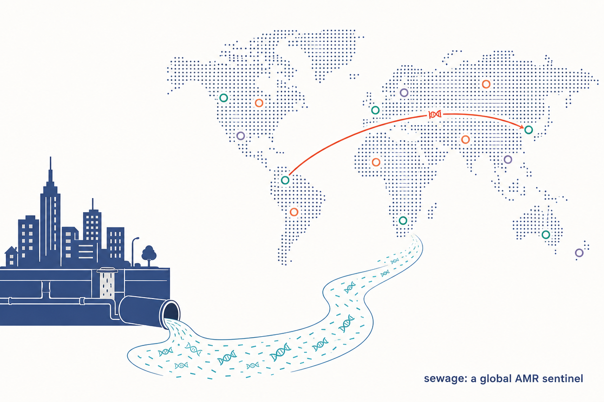
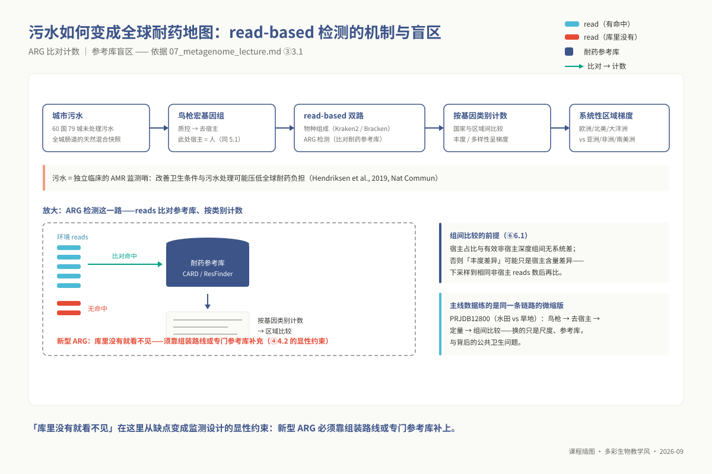
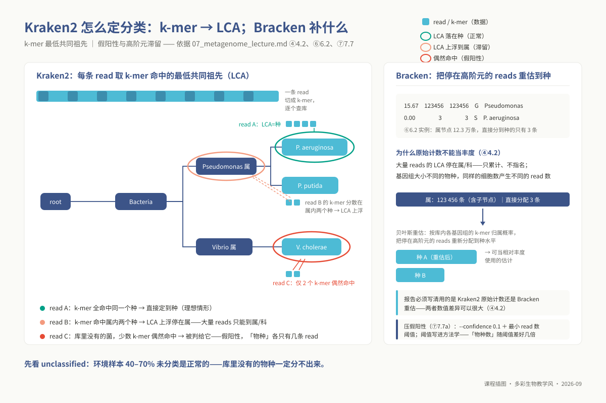
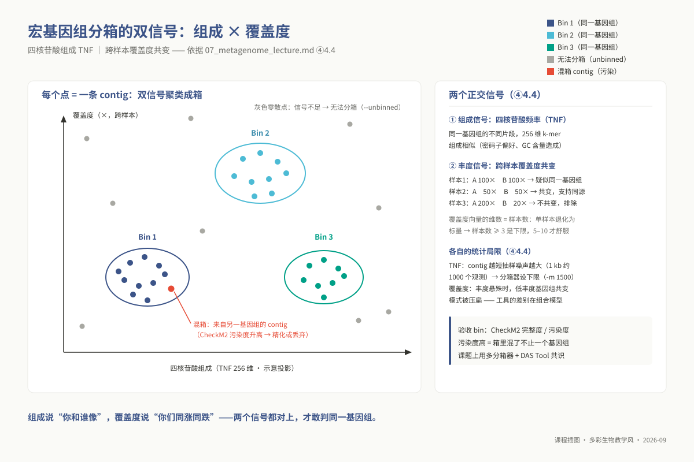
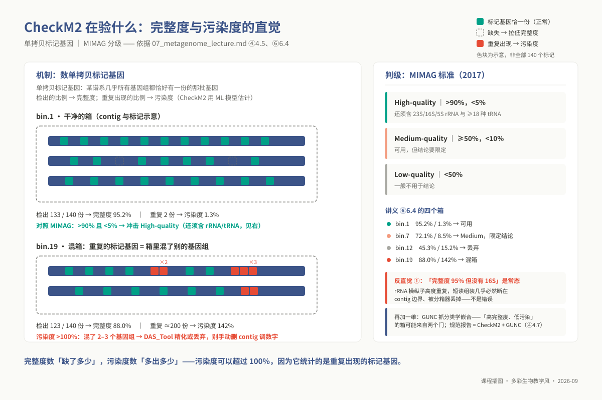
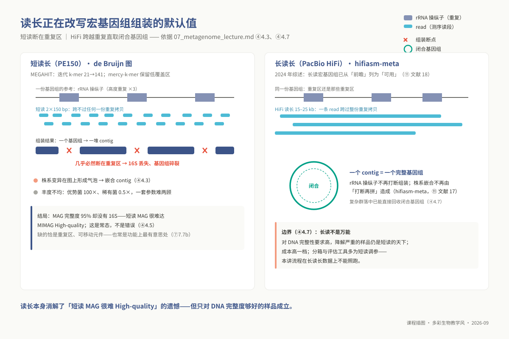
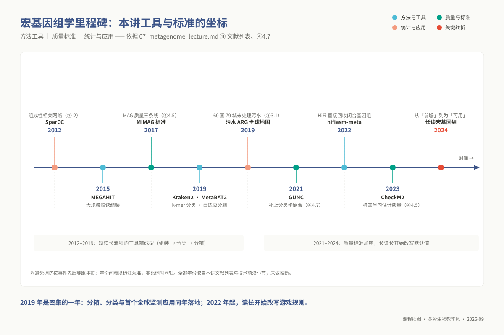

# 专题 07：宏基因组分析

> **适用对象**：硕士研究生，4 学时（2 h 理论 + 2 h 实践）。
>
> **阅读重点**：在 read-based 与 assembly-based 路线之间做出可解释的选择，并把宿主过滤、分箱质量和组成性统计连起来。

> **硕士生 ｜ 4 学时（2h 理论 + 2h 实践）｜ 环境：`conda activate ngs_ms_microbiome`**
> 本讲的工具（MEGAHIT / MetaBAT2 / CheckM 1.2.2 / Kraken2 / Bracken / eggNOG-mapper）**都在这个环境里**（CheckM2、GTDB-Tk、DAS_Tool、Prodigal 不在，需另建环境），
> 但**它们的数据库不在**——Kraken2 标准库与 eggNOG 库合计上百 GB，必须由集群统一部署，见 ②「数据库说明」。
> **建议先完成 m02（组装原理）与 m06（群落分析）**。 **最后更新**：2026-08-31

## ① 学习目标

读完并做完本讲操作后，你应当**能够**：

1. **为一个给定科学问题选出** read-based 还是 assembly-based 路线，并**说明**代价与放弃了什么。
2. **估算**一份样本需要多少测序量，**说明**去宿主前后数据量变化意味着什么。
3. **运行** fastp + Bowtie2 去宿主、MEGAHIT 组装、Bowtie2+`jgi_summarize_bam_contig_depths` 算覆盖度、MetaBAT2 分箱的完整链路。
4. **说明**单样本组装与混合组装的取舍，以及**为什么样本数越多分箱越准**。
5. **判读** CheckM2 的完整度/污染度，按 MIMAG 标准**分级**并给出取舍理由。
6. **解释**为什么 Kraken2 的原始 read 计数不能直接当作丰度，以及 Bracken 如何重估。
7. **论证**为什么相对丰度是组成性数据、直接算 Pearson 会产生什么假象，**运行** CLR 变换并**说明**它在做什么。
8. **在 ALDEx2 / ANCOM-BC / LEfSe / DESeq2 中做出选择**并写出理由，**说明**零值是怎么处理的。

## ② 前置检查

跟不上时回查对应 L0 模块。模块定义见 `00_design/prerequisite_packs.md`，自测题在 `08_assessment/prerequisites/`。

| L0 模块 id | 本讲哪里用到 | 不过关的后果 | 自测题号 |
|---|---|---|---|
| `l0_01_linux` | ⑤ 全部：`qsub` 提交 6 小时组装作业、`-hold_jid` 串作业、`/d3/scratch` 大文件管理 | 组装跑在登录节点被杀；磁盘写满 | L0-1 第 5、6 题（**第 6 题就是 `Eqw` 排查**）、第 8、10 题（上机） |
| `l0_05_qc` | ⑤ 5.1 fastp 参数；⑥ 去宿主前后数据量对比 | 参数照抄别人的 PE150 命令，丢掉一半数据还不知道 | L0-5 **第 6 题（参数推理）**、第 9 题（上机） |
| `l0_06_stats` | ⑦ 全部 | 把 DESeq2 直接搬到丰度表上；用相对丰度算相关建网络 | L0-6 第 3 题（计数数据均值-方差）、第 4 题（p 值语义）、**第 5 题（多重检验）** |
| `l0_04_formats` | ⑤ 5.3–5.4：SAM/BAM、FLAG、覆盖度；⑥ 组装统计的 N50 | 读不懂 `depth.txt`，也说不清 N50 为什么在宏基因组里意义不同 | L0-4 第 4 题（FLAG 163）、**第 10 题（N50/深度，上机）** |
| `l0_03_conda` | ②「数据库说明」：为什么数据库不能进 yml | 以为 `conda install eggnog-mapper` 就能直接跑 | L0-3 第 4、6 题、P1（上机） |

**数据库说明（必读，本讲最容易卡住的地方）**

| 数据库 | 体量 | 为什么不进 conda 环境 | 怎么办 |
|---|---|---|---|
| **eggNOG**（`download_eggnog_data.py`） | **约 50 GB**（`eggnog.db` + Diamond 库） | conda 包只装**程序**，数据库须单独下载；50 GB 不可能每人一份 | **集群侧统一部署一份**，用 `--data_dir /共享路径` 指过去；`emapper.py` 也可用 `EGGNOG_DATA_DIR` 环境变量 |
| **Kraken2 标准库** | 完整库 > 100 GB，`Standard-8` 约 8 GB | 同上；且 Kraken2 建库时会把整库读进内存 | 课堂用 `Standard-8`（8 GB 内存即可）；`#$ -l h_vmem=` 必须 ≥ 库大小 |
| **CheckM 库**（环境内为 CheckM 1.2.2；CheckM2 需另装，库约 3 GB） | 约 1.4 GB | 同上 | `checkm data setRoot <共享路径>`；另装 CheckM2 时 `checkm2 database --download --path <共享路径>` |
| **宿主基因组 Bowtie2 索引** | 视宿主而定，人/植物 3–10 GB | 与课程无关的参考数据 | 课程侧提前建好，`06_data/reference/` 下软链接 |

> **本讲不要求你自己下 50 GB 的 eggNOG 库。** 上机前确认教师给出的共享路径存在即可：`ls -lh ${EGGNOG_DATA_DIR}/eggnog.db`。真要自己建（回到自己实验室时），预留一晚上和 60 GB 空闲磁盘。

**开工前 30 秒自检**：

```bash
conda activate ngs_ms_microbiome
megahit --version && metabat2 -h 2>&1 | head -1 && kraken2 --version && emapper.py --version
ls -lh ${KRAKEN2_DB}/hash.k2d ${EGGNOG_DATA_DIR}/eggnog.db   # 数据库在不在，先看这一行
```

## ③ 背景与科学问题

在 m06 中，扩增子测序为我们勾勒出群落“谁在场”的物种粗线条轮廓。然而，受制于 16S 变异区（如 V4）的有限序列长度与 PCR 引物扩增偏好，扩增子分析存在天然的认知天花板：它无法区分同属内不同种甚至同种不同株系的生理功能，更无法直接观测功能基因的实体染色体载体。鸟枪法宏基因组测序（Shotgun Metagenomics）打破了这一引物束缚，直接对环境总 DNA 进行全基因组无偏抽样打断测序。

这一技术范式的跃迁使得研究者能够在更高维度上切入关键科学问题：其一是**功能潜力普查**，即群落中是否存在特定毒力因子、降解酶系、次生代谢合成基因簇（BGC）或抗生素耐药基因（ARG）；其二是**非培养微生物暗物质的基因组重建**，即能否绕过实验室人工纯培养的苛刻瓶颈，直接从复杂自然生境的混合 reads 中拼装出未培养微生物的完整或近完整基因组（Metagenome-Assembled Genome, MAG）；其三是**单核苷酸与株系级的演化追踪**，通过解析基因组微多样性与水平基因转移事件，揭示病原菌或共生菌在生态位分化中的微观适应机制。

然而，全基因组鸟枪测序在打破引物偏好的同时，也带来了严峻的物理与算力代价。以植物根际或昆虫肠道为例，宿主真核细胞的核基因组体量往往是原核微生物的数千倍，导致原始测序文库中 80% 至 95% 以上的数据被宿主 reads 占据；若不加以清洗，有限的测序预算将大量浪费在非目标宿主上。此外，微生物丰度跨越 4–6 个数量级，优势种群覆盖度可达上千倍，而微量功能群落往往处于测序检测限边缘；成千上万个物种的 reads 混杂在一起，组装图论复杂度呈几何级数膨胀。因此，宏基因组实验绝非无脑拼接，必须在分析最初根据研究目的在两条正交路线间做出关键抉择：

- **基于短读长比对的分类学与功能快照路线（Read-based profiling，以 Kraken2/Bracken 为代表）**：直接将 reads 与已建索引的参考基因组数据库比对，跳过耗时的从头组装，数分钟至数小时内即可给出全局相对丰度与功能分布。其代价在于具有严重的“数据库依赖盲区”——数据库中未收录的未知新物种在比对中彻底隐形，且 $k$-mer 的局部同源命中常产生长尾低丰度假阳性。
- **基于从头组装与分箱的基因组重建路线（Assembly-based binning，以 MEGAHIT + MetaBAT2 为代表）**：通过图论组装长 contig 并基于统计信号将 contig 聚类为单个独立基因组（MAG），能够完全脱离参考数据库挖掘未知物种，并在完整操纵子与染色体物理上下文中解读基因簇。其代价在于计算开销巨大（需几十至数百 GB 内存），且极端依赖测序深度；低丰度物种因物理覆盖不足无法成链，样本间株系异质性更可能引发严重的嵌合组装错误。

在严谨的科研实践中，这两条路线通常结合使用：Read-based 路线负责提供全样本全局生态学快照与大样本统计比较，Assembly-based 路线则针对关键样本深入重建物理基因组实体。

### 3.1 应用案例：城市污水宏基因组绘制全球耐药基因地图

主线 PRJDB12800 用鸟枪法宏基因组探讨农田生态系统的水田与旱地微生态差异；若将同一套技术推向全球宏观尺度，则是其在公共卫生领域最具深远影响的应用——**全球抗生素耐药基因（ARG）监测网络**。Hendriksen 等人于 2019 年在 *Nature Communications* 上发表的研究（⑪ 文献 20），对全球 60 个国家、79 个中心城市的未处理市政污水开展了高通量鸟枪法测序。城市污水本质上是全城数以百万计人口肠道微生物组的天然物理均质化快照，完全绕开了临床伦理与个例采样的局限。
该研究的研究链路为：大规模样本采集与质控 → 严格过滤人类宿主 reads（与 5.1 完全一致）→ Read-based 物种分类学分析（Kraken2/Bracken 架构）→ ARG 专门比对（将过滤宿主后的高质量 reads 比对至 CARD/ResFinder 权威耐药基因参考库，以基因类别标准化计数）→ 跨大洲、跨经济体间的组间统计比较与机器学习建模。

其核心发现揭示了全球抗生素耐药组（Resistome）存在极其鲜明的地理与社会经济学梯度，卫生条件与污水处理能力相对落后地区的总体 ARG 负荷显著高于发达地区。这一案例不仅奠定了非侵入式污水宏基因组监测公共卫生 AMR 暴发的范式，也在方法学上构成了我们后续学习的绝佳注脚：首先，“数据库没有就看不见”构成了监测已知靶点的优势，却也成为捕获新型耐药变异的盲区；其次，大规模跨国样本间比较之所以具有统计有效性，前提正是 6.1 节所强调的“宿主残留比例与有效测序通量在组间不存在系统性偏移”，以及 ⑦ 节即将推导的组成性数据标准化规范。



*图 m07-1：污水是独立于临床的 AMR 监测哨：城市污水宏基因组拼出全球耐药基因地图（AI 生成示意图，案例见上）。*



*图 m07-7：read-based ARG 检测的盲区：库里没有就看不见。*

## ④ 核心原理

### 4.1 去宿主：物理必然性与同源性误伤的平衡

在植物根际、内生菌群或动物共生组织中，宿主 reads 可能占据大部分文库。宿主染色体体量远大于微生物基因组；若不先过滤，组装会消耗大量内存处理宿主片段，分箱也可能把宿主片段误聚成体量异常的 MAG。

去宿主的核心操作是将质控后的 clean reads 比对回宿主参考基因组，并保留未比对上宿主的 reads：单端用 `--un-gz`；双端的 `--un-conc-gz` 输出的是**未能一致性（concordant）比对**的对，含一端比上或不一致比对的对，要求两端都没比上需 `samtools view -f 12` 另取。

然而，去宿主过程潜藏着隐蔽的**同源误删陷阱**：现代动植物基因组中普遍嵌合着源自古老内共生事件的线粒体和叶绿体序列，其基因骨架与现生真细菌（特别是 $\alpha$-变形菌纲与蓝细菌）高度同源；加之公开的宿主参考基因组草图中常常难以彻底清除宿主内生真菌或外周共生菌的物理污染序列。

若在比对时盲目启用 `--very-sensitive` 等极限灵敏度参数，或者容忍过短的局部匹配种子，大量真实的真菌或原核微生物 reads 会因为与宿主基因组或细胞器序列的局部保守同源性而被当作宿主片段“就地处决”。因此，标准策略是保持 Bowtie2 默认的全局比对灵敏度，并不容忍低质量截短比对。

更关键的是，必须将去宿主日志作为严谨的实验质控指标记录在案：若处理组组织因坏死或免疫浸润导致宿主裂解比例大幅异动（如 A 组宿主占比 85% 而 B 组仅 40%），两组间的实际有效微生物测序通量便出现了 4 倍的系统性人为偏差，后续任何未经下采样的丰度检验都将被此技术假象全盘颠覆。

### 4.2 read-based 策略：k-mer 精准匹配、LCA 拓扑上浮与 Bracken 贝叶斯重估

Kraken2 不执行耗时的全局核酸局部动态规划比对，而是基于空间换时间的策略：预先将庞大的微生物参考基因组集合索引构建为紧凑的 $k$-mer 哈希表（或带有最小化子 minimizer 的紧凑散列表）。在分类检索时，Kraken2 将每条 read 滑窗切割为一组连续的 $k$-mer，查询各个 $k$-mer 在分类发育树中对应的分类单元（Taxon ID）。

其决策核心在于**最低共同祖先（Lowest Common Ancestor, LCA）算法**：若一条长 150 bp 的 read 中，数个 $k$-mer 命中了假单胞菌属（*Pseudomonas*）内不同物种的保守区域，LCA 判定机制绝不武断将其指定给任一具体物种，而是沿着分类树将分类权“向上回溯”，直接将其归属到包含这批物种的最高保守节点——假单胞菌属节点（Genus）。

LCA 算法在逻辑上杜绝了伪精确推断，但给下游量化带来了两个根本性的统计畸变：
其一是**分类层级上浮与相对丰度失真**。自然界中绝大多数细菌基因组的核心看家基因为多物种所共享，这导致海量 reads 最终停滞在属、科乃至纲等上层祖先节点，无法直达种水平。同时，细菌基因组大小相差可达十倍（如 0.8 Mb 的生殖支原体与 9 Mb 的链霉菌），在细胞数绝对相等的前提下，大基因组产出的测序 reads 是小基因组的近十倍。若直接拿 Kraken2 统计的原始 read 计数作为物种相对丰度，不仅丢失了绝大部分属层级 read 的贡献，更将产生严重的基因组大小抽样偏好。
其二是**长尾偶发假阳性**。因高通量测序错误或局部短序列偶然重叠，一条 read 只要有极少数 $k$-mer 偶然碰撞上某个罕见物种的特异序列，该物种就会被登记进报告，导致输出结果中充斥着成百上千个仅有 1–3 条 reads 支持的“幽灵物种”。

**Bracken（Bayesian Reestimation of Abundance with KrakEN）** 为解决这一失真而生。它在建库阶段预先扫描所有参考基因组，精确建立特定测序读长下、各个物种向其各级祖先 LCA 节点派发 $k$-mer 的理论概率转移矩阵。在实际分析时，Bracken 依托该先验概率，应用贝叶斯重估模型，将停留在上层属、科等祖先节点的 ambiguous reads，按照候选物种的特异 $k$-mer 丰度分布以概率权重合理向下再分配至种水平，。注意它**不做基因组大小归一**：输出的仍是读段丰度，大基因组物种的读段份额会高于其细胞份额。因此，在撰写论文与报告时，必须明晰区分 Kraken2 的原始匹配计数与 Bracken 的贝叶斯重估丰度；同时在 Kraken2 比对中施加 `--confidence 0.1` 门槛（要求至少 10% 的 $k$-mer 协同支持同一谱系路径），从源头阻断随机噪声引发的假阳性长尾。



*图 m07-4：Kraken2 的 LCA 与 Bracken 重估：k-mer 定种及其边界。*

### 4.3 组装：宏基因组图论困境与 MEGAHIT 迭代策略

与单一纯培养菌株的从头组装相比，宏基因组 de Bruijn 图面临着三座难以逾越的理论大山：

1. **跨数量级的非均匀覆盖度**。群落中优势种的覆盖深度可达数百倍，而罕见物种可能仅有 0.5× 至 2× 的残缺覆盖。若采用高频 $k$-mer 阈值截断以滤除测序错误，罕见菌的连续图拓扑将瞬间被切碎成不可连通的碎片；若降低阈值以包容低丰度，优势菌庞大数据量所衍生出的数以亿计的测序错误分支（dead-ends / tips）将使计算机内存瞬间耗尽。
2. **同源株系的微多样性（Micro-diversity）死结**。同一物种的不同地理亚株或突变株之间，往往存在 98%–99% 的高度序列相似性，少数单核苷酸变异和微小插入缺失在 de Bruijn 图上形成了密集的复合拓扑气泡（complex bubbles）。传统算法若无法判定哪条路径真实对应同一条物理染色体，往往只能选择在此截断 contig，或极为不幸地把不同株系的片段交叉拼接，产出在自然界中根本不存在的“杂交嵌合重叠群（Chimeric contigs）”。
3. **图规模与内存的物理边界**。自然土壤中包含数千乃至上万种微生物，全群落联合构建高阶 $k$-mer 图往往需要数个 Terabyte 的随机访问内存，常规服务器计算节点根本无法承载。

MEGAHIT 采用简洁数据结构（Succinct de Bruijn Graph, SdBG），利用 Burrows-Wheeler 变换与位向量压缩技术，将每条边所占用的内存压缩至仅数个字节，实现了在单机百 GB 内存内组装复杂宏基因组。针对覆盖度不均的核心痛点，MEGAHIT 设计了**多轮迭代 $k$-mer（Iterative $k$-mer）流水线**（如从 $k_{min}=21$ 以步长 12 递进至 $k_{max}=141$）。

在最小 $k=21$ 阶段，算法优先利用高连通性捕获低丰度菌群的序列网络，并引入专有的 **mercy $k$-mer** 机制——当一条 read 的一端已成功锚定在图中、而另一端因覆盖度过低将被丢弃时，算法会特异性赦免并保留这部分候选 $k$-mer，防止稀有基因断裂；在后续逐轮递增 $k$ 的迭代中，已组装的长 contigs 充当骨架，高阶 $k$ 强大的解重复能力则逐一化解基因组内部的同源重复区，逐步剔除假性分支。

在实验流程设计上，单样本组装（Single-sample assembly）与混合组装（Co-assembly）呈现清晰的权衡：单样本组装各样本独立计算，株系异质性低，产出的 contig 嵌合率最小，但在深度不足时低丰度物种直接丢失；混合组装将同一处理组或相近生境的多份样本 reads 汇聚为单一输入，通过累积深度赋予了挖掘罕见物种的绝佳机会，但不可避免地引入了跨样本的株系多态性，加剧了气泡拓扑与嵌合体风险。通常对于土壤或沉积物等复杂样本，将同一生境下 3 至 6 个强生物学重复进行混合组装，是在深度增益与株系嵌合之间最具可行性的折衷。

### 4.4 分箱：四核苷酸频率与跨样本共变异的正交几何

宏基因组组装的产物是杂乱混叠的数万乃至数十万条长短不一的 contigs。分箱（Binning）的本质，是在无先验物种标签的条件下，依据序列特征将这些片段聚类归类回各自所属的单倍体微生物基因组（MAG）。实现这一高维无监督聚类的基石，在于两个统计学生物学上高度正交的判别信号：

第一个信号是**四核苷酸频率（Tetranucleotide Frequency, TNF）**。受密码子使用偏好、限制-修饰系统的特异性识别位点以及 DNA 复制保真机制的进化塑造，同一原核生物基因组内部的局部序列具有极强的整体序列组成同质性。在 4 种碱基所构成的所有 $4^4=256$ 种四核苷酸中，考虑反向互补对称性后可合并为 136 维规范特征向量。

同一细菌染色体上的不同片段，在 136 维欧氏空间中必然投射在极其接近的局部流形内。然而，TNF 的致命死穴在于**有限序列长度的抽样噪声**：若一段 contig 长度仅有 500 bp 至 1 kb，其所包含的四核苷酸总抽样次数极度匮乏，经验频数矩阵被强烈的泊松抽样随机性所支配，无法呈现稳定的基因组特征。

这正是分箱软件普遍严格要求参与聚类的 contig 长度下限必须 $\ge 1500$ bp（如 MetaBAT2 的 `-m 1500`）的根本统计学原因，绝非随意的软件工程妥协。

第二个信号是**跨样本覆盖度共变异（Differential Coverage Covariance）**。在自然生态扰动或不同采样批次中，同一个物理细胞内的所有染色体片段，在各个独立样本中的拷贝数必然同步增减。假定有 $S$ 个生物学样本，将每个样本的 reads 独立比对至共同组装的 contigs 集合，每条 contig 便对应一个 $S$ 维的覆盖度向量 $\mathbf{c}_i = (c_{i1}, c_{i2}, \dots, c_{iS})$。

若 contig $A$ 与 contig $B$ 源于同一个细胞，即便其中一段是近期通过水平基因转移获得的外源整合片段（导致其 GC 含量或 TNF 与宿主骨架显著不符），其跨样本覆盖度向量也必然满足近似线性同向比例变化，即在 $S$ 维向量空间中呈现极高的协方差或夹角余弦相似度。

```text
样本 1 (正常土壤): contig_A 100×, contig_B 100×   → 相对丰度比 1:1，提示可能属于同一基因组
样本 2 (淹水对照): contig_A  50×, contig_B  50×   → 丰度协同减半，维持 1:1，强力支持共属于同一基因组
样本 3 (施肥处理): contig_A 200×, contig_B  20×   → 丰度剧烈解耦（10:1），两片段绝非源自同一细胞
```

**这正是“分箱精度随样本数增加而跃升”的数学机理**：若只有单个测序样本（$S=1$），覆盖度向量降维为单一标量，完全丧失了共变拓扑的判别自由度，分箱器只能退化为仅依赖 TNF，极易将两个 GC 含量相近但演化无关的物种混淆进同一个箱；而当拥有 5 至 10 个独立样本时，高维覆盖度空间的协同约束呈指数级增强，两个不同物种在所有样本中同时偶然保持同比例波动的概率趋近于零。
不同分箱工具（MetaBAT2、MaxBin2、CONCOCT）的底层算法分歧，本质上仅在于如何权衡这两组正交信号的几何距离与概率密度建模方式。MetaBAT2 基于自适应经验贝叶斯模型根据数据自适应调整聚类半径，MaxBin2 采用期望最大化（EM）算法拟合泊松分布，CONCOCT 则借助高斯混合模型（GMM）与变分贝叶斯推断。由于不同工具的数学假设存在先验盲区，主流方案往往利用 DAS_Tool 等共识算法，对多个工具生成的初步分箱结果计算单拷贝标记基因图谱的 Jaccard 相似度并提取最大非重叠子集，从而在保留高完整度箱体的同时显著剥离冗余污染。



*图 m07-2：组成说「你和谁像」，覆盖度说「你们同涨同跌」——两个信号都对上才判同一基因组。*

### 4.5 MAG 质量评估：从谱系单拷贝基因到 MIMAG 黄金标准

从复杂宏基因组中分箱得到的重叠群集合是否真正构成一个可信的微生物基因组？评估这一问题无法依赖已知参考基因组比对，而是基于演化保守的**单拷贝标记基因（Single-Copy Marker Genes, SCGs）**。在细菌和古菌的长期生命演化中，有一类执行核糖体转录、翻译等核心生理功能的基因集，在近乎所有已知单倍体正常原核细胞中都恒定保留且严格只有单份拷贝。

CheckM 沿着分类系统树根据基因组已知上下文定位谱系特异性标记基因；新一代 CheckM2 则引入机器学习框架，通过深度特征嵌入与梯度提升回归模型，摆脱了硬性谱系分支的僵化规则，能够更敏锐地预测非模式深海、极端土壤等罕见未知古菌或细菌谱系的真实生理完整度。

质量评定的两项核心数值是**完整度（Completeness）**与**污染度（Contamination）**：

- **完整度**衡量该谱系理论上应有的单拷贝标记基因在当前分箱中被成功检索出的比例；
- **污染度**衡量同一标记基因在箱内出现 $\ge 2$ 个独立拷贝的超额比例。若某 MAG 的污染度达到 100% 甚至 140%，并非算法指标溢出，而是清晰表明该分箱极度失败，机械性地将两个甚至三个完全不同物种的染色体片段合并成了一个巨大嵌合体。

2017 年发表于 *Nature Biotechnology* 的 MIMAG 准则（Minimum Information about a Metagenome-Assembled Genome）奠定了国际通行的分级规范：

- **High-quality MAG**：完整度 $> 90\%$，污染度 $< 5\%$，且必须明确检出全长 23S、16S、5S rRNA 操纵子与至少 18 种不同氨基酸对应的转运 RNA（tRNA）；
- **Medium-quality MAG**：完整度 $\ge 50\%$，污染度 $< 10\%$；
- **Low-quality MAG**：完整度 $< 50\%$，此类基因组破碎严重，不得单独用于衍生关键生物学假说。

在实测中必须破除一个常见误区：**二代短读长宏基因组组装获得的 MAG 极难达到 High-quality 标准**。原核生物的 16S-23S-5S rRNA 操纵子全长约 5 kb，在同一个基因组内往往存在多份拷贝且序列一致性常超过 99%；150 bp 的短读长完全无法跨越长达数千碱基的完美重复序列，这导致在 de Bruijn 组装图上 rRNA 操纵子必然发生拓扑崩溃并碎裂为无法桥接的死结，最终在分箱中被当场丢弃。

因此，“某 MAG 完整度高达 95% 且污染度仅 1% 但缺失 16S”是二代测序物理机制下的绝对常态，切勿将其盲目视为失败数据而弃置。



*图 m07-3：CheckM2 在验什么：单拷贝标记基因的缺失与多出。*

### 4.6 功能注释与推断跨度警示

对于通过质控筛选的合格 MAG，标准下游分析首先使用专门针对宏基因组重叠群优化的原核基因预测软件（如 `Prodigal -p meta`，其利用预置的非特异性无偏先验模型处理截断在 contig 边界的开放阅读框），将核酸序列翻译为理论蛋白序列集。随后利用 eggNOG-mapper（调用超高速 Diamond 序列比对引擎）将蛋白比对至预构建的 eggNOG 直系同源基因簇数据库，批量映射到 COG 功能大类、KEGG 酶学通路号（KO 号）、GO 基因本体论术语以及 CAZy 碳水化合物活性酶分类体系。

在根据基因注释撰写论文讨论时，必须恪守严肃的**生物学推断跨度（Inferential leap）边界**：在宏基因组 DNA 水平上检出特定代谢酶的完整编码序列（如甲烷单加氧酶或固氮酶 `nifH`），仅能严谨证明该微生物个体“**在遗传层面具备行使此项生化代谢途径的生理潜力（Genomic potential）**”。

从基因蓝图的存在到该生化反应在土壤中真实发生，中间横亘着三道不可逾越的生理屏障：该基因在特定微环境下是否受到转录调控而激活表达？翻译出的酶分子是否具有催化活性且未被变性失活？该生化反应所需的化学底物与辅因子在局部微域内是否真实可及？因此，单纯依据宏基因组数据绝不可做出“该微生态系统正在活跃固氮或高效降解农药”的断言；确证代谢活性必须依赖宏转录组、宏蛋白质组或原位同位素标记代谢流检测的多组学闭环验证。

### 4.7 技术前沿（2023–2026）

**长读长测序正在从底层颠覆宏基因组组装的游戏规则。** 随着 PacBio HiFi 测序精度的全面提升，结合专为复杂异质性图谱设计的组装算法（如 hifiasm-meta，⑪ 文献 17），宏基因组领域实现了从“盲目分箱碎裂短片段”向“单条重叠群直接闭合单菌完整染色体”的技术飞跃。长达 15–20 kb 的高保真长读长能直接跨越 5 kb 的 rRNA 操纵子和复杂转座子重复区，将 4.5 节中“短读长 MAG 无法达到 High-quality”的物理枷锁彻底化解；近年来综述已将长读长宏基因组列为复杂微生态解析的核心标准（⑪ 文献 18）。然而该技术亦非万能灵药：HiFi 测序对起始高分子量（HMW）DNA 样品的完整度有着严苛要求，在严重降解的历史沉积物或石化土样中难以开展；且长读长测序的高昂单价决定了其在多样本大队列流行病学调查中仍受成本制约。

**MAG 质量审计体系正在跨越单纯的 MIMAG 指标。** 传统 MIMAG 仅考量基于单拷贝标记基因的完整度与污染度，但忽视了一种极其致命且隐蔽的错误模式——**分类学嵌合（Taxonomic chimerism）**：当两个分类地位极远（如来自不同原核生物门）的残缺基因组碎片因偶然的共变异模式被分箱器强行缝合为一个箱时，由于两者各自仅贡献了不重叠的单拷贝基因集，CheckM 评估该箱时可能呈现荒谬的“高完整度、零污染度”。为遏制此类混淆，GUNC（Genome UNClutterer，*Genome Biology* 2021，⑪ 文献 19）引入了全基因组蛋白家族分类谱系的熵值检验，通过判定箱内全部蛋白在分类层级上的谱系纯度来捕获隐秘嵌合体。当前高水平宏基因组研究均要求“CheckM2 指标 + GUNC 纯度检验”双重质检作为最终可信 MAG 发布的金标准。

**Read-based 分析中 Kraken2 的“盲区边界”与参考库定制。** Kraken2 的本质是将其所装配的参考基因组全部转化为 $k$-mer 到 Taxon ID 的映射哈希表。这一设计在带来极速比对体验的同时，也决定了其判定上限被参考库严格锚死（Standard 库依赖 NCBI RefSeq 已发表的完整基因组）。这直接解释了为何在 6.2 节中自然土壤样本往往出现 40%–70% 的 reads 被标记为 `unclassified`——自然界绝大部分未知微生物在此哈希表中根本不存在条目。为克服该局限，研究者常将前期通过 Assembly-based 路线组装、精炼出的优质本地 MAG 补充编译进 Kraken2 索引以扩充定制库。但这引入了微妙的自洽性循环风险：你对新样本微生物组成的解析能力，完全被你所挑选组装的那批 MAG 的完备性所塑形。



*图 m07-5：短读 vs 长读宏基因组组装：rRNA 重复区是分水岭。*



*图 m07-6：宏基因组学里程碑（2012–2024）：方法与标准逐年就位。*

## ⑤ 操作步骤

配套脚本 `03_code/master/scripts/07_metagenome_assembly.sh`（SGE 作业，单样本：去宿主→MEGAHIT→比对→MetaBAT2→CheckM；质控、Kraken2/Bracken、跨样本分箱与注释按下文命令另跑）与 `07_compositional_analysis.R`（⑦ 的组成性练习）。

### 5.0 提交与依赖串接

```bash
mkdir -p /d3/scratch/${USER}/ngs/meta/{raw,clean,nohost,asm,bam,bins,anno,logs}
qsub 03_code/master/scripts/07_metagenome_assembly.sh        # 变量区改样本名与线程
qstat -u ${USER}; tail -f /d3/scratch/${USER}/ngs/meta/logs/m07_*.o*
```

### 5.1 质控与去宿主

> **⚠ 案例数据 PRJDB12800 是 MiSeq 单端**（ENA `library_layout=SINGLE`，平均读长约 200–240 bp）。下文以双端写法为通用模板；单端时 fastp 只给 `-i/-o`，Bowtie2 用 `-U` 与 `--un-gz`，Kraken2 去掉 `--paired`，MEGAHIT 用 `-r`，回比用 `-U`——配套脚本已按 R2 是否为空自动切换。

```bash
fastp -i raw/${S}_1.fq.gz -I raw/${S}_2.fq.gz \
      -o clean/${S}_1.fq.gz -O clean/${S}_2.fq.gz \
      --detect_adapter_for_pe --cut_tail --cut_window_size 4 --cut_mean_quality 20 \
      --length_required 50 -w 8 -h logs/${S}.fastp.html -j logs/${S}.fastp.json
# --cut_tail 而非 --cut_front：3' 端质量下降是系统性的，5' 端不是（L0-5 第 6 题）
# --length_required 50：短于 50 bp 的 read 在组装里几乎只贡献噪声

bowtie2 -p 16 -x ${HOST_IDX} -1 clean/${S}_1.fq.gz -2 clean/${S}_2.fq.gz \
        --un-conc-gz nohost/${S}_%.fq.gz -S /dev/null 2> logs/${S}.host.log
# --un-conc-gz 输出未能 concordant 比对的对（含单端比上者，不等于两端都未比上）；% 替换成 1/2
# 不加 --very-sensitive：过严会误删与宿主同源的共生菌 reads（见 4.1）
grep 'overall alignment rate' logs/${S}.host.log     # 宿主占比，必须记进报告
```

### 5.2 read-based 物种组成

```bash
kraken2 --db ${KRAKEN2_DB} --threads 16 --paired \
        nohost/${S}_1.fq.gz nohost/${S}_2.fq.gz \
        --report ${S}.kreport --output ${S}.kout --confidence 0.1
# --confidence 0.1：要求 read 中至少 10% 的 k-mer 支持该分类，压假阳性（见 4.2、⑦-7）

bracken -d ${KRAKEN2_DB} -i ${S}.kreport -o ${S}.bracken -r 200 -l S -t 10
# -r 读长须与实测一致且库内有对应 database<r>mers.kmer_distrib（本数据先 seqkit stats 再定 200/250）；-l S 输出到种水平；-t 10 少于 10 reads 的物种不重估
```

### 5.3 混合组装

```bash
megahit -1 $(ls nohost/*_1.fq.gz | paste -sd,) -2 $(ls nohost/*_2.fq.gz | paste -sd,) \
        -o asm/megahit --min-contig-len 1000 --k-min 21 --k-max 141 --k-step 12 \
        -t 32 -m 0.9
# --min-contig-len 1000：短于 1 kb 的 contig 分箱器用不上，早点丢掉省内存
# -m 0.9：最多用 90% 的机器内存；SGE 上必须与 #$ -l h_vmem 对得上，否则被 OOM kill
seqkit stats asm/megahit/final.contigs.fa
```

### 5.4 覆盖度与分箱

```bash
bowtie2-build --threads 16 asm/megahit/final.contigs.fa asm/contigs_idx
for S in $(cat samples.txt); do              # 每个样本单独比回组装，得到跨样本覆盖度
  bowtie2 -p 16 -x asm/contigs_idx -1 nohost/${S}_1.fq.gz -2 nohost/${S}_2.fq.gz |
    samtools sort -@ 8 -o bam/${S}.bam && samtools index bam/${S}.bam
done
jgi_summarize_bam_contig_depths --outputDepth bam/depth.txt bam/*.bam
metabat2 -i asm/megahit/final.contigs.fa -a bam/depth.txt -o bins/bin \
         -m 1500 -t 16 --unbinned
# -m 1500：参与分箱的最短 contig；调低能多分出箱，但污染度会升高
```

### 5.5 MAG 评估、分类与功能注释

```bash
checkm lineage_wf -x fa -t 16 bins/ anno/checkm > anno/checkm_summary.txt   # 环境内 CheckM 1.2.2（脚本默认）
checkm2 predict -i bins/ -o anno/checkm2 -x fa -t 16 --database_path ${CHECKM2_DB}   # 另装 CheckM2 时
awk -F'\t' 'NR==1 || ($2>50 && $3<10)' anno/checkm2/quality_report.tsv > anno/mags_pass.tsv

gtdbtk classify_wf --genome_dir bins/ --out_dir anno/gtdbtk -x fa --cpus 16 \
       --mash_db anno/gtdbtk_mash   # GTDB-Tk 与其库需集群侧部署，同 ②

prodigal -i bins/bin.1.fa -a anno/bin.1.faa -o anno/bin.1.gff -p meta
emapper.py -i anno/bin.1.faa -o anno/bin.1 --cpu 16 -m diamond \
           --data_dir ${EGGNOG_DATA_DIR}    # 50 GB 共享库，见 ②
```

## ⑥ 结果解读

### 6.1 去宿主日志

`overall alignment rate` 就是宿主占比。**该长什么样**：同一批样本之间波动在 10 个百分点以内。**不对时长什么样**：A 组平均 85%、B 组平均 40% —— 两组的**有效非宿主数据量差了 4 倍**，后面所有丰度比较都被这个技术变量污染。处理办法是把两组下采样到相同的非宿主 reads 数后再比，并在方法学里写明。

### 6.1 去宿主日志与有效测序通量诊断

在 Bowtie2 比对日志中，`overall alignment rate` 直观反映了文库中宿主基因组 DNA 的质量占比。一个健康且实验操作均一的批次，其宿主占比在生物学重复间的波动通常应收敛在 5% 至 10% 的窄幅区间内。
**关键警示信号在于组间系统性偏移**：若处理组（例如病害严重根际）因组织坏死裂解导致宿主比对率达 85%，而健康对照组仅为 40%，这意味着处理组的有效微生物测序数据量仅占文库的 15%，而对照组高达 60%——两者在微生物有效覆盖深度上存在整整 4 倍的技术鸿沟！这种由宿主污染引发的测序通量不均，会直接摧毁后续所有基于非标准化计数的统计检验，人为制造出处理组微生物多样性骤降或基因丰度普遍下调的假象。在此情形下，必须在差异分析前对所有样本进行针对非宿主 reads 的等深度随机下采样（Downsampling / Rarefaction），并在论文的方法学中明确汇报各组样本的原始通量、宿主过滤率与校正基准。

### 6.2 Kraken2 报告分类解读与假阳性判读

Kraken2 报告文件的各列依次记录了：累计相对丰度百分比、分配到当前分类节点及其所有下级子树的 reads 总数、**直接归属于该节点的 reads 数**、分类等级代码（如 U=未分类, R=根, D=域, P=门, C=纲, O=目, F=科, G=属, S=种）、NCBI Taxonomy ID 以及该分类单元的学名。
在审查报告时，首要关注的是根节点前置的 `unclassified`（未分类）比例。对于人类肠道等参考基因组高度完备的临床样本，未分类比例通常应低于 15%–20%；然而在土壤、沉积物或极端生境等环境样本中，未分类比例达到 40% 至 70% 属于完全正常的客观现实，它忠实记录了当前公共数据库对未知环境微生物暗物质的认知盲区，绝非实验或流程故障。

**必须警惕的异常现象是报告末尾由长尾构成的虚假微小类群**：若结果中罗列了数百个仅有 1 至 3 条 reads 支持的物种，这绝非发现了极其稀有的群落成员，而是 LCA 算法在测序噪声与同源微片段上的随机假阳性漂移，在下游统计前必须施加最低丰度阈值截断。

### 6.3 组装质量统计与宏基因组 N50 语境

运行 `seqkit stats` 所获取的 contigs 总数、总碱基量与 N50 指标，必须置于宏基因组群落多样性的特定语境下解读。在纯培养单一细菌组装中，数百 kb 的 N50 往往是高质量草图的底线；但在复杂宏基因组中，N50 处于 2 kb 至 10 kb 之间是丰度悬殊群落的必然常态。这是因为环境样品中各物种丰度极度不均，少数优势菌株支撑起了高阶重叠群，而中低丰度物种受限于物理覆盖深度碎裂为海量短片段，拉低了整体连续性指标。
相较于单纯追求 N50 数值，更为核心的质量试金石是**Reads 比回组装率（Overall Alignment Rate）**与**大于 1 kb 的 contigs 累计长度**。若将清洗后的 clean reads 比对回最终组装体，比回率达到 75% 至 90%，表明当前组装已经高效捕获了群落中绝大多数优势遗传信息；反之，若比回率低于 40%，则警示存在严重问题——要么是因为群落极端复杂且单样本测序深度严重不足，要么是群落内同源株系微多样性过高导致组装图拓扑死锁，致使大部分原始数据未能有效汇聚成重叠群。

### 6.4 CheckM2 质量报告与 MIMAG 规范

通过分箱器导出的各个 MAG，在 CheckM2 评估下生成完整度与污染度两项核心指标：

| MAG 编号 | 完整度 (Completeness) | 污染度 (Contamination) | 质控结论与处置方案 |
|---|---|---|---|
| bin.1 | 95.2% | 1.3% | 高质近完整基因组；若补充长读长找齐 rRNA/tRNA，可申报 MIMAG High-quality |
| bin.7 | 72.1% | 8.5% | 达到 Medium-quality 标准，可作为群落分析主体，但在讨论关键通路时需限定其不完备性 |
| bin.12 | 45.3% | 15.2% | 低质且伴随显著杂质，应当场予以废弃，不可引入下游科学假说推断 |
| bin.19 | 88.0% | **142%** | **严重嵌合灾难**：单拷贝基因超额出现 2–3 次，箱内机械揉合了数个独立基因组，须精炼或丢弃 |

在质控判读中，污染度超过 100% 并非程序溢出错误：污染度反映的是多重出现的单拷贝标记基因比例，当分箱器粗暴地把属于同一科的三个不同物种的 contigs 强行聚类进同一个 bin 时，每个单拷贝标记基因都会被观察到 2 至 3 次，从而测算得到高达 140% 甚至更高的污染度。此类严重污染箱严禁通过手动挑选剔除 contig，而必须交由 DAS_Tool 结合其他正交分箱算法重新划分，或果断淘汰。

### 6.5 eggNOG-mapper 功能图谱与未知“暗物质”

`*.emapper.annotations` 注释表按蛋白逐行给出了直系同源群（OGs）、COG 功能分类、KEGG 代谢通路代号（KO 号）以及酶学描述信息。通过统揽全群落或特定 MAG 的 COG 分布柱状图，能够敏锐捕捉不同物种的功能生态位定位（例如偏向于能量转化与无机离子转运的自养菌群，或是专职降解多糖与芳香族化合物的异养降解菌）。
面对环境样品时，若发现某个 MAG 中超过 50% 甚至 70% 的预测蛋白未能注释到任何已知的 KEGG KO 或 COG 类别，这通常不是生信流程错误，而是真实的生物学未知暗物质在起作用——大量未培养的环境原核生物分支包含着海量完全新颖的未知基因家族。然而，若所研究的样本明确为近缘肠道菌群，却出现 `Preferred_name` 与功能注释近乎全空的异常，则应立即排查运行命令中是否遗漏了 eggNOG 数据库路径，或者未正确为 Prodigal 指定宏基因组模式参数 `-p meta`。

### 6.6 一段规范的宏基因组学论文结果陈述

在正式发表的研究论文中，宏基因组组装与分箱质量必须给出定量、透明且符合学术界复现标准的描述，如下述范例所示：
> “对 6 份农田土壤样本进行高通量鸟枪测序，经 fastp 质量剪裁与宿主核酸序列物理比对过滤，共回收 4.8 ± 0.6 Gb 的高质量非宿主测序数据（各样本宿主 reads 占比在 62% 至 71% 之间，处理组与对照组间未见系统性测序通量偏倚）。对各样本实施混合组装（MEGAHIT），获得 412,386 条长度 $\ge 1$ kb 的重叠群，组装总体量为 1.9 Gb，重叠群 N50 为 4.3 kb，89% 的质控 clean reads 能够高质量物理比回组装骨架。基于四核苷酸频率与跨样本覆盖度共变异的联合分箱（MetaBAT2），共重建获得 148 个宏基因组组装基因组（MAGs）；经 CheckM2 单拷贝标记基因模型严苛评估，其中 31 个 MAG 满足完整度 $> 50\%$ 且污染度 $< 10\%$ 的 Medium-quality 标准，更有 9 个 MAG 完整度超越 90%（因受二代短读长限制未能拼合全长 rRNA 操纵子，无 MAG 达到 MIMAG High-quality 标准）。”

## ⑦ 统计插件

**焦点：组成性数据陷阱、丰度差异检验方法选择、零膨胀。**

> **与 `l0_06_stats` 的分工**：在先导课程中，我们系统讨论了假设检验的零假设、p 值的统计学涵义、Benjamini-Hochberg FDR 多重检验校正、高通量计数的负二项过离散建模以及生物学重复对统计功效的支撑作用。本专题不再重复上述通识内容，而是直击一个在宏基因组生态学中最为致命、却在经典统计学教学中极易被忽视的理论死穴——**当数据本质上是由“比例”而非“绝对实体量”构成时，经典线性模型与相关性分析将发生灾难性的数学崩溃**。

### 7.1 组成性数据（Compositional Data）的几何本质与机械压制

高通量测序仪是一台“固定通量的按比例随机采样机器”。无论提取管中真实包含 10 亿个细胞还是仅有 1000 万个细胞，测序仪所产出的测序读数总量（Library size）受制于文库上样量与流动槽芯片物理孔道，始终在某一人为预设的常数附近浮动。因此，在没有引入外源定标内参（Spike-in）的前提下，宏基因组测序产出的丰度数据从物理本源上就是**单纯形空间（Simplex space, $\mathbb{S}^D$）中的组成性数据（Compositional Data）**，其唯一确定的是各组分的相对比例，且各成分比例之和恒等于 1（或 100%）：

$$\sum_{j=1}^D x_j = 1, \quad x_j > 0$$

这一常数和闭合约束（Sum-to-one constraint）引发了两个直接违背生物学常理的统计假象：
第一是**机械压制效应（Mechanical suppression）**。假定土壤中仅有一种固氮菌在施肥后生物量真实暴增了 100 倍，而群落中所有其他 999 种细菌的绝对细胞数量毫无变化。由于总比例之和必须封死在 1，固氮菌相对丰度的剧增将不可避免地导致其余全部 999 种微生物的相对丰度在纸面上集体下降。此时若直接将相对丰度当作绝对丰度来做组间差异检验，统计软件将向你汇报数百个“显著下调”的物种，而这一长串生物学结论完全是常数和约束强加给我们的数学幻觉。
第二是**结构性负相关（Negative correlation bias）**。在封闭的单纯形内部，各成分不可能保持相互独立；一个分量的扩张必然伴随着其他分量的压缩，这在分量之间人为注入了强烈的负协方差倾向：

```r
# 亲眼见证组成性约束如何凭空制造“强负相关”：
set.seed(20260829); n <- 200
absA <- rlnorm(n, 5, 1); absB <- rlnorm(n, 5, 1)   # 生成两组绝对丰度完全独立的菌群
others <- rlnorm(n, 7, 0.3)                        # 背景其他菌群
cor(absA, absB)                                    # 相关系数接近 0，确证绝对数量独立无关联
tot <- absA + absB + others
cor(absA/tot, absB/tot)                            # 转为相对丰度后，相关系数显著为负！
```

### 7.2 伪相关（Spurious Correlation）与共现网络的虚幻世界

早在 1897 年，现代数理统计学先驱 Karl Pearson 就以严格的代数推导指出：对具有共同除数的数据集计算相关系数，必然衍生出严重的**伪相关（Spurious Correlation）**。在封闭的比例向量中，全部组分之间的理论协方差总和受制于硬性代数约束：

$$\sum_{j\neq i} \text{Cov}(x_i, x_j) = -\text{Var}(x_i)$$

（因为 $\sum_j x_j=1$，含 $j=i$ 的全和为 0。）这意味着每个分量与其余分量的协方差之和必为负，协方差矩阵被代数地带上负偏。
这一数学定理对当前微生物组文献构成了沉重的打击：在过去十余年中，无数文献采用基于相对丰度表直接计算 Pearson 或 Spearman 相关矩阵，随后施加阈值（如 $|r| > 0.6$ 且 $p < 0.05$）绘制出美轮美奂的“微生物共现网络图（Microbial co-occurrence networks）”，并大肆讨论群落间的互利共生与生态竞争。然而，**这类网络中至少有相当比例的边缘完全是由常数和闭合约束制造的数学伪影**，根本不存在真实的生态学互作。
克服伪相关的科学范式包括两条道路：其一是采用专为组成性数据设计的鲁棒算法，如 **SparCC**（通过迭代假设基础方差稀疏性来反推无偏的基础相关矩阵）或 **SPIEC-EASI**（结合中心对数比变换与稀疏高斯图模型推断直接条件独立性）；其二则是必须对所有候选边施加严格的假发现率（FDR）控制，绝不可将未校正的多重检验显著性奉为发现。

### 7.3 CLR（Centered Log-Ratio）变换：破除闭合约束的几何投影

为了让经典多元统计学（欧氏距离、主成分分析、线性回归）在组成性数据上重新生效，地质统计学家 John Aitchison 于 1980 年代奠定了组成性数据分析理论（CoDA）。其核心武器之一是**中心对数比变换（Centered Log-Ratio, CLR）**：

$$\text{CLR}(x_i) = \ln\left( \frac{x_i}{g(\mathbf{x})} \right), \quad \text{其中 } g(\mathbf{x}) = \left( \prod_{j=1}^D x_j \right)^{1/D}$$

**CLR 变换在几何与代数上完成了绝妙的解耦**：它将每个组分的丰度除以该样本内所有组分的几何平均值 $g(\mathbf{x})$，随后取自然对数。由于测序深度这一技术常数以相同乘法因子同时作用于分子与分母，在相除时被完全消去：

$$\frac{c \cdot X_i}{g(c \cdot \mathbf{X})} = \frac{c \cdot X_i}{c \cdot g(\mathbf{X})} = \frac{X_i}{g(\mathbf{X})}$$

通过这一对数比投影，数据从维度受限的曲面单纯形 $\mathbb{S}^D$ 被成功映射到无界的实数欧氏子空间 $\mathbb{R}^D$ 中。此时，基于 CLR 变换后特征的方差分析、欧氏距离与线性模型重新恢复了严格的测度意义。
然而，CLR 变换亦有其明确的边界：**CLR 值衡量的是该物种相对于本样本自身几何平均水平的对数相对离散度**。它消除了文库大小技术偏倚，却无法揭示样本间真实的绝对微生物量变动。要获得真实的细胞负荷，仍需借助定量 PCR（如靶向 16S 拷贝数）或流式细胞计数等实验手段测量总生物量，将相对组装还原为绝对生态通量。

### 7.4 零值的双重本质：采样零与结构零的博弈

由于 CLR 变换必须计算自然对数，而数学生理上 $\ln(0) = -\infty$，这在微生物丰度矩阵面前构成了致命危机——在宏基因组物种或基因丰度表中，**零值通常占据全部数据格的 70% 至 90%**。零值的成因绝非单一，必须严格区分为两种不同本质：

| 零值类别 | 物理产生机理 | 数据特征与识别标准 | 统计处置策略 |
|---|---|---|---|
| **采样零** (Sampling zero) | 该微生物在样本中客观存在，仅因**测序通量有限未能被抽样捕获** | 随测序深度加深逐渐消失；在深度更高的平行重复样本中呈现非零计数值 | 适合引入贝叶斯先验伪计数或后验抽样平滑 |
| **结构零** (Structural zero) | 该微生物受宿主免疫或环境理化屏障排斥，在**真实环境中绝对缺席** | 在该处理组的所有深度充足的生物学重复中始终恒等于 0 | 绝不可加伪计数强行填补，应当作为离散存在/缺失特征单独建模 |

在工程实践中，绝对无法仅凭单一数值完全切割这两种零，盲目采用全局 $+0.5$ 或 $+1$ 的传统经验伪计数做法具有极大的危害性：对于原本处于 0 计数的物种，加 0.5 会在对数变换后产生极具扭曲力的数值杠杆，人为拉平了组间真实存在的显著差异。
现代统计工具提供了更为优雅的数理机制：

- **ALDEx2** 放弃了固定的人工伪计数设定，将原始整数读数矩阵视为 **Dirichlet-多项式分布（Dirichlet-multinomial）**的一次经验观测，通过蒙特卡洛（Monte Carlo）算法在后验分布中独立模拟抽样 128 次。在每一次抽样中均生成一个非零的可能组成向量并计算 CLR，最终将差异统计量的显著性建立在所有抽样实例的积分边缘期望之上，将零值的不确定性自然融入到后验方差中。
- **ANCOM-BC** 则在模型中构建了两步法判定流程：首先依据贝叶斯法则识别出在特定组别中发生率极低的确定性结构零（Structural zeros），直接判定其存在定性差异；随后利用对数线性模型，将各样本未知的测序抽样偏好（Sampling fraction）作为潜变量进行全局联合估计与偏差校正，确保差异分析不受零膨胀与文库缩放尺度的扭曲。

### 7.5 零膨胀与过度离散：为何 RNA-seq 工具不可盲目平移

在转录组分析（m04）中，DESeq2 与 edgeR 表现卓越。部分初学者常习惯性地将宏基因组丰度表直接投喂给 DESeq2，这一做法隐藏着严重的模型破裂风险。
首先，转录组数据通常以组织细胞中表达的基因集为考察对象，零表达基因比例一般在 10%–30% 之间；而宏基因组群落物种矩阵包含海量稀有环境物种，零值比例常年高达 70%–90%，展现出极端的**零膨胀（Zero-inflation）**。负二项分布虽能容忍过度离散，但其分布函数所预期的零值出现概率是由均值 $\mu$ 与离散度 $\alpha$ 联合决定的；面对如此极端的实测零堆积，负二项分布的均值-方差关系将严重失真。
其次，DESeq2 依赖 Median-of-ratios 算法计算标准化因子（Size factor），该算法的第一步是对所有样本计算各个基因的几何平均数。当零值覆盖大部分矩阵时，绝大多数物种在全样本中的几何平均直接归零，导致用于计算参考基准的中位数系统性崩溃，迫使软件抛出错误或不得不依赖退化的非零子集。其结果往往是计算出的组间 log2 Fold Change 极端两极化，并在稀有群落中产生大量的假阳性警报。

### 7.6 差异丰度检验工具的比较与“共识规则”

在微生物组学界，差异丰度分析方法的科学合理性经历了激烈的理论争鸣。2022 年，Nearing 等人在 *Nature Communications* 上发表了对 38 个真实微生物组数据集（涵盖扩增子与鸟枪法宏基因组）的全面实证评估（⑪ 文献 12），对比了 14 种主流检验方法，得出了震动学界的核心结论：不同统计方法在同一份真实数据上给出的显著差异物种名单，其相互重叠交集往往惊人地低；且部分传统流行工具在经过完全随机置换打乱的阴性对照数据上，依然能够“检出”数十个假阳性差异物种！

| 分析工具 | 核心统计架构 | 核心优势 | 潜在缺陷与适用边界 |
|---|---|---|---|
| **ALDEx2** | Dirichlet 蒙特卡洛抽样 + CLR 投影 + Wilcoxon/Welch 检验 | 极具统计严谨性，将零值抽样波动纳入模型，并汇报无量纲效应量（Effect size） | 计算耗时相对较高，因模型高度保守导致在小样本探索中统计功效较低 |
| **ANCOM-BC** | 对数线性模型 + 采样偏差估计 + 结构零识别 | 严控假阳性率（FDR），支持纳入连续型与分类型复杂协变量（如批次、年龄、pH） | 对样本容量较为敏感，样本量极小（$n < 4$）时方差估计可能出现数值不稳 |
| **LEfSe** | Kruskal-Wallis 秩和 + Wilcoxon 秩和 + LDA 判别 | 适合多级复杂分组发现，绘图直观，对高层级谱系友好 | **完全未对数据组成性做任何数学纠偏**；LDA 分值不具备概率置信度，默认不施加 FDR 校正，假阳性极高，仅可用作探索性提示 |
| **DESeq2 / edgeR** | 负二项广义线性模型 (GLM) | 生信生态极其成熟，调用简单 | 未校正组成性单纯形约束，在面对大比例零膨胀时假阳性失控（见 7.5） |

基于 Nearing 等人的实证研究与课程教学标准，本专题明确提出研究生的考核与实战规范：必须同时采用两种不同数理原理的严谨工具（如 ALDEx2 与 ANCOM-BC）对同一丰度矩阵独立运行，并严格统计二者结论的重叠交集（Consensus set）。若两种正交模型同时捕获到某一类群显著上调，该结论方具备坚如磐石的统计置信度；而仅在单一模型中微弱显著的候选者，必须降级作为探索性假说并在文末诚实讨论。

### 7.7 宏基因组学特有的两大推断雷区

**第一陷阱：Kraken2 的长尾“幽灵多样性”。**
由于 $k$-mer 匹配不可避免地受到基因组高保守片段的偶然碰撞，未经严密门槛过滤的 Kraken2 报告会在下游计算中凭空捏造出极其庞大的稀有物种名单。若不加甄别地基于此类未过滤丰度表计算 Chao1 等丰富度指数或绘制稀释曲线，得出的生物多样性结论将完全被测序技术噪声所主导。在实践中，务必设置硬性物理截断（例如利用 Bracken 重估并剔除 reads 计数低于 10 或相对丰度低于 0.01% 的物种），并在论文方法学中如实披露截断阈值。

**第二陷阱：MAG 基因缺失的“弱阴性证据”。**
在宏基因组组装基因组（MAG）分析中，一个广为人知的严谨性陷阱在于“依据基因未检出推断功能丧失”。若某土壤 MAG 经 CheckM2 测算完整度为 92%，而在其蛋白预测中未能命中反硝化关键酶编码基因，部分初学者往往轻率断言“该菌株缺乏反硝化能力”。这一推断在逻辑上是极其脆弱的：二代短读长组装在面临重复序列、噬菌体整合位点或高 GC/AT 局部区域时必然发生链断裂，MAG 中所缺失的 8% 遗传密码并非全基因组的无偏均匀抽样丢失，而是具有高度的物理位点特异性。

如果一项核心科研假说极度依赖“某个代谢基因在该菌株中的确凿缺失”，研究者绝不能仅凭短读长组装草图下定论，而必须提取该基因的探针序列，直接比对回该样本未组装的原始高质量 reads 深度图谱，或依托长读长单分子测序闭合染色体进行物理确证。

## ⑨ 常见错误与排查

**1. `megahit: /path/asm/megahit already exists`** ｜ 原因：MEGAHIT 拒绝写入已存在的输出目录（防止覆盖几小时的结果）。｜ 解法：换目录名，或 `--continue` 从断点续跑（前提是上次因超时而非数据错误中断）。

**2. 组装作业被 SGE 杀掉，日志末尾无异常，`qacct` 显示 `exit_status 137`** ｜ 原因：OOM——`megahit -m 0.9` 按物理内存的 90% 申请，而 SGE 只给了 `h_vmem` 那么多。｜ 解法：让两者一致，例如 `#$ -l h_vmem=120G` 配 `-m 100e9`（MEGAHIT 的 `-m` 大于 1 时按字节解释）。

**3. `kraken2: Error: unable to allocate memory for hash table`** ｜ 原因：Kraken2 建库/查询时把整个哈希表读进内存，标准库需要 > 100 GB。｜ 解法：课堂用 `Standard-8`（8 GB）；或加 `--memory-mapping` 走磁盘（慢很多但能跑）；申请足够的 `h_vmem`。

**4. `metabat2` 只分出 1–2 个箱，或直接报 `No bins`** ｜ 原因（按概率）：① `depth.txt` 只有一个样本的列 → 覆盖度信号退化（4.4）；② contig 太短，`--min-contig-len` 与 `-m` 不匹配；③ 组装本身太碎。｜ 解法：确认 `jgi_summarize_bam_contig_depths` 传入了**全部**样本的 BAM（`bam/*.bam` 而不是单个）；`head -2 bam/depth.txt` 看列数对不对。

**5. `jgi_summarize_bam_contig_depths` 报 `BAM file is not sorted`** ｜ 原因：`samtools sort` 与 `index` 的顺序反了，或管道里 `samtools view` 之后直接输出未排序 BAM。｜ 解法：严格按 `bowtie2 | samtools sort -o x.bam && samtools index x.bam`。

**6. `emapper.py` 报 `Could not find eggnog.db at ...`** ｜ 原因：没设 `--data_dir` 或 `EGGNOG_DATA_DIR`；conda 只装了程序，50 GB 数据库是分开的（见 ②）。｜ 解法：`ls -lh ${EGGNOG_DATA_DIR}/eggnog.db` 确认路径，再 `emapper.py --data_dir ${EGGNOG_DATA_DIR} ...`。**不要自己在家目录下载**——多半会 `Disk quota exceeded`。

**7. CheckM2 报 `Contamination` 高达 140%** ｜ 这不是报错，是结果：箱里混了 2–3 个基因组（见 6.4）。｜ 解法：用多个分箱器 + DAS_Tool 整合，或直接丢弃；不要"手动删几条 contig 把数字调下来"。

**8. R 里 `ALDEx2` 报 `not all reads are integers`** ｜ 原因：丰度表传成了相对丰度（小数）而非整数计数。ALDEx2 要求**原始计数**输入，它自己做 CLR。｜ 解法：传 counts 表；同理 ANCOM-BC 也要 counts。这是把 m06 的相对丰度习惯带过来时最常犯的错。

## ⑩ 思考练习

1. 你只有 2 个样本、每个 10 Gb。说明为什么加深度救不了分箱质量，以及同样的钱应该怎么花。
2. 一位同学用相对丰度表算 Spearman 相关建了共现网络，边数 3 200 条。指出至少**两个**独立问题，并写出你会怎么重做。
3. 某 MAG（完整度 91%，污染度 2%）中没有找到固氮基因 `nifH`，作者据此写"该菌不具备固氮能力"。这个结论的证据强度有多大？你会怎么补证据？
4. 同一份数据，ALDEx2 报出 8 个显著类群，LEfSe 报出 63 个，重叠 5 个。给出你对这个现象的解释，以及你会在论文里报哪一组。
5. 你的丰度表零比例是 82%。分别说明用"+0.5 伪计数后做 CLR"和"用 ANCOM-BC"这两条路，各自对这些零做了什么假设。
6. **（迁移到自己课题）** 用你自己的体系回答：① 你的科学问题需要 read-based 还是 assembly-based，还是都要；② 宿主是什么、预计宿主 reads 占比多少、这决定了你要测多少 Gb；③ 你能拿到几个样本，据 4.4 判断能不能做分箱；④ 若要做差异丰度，你选哪两种方法、零怎么处理。写成 300 字以内、可直接放进开题报告的一段。

## ⑪ 参考资料

**核心文献**

1. Li D, Liu CM, Luo R, Sadakane K, Lam TW. MEGAHIT: an ultra-fast single-node solution for large and complex metagenomics assembly via succinct de Bruijn graph. *Bioinformatics*, 2015;31(10):1674–1676. doi:10.1093/bioinformatics/btv033
2. Kang DD, Li F, Kirton E, et al. MetaBAT 2: an adaptive binning algorithm for robust and efficient genome reconstruction from metagenome assemblies. *PeerJ*, 2019;7:e7359. doi:10.7717/peerj.7359
3. Wood DE, Lu J, Langmead B. Improved metagenomic analysis with Kraken 2. *Genome Biology*, 2019;20:257. doi:10.1186/s13059-019-1891-0
4. Lu J, Breitwieser FP, Thielen P, Salzberg SL. Bracken: estimating species abundance in metagenomics data. *PeerJ Computer Science*, 2017;3:e104. doi:10.7717/peerj-cs.104
5. Cantalapiedra CP, Hernández-Plaza A, Letunic I, Bork P, Huerta-Cepas J. eggNOG-mapper v2: functional annotation, orthology assignments, and domain prediction at the metagenomic scale. *Molecular Biology and Evolution*, 2021;38(12):5825–5829. doi:10.1093/molbev/msab293
6. Chklovski A, Parks DH, Woodcroft BJ, Tyson GW. CheckM2: a rapid, scalable and accurate tool for assessing microbial genome quality using machine learning. *Nature Methods*, 2023;20(8):1203–1212. doi:10.1038/s41592-023-01940-w
7. Bowers RM, Kyrpides NC, Stepanauskas R, et al. Minimum information about a single amplified genome (MISAG) and a metagenome-assembled genome (MIMAG) of bacteria and archaea. *Nature Biotechnology*, 2017;35(8):725–731. doi:10.1038/nbt.3893
8. Hyatt D, Chen GL, LoCascio PF, et al. Prodigal: prokaryotic gene recognition and translation initiation site identification. *BMC Bioinformatics*, 2010;11:119. doi:10.1186/1471-2105-11-119
9. Gloor GB, Macklaim JM, Pawlowsky-Glahn V, Egozcue JJ. Microbiome datasets are compositional: and this is not optional. *Frontiers in Microbiology*, 2017;8:2224. doi:10.3389/fmicb.2017.02224 —— ⑦ 的总纲，必读
10. Fernandes AD, Reid JN, Macklaim JM, et al. Unifying the analysis of high-throughput sequencing datasets: characterizing RNA-seq, 16S rRNA gene sequencing and selective growth experiments by compositional data analysis (ALDEx2). *Microbiome*, 2014;2:15. doi:10.1186/2049-2618-2-15
11. Lin H, Peddada SD. Analysis of compositions of microbiomes with bias correction (ANCOM-BC). *Nature Communications*, 2020;11:3514. doi:10.1038/s41467-020-17041-7
12. Nearing JT, Douglas GM, Hayes MG, et al. Microbiome differential abundance methods produce different results across 38 datasets. *Nature Communications*, 2022;13:342. doi:10.1038/s41467-022-28034-z —— ⑦-6 的实证依据
13. Segata N, Izard J, Waldron L, et al. Metagenomic biomarker discovery and explanation (LEfSe). *Genome Biology*, 2011;12:R60. doi:10.1186/gb-2011-12-6-r60
14. Friedman J, Alm EJ. Inferring correlation networks from genomic survey data (SparCC). *PLoS Computational Biology*, 2012;8(9):e1002687. doi:10.1371/journal.pcbi.1002687
15. Chaumeil PA, Mussig AJ, Hugenholtz P, Parks DH. GTDB-Tk: a toolkit to classify genomes with the Genome Taxonomy Database. *Bioinformatics*, 2020;36(6):1925–1927. doi:10.1093/bioinformatics/btz848
16. Chen S, Zhou Y, Chen Y, Gu J. fastp: an ultra-fast all-in-one FASTQ preprocessor. *Bioinformatics*, 2018;34(17):i884–i890. doi:10.1093/bioinformatics/bty560
17. Feng X, Cheng H, Portik D, Li H. Metagenome assembly of high-fidelity long reads with hifiasm-meta. *Nature Methods*, 2022;19:671–674. doi:10.1038/s41592-022-01478-3 —— ④-4.7，HiFi 宏基因组直接回收闭合基因组
18. Kim C, Pongpanich M, Porntaveetus T. Unraveling metagenomics through long-read sequencing: a comprehensive review. *Journal of Translational Medicine*, 2024;22:111. doi:10.1186/s12967-024-04917-1 —— ④-4.7，长读长宏基因组综述
19. Orakov A, Fullam A, Coelho LP, et al. GUNC: detection of chimerism and contamination in prokaryotic genomes. *Genome Biology*, 2021;22:178. doi:10.1186/s13059-021-02393-0 —— ④-4.7，MAG 分类学嵌合检测
20. Hendriksen RS, Munk P, Njage P, et al. Global monitoring of antimicrobial resistance based on metagenomics analyses of urban sewage. *Nature Communications*, 2019;10:1124. doi:10.1038/s41467-019-08853-3 —— ③-3.1 应用案例

**官方文档**

| 资源 | 链接 |
|---|---|
| MEGAHIT ／ MetaBAT2 | https://github.com/voutcn/megahit ／ https://bitbucket.org/berkeleylab/metabat |
| Kraken2 手册 ／ Bracken | https://github.com/DerrickWood/kraken2/wiki/Manual ／ https://github.com/jenniferlu717/Bracken |
| Kraken2 预建库下载（含 Standard-8） | https://benlangmead.github.io/aws-indexes/k2 |
| **eggNOG-mapper Wiki（50 GB 数据库的部署说明在此）** | https://github.com/eggnogdb/eggnog-mapper/wiki |
| CheckM2 ／ GTDB-Tk | https://github.com/chklovski/CheckM2 ／ https://ecogenomics.github.io/GTDBTk/ |
| ALDEx2 ／ ANCOMBC（Bioconductor） | https://bioconductor.org/packages/ALDEx2/ ／ https://bioconductor.org/packages/ANCOMBC/ |
| Prodigal ／ fastp ／ Bowtie2 | https://github.com/hyattpd/Prodigal ／ https://github.com/OpenGene/fastp ／ https://bowtie-bio.sourceforge.net/bowtie2/ |

**配套脚本**（`03_code/master/scripts/`）：`07_metagenome_assembly.sh`（SGE 作业，单样本去宿主→MEGAHIT→覆盖度→MetaBAT2→CheckM，单/双端自动切换；质控、Kraken2/Bracken、eggNOG 见 ⑤ 命令）、`07_compositional_analysis.R`（⑦-1 伪相关演示、CLR 变换、ALDEx2 与 ANCOM-BC 两法对比与重叠度统计）。

**案例数据（已确定 2026-08-30）**：`PRJDB12800`「日本农田鸟枪法宏基因组」——**水田(paddy) vs 旱地(uplandfield)**，每组 2 个采样点 × 3 重复 = 6 个样本，12 个样本共 **1.1 GB**，是宏基因组里罕见的"课堂跑得完"的数据。登录号：paddy `DRR336839` `DRR336851` `DRR336863` `DRR336843` `DRR336855` `DRR336867`；upland `DRR336847` `DRR336871` `DRR336859` `DRR336848` `DRR336872` `DRR336860`。**⚠ 与 m06 不是同一批采样**：已实查 ENA 全部 `rice paddy metagenome` 与 `rhizosphere metagenome` 项目，**不存在**同时含足量 AMPLICON 与 WGS 且分组信息可用的项目（唯一两者都有的 `PRJNA531524` 只有 2 个 WGS 样本且样本名无分组）。两者同为稻田土壤，属**概念性对照**——课上必须讲明它们来自不同大陆、不同年份，**丰度差异不可直接归因于方法差异**，这本身就是 ⑦ 讲混杂的现成案例。另注：这个测序深度下**可能一个高质量 MAG 都分不出**，属真实情况（见 ⑦-7.7b），教学重点应放在**丰度差异分析与组成性数据处理**。下载：`--topic m07`。
