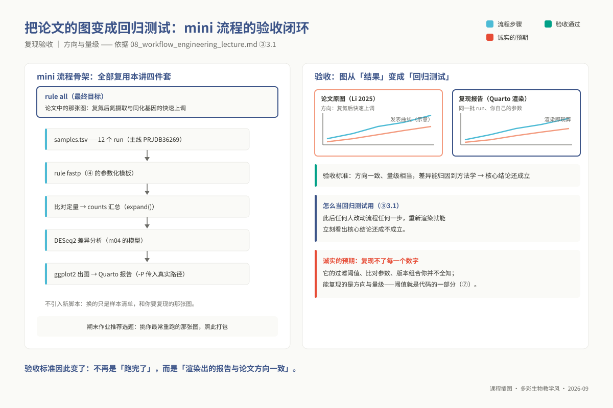
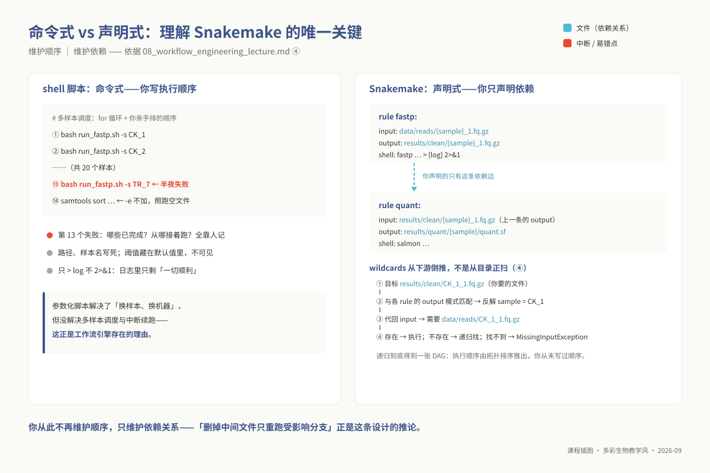
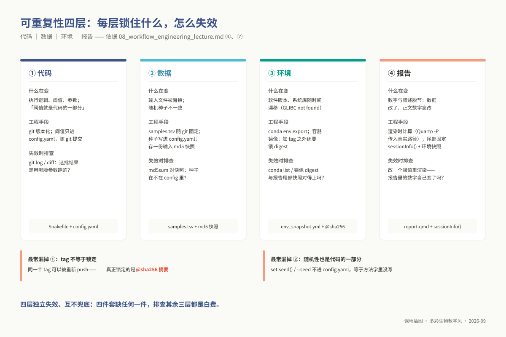
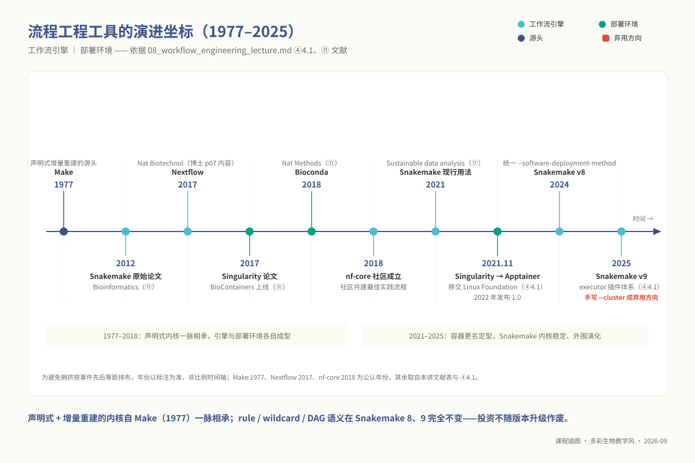

# 专题 08：分析流程工程化与可重复报告

> **适用对象**：硕士研究生，4 学时（2 h 理论 + 2 h 实践）。
> **阅读重点**：把已有分析改造成可追踪、可增量重跑的流程，并用 benchmark 与报告快照验证结果。

> **硕士生 ｜ 4 学时（2 h 理论 + 2 h 实践）｜ 环境：`conda activate ngs_ms_workflow`**
>
> **配套流程**：`03_code/master/pipelines/`（`Snakefile` / `config.yaml` / `samples.tsv` / `envs/` / `scripts/` / `report/report.qmd`）
> **本讲不发新数据、不学新分析**，改造对象是**你自己在专题 2–7 里跑过的命令**。

**为什么它排在第 8 位而不是第 1 位。** 你刚手工敲完七个专题，可能已经遇到这些问题：换个样本要重敲整串命令；上个月 `fastp` 用的是 Q20 还是 Q30 记不清；中间文件被误删后，只能从头再跑。若过早引入 Snakemake，缺少真实的待自动化对象，容易停留在语法练习。放在最后，你可以直接把自己的分析改造成可维护、可重跑的流程。本讲的目标不是多学一个工具，而是把七个专题的手工劳动**固化成别人（和三个月后的你）能一键重跑的东西**。

## ① 学习目标

读完并做完本讲操作后，你应当**能够**：

1. **改写**自己在专题 2–7 中敲过的一段命令为参数化 shell 脚本：路径、线程数、阈值全部来自变量，开头有 `set -euo pipefail`，每一步有日志。
2. **说明** `set -euo pipefail` 四个开关各拦哪一类错误，并举出一个"不加它就会失败了还继续跑"的具体情形。
3. **编写**一条完整的 Snakemake rule，正确使用 `input` / `output` / `params` / `threads` / `log` / `benchmark` / `shell`。
4. **解释** wildcards 的匹配方向——为什么是从下游 target 倒推而不是从上游文件正推——并据此**预测**删掉 `rule all` 后会发生什么。
5. **运行** `snakemake -n` / `--dag` / `--use-conda -c N`，并从 `-n` 输出中**读出**"它打算重跑哪几步、为什么"。
6. **读懂** `benchmark` 的 `s` 与 `max_rss` 两列，据此**判断**该 rule 在集群上该申请多少内存。
7. **区分** conda 环境与容器各解决哪一层问题，**说明** HPC 上为什么通常只能用 Singularity/Apptainer。
8. **渲染**一份参数化 Quarto 报告，使输入路径由流程传入、尾部固定附上 `sessionInfo()` 与环境快照。
9. **判断**一个交给你的项目目录是否"可一键重跑"，并列出它缺了哪几样东西。

## ② 前置检查

跟不上时回查对应 L0 模块，不要硬啃本讲。

| L0 模块 id | 本讲哪里用到 | 不过关的后果 | 自测题号 |
|---|---|---|---|
| `l0_01_linux` | ④ 参数化脚本全部；⑤ 步骤 1–3 的重定向与批量；⑤ 步骤 6 的集群提交 | 分不清 `> log` 与 `2> log`，日志里永远只有一半信息；作业提交不上去 | L0-1-Q3（管道与重定向）、L0-1-Q4（`grep`/`sed`/`awk`）、L0-1-Q8（上机：批量处理）、L0-1-Q9（上机：提交集群作业） |
| `l0_03_conda` | ④ `--use-conda` 与 `envs/*.yaml`；⑤ 步骤 4；⑨-4 集群上环境未激活 | 每条 rule 都报 `command not found`，且分不清是环境没建好还是作业没激活 | L0-3-Q2（channel 顺序）、L0-3-Q4（三种导出的差别）、L0-3-Q7（`EnvironmentNameNotFound`）、L0-3-P1（上机：手写 yml 并导出） |

**本讲不重复 Conda。** 环境创建、channel 优先级、`conda env export` 的三种写法已在 `l0_03_conda` 讲完；本讲只在两处引用它：`--use-conda` 让每条 rule 自带环境、报告尾部的环境快照。

**本讲还依赖 m01–m07 的分析产物，这是硬前提**：

| 你要带来的东西 | 从哪个专题来 | 用在本讲哪里 |
|---|---|---|
| 一段你**真敲过**的命令（含参数） | m02–m07 任选其一 | ⑤ 步骤 1：参数化的原材料 |
| 该分析的原始数据与样本清单 | 同上 | ⑤ 步骤 2：`samples.tsv` 的内容 |
| 你当时用的**阈值与软件版本** | 同上 | ⑥、⑦：报告里必须复述的记录 |
| 该分析产出的结果表与图 | 同上 | ⑤ 步骤 7：Quarto 报告的内容 |

没带材料的同学用配套流程的演示数据（`python3 scripts/make_demo_data.py --outdir data`，固定随机种子、离线可生成），但**期末仍要交自己课题的版本**。

## ③ 背景与科学问题

在真实的生信科研日常中，我们几乎都经历过这样的困境：论文初审意见返回，审稿人质疑“转录组差异分析采用的 padj 阈值是多少、是否启用了独立过滤（Independent filtering）”。此时回翻数月前的终端操作记录，`~/.bash_history` 早已被滚动覆盖；翻出的分析脚本散落在某个临时目录下，其内部硬编码着诸如 `/home/user_old/data/...` 的绝对路径，而当年的师兄已然毕业离校。当勉强尝试重新跑通流程时，却震惊地发现生成的火山图或富集通路与论文主图存在无法弥合的数值出入。

这不是单个实验者的疏忽，而是计算生物学中常见的记录与环境管理问题。Nature 对 1,576 名研究者的调查中，七成以上报告曾无法复现他人的实验（Baker 2016）；在生信分析中，原因常包括路径、软件版本、参数和执行顺序没有完整记录。本专题聚焦一个可操作的问题：**如何构建标准化分析流程，使高通量数据分析在数月或数年后仍能被重新执行，并能解释结果差异？**

在概念边界上，我们必须清醒地区分计算科学的三个层次：

- **可重复性（Reproducibility）**：同一份输入数据，结合同一套分析代码与参数，在任何兼容硬件上运行均能复现出完全一致的数值与图表。这是最底线、最基础的计算工程要求。
- **可复制性（Replicability）**：采用相同的方法与实验设计，在全新采集的独立生物学队列中能够得出相同或相似的生物学结论。这依赖于生物学规律的稳定性。
- **可推广性（Generalizability）**：将分析流程推广至不同物种、不同发育阶段或不同生境中依然具有泛化解释力。

**可重复性是后两者的基础条件之一**。如果既有数据无法稳定重跑，就难以判断差异来自生物学还是计算过程。从“本地能运行”到“第三方可重跑”，至少需要显式记录五类要素：文件路径、软件版本、分析阈值与参数、执行拓扑以及伪随机数种子。本讲通过参数化脚本、工作流 DAG、容器化环境和参数化报告，把这些信息固化为可版本控制的代码与配置。

### 3.1 应用案例：把"复现一篇论文的图"打包成 mini 流程

可重复性工程最实在的验收方式，是拿一篇已发表论文当"标准答案"。主线数据（PRJDB36269，即 m04 的 12 个 RNA-seq）出自一项已发表的时间序列研究：水稻根在复氮后 2 小时内的 ATAC + RNA 时序（Li W et al., 2025，*Plant Commun*，⑪）。练习的核心是把论文的其中一张关键图——“复氮后氮摄取与同化基因的快速协同激活”——设定为 mini 流程 `rule all` 的最终目标：

- **骨架设计**：`samples.tsv` 规范管理 12 个 run 的样本元数据 → `rule fastp` 实施自动化多线程质控清洗 → Salmon 比对定量 → `expand()` 规则汇聚各样本丰度并生成基因表达 counts 矩阵 → DESeq2 拟合时间序列广义线性模型 → ggplot2 导出 publication-ready 矢量图表 → Quarto 自动化编译生成交互式 HTML 报告。
- **验收标准的跃迁**：检验流程的标准不再是低层次的“无报错跑完”，而是“渲染出的报告与已发表论文的生物学结论在方向与量级上高度自洽”。在此范式下，论文图从一次性的静态终点，升华为监测生信流程抗退化能力的“持续集成回归测试（Regression Test）”。
- **诚实的方法学边界**：受限于公共数据库的参数披露完整度，我们通常无法机械复现原论文图表上的每一个微小数字；能被严谨复现的是效应量的方向与统计量级，而任何细微出入都必须能由明确的方法学差异（如参考转录本注释版本演进）给出科学解释。



*图 m08-5：论文图变成回归测试：Quarto 复现报告并排对照。*

## ④ 核心原理

### 从手敲命令到参数化脚本

初学生信时，最常见的操作习惯是在终端交互式敲下一行命令：`fastp -i /data/rna/CK_1_1.fq.gz -I /data/rna/CK_1_2.fq.gz -o clean_1.fq.gz -O clean_2.fq.gz`。这类交互式命令在生产环境中存在四个致命缺陷：其一是绝对路径硬编码，换目录或服务器便全盘崩溃；其二是样本标识符写死，面对数十个样本只能机械复制粘贴；其三是过滤阈值深埋在黑盒默认值中，无法溯源审计；其四是缺乏进程退出状态检测，中途崩溃后下游工具依然盲目执行。

将散落命令改写为参数化 Shell 脚本，是走向工程化的第一步：

```bash
#!/usr/bin/env bash
# 用法：bash run_fastp.sh -s CK_1 -i data/reads -o results -t 4
set -euo pipefail
THREADS=4; QUAL=20; MINLEN=36          # 显式声明阈值，使过滤准则在代码中透明化
usage() { echo "Usage: $0 -s <sample> -i <fq_dir> -o <outdir> [-t threads]" >&2; exit 1; }
while getopts "s:i:o:t:h" opt; do
  case "$opt" in
    s) SAMPLE=$OPTARG ;; i) FQ_DIR=$OPTARG ;; o) OUTDIR=$OPTARG ;; t) THREADS=$OPTARG ;; *) usage ;;
  esac
done
: "${SAMPLE:?缺少 -s 样本名}" "${FQ_DIR:?缺少 -i 输入目录}" "${OUTDIR:?缺少 -o 输出目录}"   # 变量断言：缺参立刻阻断退出
mkdir -p "$OUTDIR"/{clean,qc,logs}
fastp -i "$FQ_DIR/${SAMPLE}_1.fq.gz" -I "$FQ_DIR/${SAMPLE}_2.fq.gz" \
      -o "$OUTDIR/clean/${SAMPLE}_1.fq.gz" -O "$OUTDIR/clean/${SAMPLE}_2.fq.gz" \
      -h "$OUTDIR/qc/${SAMPLE}.html" -w "$THREADS" \
      --qualified_quality_phred "$QUAL" --length_required "$MINLEN" \
      > "$OUTDIR/logs/${SAMPLE}.fastp.log" 2>&1
```

在 Unix 进程通信体系中，进程以退出状态码（Exit code，0 为成功，非 0 为异常）向父进程传递执行状态。然而在原生 Bash 环境中，命令执行失败并不会终止脚本，这会导致极其危险的级联隐蔽错误。**`set -euo pipefail` 构成了参数化脚本最关键的“安全防护锁”**：

- **`-e`（errexit）**：任一命令返回非零退出码时 Bash 立即中止执行。若比对软件因内存不足崩溃，脚本即刻截断，严防下游 `samtools sort` 在空输入上生成 0 字节虚假 BAM 文件。
- **`-u`（nounset）**：引用未赋值变量时立即报错退出，彻底消除因变量名笔误（如将 `$OUTDIR` 误敲为 `$OUTDIRR`）而引发 `rm -rf /clean` 等毁灭性清空灾难。
- **`-o pipefail`**：修复经典管道命令的返回值盲区。在标准管道 `cmd1 | cmd2` 中，Bash 默认仅判定最末端命令 `cmd2` 的退出状态。若 `bwa mem` 崩溃退出但下游 `samtools sort` 成功处理了空管道并正常返回 0，默认的 `-e` 根本无法捕获该失败。启用 `pipefail` 则强制要求管道内只要有任何一环发生非零退出，整个管道表达式便返回该非零错误。
- **重定向标准流 `> log 2>&1`**：大部分生信软件将算法进度打印至标准输出（stdout），而将参数警告与错误回溯输出至标准错误（stderr）。若仅使用 `> log`，日志文件中只记录了虚假的“一切平稳”，核心报错信息则随终端关闭而湮灭。将 stderr 合流至 stdout 是保障分析黑盒得以解构排查的底线要求。

虽然参数化脚本消除了路径与样本的硬编码，但面对多样本并行时仍显乏力：一个简单的 Shell `for` 循环若在第 15 个样本处因集群节点超时而中断，研究者不得不耗费精力人工筛查前 14 个样本的完整性，并手动修剪列表以便从断点续跑。这种状态维护的沉重负担，正是专业工作流引擎诞生的必然动因。

### Snakemake rule 编写



*图 m08-3：命令式 vs 声明式：shell 自己管顺序，Snakemake 让依赖管顺序。*

> **这一节是 L1 锚点**：契约 `prerequisite_packs.L1.mappings` 中，博士 p07（Nextflow / Snakemake 工作流开发）指向本节。被 L1 送来补课的同学可以只读本节，不必读全讲。

**从命令式（Imperative）到声明式（Declarative）**是理解现代工作流系统的一条重要线索。Shell 脚本通常需要明确写出操作顺序；Snakemake 则由研究者声明“哪些目标文件由哪些输入文件、通过何种规则生成”，再根据依赖关系推导执行顺序、并发分支和可跳过的步骤。

**一条规范 Snakemake rule 的核心要素**（`input` / `output` / `shell` 构成最小闭环）：

```python
rule fastp:
    input:                                        # 声明前置依赖：开工所需的文件实体
        r1 = "data/reads/{sample}_1.fq.gz",
        r2 = "data/reads/{sample}_2.fq.gz",
    output:                                       # 声明生产产物：此规则承诺生成的物理文件
        r1 = "results/clean/{sample}_1.fq.gz",
        r2 = "results/clean/{sample}_2.fq.gz",
    params:  qual = 20                            # 软参数解耦：非文件类的数值阈值
    threads: 4                                    # 资源契约：动态传入底层命令，禁止写死数字
    log:       "logs/fastp/{sample}.log"          # 独立日志：捕获单样本执行的完整流信息
    benchmark: "benchmarks/fastp/{sample}.tsv"    # 物理开销：纳秒级时间与物理内存监控
    shell:                                        # 转换引擎：定义从 input 到 output 的具体调用
        "fastp -i {input.r1} -I {input.r2} -o {output.r1} -O {output.r2} "
        "-w {threads} --qualified_quality_phred {params.qual} > {log} 2>&1"
```

**Wildcards（通配符）的数学本质：从下游需求倒推（Demand-pull execution）。**
初学者极易产生一个根本性的误区，误以为 Snakemake 是主动扫描 `data/reads/` 输入目录来提取样本名 `{sample}` 的。事实恰恰相反：**Snakemake 的解析引擎完全是由下游目标驱动的（Pull-based），它绝不主动窥探输入目录！**
以请求最终文件 `results/clean/CK_1_1.fq.gz` 为例，其解析链条如下：

1. **模式逆向匹配**：引擎遍历所有规则的 `output` 声明，发现与 `results/clean/{sample}_1.fq.gz` 正则吻合；
2. **通配符变量绑定**：自动反解提取出变量字典 `{sample: "CK_1"}`；
3. **向上传递代入**：将已确定的 `sample="CK_1"` 实时代入当前规则的 `input` 模板，得出其物理依赖为 `data/reads/CK_1_1.fq.gz` 与 `CK_1_2.fq.gz`；
4. **递归图遍历**：系统检验上述两个输入文件是否存在于磁盘中。若存在，当前节点变为可就绪叶节点；若不存在，引擎继续将这两个依赖项作为新的目标，向更上游规则递归反解，直至触达已存在的源头文件。

这一递归展开过程在内存中构建起一张严密的**有向无环图（Directed Acyclic Graph, DAG）**。**整个分析流程的执行顺序正是该 DAG 的拓扑排序（Topological sort）产物**。这从数学原理上解释了 Snakemake 卓越的增量计算能力：通过比对 DAG 上每条边连接的前后文件系统修改时间戳（mtime），若某个上游文件更新或某个下游输出缺失，引擎仅重新调度该节点及其下游传递闭包构成的子图，其余未变异的分支全部命中缓存直接跳过。
在此机制下需恪守两条工程防线：

- **通配符路径贪婪陷阱**：`{sample}` 在底层默认按正则 `.+` 匹配，这会导致其将路径分隔符 `/` 一并吞入（例如将 `results/a/b.txt` 贪婪解析为 `sample="a/b"`）。在 Snakefile 首部显式施加约束是专业工程的底线：`wildcard_constraints: sample = r"[A-Za-z0-9_.-]+"`。
- **输出模式冲突（Ambiguous Rule）**：严禁两条不同的 rule 声明能够产出完全相同模式的 output 文件，否则引擎在倒推时无法抉择拓扑走向，必然引发 `AmbiguousRuleException`。

**`rule all`：确立拓扑遍历的原点。**
既然 Snakemake 是按需求倒推的，系统必须知晓“实验终点究竟需要哪些具体文件”。若用户在命令行未显式传入目标文件名，Snakemake 默认以 **Snakefile 中定义的第一条 rule** 作为求值起点。
因此，业界约定俗成在文件最顶端放置一条不执行任何实质 Shell 计算的伪规则 `rule all`，其 `input` 罗列出该项目所承诺产出的全部终极文件：

```python
SAMPLES = ["CK_1", "CK_2", "TR_1", "TR_2"]
rule all:
    input:
        expand("results/quant/{sample}/quant.sf", sample=SAMPLES),
        "results/counts/counts_matrix.tsv",
        "results/report/report.html",
```

若草率删去 `rule all`，文件顶部的第一条规则将退化为具体的计算规则（如 `rule fastp`）。由于该规则的 output 包含抽象通配符 `{sample}`，引擎因无具体上下文可解而当场抛出 `Target rules may not contain wildcards` 错误；而若第一条规则恰巧无通配符（如参考基因组建库），引擎将仅仅建立索引便宣告流程结束。`rule all` 的真正工程价值在于将“研究者到底想要什么最终成果”从随意的命令行输入沉淀为可被 Git 追踪的固定代码契约。

**`expand()` 聚合函数与资源监视。**
`expand()` 是专用于批量模式展开的高阶字符串生成函数。在 `expand("results/{sample}_{rep}.txt", sample=["A","B"], rep=[1,2])` 中，它默认生成输入维度的笛卡尔积（产出 4 个目标）；若传入 `zip` 参数则按对应索引按位配对。它广泛应用于 `rule all` 以及需要将全样本数据汇聚为单一矩阵的统计汇总规则中。
与此同时，在每条规则中显式声明 `log:` 与 `benchmark:` 是本课程的硬性规范：

- `log:` 保证并行分发至不同集群节点的不同样本拥有专属的独立报错记录，彻底杜绝多进程竞争写入单一终端所造成的混乱；
- `benchmark:` 则通过操作系统底层的进程树监控，生成包含真实物理常驻内存峰值（`max_rss`，单位 MB）与 CPU 利用率的结构化性能表，这构成了后续向集群调度器（SGE/SLURM）精准申请内存配额的唯一科学依据。

### 容器化封装（Docker / Apptainer）与抽象分层

在计算环境复现的阶梯上，Conda 与容器技术解决了完全不同抽象维度的痛点：
Conda 运行在用户态，专注于隔离 Python、R 等特定解释器及其第三方包依赖，但它完全依赖宿主机的 Linux 内核及基础 C 运行时（`glibc`、`libstdc++`）。当老旧服务器的系统级 `glibc` 版本低于编译依赖时，Conda 环境将彻底失效并抛出无法由用户修复的底层符号缺失错误。
容器（Container）则进一步虚拟化了**除了操作系统内核之外的整个用户空间**：基础系统发行版、特定版本的 `glibc`、系统级编译器、共享动态链接库以及应用软件被严密固化进单一容器镜像内。
而在高性能计算集群（HPC）上，**Docker 存在不可调和的安全架构矛盾**：Docker 依赖拥有超级用户权限的常驻后台守护进程（`dockerd`），赋予普通用户调用 Docker 的权限等同于赋予其物理主机的 root 特权。因此，学术计算集群统一采用无特权、无守护进程的 **Apptainer（原 Singularity）** 架构。

Apptainer 利用 Linux 用户命名空间技术，使得容器内进程的 UID/GID 与提交作业的普通用户完全等同，且严格屏蔽一切容器内提权操作，同时原生支持直接拉取并执行来自 Docker Hub 或 Quay.io（BioContainers）的 Docker 镜像。

在可重复性规范中，**镜像 Tag 不等于环境锁定**：由于 Docker 镜像的 Tag（如 `fastp:latest` 或 `fastp:0.23.4`）在技术上允许被维护者重新覆盖打包并推送到仓库，真正能够实现密码学级别不可篡改锁定的，是镜像专属的内容可寻址哈希摘要——**Digest（即 `@sha256:...` 签名）**。

### Quarto 文学化编程与四层可重复性架构

传统生信报告的脱节风险源自数据与表现层的割裂：研究者在终端跑完分析后，手动打开 Excel 汇总数字、导出 R 图表并粘贴进文档。一旦某个前处理参数发生细微修正，重新导出的图表往往被及时更新，而正文段落中引用的旧数字却被遗忘，造成论文内部的荒谬冲突。
文学化编程（Literate Programming）将分析代码、图表生成与叙述文本有机熔炼于单一 `.qmd` 源文件中。借助 Quarto 的参数化管道机制（`params:`），工作流引擎可将最终生成的矩阵路径与参数记录以环境变量或命令行参数（`-P`）动态注入报告模板。在文档渲染（Render）时，全套汇总统计与矢量图表均由代码现场计算生成，彻底杜绝了人工转录的人为疏漏。

最终，一项成熟的工程化生物信息学项目必须在四个独立维度上实现刚性自洽：

1. **代码层（Code）**：逻辑代码、流水线规则与参数配置文件必须全面纳入 Git 版本控制；
2. **数据层（Data）**：样本元数据清单与外部参考序列必须具备明确的来源标识与不可变校验；
3. **环境层（Environment）**：执行环境通过 Conda 依赖锁文件与容器 Digest 实现跨机二进制级冻结；
4. **报告层（Report）**：通过参数化文学编程在文末附带 `sessionInfo()` 运行时快照，保证结论与底层推断数据实时同步。
这四层防御机制环环相扣，构成了严谨科研可重复性的物理闭环。



*图 m08-2：可重复性四层：代码、数据、环境、报告各锁什么。*

### 4.1 技术前沿（2023–2026）

**Snakemake 8/9：语法没变，外围在换。** 2023 年底发布、2024 年全面铺开的 v8 把 `--use-conda` / `--use-singularity` 收拢为
`--software-deployment-method conda apptainer`（旧旗标暂作别名保留，本讲 ⑤ 的写法仍可运行）；workflow profiles
从第三方收编进主包；重跑元数据（persistence）格式重构。2025 年的 v9 把集群执行转向 executor 插件体系
（如 snakemake-executor-plugin-slurm），手写 `--cluster` 提交串被官方标记为弃用方向。**rule / wildcard / DAG 的语义
在 8、9 两代完全不变**——这正是声明式设计的红利：内核稳定、外围演化，学本讲的投资不会随版本升级作废。

**Singularity → Apptainer：一个改名，两套并行。** 2021 年 11 月 Singularity 项目移交 Linux Foundation 并更名为
Apptainer（2022 年发布 1.0）；原厂 Sylabs 继续维护自己的 SingularityCE 分支。两者命令几乎一致，HPC 文档里两个
名字常指同一个东西：读 2021 年前的文献与脚本用 Singularity 这个名字，装新环境认 Apptainer——④ 容器小节的
`singularity exec` 在 Apptainer 下只是把命令名换成 `apptainer`。

**Quarto 报告栈已是跨语言默认。** R / Python / Julia 同一套工具链、渲染独立于 R 环境（⑨-5 的报错正是环境混用的
代价）、报告与幻灯片同一引擎。本讲选它不是因为新，而是它把"渲染即计算"变成了跨语言的事实标准；
`.Rmd` 仍是等价选项，但新项目默认应写 `.qmd`。



*图 m08-4：工作流引擎演进：Make → Snakemake → Nextflow → nf-core。*

## ⑤ 操作步骤

**总任务：把你在专题 2–7 中做过的任意一个专题，打包成一条可一键重跑的流程。** 以下用配套流程（RNA-seq，对应 m04）示范，你替换成自己那条线。

```bash
conda activate ngs_ms_workflow
cp -r 03_code/master/pipelines ~/my_m08_project && cd ~/my_m08_project
python3 scripts/make_demo_data.py --outdir data      # 无自备数据时生成微型演示数据
```

**步骤 1（20 min）· 命令 → 参数化脚本。** 打开 `~/.bash_history` 或实验记录，把某专题的命令抄出来，按 ④ 的模板改成带 `getopts` 的脚本，跑通一个样本。**验收**：把脚本拷到 `/tmp` 下用相对路径调用仍能跑通（说明没有硬编码路径残留）。

**步骤 2（10 min）· 写 `samples.tsv` 与 `config.yaml`。** 样本清单四列 `sample / fq1 / fq2 / condition`；`config.yaml` 收纳全部路径、线程数、阈值。**Snakefile 里一个具体路径都不许出现。** 写完 `cat -A samples.tsv | head` 确认是制表符而非空格分隔。

**步骤 3（40 min）· 脚本 → Snakemake。** 把步骤 1 的脚本拆成 3–5 条 rule，每条对应一个"输入→输出"的转换。参照配套 `Snakefile` 逐条确认：三要素齐全、`log:` 与 `benchmark:` 带 wildcards。

**步骤 4（15 min）· 验证与可视化；步骤 5（10 min）· 断点续跑演示。** 后者是本讲最能说明问题的一步：

```bash
snakemake -n                              # ① 空跑：先看它打算做什么，再让它动手
snakemake --dag | dot -Tpng > dag.png     # ② 画依赖图，确认箭头方向符合预期
snakemake --use-conda -c 8                # ③ 真跑，每条 rule 自建环境
rm -rf results/quant/CK_1                 # ④ 故意删掉一个中间结果……
snakemake --use-conda -c 8 -n             # ……看它只打算重跑 CK_1 的 quant 及其下游
```

**步骤 6（15 min）· 容器化一步 + 集群提交。** 用 BioContainers 镜像跑其中一条 rule（见 ④），对比容器内外 `--version` 是否一致。集群提交：

```bash
snakemake --use-conda -j 50 --cluster "qsub -S /bin/bash -cwd -j y -pe smp {threads} -N {rule}"
```

**步骤 7（20 min）· Quarto 报告。** 改 `report/report.qmd`：读进你自己专题的结果表，画 2–3 张图，第 3 节写清阈值记录，结尾保留 `sessionInfo()`。用 `snakemake -c 1 results/report/report.html` 单独触发这条 rule。

**步骤 8（10 min）· 打包与交叉验收。** `git init && git add . && git commit`（`.gitignore` 已排除 `data/` `results/` `logs/` `.snakemake/`），README 回答三个问题：这是什么 / 怎么跑 / 产出什么。**交给同学，让他在自己账号下 `snakemake --use-conda -c 4` 跑一遍**——跑不通就是没完成。

## ⑥ 结果解读

### `snakemake -n` 的输出：只看 `reason` 与 `wildcards` 两行

```text
rule salmon_quant:
    input: results/clean/CK_1_1.fq.gz, results/clean/CK_1_2.fq.gz, results/index/salmon
    output: results/quant/CK_1/quant.sf
    reason: Missing output files: results/quant/CK_1/quant.sf; Input files updated by another job: results/clean/CK_1_1.fq.gz
    wildcards: sample=CK_1
Job stats:
job             count            all 1 ／ fastp 4 ／ salmon_index 1 ／ salmon_quant 4
------------  -------            merge_counts 1 ／ report 1 ／ total 12
```

`reason` 的常见值：`Missing output files`（第一次跑，正常）、`Input files updated by another job`（上游要重跑，正常）、`Updated input files: xxx`（**警告信号**——某个上游文件时间戳变了，你要能说出是谁动了它）；7.8 起还有 `Params have changed since last execution`、`Code has changed since last execution` 等（rerun-triggers 默认全开）。上面这份是 4 样本流程的正确形态：4 fastp + 1 index + 4 quant + 汇总 + 报告 + `all` = 12。**结果不对时长什么样：**

| 症状 | 说明什么 | 怎么查 |
|---|---|---|
| `total 1`，只有 `all` | 目标已全部最新，它什么也不打算做 | 正常。强制重跑用 `-F`（全部）或 `-R <rule>` |
| `fastp` 只有 1 个而不是 4 个 | `samples.tsv` 没读全——多半是空格分隔而非制表符 | `cat -A samples.tsv \| head` 看有没有 `^I` |
| 输出是目录的 rule（如 `salmon_index`）行为异常 | 目录输出没标 `directory()`：5.2 起必须标，Snakemake 靠它安全删除旧目录并用 `.snakemake_timestamp` 判新 | 检查 `output` 是否包了 `directory()` |
| `wildcards: sample=clean/CK_1` | wildcard 把路径吃进去了 | 加 `wildcard_constraints`（④、⑨-2） |
| 改了 `config.yaml` 阈值却说 `Nothing to be done` | 阈值没进 rule 的 `params:`（脚本里直接读 config），或 `.snakemake/` 元数据丢了（换目录、`.gitignore` 排除后重新克隆），或 `touch`/`rsync` 保留了旧 mtime | 让阈值走 `params:`；必要时 `-R <rule>` 强制重跑 |

最后一行最值得记住：课程 pin 的 7.28.1（≥7.8）默认 rerun-triggers 全开（mtime/params/input/software-env/code），**经 `params:` 传入的参数**改了会自动重跑；但触发依赖 `.snakemake/` 里的元数据，元数据一丢就退回只看时间戳（8.x 提示里给的两个出口是 `--rerun-triggers mtime` 与 `--cleanup-metadata`）。因此 `config.yaml` 每次改动仍须 git commit，否则你无法回答"这批结果是用哪版参数跑的"。

### `benchmark` 输出：申请集群资源的唯一依据

```text
s       h:m:s   max_rss max_vms max_uss max_pss io_in  io_out mean_load cpu_time
1.2     0:00:01 320     1066    —       —       —      —      —         —
```

`s` 是墙钟秒数；`max_rss` 是**物理内存峰值（MB）**——这里约 320 MB，是 `make_demo_data.py` 默认 20000 条 read 的演示数据（fastp 0.24.0 实测的取整参考值，「—」列省略）。真实数据放大后若峰值是 6 GB，`qsub` 就申请 `h_vmem=8G` 左右（约 1.3–2 倍余量），而不是 `100G` 占着不用。**`max_vms`（这里约 1066 MB）远大于 `max_rss` 是正常的**——它包含未实际使用的地址空间映射，**拿 `max_vms` 去申请内存是最常见的误读**。

异常长什么样：`max_rss` 顶到你申请的上限而作业被杀 → 内存不够；`cpu_time / s` 远小于 `threads` → 给了 8 线程只用上 1 个，多申请的核在空转，该调小 `threads:`。

**`logs/` 与 `benchmarks/` 的分工**：排错先看 `logs/<rule>/<sample>.log`，里面是工具自己的报错原文；Snakemake 终端上打印的只是"job failed"这类外壳信息，**真正的原因永远在 rule 的 log 里**。`benchmarks/` 不用于排错，只用于报资源。

### Quarto 报告：怎么判断它是"活的"

合格的报告应满足：**改掉 `config.yaml` 里一个阈值 → 重跑 → 报告里的数字自己变了**。如果你需要手动改 HTML 或重新粘图，说明报告没真正接进流程。常见反例：报告里 `read_tsv("results/counts/counts_matrix.tsv")` 写的是**相对路径**，本地调试时能跑，被 Snakemake 从别的工作目录调用时读到的却是上一次的旧文件——渲染成功、图也有，但**数字是过期的**。配套 `report.qmd` 用 `-P` 接收 `realpath` 绝对路径正是为了避免这一点。

## ⑦ 统计插件

**本讲无独立统计要点。**

本专题不在契约 `stats_plugin_topics` 名单内（该名单是 m02–m07 六个专题）。原因是**本讲不产生任何新的统计推断**——不做检验、不估参数、不给 p 值，教学重心是工程可重复性。但它对统计有一条**硬要求**，而这条要求恰恰是可重复性的核心：

> **报告模板中必须保留前序分析的全部阈值与参数记录**：用了什么检验、什么阈值、什么多重检验校正方法、软件与数据库版本各是多少、随机种子是多少。

理由很直接：可重复性的第一层是"同数据 + 同代码 → 同结果"，而**阈值就是代码的一部分**。`padj < 0.05` 换成 `< 0.01`，差异基因数量可能差一倍；`vegan` 的 PERMANOVA 不固定 `set.seed()`，两次运行的 p 值就不同。别人拿到你的 `Snakefile` 却不知道你的阈值，照样复现不出你的数字——**代码公开而参数不公开，等于没公开**。

落实到本讲三个位置：① `config.yaml`——全部阈值的**唯一**存放处，随 git 版本化，不要散落在 shell 命令里；② `report.qmd` 的「阈值与参数记录」一节——由流程经 `-P thresholds_note:` 传入，人可读；③ 报告尾部 `sessionInfo()` + `conda env export --from-history`——版本快照。

三者缺一，作业按未完成计。至于"这个阈值选得对不对、假阳性风险在哪"，回各专题的统计插件章节（m02–m07）与 `l0_06_stats`。

## ⑨ 常见错误与排查

**1. `MissingInputException`：它找不到起点**

```text
MissingInputException in rule fastp in file /home/you/my_m08_project/Snakefile, line 61:
Missing input files for rule fastp:
    output: results/clean/CK_1_1.fq.gz, results/clean/CK_1_2.fq.gz
    wildcards: sample=CK_1
    affected files:
        data/reads/CK_1_1.fq.gz
```

- **原因**：`affected files` 列出的文件既不在磁盘上，也没有任何 rule 的 `output` 能生成它。九成情况是 `samples.tsv` 路径写错，或路径基准不对。
- **解法**：先 `ls data/reads/CK_1_1.fq.gz` 看文件在不在。在的话就是基准问题——Snakemake 的相对路径**以你运行 `snakemake` 的当前目录为基准**，不是 Snakefile 所在目录；cd 到项目根再跑，或加 `-d /path/to/project`。**不要**用 `touch` 造个空文件糊弄过去——流程会继续跑，然后在下游给你一个空结果。

**2. wildcards 匹配歧义**

```text
AmbiguousRuleException:
Rules salmon_quant and rescue_quant are ambiguous for the file results/quant/CK_1/quant.sf.
Consider starting rule output with a unique prefix, constrain your wildcards, or use the ruleorder directive.
```

- **原因**：两条 rule 的 `output` 模式都能匹配同一目标文件，Snakemake 不替你猜。
- **解法**（按推荐度）：① 让两条 rule 的输出路径前缀不同（`results/quant/` vs `results/rescue/`）；② 加 `wildcard_constraints` 收窄取值；③ 实在要共存，用 `ruleorder: salmon_quant > rescue_quant`。
- **隐形版本**（不报错但更坑）：`-n` 输出里出现 `wildcards: sample=clean/CK_1`，说明 `{sample}` 把 `/` 吃进去了（它默认相当于正则 `.+`）。顶部加 `wildcard_constraints: sample=r"[A-Za-z0-9_.-]+"`，别等出问题再加。

**3. `Directory cannot be locked`**

```text
Error: Directory cannot be locked. Please make sure that no other Snakemake process is trying to create the same files in the following directory:
/home/you/my_m08_project
If you are sure that no other instances of snakemake are running on this directory, the remaining lock was likely caused by a kill signal or a power loss. It can be removed with the --unlock argument.
```

- **原因**：Snakemake 在 `.snakemake/locks/` 下加目录锁，防两个实例同时写同一批文件。上次运行被 `Ctrl-C`、被 OOM killer 杀掉或 SSH 断线，锁没释放。
- **解法**：**先确认真的没有别的实例在跑**（`ps -u $USER | grep snakemake`；集群上还要 `qstat -u $USER`），再 `snakemake --unlock`，然后正常重跑。**不要**直接 `rm -rf .snakemake/`——那会连元数据一起删掉，下次运行会认为所有输出"来路不明"而全部重跑。
- **预防**：长流程用 `nohup` / `tmux` / `screen` 挂起，或把 snakemake 本身 `qsub` 成一个作业。

**4. 集群提交时 conda 环境未激活**

作业日志里是 `/var/spool/sge/node07/job_scripts/482913: line 12: snakemake: command not found`，或计算节点上的 `/bin/bash: line 1: fastp: command not found`。

- **原因**：**SGE / SLURM 作业不继承你登录 shell 的环境**。你在终端 `conda activate ngs_ms_workflow` 过，不代表计算节点上的作业脚本也激活了；`~/.bashrc` 里的 conda 初始化在非交互 shell 中往往被跳过。
- **解法**：作业脚本里自己激活，并加自检让错误立刻暴露：

  ```bash
  #$ -S /bin/bash
  source /opt/miniconda3/bin/activate       # 路径以本集群实际安装为准
  conda activate ngs_ms_workflow
  command -v snakemake >/dev/null || { echo "[FATAL] snakemake 不在 PATH"; exit 1; }
  snakemake --use-conda -j 50 --cluster "qsub -S /bin/bash -cwd -j y -pe smp {threads}"
  ```

- `--cluster` 里也必须写 `-S /bin/bash`，否则 SGE 用默认 shell 执行，`source` 语法直接报错。**变体**：`--use-conda` 在计算节点首次运行要联网建环境，而计算节点常无外网——先在登录节点跑一次 `snakemake --use-conda --conda-create-envs-only` 把环境建好再提交。

**5. Quarto 渲染时找不到 pandoc**

```text
ERROR: Unable to locate an installed version of pandoc.
Please install pandoc or set the QUARTO_PANDOC environment variable.
```

R 侧的等价报错是 `Error: pandoc version 1.12.3 or higher is required and was not found (see the help page ?rmarkdown::pandoc_available).`

- **原因**：Quarto 自带 pandoc，但当 `rmarkdown` 在**没有 Quarto 的环境**里渲染 `.Rmd`，或 `RSTUDIO_PANDOC` / `QUARTO_PANDOC` 指向已被删除的旧环境路径时就找不到它。最常见触发方式：在环境 A 里装了 quarto，却在环境 B 里 `quarto render`。
- **解法**：`conda activate ngs_ms_workflow` 后跑 `quarto check`（逐项报告 pandoc / R / knitr 是否就位）与 `which quarto`。仍找不到就显式指路：`export QUARTO_PANDOC=$(dirname $(which quarto))/tools/pandoc`。在 Snakemake 里最稳妥的是给 `rule report` 配一个含 quarto 的 `conda:` 环境（配套流程的 `envs/report.yaml` 正是干这个的），而不是依赖系统里那个 quarto。

**6. 改了参数但输出已存在，索引不重建**：salmon 1.10.3 对短于 k 的转录本给出 `Entry with header ... had length less than equal to the k-mer length of 31` 警告

- **原因**：`config.yaml` 里 `salmon.index_kmer` 用了 31，而部分转录本比它还短：混合长度时短序列被**静默跳过**（索引照样建成，定量里这些转录本凭空消失）；全部短于 k 时进程 SIGABRT 退出（rc=134）。调小 `-k` 后若参数没走 `params:` 或元数据已丢，Snakemake 看索引目录已存在而不重建。
- **解法**：改参数后用 `-R salmon_index` 强制重跑该 rule（或删掉索引目录）。这一类"改了参数但输出已存在"的问题统一用 `-R <rule>` 解决，见 ⑥。

**7. rule 失败后输出被删、日志也没了**

- **原因**：Snakemake 在 rule 失败时删除该 rule 不完整的 `output`，这是**正确**行为（防半成品被下游当成成品）。但若你把 log 误写进 `output:`，唯一线索也被一起删。**解法**：log 只写在 `log:` 里；现场已丢的话，加 `--keep-incomplete` 重跑一次留住证据。

## ⑩ 思考练习

1. **（机制）** 一条 rule 的 `output` 写 `results/{sample}.bam`，另一条写 `results/{sample}.sorted.bam`。目标 `results/A.sorted.bam` 会被哪条匹配上？为什么两条都匹配得上？写出让它无歧义的两种改法。
2. **（预测）** 把配套 `Snakefile` 的 `rule all` 整段删掉再 `snakemake -n`。先预测会发生什么（报错还是跑一部分）并说明理由，再实际跑一遍验证。
3. **（判读）** 某 rule 的 benchmark 是 `s=7200`、`max_rss=3200`、`max_vms=48000`、`cpu_time=7100`，`threads: 16`。它在集群上该申请多少内存、多少核？给出理由，并指出哪一列**不能**用来定内存。
4. **（排错）** 同学把项目发给你，`snakemake --use-conda -c 4` 报 `MissingInputException`，但 `ls` 显示 `data/` 下文件齐全。列出**三种**可能原因和各自的验证命令。
5. **（设计）** 你把 `config.yaml` 里 padj 阈值从 0.05 改成 0.01（R 脚本里直接读 config，没走 `params:`），`snakemake -n` 却说 `Nothing to be done`。解释为什么，并给出**两种**让参数变化能触发重跑的做法，说明各自代价。
6. **（判断）** 举一个"看起来可重复但其实不可重复"的项目：有 Snakefile、有 git 仓库、README 也不错，但同学跑出的结果和作者不一样。列出至少四个可能原因，按你认为的概率排序。
7. **（🔬 迁移到自己课题 · 开放题）** 选你毕业课题里**最花时间、最常重跑**的那段分析，回答：① 它可以拆成几条 rule？每条的 input / output 分别是什么文件？② 哪些东西属于 `config.yaml`（会变的），哪些属于 `Snakefile`（不会变的）？给出划分依据。③ 有没有某一步**无法**用 rule 表达（需人工目视挑选、需在网页上手工提交）？如果有，你打算怎么把这个人工环节的**决策记录**留在流程里，让它仍可追溯？④ 如果三年后有人要复现你论文的第 X 章，他需要你交出哪几个文件？现在就把清单写下来。

## ⑪ 参考资料

### 文献

| 主题 | 文献 |
|---|---|
| Snakemake（原始） | Köster, J., & Rahmann, S. (2012). Snakemake—a scalable bioinformatics workflow engine. *Bioinformatics*, 28(19), 2520–2522. [10.1093/bioinformatics/bts480](https://doi.org/10.1093/bioinformatics/bts480) |
| Snakemake（现行用法） | Mölder, F., et al. (2021). Sustainable data analysis with Snakemake. *F1000Research*, 10, 33. [10.12688/f1000research.29032.2](https://doi.org/10.12688/f1000research.29032.2) |
| Singularity | Kurtzer, G. M., Sochat, V., & Bauer, M. W. (2017). Singularity: Scientific containers for mobility of compute. *PLoS ONE*, 12(5), e0177459. [10.1371/journal.pone.0177459](https://doi.org/10.1371/journal.pone.0177459) |
| BioContainers | da Veiga Leprevost, F., et al. (2017). BioContainers: an open-source and community-driven framework for software standardization. *Bioinformatics*, 33(16), 2580–2582. [10.1093/bioinformatics/btx192](https://doi.org/10.1093/bioinformatics/btx192) |
| Bioconda | Grüning, B., et al. (2018). Bioconda: sustainable and comprehensive software distribution for the life sciences. *Nature Methods*, 15(7), 475–476. [10.1038/s41592-018-0046-7](https://doi.org/10.1038/s41592-018-0046-7) |
| 项目组织 | Noble, W. S. (2009). A quick guide to organizing computational biology projects. *PLoS Computational Biology*, 5(7), e1000424. [10.1371/journal.pcbi.1000424](https://doi.org/10.1371/journal.pcbi.1000424) |
| 可重复性十条规则 | Sandve, G. K., Nekrutenko, A., Taylor, J., & Hovig, E. (2013). Ten simple rules for reproducible computational research. *PLoS Computational Biology*, 9(10), e1003285. [10.1371/journal.pcbi.1003285](https://doi.org/10.1371/journal.pcbi.1003285) |
| 可复现性危机调查 | Baker, M. (2016). 1,500 scientists lift the lid on reproducibility. *Nature*, 533(7604), 452–454. [10.1038/533452a](https://doi.org/10.1038/533452a) |
| 够用就好的工程实践 | Wilson, G., Bryan, J., Cranston, K., Kitzes, J., Nederbragt, L., & Teal, T. K. (2017). Good enough practices in scientific computing. *PLoS Computational Biology*, 13(6), e1005510. [10.1371/journal.pcbi.1005510](https://doi.org/10.1371/journal.pcbi.1005510) |
| 生命科学的实操可重复性 | Grüning, B., Chilton, J., Köster, J., et al. (2018). Practical Computational Reproducibility in the Life Sciences. *Cell Systems*, 6(6), 631–635. [10.1016/j.cels.2018.03.014](https://doi.org/10.1016/j.cels.2018.03.014) |
| 主线数据出处（③ 3.1 案例，与 m04/m05 共用） | Li, W., Zhu, X., Yang, J., et al. (2025). Chromatin accessibility dynamics and transcriptional regulatory networks underlying the primary nitrogen response in rice roots. *Plant Communications*, 6(7), 101392. [10.1016/j.xplc.2025.101392](https://doi.org/10.1016/j.xplc.2025.101392) |

### 官方文档与课程内部材料

| 主题 | 链接 / 路径 |
|---|---|
| Snakemake 文档（rules / wildcards / 集群执行） | https://snakemake.readthedocs.io/ |
| Quarto 指南 ｜ 参数化报告 | https://quarto.org/docs/guide/ ｜ https://quarto.org/docs/computations/parameters.html |
| BioContainers 镜像检索 ｜ Docker 文档 ｜ Apptainer（原 Singularity）文档 | https://biocontainers.pro/ ｜ https://docs.docker.com/ ｜ https://apptainer.org/docs/user/latest/ |
| **本讲配套流程**（可直接拷走改） | `03_code/master/pipelines/` —— `Snakefile` / `config.yaml` / `samples.tsv` / `envs/` / `scripts/` / `report/report.qmd` |
| 本讲环境定义 | `07_envs/conda/env_master_workflow.yml`（`ngs_ms_workflow`；Docker / Singularity **不在**其中） |
| Conda 前置模块与自测 ｜ Linux 前置模块与自测 | `02_lectures/prerequisites/l0_03_conda/l0_03_conda.md` + `08_assessment/prerequisites/l0_03_conda_selftest.md` ｜ `02_lectures/prerequisites/l0_01_linux/l0_01_linux.md` + `08_assessment/prerequisites/l0_01_linux_selftest.md` |
| 集群速查表 | `09_resources/cheatsheets/linux_cluster_cheatsheet.md`（`qsub` / `qstat` / 资源申请写法） |

### 视频（策展方向）

| 主题 | 来源 | 看哪一段 |
|---|---|---|
| Snakemake 入门 | Snakemake 官方教程（Johannes Köster）https://snakemake.readthedocs.io/en/stable/tutorial/tutorial.html | Step 1–4（第一条 rule 到 wildcards），对应本讲 ④；看完做 ⑩-1、⑩-2 |
| Git 与可重复研究 | Software Carpentry https://swcarpentry.github.io/git-novice/ | 前 6 节（init / add / commit / .gitignore），对应 ⑤ 步骤 8 |

*讲义版本 v1.0（由原「可重复性分析环境与报告生成」转型；Conda 部分已上移 `l0_03_conda`）｜ 依据 contract_version 1.1 ｜ 最后更新 2026-08-31*
