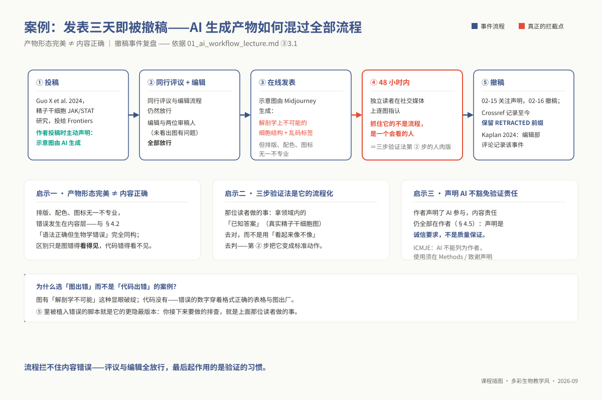
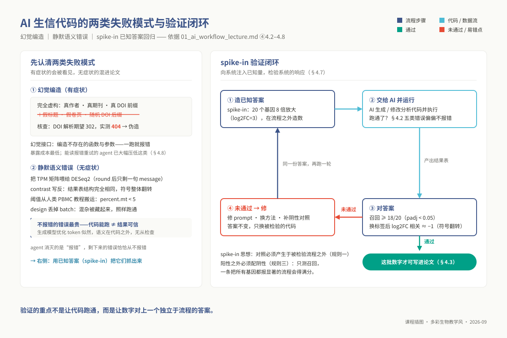
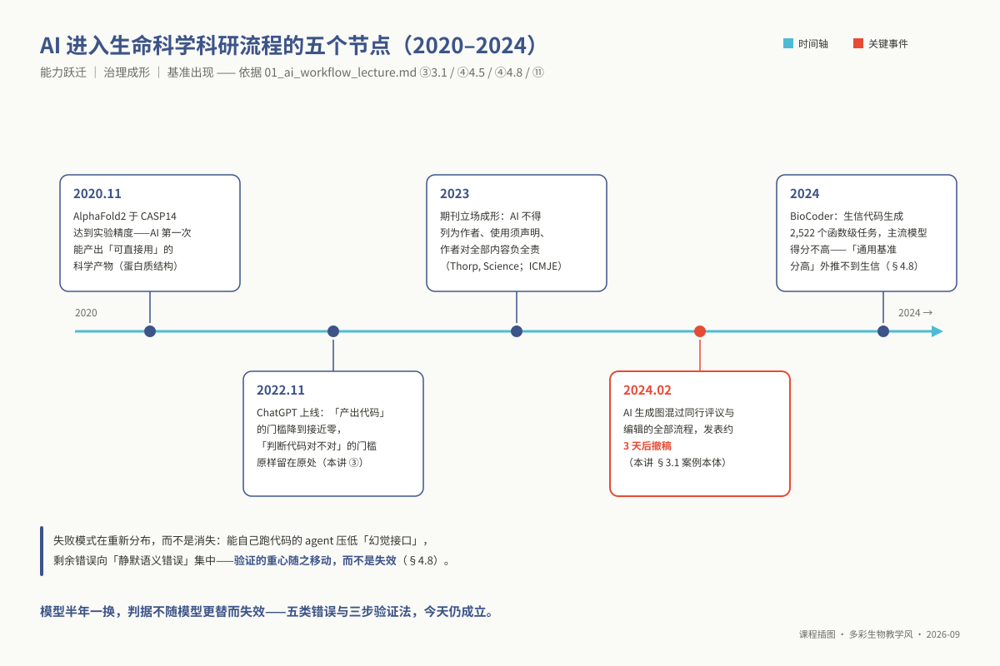

# 专题 p01：AI 辅助的生信工作流

> **适用对象**：博士研究生（植物病理、昆虫、农药、微生物等专业）｜授课方式与学时：2 学时理论 + 2 学时实践，共 4 学时。
>
> **阅读重点**：本讲训练 AI 辅助生信工作流中的需求拆解、输出验证、报错判读和文献核查，重点阅读 ④ 核心原理与 ⑩ 迁移练习。

<!-- 维护信息：工具对比与 prompt 技巧下沉至 `09_resources/cheatsheets/`（契约 `delivery.cheatsheets_receives`）。本讲验证动作供 p02–p08 的 AI 任务使用；p01 不依赖硕士层特定章节。 -->

## ① 学习目标

完成本讲后，你能够：

1. **拆解**：把一句"帮我分析这批数据"改写成 5–8 个原子步骤，每步显式写出输入形态、输出判据、生物学前置条件。
2. **验证**：对一段你没有能力从零写出的 R 分析脚本，执行三步验证法（维度语义自检 / 已知答案回归测试 / 关键中间量手算），并在 30 分钟内定位其中至少 1 处**语法正确但生物学错误**的缺陷。
3. **判读报错**：把一条真实报错归入环境 / 数据 / 逻辑三类之一，并说明 AI 给出的修复建议属于"修好了"还是"把报错藏起来了"。
4. **核查文献**：对 AI 生成的参考文献逐条执行 DOI 解析 → Crossref/PubMed 检索 → 摘要语境比对，给出"真 / 假 / 张冠李戴"的判定并统计比例。
5. **产出**：写出一份可复用的个人版《AI 输出验证清单》，并在 p02–p08 的 AI 任务中实际引用它。

> 本讲不要求你"会写代码"。要求你**会判断代码对不对**——这两件事在 AI 出现之后已经分家了。

## ② 前置检查

本讲实践全程在 R 里跑一份差异表达脚本，因此 R 与统计两块前置必须先过。**跟不上时按下表回查，不要硬啃**。

| 依赖模块 id | 本讲哪里用到 | 不过关的典型症状 | 对应自测题 |
|---|---|---|---|
| `l0_02_r` | ⑤ 全部实践代码；⑥ 结果表筛选与作图 | 看不出 `res$pvalue` 与 `res$padj` 被换掉了；不会用 `dplyr` 复算一遍结果 | `L0-2-Q3`（**本讲植入错误的正题**：按 `padj < 0.05` 筛显著上调）、`L0-2-Q4`（`group_by`/`summarise`）、`L0-2-Q8`（读表、筛选、汇总）、`L0-2-Q10`（把流程写成可重跑脚本） |
| `l0_06_stats` | ④ 五类高频错误；⑥ 三种"结果不对"的形态 | 说不出把 `padj` 换成 `pvalue` 之后差异基因数为什么会暴涨 | `L0-6-Q4`（p 值的五句错话）、`L0-6-Q5`（2 万基因、20 000 × 0.05 = 1 000 个假阳性）、`L0-6-Q9`（**必做**：为什么不能对原始 counts 做 t 检验）、`L0-6-Q10`（无差异数据也能出 985 个"显著"） |
| `l0_03_conda` | ⑤ 步骤 0 建环境；⑨-E7 作业里的环境未激活 | `qsub` 出去的作业报 `Rscript: command not found` | `L0-3-Q9`（建环境并导出 `environment.yml`）、`L0-3-Q10`（写出能在 SGE 上正确激活环境的作业头） |
| `l0_01_linux` | ⑤ 作业提交；⑨-E7 | 在登录节点直接跑 R，被管理员杀进程 | `L0-1-Q9`（把统计改写成 SGE 作业脚本并提交，日志主机名不能是登录节点） |

`l0_06_stats` 的 `L0-6-Q10` 里那 985 个假阳性，本讲会以**另一种方式**再遇见一次：不是数据随机，而是**筛选列被换错**。两者的表象几乎相同，这正是本讲要训练的辨别力。

**30 秒自查**（四条都过再往下）：

```bash
source "${CONDA_ROOT:-/opt/miniconda3}/bin/activate" ngs_phd_base
R --version | head -1                                  # R 4.3.x
Rscript -e 'packageVersion("DESeq2")'                  # 1.4x.x
Rscript -e 'packageVersion("tidyverse")'               # 2.0.0
curl -sI https://doi.org/10.1186/s13059-014-0550-8 | head -1   # 期望 HTTP/2 302（DOI 可解析）
```

> 本讲**无 L1 依赖**——p01 不建立在硕士层任何特定章节之上（见 `01_syllabus/syllabus_phd.md` §前置能力）。

## ③ 背景与科学问题

本讲要回答的不是技术问题，是一个**可信度问题**：

> **在什么条件下，我可以把一段自己写不出来的代码所产生的数字，写进我的论文？**

AI 把"产出代码"的门槛降到接近零，却把"判断代码对不对"的门槛**原样留在原处**。这两条曲线之间的落差，就是这一讲存在的全部理由。对本课程的受众——植物病理、昆虫、农药、微生物专业的博士生——这个落差尤其危险：你们有真实课题、有真实数据、有发表压力，但没有生信专业的代码审查同伴。过去写不出代码时，坏结果不会产生；现在坏结果会准时产出，而且格式整齐、图很漂亮。

在真实的科研实验室中，生成式模型可能引入几类不易察觉的错误。其一是**虚假差异表达列表**：若 AI 将校正后的 `padj` 换成原始 `pvalue`，两万个基因的背景足以产生大量假阳性，后续 GO 富集也会随之偏离。其二是**方向相反的生物学结论**：若 `contrast` 把实验组与对照组位置写反，脚本仍可能正常运行，图表也可能看起来合理；已知阳性对照可以帮助发现这种错误。其三是**编造的参考文献**：DOI 可能无法解析，或解析到与正文无关的论文。因此，文献必须逐条核查。

**案例数据 —— 自造 spike-in 计数矩阵（不需要外部数据）。** 本讲使用一套带有已知答案的小规模差异表达数据：$\ge 2$ 组 $\times$ 3 个生物学重复，配套含 `sample`、`condition`、`batch` 三列的元数据表，并预先设定若干基因的变化倍数。这个标准答案使三步验证法可以被检查。真实样本还会受到自然变异和未知背景影响，因此本讲通过 `01_make_spikein_counts.R` 生成基准数据，固定随机数种子 `20260829` 以便离线复现。迁移到真实课题时，可用经 qPCR 等独立实验确认的标记基因作为已知答案。

### 3.1 应用案例：发表三天即被撤稿的论文——AI 生成产物如何混过全部流程

2024 年 2 月，*Frontiers in Cell and Developmental Biology* 刊发了一篇关于精子干细胞信号通路的学术论文（Guo X et al. 2024）。该文引起学界轩然大波的原因在于其核心信号通路示意图完全由 Midjourney 生成：图中赫然出现了违背哺乳动物解剖学规律的畸变大鼠解剖构造，图例文字充斥着完全无语义的乱码 token。

极其发人深省的是，作者在投稿时**主动合规声明了图表由 AI 辅助生成**，而这篇论文依然毫无阻碍地通过了专业同行评议与期刊编辑质控流程。2024-02-13 见刊后，读者在学术社交平台上逐图质证，期刊于 02-15（约 48 小时）挂出关注声明（Expression of Concern），02-16（约 72 小时）正式撤稿，该篇论文在 Crossref 检索数据库中至今打上了刺眼的 "RETRACTED" 撤稿标记（⑪），并引发了学术期刊编辑部的系统性反思（Kaplan 2024）。

这起事件说明，AI 输出的外观质量与科学有效性并不等价：
第一，**产物外观与内容真实性可能脱节**。图件的构图和渲染可以很精致，但其中的生物学结构仍需由领域知识检查。这与 4.2 节讨论的“代码语法正确但生物学语义错误”属于相似的风险；图形错误较容易被发现，统计语义错误则常隐藏在整洁的代码和图表中。
第二，**自动化流程不能替代领域专家的审视**。该案例中，错误是在发表后由读者发现的。本讲的三步验证法试图把这种领域判断转化为可计算、可留痕的检查。
第三，**免责声明不替代研究者的责任**。即使论文披露使用了 AI，作者仍须对代码、数字和图表负责。



*图 p01-5：AI 生成图像混过评议与编辑：发表三天后撤稿的复盘。*

## ④ 核心原理

> 博士层深度：**讲到方法局限与近 3 年进展**。本节不介绍任何具体模型，介绍的是**不随模型更替而失效的判据**。

### 4.1 需求拆解：把请求改写成一份可验收的契约

在生信科研中，“帮我分析这批 RNA-seq 数据”属于典型的**不可验收需求**。此类模糊提问剥离了所有关键物理约束，导致生成式 AI 只能从其预训练语料的先验概率中强行补齐默认假定——通常默认为人类受试者、单因素无批次、输入矩阵严格为整数 counts 且各组样本完全独立。然而在植物抗逆、病原共侵染或昆虫发育等复杂实验中，这些默认假设近乎无一成立。

合格的需求拆解必须将复合任务细化为由**原子步骤（Atomic step）**构成的确定性有向链条。每个原子步骤都必须具备清晰的三要素：

- **输入规范（Input contract）**：精确定义文件路径、物理格式、行列几何语义（行表征特征还是观测样本）以及最核心的**数据物理量纲**（是原始未校正的 Raw Counts，还是已经过文库大小缩放的 CPM/TPM，抑或是经过对数变换的连续值）。
- **输出判据（Output assertion）**：显式声明所承诺产出的结构化文件名、列字段以及**一条可自动执行的机器断言规则**（例如“对照组与处理组之间的 20 个阳性标记基因中，必须有 $\ge 18$ 个在输出表格中呈现 $\text{padj} < 0.05$”）。
- **生物学前置约束（Biological preconditions）**：锁定基因组注释版本、生物学重复数量、嵌套批次设计矩阵以及因变量因子因子的基线参考水平（Reference level）。

使用生成式 AI 时应遵守三条边界：一是**不能独立验证的任务不要交给 AI 决定**，例如研究者不了解其假设边界的高阶统计模型；二是**未发表或受限数据不上网**，包括未公开序列和临床数据；三是**事实检索回到数据库或原始文献**，基因功能、物种特异 marker 等内容不能只依赖模型生成（见 4.5）。

### 4.2 为什么"语法正确但生物学错误"是常态而不是意外

这一系统性缺陷的数学本源在于自回归大语言模型的优化目标：大模型在预训练与指令微调中所最大化的，是给定上下文条件下下一个 Token 的条件对数似然 $\sum \log P(w_t \mid w_{<t})$，而非逻辑命题的真实性。换言之，模型追求的是“语言表述的高度合理性与流畅性”。

然而，生物信息学代码的正确性，绝大部分并非寄宿在代码语法之中，而是**寄存在代码文本之外的生物学本体与实验设计约束中**：矩阵维度的真实生物学标签、浮点数值背后的物理量纲、参考基因组的坐标系定义（0-based 还是 1-based）、多重混杂因子的正交性以及因子因子的参考基准。

这些上下文既不在代码字符串中，也无法被 R 解释器的语法分析树感知。因此可能出现**语法合法、脚本正常退出，但生物学或统计学含义错误**的情况：

| # | 错误类型 | 典型形态 | 为什么不报错 |
|---|---|---|---|
| 1 | **统计量误用** | 用 `pvalue < 0.05` 代替 `padj < 0.05`；用 `log2FoldChange` 的绝对值排序当显著性排序 | 两列都是合法的数值列，`dplyr::filter` 不关心你筛的是哪一列 |
| 2 | **方向搞反** | `results(dds, contrast = c("condition","ctrl","treat"))` 把处理与对照写反；`factor()` 的参考水平默认按字母序，`ctrl` 恰好排在 `treat` 前是运气不是设计 | 两种写法都返回结构完全相同的结果表 |
| 3 | **单位混淆** | 把 TPM / FPKM / CPM 矩阵喂给 DESeq2；把已 log 转换的矩阵再做一次 `log2` | 非整数时 DESeq2 **报错**停下，`round()` 一下就"解决"了，只剩一句 `converting counts to integer mode` 的 message |
| 4 | **阈值凭空捏造** | `percent.mt < 5`、`minCount = 10`、`resolution = 0.5` ——从人类 PBMC 教程搬来的数字，套到植物、真菌、昆虫样本上 | 阈值是常数，任何常数都能跑通 |
| 5 | **配对关系丢失** | `design = ~ condition` 丢掉真实存在的 `batch`；counts 的列顺序与 coldata 的行顺序对不齐 | DESeq2（1.42.0 实测）构建时校验 colData 行名与 counts 列名**逐一同序**，同名乱序会报错；静默的是先改列名、数据却没跟着重排 |

第 5 类错误中样本顺序的静默错位尤为恶劣：DESeq2 构建对象时会校验名称是否逐一同序，但它只比对名字；一旦脚本先 `as.matrix()` 剥离元数据、再把 coldata 的样本名直接赋给列名，名字对上了而数据没重排，错配就悄无声息地穿透这道防线（第①步的名称检查同样抓不到它，要靠第②步看数据本身）。唯有在代码中引入显式交集与强制重排序机制，方能构筑防线。

### 4.3 三步验证法

三步验证法按照排查成本与检出颗粒度设计为严密的渐进梯队：

| 验证阶段 | 核心考察维度 | 单行命令检验范式 | 未通过所指征的核心系统缺陷 |
|---|---|---|---|
| **① 维度与语义自检** | 矩阵尺寸、数据类型、取值区间极值、行列样本名对齐 | `dim(cts); range(cts); all(colnames(cts) == rownames(coldata)); table(cts %% 1 == 0)` | 包含小数提示非原始 counts；行列名未对齐指征样本与元数据严重错位 |
| **② 已知答案的回归测试** | 植入阳性标记基因的统计检出率；样本分组反转时效应量的镜像反转 | `sum(res[spike_in, "padj"] < 0.05); cor(lfc_原, lfc_换标签)` 理论值应 $\approx -1$ | 召回率低暴露模型拟合失效；相关系数未反转确证基准因子水平或对比参数写反 |
| **③ 关键中间量手算复核** | 手工复算典型基因的 CPM、校验 BH 阈值单调性、核对模型系数名称 | `resultsNames(dds); sort(res$pvalue)[1] * nrow(res) / 1` 与 `min(res$padj)` 比对 | 模型名称显示 `condition_ctrl_vs_treat` 直接确证效应量方向彻底颠倒 |

在这个防御体系中，**第 ② 步尤其适合捕获“结论方向反转”等静默错误**。它要求研究者在真实分析前设计一套独立的基准数据，通常需要额外准备时间。


*图 p01-2：三步验证法：格式、对答案、边界条件——第②步唯一能抓无症状错误。*

### 4.4 报错阅读：三分法，以及 AI 修复建议的危险形态

面对程序抛出的异常，先按问题来源分为三类：

- **环境层问题（Environment failures）**：表现为跨机器或重建虚拟环境后即可自行化解（例如动态链接库缺失、缺少特定 R 包）。AI 所给出的安装依赖、切换镜像源建议通常较为可靠；
- **数据层问题（Data sanity violations）**：换用整洁输入后消失的异常（如非整数或缺失值 NA）。AI 可能建议用 `round()` 或 `na.omit()` 消除报警；这会掩盖输入其实是 TPM 或基因 ID 映射失败等上游问题。
- **逻辑与模型设计问题（Statistical design flaws）**：更换环境或输入后仍存在的异常，通常反映设计矩阵不完整（例如 `the model matrix is not full rank`）。当批次与处理组完全混杂时，直接删除 `batch` 变量只能让代码运行，不能恢复可识别的实验设计。

判断修复是否可靠的实用规则是：**如果补丁只让报错消失，却没有说明输入、单位或实验设计的含义是否正确，就不能把它当作修复。**


*图 p01-3：报错三分法：环境、数据、逻辑，危险度递进。*

### 4.5 文献核查：AI 编造引用的失效模式

生成式模型在生成学术引用时，并非在检索真实的索引数据库，而是依赖自注意力机制对文献标题、作者与期刊名进行的概率重组。这导致了高度规律化的学术伪造形态：从“真作者与真期刊拼凑出的假文章”，到“真实出版商前缀拼凑出的随机死链 DOI”，乃至更为隐蔽的“文献真实存在但其结论被恶意张冠李戴”。
严谨的文献核查必须遵循标准化流水线（可由脚本 `01_check_refs.sh` 自动化前三步）：首先调用 DOI 解析器验证 HTTP 响应是否重定向至出版商页面（拦截 404 伪造）；其次通过 Crossref 公开 REST API 抓取官方题录，核实论文真实篇名与发表卷期；再者利用 NCBI E-utilities 逆向比对 PubMed 索引库。而最关键的第四步必须由学者亲自完成——研读论文摘要与讨论原文，确证其真实论断确实支持你在正文中所陈述的具体科学命题。

### 4.6 局限与近 3 年进展：为什么"验证"不会被下一代模型消灭

幻觉源于训练目标（最大化下一 token 似然）与模型的知识边界：温度设为 0 的贪心解码同样会产生幻觉，采样参数只影响其表现形式与频率（Ji et al. 2023）。即便引入检索增强（RAG）或工具调用链，系统也仅仅是降低了无中生有的频率，却引入了更为复杂的失效维度：检索到了真实的文献，却在提取信息时发生语境错置；生成了看似正确的代码，却在对齐真实数据时发生单位滑移。
近年来的代码智能体能够执行脚本并根据终端输出重试。这会减少语法和环境错误，但“运行成功”仍不能证明单位、方向、物种或实验设计正确。因此，智能体输出仍需要独立的语义检查。

### 4.7 "已知答案"的三条设计规则：spike-in 思想的方法论

将湿实验中的外源内参（Spike-in）质控思想投射到生信验证中，构建可信的回归基准必须严格遵循三条方法论准则：
首先，**已知标准答案必须完全脱离被检验流程的内部逻辑而独立生成**。采用自造 spike-in 数据时，20 个差异表达基因的 8 倍表达提升是在矩阵模拟初期通过硬编码写入输入文件的，绝不可使用分析流程自身的中间产物充当金标准；
其次，**基准测试的扰动设计必须与待捕获的错误模式形成明确的数学对偶**。例如，为防范 `contrast` 参数反向，可将样本组别标签人为全量置换，检验生成的 $\log_2\text{FC}$ 向量与原始结果的皮尔逊相关系数是否严格收敛于 $-1.0$；
最后，**阳性对照的设立必须无条件配备严格的阴性对照**。如果评估框架仅仅检测已知差异基因能否被召回，那么一个极度激进、将全基因组所有基因统统判为显著差异的错误模型反而会获得完美的召回率得分。唯有通过阴性对照监测假阳性膨胀率，才能确保检验闭环的稳健性。



*图 p01-1：幻觉与静默错都「不报错」：用独立于流程的 spike-in 已知答案对答案，不通过就修了再跑。*

### 4.8 技术前沿（2023–2026）：失败模式重塑与领域代码基准评测

在生信大模型前沿研究中，错误模式正在发生显著的重心迁移：早期简单的语法解析失败与虚构函数调用（Hallucinated APIs）已被现代工具链大幅压低，而诸如基因组坐标系错位（0-based vs 1-based）、多重假设校正漏选、样本元数据因行名对齐失效导致的静默乱序等高阶语义错误，正成为高水平生信工作流中的主要威胁。
2024 年发表于 *Bioinformatics* 的 BioCoder 基准（Tang et al. 2024，⑪ 文献 8）从 28 个生信 GitHub 仓库抽取 1,026 个 Python 函数与 1,243 个 Java 方法，另加 253 道 Rosalind 题，共 2,522 个函数级测试任务，以模糊测试判定正误。其 Pass@1 结果（原文表 5/6）表明，通用编程能力强的大模型在这类领域代码上通过率明显下降。这一实证数据从侧面印证了通用代码能力无法线性推演至生信语义有效性的事实，进一步凸显了本讲所确立的三步验证法作为长效工程规范的学术价值。



*图 p01-4：AI 进入生信的时间线（2020–2024）：CASP14 → ChatGPT → 撤稿事件 → 基准。*

## ⑤ 操作步骤

环境：`ngs_phd_base`（契约 `levels.phd.env_files`，含 R + DESeq2）。全部脚本在 `03_code/phd/scripts/`。

### 5.0 建环境（一次性）

```bash
conda env create -f 07_envs/conda/env_phd_base.yml     # 名字：ngs_phd_base
source "${CONDA_ROOT:-/opt/miniconda3}/bin/activate" ngs_phd_base
Rscript -e 'library(DESeq2); sessionInfo()$otherPkgs$DESeq2$Version'
```

### 5.1 生成已知答案的数据（三步验证法的第 ② 步靠它）

```bash
Rscript 03_code/phd/scripts/01_make_spikein_counts.R results/p01
#   产出 counts.tsv（2000 基因 × 6 样本）、coldata.tsv（含 batch 列）、
#        spikein.txt（20 个被人为放大 8 倍即 log2FC=3 的基因名 —— 这就是"已知答案"）
```

参数含义写在脚本头部；`set.seed(20260829)` 保证全班拿到**同一份**数据，便于横向对答案。

### 5.2 拿到"AI 生成"的脚本并跑通

`01_ai_generated_de.R` 是一段形态完全正常的差异表达脚本：能跑通、不报错、出图。**教师已在其中植入若干处生物学错误**，位置不公布。

```bash
Rscript 03_code/phd/scripts/01_ai_generated_de.R \
        results/p01/counts.tsv results/p01/coldata.tsv results/p01/ai_out
```

### 5.3 执行三步验证法

```bash
Rscript 03_code/phd/scripts/01_verify_de.R \
        results/p01 results/p01/ai_out
#   ① 维度语义自检：dim / 取值域 / 是否整数 / 行列名对齐
#   ② 回归测试   ：spike-in 20 个基因的召回率；换标签后 log2FC 相关系数应 ≈ -1
#   ③ 手算复核   ：resultsNames(dds) 字面、最小 padj 与 BH 手算值、一个基因的 CPM
```

**这一步是本讲的核心，不要跳过直接看答案。** 先自己看 `verify_report.txt` 的三段输出，写下你的判断，再往下读 ⑥。

### 5.4 对照环节：把同一段代码交给 AI

把 `01_ai_generated_de.R` 全文贴给你惯用的 AI，只问一句"这段代码有没有问题"。**记录**：它指出了几处、指对了几处、有没有指出根本不存在的问题（假阳性建议）。然后换一种问法——把 §4.1 的输入/输出/前置三要素补齐再问一次，比较两次的差别。

### 5.5 文献核查演练

```bash
bash 03_code/phd/scripts/01_check_refs.sh refs.txt   # 每行一个 DOI
#   输出（7 列 TSV）：DOI | HTTP 状态 | 题名 | 期刊/出版方 | 年份 | pubmed_hits | verdict
```

让 AI 为"植物免疫的单细胞转录组研究"生成 5 条参考文献（要求给出 DOI），把 DOI 写进 `refs.txt` 跑上面这条命令；再对存活下来的条目人工做第 ④ 步。**统计真伪比例并写进作业。**

### 5.6 集群提交（数据量变大时）

```bash
qsub 03_code/phd/scripts/01_run_ai_practice.sh
qstat -u "$USER"
```

作业头与 `source .../activate` 两行的机理见 `l0_01_linux`，写法见 `l0_03_conda` 的 `L0-3-Q10`。

## ⑥ 结果解读

### 6.1 正确的结果长什么样

`verify_report.txt` 三段全过时应当看到：

- **① 自检**：`2000 x 6`；`all integers: TRUE`；`colnames == coldata$sample: TRUE`；**文库大小 max/min ≈ 2.5**（原始 counts 的正常形态）。
- **② 回归测试**：20 个 spike-in 基因中 **≥ 18 个** `padj < 0.05`（参考流程实测 20/20），`log2FoldChange` 中位数 **+2.8 左右**（真值 +3，收缩后略小）；换标签重跑后 `cor(lfc_原, lfc_换) = -1.000`；参考流程的差异基因数在 **20 上下**。
- **③ 手算复核**：`resultsNames(dds)` 含 `condition_treat_vs_ctrl`——**字面必须与你想要的方向一致**；`min(res$padj)` 与手算的 BH 边界同量级。

### 6.2 结果不对时长什么样（这一节是本讲的重点）

三种植入错误各有**特征鲜明的指纹**，学会看指纹比学会读代码更快：

| 症状 | 最可能的错误 | 一行验证 |
|---|---|---|
| 差异基因数从 **20 上下**跳到 **100 上下**（约 4–5 倍）；火山图左右**大致对称**；GO 富集全是 "metabolic process" 这类泛化 term | **用了 `pvalue` 而非 `padj`**——本例 1 995 × 0.05 ≈ 100 个期望假阳性；换成 2 万基因就是 1 000，正是 `L0-6-Q5` 那笔账 | `grep -n 'pvalue' 01_ai_generated_de.R` |
| spike-in 的 20 个基因**全部出现在下调侧**（`0/20` 在上调侧）；与参考流程的 `log2FC` **相关系数 ≈ −0.99** | **`contrast` 或 factor 参考水平写反** | `Rscript -e 'dds<-readRDS("ai_out/dds.rds"); resultsNames(dds)'`，再核对 `results()` 里 `contrast` 的第 2、3 个元素 |
| `sizeFactors(dds)` 全部挤在 1.0 附近（本例 0.95–1.13），而**原始 counts 的文库大小最大/最小相差 2.5 倍** | **归一化做了两次**：先手工转成 CPM 再喂给 DESeq2（`round()` 后不再报错，只剩一句 `converting counts to integer mode` 的 message） | `Rscript -e 'x<-read.delim("counts.tsv",row.names=1); range(colSums(x))'`——真 counts 的文库大小应有明显差异，size factor 也应随之分散 |

补三条**不报错但更隐蔽**的形态，作为你自己写清单时的素材：

- `res` 里 `padj` 有大量 `NA`（独立过滤与离群值所致），用 `res[res$padj < 0.05, ]` 直接取子集会得到一堆 `NA` 行——这不是"没有显著基因"，是**取子集写法错了**（⑨-E6）。
- 设计公式丢了 `batch`，结果表看起来完全正常，只有把 PCA 画出来才看见样本按批次分开（`L0-6-Q8` 的图形）。
- 差异基因数**异常地少**（个位数）而 spike-in 也没召回——常见于 counts 被 log 过一次又被当原始值。

## ⑦ 统计插件

**本讲无独立统计要点。**

理由：p01 不在契约 `stats_plugin_topics` 名单内。本讲实践中出现的统计概念——p 值与 FDR 的区别、多重检验的规模效应、生物学重复的含义——**全部属于 `l0_06_stats` 的范围**（`L0-6-Q4`、`L0-6-Q5`、`L0-6-Q9`、`L0-6-Q10`），本讲直接引用、不重讲。差异表达本身的统计模型（负二项、离散度收缩、独立过滤）见硕士 m04 §⑦；相关性网络的多重检验见本课程 p06 §⑦。

本讲检验的是**能否发现统计量被用错**，不是**能否推导该统计量**——这是两种不同的能力，前者才是本讲的目标。

## ⑨ 常见错误与排查

| 编号 | 真实报错 / 现象 | 原因 | 解法 |
|---|---|---|---|
| **E1** | `Error in DESeqDataSetFromMatrix(countData = cts, colData = coldata, design = ~condition) :`<br>`  some values in assay are not integers` | 输入是 TPM / CPM / 已归一化矩阵，不是原始 counts | **不要**直接 `round()`。回到上游确认矩阵来源；确实是 counts 但因 `tximport` 带来小数时，用 `DESeqDataSetFromTximport()` 而非手工取整 |
| **E2** | `converting counts to integer mode`（只是一句 message，不是报错） | 同 E1，但被静默处理了 | 把它当报错看。在脚本里加 `stopifnot(all(cts %% 1 == 0))` 主动拦截 |
| **E3** | `Error in checkFullRank(modelMatrix) :`<br>`  the model matrix is not full rank, so the model cannot be fit as specified.` | `design` 里两个变量**完全混杂**——如批次 1 全是对照、批次 2 全是处理（`L0-6-Q6` 的 2×2 表） | 这是**设计问题不是代码问题**。删掉 `batch` 能跑通，但结论无法把批次与处理分开。正确做法是报告这一限制，并在下一批实验里交叉安排 |
| **E4** | `Error in DESeqDataSet(se, design = design, ignoreRank) :`<br>`  all samples have 0 counts for all genes. check the input matrix` | 行列转置了（行=样本列=基因），或读表时把第一列当成了数据列 | `dim()` + `head(rownames())` 看一眼；读表统一用 `row.names = 1` |
| **E5** | `Error in .local(object, ...) :`<br>`  all variables in design formula must be columns in colData` | `coldata` 里没有 `batch` 这一列，或列名大小写不符 | `colnames(coldata)`；元数据表的列名建议全小写下划线 |
| **E6** | ``Error in `[.data.frame`(res, res$padj < 0.05, ) : ``<br>`  missing values are not allowed in subscripts` | `padj` 含 `NA`（独立过滤 / 离群值），逻辑向量里的 `NA` 不能做下标 | 用 `subset(res, !is.na(padj) & padj < 0.05)` 或 `dplyr::filter(padj < 0.05)`（`filter` 自动丢弃 NA，但你必须**知道**它丢了） |
| **E7** | 作业日志里 `bash: Rscript: command not found`，而登录终端明明能跑 | SGE 作业**不继承**登录终端的环境（机理见 `l0_01_linux`） | 作业脚本里显式写 `source "${CONDA_ROOT:-/opt/miniconda3}/bin/activate" ngs_phd_base`（写法见 `L0-3-Q10`） |
| **E8** | `curl -sI https://doi.org/10.1038/s41586-023-99999-9` 返回 `HTTP/2 404` | DOI 是拼凑的：前缀真实、后缀虚构 | 该条引用直接删除。**不要**尝试"把 DOI 修对"——标题本身通常也是编的 |
| **E9** | AI 建议加 `na.rm = TRUE` 后代码跑通、结果"正常" | NA 来自上游 merge 键对不上（基因 ID 版本号 `.1` 之类） | 先 `sum(is.na(x))` 数一数、`which(is.na(x))` 看是哪些行。NA 的**数量与位置**才是诊断信息，抹掉它等于销毁证据 |

## ⑩ 思考练习

1. **拆解**：把"帮我看看这批菌株的转录组有没有差异"改写成 6–8 个原子步骤，每步写全输入 / 输出 / 判据三要素。指出原句里有几处默认值是 AI 会替你填、而在你的体系里不成立的。
2. **回归测试设计**：如果你手上**没有** spike-in，还能用什么充当"已知答案"？至少给出两种，并说明各自的局限（提示：已 qPCR 验证的基因；管家基因应当**不**显著）。
3. **符号检验**：写出三行代码，把 `condition` 的参考水平人为反过来重跑一次，并用一个数字证明两次结果互为镜像。这个数字应该等于多少？
4. **报错归类**：把 ⑨ 表里的 E1–E9 归入环境 / 数据 / 逻辑三类，并挑出**其中 AI 的常见建议会掩盖真问题**的那几条，各写一句为什么。
5. **假阳性建议**：在 §5.4 里，AI 有没有指出根本不存在的问题？举一例，并说明如果你照它改了会发生什么。这条经验写进你的清单第几条？
6. **文献核查的第 ④ 步**：找一条**DOI 能解析、标题也对**但被 AI 用错了地方的引用（可从 §5.5 的产物里找，也可从你已读过的文献里构造），说明它错在哪一层。
7. **成本判断**：三步验证法全套约需 40 分钟。什么情况下你会只做第 ① 步就往下走？写出你的判据（提示：这个数字要不要写进论文）。
8. **迁移到自己课题（开放题）**：针对你自己**正在做或计划做**的一个分析，写 250–300 字的 AI 使用与验证方案，必须回答：① 这个分析里哪些步骤你打算用 AI、哪些坚决不用，判据是什么；② 你的"已知答案"从哪里来（具体到基因名或样本名）；③ 你的数据有没有保密约束，据此哪些内容不能贴进在线模型；④ 你打算在论文 Methods 里怎么写这一段 AI 使用声明。**必须具体到你自己的数据，不要写通用流程。**

## ⑪ 参考资料

### 文献

> **本表本身就是 §5.5 的第一份练习材料**：请逐条执行 DOI 解析与 Crossref 核对，
> 确认它们全部真实存在——不要因为出现在讲义里就默认为真，这正是本讲要训练的习惯。

| 文献 | 出处 | DOI |
|---|---|---|
| Love MI, Huber W, Anders S. Moderated estimation of fold change and dispersion for RNA-seq data with DESeq2 (2014) | Genome Biology 15:550 —— 实践所用方法的原始论文 | DOI: 10.1186/s13059-014-0550-8 |
| Benjamini Y, Hochberg Y. Controlling the false discovery rate (1995) | J R Stat Soc B 57(1):289–300 —— `padj` 的出处，⑥-6.2 第一行的理论依据 | DOI: 10.1111/j.2517-6161.1995.tb02031.x |
| Soneson C, Love MI, Robinson MD. Differential analyses for RNA-seq: transcript-level estimates improve gene-level inferences (2015) | F1000Research 4:1521 —— `tximport` 与"为什么 counts 会带小数"（⑨-E1） | DOI: 10.12688/f1000research.7563.2 |
| Ji Z, Lee N, Frieske R, et al. Survey of hallucination in natural language generation (2023) | ACM Computing Surveys 55(12):248 —— §4.6 幻觉机制的综述来源 | DOI: 10.1145/3571730 |
| Thorp HH. ChatGPT is fun, but not an author (2023) | Science 379(6630):313 —— §4.5 学术诚信边界的期刊立场 | DOI: 10.1126/science.adg7879 |
| Guo X, Dong L, et al. Cellular functions of spermatogonial stem cells in relation to JAK/STAT signaling pathway (2024)【已撤稿】 | Frontiers in Cell and Developmental Biology 11:e1339390 —— §3.1 案例本体；Crossref 记录带 RETRACTED 前缀，撤稿本身即教材 | DOI: 10.3389/fcell.2023.1339390 |
| Kaplan MH. On rats with oversized genitalia and other submissions (2024) | ImmunoHorizons 8(3):227 —— §3.1 对该事件的编辑部评论 | DOI: 10.4049/immunohorizons.2400020 |
| Tang X, Qian B, Gao R, et al. BioCoder: a benchmark for bioinformatics code generation with large language models (2024) | Bioinformatics 40(Suppl 1):i266–i276 —— §4.8 生信代码生成基准 | DOI: 10.1093/bioinformatics/btae230 |

### 官方文档与工具

- DOI 解析（核查第 1 步）：https://www.doi.org/ ｜ Crossref REST API（第 2 步，无需密钥）：https://api.crossref.org/ ，文档 https://www.crossref.org/documentation/retrieve-metadata/rest-api/
- NCBI E-utilities（第 3 步，按标题反查 PubMed）：https://www.ncbi.nlm.nih.gov/books/NBK25501/
- ICMJE Recommendations（AI 不能作为作者、使用须声明）：https://www.icmje.org/recommendations/
- COPE 关于 AI 与作者身份的立场声明：https://publicationethics.org/guidance/cope-position/authorship-and-ai-tools
- DESeq2 vignette（`results()` 的 `contrast`、`resultsNames()`、独立过滤与 `padj` 为 NA 的权威说明）：https://bioconductor.org/packages/release/bioc/vignettes/DESeq2/inst/doc/DESeq2.html

### 课内交叉引用

- 前置：`l0_01_linux`、`l0_02_r`、`l0_03_conda`、`l0_06_stats`（见 `00_design/prerequisite_packs.md`）
- 易过时内容（模型对比、prompt 技巧、按需更新）：`09_resources/cheatsheets/`
- 本讲产出的《AI 输出验证清单》在 **p02–p08** 的 §⑧ AI 辅助任务中逐次复用；考核对应契约 `assessment.rubric_requirements.ai_verification_log`
- 差异表达统计模型的完整讲法：硕士 `02_lectures/master/topic04_rnaseq/04_rnaseq_lecture.md` §④、§⑦
