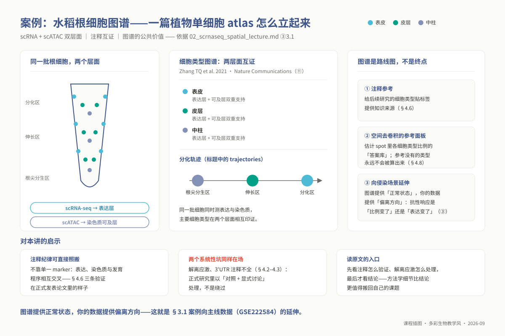
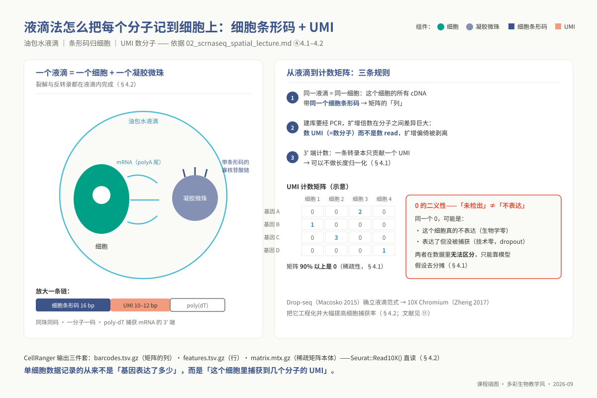
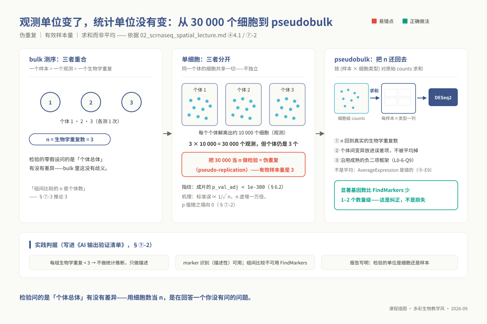
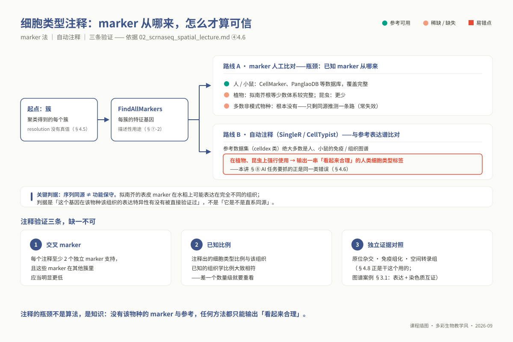
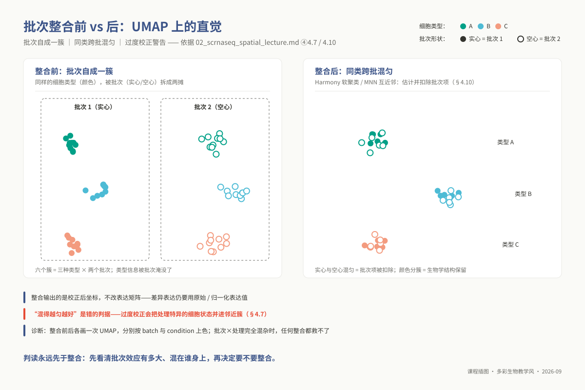
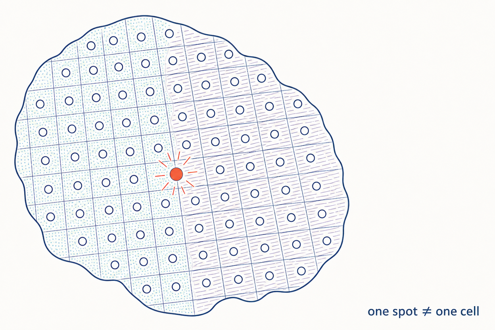
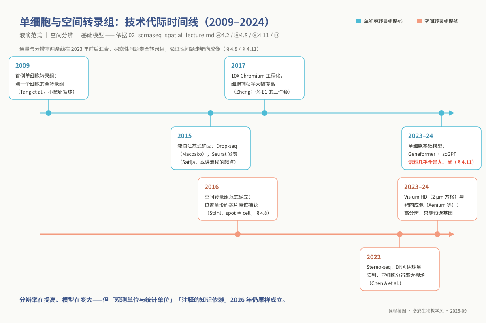

# 专题 p02：单细胞与空间转录组

> **适用对象**：博士研究生（植物病理、昆虫、农药、微生物等专业）｜授课方式与学时：2 学时理论 + 2 学时实践，共 4 学时。
>
> **阅读重点**：本讲覆盖单细胞与空间转录组的物理原理、标准分析链和方法边界，重点阅读 ④ 的批判性原理与 ⑦ 的统计插件；贯穿原则是细胞为观测单位、个体为统计独立单位。

<!-- 维护信息：本专题由原 topic02 与 topic03 合并；保留液滴微流控、CellRanger、Seurat、Harmony 和 Visium 去卷积，Monocle3 与 CellChat 细节移至 §4.9。 -->

## ① 学习目标

完成本讲后，你能够：

1. **阐明**液滴微流控（10X / Drop-seq）捕获机理与 UMI 分子标签对 PCR 扩增偏倚的消除机制，推导单细胞数据高稀疏性、技术性缺失与生物学真零的统计根源，并指明 Visium 空间转录组中 55 µm 直径 spot 属于多细胞混合捕获的物理本质，界定其表述边界。
2. **规范执行** Seurat 端到端分析流：解析 CellRanger 矩阵产物，实施数据驱动的质控过滤，运行 SCTransform 正则化负二项回归，完成 PCA 降维、UMAP 流形映射、多分辨率聚类、特异 Marker 筛选及 Harmony 批次整合，且能针对 `nFeature_RNA`、`percent.mt`、PC 截断数及 `resolution` 给出样本特异的定量依据。
3. **审慎判读**细胞类型注释结论：为每个推断谱系建立至少两个正交 marker 的交叉验证链，敏锐识别自动化工具将人/鼠参考集强行同源映射至植物与昆虫非模式物种所引发的注释幻觉。
4. **定量诊断**批次效应矫正中的过度整合：对比整合前后高维流形拓扑结构，基于处理特异细胞群与关键 marker 表达梯度的保留程度，严谨判定真实生物学异质性是否被算法强行抹平。
5. **纠正**单细胞差异表达分析中的伪重复陷阱：对比细胞水平直接检验与基于样本计数的 pseudobulk 检验结果，阐明两类方法显著基因数出现数量级差异的方差结构动因。
6. **建立**目标稀有细胞类型的检出功效模型：利用泊松-二项捕获概率推导在给定统计把握度与亚群丰度下所需的最小测序细胞量，为实验设计方案提供严谨的样本规模决策。

## ② 前置检查

本讲深入解析高维稀疏矩阵与复杂的 S4 对象容器，其下游统计推断直接建立在实验设计重复层级之上。若在推导或代码实操中遇到阻碍，请对照下表回溯排查。

| 依赖模块 id | 本讲哪里用到 | 不过关的典型症状 | 对应自测题 |
|---|---|---|---|
| `l0_02_r` | ⑤ 全部代码；⑥ 全部图 | 混淆 `obj@meta.data` 属性与 `obj[[ ]]` 列表索引；无法在 ggplot2 中按元数据映射颜色 | `L0-2-Q1`、`L0-2-Q2`（S4 对象嵌套属性提取）、`L0-2-Q5`（`aes()` 内部变量映射）、`L0-2-Q9`（矢量图件导出与主题排版）、`L0-2-Q10`（脚本工程化封装） |
| `l0_06_stats` | ④ §4.1；⑦ 全节 | 无法厘清“3 个生物学重复各测 10 000 个细胞”的有效独立自由度为何仍是 3 | `L0-6-Q5`（数万次单基因假设检验的多重校正）、`L0-6-Q7`（生物学真实重复与技术观测单元的分离效应）、`L0-6-Q10`（虚无假设成立下的假阳性雪崩） |
| `l0_05_qc` | ④ §4.3 质控阈值 | 机械搬用 `percent.mt < 5%` 人类经验参数，误将数据分布特征当作先验常数 | `L0-5-Q2`（质控阈值属于工程截断而非显著性检验）、`L0-5-Q4`（区分样品系统性损伤与组织自身生理本底差异） |
| `l0_03_conda` | ⑤ 步骤 0；⑨-E8 | 缺乏精确版本锁定的环境重现意识，导致生物信息学包跨机器运行时产生非兼容崩溃 | `L0-3-Q9`（隔离环境构建与 `environment.yml` 快照固化）、`L0-3-Q10`（高性能计算集群作业中的环境动态激活） |
| `l0_01_linux` | ⑤ 步骤 5；⑨-E7 | 在集群公共登录节点直接调度大规模 `SCTransform`，致使内存耗尽触发 OOM Killer | `L0-1-Q9`（资源限制规范与 SGE/Slurm 作业排队调度） |

> 本讲**无 L1 依赖**：p02 不建立在硕士层特定章节代码之上，完全面向独立科研体系。

**30 秒运行环境自检**：

```bash
source "${CONDA_ROOT:-/opt/miniconda3}/bin/activate" ngs_phd_sc
Rscript -e 'packageVersion("Seurat")'        # 确认 4.x 或 5.x 核心依赖架构
Rscript -e 'packageVersion("harmony")'
Rscript -e 'packageVersion("SingleR")'
python -c "import scanpy, squidpy; print(scanpy.__version__, squidpy.__version__)"
```

## ③ 背景与科学问题

经典 bulk RNA-seq 揭示的是组织匀浆内成千上万个细胞的平均转录状态。然而，在诸多复杂的生物学过程中，关键生理表型往往局限于极少数细胞亚群。组织匀浆的信号平均化效应会将这类低丰度细胞特异性应答稀释至检测阈值以下。因此，单细胞技术并非单纯的“通量升级”，其根本意义在于解析细胞群体内部不可被平均化掩盖的表型异质性。

在涉农与微生物学科中，单细胞测序主要解决如下核心科学假说：在**植物病理**方向，病原菌侵染位点诱发的超敏反应（HR）是全组织广谱响应，还是严格局限于接触界面的少数侵染点细胞？受侵细胞与邻近未受侵细胞的转录重编程存在多大距离衰减？在**昆虫与农药毒理**方向，昆虫中肠上皮由干细胞、肠内分泌细胞及吸收细胞构成，Bt 毒素或化学杀虫剂诱导的抗性突变，究竟是由于**抗性相关细胞群的比例发生了代偿性扩增**，还是源自**既有细胞群内部特定解毒酶基因的特异性上调**？这种“细胞亚群比例重构”与“细胞内源基因表达调控”的竞争解释，在 bulk 测序中完全等价且无法区分，构成了单细胞技术最具实战价值的试金石。

而在**微生物学**方向，必须清醒认识到现有基于 10X 的 3' poly(A) 捕获物理化学机制完全依赖真核 mRNA 的加尾修饰，原核生物转录本缺乏稳定 poly(A) 尾、半衰期极短且具有厚重肽聚糖细胞壁，现有常规单细胞捕获芯片在原核体系中基本失效。因此细菌学科博士生学习本专题的核心价值，在于建立严谨的跨学科文献批判力与审稿判断力。

**实战基准数据集 —— `GSE222584`（单细胞）与 10X 官方 Visium 数据（空间）。** 单细胞主线数据集源自水稻瘤矮病毒（RRSV）与水稻草矮病毒（RGSV）侵染茎基部组织的 10X 测序，包含 9 个生物学样本（3 种侵染处理 × 7/14/21 dpi 三个发育时间点）。数据已固化为标准的 `barcodes/features/matrix` 稀疏矩阵三件套，可直接通过 `Seurat::Read10X()` 解析载入，实测单样本（如 `GSM6926986_CK0828`）捕获 4,515 个有效条码。值得格外警惕的是，该公开数据集的实际采样批次与侵染周期（dpi）存在严重统计共线，这为后续批次校正与流形诊断提供了极具启发意义的真实科研反例。空间转录组部分，鉴于植物组织高通量原位捕获数据极具稀缺性，教学采用 10X 官方小鼠大脑矢状切片标准基准集（`V1_Mouse_Brain_Sagittal_Anterior`）训练 `Load10X_Spatial()` 标准化解析与空间降维，并引入水稻根—丛枝菌根真菌互作空间图谱（`GSE316219`）作为植物原位切片、探针结合阻碍及叶绿体荧光淬灭等实验瓶颈的学术研讨载体。

### 3.1 应用案例：水稻根细胞图谱——一篇植物单细胞 atlas 论文怎么立起来

Zhang TQ 等（2021, *Nature Communications*）利用 10X 微流控平台对水稻根尖分生组织同步开展了单细胞转录组（scRNA-seq）与单细胞染色质可及性（scATAC-seq）联合图谱构建。该工作通过拟时序分析重建了从根端分生区表皮细胞、皮层细胞到中心柱导管分化连续状态，使多组学表观调控网络与细胞分化轨迹相互契合。

该顶级工作为非模式植物单细胞研究树立了三项严谨规范：首先是**多维证据互证链**，研究杜绝单一转录 Marker 的轻率指称，而是通过原位杂交、染色质开放区结合基序（motif）与转录共表达模块共同锚定细胞类型；其次是**显式处理解离应激**，在文章中系统评估纤维素酶/果胶酶长时间消化所诱发的热激与氧化应激背景；最后，该图谱不仅是描述性终点，更成为了该领域后续开展生物与非生物胁迫响应、空间细胞类型去卷积（§4.8）不可或缺的公共基准参照。



*图 p02-8：水稻根单细胞图谱案例：图谱怎么变成公共资源。*

## ④ 核心原理

### 4.1 观测单位变了，统计单位没有变

这是贯穿单细胞数据分析的最底层基石。在经典 bulk 测序中，一个物理反应管对应一个个体，生物学重复数、实验观测单位与统计推断自由度在数学上高度重合（$N=3$）。而在液滴单细胞实验中，物理制备过程将组织打碎为海量独立液滴：

```text
真实实验设计：3 个独立生物学个体（生物学有效样本量 N = 3）
            → 经酶解制备并捕获 10 000 个细胞/个体（实验观测总数 N_obs = 30 000）
            → 每个细胞测得 2 000 个基因表达值（高维稀疏特征矩阵）
```

必须清醒认识到，来自同一个体或同一解离管的 10 000 个细胞在统计学上**绝非相互独立**——它们共享宿主基因型、生长微环境、组织取样偏差、酶解消化时长以及同一批反转录微流控芯片物理参数。如果在组间比较中将 30 000 个细胞视作独立抽样样本进行检验，统计推断中的标准误（$\text{SE} \propto 1/\sqrt{N}$）将在数学上被人为压缩近百倍，导致无效的零假设被极度通胀的检验统计量暴力粉碎，产生成百上千个虚假的 $p < 10^{-300}$ 显著基因。

这就是充斥单细胞文献的**伪重复（Pseudo-replication）**危机。**铭记核心戒律：用于推断处理间差异的有效样本量是 3，而不是 30 000。**

除自由度混淆外，单细胞转录组在数学物理上还具有两大固有本质：
其一是**超高稀疏性与零的二义性**。由于单个细胞 mRNA 分子总量极低（约 10–30 pg）且液滴捕获效率有限，矩阵中通常超过 80%–90% 的数值为 0。然而，数据中的“0”蕴含着两种截然不同的物理机制：一为细胞在该生理状态下确未转录的**生物学真实零（Structural zero）**；二为转录本虽真实存在，但在微流控捕获、反转录或测序抽样中因泊松统计波动而遗漏的**技术性缺失（Sampling zero / Dropout）**。这两种零在单细胞矩阵中完全重叠且不可直接测得，导致单细胞数据中的“未检出”绝不能直接等同于“生物学静默”。
其二是 **UMI（Unique Molecular Identifier，唯一分子标识符）分子计数法则**。建库过程依赖多轮 PCR 指数级扩增，转录本间由于 GC 含量与二级结构差异会引入严重的扩增偏好。在反转录前通过 10–12 bp 随机碱基条码标记单个原始 mRNA，后续分析只对去重后的非冗余 UMI 进行分子计数。因此，10X 计数量反映的是绝对转录本分子数而非 read 测序深度，天然规避了传统转录本全长偏好，无须引入转录本长度标准化。



*图 p02-4：液滴与 UMI：每个分子怎么记到细胞头上。*

### 4.2 建库与上游：10X / Drop-seq / CellRanger 的三件套

液滴微流控技术将单个细胞与带有可裂解寡聚核苷酸引物的凝胶微珠共同封装于皮升级油包水液滴中。凝胶微珠释放的引物包含固定的 PCR 处理柄、指示液滴身份的 Cell Barcode、指示分子身份的 UMI 以及退火捕获 poly(A) 的 Oligo(dT) 序列。液滴内部原位裂解细胞并启动反转录，使源自同一细胞的所有 cDNA 分子被打上完全一致的细胞条形码。

CellRanger 对原始测序数据完成去接头、条码纠错、STAR 基因组比对后，输出标准稀疏矩阵三件套（`filtered_feature_bc_matrix/`）：记录有效细胞条码的 `barcodes.tsv.gz`、记录基因注释名称与 ID 的 `features.tsv.gz`，以及采用 Coordinate 稀疏三元组存储计数的 `matrix.mtx.gz`。

值得注意的是，`raw_` 与 `filtered_` 矩阵的界线在于是否通过了空液滴过滤算法（如 EmptyDrops）。该算法通过对超低 UMI 读段拟合环境 RNA 背景分布，运用狄利克雷-多项分布检验将低转录活性真细胞从未包裹细胞的游离环境 RNA（Ambient RNA）背景中剥离出来。

在农作物、昆虫及丝状真菌等非模式体系中，上游建库常遭遇两大系统性暗坑：
首先是**环境 RNA 扩散污染**。在组织酶解机械解离阶段，脆弱易碎细胞破裂释放出的胞浆高丰度转录本会游离在整个细胞悬液中，并均一性地渗入所有液滴内。其在下游降维流形中表现为“高丰度组织 marker 在所有细胞簇中普遍呈现低丰度弥漫背景”，甚至拉近拓扑距离导致假性细胞过渡态。这类背景必须通过 SoupX 或 CellBender 构建环境谱模型予以反卷积剔除。
其次是**非模式物种 3' UTR 注释截断危机**。10X 3' 建库化学仅测定靠近 poly(A) 尾末端的数百碱基。许多非模式基因组注释 GTF 仅标注预测编码区（CDS），缺失精确的 3' 非翻译区定义。这导致大量测序 reads 准确落在 CDS 下游数百碱基的真实 UTR 区域，却因超出基因注释边界而被定量软件判定为“基因间区（Intergenic）”直接抛弃，表型上表现为每个细胞检出的特征基因数系统性塌缩至几百个。

针对此陷阱，必须核验 CellRanger 质控报告中的 `Reads Mapped Confidently to Transcriptome` 指标（正常植物应 >50%）；若过低，需借助全长转录组（Iso-Seq）补充 3' UTR 注释，或在参考基因组建库阶段人为将外显子末端向下游虚拟延伸 1–2 kb。



*图 p02-5：伪重复与 pseudobulk：3 万个细胞不等于 3 万个生物学重复。*

### 4.3 质控阈值：为什么“人类 PBMC 的 `percent.mt < 5%`”不能照搬

质控过滤的核心目的是排除“空微珠伪液滴”、破损细胞和多细胞共封装（Doublet）。但直接照搬人类 PBMC 教程中的数值（如 `nFeature_RNA > 200`、`percent.mt < 5%`）可能在农业和跨物种体系中造成系统性偏差：

第一，**基因标识符前缀可能静默失配**。Seurat 的模板指令 `PercentageFeatureSet(obj, pattern = "^MT-")` 依赖人类基因命名规范；小鼠、拟南芥和水稻的前缀并不相同，植物还需要检查叶绿体基因（拟南芥为 `^ATCG`）。在植物数据中直接执行 `^MT-` 可能返回全 0 矩阵。流程不一定报错，却会让研究者误以为线粒体指标正常，并将破损原生质体带入下游。

第二，**生理能量代谢本底与应激容忍度的异质性**。线粒体转录本占比升高固然表征胞膜破损后胞浆 mRNA 流失而线粒体受双层膜保护相对富集的破损状态，但其基线水平完全取决于组织自身的需能特性。例如植物保卫细胞、分泌腺毛或昆虫飞翔肌天生富集线粒体。更为重要的是，植物单细胞必须经历数小时高浓度纤维素酶与离析酶的原生质体制备消化，强烈的渗透压差与细胞壁缺失本身就是剧烈的物理应激源，其线粒体与叶绿体基础代谢表达天然高于哺乳动物游离悬浮细胞。在植物原生质体数据中机械执行 5% 阈值，会直接将活性最旺盛、应激感知最灵敏的目标细胞彻底抹杀。

第三，**解离诱导的假 Marker 假象**。植物组织在原生质体化酶解进程中，全组织细胞会在数十分钟内爆发热休克蛋白（HSP70、HSP90）与活性氧清除酶系统的转录自救反应。这些由体外解离操作强行诱发的基因上调，极易在无对照的单细胞聚类中被算法指认为特异“细胞亚群 Marker”。严谨的实验设计必须设置未解离组织的常规 bulk RNA-seq 作为平行基准，在生物信息学分析链中显式屏蔽已知的解离应激应答基因集。

因此，单细胞质控阈值必须严格基于**当前测序文库的实际经验分布（Data-driven distribution）**来划定。通过绘制 `nFeature_RNA`、`nCount_RNA` 与细胞器基因比例的双变量散点图及小提琴图，观察长尾截断拐点，采用分位数截断（如排除高于 95% 分位数的高线粒体离群值），并在方法学中详实汇报参数选取的实测依据。

### 4.4 标准化与降维：三个关键选择及其误差传播

单细胞表达矩阵的下游数学转换依赖三道核心抉择，每一步均深远影响降维流形与生物学发现：

**其一，均值-方差依赖性的消除（LogNormalize vs SCTransform）**。传统的 LogNormalize 算法采用文库大小简单缩放后施加 $\ln(1 + \text{count})$ 变换。然而，计数数据的泊松-负二项抽样方差天然随均值增大而增大，简单的对数变换在强稀疏矩阵中无法实现方差齐性化，高丰度基因仍会主导方差分解。Hafemeister 与 Satija（2019）提出的 SCTransform 框架，针对每个基因构建以测序深度为协变量的广义线性负二项回归模型，并在全基因组尺度上对过离散参数与基线进行核密度平滑正则化，提取 Pearson 残差作为标准输入。这不仅彻底解除了测序深度对基因表达的机械干扰，且残差方差不依赖于基因丰度。然而，SCTransform 允许在模型中显式回归协变量（`vars.to.regress`，如细胞周期得分或线粒体比例）；必须指出，若你的生物学处理本身就会重塑细胞周期进程或引发线粒体代谢重编程，将这些协变量在前端数学上盲目回归剥离，将直接抹平核心生物学发现。

**其二，线性低维嵌入的自由度截断（PCA 主成分数选择）**。PCA 从上万个高变基因的协方差矩阵中提取正交特征向量。主成分数 $N$ 决定了下游图网络构建的信息空间维数。实践中通常结合 ElbowPlot 陡坡图拐点识别与 JackStraw 置换检验进行判读。由于单细胞数据的局部邻域拓扑对于小主成分的引入具有较强的几何鲁棒性，而截断过严则会永久丢失稀有细胞类型的特异信号，故工程上应遵循“宁宽勿紧”原则（通常选取 20–40 个 PC），并在论文方法学中精确固化该参数。

**其三，非线性流形投影的数学边界（UMAP 的解释局限）**。均匀流形近似与投影（UMAP）通过模糊单纯形集逼近高维数据中的局部黎曼流形，其核心数学约束在于**最大化保留高维邻域局部的拓扑连通性（1-骨架拓扑），而全局欧几里得距离在投影中高度失真**。因此，UMAP 空间中相隔甚远的两个细胞簇绝不意味着其发育分化谱系距离更远；不同细胞簇所呈现的几何体积膨胀或收缩仅反映局部图拉普拉斯算子的排斥力，毫无真实生物学离散度含义。任何基于“在 UMAP 图上 A 簇相比 C 簇距离 B 簇更近，故 A 是 B 的直接祖先”的推断均属于严重的伪科学解释，流形图仅供全局可视化概览，所有分化与邻近推断必须依赖高维特征空间中的定量距离或伪时序流形算法。

### 4.5 聚类：`resolution` 决定下游一切，而它没有客观真值

在主成分空间构建 $k$-近邻（KNN）图后，Seurat 采用 Louvain 或 Leiden 算法优化图划分的模块度（Modularity）。聚类参数中的核心旋钮是分辨率参数 $\gamma$（`resolution`），该参数直接调控图切割过程对内部稠密子图的惩罚尺度。在数学上，`resolution` 与最终切分出的细胞簇数目呈现近似单调递增关系。

需要明确：**无监督聚类是对连续高维表达流形的离散化分割，不等同于发现天然存在的离散“物种”。** 单细胞表达矩阵也不存在一个脱离证据的“唯一正确”细胞类型真值。下游生物学命题——从 marker 富集、细胞类型标签到细胞比例比较——都建立在特定 `resolution` 切分出的簇结构之上。因此，不要以单点参数定稿；应在 0.2–1.2 等区间内检查聚类稳定性（详见 §⑦-1）。

### 4.6 注释：marker 方法的知识依赖，与非模式物种上的系统性失效

将无监督聚类的数字簇赋予生物学意义的细胞类型注释，构成了单细胞生信分析中最具主观性与专业知识依赖的决断点。当前学界主要依赖两条技术路径，然而在面向农业动植物及微生物宿主体系时，均面临严酷的方法学失效：

**其一，经典 Marker 基因人工排查法**。该方法通过 `FindAllMarkers` 筛选各簇显著过表达的特征基因，并人工比对已知文献。该路径的死穴在于非模式物种先验生物学知识极度匮乏。人类与啮齿类积累了 CellMarker、PanglaoDB 等海量成熟数据库，但在非模式农作物或经济昆虫中，绝大多数细胞特异性 marker 从未被生化或组织学验证。许多研究者退而采用“模式生物同源映射”——将拟南芥根系或果蝇脑部的已知 marker 通过 BLAST 同源比对强行套用到水稻或小菜蛾上。然而，**序列直系同源绝不代表细胞时空表达模式守恒**。基因在漫长物种分化演化中普遍经历亚功能化或新功能化，同源基因在不同物种中发生组织表达谱漂变是极为常见的生物学事实。

**其二，自动化转录组参考集匹配法（SingleR、CellTypist 等）**。这类工具通过计算测试细胞表达谱与已发表基准参考集之间的相关性或逻辑斯蒂概率完成分型。例如 SingleR 广泛调用的 celldex 库内全部由人类胎肝、PBMC 及小鼠原代免疫细胞图谱构成。在缺乏本物种参考的前提下强行运行自动注释，算法为追求全局相关系数最大化，必然会在完全无关的参考系中为植物或昆虫细胞强制分配一个得分最高但毫无生理意义的动物细胞标签（如水稻根尖细胞被标注为人 T 细胞或巨噬细胞）。

为规避上述严重的“注释幻觉”，非模式物种单细胞研究必须建立严谨的**三重正交印证框架**：

1. **多重 Marker 正交检验**：任何细胞类型的确认，必须同时依赖至少 2 个以上机制正交的 marker 基因协同支撑，且这些 marker 在目标簇内具备高度专一的富集度梯度；
2. **组织学形态与先验丰度契合**：注释所推断出的各亚群比例，必须与经典解剖学或石蜡切片显微观察下的细胞生理丰度在数量级上保持自洽；
3. **原位实验证据闭环**：关键假说的确立必须辅以 RNA 原位杂交（RNA-FISH）、免疫荧光染色或原位空间转录组图谱（§4.8）的空间物理定位印证。



*图 p02-6：细胞类型注释流程：marker → 参考 → 人工判，三道验证。*


*图 p02-3：Aviv Regev 与 Seurat 框架：注释的「参考依赖」从哪来（照片：ismb，CC BY 2.0，Wikimedia Commons）。*

> **人物视角与注释陷阱：阿维芙·雷格夫与参考图谱的边界**
> 
> 照片中的**阿维芙·雷格夫（Aviv Regev）**是计算与系统生物学先驱，麻省理工-哈佛博德研究所（Broad Institute）前核心成员、人类细胞图谱（Human Cell Atlas, HCA）国际大科学计划的联合发起人。2015 年，其实验室博士后拉胡尔·萨蒂亚（Rahul Satija）发表了单细胞空间重构算法，开启了今天最主流的单细胞分析套件 **Seurat** 的演进历程。
> 
> 雷格夫敏锐地预见到单细胞技术将颠覆细胞生物学认知，但其倡导建立的高质量细胞图谱也揭示了 §4.6 探讨的核心困境：当今绝大多数自动化注释工具（SingleR、CellTypist 等）极度依赖 HCA 积累的人与小鼠参考库。对于植物和昆虫等非模式物种博士生而言，理解雷格夫的科学贡献恰恰伴随着深刻警醒——参考库中没有你的物种时，盲信算法匹配只会产生啼笑皆非的“跨物种标签幻觉”，唯有多重正交 Marker 验证才能立于不败之地。

### 4.7 批次整合：Harmony 的原理与“过度校正”

当整合多个测序反应管、不同个体乃至跨年度的单细胞文库时，技术批次效应必然产生。在未矫正的降维投影中，细胞往往优先按照处理时间、操作人员或微流控通道发生几何聚集，彻底割裂跨批次的同源细胞谱系。

Harmony 算法（Korsunsky et al. 2019）构建在主成分空间之上，其数学精髓在于将批次矫正转化为一种软聚类优化问题。算法在共享 PCA 空间中迭代交替执行两步：首先运行软性 $k$-means 聚类将细胞概率指派至各个隐藏簇，并在目标函数中引入最大多样性惩罚项，强力迫使每个局部软簇内部的批次构成逼近全样本的全局混合比例；随后根据每个细胞所属软簇的混合中心，计算线性批次偏移向量并更新其主成分坐标。

核心关键在于：**Harmony 仅输出经校正后的降维嵌入坐标（Embedding），其绝不修改底层的原始与标准化基因表达矩阵**。任何试图在 Harmony 矫正空间后提取“矫正后表达矩阵”执行常规差异表达检验的做法，在数学原理上均属严重概念误解。

批次整合的致命边界与**过度校正（Over-correction）风险**：
最严重的统计学灾难发生于**批次与生物学实验设计发生完全共线混杂**的情境。若实验中批次 1 全为健康对照，批次 2 全为病原侵染组，由于“批次技术项”与“疾病生物学项”在数学方差上完全无法区分，任何批次整合算法在强行拉平两批次流形的同时，必然将真实病理侵染引发的转录组重编程同步清洗抹杀。
即使批次未发生完全共线，过度校正亦会产生隐秘的学术假象。例如在处理组中由病原侵染诱导产生了一类极独特的抗性过渡态细胞群，该类型在健康对照中天然完全缺席。若过度强求跨批次充分混匀，算法惩罚机制会将这类处理组特异性细胞强行揉碎并压缩嵌入到邻近的正常细胞簇内。因此，必须确立严谨的过度校正诊断动作：对比整合前后的高维 UMAP 映射，检查处理特异性亚群是否保留了独立的拓扑突起，并监测全群 marker 梯度的锐度变化。**“批次混匀得越完美，分析越成功”是单细胞领域最具破坏力的朴素误区。**



*图 p02-1：批次自成一簇（实心/空心）→ 同类细胞跨批混匀；颜色分型保留，批次项被扣除。*

### 4.8 空间转录组：Visium 的 spot 不是细胞

10X Visium 空间转录组技术将带有空间坐标条形码（Spatial Barcode）的引物点阵预印在玻片芯片上，原位捕获贴壁组织冷冻或石蜡切片经通透释放的 mRNA，从而赋予每个转录本二维物理坐标。该技术的关键物理尺寸是冷酷的几何约束：**捕获 spot 直径为 55 µm，中心点距为 100 µm**。这一物理量级决定了 Visium 的核心本质：

1. **单个 spot 绝非单细胞，而是微区多细胞混合体**。在动物疏松组织中，一个 55 µm 的 spot 通常覆盖 5–10 个细胞；而在横切面直径数微米至数十微米的植物细胞中，一个 spot 亦可能覆盖 1–3 个细胞，或恰好跨越表皮与维管束的分界线。因此，在 Visium 空间分析中，“在某 spot 中高表达某侵染响应基因”在科学逻辑上只能描述为“该 55 µm 空间微区富集表达”，严禁跳跃推断为“该特定组织细胞类型激活了该基因”。
2. **空间采样不连续性**。芯片表面 spot 之间存在 45 µm 的空白间隙，这意味着整张切片有近 60% 的组织面积在物理上处于采样盲区。

为拆解 spot 内部的混合异质性，下游分析依赖**单细胞参考辅助的去卷积算法（Deconvolution，如 RCTD、Cell2location）**。这类模型基于先验单细胞转录组图谱构建各类细胞的纯谱先验分布，通过层级泊松回归推断每个 spot 内部各类细胞的丰度配比。去卷积的高度脆弱性在于：**它在数学上严格受限于参考图谱的完备性**；若单细胞参考集中遗漏了某种真实存在但极难解离的细胞亚群，去卷积模型会强制将缺失谱系的原位表达信号投影并分摊给其它已知谱系，导致灾难性的虚假定位推断。

空间组学的前沿演化呈现技术路线的分水岭：一类是以 Visium HD（连续 2 µm 像素网格）与 Stereo-seq（DNA 纳米球阵列，亚微米间距）为代表的高通量非靶向全转录组测序；另一类是以 Xenium、MERFISH、CosMx 为代表的原位荧光单分子连续杂交成像。后者能够在亚细胞尺度实现真正的单细胞分辨，但代价是将检测范围严格限定在预先设计的数百至数千个已知探针面板内。科研选型的分水岭极其明确：全局假说生成与未知亚群探索依托全转录组测序；精确微环境互作与已知靶点亚细胞定位必须转向靶向成像。



*图 p02-2：one spot ≠ one cell：骑跨两种细胞纹理区的 spot，测的从来是混合信号（AI 生成示意图）。*

### 4.9 被砍掉的两块：什么时候你需要它们

| 分析模块 | 解决的核心科学问题 | 什么时候你**真正**需要它 | 为什么不列为涉农博士通用必修 |
|---|---|---|---|
| **拟时序轨迹推断（Monocle3）** | 从静态高维细胞快照中反演连续分化状态的时序流向（Pseudotime） | 实验体系确证存在**内源性、连续性分化流形**（如生殖细胞发生、根分生区持续分化），且采样时间点充分覆盖所有过渡态 | 拟时序是由图结构算法在数学上强行“串接”出来的流形骨架，其强制假设细胞状态在转录空间上沿测地线连续渐进。病原侵染诱导的超敏凋亡或突发农药应激属于离散的相变开关，盲目套用必然产出看似平滑实则毫无生理意义的伪分化线 |
| **受体-配体细胞通讯（CellChat）** | 推断不同细胞类型间分泌因子与跨膜受体的潜在分子互作强度 | 已知明确的互作假说，需在全景细胞图谱中全局排查候选旁分泌通路 | 算法完全建立在“受体与配体共表达即发生通讯”的统计关联之上，忽略了空间物理间距的可达性；更致命的是，其配体-受体交互数据库绝大多数建立在哺乳动物文献之上，涉农植物与昆虫的同源注释覆盖极度残缺 |

### 4.10 批次整合的数学直觉：MNN 与 Harmony 各自在分解什么

为了在数学层面上洞察高维整合的本质，可将单细胞表达观测解构为加性流形模型：$\mathbf{Y} = \mathbf{X}_{\text{bio}} + \mathbf{Z}_{\text{batch}}$。整合的核心使命即是在没有完全标签的前提下准确估计并剥离未知批次向量 $\mathbf{Z}_{\text{batch}}$。互近邻法（MNN，Haghverdi et al. 2018）与 Harmony 代表了估计生物学基底 $\mathbf{X}_{\text{bio}}$ 的两种正交流派：

MNN 走局域配对几何路线。在两个批次的高维 PCA 流形中，若批次 1 中的细胞 $i$ 将批次 2 中的细胞 $j$ 视作近邻，且反向成立，则配对 $(i, j)$ 被锚定为处于同等生物学状态的基准点，其差向量即反映了局部批次位移。Harmony 则走全局软聚类对齐路线，它跳过局部显式配对，在低维超球面上构建软划分，通过信息熵最大化倒逼批次成分均匀散布在各个聚类簇核中。

两者的共性阿喀琉斯之踵依然在于**条件混杂时的模型不可辨识性（Unidentifiability）**。当实验处理与测序批次完全共线时，观测数据矩阵 $\mathbf{Y}$ 的方差分解存在无限多组数学解——算法既可将其归因于全量的生物学差异，亦可全部视作批次技术噪声。在缺乏先验对照的情形下，任何纯统计驱动的算法均无法跨越这一信息瓶颈。

### 4.11 技术前沿（2023–2026）：分辨率、靶向性与基础模型

近三年单细胞空间组学呈现出物理分辨率突破与表征模型升维的交叠浪潮。空间转录组领域，2024 年商业化的 Visium HD 将传统 55 µm 间断点阵彻底重构为 2 µm×2 µm 无间隙连续网格阵列，分析实践通常将像素聚合至 8 µm bin 以平衡测序捕获深度与细胞级物理尺度；BGI 推出的 Stereo-seq 则利用 DNA 纳米球芯片在大视场下突破至亚微米级捕获。

在算法建模层面，单细胞分析从单纯的自编码器（scVI，Lopez et al. 2018）全面跨入预训练大模型时代。Geneformer（Theodoris et al. 2023）借鉴自然语言处理的掩码注意力架构，将每个细胞内基因丰度的相对秩次转化为“Token 序列”，在数千万级人类单细胞转录组语料中预训练自监督表征；scGPT（Cui et al. 2024）进一步统一了细胞表征学习、跨批次整合与基因扰动预测。

**对涉农非模式物种研究者的冷峻审视**：当前所有的单细胞基础模型几乎百分之百以人类与小鼠图谱作为预训练底座。正如大语言模型缺乏稀缺小语种词汇一样，基础模型内部的基因注意力权重矩阵根本未曾编码水稻、昆虫或植物病原真菌的独特调控语法。在非模式物种上贸然迁移基础模型，极易引入深层不可解释的归纳偏置。面向前沿，务必牢记：物理空间分辨率虽已下沉至亚细胞，算法参数虽已通胀至百亿，但 §4.1 揭示的实验设计自由度约束与 §4.6 的跨物种同源知识断层，在 2026 年依然是每一位博士生必须严守的方法学防线。



*图 p02-7：单细胞与空间组学技术代际（2009–2024）。*

## ⑤ 操作步骤

运行环境依托契约固化的 `ngs_phd_sc` Conda 独立环境。所有标准化分析脚本均已在 `03_code/phd/scripts/` 实现工程化交付。

### 5.0 建环境（并**记录版本**）与主流程

```bash
conda env create -f 07_envs/conda/env_phd_singlecell.yml     # 环境名：ngs_phd_sc
source "${CONDA_ROOT:-/opt/miniconda3}/bin/activate" ngs_phd_sc
conda env export --no-builds > results/p02/env_snapshot.yml  # 强制固化全包依赖版本快照

# 主线是水稻：先 zcat data/p02/10x/features.tsv.gz | cut -f1,2 | grep -iE "Osm1g|Osp1g|mito|chloro" 实查细胞器基因命名再设 MT_RE/CP_RE（拟南芥为 ^ATMG/^ATCG）
Rscript 03_code/phd/scripts/02_seurat_pipeline.R \
        --indir data/p02/10x --outdir results/p02 \
        --mt-pattern "${MT_RE}" --cp-pattern "${CP_RE}" \
        --npcs 30 --resolution 0.5 --batch-col batch
```

核心流程参数严谨释义与定值准则：

| 核心参数 | 物理生物学释义 | 严谨定值依据与防错策略 |
|---|---|---|
| `--mt-pattern` / `--cp-pattern` | 线粒体与叶绿体特征基因正则匹配式 | **严禁照搬动物模板**。拟南芥填 `^ATMG` 与 `^ATCG`；水稻与昆虫需实查 GFF 注释。若正则错误将全量返回 0 且无崩溃警告（⑨-E2） |
| `min.cells=3` / `min.features=200` | 基因与细胞入选的稀疏性基线过滤 | `min.features` 过严会系统性误杀天然转录不活跃的微小细胞；非模式物种 UTR 注释截断时（§4.2）需结合分布下调 |
| `--npcs` | 映射入流形图分析的主成分维度截断 | 基于 ElbowPlot 拐点平滑区向后预留 5–10 个冗余 PC，执行“宁宽勿紧”原则（§4.4） |
| `--resolution` | 图划分模块度切分分辨率参数 | **绝非孤立点值，需实施区间扫描**。主脚本扫描 0.2/0.4/0.6/0.8/1.0（并入 `--resolution` 主值），输出各分辨率簇数表 `cluster_stability.tsv`；clustree 演化树需另行绘制（§⑦-1） |
| `--batch-col` | 样本元数据中的实验批次登记列 | 若脚本检测到该列与实验处理变量发生 100% 统计混杂，将主动输出阻断性警告并拒绝整合（§4.7） |

流程内部核心运算序列：`Read10X` → `CreateSeuratObject` → `PercentageFeatureSet` → 经验分布质控绘图 → `subset` 离群值切除 → `SCTransform` 正则化回归 → `RunPCA` → `RunUMAP` → `FindNeighbors` → `FindClusters` 多尺度分析 → `FindAllMarkers` 差异提取 → `RunHarmony` 潜空间对齐 → 整合后流形重构。

**注释策略**：流程默认设置 `--step annotate --singler-ref none`，仅规范输出 Marker 秩次表与双变量特征点图，将生物学裁决权严格保留给研究者。在非模式物种缺乏可信参考集时，杜绝自动化工具伪造标签（§4.6）。

### 5.2 pseudobulk 差异表达、功效估算、空间数据

```bash
# ① 执行 pseudobulk 严谨统计检验：输出单细胞直接检验 vs 假总体聚合检验两套对照（§⑦-2）
Rscript 03_code/phd/scripts/02_pseudobulk_de.R --rds results/p02/integrated.rds \
        --sample-col sample --celltype-col celltype --condition-col condition --outdir results/p02/de

# ② 实验设计阶段的稀有亚群捕获功效概率推演（§⑦-3）
Rscript 03_code/phd/scripts/02_power_cells.R --prop 0.01 --k 10 --power 0.95

# ③ Visium 空间多细胞阵列规范化加载与降维聚类
Rscript 03_code/phd/scripts/02_spatial_visium.R \
        --indir data/p02/visium --outdir results/p02/spatial --resolution 0.8
```

### 5.3 集群提交规范

```bash
qsub 03_code/phd/scripts/02_run_seurat.sh    # SGE 脚本头封装 + 严禁静默失效：set -euo pipefail
qstat -u "$USER"
```

鉴于 `SCTransform` 的大矩阵回归拟合与 `FindAllMarkers` 的海量非参数检验需瞬时吞吐 32–64 GB 动态内存，必须通过作业调度系统提交至计算节点，严禁在公共登录节点直接启动执行。

## ⑥ 结果解读

### 6.1 正常结果的物理与统计学特征

| 关键分析产物 | 正常健康数据的数学与图形学表型 |
|---|---|
| 质控分布小提琴图 | `nFeature_RNA` 呈清晰单峰且略带右偏态；`percent.mt` 绝大多数聚集在低值平原，伴随少量右侧尾部受损细胞 |
| ElbowPlot 特征值散点图 | 前 10–15 个 PC 标准差发生几何级数骤降，随后进入平滑的水平渐近线，拐点明确可辨 |
| 整合后高维 UMAP 映射 | 呈现若干边界清晰的拓扑离散簇；属于不同实验批次的细胞在各簇内部均匀嵌合，未出现批次孤岛 |
| `FindAllMarkers` 统计表 | 各簇呈现清晰的专一性 Marker 阶梯，top 基因在簇内具备高检出率（`pct.1 > 0.6`）与簇外低检出率（`pct.2 < 0.2`） |
| pseudobulk 差异检验表 | 显著差异基因数相比细胞级检验下降 1–2 个数量级，保留下的基因效应量稳健且符合生物学逻辑（§⑦-2） |
| `SpatialDimPlot` 原位图 | 算法聚类簇的空间排布与石蜡显微镜检下的组织解剖学分区（表皮层、皮层、维管束）形成清晰吻合 |

### 6.2 异常结果的病理诊断与排查路径

| 异质性报错或异常图型 | 背后的真实物理/统计根源 | 针对性快速排查动作 |
|---|---|---|
| `percent.mt` **完全为 0**，小提琴图呈现一条贴地水平线 | 正则表达式未匹配物种命名规范（将人类 `^MT-` 用于植物），函数静默返回 0 | 运行 `grep -ci '^ATMG' features.tsv`，或在 R 中通过 `head(rownames(obj))` 打印前缀 |
| 每细胞基因中位数仅数百个，且比对率 `Mapped Confidently to Transcriptome` < 30% | 基因组 GTF 注释严重缺失 3' UTR，大量 reads 被判定为 Intergenic（§4.2） | 审视 CellRanger 生成的 `web_summary.html`；评判是否需向下游虚拟延伸注释 |
| UMAP 流形中不同聚类簇被一条粗大的连续带状“假桥”强行拉扯粘连 | 组织解离严重破损引发高浓度环境游离 RNA 污染，或双细胞比例超标 | 检查各簇中高丰度结构基因（如 RuBisCO 或特定核糖体基因）是否在全图弥漫浸润 |
| 批次整合前 UMAP 完全按测序批次分化为割裂的孤岛 | 存在剧烈的操作人员、芯片通道或反应管批次技术方差 | 检查元数据登记列；执行 Harmony 降维坐标校正 |
| 整合后全样本批次混匀极为完美，但**原本处理特异性的离散小簇彻底消失** | **过度校正灾难**（§4.7）；算法将真实的病理应答变异当作批次噪声强行抹平 | 比较整合前后的簇总数演变，验证关键受侵应答 Marker 表达在整合后是否发生均质化衰减 |
| `FindAllMarkers` 输出数千个 `p_val_adj < 1e-300` 的超极显著基因 | **伪重复引发的标准误塌缩**（§⑦-2）；将细胞误当作独立生物学重复的虚假推断 | 启动 `02_pseudobulk_de.R` 重建基于样本级的广义线性模型检验 |
| 所有聚类簇的顶级 Marker 均为热激蛋白（Hsp70/90）或谷胱甘肽转移酶 | 酶解制备原生质体引发的全组织解离应激伪信号（§4.3） | 与未酶解组织的常规 bulk 测序开展转录对照，屏蔽解离高敏基因集 |
| `SpatialFeaturePlot` 原位表达呈现出几何规则的平行条带，脱离解剖学轮廓 | 芯片通透渗漏、图像与点阵配准漂移，或该基因处于极端低表达噪声态 | 检索该基因切片内的总 UMI 绝对计数；比对组织学高分辨率 H&E 明场图像 |

## ⑦ 统计插件

### ⑦-1 聚类稳定性：结论必须在稳定区间内成立

聚类分析缺乏客观的物理真值基准（§4.5）。在严谨的科学报告中，“某处理诱导了 15 类特定亚群”属于不可证伪的算法表象。科学推断所依赖的命题必须表述为：“**在 resolution 0.4–0.8 的宽广参数区间内，该特征亚群始终作为一个拓扑独立的凝聚簇而存在，且其顶级 Marker 排序保持统计不变性。**”

评估聚类稳健性推荐采用以下正交手段进行联合确认：
首先是**多分辨率层级一致性分析**。通过构建 clustree 聚类演化树，跟踪随着 `resolution` 递增，各个簇的分裂、合并与漂变轨迹。若目标细胞群在 0.4 时已从母群中清晰分立，且在增加至 1.0 时仍作为独立分支维持结构不破裂，则证明其转录组边界具备坚实的特征方差间距；反之，若在 0.5 出现、而在 0.6 瞬间崩塌融入其它簇，则表明该分群仅仅是过度切分导致的算法假象。
其次是**重抽样共聚类频率（Bootstrap Co-clustering）**。对全量细胞矩阵执行 $B$ 次随机子抽样（如每次抽取 80% 细胞）并重新运行聚类流程，统计全矩阵任意一对细胞被划分至同一分群的经验概率。唯有目标簇内各细胞的平均共聚类概率维持在高阈值（如 $> 0.8$）时，该分类方具可信度。
最后辅以**轮廓系数（Silhouette Score）**校验。在高维 PCA 潜空间中计算每个细胞针对所属簇与邻近簇的距离比值。平均轮廓系数接近 0 或呈负值的聚类簇，表明其在高维流形中与邻近亚群高度重叠，不具备独立形态学生理实体资格。

### ⑦-2 差异表达的伪重复：为什么 `FindMarkers` 会系统性高估显著性

**误差膨胀的数学机制**。在广义统计假设检验中，检验统计量（如 Wald 检验或 $t$ 检验）的结构核心为：$T = \frac{\hat{\beta}}{\text{SE}(\hat{\beta})}$。而在无交互独立随机抽样模型下，参数估计的标准误在数学上严格正比于样本量的平方根反比：$\text{SE} \propto \frac{1}{\sqrt{N}}$。如果研究者将原本来自 3 个独立植株个体的 30 000 个细胞未经聚合直接喂入双样本检验工具，自由度将在形式上膨胀 10 000 倍，标准误被人为压缩至正常水平的百分之一，致使 $T$ 统计量激增数倍乃至数十倍。由此产出的成片 `p_val_adj < 1e-300` 并非源于生物学效应的强烈，而是**纯粹的统计学尺度违例所诱发的虚妄狂欢**。

**零假设的本质错配**。比较处理组与对照组的生物学本质，是在探究该逆境处理在“个体总体”层面上是否引发了显著偏离。同一个体解离出的细胞绝非独立抽样，它们牢固地锚定在个体的整体生理机能、相同遗传背景及同管实验误差之上，细胞间相关系数 $\rho > 0$。直接拿细胞充当样本单位，实际上回答的是一个毫无科学意义的问题：“这 3 个特定组织样本解离出的一堆液滴，与那 3 个组织样本解离出的一堆液滴是否存在随机抽样波动差异？”——由于生物学个体间天然存在异质性，这种差异的检验答案永远是极其显著的。

**Pseudobulk 策略的统计学诚实性**。克服伪重复的标准方案是构建假总体（Pseudobulk）：针对每个独立的生物学样本，将其属于特定细胞类型的原始 UMI 计数**直接求和（Sum raw counts）**，从而将庞大稀疏的单细胞矩阵折叠为以真实样本为列、基因计数为行的稠密表达矩阵。随后，直接导入成熟严密的负二项广义线性模型（如 DESeq2 或 edgeR，硕士 m04 §④）执行组间统计推断。该方案之所以能够彻底肃清伪重复，其数学优越性体现于：

1. **自由度回归真实本质**：独立推断样本量严格锁死为生物学重复数 $N$，彻底封堵了标准误的人为坍缩；
2. **方差结构合理分解**：个体间的真实生物学变异被显式纳入误差离散度模型，而非在单细胞水平被误当成无关技术噪声平均剔除；
3. **完美适配计数分布特征**：求和后的原始计数消除了大量单细胞非典型零膨胀，严谨匹配经典的 Gamma-Poisson（负二项）混合分布。
尽管其代价是表观检验功效的下降——那些在单细胞水平上被盲目判定的“超显著基因”大量掉出显著名单，但必须清醒认识到：**这种显著性的消褪不是真实信号的损失，而是对虚假发现的严正矫正。**

### ⑦-3 细胞数与检出功效：在实验设计阶段就要算

在单细胞湿实验启动前，实验设计者必须回答的核心决策是：若目标组织中存在预期丰度仅占总体 1%（$p = 0.01$）的稀有干细胞或抗性过渡态细胞，希望以 95% 的统计把握度（Power $= 0.95$）**在最终文库中至少捕获 10 个有效细胞**（$k = 10$）以支撑下游聚类，物理建库时必须最少测定多少个细胞？

该过程可建模为独立的伯努利试验序列，细胞捕获总数服从二项分布：$X \sim \text{Binomial}(n, p)$。当总体样本量 $n$ 较大而 $p$ 极小时，可引入泊松分布作为高精度渐近近似：$\lambda = n \cdot p$。求取满足下式的最小样本量 $n$：
$$P(X \ge k) = 1 - \sum_{i=0}^{k-1} \frac{\lambda^i e^{-\lambda}}{i!} \ge 0.95$$

```r
p <- 0.01; k <- 10
n <- 100; while (1 - pbinom(k - 1, n, p) < 0.95) n <- n + 10
n                            # 精确数值计算：需捕获 1 570 个细胞
1 - pbinom(9, 1000, 0.01)   # 若仅测定 1000 个细胞，满足要求的把握度断崖式跌至 54.3%
1 - pbinom(9, 2000, 0.01)   # 扩充至 2000 个细胞，捕获把握度提升至 99.5%
```

该计算揭示了直觉经验与概率真理的巨大鸿沟：**测定 1 000 个细胞时，稀有群的数学期望捕获量确为 10 个，但真正达到“至少捕获 10 个”的成功概率仅仅略高于抛硬币（54.3%）！** 欲达成科研发表所必备的 95% 稳健置信区间，实际需测定近 **1 570** 个细胞。若目标类型丰度进一步稀释至 0.1%，样本需求量将迅速激增至近 **15 700** 个。

此模型为单细胞课题预算规划立下了三条铁律：
第一，测序细胞量是**实验前置的工程设计约束**，绝非事后补救参数。一旦前期因预算压缩导致稀有亚群在物理测序中缺失，后续无论动用多么精妙的插值或深度学习插补算法，都无法从纯粹的虚无中凭空还原出消失的生物学实体；
第二，**捕获达标绝不等于具备差异统计功效**。即使成功捕获 50 个稀有细胞，若每组仅有 2 个生物学重复，根据 §⑦-2 的伪重复公理，该亚群依然完全无法开展可信的处理间组间推断；
第三，**预算约束下的权衡公理**：在固定经费盘子下，**“增加生物学个体数（例如 5 重复 × 每样 4 000 细胞）”在统计功效上系统性优于“堆砌单样本细胞量（例如 2 重复 × 每样 10 000 细胞）”**。唯有当核心假说仅聚焦于绘制静态谱系图谱以期发现未知新细胞型时，后者方具策略合理性。

## ⑧ AI 辅助任务

> 契约 `ai_task_topics` 明确本讲核心使命在于构筑针对细胞类型注释的批判性防线。本任务深度对接 p01 所确立的《AI 输出验证清单》。

**任务靶向：驱动大语言模型生成非模式目标物种的单细胞 Marker 基因库，系统开展跨物种漂移、虚假基因 ID 与捏造文献的深度实证核查。**

**步骤 1 · 提示词生成**。选定与自身课题直接关联的非模式真核生物及其特定器官（如水稻根尖、小麦胚乳、草地贪夜蛾中肠、稻瘟病菌侵染菌丝等），向大模型下达结构化指令：

```text
请为 [目标物种名] 的 [目标组织/器官] 单细胞转录组数据梳理一份关键细胞类型及其特征 Marker 基因清单。
输出规范要求：
1. 列举 4-6 种核心细胞类型，每类给出 3-5 个特征 Marker 基因；
2. 必须精确列出该物种官方参考基因组注释中的标准基因 ID（如拟南芥 ATxGxxxxx、水稻 Osxxgxxxxxxx，杜绝仅提供缩写符号）；
3. 为每个 Marker 基因检索并提供 1 条支持其细胞特异性表达的原著文献完整 DOI 号。
```

**步骤 2 · 三重维度严谨核验链**（构成本次任务的核验核心）：

| 关键核验维度 | 标准化排查技术动作 | 关键实证记录规范 |
|---|---|---|
| **① 基因命名真实性** | 将输出的基因 ID 逐一置入物种官方数据库核对（TAIR / RAP-DB / Ensembl Plants / VectorBase / FungiDB） | 记录状态：实存 / 伪造 / 语法非法（例如在拟南芥体系下编造 `AT9G12345` 编号，违背拟南芥仅 5 条染色体的物理常识） |
| **② 跨物种同源幻觉** | 审查输出中是否潜伏哺乳动物免疫或上皮细胞 marker 的强行迁移 | 典型破绽特征：在植物列表中赫然出现 `CD4`、`PTPRC`、`EPCAM`、`ACTA2` 等脊椎动物特异分子，或直接给出“巨噬细胞/浆细胞”等荒谬分型 |
| **③ 支撑文献 DOI 追踪** | 执行 p01 的四步文献认证流：`curl -sI https://doi.org/<DOI>` → Crossref 元数据匹配 → 抓取官方 Abstract 并审读其研究内容 | 判定结果：真实且高度支持 / 链接 404 伪造 / 张冠李戴（文章真实发表但内容与该基因或该物种完全无关） |

```bash
# 调度 p01 工程化脚本执行文献元数据批量核查
bash 03_code/phd/scripts/01_check_refs.sh results/p02/ai_markers_doi.txt
```

**步骤 3 · 课程实训报告提交物规范**：

1. 完整附录 AI 原始生成记录及所调用的系统提示语；
2. 填报《非模式物种单细胞 Marker 真实性核验明细表》：包含“推断细胞型、Marker 名、基因 ID、ID 物理存在性、跨物种漂移判定、关联 DOI、文献真伪与论断契合度”；
3. **统计学误差溯源分析**：量化统计三类错误在总产出中的频次与百分比；
4. 撰写 250 字反思札记：深入剖析大语言模型在农学与非模式生物单细胞领域产生“幻觉”的深层语料机制（提示：公共预训练知识库被哺乳动物生物医学文献高度垄断），并归纳形成个人课题组适用的《非模式单细胞数据注释防误指南》。

## ⑨ 常见错误与排查

| 故障编号 | 控制台真实报错信息 / 异常表象 | 底层诱发机理分析 | 规范化应急处置策略 |
|---|---|---|---|
| **E1** | `Error in Read10X(data.dir = "...") :`<br>`  Barcode file missing. Expecting barcodes.tsv.gz` | 输入路径未正确定位至包含三件套的末级文件夹，或解压后导致 `.gz` 索引缺失 | `ls` 确认三件套是否完备；若为旧版 CellRanger v2 产物（包含 `genes.tsv`），需显式声明 `gene.column = 1` |
| **E2** | **静默无报错**：`percent.mt` 特征列在全矩阵中恒等于 0 | 正则模式式（如 `^MT-`）与当前物种特征名命名空间失配 | `grep` 检索 `features.tsv` 提取实际前缀；脚本中务必设置断言守护：`stopifnot(max(obj$percent.mt) > 0)` |
| **E3** | `Warning: Non-unique features present in the input matrix, making unique` | 参考基因组 GTF 中存在多个异名同义基因符号（非模式生物极常见） | 建议在构建 Seurat 容器时强制指定以基因 ID（如第 1 列）作为矩阵行名，规避同名合并混乱 |
| **E4** | `Error in irlba(A = t(x = object), nv = npcs) :`<br>`  max(nu, nv) must be strictly less than min(nrow, ncol)` | 质控阈值设置过苛导致截断后残存有效细胞数低于指定 PC 维度 | 检查 `ncol(obj)` 实际存活量；若样本确属稀有微量细胞，需相应下调 `npcs`，并回查质控截断分位数 |
| **E5** | Harmony 整合后差异表达分析输出荒谬的极值，生物学逻辑颠倒 | 严重概念错位：直接读取了 Harmony 输出的**低维嵌入坐标**开展表达差异检验 | Harmony 仅生成纠偏后的坐标表象，严禁用于差异统计。检验前必须重置回原始计数槽：`DefaultAssay(obj) <- "RNA"` |
| **E6** | `Error in FindMarkers(...) : Cell group 1 has fewer than 3 cells` | 目标细胞亚群在该特定生物学样本中捕获量过少，不足以支撑统计检验 | 属于采样信息不充分；需审慎合并同源亚群，或在 pseudobulk 阶段剔除样本细胞数不足 10 的空样本行 |
| **E7** | 集群作业日志无任何 R 报错栈，仅在尾部突兀打印 `Killed` | 进程内存消耗触顶，遭宿主系统 OOM Killer 强行终止（`SCTransform` 极高频） | 在调度头中申领更大虚拟内存（如 `#$ -l h_vmem=64G`）；严禁在公共登录交互节点全量运行超万级细胞分析 |
| **E8** | `Error: cannot allocate vector of size 12.3 Gb` | 连续申请超大连续内存页失败，R 运行时抛出内存耗尽异常 | 阶段性清理历史变量并强制执行内存垃圾回收：`rm(list = c("tmp_mat")); gc()` |
| **E9** | `Error in DESeqDataSetFromMatrix(...) : some values in assay are not integers` | pseudobulk 聚合时误用了 `AverageExpression()` 取均值，混入了浮点数 | 假总体聚合必须采用 `Matrix::rowSums` 对原始整数 UMI 进行累加（详见 `02_pseudobulk_de.R`） |
| **E10** | `Error in Load10X_Spatial(...) :` 找不到 `tissue_positions_list.csv` | Space Ranger 新旧版本文件名变更（v2.0 升级为 `tissue_positions.csv`） | 确认 `outs/spatial/` 真实文件名；在调用中显式通过 `image = Read10X_Image(...)` 补充定位参数 |

## ⑩ 思考练习

1. **质控基线的物种自适应推演**：根据你所研究的植物、昆虫或微生物真核宿主，详述该物种线粒体与叶绿体基因在 GFF 中的特征命名规律。阐明你会绘制哪两类散点图与小提琴图，并论证如何通过经验数据分位数划定质控红线。
2. **UMAP 几何距离批判性答辩**：论文审稿人提出：“在 UMAP 流形中，细胞簇 3 与细胞簇 8 距离极其贴近，证明簇 3 为簇 8 的前体细胞”。请写出一段 150 字以内的学术反驳，从高维拓扑投影原理指出该论据的方法学硬伤，并列举两种可作为严谨判定证据的定量计算模型。
3. **伪重复实证剖析**：某已发表顶刊文章宣称在“每组仅有 2 只实验动物，各捕获 12 000 个单细胞”的比较分析中挖掘到 6 800 个显著差异基因，且大量基因伴随 $p_{\text{adj}} < 10^{-200}$。请系统列出三项严厉的统计性质疑，并针对每项质疑设计可执行的代码复现核查动作。
4. **Pseudobulk 实战效应追踪**：在完成 `02_pseudobulk_de.R` 后，比对细胞级检验与假总体聚合检验两套列表，挑选在 `FindMarkers` 中表现为顶级显著但在 pseudobulk 中显著性彻底崩塌的前 10 个基因，分析这些基因在各独立重复样本间的表达分布，提炼其假阳性形成的特征共性。
5. **稀有亚群捕获规划**：假定在你的实验体系中拟捕获一种丰度仅占 0.3% 的特异侵染诱导细胞，要求达到至少截获 15 个细胞且保证 90% 的概率把握。请利用 §⑦-3 的泊松模型推算物理制备所需的最少有效细胞数，并评估商业化微流控单通道通量能否承受该需求。
6. **完全共线批次整合的破局思辨**：若由于不可抗力，你的实验批次 1 全为对照，批次 2 全为处理。请论证为何此时 Harmony 将彻底失效。在此严苛现实下，若要挽救该批次数据并提炼出**在审稿人面前立得住的可靠结论**，你能够设计哪些正交对照或保守分析方案？
7. **空间数据表述严谨度重构**：请将文献中常见的“空间转录组证实抗性基因 $X$ 在叶片下表皮细胞中被特异诱导”这一陈述，严格依照 Visium 55 µm spot 的物理约束改写为无懈可击的学术表达，并指明要支撑原初论断必须追加何种显微实验。
8. **研究课题实战迁移方案（开放设计题）**：围绕你本人的博士学位课题撰写一份 300 字左右的单细胞实验可行性论证：① 你的假说是否**必须借助**单细胞解析，抑或显微激光切割结合常规 RNA-seq 即可解决；② 解离过程的物理应激控制预案；③ 基于捕获概率推导的生物学重复数与单样本细胞量；④ Marker 知识库储备情况及三道正交验证路径；⑤ 若你的对象涉及原核体系，阐述针对该生物学问题的替代性组学解析路线。

## ⑪ 参考资料

### 原始文献

| 经典文献 | 科学贡献与发表出处 | DOI / 定位标识 |
|---|---|---|
| Satija R, Farrell JA, Gennert D, Schier AF, Regev A. Spatial reconstruction of single-cell gene expression data (2015) | Nature Biotechnology 33:495–502 —— **Seurat 奠基之作** | DOI: 10.1038/nbt.3192 |
| Hao Y, Hao S, Andersen-Nissen E, et al. Integrated analysis of multimodal single-cell data (2021) | Cell 184(13):3573–3587 —— Seurat v4 多模态框架基准 | DOI: 10.1016/j.cell.2021.04.048 |
| Macosko EZ, Basu A, Satija R, et al. Highly parallel genome-wide expression profiling of individual cells using nanoliter droplets (2015) | Cell 161(5):1202–1214 —— Drop-seq 液滴微流控范式开创 | DOI: 10.1016/j.cell.2015.05.002 |
| Zheng GXY, Terry JM, Belgrader P, et al. Massively parallel digital transcriptional profiling of single cells (2017) | Nature Communications 8:14049 —— 10X Chromium 高通量工程化 | DOI: 10.1038/ncomms14049 |
| Hafemeister C, Satija R. Normalization and variance stabilization of single-cell RNA-seq data using regularized negative binomial regression (2019) | Genome Biology 20:296 —— SCTransform 正则化负二项回归 | DOI: 10.1186/s13059-019-1874-1 |
| Korsunsky I, Millard N, Fan J, et al. Fast, sensitive and accurate integration of single-cell data with Harmony (2019) | Nature Methods 16:1289–1296 —— Harmony 潜空间软聚类对齐 | DOI: 10.1038/s41592-019-0619-0 |
| Aran D, Looney AP, Liu L, et al. Reference-based analysis of lung single-cell sequencing (2019) | Nature Immunology 20:163–172 —— SingleR 自动注释及其参考依赖 | DOI: 10.1038/s41590-018-0276-y |
| Lun ATL, Riesenfeld S, Andrews T, et al. EmptyDrops: distinguishing cells from empty droplets (2019) | Genome Biology 20:63 —— 空液滴与环境 RNA 统计鉴别 | DOI: 10.1186/s13059-019-1662-y |
| Squair JW, Gautier M, Kathe C, et al. Confronting false discoveries in single-cell differential expression (2021) | Nature Communications 12:5692 —— **§⑦-2 伪重复危机实证基准** | DOI: 10.1038/s41467-021-25960-2 |
| Zimmerman KD, Espeland MA, Langefeld CD. A practical solution to pseudoreplication bias in single-cell studies (2021) | Nature Communications 12:738 —— 混合效应模型化解单细胞伪重复 | DOI: 10.1038/s41467-021-21038-1 |
| Ståhl PL, Salmén F, Vickovic S, et al. Visualization and analysis of gene expression in tissue sections by spatial transcriptomics (2016) | Science 353(6294):78–82 —— 玻片条码原位空间捕获范式 | DOI: 10.1126/science.aaf2403 |
| Cable DM, Murray E, Zou LS, et al. Robust decomposition of cell type mixtures in spatial transcriptomics (2022) | Nature Biotechnology 40:517–526 —— RCTD 空间混合微区去卷积 | DOI: 10.1038/s41587-021-00830-w |
| Luecken MD, Theis FJ. Current best practices in single-cell RNA-seq analysis: a tutorial (2019) | Molecular Systems Biology 15:e8746 —— 单细胞最佳实践系统综述 | DOI: 10.15252/msb.20188746 |
| Denyer T, Ma X, Klesen S, et al. Spatiotemporal developmental trajectories in the Arabidopsis root revealed using single-cell RNA sequencing (2019) | Developmental Cell 48(6):840–852 —— 植物单细胞经典；解离应激实务 | DOI: 10.1016/j.devcel.2019.02.022 |
| Zhang TQ, Chen Y, Liu Y, et al. Single-cell transcriptome atlas and chromatin accessibility landscape reveal differentiation trajectories in the rice root (2021) | Nature Communications 12:2053 —— §3.1 水稻根图谱基准论文 | DOI: 10.1038/s41467-021-22352-4 |
| Haghverdi L, et al. Batch effects in single-cell RNA-sequencing data are corrected by matching mutual nearest neighbors (2018) | Nature Biotechnology 36(5):421–427 —— §4.10 MNN 互近邻对齐 | DOI: 10.1038/nbt.4091 |
| Lopez R, et al. Deep generative modeling for single-cell transcriptomics (2018) | Nature Methods 15(12):1053–1058 —— §4.11 scVI 深度生成模型 | DOI: 10.1038/s41592-018-0229-2 |
| Chen A, Liao S, et al. Spatiotemporal transcriptomic atlas of mouse organogenesis using DNA nanoball-patterned arrays (2022) | Cell 185(10):1777–1792 —— §4.11 Stereo-seq 亚微米时空组学 | DOI: 10.1016/j.cell.2022.04.003 |
| Theodoris CV, et al. Transfer learning enables predictions in network biology (2023) | Nature 618(7965):616–624 —— §4.11 Geneformer 预训练大模型 | DOI: 10.1038/s41586-023-06139-9 |
| Cui H, et al. scGPT: toward building a foundation model for single-cell multi-omics using generative AI (2024) | Nature Methods 21(8):1470–1480 —— §4.11 单细胞多组学生成式大模型 | DOI: 10.1038/s41592-024-02201-0 |

### 裁剪模块的拓展学术入口

| 经典文献 | 科学贡献与发表出处 | DOI / 定位标识 |
|---|---|---|
| Cao J, Spielmann M, Qiu X, et al. The single-cell transcriptional landscape of mammalian organogenesis (2019) | Nature 566:496–502 —— Monocle3 连续流形轨迹推断 | DOI: 10.1038/s41586-019-0969-x |
| Jin S, Guerrero-Juarez CF, Zhang L, et al. Inference and analysis of cell-cell communication using CellChat (2021) | Nature Communications 12:1088 —— CellChat 受体-配体细胞通讯推断 | DOI: 10.1038/s41467-021-21246-9 |

### 官方技术文档

- Seurat 实验室官方基准指引（PBMC 经典管线、多组学整合、空间数据、SCTransform）：https://satijalab.org/seurat/
- Harmony 批次整合算法仓库：https://portals.broadinstitute.org/harmony/ ｜ SingleR 参考对齐手册：https://bioconductor.org/books/release/SingleRBook/ ｜ Squidpy 空间组学 Python 生态：https://squidpy.readthedocs.io/
- Scanpy 单细胞全流程框架（Wolf et al. 2018, DOI: 10.1186/s13059-017-1382-0）：https://scanpy.readthedocs.io/
- 10X Genomics CellRanger 官方支持（`web_summary.html` 指标解析、非模式基因组构建）：https://www.10xgenomics.com/support/software/cell-ranger ｜ Space Ranger（Visium）：https://www.10xgenomics.com/support/software/space-ranger
- 动植物物种权威注释中心（§⑧ 基因真实性核验）：TAIR https://www.arabidopsis.org/ ｜ Ensembl Plants https://plants.ensembl.org/ ｜ Ensembl Metazoa https://metazoa.ensembl.org/ ｜ VectorBase https://vectorbase.org/ ｜ FungiDB https://fungidb.org/

### 课程内部体系映射

- 先导通识包支持：`l0_01_linux`、`l0_02_r`、`l0_03_conda`、`l0_05_qc`、`l0_06_stats`（完整大纲详见 `00_design/prerequisite_packs.md`）
- §⑧ 所采用的 AI 生成内容考据规程承接自 **p01 AI 辅助的生信工作流** §4.5 与工程核验脚本 `01_check_refs.sh`
- Pseudobulk 聚合后的 DESeq2 离散度建模与收缩估计参见硕士层 **m04 转录组学与差异表达** §④、§⑦
- 完全混杂实验设计的自由度塌陷参见先导统计模块 `l0_06_stats` 之 `L0-6-Q6`；多组学共表达网络的高维假发现参见本层次 **p06 多组学整合分析** §⑦
