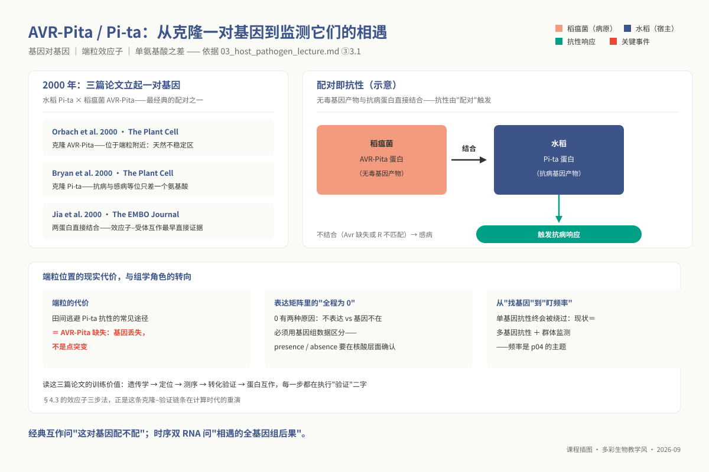
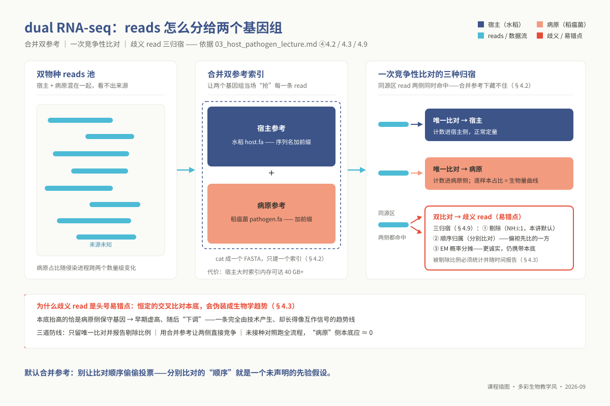
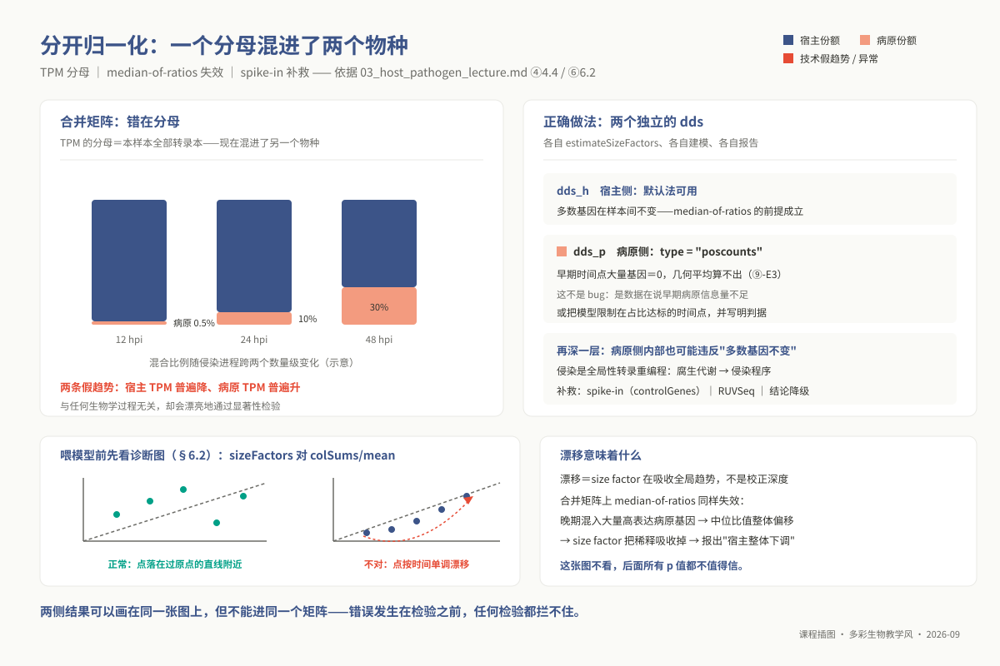
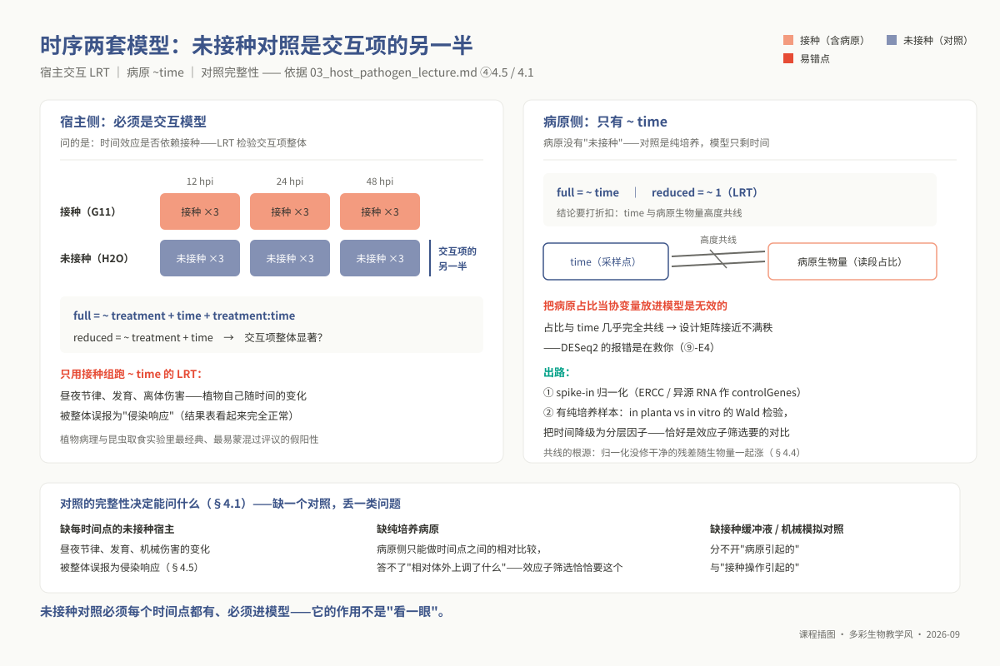
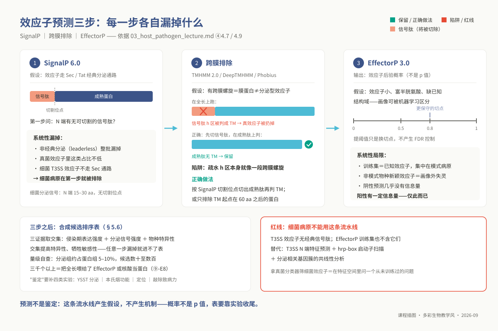

# 专题 p03：宿主-病原互作组学

> **适用对象**：博士研究生（植物病理、昆虫、农药、微生物等专业）｜授课方式与学时：2 学时理论 + 2 学时实践，共 4 学时。
>
> **阅读重点**：本讲聚焦双转录组的参考整合、独立归一化、侵染时序模型和效应子候选筛选，重点阅读 ④ 的互作场景边界与 ⑩ 的课题迁移。

**资源与前置**：环境为 `ngs_phd_interaction`；配套脚本为 `03_code/phd/scripts/03_dual_rnaseq_quant.sh`、`03_effector_screen.sh` 和 `03_dual_deseq2_lrt.R`。前置为硕 m04 §4.3、硕 m02 §4.5，经 `l1_p03` 送达。

<!-- 维护信息：专题 id `p03`；目录 `topic03_host_pathogen`。工具：`STAR`、`Salmon`、`DESeq2`、`OrthoFinder`、`SignalP`、`EffectorP`、`HMMER` + Pfam。环境 `ngs_phd_interaction`，创建命令 `conda env create -f 07_envs/conda/env_phd_interaction.yml`。SignalP/EffectorP 按契约豁免，部署见 §5.1；脚本见 `03_code/phd/scripts/03_dual_rnaseq_quant.sh`、`03_effector_screen.sh`、`03_dual_deseq2_lrt.R`。前置：硕 m04 §4.3、硕 m02 §4.5，经 `l1_p03` 送达。 -->

## ① 学习目标

学完本专题，你应当**能够**：

1. **审定**双转录组（Dual RNA-seq）分析中的参考基因组整合策略，推导竞争性比对相比顺序过滤比对在消除假阳性上的拓扑优势，并依据宿主与病原基因组尺度及不同侵染时相的读段占比，**定量测算**跨物种同源交叉比对给病原侧低丰度基因带来的虚增效应。
2. **严密论证**宿主与病原计数矩阵必须物理分离并独立估算 size factor 的数学必然性，指明将两物种混合计算 TPM 所导致的系统性方向性畸变及其生物学假象。
3. **构建**侵染时序进程的对偶广义线性模型——宿主侧 `~ treatment + time + treatment:time` 交互似然比检验（LRT）与病原侧 `~ time` LRT，并阐明缺失未接种 Mock 对照时将植物昼夜节律或物理损伤误判为侵染响应的统计根源。
4. **诊断**病原生物量指数级膨胀对经典归一化假设构成的破坏，通过 `sizeFactors()` 与 `colSums()` 的动态漂移轨迹识别警报，并给出外源 Spike-in 或稳健亚群校准方案。
5. **设计**用于定位核心毒力因子的菌株泛基因组比对方案，阐明“物种/菌株特异性基因”的集合定义对参考谱系选择的高度依赖性，并在核酸层面建立假阳性过滤机制。
6. **实施**丝状病原效应子计算筛选三步法（SignalP → 跨膜结构域剔除 → EffectorP），阐明各环节针对非经典分泌与机器分类器先验偏差的假阴性边界，阐明为何该流程完全不适用于细菌 III 型分泌系统（T3SS），并建立涵盖生化与遗传学的“预测到鉴定”四层实证闭环。
7. **生成**融合时序转录激活、分泌特征置信度与菌株进化特异性的候选效应子加权排序表，为每一项权重分配提供可经受同行审议的方法学支撑。
8. **迁移**互作组学批判框架至昆虫取食、微生物-农药互作等非经典体系，准确界定通用规则与物种特异性约束。

## ② 前置检查

本讲同时动用**差异表达建模**与**比较基因组同源推断**两套高阶分析流。若在理解推导或脚本排错时出现断层，请严格对照下表排查补缺。

| 依赖模块 id | 本讲哪里用到 | 不过关的典型症状 | 对应自测题 |
|---|---|---|---|
| `l0_01_linux` | ⑤ 全部实践在集群调度；双参考构建需申请高内存 | 在公共登录节点直接启动 STAR 建索引，瞬时打爆节点内存被系统强制清退 | `L0-1-Q9`（集群 SGE/Slurm 资源申领与作业规范提交） |
| `l0_02_r` | ⑤ 步骤四与 R 脚本；⑥ 候选表排序与可视化 | 获得双侧结果后无法通过行名前缀切分矩阵；混淆不同对比组的提取逻辑 | `L0-2-Q8`（高维表格数据清洗与条件切片）、`L0-2-Q10`（端到端可重现 R 脚本封装） |
| `l0_03_conda` | ⑤ 运行环境激活；SignalP / EffectorP 源码部署 | 在作业脚本中遗漏 Conda 环境动态激活，致使后台任务抛出 `command not found` | `L0-3-Q9`（环境 YAML 导出与依赖固化）、`L0-3-Q10`（跨节点运行脚本的环境变量配置） |
| `l0_04_formats` | ④ 竞争性比对依赖 SAM 规范；⑤ 双 GTF 前缀处理 | 误以为 CIGAR 串全为 `M` 即代表完全精确匹配，无法看透跨物种同源错配比对 | `L0-4-Q4`（SAM 核心字段解析）、`L0-4-Q9`（FLAG 标志位解码与比对歧义度分析）、`L0-4-Q6`（GTF/GFF 结构规范） |
| `l0_05_qc` | ⑤ 步骤零质控；⑥ 侵染读段比例异常排查 | 对互作转录组直接做常规去重处理，导致高丰度防卫基因与病原效应子信号被大幅削平 | `L0-5-Q4`（区分真实生物学高表达与文库构建扩增偏倚）、`L0-5-Q9`（数据质控指标的客观解读） |
| `l0_06_stats` | ④ 归一化陷阱；⑦ 推断边界 | 无法阐明 median-of-ratios 的不变性假设，不能察觉病原生物量剧变引发的基线漂移 | `L0-6-Q3`（计数的均值-方差离散关系）、`L0-6-Q5`（多重检验校正）、`L0-6-Q6`（协变量混杂）、`L0-6-Q9`（非参数检验与负二项检验的功效鸿沟） |
| **`l1_p03`** | 全讲。本讲**默认掌握** m04 §4.3（负二项 GLM、LRT 设计公式）与 m02 §4.5（直系同源群与 OrthoFinder 输出解析） | 无法规范构建包含交互项的设计矩阵；在 OrthoFinder 输出中找不到单拷贝与特异基因集 | 博士前置补丁自测 **Q5、Q6**（`08_assessment/prerequisites/`）；补修指引参见 `02_lectures/prerequisites/l1_phd/l1_phd.md` |

**30 秒运行环境自检**：

```bash
source "${CONDA_ROOT:-/opt/miniconda3}/bin/activate" ngs_phd_interaction
STAR --version              # 确认 2.7.10b
salmon --version            # 确认 1.10.3
orthofinder -h | head -2    # 确认 2.5.5
hmmscan -h | head -2        # 确认 HMMER 3.x
Rscript -e 'packageVersion("DESeq2")'   # 确认 1.4x.x
```

## ③ 背景与科学问题

传统转录组学研究通常假定测序文库源于单一生物学物种，其核心任务是在统一的基因组参照系下度量表达涨落。然而，宿主-病原互作组学（Dual RNA-seq）面对的是一个**双主语对偶动力学系统**：在侵染发生的组织微区内，宿主与病原的生命活动发生物理交织与转录级联响应。此时，任何一方的转录改变都不再是孤立的生理行为，而是对另一方分子动作的防御抵抗或进攻压制。

该技术最深刻的复杂性并不在于数据规模的倍增，而在于**单一度量参照系的彻底破裂**——宿主的基准对照是未接种的健康组织，病原的基准对照是体外人工纯培养物，两套处于不同生理状态的物理样本在同一个测序反应管中被混合同步测定，必须在统一的生物信息学框架中得到合理解构。

在植物保护、昆虫毒理与微生物互作领域，这一方法学骨架统摄着四大专业分支的核心命题：在**植物病理学**中，核心关注病原菌如何通过瞬时分泌特定效应子蛋白簇抑制宿主活性氧暴发与水杨酸通路，以及抗病宿主如何启动以 NLR 为核心的特异免疫监控；在**昆虫与农药学**中，核心聚焦害虫刺吸取食诱发植物防卫应答的时空动力学、昆虫唾液效应子对植物激素的干扰，以及靶标微生物在杀菌剂胁迫下多药耐药外排泵的应激转录重塑；在**环境与病原微生物学**中，则聚焦强致病力菌株相对近缘弱毒株特异演化出的致病岛与毒力质粒基因簇。

尽管表型千差万别，其底层生物信息学逻辑高度同构：**双基因组竞争性定量 + 时序交互数学建模 + 泛基因组比较进化筛选。**

必须建立冷峻的认识论定位：**高通量组学在互作机制研究中仅负责高效提出具有统计依据的候选假说，绝不直接等同于功能机制本身。** 一个病原基因即使同时满足“侵染早期暴发表达、具备经典真核分泌信号、且仅在强毒力菌株基因组中保守”三重证据，依然仅仅是一份经过数据收敛的候选分子。本专题产出的核心资产——候选效应子排序表，其唯一定位是指导湿实验研究者在经费与精力约束下确定下一阶段基因敲除或过表达验证的优先级，严禁将其草率作为最终机理定论。

**实战主线数据集 —— `PRJNA661210` / `GSE157400`（水稻—稻瘟菌侵染时序）。** 该公开数据采用全因子析因设计：涵盖 2 个水稻品种（感病品种 Nipponbare 与抗病品种 N3）× 2 种接种处理（稻瘟菌 Guy11 接种 vs 无菌水 H2O 模拟接种）× 4 个关键侵染时点（12、24、36、48 hpi）× 3 次独立生物学重复，全量包含 48 个深度测序样本。教学精选核心子集：Nipponbare × {Guy11, H2O} × {12, 24, 48 hpi} × 3 重复共 18 个样本（清单见 `06_data/phd/manifests/p03_runs.tsv`）。接种样本直接测定发病叶片，天然混合了水稻与稻瘟菌转录本，为竞争性比对提供了真实的实战语境；而未接种的 H2O 模拟组则充当交叉比对本底污染的黄金负对照。实战分析需注意：本数据为 Illumina 单端测序（Salmon 需使用 `-r` 参数），全基因组参考序列采用水稻 IRGSP-1.0 与稻瘟菌 70-15 的物理融合版本。

### 3.1 应用案例：AVR-Pita/Pi-ta——从克隆一对基因到监测它们的相遇

在植物免疫学的发展史上，水稻细胞内抗病受体 *Pi-ta* 与稻瘟病菌特异无毒蛋白 *AVR-Pita* 的互作构成了“基因对基因（Gene-for-gene）”假说最为经典的范例。2000 年发表的三篇里程碑文献构建了完整的验证闭环：Orbach et al.（2000）克隆了 *AVR-Pita*，发现其物理定位紧邻极易发生染色体断裂与重组的**端粒区**，解释了田间菌株极易通过毒力基因丢失逃逸抗性的进化机制；Bryan et al.（2000）成功克隆抗病基因 *Pi-ta*，揭示抗病与感病等位基因在结合口袋处仅仅存在**单个关键氨基酸的置换**；Jia et al.（2000）通过酵母双杂交与体外生化结合实验，直接证实了 AVR-Pita 成熟肽与 Pi-ta LRD 结构域的**直接物理嵌合**。

将这一经典配对映射至当今的时序 Dual RNA-seq 语境中，为我们提供了深刻的方法学启示：
首先，经典分子生物学仅能回答单对分子“能否特异结合”，而双转录组学则能系统揭示这对分子在活体组织中“物理相遇所引发的全基因组转录级联风暴”。当携带 *Pi-ta* 的抗病宿主感知到 *AVR-Pita* 时，宿主侧在侵染早期窗口（12–24 hpi）暴发出的超敏死亡转录程序，正是 §5.4 交互 LRT 模型所捕捉的核心方差项。
其次，端粒效应子的脆弱性揭示了生物信息学中“零表达”的本质：在许多田间高毒株中，*AVR-Pita* 表达矩阵中恒等于 0，其根源在于基因组大片段缺失而非转录沉默。这警示我们，仅凭 RNA-seq 矩阵无法区分“表达沉默”与“物理基因缺失”，必须像 §4.6 那样借助泛基因组核酸比对予以确证。
最后，单基因介导的强抗性在田间终将被病原群体的进化所击溃。现代互作组学的重心已由孤立的“单基因挖掘”全面转向监测病原群体的效应子多态性演化与宿主多基因免疫网络的协同。2000 年三篇经典工作所确立的生化与遗传学实证规范，依然是当今高通量生信筛选必须遵从的验证终点。



*图 p03-5：AVR-Pita/Pi-ta：基因对基因的 2000 年三连证。*

## ④ 核心原理

### 4.1 三个在测序之前就决定了结论上限的设计选择

双转录组实验的最终成败与分析天花板，在组织采样与文库构建完成的瞬间便已被物理锁定。任何试图通过下游算法“妙手回春”掩盖前端设计缺陷的尝试，最终都会被严谨的同行审阅所击碎：

**（1）病原读段占比的时间动态性与测序深度的非对称悖论**。在典型的丝状真菌或卵菌侵染进程中，组织内部的病原生物量呈现剧烈的指数增长。侵染极早期（如 12 hpi 附着胞侵入期），受侵组织中病原真菌的生物质占比通常低于 0.1%–0.5%；直至侵染中晚期（如 48–72 hpi 菌丝扩展产孢期），病原生物质占比方能攀升至 10%–30%。此时面临冷酷的统计学算术：若要对侵染早期病原基因实施稳健的广义线性模型推断，病原侧至少需要积累 1000 万至 2000 万有效比对 reads；以此倒推，由于早期病原仅占文库千分之五，单样本所需的理论总测序深度将突破惊人的 20 亿至 40 亿 reads，这在常规科研预算下完全不具备可行性。这一现实迫使研究者必须做出明智的技术折中：要么通过高密度点接种以提高侵染微区的物理同步性，要么利用杂交探针捕获技术富集病原转录组，或者在实验设计中理性放弃超早期时间点，将初始采样窗口后移至病原生物量突破 2% 阈值的时相。

**（2）文库构建策略对跨物种生物化学特征的兼容性**。若实验体系属于“真核宿主 + 真核病原”（如植物与丝状真菌/卵菌，或植物与植食性昆虫），成熟 mRNA 均具备 poly(A) 尾，常规基于 Oligo(dT) 磁珠富集的建库策略能够自然兼容两侧转录组。然而，一旦面对**“真核宿主 + 原核病原”（如水稻白叶枯细菌或丁香假单胞菌）**，盲目采用经典的 mRNA 富集试剂盒将酿成灾难性后果——原核细菌 mRNA 缺乏稳定的 poly(A) 修饰且半衰期极短，磁珠洗脱后细菌转录本几乎被全量丢弃。此类体系唯一的物理通路由双物种核糖体 RNA 同步去除（Dual rRNA Depletion，联合投入真核胞质、真核细胞器与原核特异性阻断探针）构成。此外，鉴于病原微生物基因组编码密度极高，广泛存在正反向重叠转录本与双向启动子，双转录组测序必须强制执行链特异性文库构建（Strand-specific RNA-seq），否则海量来自反义非编码链的噪音读段将彻底扰乱紧凑基因的定量分配。

**（3）对照实验的系统完备性是解构因果关联的唯一基石**。双转录组分析的结论有效性完全由其阴性对照群所锚定。若缺失**各采样时间点完全平行的未接种 Mock 宿主对照**，植物体内剧烈波动的内源昼夜节律转录本、发育进程基因及取样引发的物理损伤应答，将被算法系统性误判为侵染特异性防卫激活（§4.5）；若缺失**病原菌纯培养离体样本（In vitro axenic culture）**，病原侧的分析将沦为纯粹的时序相对变化，彻底丧失判定“该效应子是否在宿主组织内被特异激活诱导”的能力；若缺失**接种缓冲液/机械刺吸模拟对照**，则根本无法剥离侵染原初动作与异物刺激的界限。

### 4.2 拆分策略：合并参考竞争性比对 vs 分别比对

在从混合原始 FASTQ 提取宿主与病原各自计数的阶段，生信分析存在两条根本对立的技术路线：

| 关键比较维度 | **合并物理参考（竞争性比对，Competitive Mapping）** | **分别比对（顺序级联过滤，Sequential Mapping）** |
|---|---|---|
| **算法执行逻辑** | 将宿主与病原基因组物理拼接为单一复合参考库，原始 reads 一次性竞争比对 | 先将全量 reads 比对至宿主，提取未比对 reads，再次比对至病原基因组 |
| **同源保守区 reads 命运** | 两侧同源区同时检出命中，比对软件标记为 Multimapper 并压低 MAPQ，**可定量识别与剔除** | **被系统性强行指派给先比对的物种**，由于人为截断下游流道，该严重偏倚在后端彻底不可见 |
| **内存与算力开销** | 复合参考库极大膨胀，STAR 构建植物-微生物复合索引常需 40–60 GB 运行内存 | 两次独立比对内存开销较小，适合轻量级服务器执行 |
| **核心潜在风险** | 若两侧染色体存在同名标识会导致构建静默混乱（⑨-E1） | **引入具有方向性的隐蔽伪发现**，彻底污染后续所有差异表达推断 |

**方法学定论：双转录组分析必须无条件坚持合并参考的竞争性比对。** 分别比对算法隐含着一个极其荒谬的先验假设——假定先比对的基因组享有无限优先权。对于核糖体蛋白、肌动蛋白、热休克蛋白等在真核生物间高度保守的结构基因，哪怕宿主与病原在此处仅存在一两个单碱基错配，在允许一定失配率的启发式比对算法中，先比对的一侧必将把本属于另一方的真实转录本吞噬殆尽。若受限于硬件算力不得不采用分步策略，唯一具备数学合理性的补救动作是：将同一批原始 reads 独立比对宿主与病原，提取在两个基因组中均能成功比对的交集 reads，将其标记为歧义读段（Ambiguous reads）并在两侧计数矩阵中**同步予以扣除**。

近年以 Salmon 为代表的非比对伪联配算法引入了选择性联配（Selective Alignment）与诱饵序列（Decoy-aware）机制。其在双转录组中的标准应用范式是将**两侧转录本全集与两侧基因组全集（作为 Decoy）融合成统一的 Gentrome 索引**。此时，算法能敏锐察觉某条 read 是更像真实转录产物还是更像基因组别处的微卫星重复序列，在大幅降低内存开销的同时有效压制交叉伪比对。



*图 p03-1：合并双参考一次竞争性比对：唯一比对归主侧，歧义 read 三归宿是头号易错点。*

### 4.3 交叉比对归属：一个必须自己算一遍的量级问题

许多分析人员误以为只要错配率足够低，交叉比对的误差可以忽略不计。然而，交叉比对在统计推断上的破坏力，源自其在宿主与病原之间**极端不对称的数学放大效应**。

设想在侵染极早期样本中，宿主转录本占总体文库的 99.5%，病原转录本仅占 0.5%。由于进化高度保守，假定宿主高丰度转录本中有极微小比例（$\epsilon = 0.1\%$）因不可分辨的同源序列泄漏而被误判定为病原序列：
$$\text{宿主渗漏入病原侧的伪计数} = 99.5\% \times 0.1\% = 0.0995\% \quad (\text{占总测序文库})$$
$$\text{此时病原侧真实的有效丰度} = 0.5\%$$
$$\text{病原侧计数的相对虚增幅度} = \frac{0.0995\%}{0.5\%} \approx 19.9\% \quad (\text{病原丰度被凭空虚增两成！})$$
而随着侵染推进至中晚期（病原占比攀升至 30%，宿主降至 70%），同样的渗透率引发的相对虚增仅为：
$$\text{中晚期病原侧虚增幅度} = \frac{70\% \times 0.1\%}{30\%} \approx 0.23\% \quad (\text{完全在抽样波动噪音以内})$$

**这一不对称性导出了双转录组学中最具欺骗性的经典技术伪影**：一个在生物学上恒定不变的微量交叉比对泄漏率，由于两侧生物量比例在时间轴上的持续倾斜，将在数据矩阵中**人为制造出一条“病原保守基因在早期异乎寻常地高表达，随着侵染推进呈现极其显著的持续下调”的完美虚假动力学曲线！** 反之，病原向宿主侧的渗漏由于分母是宿主的数千万 reads，表观影响几乎为零。严谨的排查法则包含三道防线：第一，强制执行单一比对过滤（如 STAR `outFilterMultimapNmax 1`）并系统性追踪报告该过滤比例随侵染时点的演变规律；第二，利用双参考 Gentrome 开展全局竞争性对齐；第三，**在未接种的纯宿主 Mock 样本中全流程运行病原定量流**，其在病原基因上截获的非零计数，即为本套实验体系无法规避的交叉比对物理本底（§6.1）。

### 4.4 分开归一化：合起来算 TPM 错在哪个方向

在完成读段拆分后，生信初学者常犯的致命错误是将宿主与病原矩阵重新拼接，在单一矩阵中执行 TPM、FPKM 或 DESeq2 默认的文库归一化。这一操作在统计机理上属于严重的概念错误。

以 TPM（Transcripts Per Million）计算为例，其数学定义式为：
$$\text{TPM}_i = \frac{c_i / l_i}{\sum_{j \in \text{Host}} (c_j / l_j) + \sum_{k \in \text{Path}} (c_k / l_k)} \times 10^6$$
当侵染从早期推进至晚期时，病原转录本分子在全组织总转录池中的绝对占比从 0.5% 暴涨至 30% 以上。这一变化导致上述算式的分母随侵染进程发生了数量级的结构性通胀。在数学必然性驱动下，**全量宿主基因的 TPM 值在时序上将呈现全局性的“全面下调”，而病原基因的 TPM 值则呈现激进的“全面暴涨”！** 这两套完全对称的虚假宏观趋势纯粹是分母成分剧变诱发的数学错觉，毫无细胞生物学因果可言，却能在常规单因素方差分析中轻易斩获成片的极端显著 $p$ 值。

同理，DESeq2 赖以生存的中位数比值法（Median-of-ratios，m04 §4.2）建立在不可动摇的统计学先验之上——**“在所考察的生物学样本间，绝大多数基因的绝对转录丰度保持稳定不变”**。在混合矩阵中，病原生物量的扩张剧烈侵蚀了宿主的相对份额，打破了守恒基准，导致计算出的 Size factor 发生全局性畸变。因此，双转录组数据必须在物理上拆分为两个完全独立的计数矩阵，各自构建独立的 `DESeqDataSet` 容器，分别独立估算 Size factor 并独立拟合负二项 GLM 模型。

在博士层深入探究的维度，必须进一步洞察：即便完成物种拆分，**病原侧自身的转录组亦极易击穿“绝大多数基因不变”的统计假设**。病原从休眠孢子萌发、形成附着胞、穿透胞壁到定殖扩展，全基因组转录本经历的是全局性的功能网络重编程。诊断 Size factor 是否在吸收全局生物量变异的有效工具，是绘制 `sizeFactors(dds)` 相对文库原始总深度的散点回归图；若出现沿侵染时点的单调系统性漂移，常规负二项模型将无法分辨全局上调与测序深度的界限，此时必须引入外源合成转录本（Spike-in controls，如 ERCC）、应用 RUVSeq 借助不变候选基因集提取不可见变异，或在结论陈述中保守地将推断降级为“基因间的相对表达模式分析”。



*图 p03-4：别合并归一化：宿主与病原要各建各的 dds。*

### 4.5 侵染时序：两套模型，以及未接种对照放在哪里

差异表达分析中 Wald 检验（单对比较）与似然比检验（LRT，多水平时序检验）的统计机制已在硕 m04 §4.3 系统阐明。在双宿主互作场景中，核心挑战在于针对宿主与病原的生物学特异性，部署结构完全不对称的两套广义线性模型：

**宿主侧：必须构建全因子双向交互 LRT 模型。**

```r
dds_h <- DESeq(dds_h, test = "LRT",
               full    = ~ treatment + time + treatment:time,
               reduced = ~ treatment + time)
```

宿主植物是活体生物，在长达数天的侵染取样过程中，其转录组时刻处于自身生物钟（Circadian rhythm）、叶龄发育衰老以及组织代谢波动的深刻支配之下。如果分析者仅提取接种组样本拟合单向时间模型（`~ time`），数学模型将把宿主内部一切随时间演进的内源变化——包括在植物转录组中振幅极其剧烈的光合节律基因、水分蒸腾调节基因与离体叶片的创伤修复反应——原封不动地全量指认为“侵染响应基因”。

引入包含同时相未接种 Mock 的交互模型，其零假设锁定了“接种处理引发的变化速率与未接种自然演变速率在统计上完全重合”。唯有跨越交互项检验（`treatment:time`）的基因，方能证实其时序波动特异性地依赖于病原接种事件的存在。

**病原侧：受限于参照系缺失的单向 LRT 模型及其统计局限。**
由于在寄主组织内部不存在所谓的“未侵染病原对照”，病原侧的分析只能退守至以接种后时间点为因子的单向模型（`full = ~ time, reduced = ~ 1`）。分析者必须时刻保持高度清醒：在病原单向模型中，时间变量 `time` 与**组织内病原菌丝绝对生物量呈现几乎百分之百的线性共线**。

试图在设计矩阵中强行将病原 reads 占比作为连续协变量引入模型是徒劳的，这会导致模型矩阵秩亏缺（Not full rank）而触发程序崩溃（⑨-E4）。如果实验体系同时测定了病原在人工合成培养基中的纯培养物（In vitro），最佳的统计策略是将离体状态作为统一参考基准，拟合 `~ condition` 模型以评估体内侵染相对体外生存的倍数诱导，从而巧妙规避体内时间轴上的生物量共线危机。



*图 p03-3：宿主×时间的交互设计：LRT 检验什么、共线陷阱在哪。*

### 4.6 比较基因组与直系同源：只讲互作场景的三件事

直系同源（Ortholog）与旁系同源（Paralog）的图论聚类算法已在硕 m02 §4.5 系统推导。在病原致病机制解析中，泛基因组比对不是孤立的进化演染，而是服务于毒力因子排查的核心过滤器。必须严格恪守三项实战准则：

**（1）以表型对比为导向的严谨选株策略**。在 OrthoFinder 中，“物种/菌株特异性基因”是一个高度依赖于输入基因组集合的相对概念。如果随意下载 5 个同种病原菌株开展比对，产出的特异基因集仅仅反映了种内中性演化下的随机基因渗漏与转座子插入。唯有构建“强毒力株 vs 自然弱毒力株 vs 近缘非致病非寄生腐生株”的严密表型梯度基因组群，所得出的特异直系同源群（Orthogroups）方能具备指向致病性起源的生物学假说价值。选株的边界，在本质上决定了科学发现的终点。

**（2）注释异质性陷阱与全基因组核酸层面的二次复核**。当比对的菌株基因组来源于不同实验室、不同算法或不同参数版本的注释产物时，泛基因组分析将充斥着大量虚假的“特异基因”。这并非基因真实存在性差异，而是由于基因预测软件对非典型外显子或小开放读码框（sORF）的漏注释所致。严谨的规程要求：其一，全量输入菌株必须采用统一的软件版本（如同一套 Braker 或 Funannotate 参数）实施全基因组标准化重注释；其二，针对任何被判定为“在强毒株特异存在、弱毒株完全缺失”的核心候选，必须编写脚本调度 `tblastn` 或 `miniprot` 将其氨基酸序列回帖至对照菌株的**原始核酸基因组序列**开展穷尽排查。唯有在核酸序列水平证实其物理缺失或发生了破坏读码框的假基因化突变，该基因的存在/缺失变异（PAV）方可作为坚实结论采纳。

**（3）直系同源物种树是毒力基因共进化的解构骨架**。基于单拷贝核心直系同源基因推断的高精度物种树，不仅用于厘清菌株进化脉络，更关键的功用在于判定毒力性状是否在系统发育树上呈现单系性进化（Monophyletic），并推断关键毒力效应子家族横向水平转移（HGT）或谱系特异性爆发的进化时空节点。

### 4.7 效应子预测三步：每一步各自漏掉什么

在丝状真核病原体（真菌、卵菌）中，效应子蛋白的生物信息学挖掘形成了经典的串联过滤漏斗：`SignalP` 分泌信号预测 → `跨膜结构域排除` → `EffectorP` 机器学习判别。必须清醒洞察该流水线在每一步上的理论假设与系统性盲区：

| 预测过滤阶梯 | 算法底层生物学假设 | 必然导致的系统性假阴性与适用边界 |
|---|---|---|
| **第一步：SignalP 6.0 信号肽预测** | 假定所有效应子均经由内质网-高尔基体经典的 Sec / Tat 通路分泌，N 端必携带标准分裂信号肽 | **彻底漏检非经典无先导分泌通路（Leaderless secretion）**；**对原核细菌 III 型分泌系统（T3SS）完全失效**——细菌 T3SS 效应子依赖伴侣蛋白与 N 端非保守的伴侣结合区，缺乏真核经典信号肽与酶切位点，强行运行将在首轮全军覆没 |
| **第二步：跨膜结构域剔除（DeepTMHMM / Phobius）** | 假定质膜整合蛋白属于病原自身结构组分，不属于向胞外释放的游离效应子 | **致命操作陷阱：信号肽自身的疏水核心区（h-region）在物理理化性质上与跨膜螺旋高度重合！** 若在未经剪切的蛋白质全长序列上直接运行跨膜预测，算法极易将信号肽误判为跨膜段而将大量真效应子暴力斩杀。**正确规程：必须先调用脚本截断 SignalP 预测的信号肽切除位点，在成熟肽（Mature peptide）上执行跨膜结构域排查** |
| **第三步：EffectorP 3.0 机器学习判别** | 假定真菌/卵菌效应子在全局特征空间中呈现出小分子量、半胱氨酸富集、偏碱性等共性统计模式 | **模型严重的先验偏倚：算法训练集全部建立在少数经典农作物模式病原（如稻瘟菌、大豆疫霉）已知效应子库之上**。对于非模式体系中结构新颖、进化遥远的新型效应子，EffectorP 的特征判别力严重退化，呈现出“阳性预测具有参考价值，而阴性打分毫无排除效力”的高度不对称性 |

**深植“预测绝非鉴定”的四层学术规范**：
第一，**分类器输出的后验概率值绝非假设检验的 $p$ 值**。EffectorP 输出的 0.85 仅代表其在特定特征向量空间中的逻辑斯蒂后验几率，其不具备统计学零假设与多重比较校正（FDR）含义。人为将截断阈值由 0.5 提升至 0.8，仅仅是策略性地压缩候选集规模，并不能在数学上保证将假阳性控制在确定水平。
第二，**多重过滤取交集在提升精确度的同时急剧拉低敏感度**。任何一个在物理生物学上真实发挥功能的效应子，只要其属于非经典分泌、或成熟肽富含疏水残基、或序列特征超出训练集认知，就会在流水线中被永久抛弃。
第三，**候选结果总量的常识性物理自检**。丝状真菌全蛋白质组通常包含 10 000–15 000 个基因，正常分泌组占比约在 5%–10%（数百至千余个），跨膜剔除并经 EffectorP 严苛筛选后，最终候选效应子规模通常收敛在数十至数百个之间。若最终运行产出数千个候选，多半是因为将未切除信号肽的全长序列甚至将核酸序列错误投喂；若产出为个位数，则需检查物种界（Organism type）选项是否配置失当。
第四，**鉴定闭环不可或缺的四维湿实验基石**：分泌物理活性实验（酵母蔗糖转化酶反选择系统 YSST）、活体免疫抑制/坏死诱导表型（本氏烟叶片瞬时表达体系）、亚细胞空间物理定位追踪（GFP 融合荧光显微成像验证其是否成功转位至宿主胞浆或细胞核），以及最终的遗传学功能敲除致病力测定。在上述实验证据闭环建立之前，论文中严禁出现“鉴定了 N 个效应子”的断言，只能客观表述为“在计算生物学层面预测并排序了 N 个候选效应子”。



*图 p03-2：效应子预测三步：SignalP → 跨膜排除 → EffectorP，细菌 T3SS 不适用。*

### 4.8 抗性基因挖掘：结构域扫描找的是结构域，不是功能

在宿主侧对抗病因子的排查中，基于 HMMER 开展 Pfam 隐马尔可夫模型扫描构成了定位核苷酸结合位点-富亮氨酸重复序列（NLR）免疫受体家族的标准路径。其核心扫描结构域包括保守的核苷酸结合区 **NB-ARC**（PF00931）、**LRR** 识别超家族（如 PF00560、PF07723），以及 N 端信号传导结构域 **TIR**（PF01582）或 CC 卷曲螺旋。

在该环节必须建立严密的结构生物学甄别规范：
首先，**隐马尔可夫模型命中绝不等于全长功能基因**。NLR 基因家族在植物基因组中通常以串联重复基因簇形式存在，属于假基因化、片段截断与染色体畸变最为密集的演化热点区。单纯检索到单个 NB-ARC 结构域片段，极有可能是早已丧失功能的退化转座假基因，必须结合结构域序列覆盖度与保守基序完整性（P-loop、Walker B、GLPL）实施全长过滤。
其次，**警惕超家族的特异性泛化**。LRR 属于高度普适的蛋白质互作支架，细胞壁受体样激酶（RLK）、多聚半乳糖醛酸酶抑制蛋白等大量与细胞发育相关的非 NLR 分子均广泛嵌合 LRR 模体，脱离 NB-ARC 的单 LRR 筛选毫无特异性可言。
最后，针对高重复基因簇的标准全基因组注释极易出现剪接错误与漏注释，高精度的抗性谱系挖掘往往需要借助 NLR-Annotator 直接在全基因组原始核酸序列上开展从头基序拼装。

**与转录组数据取交集时的反直觉铁律**：**严禁将“侵染发生后显著转录上调”作为筛选功能性 NLR 抗病受体的首要先决条件！** 大量经过正向遗传学克隆鉴定的关键 NLR 基因（包括抗稻瘟病的 *Pi-ta*、*Pik* 以及抗白粉病的 *MLA* 等），在活体内普遍呈现出**极低水平且恒定的组成型表达模式**。植物演化出此机制，是为了严防高浓度抗病受体自发寡聚化而诱发自身免疫致死和巨大的生长适应时代价。用侵染上调作为硬性过滤漏斗，将造成大批核心抗病基因的系统性假阴性漏失。正确的交集策略应当是：在**抗病等位基因型与感病等位基因型材料之间**比对存在/缺失多态性与结构变异，或将结构域扫描结果精准投射至 QTL 遗传定位区间与 GWAS 关联热点区域（p04/p05）——**用“群体遗传多态性参照”替代“时序表达诱导参照”**。

### 4.9 两个“深一层”：歧义 read 的三种归宿与效应子特征的可迁移性

**深入解构多重比对歧义读段（Ambiguous reads）的三种处置归宿及其统计代价**：

| 处理范式 | 具体实现机制 | 最终对生物学推断造成的深远影响 |
|---|---|---|
| **对称剔除法**（本讲标准：`NH:i:1` 过滤） | 在 BAM 中识别所有命中两个物种的 reads，直接在两侧计数中同步抹去 | **彻底消除了物种偏向性与虚假诱导趋势**；唯一代价是同源基因的测序深度受到对称削减；被剔除比例必须随侵染时相进行详实披露 |
| **顺序归属法**（粗暴的分别比对） | reads 命中先比对的基因组即被判定，不再交予后比对物种检验 | 将测序数据中的歧义完全转化为对先比对物种的非对称倾斜，制造严重的下游虚假发现 |
| **期望最大化分摊法**（Salmon Gentrome EM 算法） | 将复合参考库作为统一概率空间，利用 EM 迭代基于局部转录本丰度后验几率实施软分摊 | 相比顺序法更为科学诚实，但本质上仍属于“基于似然性的数学分摊”而非物理真实归属，在早期极端生物量失衡体系下依然需要 Mock 样本实施基底校准 |

**洞悉效应子预测模型背后的“统计画像”逻辑**：
必须从机器学习特征工程的高度认识到，以 EffectorP 为代表的分类算法所捕捉的，并非效应子对抗宿主免疫的因果生化定义，而仅仅是**已知模型病原真菌效应子数据库在氨基酸序列尺度上的统计肖像**。这深刻揭示了为什么对农业细菌体系必须构筑绝对的防线隔离——细菌 T3SS 效应子通常分子量庞大、具备特异的假真核功能结构域、分泌信号严格依赖其 N 端无序区与专职分子伴侣，其序列规律与真菌效应子毫无共性。用真菌分类器筛选细菌组学，在统计学上等价于在一个未定义的流形空间中开展随机抽样投影，必然输出毫无生理价值的高维噪声。

### 4.10 技术前沿（2023–2026）：direct RNA、预测器的语言模型化与宿主内进化

进入 2023–2026 年，互作组学正经历从技术工程到进化视角的全面跃迁：
在测序技术维度，基于 Oxford Nanopore 的**直接天然 RNA 测序（Direct Native RNA Sequencing，dRNA-seq）**全面渗透互作分析（Workman et al. 2019）。该技术规避了反转录 PCR 扩增，能够在单分子水平完整读出宿主与病原的全长转录本异构体，并直接解码 $m^6A$ 等 RNA 动态表观修饰。

其核心价值在于直接揭示侵染微区中病原效应子复杂的可变剪接异构体。然而其当前缺陷同样尖锐：单分子测序通量较低、对组织解离提取的 RNA 完整度极其苛刻，而受侵病理组织中往往充斥着高浓度核酸酶，导致 RNA 降解极快。在现阶段，dRNA-seq 属于与短读长高通量互补的“结构层佐证”。

在计算挖掘维度，蛋白质语言模型（Protein Language Models）彻底重塑了效应子表征学习。SignalP 6.0（Teufel et al. 2022）已全面转向基于 BERT 架构的语言模型嵌入，显著提升了非标准信号肽的边界切割精度；然而，预训练底座无法从根本上消除训练集偏差，新一代大模型依旧需要严守 §4.7 确立的实验验证边界。

在演化微观尺度，**宿主植物组织内部演化（Within-host evolution）**成为抗性耐用性研究的最前沿视阈。病原体对寄主组织的侵染并非均质菌落的平铺复制，接种极早期经历严重的瓶颈效应，随后在单株宿主微环境的强烈免疫选择下，病原体群体持续发生快速突变与克隆竞争。Tamisier et al.（2024, *PLOS Pathogens*）利用时序高保真深度测序揭示了株内遗传漂变强度对抗性基因耐用性的决定性控制。

这深刻启示涉农博士生：常规 Dual RNA-seq 所测得的仅是组织内病原群体的转录均值，将群体遗传学演化思维（p04）下沉融合至单组织互作的时空微区，构成了突破传统互作抗性研究天花板的关键方向。

## ⑤ 操作步骤

完整分析脚本已封装于 `03_code/phd/scripts/` 目录。所有分析必须通过集群作业调度系统分发执行，严禁在登录交互节点直接启动耗能运算。

### 5.1 环境与两个必须手工安装的工具

```bash
conda env create -f 07_envs/conda/env_phd_interaction.yml
source "${CONDA_ROOT:-/opt/miniconda3}/bin/activate" ngs_phd_interaction
```

**SignalP 6.0 部署规范**：登录 DTU 官方学术申请门户（https://services.healthtech.dtu.dk/services/SignalP-6.0/）登记并获取源码包，解压后在激活环境中执行 `pip install signalp-6-package/`。**EffectorP 3.0 部署规范**：通过 GitHub 检出代码 `git clone https://github.com/JanaSperschneider/EffectorP-3.0`，利用 `python EffectorP.py -h` 验证环境完备性。两者已在契约 `env_exempt_tools` 明确声明豁免，**严禁使用 Conda 搜索安装**。

### 5.2 步骤一：构建加前缀的双参考基因组与注释

```bash
seqkit replace -p '^' -r 'HOST_'  host.fa     > host.pfx.fa
seqkit replace -p '^' -r 'PATH_'  pathogen.fa > pathogen.pfx.fa
cat host.pfx.fa pathogen.pfx.fa > dual.fa
awk 'BEGIN{OFS="\t"} !/^#/{$1="HOST_"$1} 1' host.gtf     >  dual.gtf
awk 'BEGIN{OFS="\t"} !/^#/{$1="PATH_"$1} 1' pathogen.gtf >> dual.gtf
grep '^>' dual.fa | cut -d' ' -f1 | sort | uniq -d   # 必须为空；faidx 遇重名只警告并丢弃后者（rc=0），不会替你拦（⑨-E1）
```

**前缀隔离的工程必然性**：植物与病原微生物各自的染色体或 Scaffolds 极易出现重名（如 `chr1`、`scaffold_01`），直接合并时索引工具多半不报错：samtools faidx 只打一行 `Ignoring duplicate sequence` 警告并丢弃后出现的同名序列，退出码仍为 0。前缀修饰同时构成了下游矩阵精准拆分的唯一物理锚点。

### 5.3 步骤二：竞争性比对、拆分与生物量曲线

```bash
STAR --runMode genomeGenerate --genomeDir dual_idx --genomeFastaFiles dual.fa \
     --sjdbGTFfile dual.gtf --sjdbOverhang 149 --runThreadN 16 \
     --limitGenomeGenerateRAM 60000000000

# PRJNA661210 为单端，只给 R1；双端数据在 R1 后再加 ${S}_R2.fq.gz
STAR --genomeDir dual_idx --readFilesIn ${S}_R1.fq.gz --readFilesCommand zcat \
     --runThreadN 8 --outSAMtype BAM SortedByCoordinate --quantMode GeneCounts \
     --outFilterMultimapNmax 1 --outFileNamePrefix star/${S}_
```

参数设置原则：`--outFilterMultimapNmax 1` 强制阻断跨物种同源区歧义读段分配，确保比对进入单侧计数；`--quantMode GeneCounts` 直接输出分链定量表，需根据测序文库链特异性严格选择对应的计数列（反向链通常对应第 4 列）。

```bash
awk 'NR>4 && $1 ~ /^HOST_/ {print $1"\t"$4}' star/${S}_ReadsPerGene.out.tab > counts/host/${S}.tsv
awk 'NR>4 && $1 ~ /^PATH_/ {print $1"\t"$4}' star/${S}_ReadsPerGene.out.tab > counts/path/${S}.tsv
```

### 5.4 步骤三：分开归一化与时序 LRT（R）

```r
dds_h <- DESeqDataSetFromMatrix(cts_host, coldata, ~ treatment + time + treatment:time)
dds_p <- DESeqDataSetFromMatrix(cts_path, coldata[coldata$treatment == "inoculated", ], ~ time)
dds_h <- estimateSizeFactors(dds_h)                      # 宿主满足大部分基因不变假设
dds_p <- estimateSizeFactors(dds_p, type = "poscounts")  # 病原早期稀疏多零，必须采用 poscounts
dds_h <- DESeq(dds_h, test = "LRT", reduced = ~ treatment + time)  # 检验接种依赖的时序交互
dds_p <- DESeq(dds_p, test = "LRT", reduced = ~ 1)                 # 检验病原体内时序表达波动
```

### 5.5 步骤四：直系同源、效应子三步与 NLR 扫描

```bash
orthofinder -f proteomes/ -t 16 -a 4 -S diamond -o ortho_out
signalp6 --fastafile pathogen_prot.faa --organism eukarya --format none --output_dir sp_out --mode fast
# 依据预测切割位点截除信号肽，在成熟肽（mature_peptides.faa）上执行跨膜排除与 EffectorP 判别：
python EffectorP.py -i mature_peptides.faa -o effectorp.tsv
hmmscan --cpu 8 -E 1e-5 --domtblout nlr.domtbl Pfam-A.hmm host_prot.faa
```

泛基因组特异基因需同时提取未聚类孤儿基因（`Orthogroups_UnassignedGenes.tsv`）与菌株特异同源群，并全量通过 `tblastn` 回查基因组核酸序列实施假阳性核验（§4.6）。

### 5.6 步骤五：候选排序表（实践终点）

调度脚本 `03_code/phd/scripts/03_dual_deseq2_lrt.R`，将病原侧 LRT 表达强度、in planta 诱导峰值、SignalP 信号肽置信度与泛基因组毒力特异性指标整合为多维权重矩阵，输出规范的 `candidate_effectors.tsv`，为下游敲除实验提供可重现的优先级序列。

## ⑥ 结果解读

### 6.1 正常结果的物理与统计学特征

| 核心产物文件 | 正常健康数据的数学图形表型 | 异常病态表型与警报归因 |
|---|---|---|
| **生物量曲线 (`biomass.tsv`)** | 病原 reads 占比随时间平滑上升，同时间点重复样本间维持在极窄方差内 | 未接种 Mock 样本检出 $\ge 1\%$ 病原 reads（交叉比对本底失控或操作污染）；同一时间点重复样本跨越数量级（接种不同步） |
| **归一化诊断散点图** | `sizeFactors(dds_p)` 相对总比对深度的比值落在过原点的稳定区间内 | 点位沿侵染时间呈现单调强倾斜漂移，表明 Size factor 在吸收全局生物量变异而非测序技术偏倚 |
| **时序 LRT 表达聚类图** | 宿主交互显著基因划分为早响应应激簇、持续防卫簇与晚期坏死簇，富集抗病通路 | 显著基因集中富集光合作用或昼夜生物钟节律（漏设交互模型或未扣除 Mock 背景） |
| **候选效应子收敛表** | 候选数量在数十至数百个量级，呈现明显的时序上调与无跨膜区特征 | 候选数量突破三千（误用全长序列或核酸序列投喂）；候选蛋白含大量线粒体基质定位信号 |
| **OrthoFinder 统计表** | 核心直系同源群覆盖绝大多数菌株，特异基因数量在各株间分布平稳 | 某一菌株特异基因数量暴增数倍（典型的外部输入注释流程不一致人为假象） |

## ⑦ 统计插件

**本讲无独立统计要点。**

此设计经过系统论证：双转录组与效应子预测中所依托的核心推断工具——包括负二项广义线性模型参数估计、离散度经验贝叶斯收缩、LRT 约束模型似然比检验、Benjamini-Hochberg 错误发现率校正——已在硕士层 **m04 转录组学与差异表达** §4.3 与 §⑦、以及前置模块 `l0_06_stats` 中完成系统数学推导。

互作组学最致命的科研风险并不源于统计检验模型本身，而发生于**数据投喂给统计模型之前的预处理断层**：

1. **归一化假设失效的不可抗性**（§4.4）：若未执行物种分离归一化，由于输入矩阵分母的物理失真，后续执行的任何高级统计检验每一步都在严格输出数学结果，但其产出的整张“极显著差异表”在生物学意义上是全盘颠倒的虚假信号；
2. **机器学习概率的非统计性**（§4.7）：SignalP 与 EffectorP 输出的判定概率属于分类超平面的距离映射，绝非统计显著性 $p$ 值，不存在多重检验 FDR 控制机制，必须依赖正交生物学实验构筑证据链。

## ⑧ AI 辅助任务

> 契约 `ai_task_topics` 明确本讲核心使命在于构筑针对双转录组方案设计的批判性防线。

**任务靶向：驱动大语言模型生成双转录组数据拆分与差异分析全流程，系统核查其是否踩入交叉比对偏袒与混合归一化两大经典陷阱。**

**步骤 1 · 提示词生成**（保持客观中立，严禁诱导）：

```text
我有植物和真菌病原菌同时测序的 Dual RNA-seq 侵染时序数据（包含 4 个侵染时相，每个时相包含 3 个接种重复与 3 个水处理对照）。请给出使用 STAR、Salmon 与 DESeq2 完成读段拆分、基因表达定量与时序差异分析的端到端完整 Shell 及 R 代码。
```

**步骤 2 · 四维方法学破绽审查矩阵**：

| 核查维度 | 严谨判定准则与审查技术动作 | 严重缺陷判定结论 |
|---|---|---|
| **① 交叉比对偏倚防范** | 审查代码是否采用顺序过滤比对（如先比水稻、未比读段再比稻瘟菌）而不提歧义读段处理 | **不合格**：顺序比对严重偏袒先比物种，在早期导致病原侧保守基因虚增（§4.2） |
| **② 归一化分母混淆** | 审查是否将宿主与病原计数矩阵直接拼接计算 TPM，或放进同一个 `DESeqDataSet` | **致命错误**：违背物种独立性，导致宿主基因被全局伪装为下调（§4.4） |
| **③ 病原生物量变异洞察** | 审查是否察觉病原转录组在早期存在多零现象，并评估 Size factor 的稳健性 | **不完整**：若对病原直接采用默认方法且不设 `poscounts` 或 Spike-in 校验，判定缺乏深层认知 |
| **④ 参数时效与语法自洽** | 在 Conda 环境中核验 STAR 与 DESeq2 参数合法性，重点审查 LRT 模型是否规范配对 `reduced` | 依据实际执行输出记录参数合法性 |

**步骤 3 · 课程实训报告提交物**：

1. 完整附录 AI 原始生成记录与提示词；
2. 填报《双转录组方案 AI 缺陷诊断清单》；
3. 提交一份修正后的规范工程脚本，并附一段 200 字方法学反思：阐明为何一份完全可运行且格式规范的 AI 方案，在生物学逻辑上可能是完全错误的。

## ⑨ 常见错误与排查

| 故障编号 | 控制台真实报错信息 / 异常表象 | 底层诱发机理分析 | 规范化应急处置策略 |
|---|---|---|---|
| **E1** | 不报错！`samtools faidx` 只给一行 `[W::fai_insert_index] Ignoring duplicate sequence "chr1"` 且 rc=0（samtools 1.24 实测）；表现是一侧同名序列消失、该侧读段错配到另一物种 | 双基因组序列或 GTF 第一列未同步添加物种前缀，引发染色体同名冲突 | 执行 `seqkit replace` 为 FASTA 染色体加前缀，并利用 `awk` 同步更新 GTF 第 1 列 |
| **E2** | `EXITING because of FATAL ERROR: not enough memory for BAM sorting` | 双基因组复合索引内存消耗巨大，超出作业调度预设限额 | 申请 `h_vmem=64G` 队列，或改用轻量化 Salmon Gentrome 索引路线 |
| **E3** | `every gene contains at least one zero, cannot compute log geometric means` | 病原侧早期时间点生物量过低，几乎全量基因为 0，几何平均无法计算 | 设置 `estimateSizeFactors(dds_p, type = "poscounts")`，或合理截断超早期无信号时相 |
| **E4** | `Error in checkFullRank(modelMatrix) : the model matrix is not full rank` | 错误地将与时间高度共线的病原 reads 占比作为连续协变量引入模型 | 剔除共线变量，改用体外与体内对照 Wald 检验架构规避共线性 |
| **E5** | `OrthoFinder ERROR: A duplicate accession was found: gene_00123` | 蛋白质 FASTA 头信息中包含空格与描述符，截断后引发跨物种撞名 | 执行 `seqkit replace -p '\s.*' -r ''` 清理头部，并在基因 ID 前嵌入菌株特异前缀 |
| **E6** | `PackagesNotFoundError: - signalp - tmhmm2` | 盲目尝试通过 Conda 安装受 DTU 商业版权保护的学术工具 | 遵循 §5.1 官方门户登记下载源码包，或使用 DeepTMHMM 官方在线服务 |
| **E7** | `Error: Failed to open binary auxfiles for Pfam-A.hmm: use hmmpress first` | 下载的 Pfam 数据库未经过 HMMER 二进制索引化处理 | 在宿主蛋白扫描前执行 `hmmpress Pfam-A.hmm` 构建四元二进制索引 |
| **E8** | 预测产出的候选效应子突破三千个，且充斥着大量跨膜转运体 | 错误地将未经信号肽剪切的全长序列投喂给 EffectorP | 严格基于 SignalP 预测的切割位点提取成熟肽后，方可输入后续分析 |

## ⑩ 思考练习

1. **同源偏倚定量测算**：假定宿主基因组大小为 450 Mb，病原真菌为 35 Mb。某侵染早期样本中病原 reads 实际占比为 0.8%。若宿主向病原的同源交叉比对错配率为 0.08%，病原侧有效计数被虚增了多少比例？当侵染进展至病原占比达到 20% 时，该虚增比例演变为多少？请论证为何这一计算结果彻底否定了分别比对策略的合理性。
2. **缺省对照的因果断裂**：某研究因经费所限，仅测定了接种病原后 0、12、24、48 hpi 四个时间点的植物组织，未设置平行的 Mock 水处理对照。请写出该研究在统计上唯一能拟合的模型形式，指出哪些核心生物学结论必须在方法学中主动声明放弃，并为论文的讨论部分草拟一段 150 字的局限性陈述。
3. **病原归一化失真诊断**：在病原转录组分析中，随着侵染推进，`sizeFactors(dds_p)` 从 0.25 持续激增至 3.8，而各时相原始测序文库总量基本一致。请剖析这一现象背后的生物学实质，并提出两套相互独立的实验或生物信息学校正预案。
4. **菌株进化比对架构设计**：为了排查某丝状病原真菌的核心毒力致病岛，课题组手头拥有 10 个不同地理来源的测序菌株。请结合毒力强弱表型，制定一份 4–6 个菌株的精选输入方案，并论证为何随意调取 4 个同种高毒菌株无法达成研究目的。
5. **非经典分泌效应子挽救**：已知某植物病原菌的核心毒力蛋白已被分子生物学证实进入了宿主细胞内部发挥毒力功能，但 SignalP 明确判定其完全不含 N 端分泌信号肽。请阐明该蛋白的分泌机理，并为其设计一套绕过经典信号肽预测的生物信息学筛选方案。
6. **抗性基因交集反直觉辨析**：阐明为何在转录组分析中盲目追求“侵染后显著上调表达”会系统性遗漏真正的核心 NLR 抗病受体，并给出联合群体基因组学变异数据的正确筛选替代逻辑。
7. **学位课题实战迁移论证（开放设计题）**：围绕你本人的博士研究课题，撰写一份 600–800 字的互作组学实验设计草案，系统回答：① 你的实验双主体分别是什么，文库构建必须选择 poly(A) 富集还是双 rRNA 去除；② 采样时间点如何设置，最早时相的病原生物量预计占比多少，是否具备测序可行性；③ 阴性对照如何布设，若缺失对应对照将动摇哪一结论；④ 宿主与病原侧各自采用何种 GLM 模型公式；⑤ 若研究对象涉及原核细菌体系，详述针对效应子挖掘的替代分析路径。

## ⑪ 参考资料

### 原始文献

| 经典文献 | 科学贡献与发表出处 | DOI / 定位标识 |
|---|---|---|
| Westermann AJ, Gorski SA, Vogel J. Dual RNA-seq of pathogen and host (2012) | Nature Reviews Microbiology 10:618–630 —— **双转录组学奠基之作**，确立方法学范式 | DOI: 10.1038/nrmicro2852 |
| Westermann AJ, et al. Dual RNA-seq unveils noncoding RNA functions in host–pathogen interactions (2016) | Nature 529:496–501 —— 双转录组全景生物学实践 | DOI: 10.1038/nature16547 |
| Srivastava A, et al. Alignment and mapping methodology influence transcript abundance estimation (2020) | Genome Biology 21:239 —— **§4.2 选择性联配与 Decoy 机制依据** | DOI: 10.1186/s13059-020-02151-8 |
| Evans C, Hardin J, Stoebel DM. Selecting between-sample RNA-Seq normalization methods from the perspective of their assumptions (2018) | Briefings in Bioinformatics 19(5):776–792 —— **§4.4 归一化先验不变性假设适用边界** | DOI: 10.1093/bib/bbx008 |
| Risso D, Ngai J, Speed TP, Dudoit S. Normalization of RNA-seq data using factor analysis of control genes or samples (2014) | Nature Biotechnology 32:896–902 —— RUVSeq 不变基因校正模型 | DOI: 10.1038/nbt.2931 |
| Emms DM, Kelly S. OrthoFinder: phylogenetic orthology inference for comparative genomics (2019) | Genome Biology 20:238 —— 泛基因组直系同源群图论聚类算法 | DOI: 10.1186/s13059-019-1832-y |
| Teufel F, et al. SignalP 6.0 predicts all five types of signal peptides using protein language models (2022) | Nature Biotechnology 40:1023–1025 —— SignalP 6.0 蛋白质语言模型架构 | DOI: 10.1038/s41587-021-01156-3 |
| Sperschneider J, Dodds PN. EffectorP 3.0: prediction of apoplastic and cytoplasmic effectors in fungi and oomycetes (2022) | Molecular Plant-Microbe Interactions 35(2):146–156 —— EffectorP 3.0 机器学习框架 | DOI: 10.1094/MPMI-08-21-0201-R |
| Steuernagel B, et al. The NLR-Annotator tool enables annotation of the intracellular immune receptor repertoire (2020) | Plant Physiology 183(2):468–482 —— 植物 NLR 全基因组从头注释工具 | DOI: 10.1104/pp.19.01273 |
| Mistry J, et al. Pfam: The protein families database in 2021 (2021) | Nucleic Acids Research 49(D1):D412–D419 —— Pfam 蛋白质结构域基准模型库 | DOI: 10.1093/nar/gkaa913 |
| Eddy SR. Accelerated profile HMM searches (2011) | PLoS Computational Biology 7(10):e1002195 —— HMMER3 隐马尔可夫模型快速比对算法 | DOI: 10.1371/journal.pcbi.1002195 |
| Jones JDG, Dangl JL. The plant immune system (2006) | Nature 444:323–329 —— 植物先天免疫系统经典概念模型 | DOI: 10.1038/nature05286 |
| Dobin A, et al. STAR: ultrafast universal RNA-seq aligner (2013) | Bioinformatics 29(1):15–21 —— STAR 剪接感知超高速比对工具 | DOI: 10.1093/bioinformatics/bts635 |
| Patro R, et al. Salmon provides fast and bias-aware quantification of transcript expression (2017) | Nature Methods 14:417–419 —— Salmon 拟比对与偏差校正框架 | DOI: 10.1038/nmeth.4197 |
| Love MI, Huber W, Anders S. Moderated estimation of fold change and dispersion for RNA-seq data with DESeq2 (2014) | Genome Biology 15:550 —— DESeq2 负二项广义线性模型基准 | DOI: 10.1186/s13059-014-0550-8 |
| Orbach MJ, Farrall L, Sweigard JA, et al. A telomeric avirulence gene determines efficacy for the rice blast resistance gene Pi-ta (2000) | The Plant Cell 12(11):2019–2032 —— §3.1 AVR-Pita 端粒定位克隆 | DOI: 10.1105/tpc.12.11.2019 |
| Bryan GT, Wu KS, Farrall L, et al. A single amino acid difference distinguishes resistant and susceptible alleles of the rice blast resistance gene Pi-ta (2000) | The Plant Cell 12(11):2033–2045 —— §3.1 Pi-ta 抗性受体单残基关键位点 | DOI: 10.1105/tpc.12.11.2033 |
| Jia Y, McAdams SA, Bryan GT, et al. Direct interaction of resistance gene and avirulence gene products confers rice blast resistance (2000) | The EMBO Journal 19(15):4004–4014 —— §3.1 效应子-受体直接结合物理证据 | DOI: 10.1093/emboj/19.15.4004 |
| Workman RE, Tang AD, Tang PS, et al. Nanopore native RNA sequencing of a human poly(A) transcriptome (2019) | Nature Methods 16(12):1297–1305 —— §4.10 direct RNA 直接测序技术基准 | DOI: 10.1038/s41592-019-0617-2 |
| Tamisier L, Fabre F, Szadkowski M, et al. Within-plant genetic drift to control virus adaptation to host resistance genes (2024) | PLOS Pathogens 20(8):e1012424 —— §4.10 宿主微环境内部演化动力学 | DOI: 10.1371/journal.ppat.1012424 |

### 官方技术文档

- SignalP 6.0 官方学术许可申请：https://services.healthtech.dtu.dk/services/SignalP-6.0/ ｜ EffectorP 3.0：https://github.com/JanaSperschneider/EffectorP-3.0
- DeepTMHMM 在线服务平台：https://dtu.biolib.com/DeepTMHMM ｜ OrthoFinder 文档：https://github.com/davidemms/OrthoFinder
- STAR 官方操作手册：https://github.com/alexdobin/STAR/blob/master/doc/STARmanual.pdf ｜ Salmon 在线文档：https://salmon.readthedocs.io/en/latest/salmon.html
- DESeq2 核心功能指南（似然比检验与 sizeFactors 控制）：https://bioconductor.org/packages/release/bioc/vignettes/DESeq2/inst/doc/DESeq2.html
- HMMER 用户指南：http://eddylab.org/software/hmmer/Userguide.pdf ｜ InterPro / Pfam 数据库：https://www.ebi.ac.uk/interpro/

### 课程内部体系映射

- 前置通识准备：`l0_01_linux`、`l0_02_r`、`l0_03_conda`、`l0_04_formats`、`l0_05_qc`、`l0_06_stats`；`l1_p03`（见 `02_lectures/prerequisites/l1_phd/l1_phd.md`）
- 理论上承衔接：硕 m04 §4.3 差异表达分析（`02_lectures/master/topic04_rnaseq/04_rnaseq_lecture.md`）、硕 m02 §4.5 比较基因组与直系同源（`02_lectures/master/topic02_assembly_pangenome/02_assembly_pangenome_lecture.md`）
- 下游技术延伸：p04 群体基因组学 / p05 GWAS（抗性 QTL 与变异位点关联）、p06 多组学整合（宿主防御表达矩阵的加权共表达网络分析）、p07 科学工作流工程（双参考构建与竞争性比对的 Nextflow 封装）、p08 课题设计（⑩-7 实战方案直接作为开题骨架）
