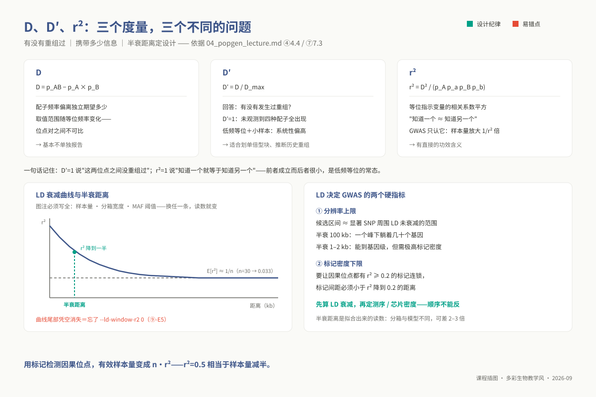
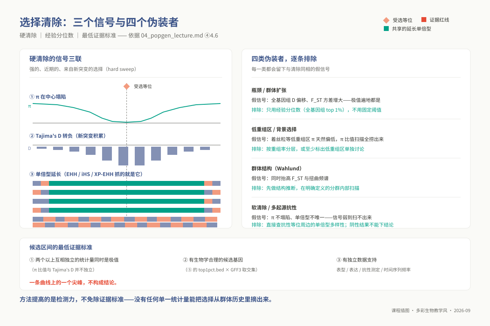
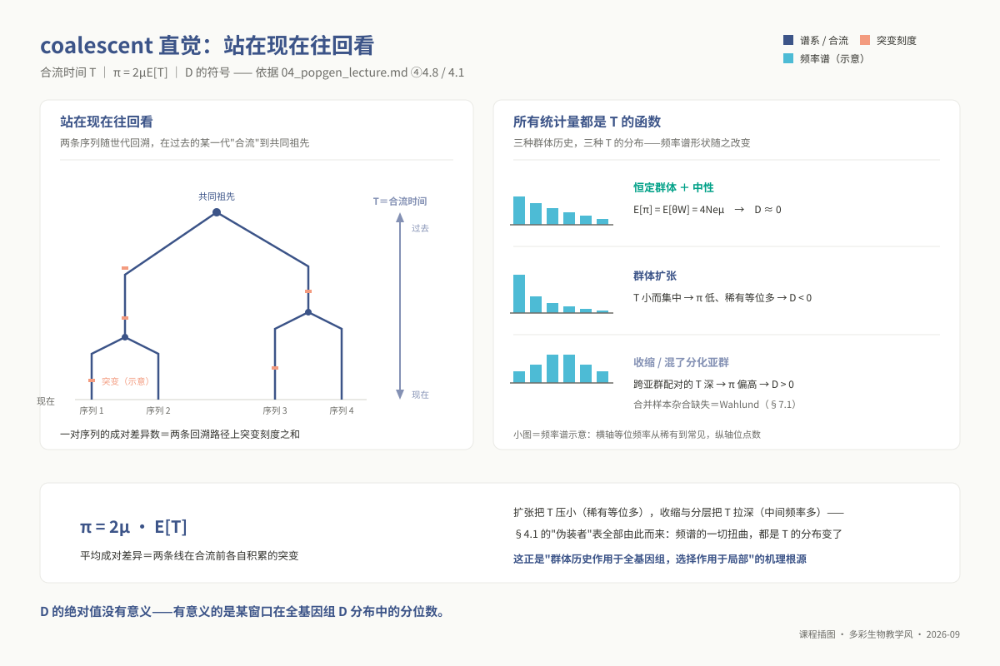
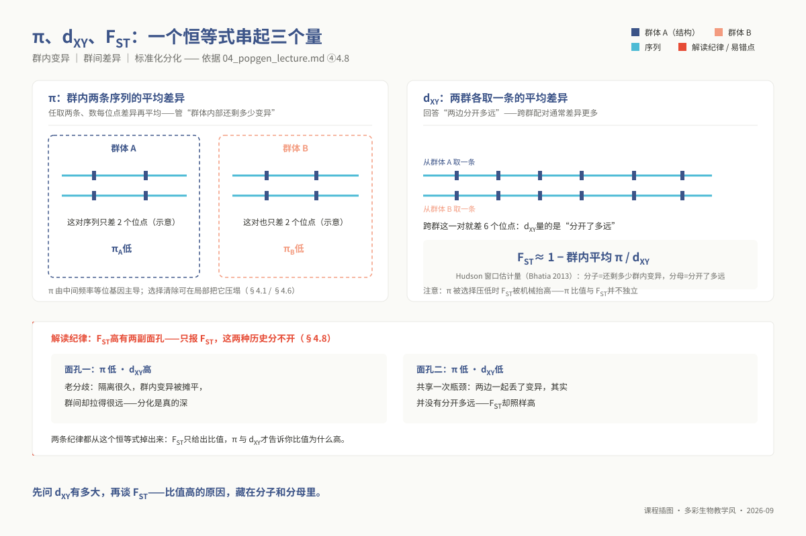

# 专题 p04：群体遗传学基础与群体基因组

> **适用对象**：博士研究生（植物病理、昆虫、农药、微生物等专业）｜授课方式与学时：2 学时理论 + 2 学时实践，共 4 学时。
>
> **阅读重点**：本讲建立 LD、HWE、群体结构与多样性统计的理论链，并为 p05 GWAS 准备可复用的群体层输入；重点阅读 ④ 的统计边界与 ⑩ 的课题迁移。

**资源与前置**：环境为 `ngs_phd_popgen`；工具包括 `plink`/`plink2`、`admixture`、`vcftools`、`treemix`、`bcftools` 和 R。脚本为 `03_code/phd/scripts/04_popgen_qc_diversity.sh`、`04_popgen_structure.sh` 和 `04_ld_decay_plot.R`。⑥ 6.3 向 p05 交付过滤基因型、LD 剪枝集、PCA 协变量、重复/亲缘过滤清单和 LD 半衰距离。

<!-- 维护信息：专题 id `p04`；目录 `topic04_popgen`。工具：`plink`/`plink2`、`admixture`、`vcftools`、`treemix`、`bcftools` 与 R。环境 `ngs_phd_popgen`，创建命令 `conda env create -f 07_envs/conda/env_phd_popgen.yml`。脚本：`03_code/phd/scripts/04_popgen_qc_diversity.sh`、`04_popgen_structure.sh`、`04_ld_decay_plot.R`。⑥ 6.3 向 p05 交付过滤基因型、LD 剪枝集、PCA 协变量、重复/亲缘过滤清单和 LD 半衰距离。 -->

## ① 学习目标

学完本专题，你应当**能够**：

1. **推导并解释** $\pi$、Watterson's $\theta_W$、Tajima's $D$ 与 $F_{ST}$ 的数学定义，并说明瓶颈、扩张和亚群混合如何改变这些统计量的解释。
2. **区分**哈代-温伯格平衡（HWE）偏离的技术原因（分型错配、旁系同源序列坍缩、等位基因缺失）和生物学原因（自交、无性克隆、群体分层），建立定量排查路径，评估当前体系是否适用 `--hwe` 过滤。
3. **推导** $D$、$D'$ 与 $r^2$ 的数学本质差异，**阐明** GWAS 关联推断唯独依托 $r^2$ 的功效动因，并利用物理 LD 衰减曲线界定关联定位的分辨率理论上限与标记密度需求底线。
4. **运行** PCA 与 ADMIXTURE 分析流，判读特征值碎石图和交叉验证误差曲线，说明为什么 CV 误差最低的 $K$ 值不一定等于真实祖先亚群数。
5. **实施**滑窗 $\pi$ 比值、$F_{ST}$ 与 Tajima's $D$ 联合选择清除扫描，**论证**候选功能区间为何严禁仅凭单一统计量极值定论的统计学动因。
6. **输出**可对接 `p05` GWAS 的工程资产包（⑥ 6.3），并为质控参数阈值写出基于数据和生物学背景的说明。

## ② 前置检查

本讲深入剖析群体等位基因频率的高维协方差结构。若在数学推导或脚本排错中遭遇障碍，请对照下表回溯检索。

| 依赖模块 id | 本讲哪里用到 | 不过关的典型症状 | 对应自测题号 |
|---|---|---|---|
| `l0_01_linux` | ⑤ 全部命令；ADMIXTURE 的多 $K$ 并行计算 | 在公共登录节点直接启动多线程 ADMIXTURE 循环，引发内存超限被系统强制清退 | `L0-1-Q5`（登录节点与计算节点算力调度分工）、`L0-1-Q9`（集群 SGE 作业投递） |
| `l0_03_conda` | 全讲运行；集群后台脚本依赖环境切换 | 作业日志抛出 `plink: command not found`，在交互式终端却能正常调用 | `L0-3-Q9`（Conda 环境固化与快照导出）、`L0-3-Q10`（批处理作业中的环境变量激活） |
| `l0_04_formats` | ④ 频率统计算法；⑤ VCF 转 PLINK 格式 | 无法阐清 `--maf` 与等位基因位点深度的关系；混淆 BED/GFF 坐标系偏移 | `L0-4-Q6`（BED/GFF/VCF 格式规范与信息槽）、`L0-4-Q7`（0-based 与 1-based 坐标换算） |
| `l0_06_stats` | ⑦ 统计插件全节：多重假设检验与结构混杂 | 在全基因组百万位点上盲目执行 `p < 0.05` 过滤 HWE，致使大批真实变异遭到误杀 | `L0-6-Q4`（假设检验 $p$ 值统计学语义）、`L0-6-Q5`（Bonferroni 与 FDR 校正）、`L0-6-Q6`（批次与分层混杂） |
| `l0_02_r` | ⑤ LD 曲线非线性拟合、PCA 投影散点图绘制 | 无法在 ggplot2 中正确映射分组分类变量，无法导出符合出版规范的矢量图件 | `L0-2-Q9`（统计作图与图形排版导出）、`L0-2-Q10`（工程化 R 脚本封装） |
| `l1_p04` | 全讲输入：群体多样本 VCF 矩阵解析 | 面对海量 VCF 矩阵无法提取 GT 基因型并统计位点缺失率分布 | 博士前置补丁自测 **Q1**（群体 VCF 解析）、**Q2**（基因型频数分布统计） |

> `l1_p04` 补课入口参见硕士层 `m03`《重测序与变异检测》**§6.2 VCF 格式与变异过滤**。

**30 秒运行环境自检**：

```bash
source "${CONDA_ROOT:-/opt/miniconda3}/bin/activate" ngs_phd_popgen
plink --version && vcftools --version && admixture --help | head -3 && treemix 2>&1 | head -2
```

## ③ 背景与科学问题

群体基因组学的核心使命，在于从**等位基因频率的时空动态**中解码生命演化的动力学法则。如果说单基因组测序回答的是“特定个体相对参考基因组存在哪些变异”，那么群体重测序则将科学提问升维为：**特定等位基因在群体中的真实分布频率是多少？驱动其频率偏离中性预期的动力是自然选择、人工驯化，抑或是瓶颈效应与地理隔离？**

在此视角下，经典统计量构成了该频率分布多维特征的正交切片：$\pi$ 与 $\theta_W$ 刻画全基因组多态性丰度，Tajima's $D$ 度量等位基因频谱对中性期望的偏斜形态，$F_{ST}$ 定量亚群间的遗传隔离程度，而连锁不平衡（LD）则衡量染色体物理邻近位点在减数分裂重组中的共分离强度。必须牢固树立的核心认识论是：上述所有统计量本质上均为等位基因频率的非线性泛函，因此它们天然同步受到达尔文选择压力与群体历史事件的交织支配——在统计学上，没有任何单一指标能够将局部自然选择从全局群体历史中直接剥离。

| 农学与微生物学科 | 核心科学假说与应用场景 | 关键依赖统计量 |
|---|---|---|
| **植物病理学** | 田间病原暴发是单克隆菌系的激进扩散，还是多谱系独立重组侵入？抗性丧失是新发点突变还是外源毒力单倍型渗透？ | ADMIXTURE/PCA 谱系聚类、$F_{ST}$、TreeMix 基因流重构、克隆群体的强 LD 与非平衡 HWE 表型 |
| **昆虫与入侵生物学** | 农业害虫地理种群间的有效基因流多大？抗药性扩散是沿交通线的长距离跳跃迁飞还是局域渐进式渗漏？ | 遗传分化 $F_{ST}$ 相对地理测地距离的隔离衰减斜率（IBD）、PCA 连续流形演变、局部多态性 $\pi$ |
| **农药抗性进化** | 农药靶标抗性等位是**单一起源后席卷扩散（硬清除）**，还是**由多重突变在多地平行独立暴发（软清除）**？ | 抗性位点侧翼 LD 物理延伸跨度、单倍型纯合度（EHH）、滑窗 $\pi$ 相对敏感群的塌陷比值、Tajima's $D$ |

### 3.1 应用案例：3 010 份水稻的“频率账本”——驯化印记怎么读

Wang W et al.（2018, *Nature*）对全球代表性生态区的 3 010 份亚洲栽培稻（涵盖地方农家种与现代育成品种）开展了全基因组重测序，构建了农业基因组学领域最具标志性的变异图谱资源。该工作系统运用了本讲所述的全套分析流，在万级样本尺度上精确解构了籼稻、粳稻及其下属 9 个亚群的遗传分化，并在驯化位点周边精准捕获了强烈的选择清除信号。

该经典工作为现代群体分析树立了四条方法学标杆：
第一，**对照组的对比轴线完全取决于实验设计**。将现代育成种与古老农家种并置，人工强烈育种改良的“演化时间轴”方能转化为可被统计检验的选择扫荡信号；
第二，**全基因组选择扫描在本质上仅输出假说候选集**。在 3 010 份水稻中全基因组扫描定位出数千个高分化信号峰，但最终真正被克隆并生化确证的功能基因屈指可数。针对统计极值区间，研究者必须保持严密的假阴性与假阳性双向自省；
第三，**大样本方法学原则在中小群体中完全同构**。无论面对 3 000 份作物材料，还是本讲实战的 40 株稻瘟病菌微型群体，数据清洗、格式转换、LD 剪枝、HWE 过滤及伪影排查等全套规程在数学逻辑上毫无二致，样本量较小时对统计假设违例反而更加敏感；
第四，**数据资产的长期开放与复用价值**。变异图谱一旦规范沉淀，后续的超级泛基因组构建、单倍型挖掘与分子育种标记开发均可直接叠加上游成果，这彰显了严谨遵循分析规范与元数据记录的深远学术价值。


*图 p04-5：3010 份水稻的「频率账本」：群体基因组资源怎么用。*

## ④ 核心原理

### 4.1 $\pi$、$\theta_W$ 与 Tajima's $D$ 的数学本质与频谱失真


*图 p04-6：木村资生（1924–1994），中性学说提出者，本讲零假设的源头（照片：1986，CC BY 4.0，Wikimedia Commons）。*

> **人物故事与演化争鸣：木村资生与中性学说的风暴**
> 
> 照片中的学者是日本国立遗传学研究所的**木村资生（Motoo Kimura，1924–1994）**，分子演化中性学说（Neutral Theory of Molecular Evolution）的提出者，也是将严密偏微分方程（柯尔莫哥洛夫扩散方程）引入群体遗传学的数学大师。
> 
> 在 20 世纪 60 年代，新达尔文主义综合学说（选择论）牢固统治着演化生物学，主流学界坚信自然界中每一处基因变异都是达尔文正选择精雕细琢的产物。1968 年，木村资生在 *Nature* 发表划时代论文《分子水平上的演化速率》，利用早期蛋白质序列数据与随机漂变数学模型提出：在分子（DNA 与蛋白质）水平上，绝大多数突变置换并不是正选择推动的，而是对适应度中性或近中性的无害突变，由**随机遗传漂变（Genetic Drift）**在群体中偶然固定。
> 
> 该理论引发了生物学史上著名的“中性论与选择论大论战”。木村资生留给当今群体基因组学最重要的遗产，就是本讲的核心——**无偏的“零假设（Null Hypothesis）”**。若没有木村确立的中性基准期望（$E[\pi] = E[\theta_W] = 4N_e\mu$），任何选择清除（Selective Sweep）与 Tajima's $D$ 检验便失去了一切数学参照物。“在指责选择之前，必须先排除中性漂变”——这是本讲一切统计推断的逻辑起点。

在木村资生确立的中性演化与恒定有效群体大小（$N_e$）零假设框架下，群体内多态性水平由突变率 $\mu$ 与遗传漂变的动态平衡决定，其群体突变参数期望为 $\theta = 4N_e\mu$（二倍体口径；本讲主线稻瘟菌为单倍体，应为 $\theta = 2N_e\mu$，下文凡 $4N_e$ 均按此换算）。度量该参数存在两条经典正交路径：

**其一，成对核苷酸多样度 $\pi$（Nucleotide Diversity）**。定义为群体中随机抽取两条同源染色体，在给定碱基位点上发生变异的经验概率：$\pi = \sum_{i=1}^S 2p_i(1 - p_i)$（此为区段求和口径，除以检查的位点总数才是 per-site π，与 `vcftools --window-pi` 输出对齐）。该统计量以等位基因频率乘积 $p(1-p)$ 作为权重，因此其数值由**处于中间频率的多态位点**主导，对稀有变异极不敏感。
**其二，Watterson's 估计量 $\theta_W$**。纯粹基于群体中观察到的多态分离位点总数 $S$ 进行期望校准：$\theta_W = \frac{S}{\sum_{i=1}^{n-1} \frac{1}{i}}$。该估计量仅记录位点是否存在多态性，完全忽略等位基因的具体频率，因而对**稀有多态位点**具备高度的统计敏感性。

中性恒定群体下，$\pi$ 与 $\theta_W$ 在数学上具有完全相同的数学期望：$E[\pi] = E[\theta_W] = \theta$。**Tajima's $D$ 正是两者的标准化残差**：
$$D = \frac{\pi - \theta_W}{\sqrt{\hat{V}(\pi - \theta_W)}}$$

| Tajima's $D$ 读数 | 位点频谱（SFS）形态 | 潜在生物学驱动力（**统计量本身完全不可区分**） |
|---|---|---|
| **显著负值 ($D < 0$)** | 稀有多态位点异常富集，中间频率位点匮乏 | 局部受到强烈正向选择（选择清除后新突变重新积累）、全基因组背景纯化选择；**全基因组尺度近期发生剧烈群体膨胀** |
| **显著正值 ($D > 0$)** | 中间频率位点异常富集，稀有突变受到压制 | 局部平衡选择维持双等位并存；**全基因组尺度经历剧烈群体瓶颈收缩，或样本混杂了分化的独立亚群（Wahlund 效应）** |

**博士层严谨解读铁律**：自然选择作用于**染色体局部微区**，而群体历史人口学变迁作用于**全基因组广谱位点**。因此，孤立考察某基因座 $D = -1.8$ 并在论文中轻率断言“该基因受到了正向达尔文选择”在学术上是不合格的。唯一具备论证效力的是：计算该候选窗口的 $D$ 在**全基因组经验分布中的经验分位数（如落入全基因组极端 1% 尾部）**，并在排查全局人口历史基线偏置后方可得出推论。

### 4.2 $F_{ST}$：三个估计量，两种求平均方式

遗传分化指数 $F_{ST}$ 定量衡量亚群间等位基因频率方差占总体方差的比例。在实际生信分析中，算法实现存在三个截然不同的估计量内核：Nei's $G_{ST}$（未校正样本抽样方差，在小样本中系统性高估）、Weir & Cockerham (1984) 方差分量无偏估计量（基于协方差均方期望推导，为 VCFtools `--weir-fst-pop` 核心算法），以及 Hudson 估计量（Bhatia et al. 2013 论证其对亚群样本量不均衡体系具备最高数学稳健性）。

比算法内核选型更具杀伤力的，是**滑窗分析中求取平均值的数学次序陷阱**：
在多 SNP 构成的染色体物理滑动窗口内，严谨的窗口 $F_{ST}$ 必须遵循**比值的比率（Ratio of averages）**法则，即将窗口内各个 SNP 的方差分量分子 $\sum N_i$ 与分母 $\sum D_i$ 分别全量累加，再执行除法运算：
$$\bar{F}_{ST}^{\text{window}} = \frac{\sum_{i=1}^m N_i}{\sum_{i=1}^m D_i}$$
若错误采用“均值的比率（Average of ratios）”——即对窗口内每个单 SNP 独立计算 $F_{ST}$ 后取算术平均，分母接近零的低频稀有突变将产生极端虚假大值，彻底主导并严重扭曲窗口读数。VCFtools 输出中的 `WEIGHTED_FST` 即为前者，必须在出版级报告中无条件采用。同时牢记两条边界约束：稀有变异（MAF < 0.05）会从数学上全局压低全基因组 $F_{ST}$，跨文献对比数值必须核验过滤阈值；单 SNP 水平的抽样方差极大，唯有基于滑动窗口的集聚特征方具拓扑可信度。

### 4.3 Hardy-Weinberg：过滤器还是生物学信号

哈代-温伯格平衡定律（HWE）指出，在无限大随机交配且不受突变、迁移与选择干扰的中性群体中，双等位二倍体基因型频率将维持 $p^2 + 2pq + q^2 = 1$ 的恒定二项展开分布。在统计计算层面，**HWE 假设检验在数学上等价于考察样本观测杂合子数与 $2pq$ 期望值之间的残差显著性**。该偏离呈现截然对立的两类机制：

| 偏离诱发性质 | 底层诱发机理 | 偏离表型方向 | 全基因组拓扑分布特征 |
|---|---|---|---|
| **技术伪影误差** | 串联重复序列或旁系同源基因在短读长比对中坍缩至单一参考位点 | **杂合子极端过量** | 呈现孤立散点状，高度聚集于参考基因组着丝粒、转座子重复区与低比对质量区（MAPQ < 20） |
| **技术伪影误差** | 低测序深度引发的等位基因抽样丢失（Allelic dropout）、参考等位偏好比对 | **杂合子极端缺失** | 与个体测序深度呈强烈负相关，与位点全局缺失率呈强烈正相关 |
| **内源生物学机制** | 严格自交繁育、自交系构建、近亲交配 | **杂合子全基因组缺失** | **全基因组平坦均一分布**，全基因组近交系数 $F_{IS}$ 呈现全局单向刚性平移 |
| **内源生物学机制** | 专性或长期无性克隆繁殖（克隆世代锁定杂合多态性） | **杂合子全基因组过量** | 全基因组大部分杂合位点无法通过减数分裂分离重组，呈现均质化杂合冗余 |
| **内源生物学机制** | 亚群隐形分层（Wahlund 效应：混合了不同频率的孤立亚群） | **杂合子全局缺失** | 全基因组广谱存在，**在正确实施遗传分群后即刻在亚群内部彻底消失** |
| **内源生物学机制** | 超显性（Overdominance）、多态性平衡选择 | **局域杂合子过量** | **严格局限在少数具有关键适应性功能的特定基因座微区** |

**博士层最重要的实践警示：严禁盲目执行 `--hwe 1e-6` 硬过滤！**
经典 GWAS 教程中的 HWE 过滤参数完全基于人类随机交配大群体的经验假设。在涉农体系中，**水稻、大豆、拟南芥等高自交作物**的自交率往往高达 95% 以上，近交系数 $F \approx 1$，全基因组绝大多数真实变异座位的杂合子天然趋近于零，其卡方检验 $p$ 值在全基因组尺度上普遍突破 $10^{-10}$；而在**卵菌、锈菌无性孢子阶段或无融合生殖昆虫**中，长期无性繁殖锁定了全基因组杂合态。

在这两类体系中机械套用 `--hwe` 过滤，将直接以“质量不过关”为由将数百万真实生物学变异全量从数据中清洗殆尽。正确的规程是：依托测序物理深度（DP）、基因型质量值（GQ）以及双等位测序深度比（`AD_alt / (AD_ref + AD_alt)` 处于 0.25–0.75 区间）构筑位点级真实性防线，仅单向剔除杂合子极端过量的技术坍缩位点。

### 4.4 LD：$D$、$D'$ 与 $r^2$ 的统计解构与衰减物理意义

连锁不平衡（Linkage Disequilibrium）衡量染色体上不同基因座等位基因非随机结合的统计偶联程度：

| 关联度量 | 数学定义式 | 核心回答的生物学问题 | 关键使用边界与固有局限 |
|---|---|---|---|
| **$D$** | $D = p_{AB} - p_A p_B$ | 配子观测联合概率偏离中性独立相乘的原始差值 | **取值范围严格受到边际频率制约**（$|D| \le \min(p_A p_b, p_a p_B)$），位点对之间无法直接横向比较，不作为独立评估指标 |
| **$D'$** | $\frac{D}{D_{\max}}$ | **位点对之间在历史世代中是否发生过减数分裂重组** | 在小样本与稀有等位基因中**系统性严重偏高**；只要某配子型因抽样波动未被观测到即可形成 $D'=1$。专用于**单倍型块（Haplotype block）识别** |
| **$r^2$** | $\frac{D^2}{p_A p_a p_B p_b}$ | **一个指示标记能为因果变异提供多少方差解释力**（两位点指示变量皮尔逊相关系数的平方） | **具备严格的统计功效等价性**：利用标记 $M$ 间接探测其关联度为 $r^2$ 的因果位点 $C$，所需的有效样本量在数学上被放大 $1/r^2$ 倍。**GWAS 唯独依赖 $r^2$** |

**LD 衰减距离决定了 GWAS 关联分析的两大物理死线**：
其一，**定位分辨率的天花板**：显著关联峰所指示的候选基因物理区间，严格受限于局部染色体 LD 未发生衰减的跨度。在全自交作物中，若 LD 半衰距离长达 100–200 kb，一个曼哈顿峰下方往往横跨数十个甚至上百个基因，此时妄图仅凭纯统计学关联直接定位单个因果突变纯属空想；反之，在异交昆虫或野生菌株中，LD 半衰极短（1–2 kb），能够实现单基因乃至单碱基级的高清定位。
其二，**测序标记密度的底线**：为保证全基因组任意功能致病变异均能被至少一个连锁标记（$r^2 \ge 0.2$）所捕获，基因组标记物理间距必须小于 LD 降至 0.2 时的物理距离。**“先由先验群体测定 LD 衰减，再科学倒推重测序通量或 SNP 芯片密度”**，构成了群体实验设计的不可逆逻辑序列。



*图 p04-3：LD 的三种度量与衰减曲线：D、D′、r² 各答什么。*

### 4.5 群体结构：PCA 与 ADMIXTURE 各自在做什么

**主成分分析（PCA）是无先验假设的几何方差分解**。它直接对中心标准化后的等位基因矩阵进行奇异值分解，提取正交方差解释力最大的连续投影轴。PCA 的核心局限在于**特征向量不映射特定的历史演化事件**。Novembre & Stephens (2008) 证明，在纯粹连续的地理距离隔离（Isolation-by-distance）模型下，二维 PCA 图上会自动涌现出极为规则的正弦/余弦连续几何波形；将这种流形上的连续梯度轻率指认为“古代人类或病原菌沿某方向定向迁徙的路线图”，属于对低维投影的过度拟合解释。此外，若未在分析前执行严格的 LD 剪枝，染色体大片段倒位区或着丝粒高互阻区将凭借数千个共分离标记在单一主成分上形成虚假极化，掩盖全基因组真实的群体谱系。

**ADMIXTURE 则是基于显式生成式模型的最大似然推断**。它假定当代群体由 $K$ 个未知的离散古老祖先成分按个体特异比例 $Q$ 混合而成，通过块松弛算法最大化基因型似然曲面。
**严谨破除“将交叉验证（CV error）最低的 $K$ 奉为真实谱系亚群数”的误区**：
首先，**CV 误差仅反映该参数族在预测掩码数据时的统计泛化精度**，它衡量的是模型的数值拟合表现，与“自然界客观存在多少个独立演化支系”毫无本体论等价性；
其次，**底层混合假设可能从根本上失真**。ADMIXTURE 强力假定存在离散祖先库的瞬时杂交。然而 Lawson et al. (2018) 系统证明，在连续地理渐变、近期种群指数扩张、或是抽样网格严重不均的前提下，算法仍会将连续演化空间强行切割并拼凑成若干“虚构的祖先成分”，产出与真实杂交完全雷同的堆叠条形图；
最后，在真实农作物与微生物数据中，CV 误差曲线往往呈现平缓下降或缺乏清晰全局极小值。严谨的学术展示策略是**将 $K = 2 \dots 8$ 的演进图谱作为不同粒度下的分层拓扑并列披露**，并结合独立的历史地理学、表型谱系或系统发育树给予联合阐释。

**TreeMix 的演化边界**：TreeMix 利用群体间等位基因频率的协方差残差矩阵拟合带漂移的分支树，并以贪心策略逐步引入基因流迁移边（Migration edges）。必须清醒认识到：**迁移边本质上是算法吸收该协方差模型未能解释的一切高维残差的产物**。未建模的古老隐秘结构、测序参考等位基因偏倚或抽样偏差，均会在残差矩阵中激发出虚假的迁移箭头。TreeMix 产出的定向箭头仅能作为微弱的工作假说，必须经由 $f_3 / f_4$ 四群检验或单倍型溯祖分析予以独立证实。

### 4.6 选择清除：信号三联与它们的伪装者

当一个新发生的有利突变受到强烈的正向自然选择时，其频率将在群体中快速攀升至固定，由于减数分裂重组尚未充分发生，该位点物理相邻的侧翼染色体片段将被作为“搭便车（Hitchhiking）”单倍型整体拖带至高频，形成经典的**硬选择清除（Hard sweep）**。硬清除在基因组微区留下了不可磨灭的**特征三联征**：局部多态性骤降（$\pi$ 塌陷）、等位基因频谱向稀有突变倾斜（Tajima's $D$ 转负），以及侧翼单倍型纯合度显著延伸（EHH 升高）。

然而，高通量扫描面临四类狡黠的**假阳性伪装者**：

1. **全局人口历史扰动**：瓶颈收缩与随后的爆发扩张会使全基因组 $D$ 整体偏负，极值在染色体各处随机涌现。防范策略是**严禁使用绝对截断值**，必须以全基因组滑窗统计量的**极端分位数（Top 1% 或 Top 0.5%）**划定候选区间；
2. **基因组重组率景观异质性**：染色体着丝粒与异染色质区减数分裂重组率天然被压制，在漫长演化中因背景选择（Background selection）导致 $\pi$ 呈现本底性深坑，极易在 $\pi_{\text{野生}} / \pi_{\text{驯化}}$ 比值扫描中形成巨大的虚假驯化信号。必须借助遗传连锁图谱对低重组区实施分层标记排查；
3. **隐秘群体结构**：Wahlund 效应会系统性抬高局部 $F_{ST}$。扫描必须限定在经结构推断严格确认的单一亚群内部或明确分化的平行亚群对之间开展；
4. **软选择清除（Soft sweep）的隐蔽性**：在农药抗性进化中，若靶标抗性变异源于群体中早已存在的站立变异（Standing variation），或是由多个独立突变在不同单倍型背景中平行暴发，抗性发生后不会形成单一主导单倍型，局部 $\pi$ 亦不塌陷。此类微弱信号在常规扫描中极易漏失，必须转向单倍型多样性与频率时序追踪。

**选择证据的最低可信底线**：候选区间必须在**两个以上理论正交的统计量**中同步达到极端显著，具备生物学功能自洽的注释基因，并辅以独立的分化表型或实验室体外抗性生化测定。单个统计量曲线上孤立的尖峰，绝不能直接构成科研发表的有效结论。



*图 p04-4：选择清除的信号与伪装者：π 塌陷、D 转负、单倍型延长。*

### 4.7 数据设计：深度、样本量与“不能滤 MAF”的场景

在固定的测序经费约束下，群体基因组研究面临核心选型博弈：**深入个体深度（High-depth WGS）还是追求大样本量（Low-depth lcWGS）？**
若实验目标在于解析群体精细结构与实施选择扫描，统计功效的高度优先取决于**独立抽样的生物学个体规模**而非个体测序深度。然而，不同测序策略严格约束着下游生信算法路径：
在个体测序深度 $\ge 10\times$ 时，可稳健走硬基因型（Hard Genotype Calls）路线，直接在 VCF 的 `GT` 槽上调度 PLINK 与 VCFtools；而当采用 $1\text{–}3\times$ 的超低深度大样本测序时，单个杂合位点的另一个等位基因面临极高的抽样漏失概率（Allelic dropout），强行判定硬基因型将造成全基因组杂合度坍塌与严重的虚假分化，此时**严禁生成硬 GT**，必须借助 ANGSD 框架直接基于基因型后验似然度（Genotype Likelihoods，GL）积分推导等位基因频谱（SFS）、$\pi$ 与 $F_{ST}$，或借助高精度单倍型参考面板实施基因型填补（Imputation）。

**MAF 过滤的双刃剑机制**：在下游 GWAS 关联分析中，次要等位基因频率极低的变异（MAF < 0.05）因统计自由度极小、功效贫弱且易引发假阳性膨胀，执行过滤属于规范操作；然而，**群体遗传学核心多样性指标（$\pi$、$\theta_W$、Tajima's $D$ 及 SFS）完全依赖稀有等位基因的真实频数分布**。若在多样性分析前执行 `--maf 0.05`，全基因组稀有多态位点将被人工切除，直接导致 $\theta_W$ 剧烈坍塌，人为诱发全基因组 Tajima's $D$ 严重偏向虚假正值！因此，在工程实践中**必须无条件分流维护两套独立过滤的 VCF 核心产物**（⑤ 5.2）。

### 4.8 Coalescent 直觉与 $\pi$、$F_{ST}$、$d_{XY}$ 的三角关系



*图 p04-2：coalescent 直觉：往回数谱系，T 的分布由群体历史决定。*

溯祖理论（Coalescent Theory）提供了一种**从当下时间节点向历史回溯谱系合流**的优美视角。在无重组中性位点上，从群体中抽取两条序列，其沿时间回溯至最近共同祖先（MRCA）的等待代数定义为合流时间 $T$。本讲所有的群遗传学统计量，本质上均是合流时间 $T$ 在不同拓扑抽样下的数学期望映射：

$$\pi = 2\mu \cdot E[T_{\text{within}}] \qquad d_{XY} = 2\mu \cdot E[T_{\text{between}}]$$
$\pi$ 度量亚群内部随机抽取的两条序列的平均合流深度，反映亚群近期的变异蓄积；$d_{XY}$ 则度量分别从两个独立亚群各抽取一条序列时的平均合流深度，其直接反映两亚群在物种演化历史上真正的物理分立时间与古老变异。

由此，经典的 Hudson $F_{ST}$ 估计量（Bhatia et al. 2013）在数学上展现出纯粹的几何对偶关系：
$$F_{ST} \approx 1 - \frac{\bar{\pi}_{\text{within}}}{d_{XY}}$$

这一恒等式揭示了两条不可动摇的判读真理：
第一，**表观上观测到高 $F_{ST}$ 存在两副截然对立的演化面孔**。一种是真正的**古老长期隔离分歧**，表现为 $d_{XY}$ 极高而 $\pi_{\text{within}}$ 维持正常；另一种则是**某一亚群经历了极其剧烈的局域选择清除或极端近期种群瓶颈**，导致其亚群内多样性 $\pi_{\text{within}}$ 发生断崖式暴跌，此时即便两群在演化上分立极短（$d_{XY}$ 毫无变化），根据上述公式，分母不变而分子急剧缩小，依然会机械性地计算出极高的 $F_{ST}$！脱离 $d_{XY}$ 单独报告 $F_{ST}$，这两种演化历史在数学上完全混淆；
第二，**滑窗 $\pi$ 比值扫描与 $F_{ST}$ 扫描并不相互独立**。当选择压制了某一亚群的局部多样性时，$F_{ST}$ 必然被动发生机械性飙升。在论文中将这两个指标列为“两项相互独立的验证证据”，暴露出对该恒等式的认知缺失。



*图 p04-1：一个恒等式串起三个量：FST 高有两副面孔，先问 dXY 再下结论。*

### 4.9 技术前沿（2023–2026）：把群体放进图里，把基因型补出来

近三年群体基因组学正经历底层数据结构与推断范式的根本性革新：
在变异表征层面，**图泛基因组（Graph Pangenomes）全面取代单一线性参考基因组**。人类泛基因组联盟（HPRC，Liao et al. 2023）与水稻超级泛基因组（Shang et al. 2022）的发布，彻底重构了群体比对底座。传统线性比对中，由于参考等位基因偏好，大片段结构变异（SV）与基因存在/缺失变异（PAV）被系统性遗漏。

图基因组将群体变异节点化嵌入，使得 $\pi$ 与 $F_{ST}$ 能够跨越 SNP 局限，扩展至对染色体倒位与复杂插入缺失的多态性刻画；然而其代价是引入了全新的拓扑偏倚——图节点的密度异质性会动态改写下游全局比对敏感度。

在建库测序层面，**超低深度测序结合深度单倍型填补（lcWGS + Imputation）成为最具经济性的大群体研究主流**。利用高精度参考面板，GLIMPSE2 算法（Rubinacci et al. 2023）在英国生物样本库 150,119 人的数据上评估了低深度填补：对 MAF 约 0.01% 的极稀有变异，0.1× 与 1.0× 深度填补后与真值的 $r^2$ 分别约 0.89 与 0.93（原文口径；不宜概括成单一「准确率」）。然而必须警醒：填补操作会将外部参考面板的等位基因频率先验强制烙印在目标样本中，在稀有变异与精细群体结构推断中必须在未填补原始位点上开展正交复核。

在统计建模层面，选择清除推断迈入规范化新纪元。Johri et al. (2022) 系统反思了传统选择扫描依赖经验分位数所引入的巨大假阳性，推动了融合人口学演化历史先验与单倍型同一性（IBD）的综合推断框架。前沿技术虽大幅跃迁，但“没有任何单一统计量能把选择从群体历史中直接剥离”的统计学第一公理，在 2026 年依然是不可动摇的方法学底线。

## ⑤ 操作步骤

全流程规范化脚本封装于 `03_code/phd/scripts/04_popgen_qc_diversity.sh` 与 `04_popgen_structure.sh`，均部署 SGE 作业调度封装。

### 5.1 输入数据规格

教学采用公开基准案例数据集：**`PRJEB53625`（稻瘟病菌全球分离株群体重测序）**。精选 40 个代表性单倍体分离株（元数据详见 `06_data/phd/manifests/p04_runs.tsv`），有效测序数据量均处于 0.4–1.5 Gb 区间，针对其 40 Mb 紧凑基因组达到约 **11× 测序覆盖度**。（manifest 曾含同名分离株——O23 三次、i76a 两次——按样本名落盘时互相覆盖，40 行只落地 37 个且 rc=0；现已去重补足。**按样本名写文件前必须校验名称唯一**，这是 fm4 之外的数据工程版「样本悄悄变少」。）

**关键生物学约束提示**：稻瘟菌在营养生长与侵染阶段属于**单倍体真菌**，每个基因座仅携带单一等位基因，天然规避了二倍体低深度下杂合位点被误读为纯合子的核心难题；然而，单倍体生物学特征亦使得经典的哈代-温伯格平衡（`--hwe`）过滤在数学上彻底失去意义。在单倍体分析流中必须显式剔除 HWE 过滤项，并在方法学中做出客观理论声明。

### 5.2 群体层质控：产出两套独立过滤成果

```bash
source "${CONDA_ROOT:-/opt/miniconda3}/bin/activate" ngs_phd_popgen
VCF=raw.pop.vcf.gz

# ① 提取双等位 SNP 核心骨架，针对低质量个体基因型置缺失（严禁盲目直接丢弃位点）
bcftools view -m2 -M2 -v snps "${VCF}" -Oz -o biallelic.vcf.gz
bcftools filter -S . -e 'FMT/DP<5 | FMT/GQ<20' biallelic.vcf.gz -Oz -o gtmask.vcf.gz && tabix -p vcf gtmask.vcf.gz

# ② 群体遗传学专用资产包（π / θ / Tajima's D / F_ST）：绝对严禁过滤 MAF！
vcftools --gzvcf gtmask.vcf.gz --max-missing 0.8 --min-alleles 2 --max-alleles 2 \
         --recode --stdout | bgzip -c > popgen.vcf.gz

# ③ 结构推断 / LD 拟合 / GWAS 专用资产包：执行常规 MAF 截断
vcftools --gzvcf gtmask.vcf.gz --max-missing 0.9 --maf 0.05 --recode --stdout | bgzip -c > struct.vcf.gz

# ④ 评估个体水平缺失率分布，客观识别劣质测序文库
vcftools --gzvcf popgen.vcf.gz --missing-indv --out qc
awk 'NR>1 && $5>0.2 {print $1}' qc.imiss > drop_indv.txt
```

### 5.3 格式转置：非模式生物的工程规程

```bash
plink --vcf struct.vcf.gz --allow-extra-chr --double-id --set-missing-var-ids '@:#' --make-bed --out struct
```

关键修补解析：`--allow-extra-chr` 阻断非人类染色体命名的退出异常；`--double-id` 自动填补 FID 与 IID；`--set-missing-var-ids '@:#'` 基于染色体与物理坐标强制重构唯一变异识别码，规避点号冲突。

### 5.4 多样性、中性检验与分化扫描

```bash
W=50000; S=10000  # 依据 5.5 确立的 LD 半衰距离设定 50 kb 滑窗，10 kb 步长
vcftools --gzvcf popgen.vcf.gz --window-pi ${W} --window-pi-step ${S} --out div
vcftools --gzvcf popgen.vcf.gz --TajimaD ${W} --out div
vcftools --gzvcf popgen.vcf.gz --weir-fst-pop pop1.txt --weir-fst-pop pop2.txt \
         --fst-window-size ${W} --fst-window-step ${S} --out fst_p1_p2
```

### 5.5 LD 剪枝与衰减动力学拟合

```bash
# ① 独立标记子集提取（为 PCA 与 ADMIXTURE 提供低共线性输入）
plink --bfile struct --allow-extra-chr --indep-pairwise 50 10 0.2 --out prune
plink --bfile struct --allow-extra-chr --extract prune.prune.in --make-bed --out struct.pruned

# ② 全基因组 LD 衰减曲线计算：必须显式指定 --ld-window-r2 0
plink --bfile struct --allow-extra-chr --r2 --ld-window 99999 \
      --ld-window-kb 500 --ld-window-r2 0 --out ld

Rscript 03_code/phd/scripts/04_ld_decay_plot.R ld.ld 500 1000 ld_decay ${N}
```

### 5.6 PCA、ADMIXTURE 与选择信号定位

```bash
# 执行主成分分析输出特征向量（直接充当下游 GWAS 的 Q 协变量）
plink --bfile struct.pruned --allow-extra-chr --pca 10 --out pca

# ADMIXTURE 祖先成分推断循环与交叉验证误差捕获
awk '{$1="0"; print}' OFS='\t' struct.pruned.bim > tmp.bim && mv tmp.bim struct.pruned.bim
for K in $(seq 2 8); do admixture --cv=5 -j4 struct.pruned.bed ${K} | tee log_K${K}.out; done
grep -h "CV error" log_K*.out | sed 's/.*(K=\([0-9]*\)).*: /\1\t/' | sort -n > cv_error.tsv

# TreeMix 基因流拓扑推断
for M in 0 1 2 3; do treemix -i pop.treemix.frq.gz -m ${M} -k 500 -root OUTGROUP -o tm_m${M}; done

# 提取极度分化 top 1% 区间与基因组注释 GFF3 取交集
bedtools intersect -a top1pct.bed -b annotation.gff3 -wa -wb > candidate_genes.txt
```

## ⑥ 结果解读

### 6.1 核心图件的病理诊断与排查

| 核心产物图件 | 正常健康数据的数学表型特征 | 异常病态图型与深层诱因分析 |
|---|---|---|
| **LD 物理衰减曲线** | 从极近距离的高 $r^2$ 平滑单调下降，最终渐近趋向于 $1/n$ 抽样噪音平台 | 远距离平台异常高企（存在严重的群体分层隐匿混杂）；曲线在尾部 0.2 截断消失（遗漏 `--ld-window-r2 0`） |
| **PCA 潜空间散点图** | 碎石图前数个主成分方差陡降，散点投影拓扑与已知地理生态分布自洽吻合 | 极少数点被异常甩至远端（样本存在污染或严重缺失）；PC1 坐标与个体测序深度呈显著正相关（技术批次伪造群体分化） |
| **CV 误差折线图** | 在特定 $K$ 值呈现平滑极小值点，或随 $K$ 增大进入平缓过渡的平台期 | 曲线随 $K$ 递增呈现无底洞式单调暴跌（模型严重错配连续地理距离）；换随机种子后 $Q$ 矩阵剧烈动荡（似然面存在多峰极值） |
| **Tajima's $D$ 基因组分布** | 全基因组均值维持在中性基线零值附近，仅在局部窗口呈现离群尾部 | 全基因组均值系统性呈现大于 0.5 的强烈正向偏移（上游错误执行了 `--maf` 过滤切除了低频等位） |

### 6.2 交付清单（对接 `p05` GWAS 的工程资产）

| 交付文件 | 文件格式类型 | 下游专题 `p05` 的实际消费场景 |
|---|---|---|
| 规范质控后基因型 | `struct.{bed,bim,fam}` | 充当全基因组关联检验（GWAS）的标准基因型矩阵输入 |
| LD 独立剪枝变异集 | `struct.pruned.*` | 用于高精度推导个体间亲缘关系矩阵（$K$ 协方差阵）与主成分 |
| 主成分特征向量 | `pca.eigenvec` | 提取前数个 PC 轴直接充当线性混合模型（LMM）的固定效应 $Q$ 矩阵 |
| 极端亲缘/离群过滤清单 | `drop_indv.txt` | 剔除潜在的无意重复抽样或异物种污染样本 |
| 全基因组 LD 半衰跨度 | `ld_decay.txt` | 界定关联显著曼哈顿峰的候选物理边界，估算全基因组有效独立检验数 |
| 原始多态性 VCF（未滤 MAF） | `popgen.vcf.gz` | 不进入 GWAS 模型，用于下游对候选因果位点回溯开展单倍型多样性佐证 |

## ⑦ 统计插件

> 契约 `stats_plugin_topics` 指定重点：**LD 衰减、HWE 检验与群体结构推断的统计学机理。**

### 7.1 HWE 检验到底在检验什么

在双等位模型下，根据样本边际等位频率估算的期望基因型计数与实际观测值开展皮尔逊卡方拟合度检验，其自由度严格为 $df = 3 - 1 - 1 = 1$。必须深刻领会：由于等位频率 $p$ 是从当前同批数据直接内生估计的，**该卡方检验在数学上仅且仅检验了 1 个自由度的信息——即杂合子数量偏离二项展开的残差**。

卡方检验依赖正态渐近大样本近似（要求各网格期望频数 $\ge 5$）。在小样本或低频位点（如 $n=50, \text{MAF}=0.05$）中，稀有纯合子的理论期望频数仅为 $50 \times 0.05^2 = 0.125$，此时卡方近似彻底失效，输出严重虚假缩小的 $p$ 值，造成低频变异被成批误判为偏离平衡。因此，**基因组全位点检验必须全面采用 Wigginton et al. (2005) 的 Fisher-like 网络精确检验（Exact Test）**。

全基因组 HWE 阈值为何约定俗成设为 $10^{-6}$：在百万级 SNP 尺度上，若按常规 $0.05$ 判定，根据第一类错误概率，即使全量位点完美符合平衡，亦会随机产生 5 万个虚假显著偏离位点。$10^{-6}$ 是针对染色体独立重组块尺度做出的经验 Bonferroni 约束。

**Wahlund 效应的代数证明**：设将 $K$ 个存在频率分化的独立亚群机械合并，各亚群等位频率为 $p_k$，样本占比为 $w_k$。总体平均频率为 $\bar{p} = \sum w_k p_k$。总体实际平均杂合度为 $\bar{H}_{\text{obs}} = \sum w_k (2p_k(1-p_k)) = 2\bar{p} - 2\sum w_k p_k^2$。而研究者若在混合总体中按合并频率计算理论期望杂合度：$H_{\text{exp}} = 2\bar{p}(1-\bar{p}) = 2\bar{p} - 2\bar{p}^2$。两者相减得出：
$$H_{\text{exp}} - \bar{H}_{\text{obs}} = 2\left(\sum w_k p_k^2 - \bar{p}^2\right) = 2 \operatorname{Var}(p) \ge 0$$
该数学代数形式给出了冷酷的推论：只要被抽样的群体内部潜伏着遗传分化（$\operatorname{Var}(p) > 0$），在合并数据中就必然且绝对会观测到全基因组尺度的杂合子缺失！ 这从统计原理上倒逼我们：面对全基因组杂合缺失，必须先完成群体亚群划分，再在各亚群内部独立执行检验。

### 7.2 技术性偏离与生物学偏离的统计判别

统计甄别矩阵构建准则：
将位点的检验显著性负对数 $-\log_{10}(p_{\text{HWE}})$ 分别与位点物理测序深度及基因型缺失率拟合线性回归模型。若回归斜率呈现极端显著，证明该偏离直接源于比对或测序深度缺陷等技术偏倚；反之，若全基因组近交系数 $F_{IS}$ 直方图呈现向正值区间的整体平滑位移，则为经典的自交交配系统生物学印记。在自交率 $s = 0.95$ 的作物中，全基因组杂合度理论上仅为随机交配期望的 10%，此时盲目施加 `--hwe 1e-6` 将在瞬间屠戮 90% 以上的真实功能多态位点。

### 7.3 LD 三个度量的统计性质与抽样偏差

当群体中两位点真实物理连锁度完全为零时，基于 $n$ 条单倍型（单倍体即 $n$ 个个体；二倍体文献常记 $1/(2n-1)$）估算的样本相关系数平方存在不可消除的本底抽样方差（Hill & Weir 1988）：
$$E[\hat{r}^2] \approx \frac{1}{n}$$
这一抽样公理警示我们：在小样本体系（如 $n=30$）中，衰减曲线在远距离处的理论下限基线已被技术性人为垫高至 0.033；而在 $n=200$ 时，该基线自然回落至 0.005。因此，**样本量不等的不同物种或亚群之间，严禁直接通过视觉比对 LD 衰减图的绝对高度**，必须通过下采样对齐样本规模，或在模型拟合前扣除 $1/n$ 抽样基底。

在非线性回归拟合中，半衰距离并非直接物理观测量，其数值高度受制于分箱物理跨度（Bin size）与 Hill-Weir 非线性最小二乘模型的收敛参数。在学术报告中，必须严格伴随披露样本量 $n$、MAF 过滤截断点、分箱几何宽度及半衰判定标准（最大值减半 vs 绝对值降至 0.2）。

### 7.4 群体结构推断的统计基础

PCA 特征分解直接作用于中心化的个体基因型相关矩阵（GRM）。特征值的统计显著性可通过 Tracy-Widom 分布检验判定纯技术噪音与真实结构的相变边界。然而，**主成分坐标纯属描述性几何投影，其特征向量并不对应具有因果假设检验效力的生物学生理参数**。在 ADMIXTURE 交叉验证中，CV 误差仅度量预测误差，其对模型的先验设定极其敏感；面对连续演化地理格局，研究者必须摒弃寻找“唯一真理 $K$ 值”的朴素思维，转而以分层描述的理性框架阐释群体分化进程。

## ⑧ AI 辅助任务

> 契约 `ai_task_topics` 明确本讲核心使命在于构筑针对群体结构与衰减模型判读的批判性防线。

**任务靶向：驱动大语言模型解读课题实际产出的 LD 衰减曲线与 ADMIXTURE CV 误差曲线，精准阻截其将算法参数草率判定为真实生物学实体的越界逻辑。**

**步骤 1 · 提示词生成**（故意隐藏样本量、繁育方式与分箱等关键背景）：

```text
这是我课题研究对象重测序分析获得的 LD 衰减曲线数据（每 1 kb 分箱的 r2 均值）与 ADMIXTURE 的 CV error 误差统计表。请帮我评估：1. 该物种的 LD 衰减物理距离是多少？2. 应该选择最佳亚群数 K 等于几？并给出具体的生物学解释。
```

**步骤 2 · 五项方法学破绽审查矩阵**：

| 核查维度 | 严谨判定准则与审查技术动作 | 典型越界表象与定性结论 |
|---|---|---|
| **① 亚群存在性的本体论越界** | 审查是否出现“该物种在自然界确证存在 $K$ 个真实谱系”的断言 | **严重越界**：混淆算法参数与自然客观实体（§4.5 与 §7.4） |
| **② 关键实验参数的追问意识** | 审查 AI 是否主动反问当前计算所依据的有效样本量、交配繁育系统及 MAF 阈值 | **不合格**：不明确 $1/n$ 抽样偏倚，盲目给出衰减绝对数值 |
| **③ LD 半衰定义的模糊性** | 审查其判定半衰距离时是否阐明计算标准 | **不规范**：未指明是衰减至峰值一半、降至 0.2 还是渐近至背景基准 |
| **④ CV 曲线无极值时的处置** | 面对实际单调微跌的 CV 曲线，审查其是否强行指定某一转折点为“最优解” | **方法学缺陷**：未能指出模型在连续地理格局下的失真，未建议分层展示 |
| **⑤ 祖先成分条形图的过度推演** | 审查是否将个体的 $Q$ 矩阵混合比例直接机械定性为“古代杂交事件的百分比” | **解释失真**：忽略了抽样密度不均与不完全谱系分选导致的相同表象 |

**步骤 3 · 课程实训报告提交物**：

1. 完整附录 AI 原始生成记录；
2. 对照上表填报《AI 解读群体结构缺陷审计表》；
3. 撰写一份经自身统计原则矫正后的规范学术论述文本，阐明在论文 Discussion 中如何严谨陈述群体结构分析发现。

## ⑨ 常见错误与排查

| 故障编号 | 控制台真实报错信息 / 异常表象 | 底层诱发机理分析 | 规范化应急处置策略 |
|---|---|---|---|
| **E1** | `Error: Invalid chromosome code 'chr01' on line 254` | PLINK 默认仅接受人类常染色体编号规范（1–22, X, Y） | 所有命令强制追加参数 `--allow-extra-chr` |
| **E2** | `Error: Duplicate ID '.'` | 非模式生物 VCF 第三列缺少唯一变异标识，点号被识别为重复 | 追加参数 `--set-missing-var-ids '@:#'` 自动重构唯一坐标 ID |
| **E3** | ADMIXTURE 读 `.bim` 时在初始化阶段无预警直接退出 | 算法底层对 `.bim` 第一列染色体命名空间设置了内部硬编码限制 | 执行 `awk '{$1="0"; print}'` 将第一列染色体名安全置零 |
| **E4** | `grep "CV error" log_K*.out` 检索输出完全为空 | 运行脚本时遗漏了 `--cv` 标志位，算法默认仅执行单次似然优化 | 补充声明 `--cv=5` 开启 5 折交叉验证模式 |
| **E5** | LD 衰减曲线在远距离处突然平直中断，最小 $r^2$ 恒为 0.2 | PLINK `--r2` 内建默认过滤阈值为 0.2，低关联度点对未被输出 | 必须显式设定 `--ld-window-r2 0` 保证全范围无偏采样 |
| **E6** | 为画衰减曲线设 `--ld-window 99999` 与 `--ld-window-r2 0` 后，输出文件膨胀到数十至数百 GB | PLINK 1.9 默认 `--ld-window 10`、`--ld-window-kb 1000`，本身不会爆；是放开位点数窗口又不收紧 kb 窗口，位点对数随密度平方增长 | 放开 `--ld-window` 时同步收紧 `--ld-window-kb`（如 500），或先按距离抽样 SNP 对再算 |
| **E7** | VCFtools 质控后位点数出现断崖式暴跌或几乎全量通过 | 混淆了 `--max-missing`（保留比例）与 PLINK `--geno`（剔除比例） | 遵循本讲规范严格复核参数方向（§5.2） |
| **E8** | VCFtools 输出的 `WEIR_AND_COCKERHAM_FST` 列全部呈现 `-nan` | 群体文本清单中的样本命名与 VCF 内部表头失配（含回车或前缀不符） | 执行 `bcftools query -l` 提取纯净样本名，严格执行交集核对 |
| **E9** | 执行 `--mind 0.1` 后终端提示 `All samples excluded` 全量样本被杀 | 在低深度样本上先将大批位点置缺失，后置样本过滤阈值过苛 | 绘制 `--missing-indv` 分布曲线，依据真实数据分位数阶梯过滤 |
| **E10** | `Error: Line 1 of --pheno file has fewer tokens than expected` | PLINK 1.9 强制要求输入清单具备 FID 与 IID 双列结构 | 调度 `awk '{print $1,$1}'` 复制单列生成对偶 ID，清除 Windows CRLF 字符 |

## ⑩ 思考练习

1. **$D'$ 与 $r^2$ 统计分歧**：已知两个 SNP 的次要等位基因频率分别为 0.02 与 0.48，实测获得 $D' = 1.0$ 而 $r^2 \approx 0.022$。请从配子联合分布的角度论证该结果是否存在数学矛盾，并指明要选择标记用于关联定位因果变异时，这一读数提供了何种确定性结论。
2. **HWE 误杀排查**：你的课题对象属于兼具高频自交与无性出芽繁殖的农作物病原真菌，合作者交付的脚本中执行了 `--hwe 1e-6` 过滤。请制定三步实证核查流程，并设计一套替代方案以剔除真实的测序分型假阳性。
3. **Wahlund 效应诊断**：某批次全基因组重测序矩阵中，超过 85% 的位点表现出极其显著的 HWE 偏离，且全量表现为观测杂合度远低于理论期望。请提出三项机制假设，并设计针对性的生物信息学检验将其逐一分离。
4. **祖先亚群数理性陈词**：审稿人提出：“论文中 ADMIXTURE 结果显示 $K=5$ 时 CV 误差达到全局最低，作者必须在正文中明确确认该病原群体存在 5 个客观的真实演化亚群”。请起草一段 150 字的学术抗辩，既充分尊重模型计算表现，又在科学认识论层面严守边界。
5. **LD 引导实验设计**：某重大农业害虫基因组大小为 600 Mb，先导实验测得其全基因组平均 LD 半衰距离仅为 2.5 kb。若希望构建覆盖全基因组且能保证捕获绝大多数因果变异（连锁阈值 $r^2 \ge 0.2$）的基因型平台，理论上至少需要开发多少数量级的有效多态标记？这对技术选型（简化基因组测序 GBS vs 低深度全基因组重测序）施加了何种约束？
6. **假阳性选择清除剥离**：在抗药性品系与敏感品系对比扫描中，某 300 kb 区间内的 $\pi$ 比值与 $F_{ST}$ 均达到全基因组前 0.1% 的极端峰值。请列举三种非选择因素导致该峰值产生的可能性，并分别给出可执行的排除性计算检验。
7. **数据流架构设计**：系统阐明为何必须在物理上持久化维护 `popgen.vcf.gz`（未滤 MAF）与 `struct.vcf.gz`（已滤 MAF）两套产物；若错误采用后者计算全基因组 Tajima's $D$，评估该操作对科学推断造成的系统性漂移方向。
8. **学位课题实战迁移方案（开放设计题）**：结合你本人的博士研究对象撰写一份 350 字的群体基因组学技术路线方案：① 明确群体的繁育交配系统特征及其对 LD 与 HWE 规律的支配；② 基于有效样本量与测序深度的博弈论证具体测序规划；③ 依据科学假说建立的预设生态或表型分组构架；④ 拟调用的核心统计量及其在当前体系下的主要假信号伪装源；⑤ 若 CV 误差曲线呈现无极值的单调下降，拟在论文中采取的稳健陈述预案。

## ⑪ 参考资料

### 原始文献（DOI 逐条核验）

| 经典文献 | 科学贡献与发表出处 | DOI / 定位标识 |
|---|---|---|
| Purcell S, et al. PLINK: a tool set for whole-genome association and population-based linkage analyses (2007) | Am J Hum Genet 81(3):559–575 —— PLINK 奠基之作 | DOI: 10.1086/519795 |
| Alexander DH, Novembre J, Lange K. Fast model-based estimation of ancestry in unrelated individuals (2009) | Genome Res 19(9):1655–1664 —— ADMIXTURE 快速极大似然算法 | DOI: 10.1101/gr.094052.109 |
| Lawson DJ, van Dorp L, Falush D. A tutorial on how not to over-interpret STRUCTURE and ADMIXTURE bar plots (2018) | Nat Commun 9:3258 —— **§4.5 与 §⑧ 严禁过度解读结构条形图的权威指南** | DOI: 10.1038/s41467-018-05257-7 |
| Pickrell JK, Pritchard JK. Inference of population splits and mixtures from genome-wide allele frequency data (2012) | PLoS Genet 8(11):e1002967 —— TreeMix 基因流拓扑推断 | DOI: 10.1371/journal.pgen.1002967 |
| Patterson N, Price AL, Reich D. Population structure and eigenanalysis (2006) | PLoS Genet 2(12):e190 —— 群体结构主成分分析与 Tracy-Widom 分布 | DOI: 10.1371/journal.pgen.0020190 |
| Novembre J, Stephens M. Interpreting principal component analyses of spatial population genetic variation (2008) | Nat Genet 40:646–649 —— **§4.5 空间连续地理格局在 PCA 上的几何伪影** | DOI: 10.1038/ng.139 |
| Danecek P, et al. The variant call format and VCFtools (2011) | Bioinformatics 27(15):2156–2158 —— VCFtools 群体统计规范工具 | DOI: 10.1093/bioinformatics/btr330 |
| Tajima F. Statistical method for testing the neutral mutation hypothesis by DNA polymorphism (1989) | Genetics 123(3):585–595 —— Tajima's D 中性检验理论奠基 | DOI: 10.1093/genetics/123.3.585 |
| Weir BS, Cockerham CC. Estimating F-statistics for the analysis of population structure (1984) | Evolution 38(6):1358–1370 —— F-统计量方差分量无偏估计 | DOI: 10.2307/2408641 |
| Bhatia G, Patterson N, Sankararaman S, Price AL. Estimating and interpreting F<sub>ST</sub>: the impact of rare variants (2013) | Genome Res 23(9):1514–1521 —— **§4.2 与 §4.8 Hudson 估计量与稀有变异效应** | DOI: 10.1101/gr.154831.113 |
| Wigginton JE, Cutler DJ, Abecasis GR. A note on exact tests of Hardy-Weinberg equilibrium (2005) | Am J Hum Genet 76(5):887–893 —— **§7.1 HWE 网络精确检验算法** | DOI: 10.1086/429864 |
| Nielsen R. Molecular signatures of natural selection (2005) | Annu Rev Genet 39:197–218 —— 自然选择分子特征系统综述 | DOI: 10.1146/annurev.genet.39.073003.112420 |
| Korneliussen TS, Albrechtsen A, Nielsen R. ANGSD: Analysis of Next Generation Sequencing Data (2014) | BMC Bioinformatics 15:356 —— 低深度测序似然度分析框架 | DOI: 10.1186/s12859-014-0356-4 |
| Rosenberg NA, Nordborg M. Genealogical trees, coalescent theory and the analysis of genetic polymorphisms (2002) | Nat Rev Genet 3(5):380–390 —— 溯祖理论与多态性直觉权威综述 | DOI: 10.1038/nrg795 |
| Wang W, Mauleon R, Hu Z, et al. Genomic variation in 3,010 diverse accessions of Asian cultivated rice (2018) | Nature 557(7703):43–49 —— **§3.1 应用案例：全球 3010 份水稻变异图谱** | DOI: 10.1038/s41586-018-0063-9 |
| Shang LG, Li XX, He H, et al. A super pan-genomic landscape of rice (2022) | Cell Research 32(10):878–896 —— §4.9 水稻超级泛基因组资源 | DOI: 10.1038/s41422-022-00685-z |
| Liao WW, et al. A draft human pangenome reference (2023) | Nature 617(7960):312–324 —— §4.9 人类首份图泛基因组参考标准 | DOI: 10.1038/s41586-023-05896-x |
| Rubinacci S, et al. Imputation of low-coverage sequencing data from 150,119 UK Biobank genomes (2023) | Nature Genetics 55(7):1088–1090 —— §4.9 超大规模低深度填补 GLIMPSE2 | DOI: 10.1038/s41588-023-01438-3 |
| Hill WG, Weir BS. Variances and covariances of squared linkage disequilibria in finite populations (1988) | Theoretical Population Biology 33(1):54–78 —— ⑦7.3 无连锁时 $E[\hat r^2]$ 的抽样基线 | DOI: 10.1016/0040-5809(88)90004-4 |
| Johri P, et al. Recommendations for improving statistical inference in population genomics (2022) | PLOS Biology 20(5):e3001669 —— §4.9 群体基因组选择推断最佳实践准则 | DOI: 10.1371/journal.pbio.3001669 |

### 官方技术文档与课程内部映射

- PLINK 1.9 核心文档库：https://www.cog-genomics.org/plink/1.9/ ｜ PLINK 2.0 前沿分支：https://www.cog-genomics.org/plink/2.0/ ｜ VCFtools 手册：https://vcftools.github.io/man_latest.html
- ADMIXTURE 官方主页：https://dalexander.github.io/admixture/ ｜ TreeMix 算法仓库：https://bitbucket.org/nygcresearch/treemix/ ｜ ANGSD 似然度分析体系：https://www.popgen.dk/angsd/index.php/ANGSD
- 前置承接链接：硕士层 `m03` 重测序与变异检测 §6.2 VCF 格式与过滤（`02_lectures/master/topic03_resequencing/03_resequencing_lecture.md`）
- 统计底座支撑：先导模块 `l0_06_stats`（`02_lectures/prerequisites/l0_06_stats/l0_06_stats.md`）
- 下游技术延伸：博士层 **p05 GWAS 与多基因风险评分**（直接消费本讲 6.3 交付的基因型、PCA 协变量与亲缘矩阵）、**p06 多组学整合分析**（表达数量性状位点 eQTL 与群体变异结合）
