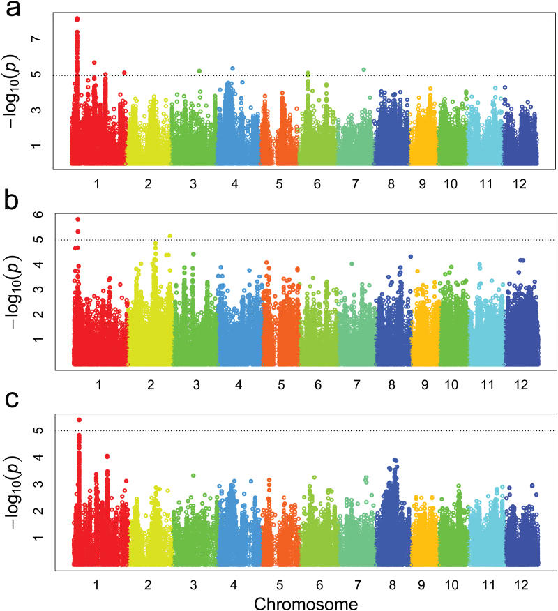
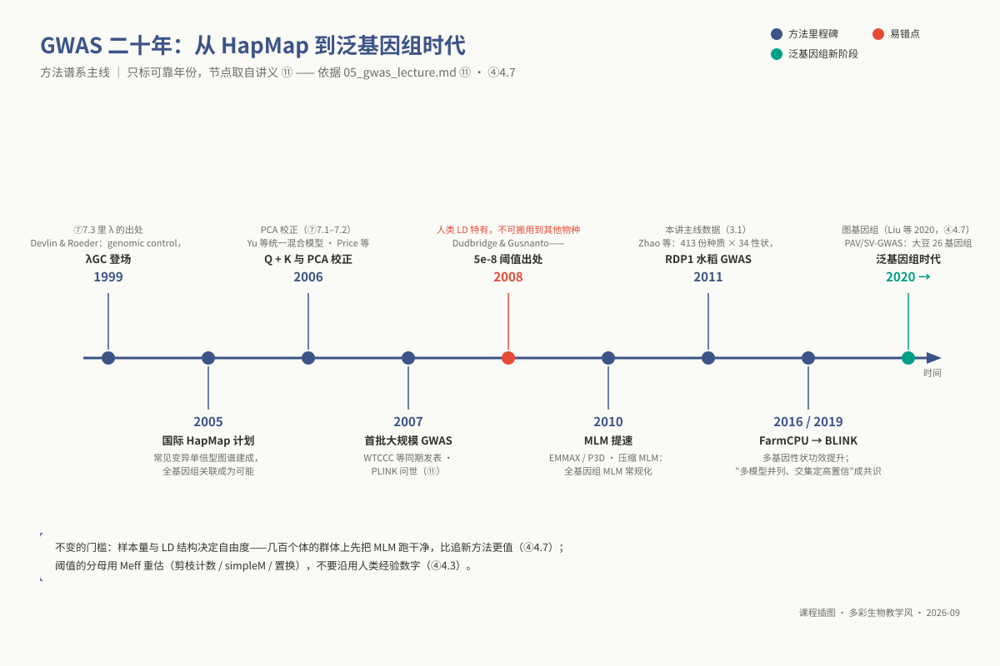
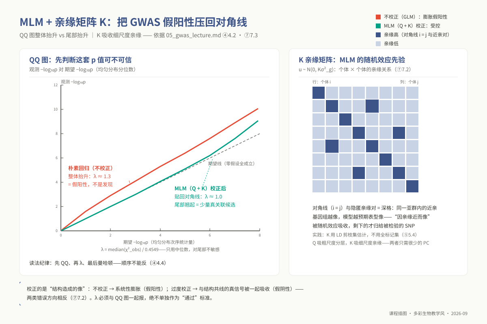
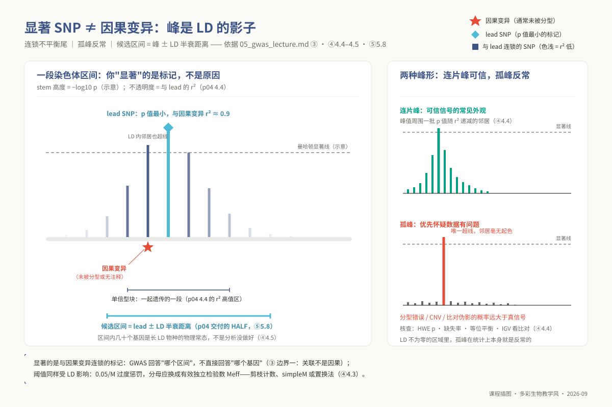
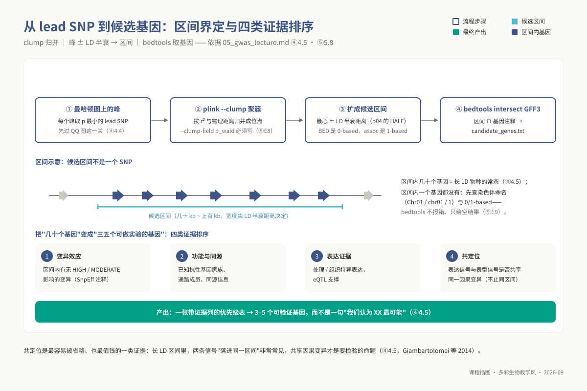
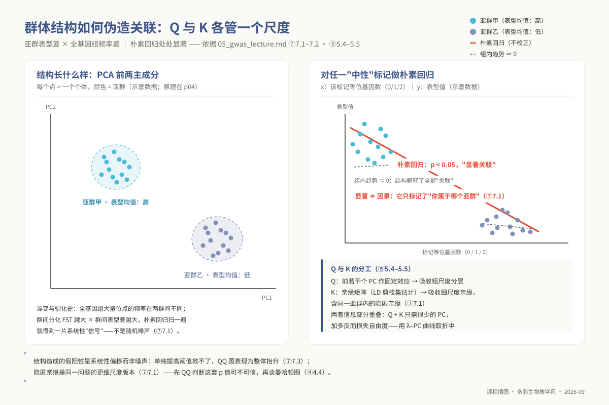

# 专题 p05：GWAS 关联分析与后 GWAS 挖掘

> **适用对象**：博士研究生（植物病理、昆虫、农药、微生物等专业）｜授课方式与学时：2 学时理论 + 2 学时实践，共 4 学时。
>
> **阅读重点**：本讲把 p04 的群体参数转化为 GWAS 协变量、显著性阈值和候选区间，重点阅读 ④ 的模型边界、⑦ 的统计诊断与 ⑩ 的课题迁移。

**资源与前置**：与 p04 共用环境 `ngs_phd_popgen`。工具包括 `plink`、`gemma`、`gapit`、`bedtools` 和 R；脚本为 `03_code/phd/scripts/05_gwas_gemma.sh`、`05_gwas_diagnostics.R` 和 `05_postgwas_interval.sh`。输入为 p04 ⑥ 6.3 的结构文件、剪枝集、PCA、过滤清单和 LD 半衰距离。

<!-- 维护信息：专题 id `p05`；目录 `topic05_gwas`。工具：`plink`、`gemma`、`gapit`、`bedtools` 与 R。与 p04 共用 `ngs_phd_popgen`；脚本：`03_code/phd/scripts/05_gwas_gemma.sh`、`05_gwas_diagnostics.R`、`05_postgwas_interval.sh`。GAPIT 依托 GitHub/独立站点分发，按契约豁免，部署见 §5.6。输入为 p04 ⑥ 6.3 的结构文件、剪枝集、PCA、过滤清单和 LD 半衰距离。 -->

## ① 学习目标

学完本专题，你应当**能够**：

1. **阐明**全基因组关联分析（GWAS）的统计本质与推断边界，区分关联和因果，并比较其与双亲连锁定位、BSA 分组分析的适用场景。
2. **规范治理**用于关联推断的表型数据：执行正态性检验与非线性/逆正态变换，基于混合线性模型提取多环境重复的 BLUE 与 BLUP 估计值，并**推导**广义遗传力与 SNP 遗传力对 GWAS 检出功效的前置约束。
3. **推导并运行**广义线性模型（GLM）与混合线性模型（MLM：$Q + K$），说明 $Q$ 和 $K$ 各自处理的混杂来源，并评估过度校正造成假阴性的风险。
4. **判读**分位数-分位数（QQ）诊断图，区分全基因组系统性抬升和极端尾部偏离，并说明基因组膨胀因子 $\lambda_{\text{GC}}$ 如何受样本量和性状多基因架构影响。
5. **严密制定**全基因组显著性阈值：**论证** GWAS 在初筛阶段更依赖族系误差率（FWER）而非错误发现率（FDR）的功效考量，并基于 `p04` 的全基因组 LD 衰减跨度精确推导有效独立检验数 $M_{\text{eff}}$。
6. **科学界定**曼哈顿峰所对应的染色体物理候选区间（而非孤立的单个 Lead SNP），完成区间内部结构注释基因提取，并基于变异后果、共定位分析与转录应答建立可验证的候选优先级排序。
7. **输出**出版级标准 GWAS 研究报告：整合 QQ 诊断图、$\lambda_{\text{GC}}$ 评估、曼哈顿全景图、高置信显著位点表、物理候选区间基因明细，以及潜在假阳性/假阴性风险辩护。

## ② 前置检查

本讲全面依托混合线性模型与高维遗传协方差矩阵。若在推导或分析中遭遇阻碍，请对照下表回溯检索。

| 依赖模块 id | 本讲哪里用到 | 不过关的典型症状 | 对应自测题号 |
|---|---|---|---|
| `l0_01_linux` | ⑤ 全部运算；GEMMA 与 GAPIT 批处理作业提交 | 在公共登录节点直接启动全基因组高密度标记的 MLM 拟合，导致系统崩溃 | `L0-1-Q5`（集群算力分配原则）、`L0-1-Q9`（SGE 作业脚本调度） |
| `l0_03_conda` | 运行环境动态加载；GAPIT 运行依赖隔离 | 作业日志抛出 `gemma: command not found`，环境变量未跨节点传递 | `L0-3-Q9`（Conda 依赖快照导出）、`L0-3-Q10`（作业脚本中环境的安全激活） |
| `l0_02_r` | ⑤ 表型 BLUE 估算、QQ 图绘制、曼哈顿图渲染及候选基因排序 | 无法利用 qqman 生成分染色体曼哈顿图，无法在 R 中完成多表合并过滤 | `L0-2-Q8`（矩阵切片与因子重整）、`L0-2-Q9`（出版级统计图件渲染） |
| `l0_04_formats` | ⑤ 5.8 候选物理区间与 GFF3 基因组注释取交集 | 混淆 0-based 与 1-based 坐标，导致 `bedtools intersect` 输出整体漂移 | `L0-4-Q6`（BED/GFF/VCF 格式规范）、`L0-4-Q7`（半开区间与闭区间换算） |
| `l0_06_stats` | ⑦ 统计插件全节：混合线性模型、多重假设检验校正 | 将单测标未校正的 `p < 0.05` 误当作“显著关联标记”，无法评估第一类错误通胀 | `L0-6-Q4`（假设检验 $p$ 值含义）、`L0-6-Q5`（Bonferroni 与 FDR 适用边界）、`L0-6-Q6`（协变量共线混杂） |
| `l1_p05` | ⑤ 5.3 质控命令中 `--maf`、`--geno`、`--mind` 三个阈值确认，及自交群体为何不加 `--hwe` | 混淆位点缺失率与个体缺失率的作用对象，说不清参数过滤的生物学动机 | 博士前置补丁自测 **Q3**（PLINK 质控参数设计）、**Q4**（PED/MAP 与 BED/BIM/FAM 结构） |

> **本层前置链条**：`p04` 是本讲不可分割的理论前置。若未完成 `p04`，本讲 5.4 的 PCA 协变量提取、7.4 的有效独立检验数推导及 5.8 的候选区间物理跨度将彻底丧失理论依据。
> **`l1_p05` 补课入口**：硕士层 `m03`《重测序与变异检测》**§6.2 VCF 格式与变异过滤**。

**30 秒运行环境自检**：

```bash
source "${CONDA_ROOT:-/opt/miniconda3}/bin/activate" ngs_phd_popgen
plink --version && gemma -h | head -3 && bedtools --version
Rscript -e 'library(qqman); packageVersion("qqman")'
```

## ③ 背景与科学问题

全基因组关联分析（GWAS）的核心数学命题在于：**在自然群体的全基因组尺度上，逐一扫描各个多态性位点的等位基因频率波动是否与目标数量或质量性状表型呈现统计学上的显著共分离。**

在迈入复杂算法之前，必须将三项冷酷的方法学先验深植于心：
第一，**统计关联绝不等于生物学因果**。曼哈顿图上的显著 SNP 峰通常仅代表一个与真实功能突变存在紧密物理连锁（`p04` §4.4 之 $r^2$）的“标签标记（Tag SNP）”，更有甚者，该信号可能纯粹源于未被模型充分吸收的群体亚群分层、近交家系背景，乃至环境与基因型空间分布的宏观共线伪影；
第二，**GWAS 能够且仅能回答**：“在当前特定抽样群体、特定实验测定环境下，全基因组哪些物理区间的常见变异（Common variants）对表型方差做出了统计贡献”；它**完全无法回答**单个候选基因是否具备因果决定性、极低频与稀有突变的效应，以及基因与复杂微环境互作（G×E）的底层生化网络；
第三，**经典基因定位手段的互补权衡**：双亲杂交构建的人工群体连锁定位（QTL）具备极高的统计功效，但其定位精度被杂交后代有限的减数分裂重组事件锁死在数个兆碱基（Mb）范围；极端表型混池分离分析（BSA）成本极低且周期短，但仅适用于极端单基因或寡基因表型，无法解析微效多基因效应；GWAS 利用自然群体在漫长演化史上积累的数万次历史重组，能够将候选区间急剧收敛至数十千碱基（kb）乃至单基因级，但其代价在于依赖高样本量、必须承受极其严苛的多重假设检验惩罚，且极易受群体亚群分层的系统性假阳性污染。

**三者绝非替代关系，现代功能基因组学的标准范式是：GWAS 初筛锁定物理区间 → 双亲残余杂合系或 CRISPR 敲除精细验证。**

### 3.1 应用案例：RDP1 与水稻地方种——自然群体 GWAS 的两次经典落地

**案例一（本讲主线数据的出处）：Zhao 等（2011, *Nature Communications*）对水稻微核心种质 RDP1 的全景关联分析。**
该工作在水稻自然群体中确立了规范的 GWAS 分析范式：针对源自全球 82 个国家的 413 份代表性水稻种质，利用第一代 44K 高密度 SNP 芯片开展全基因组基因分型，系统采集并精细测定了株高、分蘖数、抽穗期等 34 项农艺性状；在方法学层面，研究全面验证了包含 $Q$ 矩阵与亲缘矩阵 $K$ 的混合线性模型（Yu et al. 2006, Kang et al. 2010），证实了针对籼稻、粳稻亚群结构的充分校正是避免假阳性暴发的关键前提。该工作产出的已发表全性状 $p$ 值矩阵已作为黄金标准基准内嵌于课程实训之中（⑤ 5.1）。

**案例二（方法学标杆）：Huang 等（2010, *Nature Genetics*）对 517 份水稻地方品种的高通量关联定位。**
该里程碑研究针对我国 517 份地方稻种实施了低覆盖度全基因组重测序，结合单倍型图谱成功填补了 360 万个高质量 SNP 标记。研究针对复杂的亚群结构，采取了极具洞见的策略——**在遗传背景均一的单一下属亚群（如单一 indica 群体）内部独立开展关联分析**，不仅彻底规避了跨亚群宏观分层的假阳性泥潭，且在 6 个已克隆基因座（*OsC1*、*Rc*、*ALK*、*waxy*、*qSW5*、*GS3*）上，峰值 SNP 距已知基因仅 1–26 kb。这两项经典工作为博士生提供了鲜活的启示：亚群内分层关联与全局混合线性模型构成了抵御虚假关联的对偶双翼。



*图 p05-1：真实 Manhattan plot 示例：水稻深根比 RDR（237 品种群体，非 RDP1；Lou et al. 2015，J Exp Bot 66(15):4749–4757，CC BY 3.0）。*



*图 p05-6：GWAS 二十年时间线：HapMap → 首批大规模 GWAS → 泛基因组时代。*

## ④ 核心原理

### 4.1 表型：GWAS 成败在跑第一条命令之前就定了大半

混合线性模型的统计检验严密假定表型残差服从均值为零、方差齐性的正态分布。若原始表型呈现严重的多峰态、极端偏态、大量零膨胀（如某些病害发病级数）或明显的测量天花板/地板效应，常规线性回归不仅功效剧烈缩水，更会引发未校正的假阳性暴发。针对轻度偏态，可采用自然对数或 Box-Cox 幂函数变换；在面对极端分布时，业界广泛引入**基于秩次的逆正态变换（Rank-based Inverse Normal Transformation，RINT）**。

必须清醒洞察 RINT 的双刃剑效应：RINT 能够近乎强迫性地将任何分布的残差拟合至完美的标准正态，从而产出近乎教科书般的优美 QQ 诊断图，但其惨痛代价是彻底抹平了极端表型个体的离群生物学信息，并使得回归系数 $\beta$ 彻底丧失了真实的物理度量单位（由具体产量或株高尺寸异化为无量纲的统计秩分）。

在涉农与微生物实验中，表型数据通常具有“多年、多点、多区组重复”的多环境试验架构（MET）。将多维时空测量坍缩为一个可用于关联分析的标量指标，涉及**最佳线性无偏估计（BLUE）与最佳线性无偏预测（BLUP）的方法学取舍**：
$$y_{ijk} = \mu + \text{Env}_i + \text{Rep}_{j(i)} + \text{Genotype}_k + (\text{Env} \times \text{Genotype})_{ik} + \epsilon_{ijk}$$
在上述随机截距模型中，若将基因型处理为**固定效应**求解，所得即为 BLUE 值；若处理为**随机效应**求解，所得即为 BLUP 值。BLUP 机制引入了向群体均值收缩（Shrinkage）的惩罚，在数据缺失严重、重复不均衡时具备更强抗噪性，但其收缩效应人为压缩了基因型间方差，会轻微降低下游 GWAS 的检出功效；BLUE 则完全无收缩，其效应量保持原始物理含义。研究者必须在方法学中显式交代并论证该选择。

更为严峻的挑战在于**基因型与环境互作（G×E）**。当表型跨环境遗传相关 $r_G$ 显著低于 1 时，意味着存在强烈的交叉互作（例如基因型 A 在干旱胁迫下极优而在水田极差）。若盲目将多环境数据强行平均并计算全局 BLUE，互作方差将被当作残差误差强行冲销，GWAS 将只能捕捉广适性平庸位点，而将真正具有环境适应性价值的关键抗逆基因彻底过滤。正确的姿势是：先评估 $r_G$，对低相关性状分环境独立建模，或在混合模型中直接嵌入标记与环境的显式交互检验项。

**广义遗传力（$H^2$）与 SNP 遗传力（$h^2_{\text{SNP}}$）构成了关联分析的先验概率闸门**。若表型方差分析计算所得的重复力或广义遗传力低于 0.2，意味着表型变异绝大部分由非受控的环境随机噪音主导，在常规数百个体的样本规模下，全基因组关联分析在数学上注定无法捕获任何跨越全基因组显著性阈值的真实位点。此时盲目调参或放宽阈值，纯属在统计噪声中自欺欺人。

### 4.2 模型谱系：从朴素回归、MLM 到多位点 FarmCPU 与 BLINK

关联模型的演化史，本质上是人类与群体结构假阳性及运算复杂度博弈的数学史：

| 关联模型架构 | 核心数学表达式 | 解决的核心混杂维度 | 潜在的方法学代价与局限 |
|---|---|---|---|
| **朴素线性模型（OLS）** | $y = \mu + X\beta + \epsilon$ | 单纯测定标记与表型的边际关联 | 完全忽略群体结构，引发全基因组灾难性的**系统性假阳性**（§7.1） |
| **主成分校正（GLM + $Q$）** | $y = \mu + Q\gamma + X\beta + \epsilon$ | 吸收全基因组宏观粗尺度的谱系分化 | 无法拟合亚群内部未分化的近亲家系及隐匿亲缘（Cryptic relatedness） |
| **混合线性模型（MLM：$Q + K$）** | $y = \mu + Q\gamma + X\beta + u + \epsilon$<br>$u \sim \mathcal{N}(0, 2K\sigma_g^2)$ | 同步吸收宏观谱系（$Q$）与微观个体间连续亲缘网络（$K$） | **过度校正代价**：与群体结构高度共线的真实因果位点会被连带清洗（假阴性）；矩阵求逆计算量达 $\mathcal{O}(M \cdot N^3)$ |
| **压缩 MLM / P3D-EMMAX** | 仅在零模型（Null model）下完成一次方差组分估计并永久固定 | 将全基因组每次求逆优化降解为单次方差估计，速度提升数千倍 | 对极端主效因果位点的统计检验统计量有微弱的保守压制 |
| **多位点模型（FarmCPU）** | 将固定效应模型（单个标记检验）与随机效应模型（多位点伪 QTN 协变量更新）交替迭代 | 彻底解除多基因遗传架构下单一亲缘矩阵对真实信号的过度吸收 | 伪 QTN 的贪心算法迭代存在随机性，输入顺序或随机种子扰动可能诱发结果漂移 |
| **BLINK 算法** | 采用连锁不平衡矩阵取代固定物理滑窗筛选伪 QTN，摆脱正态先验 | 运行吞吐极速，在高度多基因多位点架构下展现出最高的经验检测功效 | 算法表现极具进取性，**其实际检出位点必须与经典保守 MLM 开展多模型交叉验证** |

**学术审阅判读纪律**：多模型输出不一致是复杂性状分析的必然常态。严谨的博士学位论文绝不能片面选取检出位点最多的单一激进模型（如单列 BLINK 输出），必须将保守的 MLM（稳健控制假阳性）与进取的 FarmCPU/BLINK 并列呈现，以交集作为核心高置信区间，以差集作为深入探讨模型特异性的实证素材。



*图 p05-2：MLM+kinship 把膨胀的 p 值压回对角线：QQ 图整体抬升（红）是假阳性，校正后（绿）尾部翘起才值得看。*

### 4.3 显著性阈值：为什么 GWAS 严禁照搬转录组的常规校正

在经典 RNA-seq 差异表达中，Benjamini-Hochberg（BH）控制假发现率（FDR）是通用准则。然而在 GWAS 分析中，**直接对全基因组几十万至数百万个单 SNP 施加 BH 校正，在统计机理上属于严重的概念错配**：
GWAS 关联定位的基本物理单位是**染色体连锁区间（Locus）而非孤立的单碱基变异**。由于连锁不平衡（LD）的物理存在，一个真实的因果变异会通过搭便车效应拉动周边数十上百个连锁 SNP 共同产生微弱显著信号。若直接在单 SNP 空间执行 FDR 校正，这些高度相关的同源信号将在分母上被人为反复多次计数，造成校正后的 $q$ 值严重失真。若确需使用 FDR 控制，必须首先执行 LD 聚类压缩（Clumping），将共分离的 SNP 块折叠为独立的遗传区间后再行统计校正。

更深层次的冲突在于**单标记检验的非独立性**。直接执行名义变异数 $M$ 的 Bonferroni 刚性截断（即 $\alpha = 0.05 / M$），在数学上强力假定这 $M$ 个位点相互完全独立。然而由于 LD 的物理阻滞，全基因组内部的**有效独立检验数（Effective number of independent tests，M_{\text{eff}}）远小于物理标记总数 $M$**。

在高自交、长 LD 阻滞的作物（如栽培稻、大豆）中，$M_{\text{eff}}$ 往往不足实际 SNP 总量的十分之一，机械采用 $0.05 / M$ 会引入极度苛刻的过度惩罚，造成海量中微效真实位点的系统性灭失。经典人类遗传学固化的 $5 \times 10^{-8}$ 阈值，完全基于全基因组约 100 万个独立常见单倍型块的历史推导，将其原封不动地搬用到涉农非模式物种中毫无学术根据。

严谨界定显著性阈值的正交路线包括：

1. 基于 `p04` 的独立剪枝标记子集规模（`prune.prune.in` 行数）作为 $M_{\text{eff}}$ 的稳健上界代入 Bonferroni 计算；
2. 利用标记相关矩阵特征值分解的 simpleM 算法推导真实自由度；
3. **经验置换检验（Permutation Test）**：固定全基因组基因型矩阵的原始空间拓扑与 LD 结构，将表型向量随机重排 $B$ 次（如 $B = 1{,}000$），每次记录全基因组拟合产出的最小 $p$ 值的分布，取其 5% 分位数作为全基因组族系误差率（FWER）的真实临界值。置换检验不依赖任何独立性假设，是公认最诚实的金标准。

**阈值抉择的最终准则完全取决于下游科研动作的试错成本**：若筛选位点旨在指导长达数年的 CRISPR 基因敲除或转基因功能确证，必须严格恪守基于 $M_{\text{eff}}$ 的 FWER 刚性防线（宁缺毋滥）；若关联位点仅用于全局代谢通路富集分析或多基因风险评分构建，则可理性采纳松弛的 Suggestive 阈值（$\approx 1 / M_{\text{eff}}$）或聚类后 FDR。

### 4.4 诊断三图，顺序不能反

在产出全基因组关联统计矩阵后，生信初学者极易第一时间点开华丽的曼哈顿全景图寻觅“显著高峰”。这一操作在方法学规范上属于致命的次序颠倒。GWAS 结果审阅必须无条件恪守：先审视 QQ 诊断图，再量化膨胀因子 $\lambda_{\text{GC}}$，唯有在前两者均处于健康分布区间时，方被允许检视曼哈顿图。

QQ 图将全基因组实测的 $-\log_{10}(p)$ 降序分位数与均匀无偏中性期望值绘制为散点图。若模型校正失当，即使不存在任何真实生物学信号，散点图亦会在全基因组尺度上呈现**从最左端起始便整体脱离对角线的刚性平移（全局系统性抬升）**。在曼哈顿图上，这种系统性错误会表现为成百上千个遍布各染色体的虚假“超线信号”，令缺乏经验者误以为发现了庞大的多基因调控网络；唯有在 QQ 图上确认散点在前 90%–99% 严格贴伏对角线、仅在最右侧顶端呈现锐利的向上翘起（尾部离群）时，曼哈顿图上的峰顶信号方具备起码的生物学真实性。

在曼哈顿图的形态学解构上，必须严格区分两类异质性图型：
**其一，健康的连片峰（Coherent peak with LD decay tail）**：位于峰顶的 Lead SNP 具有最高显著性，其物理侧翼的邻近标记受物理连锁程度 $r^2$ 的平滑衰减，呈现出随距离递减的阶梯状金字塔回落。这一经典物理特征与减数分裂重组规律高度契合，是真实因果变异存在的最有力形态学佐证。
**其二，突兀的孤峰（Isolated single-SNP spike）**：染色体某一物理坐标突兀飙升至 $p < 10^{-10}$，而其紧密相邻数 kb 内的其他高质量 SNP 均表现为完全中性（$p > 0.1$）。在局部 LD 显著大于零的常染色质区，这一表型在遗传学概率上属于不可思议的异常。此类孤峰绝大多数源自该变异位点的严重分型错配、未被识别的拷贝数变异微卫星滑移，或是短读长比对诱发的高假阳性错位，必须在 IGV 深度可视化核对后予以剔除。



*图 p05-4：显著 SNP ≠ 因果变异：LD 衰减与候选区间。*

### 4.5 后 GWAS：从峰到候选基因

将统计关联峰转化为湿实验可验证的生物学假说，是后 GWAS（Post-GWAS）挖掘的核心任务。必须终结将“曼哈顿峰顶处的单个 Lead SNP 坐标”直接等同于“因果突变基因”的粗暴做法。

严谨的区间界定规范包括：依据 `p04` 测定的群体平均 LD 半衰距离向 Lead SNP 两侧对称延伸，或调用 PLINK `--clump` 算法基于经验连锁度（如 $r^2 \ge 0.2$ 且物理跨度 $\le 500$ kb）将显著变异动态凝聚为独立的物理候选区间。在高 LD 自交作物中，单个候选区间物理覆盖 100–300 kb、横跨数十个注释基因属于完全正常的物理常态。将数十个候选基因收敛至 2–3 个高优先级目标，依赖**多维正交证据权重的科学加权矩阵**：

1. **变异结构后果层级**：利用 SnpEff 注释区间内所有变异，筛查是否存在导致提前终止密码子（Nonsense）、移码突变（Frameshift）或经典剪接供受体破坏的高影响突变（HIGH impact），或发生非同义氨基酸置换的中度影响突变（MODERATE impact）；
2. **时空转录组与生理通路契合**：调取靶标性状关键组织或关键逆境诱导时序下的 RNA-seq 数据，检索区间内基因是否特异表达，是否富集于已知相关生化代谢网络；
3. **统计共定位检验（Statistical Colocalization）**：在具备表达数量性状位点（eQTL）数据的体系中，通过结合双性状贝叶斯共定位模型（如 coloc 算法），严谨检验表型 GWAS 关联峰与特定基因的 eQTL 调控峰是否在统计后验概率上共享**同一个因果变异（Hypothesis 4: Shared variant）**，断然排除两者仅仅是因为同处于高 LD 染色体区间而产生的虚假偶联。



*图 p05-5：从 lead SNP 到候选基因：clump → 区间 → 证据排序。*

### 4.6 边界与近 3 年方向

传统单标记单性状 GWAS 面临着先天的固有理论天花板：它对次要等位频率低于 0.05 的罕见与稀有变异几乎丧失检出功效；它在数学上强力假定变异效应为加性且无相互作用，对普遍存在的上位性效应（Epistasis）及复杂的非线性微环境应答（G×E）缺乏建模自由度；更为致命的是，传统基于线性参考基因组识别的 SNP 标记集，对染色体大片段缺失、倒位与结构插入变异（SV）视若无睹。

近三年（2023–2026）的前沿突破主要涌现于两大方向：其一是**基于泛基因组的结构变异关联分析（PAV/SV-GWAS）**。利用高精度图泛基因组，直接将基因存在/缺失变异（PAV）或染色体大片段结构重组作为离散多态性编码代入关联模型，在植物抗病与驯化研究中成功揭示了海量传统 SNP 遗漏的隐藏因果结构；其二是**多变量联合模型（Multivariate Mixed Models）在相关性状群中的规模化应用**。

通过显式建模多个高度相关表型间的遗传协方差矩阵，在放大统计检验功效的同时，实现了对基因多效性（Pleiotropy）在系统生物学尺度上的严谨解构。

## ⑤ 操作步骤

分析流程封装于 `03_code/phd/scripts/05_gwas_gemma.sh`、`05_gwas_diagnostics.R` 与 `05_postgwas_interval.sh`。所有大矩阵运算必须提交高性能计算集群执行。

### 5.1 输入数据规格

教学主线采用水稻多样性全景基准数据集：**Rice Diversity Panel 1（RDP1）**。实测数据矩阵包含 413 份全球代表性栽培稻种质，原作者质控（call rate>70%、MAF>0.01）后发布 **36,901 个 SNP**（课程 §5.3 再质控后会更少，方法学须报实际数）；`struct`/`struct.pruned`/`pca.eigenvec` 须在 RDP1 上重跑 p04 管线得到（p04 交付物是稻瘟菌数据，不能直接接），以及包含株高、抽穗期等 34 项农艺性状的综合表型矩阵。
该数据集在教学中的核心价值在于提供了极度宝贵的“黄金对答案基准”：ricediversity.org 官方随附了已发表的完整混合模型逐标记关联检验 $p$ 值矩阵（`MixedModel_Pval_all.txt`），使得学生在完成自主分析后能够与经典文献的发表结果实现逐位点的精度比对闭环。

**实战输入陷阱规避**：

1. 原始表型文件常携带旧式 Mac 回车符（仅含 `\r`），会导致 Linux 统计行数返回 0 且 R 仅能读取首行，必须在分析前执行 `tr '\r' '\n' < pheno_raw.txt > pheno_clean.txt` 规范化；
2. 严防 ID 匹配列错位：PLINK `.fam` 第二列记录的是纯数值 NSFTVID（如 `1`、`3`、`4`），而表型矩阵第一列通常为样本代号，**第二列才是真实匹配的 NSFTVID**，混淆将导致两表交集样本量清零（⑨-E2）；
3. PLINK `.ped` 格式末列通常默认填充缺失占位符 `-9`，必须通过 `--pheno` 显式外挂纯净表型文件。

### 5.2 表型数据治理与 BLUE 提取（R）

```r
library(lme4); library(dplyr)
raw <- read.csv("pheno_raw.csv")                       # 包含 genotype, env, rep, trait 字段
hist(raw$trait); shapiro.test(sample(raw$trait, 500))  # 正态性分布检验
fit <- lmer(trait ~ env + (1|genotype) + (1|genotype:env), data = raw)
vc  <- as.data.frame(VarCorr(fit))                     # 提取方差组分推导广义遗传力 H2
blue_model <- lm(trait ~ genotype + env, data = raw)   # 基因型作为固定效应求解 BLUE
blue_vals  <- coef(blue_model)
```

### 5.3 基因型矩阵质控

```bash
plink --bfile struct --allow-extra-chr \
      --maf 0.05 --geno 0.1 --mind 0.1 \
      --make-bed --out gwas
```

**不加 `--hwe`**（与脚本默认 HWE=0 一致）：RDP1 是高自交、多亚群混杂的二倍体，自交与 Wahlund 效应让全基因组普遍杂合缺失，`--hwe 1e-6` 会成片误删真实变异；只有随机交配群体才开，并在方法学中写明阈值。

### 5.4 协变量构建与亲缘矩阵解算

```bash
# 提取 Q 矩阵：继承 p04 的 PCA 结果。GEMMA 要求协变量首列必须强制全填 1 作为模型截距
awk 'NR==FNR{pc[$2]=$3"\t"$4"\t"$5"\t"$6; next} {print "1\t" pc[$2]}' pca.eigenvec gwas.fam > covar_pc4.txt  # 按 IID 对齐 fam 行序（GEMMA 协变量行序 = fam 行序）

# 提取 K 矩阵：依托 LD 独立剪枝标记集计算，严禁使用未剪枝的全量标记直接运算
gemma -bfile struct.pruned -gk 1 -o kin
```

参数规范：`-gk 1` 计算中心化亲缘矩阵（Centered kinship），运算成果固化在 `./output/kin.cXX.txt`。

### 5.5 关联分析：从 GLM 对照到 MLM 主线

```bash
# ① 朴素 GLM 对照（未引入 K 矩阵，用于评估群体分层导致的膨胀严重度）
gemma -bfile gwas -lm 4 -o glm_raw

# ② 经典 MLM 主模型（Q + K 协同校正）
gemma -bfile gwas -k output/kin.cXX.txt -c covar_pc4.txt -lmm 4 -o mlm_pc4

# ③ 主成分维度敏感度扫描：寻觅使 λ 稳定收敛至 1.0 的最小 PC 数
for NPC in 0 2 4 6 10; do
  awk -v n=${NPC} 'NR>0{printf "1"; for(i=3;i<=2+n;i++) printf "\t%s",$i; print ""}' pca.eigenvec > c_${NPC}.txt
  gemma -bfile gwas -k output/kin.cXX.txt -c c_${NPC}.txt -lmm 4 -o mlm_pc${NPC}
done
```

### 5.6 多模型交叉验证（GAPIT 平台）

在 `ngs_phd_popgen` 环境的 R 终端中挂载 GAPIT 库，同步并行调度 MLM、FarmCPU 与 BLINK：

```r
library(GAPIT)
myGAPIT <- GAPIT(Y = pheno_df, G = hapmap_df, PCA.total = 4,
                 model = c("MLM", "FarmCPU", "BLINK"))
```

### 5.7 诊断图件绘制与膨胀因子量化

```r
res <- read.table("output/mlm_pc4.assoc.txt", header = TRUE)
chisq  <- qchisq(1 - res$p_wald, df = 1)
lambda <- median(chisq) / qchisq(0.5, df = 1)  # 严格基于中位数卡方统计量计算 lambda_GC
qqman::qq(res$p_wald, main = sprintf("MLM + 4PC, lambda = %.3f", lambda))
res$CHR <- as.integer(factor(res$chr))         # 染色体字符名映射为数值用于绘图
qqman::manhattan(res, chr = "CHR", bp = "ps", p = "p_wald", snp = "rs",
                 genomewideline = -log10(0.05 / n_eff), suggestiveline = -log10(1 / n_eff))
```

### 5.8 候选物理区间收敛与功能基因提取

```bash
# 执行基于 LD 拓扑的变异聚类（Clumping）
plink --bfile gwas --allow-extra-chr --clump output/mlm_pc4.assoc.txt \
      --clump-field p_wald --clump-snp-field rs \
      --clump-p1 1e-5 --clump-p2 1e-3 --clump-r2 0.2 --clump-kb 500 --out clump

# 依据 p04 测定的 LD 半衰物理距离将 Lead SNP 对称外延展开为 BED 物理区间
awk -v H=${HALF} 'NF>0 && $1!="CHR"{s=$4-H; if(s<1) s=1; print $1"\t"(s-1)"\t"$4+H"\t"$3}' clump.clumped > peaks.bed   # 钳位后起点 ≥ 0
awk 'BEGIN{OFS="\t"} !/^#/ && $3=="gene"{print $1,$4-1,$5,$9}' annotation.gff3 > genes.bed   # 先按第 3 列(type)取基因
bedtools intersect -a peaks.bed -b genes.bed -wa -wb > candidate_genes.txt
```

## ⑥ 结果解读

### 6.1 QQ 诊断图与基因组膨胀因子 $\lambda_{\text{GC}}$ 诊断矩阵

| QQ 散点拓扑表型 | 膨胀因子 $\lambda_{\text{GC}}$ 读数 | 底层诱发机理分析 | 规范化科研处置动作 |
|---|---|---|---|
| 散点从最左端中性区起始即**整体系统性平移抬升**于对角线之上 | $\lambda_{\text{GC}} \ge 1.20$ | **系统性假阳性灾难**：群体分层或家系亲缘未被模型吸收、测序深度与表型共线、严重分型错误 | 绝不能查看曼哈顿图！增补 PC 维度、核查亲缘矩阵 K、重新检验表型残差分布 |
| 前 90%–99% 数据严密紧贴对角线，**仅最右侧顶端极少数点向上翘起** | $\lambda_{\text{GC}} \approx 1.00 \pm 0.05$ | 符合经典“绝大多数变异中性 + 少数真实主效因果突变伴随局部 LD 拖尾”的健康形态 | 模型校正充分，可安全放行进入曼哈顿峰与显著位点解读 |
| 散点全线**整体沉陷于对角线下方** | $\lambda_{\text{GC}} \le 0.90$ | **过度校正灾难**：协变量 PC 过多，或亲缘矩阵 K 暴力吸收了与群体分化共线的真实因果效应 | 减少 PC 协变量维度；绘制 $\lambda$ 随 PC 数的收敛曲线，提取最适临界折中点 |
| 全程完全紧贴对角线，**右侧末端毫无翘起离群点** | $\lambda_{\text{GC}} \approx 1.00$ | 在当前样本量与遗传标记密度下，该性状**完全未检出任何具备统计功效的信号** | 核查表型广义遗传力 $H^2$；严禁通过私自放宽 $p$ 值阈值人为编造虚假发现 |

### 6.2 曼哈顿图异常信号排查与显著位点报告规范

| 曼哈顿图异常图型 | 背后的真实物理/统计根源 | 针对性快速排查技术动作 |
|---|---|---|
| **突兀孤峰**：单一 SNP 达到极显著，紧邻数 kb 内位点无任何关联响应 | 该 SNP 本身存在分型错配、杂合缺失、短读长比对错误或拷贝数变异微卫星突变 | 检索该 SNP 的 HWE 检验显著性、缺失率与等位基因测序深度平衡比（AD 比例） |
| 全基因组各染色体呈现大面积密集超线，遍地开花 | 模型存在深层未校正的结构膨胀，QQ 图处于整体抬升状态 | 终止解读，回溯模型检查协变量设计与表型正态性变换 |
| 显著信号完全被死死锁定在某条染色体的特定巨大物理块内 | 染色体存在大片段倒位或着丝粒抑制区，数千个标记完全共分离形成超大单倍型 | 绘制该染色体局部 LD 热图，核查该区间是否在某 PC 主成分上独占极端载荷 |
| 切换至 FarmCPU 或 BLINK 模型后，显著位点坐标发生全盘洗牌 | 多位点贪心算法迭代选择伪 QTN 时陷入局部极值，对初始输入顺序或随机种子敏感 | 固定不同随机种子重复计算 5–10 次，仅采纳稳健复现的高置信共识交集位点 |
| 单个 SNP 估计效应量极其夸张（表型方差解释率 $R^2 > 40\%$） | 自然群体中极罕见，高度疑似表型录入错误、样本 ID 颠倒或将分群标签错当表型 | 绘制表型相对基因型的分组箱线图，审视是否存在两极分化的非连续离群点 |

**高置信显著关联表必须具备的八项核心元数据**：变异 ID、染色体、物理位置坐标、效应等位与参考等位、次要等位基因频率（MAF）、加性回归效应值（$\beta$）及其标准误（SE）、模型标明的检验 $p$ 值（明确标注为 `p_wald` 或 `p_lrt`），以及该位点所属的物理候选区间边界。

## ⑦ 统计插件

> 契约 `stats_plugin_topics` 指定重点：**混合线性模型机制、群体结构混杂校正、Bonferroni 与 FDR 的抉择、QQ 图与膨胀因子数学本质。**

### 7.1 为什么朴素回归不够：群体结构如何伪造虚假关联

假定考察群体包含两个发生分化的亚群（Subpopulation A 与 B）。由于历史生态或人为栽培差异，亚群 A 的目标性状表型均值显著高于亚群 B：$\bar{y}_A > \bar{y}_B$。与此同时，在中性遗传漂变支配下，全基因组上存在数以万计的等位基因在两亚群间演化出频率差异：$p_{A,j} \ne p_{B,j}$。

若对其中某个与目标性状生化机制毫无关联的完全中性标记 $j$ 执行简单一元线性回归：$y = \mu + x_j\beta_j + \epsilon$。根据遗漏变量偏差（Omitted Variable Bias）数学定理，估计量渐近收敛于：
$$\hat{\beta}_j \xrightarrow{P} \frac{\operatorname{Cov}(y, x_j)}{\operatorname{Var}(x_j)} = \frac{\operatorname{Cov}(\mu_S, x_j)}{\operatorname{Var}(x_j)} = (\bar{y}_A - \bar{y}_B)(p_{A,j} - p_{B,j}) \frac{w_A w_B}{\operatorname{Var}(x_j)}$$
上式推导给出了深刻的统计警示：只要两个亚群的表型均值存在差距（$\bar{y}_A \ne \bar{y}_B$），且位点在两群间存在频率分化（$p_{A,j} \ne p_{B,j}$），即使该变异在生物学上彻底中性，其回归斜率估计量 $\hat{\beta}_j$ 必然显著偏离零！ 这种因群体分层诱发的假阳性具有全基因组系统性，其直接导致数万个中性标记同步呈现虚假显著性，单纯靠调高统计显著性阈值在数学上根本无法破局。



*图 p05-3：群体结构是最大的混杂：朴素回归连中性标记都「显著」。*

### 7.2 混合线性模型中 $Q$ 与 $K$ 的数学代数角色

混合线性模型通过将遗传协方差结构显式分解为固定效应与随机效应以化解上述危机：
$$\mathbf{y} = \mathbf{X}\boldsymbol{\beta} + \mathbf{S}\boldsymbol{\alpha} + \mathbf{u} + \boldsymbol{\epsilon}, \quad \operatorname{Var}(\mathbf{u}) = 2\mathbf{K}\sigma_g^2, \quad \operatorname{Var}(\boldsymbol{\epsilon}) = \mathbf{I}\sigma_e^2$$
其中 $\mathbf{S}$ 对应由主成分构成的 $Q$ 矩阵，$\mathbf{u}$ 为多基因多态性导致的微观个体间随机加性遗传效应向量。
个体间表型协方差矩阵构型为：$\mathbf{V} = 2\mathbf{K}\sigma_g^2 + \mathbf{I}\sigma_e^2$。亲缘矩阵 $\mathbf{K}$ 的核心数学使命，在于为表型残差赋予先验相关性约束——两个个体在全基因组遗传变异上越相似，模型便在先验期望中预判其表型残差越贴近。如此一来，“因血缘亲近而导致的表型相仿”被随机截距向量 $\mathbf{u}$ 充分吸收解耦，唯有剥离掉亲缘背景后仍具备独立解释力的变异，方能被赋予显著的标记回归效应 $\boldsymbol{\alpha}$。

**近邻污染（Proximal Contamination）与 LOCO 规程**：
在构建亲缘矩阵 $\mathbf{K}$ 时，若被检验的候选 SNP 及其染色体同源片段未被剔除，该标记自身的因果效应将被亲缘矩阵 $\mathbf{K}$ 双重拟合吸收，导致测定统计量被人为压低，损失检出功效。在精细分析中，应采用**留一染色体法（Leave-One-Chromosome-Out，LOCO）**——在扫描特定染色体时，仅利用其余所有染色体上的独立变异解算当前亲缘矩阵。

### 7.3 QQ 图与膨胀因子 $\lambda_{\text{GC}}$ 的统计学本质

将全基因组检验输出的 $M$ 个 $p$ 值按升序排列得到次序统计量 $p_{(1)} \le p_{(2)} \le \dots \le p_{(M)}$。在中性零假设均成立的理想分布下，$p$ 值服从区间 $(0, 1)$ 上的标准连续均匀分布，其次序统计量具有明确的期望：$E[p_{(i)}] = \frac{i}{M + 1}$。

基因组膨胀因子 $\lambda_{\text{GC}}$ 定义为观测卡方统计量中位数与理论中位数之比：
$$\lambda_{\text{GC}} = \frac{\operatorname{median}(\chi^2_{\text{obs}})}{0.454937}$$
针对 $\lambda_{\text{GC}}$ 的判读，必须掌握 Yang et al. (2011) 的经典数学标度法则：对于高度多基因控制的复杂数量性状（如株高、生物量），数千个极微效因果变异广泛散布于全基因组中。此时，在真实的生物学因果驱动下，卡方分布的全局中位数天然会产生微幅上浮：
$$\lambda_{\text{GC}} \approx 1 + N \cdot \frac{h^2_{\text{SNP}}}{M_{\text{eff}}}$$
这一公式揭示出关键学术公理：当样本量 $N$ 扩展至数千甚至上万人时，即使模型完美消除了群体分层，高度多基因性状的 $\lambda_{\text{GC}}$ 依然会自发达到 1.10–1.20！ 因此，机械将“$\lambda_{\text{GC}} < 1.05$”设为数据质控的绝对红线，在逻辑上是错误的；跨研究对比时应使用标准化样本量膨胀指标：$\lambda_{1000} = 1 + (\lambda - 1)\frac{1000}{N}$。

### 7.4 Bonferroni 与 FDR 在关联分析中的分工逻辑

在基因组长 LD 阻滞的物种中，有效独立检验数 $M_{\text{eff}}$ 构成了唯一的理性尺度。直接调用 $0.05 / M$ 属于过度保守的统计自残。通过 simpleM 特征值分解或 LD 剪枝测得 $M_{\text{eff}}$ 后，执行修正后的 Bonferroni 阈值（$\alpha = 0.05 / M_{\text{eff}}$）构成了控制族系误差率（FWER）的规范路线。唯有在通过 LD Clumping 彻底消除标记共分离之后，方被允许在独立的位点尺度上探索使用 Benjamini-Hochberg FDR 控制策略。

## ⑧ AI 辅助任务

> 契约 `ai_task_topics` 明确本讲核心使命在于构筑针对 QQ 图与模型膨胀辨析的批判性防线。

任务靶向：驱动大语言模型解读课题实操产出的 GWAS QQ 诊断图，严格审查其能否准确区分“全局系统性抬升”与“尾部离群翘起”，并检验其对膨胀因子 $\lambda_{\text{GC}}$ 评价的科学性。

**步骤 1 · 提示词生成**（故意隐藏模型参数、样本规模与性状遗传力先验）：

```text
这是我运行全基因组关联分析后获得的 QQ 图（散点在前段微幅偏离对角线，末端少数点有明显翘起）以及计算出的基因组膨胀因子 lambda_GC = 1.18。请帮我评估：1. 这个分析结果是否合格、是否存在假阳性？2. 我是否需要重新调整协变量并重跑模型？请给出具体建议。
```

**步骤 2 · 五维方法学审查矩阵**：

| 核查维度 | 严谨判定准则与审查技术动作 | 典型破绽表象与定性结论 |
|---|---|---|
| **① 全局抬升与尾部偏离的甄别** | 审查是否混淆了曲线在全区间的刚性平移与仅在极端显著尾部的脱离 | **严重失误**：将整条曲线系统性膨胀与局域真信号离群混为一谈 |
| **② 样本量与多基因性追问意识** | 审查 AI 是否主动追问当前的测序样本量规模 $N$ 与性状先验遗传力 | **不合格**：将 1.18 视为孤立绝对常数，忽略 Yang et al. 2011 的标度律 |
| **③ 盲目推荐增补 PC 维度** | 审查其是否一味建议“继续追加 10–20 个主成分协变量” | **方法学隐患**：未警示过度校正导致真实因果峰被抹平的假阴性风险 |
| **④ 建议在实际数据中的验证表现** | 依据 AI 给出的参数调整建议在 GEMMA 中实际重跑并输出对照 QQ 图 | 对比重跑前后的 $\lambda$ 曲线，判定其是改善了模型还是清除了真实信号 |
| **⑤ 曼哈顿图审阅前置性阻断** | 审查其在面对明显膨胀时，是否依然建议“先去曼哈顿图上挑选显著位点” | **原则性错误**：违背“先 QQ 诊断、后曼哈顿解读”的不可逆基本时序 |

**步骤 3 · 课程实训报告提交物**：

1. 完整附录 AI 原始交互日志与输入提示词；
2. 填报《AI 辅助 GWAS 诊断缺陷审查表》；
3. 提交依据其建议调整前后（例如 PC=2 vs PC=6 vs PC=10）两套模型的 QQ 图拼图及对应的 $\lambda_{\text{GC}}$ 对照表，并撰写一段 250 字的方法学论述，详述如何在假阳性抑制与假阴性防范之间寻觅稳健折中点。

## ⑨ 常见错误与排查

| 故障编号 | 控制台真实报错信息 / 异常表象 | 底层诱发机理分析 | 规范化应急处置策略 |
|---|---|---|---|
| **E1** | `Error: Invalid chromosome code 'chr01' on line 254` | PLINK 默认仅接受人类常染色体标识，无法解析植物 Scaffolds | 所有命令强制声明 `--allow-extra-chr` |
| **E2** | 表型匹配交集为 0，程序输出 `analyzed individuals = 0` | 表型输入文件匹配列错位，或样本 ID 后端残留 Windows `\r` 回车字符 | 运行 `dos2unix` 清洗文本，严格按 `.fam` 第二列 NSFTVID 对齐表型 |
| **E3** | GEMMA 运算中输出协变量矩阵不可逆或回归系数值大面积漂移 | 传入的 `-c` 协变量矩阵首列缺失全为 1 的模型截距向量（Intercept） | 利用 `awk` 脚本在特征向量矩阵首列前硬编码嵌入一列常数 `1` |
| **E4** | GEMMA 启动后即刻打印 `number of analyzed individuals = 0` | `.fam` 第六列全为 `-9` 缺失标记，或表型样本顺序与 `.fam` 错位 | 利用 `plink --pheno` 重新生成规范嵌入表型值的专用 `.fam` 矩阵 |
| **E5** | 脚本执行完毕后在当前工作路径下无法寻获关联结果文件 | GEMMA 默认将全量分析成果定向写入固定的 `./output/` 子目录 | 检索 `./output/` 文件夹，或显式通过 `-outdir` 重定向绝对路径 |
| **E6** | GEMMA 日志中提示的分析 SNP 数量显著少于输入 `.bim` 行数 | GEMMA 内建存在默认过滤阈值（`-maf 0.01`、`-miss 0.05` 等） | 显式声明 `-maf 0 -miss 1` 由上游统一控制，或以日志实测数为准 |
| **E7** | R 语言 `qqman::manhattan` 绘图崩溃：`CHR column should be numeric` | 非模式生物染色体名称包含字符（如 `Chr01`），无法直接被数值轴映射 | 在 R 中通过 `as.integer(factor(res$chr))` 将染色体强制离散整数化 |
| **E8** | PLINK 执行 `--clump` 时报错 `No significant --clump results` | 软件默认检索表头 `P` 与 `SNP`，与 GEMMA 的 `p_wald` 与 `rs` 命名冲突 | 显式指定映射关系：`--clump-field p_wald --clump-snp-field rs` |
| **E9** | `bedtools intersect` 执行完成但产出的候选基因表行数恒为 0 | 基因型与 GFF3 注释文件的染色体命名空间不一致（`Chr01` vs `chr01`） | 核对两表第一列命名，利用 `sed` 统一转换前缀后再行求交集 |
| **E10** | GEMMA 报告方差组分估计异常：`pve estimate = 1` 或 `se(pve) = nan` | 样本量过小（$n < 60$）而变异数过高，限制最大似然估计算法收敛边界 | 削减协变量 PC 维度，或改走 LOCO 算法并在报告中详实披露样本量局限 |

## ⑩ 思考练习

1. **QQ 诊断实战决策**：面对三套不同的全基因组关联分析产物：(a) 散点全线平移于对角线之上且 $\lambda_{\text{GC}} = 1.35$；(b) 散点前 98% 紧贴对角线，末端锐利脱离对角线且 $\lambda_{\text{GC}} = 1.02$；(c) 散点全线压制在对角线下方且 $\lambda_{\text{GC}} = 0.86$。请逐一给出统计诊断结论，指出哪套产物严禁查看曼哈顿图，并针对异常方案制定明确的参数矫正措施。
2. **膨胀因子先验辨析**：研究团队 A 在 $n = 150$ 的水稻自然群体中测得抽穗期性状的 $\lambda_{\text{GC}} = 1.05$；研究团队 B 在 $n = 3{,}500$ 的大样本群体中测得同性状的 $\lambda_{\text{GC}} = 1.15$。能否直接判定团队 B 的模型控制弱于团队 A？请引用 Yang et al. (2011) 的标度理论展开定量论述。
3. **有效检验数与阈值推演**：某自交作物全基因组重测序共分型出 50 万个高质量 SNP，而经 `p04` 测定的全基因组 LD 独立剪枝子集仅保留了 2.5 万个变异。请推导该物种全基因组显著性 FWER 阈值与 Suggestive 临界值，并论证为何直接采用人类 $5 \times 10^{-8}$ 阈值在涉农育种研究中会引发巨大的假阴性灾难。
4. **过度校正两难破局**：某关键抗病表型在特定地理生态亚群中发生高频富集。在单标记朴素回归中产出了极显著的关联高峰，但在加入 5 个 PC 协变量与亲缘矩阵 $K$ 后，该峰值信号断崖式下跌至中性基准。请设计三项正交的生物信息学或遗传学验证方案，精准判定该现象属于“群体分层假阳性被清除”还是“真实因果信号遭到算法过度校正误杀”。
5. **曼哈顿突兀孤峰剖析**：曼哈顿图显示染色体某点突发达到 $p = 10^{-11}$ 的极显著峰，但其物理侧翼 100 kb 范围内的数十个标记 $p$ 值全大于 0.2，而该物种平均 LD 半衰距离长达 60 kb。请综合群体遗传学规律评估该信号的可信度，并列举必须调用的排查分析动作。
6. **多模型输出差异整合**：同一套水稻农艺性状数据在经典 MLM 中仅检出 1 个显著区间，而在 BLINK 模型中检出 14 个显著区间，且两者仅存在 1 个重合位点。请起草一段 150 字的论文 Results 描述，规范展现多模型比较的共识发现与潜在分歧。
7. **多环境试验表型治理**：针对在三地两年条件下采集的具有 15% 缺失率的水稻抗虫评分数据，系统制定从原始记录到关联输入的清洗路径（正态性评估、BLUE 建模、广义遗传力 $H^2$ 测定），并论证各步骤对下游 GWAS 结果可靠性的支配作用。
8. **学位课题全流程方案撰写（开放设计题）**：围绕你本人的博士学位课题设计一份 350 字的 GWAS 研究规划：① 选用的自然群体规模、生态代表性及其遗传变异丰富度评估；② 目标表型的测定规范、环境重复设计与遗传力先验预估；③ 依托 `p04` 提取的核心协变量与最适 PC 维度寻觅策略；④ 显著性阈值推导路线；⑤ 曼哈顿峰收敛至候选基因的物理跨度标准与三重验证证据链设计。

## ⑪ 参考资料

### 原始文献（DOI 逐条核验）

| 经典文献 | 科学贡献与发表出处 | DOI / 定位标识 |
|---|---|---|
| Purcell S, et al. PLINK: a tool set for whole-genome association and population-based linkage analyses (2007) | Am J Hum Genet 81(3):559–575 —— PLINK 关联工具奠基文献 | DOI: 10.1086/519795 |
| Zhou X, Stephens M. Genome-wide efficient mixed-model analysis for association studies (2012) | Nat Genet 44:821–824 —— **GEMMA 高效混合线性模型原著** | DOI: 10.1038/ng.2310 |
| Price AL, et al. Principal components analysis corrects for stratification in genome-wide association studies (2006) | Nat Genet 38:904–909 —— **主成分分析校正分层奠基之作** | DOI: 10.1038/ng1847 |
| Yu J, et al. A unified mixed-model method for association mapping that accounts for multiple levels of relatedness (2006) | Nat Genet 38:203–208 —— **经典 Q + K 统一混合模型** | DOI: 10.1038/ng1702 |
| Kang HM, et al. Variance component model to account for sample structure in genome-wide association studies (2010) | Nat Genet 42:348–354 —— EMMAX / P3D 方差组分固定算法 | DOI: 10.1038/ng.548 |
| Zhang Z, et al. Mixed linear model approach adapted for genome-wide association studies (2010) | Nat Genet 42:355–360 —— 压缩混合线性模型（Compressed MLM） | DOI: 10.1038/ng.546 |
| Liu X, Huang M, Fan B, Buckler ES, Zhang Z. Iterative usage of fixed and random effect models for powerful and efficient GWAS (2016) | PLoS Genet 12(2):e1005767 —— **FarmCPU 多位点迭代算法** | DOI: 10.1371/journal.pgen.1005767 |
| Huang M, et al. BLINK: a package for the next level of genome-wide association studies (2019) | GigaScience 8(2):giy154 —— BLINK 高效关联算法原著 | DOI: 10.1093/gigascience/giy154 |
| Wang J, Zhang Z. GAPIT version 3: boosting power and accuracy for genomic association and prediction (2021) | Genomics Proteomics Bioinformatics 19(4):629–640 —— GAPIT 3.0 平台标准 | DOI: 10.1016/j.gpb.2021.08.005 |
| Devlin B, Roeder K. Genomic control for association studies (1999) | Biometrics 55(4):997–1004 —— **基因组膨胀因子 lambda_GC 出处** | DOI: 10.1111/j.0006-341X.1999.00997.x |
| Yang J, et al. Genomic inflation factors under polygenic inheritance (2011) | Eur J Hum Genet 19(7):807–812 —— **§7.3 多基因遗传架构对膨胀因子的数学影响** | DOI: 10.1038/ejhg.2011.39 |
| Dudbridge F, Gusnanto A. Estimation of significance thresholds for genomewide association scans (2008) | Genet Epidemiol 32(3):227–234 —— 全基因组显著性阈值推导 | DOI: 10.1002/gepi.20297 |
| Gao X, Starmer J, Martin ER. A multiple testing correction method for genetic association studies using correlated SNPs (2008) | Genet Epidemiol 32(4):361–369 —— simpleM 有效独立标记数推导 | DOI: 10.1002/gepi.20310 |
| Li MX, Yeung JM, Cherny SS, Sham PC. Evaluating the effective numbers of independent tests and significant p-value thresholds (2012) | Hum Genet 131(5):747–756 —— 有效独立检验数与显著阈值评估 | DOI: 10.1007/s00439-011-1118-2 |
| Storey JD, Tibshirani R. Statistical significance for genomewide studies (2003) | PNAS 100(16):9440–9445 —— 全基因组 q 值与 FDR 控制范式 | DOI: 10.1073/pnas.1530509100 |
| Korte A, Farlow A. The advantages and limitations of trait analysis with GWAS: a review (2013) | Plant Methods 9:29 —— 植物 GWAS 方法学权衡系统综述 | DOI: 10.1186/1746-4811-9-29 |
| Visscher PM, et al. 10 years of GWAS discovery: biology, function, and translation (2017) | Am J Hum Genet 101(1):5–22 —— GWAS 十年发现与转化生物学综述 | DOI: 10.1016/j.ajhg.2017.06.005 |
| Tibbs Cortes L, Zhang Z, Yu J. Status and prospects of genome-wide association studies in plants (2021) | Plant Genome 14(1):e20077 —— §4.6 植物关联分析发展现状综述 | DOI: 10.1002/tpg2.20077 |
| Giambartolomei C, et al. Bayesian test for colocalisation between pairs of genetic association studies using summary statistics (2014) | PLoS Genet 10(5):e1004383 —— **§4.5 贝叶斯统计共定位 coloc 算法** | DOI: 10.1371/journal.pgen.1004383 |
| Quinlan AR, Hall IM. BEDTools: a flexible suite of utilities for comparing genomic features (2010) | Bioinformatics 26(6):841–842 —— BEDTools 区间运算套件 | DOI: 10.1093/bioinformatics/btq033 |
| Zhao K, et al. Genome-wide association mapping reveals a rich genetic architecture of complex traits in *Oryza sativa* (2011) | Nat Commun 2:467 —— **§3.1 案例一：水稻 RDP1 关联分析经典** | DOI: 10.1038/ncomms1467 |
| Huang X, et al. Genome-wide association studies of 14 agronomic traits in rice landraces (2010) | Nat Genet 42:961–967 —— **§3.1 案例二：水稻地方品种关联定位** | DOI: 10.1038/ng.695 |
| Korte A, et al. A mixed-model approach for genome-wide association studies of correlated traits in structured populations (2012) | Nat Genet 44:1066–1071 —— §4.6 多性状联合关联分析模型 | DOI: 10.1038/ng.2376 |
| Liu Y, et al. Pan-genome of wild and cultivated soybeans (2020) | Cell 182:162–176.e13 —— §4.6 泛基因组结构变异关联分析（PAV-GWAS） | DOI: 10.1016/j.cell.2020.05.023 |

### 官方技术文档与课程内部映射

- GEMMA 官方软件仓库：https://github.com/genetics-statistics/GEMMA ｜ PLINK 1.9 Clumping 指南：https://www.cog-genomics.org/plink/1.9/post-gwas#clump
- GAPIT 官方主页：https://zzlab.net/GAPIT/ ｜ BEDTools 在线文档：https://bedtools.readthedocs.io/en/latest/
- 前置承接链接：`p04` 群体遗传学基础与群体基因组（`02_lectures/phd/topic04_popgen/04_popgen_lecture.md`）
- 统计底座支撑：先导模块 `l0_06_stats`（`02_lectures/prerequisites/l0_06_stats/l0_06_stats.md`）
- 下游技术延伸：博士层 **p06 多组学整合分析**（GWAS 关联峰与 eQTL 共定位、多组学因果网络重建）、**p08 课题设计**（全基因组关联分析实验开题论证）
