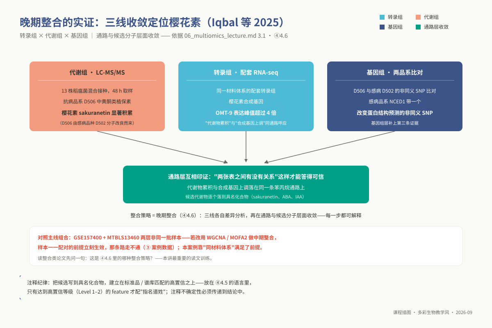
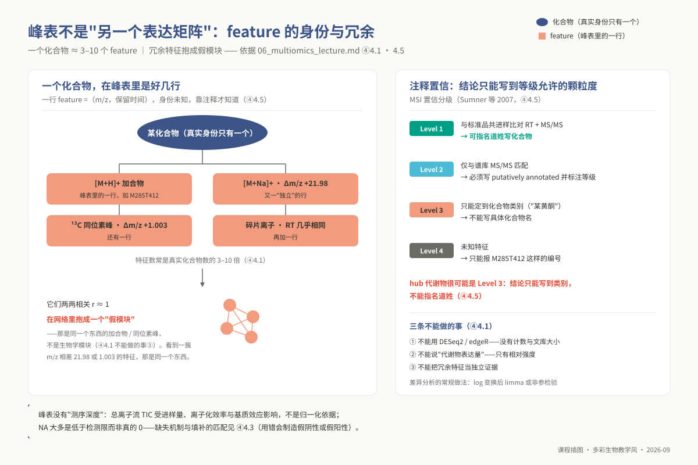
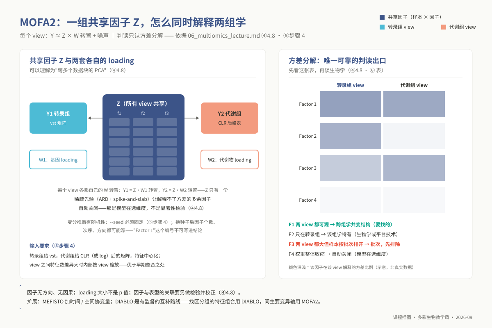
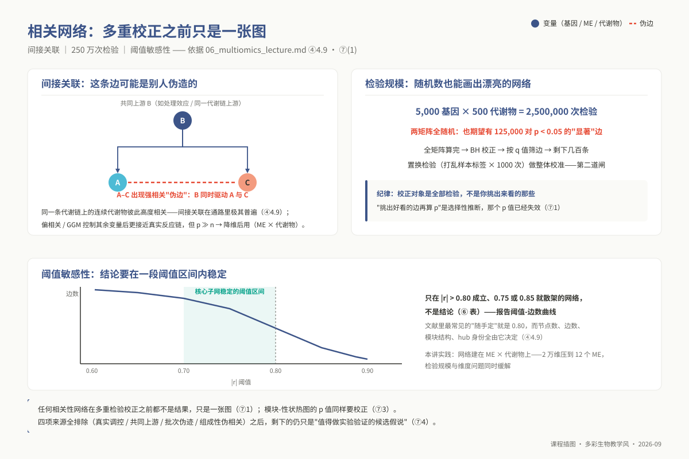
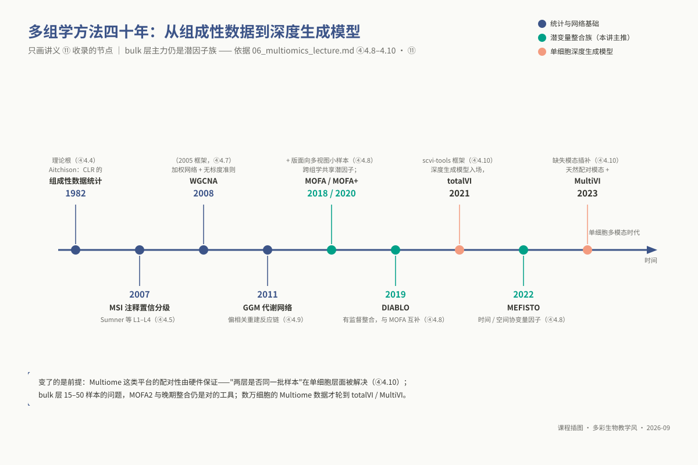

# 专题 p06：多组学整合分析

> **适用对象**：博士研究生（植物病理、昆虫、农药、微生物等专业）｜授课方式与学时：2 学时理论 + 2 学时实践，共 4 学时。
>
> **阅读重点**：本讲比较转录组与代谢组的数据生成机制、缺失机制和测量尺度，再讨论 WGCNA、MOFA2 与相关网络的整合边界；重点阅读 ④ 的方法假设与 ⑦ 的统计插件。

**资源与前置**：环境为 `ngs_phd_multiomics`；工具包括 `WGCNA`、`MOFA2`、`Cytoscape`，无界面路线使用 `igraph`。脚本位于 `03_code/phd/scripts/`：`06_metabolome_preprocess.R`、`06_wgcna_analysis.R`、`06_mofa2_integration.R` 和 `06_correlation_network.R`。

<!-- 维护信息：专题 id `p06`；目录 `topic06_multiomics`。工具：`WGCNA`、`MOFA2`、`Cytoscape`，`igraph` 为无界面替代路线。环境 `ngs_phd_multiomics`，创建命令 `conda env create -f 07_envs/conda/env_phd_multiomics.yml`。脚本位于 `03_code/phd/scripts/`：`06_metabolome_preprocess.R`、`06_wgcna_analysis.R`、`06_mofa2_integration.R`、`06_correlation_network.R`。理论 2 学时中 1 学时为「非测序组学数据入门」（§4.1–4.5，契约 `curriculum.phd.p06.embedded_module`）。 -->

## ① 学习目标

学完本专题，你应当**能够**：

1. **辨析**质谱峰表与测序表达矩阵在数据生成机理、度量尺度、缺失机制和特征冗余方面的差异，并解释为什么 DESeq2 等负二项模型不能直接用于代谢组。
2. **说明**混合质控（Pooled QC）样本在色谱质谱中的作用（进样漂移追踪、RSD 过滤和 QC-RLSC 校正），并界定缺少 QC 监测时的结论边界。
3. **诊断**代谢物矩阵中非随机缺失（MNAR，低于仪器检出限）与随机缺失（MAR/MCAR）的分布格局，**匹配**对应的左截断或多重填补模型，并指出填补算法错配所诱发的假阳性与假阴性漂移。
4. **推导**总离子流（TIC）归一化或闭合操作使数据投影进入单纯形空间后，Pearson 相关系数产生的结构性伪负相关偏倚，**执行**中心化对数比（CLR）变换并**论证**填补与 CLR 操作时序不可颠倒的数学必然性。
5. **规范标注**代谢组学标准倡议（MSI）设立的四个化学注释置信等级，并在论文撰写中实现注释不确定性的诚实传递。
6. **运行** WGCNA 流程，**判读**无标度拓扑软阈值拟合曲线，**纠正**将无标度拟合优度 $R^2$ 误读为统计显著性检验的认知偏差。
7. **执行** MOFA2 多组学潜因子分解，从跨视图方差解释比矩阵中精准剥离跨模态生物学共变结构与单一平台仪器批次技术噪声。
8. **测算**高维组学逐对关联分析中的多重假设检验惩罚规模，**实施**严密的大全矩阵 Benjamini-Hochberg FDR 控制与样本置换随机化检验。
9. **独立设计**适用于自身研究体系的多组学协同技术路线，给出样本量底线与“相关关联不能直接推断生化因果”的方法学辩护。

## ② 前置检查

本专题在 R 环境中高度整合多维张量与图论算法，统计密度居博士层次之首。跟不上时请对照下表回溯检索。

| 依赖模块 id | 本讲哪里用到 | 不过关的典型症状 | 对应自测题 |
|---|---|---|---|
| `l0_02_r` | ⑤ 全部核心代码；⑥ 诊断与网络出图 | 无法对数据框按行计算变异系数（RSD）；矩阵转置后行列标识失配未被察觉 | `L0-2-Q3`（矩阵过滤切片）、`L0-2-Q4`（分组汇总统计计算）、`L0-2-Q8`（高维表格清洗）、`L0-2-Q10`（工程化 R 脚本封装） |
| `l0_03_conda` | ⑤ 运行环境挂载；⑨-E1 桌面工具辨析 | 混淆 Conda 命令行工具与桌面图形软件边界，盲目执行 `conda install cytoscape` | `L0-3-Q9`（环境依赖导出）、`L0-3-Q10`（作业脚本中的环境动态激活） |
| `l0_06_stats` | ④ §4.3；⑦ 统计插件全节 | 无法阐明数百万次相关假设检验的大规模第一类错误通胀；将多重校正后边数清零误当作代码崩溃 | `L0-6-Q1`（统计推断决策树）、`L0-6-Q5`（Bonferroni 与 FDR 权衡）、`L0-6-Q6`（协变量与批次混杂）、`L0-6-Q10`（完全中性数据下的假阳性雪崩） |
| `l1_p06` | ④ 4.6–4.7 转录组预处理；⑤ 步骤 1 | 直接将原始 counts 或 TPM 矩阵输入 WGCNA，致使软阈值拓扑指数始终无法收敛至 0.8（⑨-E2） | 博士前置补丁自测 **Q7**（`counts()`、`vst()` 与 `rlog()` 的方差稳定化原理及软阈值失效排查）、**Q8**（高维矩阵转置与样本对齐） |

> **`l1_p06` 是本讲最重要的前置约束**。其核心结论指向硕士层 `m04` §4.4：**WGCNA 的合法输入必须是经过方差齐性化变换（`vst()` 或 `rlog()`）的连续正态表达矩阵**。

**30 秒运行环境自检**：

```bash
source "${CONDA_ROOT:-/opt/miniconda3}/bin/activate" ngs_phd_multiomics
Rscript -e 'packageVersion("WGCNA")'    # 确认 1.73（yml 钉 r-wgcna=1.73；1.72 在 conda 上不存在）
Rscript -e 'packageVersion("MOFA2")'    # 确认 >= 1.10
Rscript -e 'packageVersion("igraph")'   # 确认 igraph 环境
```

## ③ 背景与科学问题

单一维度的高通量组学仅能静态刻画生命系统内部“有哪些分子丰度发生了改变”，却无法阐明多层级调控信号如何沿生化轴线向下传递。转录组测序揭示了数百个防卫基因的剧烈转录激活，非靶向代谢组则捕捉到了数十种次生代谢物的异常富集——这两份表格所描绘的分子波动是否同处于单一调控级联反应之中，构成了多组学整合所要回答的核心科学命题。

在涉农与微生物学科中，多组学协同驱动着关键机理假说的构建：在**农药毒理**中，害虫抗药性表型究竟依赖于 P450 单加氧酶基因转录上调诱发的加速降解，抑或是谷胱甘肽 S-转移酶催化的轭合物累积，唯有在转录组与代谢物指纹图谱的对应交汇中方能破译；在**工业与环境微生物学**中，次级代谢产物生物合成基因簇（BGC）的转录静默与产物激活呈现复杂的时滞动力学，必须通过多组学同步监测区分“无转录”与“转录后代谢流阻断”；在**植物病理学**中，病原侵染诱导的植保素合成网络在转录层面的动员与其终端生理产物的合成呈现时空错配，代谢组表型因直接处于生化终端而构成了连接基因型与宏观抗病性的功能纽带；在**昆虫发育**中，滞育解除或蜕皮变态涉及全组织能量代谢的全局重塑，多组学联合为捕捉其限速调控节点提供了全局视野。

全篇分析必须紧紧锚定三大审慎追问：第一，**两张异质矩阵在物理尺度与实验设计上是否具备联合分析的合法性**（§4.1–4.5，内嵌模块）；第二，**依托何种数学模型跨越数据维度差异构建拓扑网络**（§4.6–4.9）；第三，**在数百万次统计关联假设检验中，产出的共变网络究竟承载了多大的假发现风险**（§⑦）。

**实战主线数据集设计与教学局限警示**：实操调用转录组基准集 `GSE157400`（水稻—稻瘟菌侵染时序）与代谢组基准集 `MTBLS13460`（水稻对稻瘟病免疫的苯丙烷类代谢重编程）。**必须明确向研究者披露关键事实：这两组数据源自不同的实验批次与独立实验室，在物理上绝非来自同一批均质化样本材料！** 然而，WGCNA 的模块-表型关联与 MOFA2 的潜变量分解在数学推导上**严格依赖于样本间的严格一对一物理配对（One-to-one paired specimens）**。因此，教学中调用该组合的唯一定位是开展全流程工程化代码演练（异质矩阵清洗、左截断填补、CLR 变换、模块划分与因子投影），**严禁直接从中提炼任何关于水稻抗病调控机制的跨组学生物学因果结论**。这一设计本身构成了极具现实意义的方法学警示：在公开数据库中盲目抓取两批未经物理配对的多组学数据强行拼接求相关，是当今生物信息学文献中最为泛滥的伪科学灾区。开展真实课题研究必须确保：① 来自同一生物学样品的物理分装提取；② 样本量不低于 15–20 个配对个体；③ 代谢组必须贯穿插入 Pooled QC 监测进样漂移；④ 配备连续型表型与严格遵循 MSI 准则的注释表。

### 3.1 应用案例：同一个问题（水稻抗稻瘟），两种整合路线的对照

Iqbal 等（2025, *BMC Plant Biology*）围绕水稻利用分子育种改良获得的抗稻瘟菌新株系 D506 开展了深入的转录组、代谢组与全基因组重测序联合解析。该工作系统采集了接种稻瘟菌后 48 小时的水稻组织，在转录组与 LC-MS/MS 代谢组两个物理层面上独立执行差异分析，并在黄酮类生物合成通路上实现了高度自洽的分子证据收敛。

该研究在方法学上提供了极具价值的范本参照：
首先，研究成功定位到水稻核心抗病植保素**樱花素（Sakuranetin）**在抗病品系中特异性暴发积累，其上游合成限速酶基因 *OMT-9* 的转录丰度同步激增逾 4 倍，基因组重测序进一步发现 ABA 合成基因 *NCED1* 外显子上的非同义 SNP（nsSNP），提供了结构证据。这生动展示了多组学在**生化反应通路层面实现正交印证（晚期整合模式）**的核心力量；
其次，该工作严谨证明了整合范式的选型依赖：当面对特定组织分批取样时，选择在下游生物学通路节点上开展证据收敛的晚期整合，能够彻底免疫前期因样本批次轻微波动对中早期数学共嵌入模型（如 MOFA2 或 WGCNA 样本协方差）所造成的结构性冲击；
最后，该研究严格确立了代谢物注释的证据规范：关键候选分子必须通过标准品二级碎片谱图比对确证，拒绝将未知特征峰（Feature）草率冠以具名化合物标签。



*图 p06-6：三线收敛案例：代谢组 × 转录组 × 基因组指向同一通路。*

## ④ 核心原理

### 4.1 峰表长什么样：它不是“另一个表达矩阵”

高通量质谱（LC-MS 或 GC-MS）生成的原始数据并非可以直接计数的数字，而是由色谱保留时间（RT）、质荷比（m/z）及检测器离子流信号构成的连续三维拓扑曲面。下游算法（如 XCMS、MS-DIAL）经过基线校正、色谱峰检测、同位素去重及跨样本色谱峰配准后，方能解算输出二维质谱峰表。

| 核心比较维度 | 转录组 RNA-seq 表达计数矩阵 | 质谱峰表（LC-MS / GC-MS Peak Table） |
|---|---|---|
| **行实体（Row Entity）** | 基因或转录本，具备先验已知的全局唯一参考注释 ID | **特征峰：Feature =（m/z, RT）**，物理身份未知，必须经过外部谱库二次推断 |
| **单元格取值物理含义** | 比对捕获的 cDNA 读段数，属于**非负、离散、具备可加性的物理整数** | 积分峰面积或最大峰强度，属于**正实数连续变量，具有任意物理单位，动态范围横跨 4–6 个数量级** |
| **文库测序深度概念** | 具备绝对文库大小，各样本总 counts 构成全局标准化的物理基准 | **完全不存在测序深度**！总离子流强度（TIC）受基质进样量、电离抑制与微流控物理损耗多重交织支配 |
| **方差-均值分布模型** | 服从经典的 Gamma-Poisson（负二项）混合分布，均值与离散度紧密偶联 | 无普适参数模型；通常在对数变换后呈现近似正态分布与方差齐性 |
| **数据矩阵零值与缺失** | 0 代表在当前测序抽样中未检出分子，具备清晰概率意义 | **NA 绝大多数属于低于仪器物理检出限（LOD）的非随机截断**，而非真实物理零 |
| **特征与分子的对应拓扑** | 单一基因对应单一行计数 | **严重的多对一冗余**：单个化学小分子在电离源内裂解为加合离子（[M+H]⁺、[M+Na]⁺）、同位素衍生峰及碎片离子，特征数通常为真实化学实体的 3–10 倍 |

**多组学分析三大绝对禁令**：
第一，**严禁将质谱强度矩阵输入 DESeq2 或 edgeR 运行差异分析**。这些软件底层的贝叶斯离散度经验收缩完全针对离散计数模型推导，面对数万至数千万连续峰面积时模型假设全面瓦解。代谢组的规范差异统计模型是 log 变换结合经典线性模型（limma）或非参数检验；
第二，**严禁使用“某代谢物表达量”的伪概念**。质谱离子流强度高度受制于分子自身的离子化效率（Ionization efficiency），不同化合物间其电离响应系数相差可达数千倍，跨特征直接比对数值大小毫无生理意义；
第三，**严禁将未去重的共洗脱同源特征作为独立生物学证据**。若某个化合物在电离中同时形成质子化离子与钠加合离子（m/z 相差 21.98 Da 且色谱保留时间完全重合），两者将在所有样本中呈现近乎为 1.0 的虚假共变，若未加过滤直接输入共表达网络，算法将输出由同一化合物裂解碎片构成的虚假“超强富集模块”。



*图 p06-2：一个化合物的多张脸：加合离子与网络假模块。*

### 4.2 QC 样本与批次漂移：进样顺序是一个协变量

质谱检测本质上是一个动态衰减的物理生化过程。随着进样针数的递增，电喷雾离子源电极逐渐结焦积碳、四极杆四极电场微弱偏移、色谱柱固定相缓慢流失或吸附不可逆基质杂质，仪器灵敏度通常随分析进程发生显著的单调漂移。**若实验人员在组织上机时错误采用了非随机化的顺序进样（例如第一天全量进样对照组，第二天全量进样处理组），仪器物理漂移将与处理效应发生 100% 统计共线混杂**，任何高级统计模型都无法将仪器衰减与生物学应答分离。

**混合质控样本（Pooled QC）是控制质谱漂移的黄金基准**。其实施方案为：将实验全量样本提取物各取微量等体积充分混合并分装，在进样序列中以每 5–10 针的间隔均匀穿插插入。其具备三重不可替代的质控使命：

1. **连续物理漂移诊断**：针对每个特征峰提取其在各 QC 针次中的响应轨迹，理论上 QC 点应当在水平基准线附近呈现无规律的微弱布朗运动，一旦呈现明显的斜率衰减即证明存在严重物理漂移；
2. **高噪声特征客观过滤**：计算每个特征在所有 QC 样本中的相对标准偏差（$\text{RSD} = \frac{\text{SD}}{\text{Mean}} \times 100\%$）。在 LC-MS 体系中，强制过滤剔除 $\text{RSD} > 20\%$ 的特征峰（GC-MS 可放宽至 30%），因其方差主要由仪器不稳定噪声而非样本异质性主导；
3. **信号批次重构校正（QC-RLSC）**：利用局部加权回归散点平滑算法（LOESS），针对每个特征依据其在 QC 样本上的进样顺序拟合连续时间漂移曲线，利用该拟合趋势对实验样本的信号执行逆向比值归一化，使得校正后全量 QC 样本在主成分分析（PCA）流形中高度收缩凝聚于坐标原点核心。

### 4.3 缺失值机制：MNAR 与 MAR 用错填补方法会制造假信号

质谱峰表通常伴随着 20%–40% 的海量数据缺失（NA）。在现代统计学框架中，缺失机制严格划分为三类，其在代谢组中的物理诱因截然不同：

| 统计缺失机制 | 严格数学定义准则 | 质谱分析中的真实物理机理 | 规范化填补算法决策矩阵 |
|---|---|---|---|
| **完全随机缺失（MCAR）** | 缺失概率与该变量自身取值及其他所有变量完全独立 | 自动进样器偶尔发生微量气泡空吸、物理管壁微裂漏液 | 均值、中位数或随机森林填补 |
| **随机缺失（MAR）** | 缺失概率与变量自身当前取值无关，但依赖于其余已观测变量 | 某进样批次提取溶剂微小挥发、特定共洗脱基质引发离子抑制 | $k$-近邻法（kNN）、missForest 或多重链式方程（MICE） |
| **非随机缺失（MNAR）** | **缺失概率直接依赖于该缺失值自身的绝对大小！** | **低于仪器物理检出限（Limit of Detection，LOD）的真实微量化合物**（左截断是质谱缺失最常见的机制；Do 2018 的「>80%」指受缺失影响的化合物比例，不是 MNAR 占比） | **左截断经验填补（如 min/5、QRILC 截断分位数回归、GSimp）** |

**算法错配的假阳性与假阴性杀伤链**：
若特征属于典型的 **MNAR（低于检测限）**，若研究者教条式套用均值或 $k$-近邻算法进行“全局平滑填补”，算法将强制依据已检出的高丰度样本把原本在低表达组中接近零的微量信号人为拔高至组均值，直接抹杀两组之间的真实生物学下调差异，制造巨大的**假阴性**；
反之，若特征属于因离子抑制偶然失谐导致的 **MAR/MCAR**，若研究者一律粗暴套用最小值除以五（$\min / 5$）填补，将在原本处于正常生理表达区间的样本中人为制造出一个远离数据主体的虚假超低极值点，在后续相关性分析中，该极端假点将凭借其巨大的杠杆值（Leverage）直接伪造出一条完全虚假的强相关统计边，制造严重的**假阳性**。
严谨的规程要求：先绘制“缺失比例相对检出样本均值”的双变量散点图，通过显著负相关确证 MNAR 的主导地位；对缺失率突破 50% 的低质量特征**直接执行物理切除，严禁施加任何伪插值填补**。

### 4.4 组成性数据：为什么不能直接算 Pearson 相关

尽管未经处理的质谱绝对峰面积在物理上尚未完全闭合，但为了消除进样体积波动与微流控损耗，下游常规分析普遍施加总离子流强度（TIC）、中位数或概率商归一化（PQN）。这一步操作在数学上将样本的向量全量元素强制约束至恒定的常数总和：
$$\sum_{j=1}^D x_{ij} = C \quad (\text{闭合操作，Closure})$$
由此，高维数据被强制投影限制在一个受约束的单纯形几何空间 $\mathbb{S}^D$ 中。根据 Aitchison（1982）奠定的组成性数据分析（CoDA）几何定理，单纯形空间天然违背了欧几里得空间距离公理：
第一，**协方差矩阵奇异性**：由于行和守恒，各组分在代数上丧失了至少一个自由度，其协方差矩阵必然不满秩；
第二，**结构性负相关伪影**：在总量固定的闭合系统内，一个高丰度特征（如某种极端富集的主导氨基酸）的爆发性积累，在分母归一化除法的作用下，必然从数学上机械性地将系统中其余绝大多数特征的相对丰度全量向下压缩，人为诱发出全基因组尺度的**虚假负相关网络**；
第三，**子成分非一致性（Lack of subcompositional coherence）**：在单纯形中，两个代谢物间的 Pearson 相关系数强力依赖于分析者“选入了多少其他代谢物共同计算”。从 1 000 个特征中随意剔除 100 个，保留下来的两个特征之间的相关系数及其显著性将发生不可预测的代数漂移。

**中心化对数比变换（CLR）的数学桥梁**：
$$\operatorname{clr}(\mathbf{x}) = \left[ \ln \frac{x_1}{g(\mathbf{x})}, \ln \frac{x_2}{g(\mathbf{x})}, \dots, \ln \frac{x_D}{g(\mathbf{x})} \right], \quad g(\mathbf{x}) = \left(\prod_{j=1}^D x_j\right)^{\frac{1}{D}}$$
CLR 通过除以样本所有特征的几何均值并取自然对数，把数据放进 Aitchison 几何下的等距坐标，使对数比尺度上的距离与方差可比；但它**没有解除约束**：每个样本的 $D$ 个 CLR 分量之和恒为 0，数据仍落在 $D-1$ 维超平面上，协方差矩阵奇异，真零相关时两两 Pearson 仍带约 $-1/(D-1)$ 的系统偏移。
**不可颠倒的操作时序红线**：CLR 公式涉及全局乘积开次方与对数运算，其在数学定义域上严格要求全量输入数值为非零正实数。任何矩阵中残留的未填补 `NA` 或 `0` 将直接导致全样本输出返回不可计算的 `-Inf` 或 `NaN`。因此，数据流**必须严格遵从：特征过滤 $\to$ 机制诊断 $\to$ 合理填补 $\to$ CLR 空间映射**，时序颠倒将酿成整张矩阵静默失效的计算灾难。

### 4.5 特征注释的不确定性：一个峰可能是好几个东西

高分辨率质谱（HRMS）即使在 5 ppm 的超高仪器质量精度约束下，单个精确质荷比（m/z）在理论化学分子式数据库中依然能够匹配到数十种不同的同分异构体。为杜绝生信分析中毫无根据的“指名道姓”，代谢组学标准倡议（MSI）确立了严密的四级置信度阶梯：

| MSI 置信等级 | 必须达到的实验质证要求 | 论文正文与报告中的规范撰写口径 |
|---|---|---|
| **Level 1：确证化合物（Identified）** | 在本实验室相同色谱质谱仪器、相同流动相条件下，与化学合成标准品比对保留时间（RT）、母离子精确质量与 MS/MS 二级碎片谱图三项完全契合 | 可无条件明确冠以具体化合物学名（如水杨酸、茉莉酸） |
| **Level 2：推测化合物（Putatively annotated）** | 在无标准品的前提下，母离子质量与二级碎片裂解谱图与公共商业化串联谱库（如 METLIN、HMDB、MoNA）实现高分匹配 | 必须在文中标注“推测鉴定的（Putatively annotated）”，严禁作为定论宣称 |
| **Level 3：推测化学大类（Putatively characterized class）** | 仅基于特定的特征碎片离子或中性丢失模式，判定其属于特定化学骨架（如类黄酮苷元、溶血磷脂） | 严禁撰写具体分子学名，只能描述为“某类黄酮类衍生物” |
| **Level 4：未命名特征峰（Unknown features）** | 仅记录仪器测得的理化坐标，谱库检索未获任何高置信匹配 | 必须忠实保留物理特征标签，如 `M285T412`（m/z 285.08, RT 412s） |

在农林植物与丝状微生物的次生代谢谱系中，绝大多数特异性天然产物在公共人源/模式动物谱库中处于彻底的空白状态，非靶向代谢组产出的 Level 1/2 高置信注释特征往往不足总量的 20%–30%。在构建跨组学共表达网络时，核心节点（Hub）极高概率属于 Level 3 或 Level 4 的未知特征。**研究者必须在结果表格中显式嵌入一列 `MSI_Level`，并坚决阻断在论文写作中将 Level 3 粗暴美化为确定分子的学术不端行径**。

### 4.6 整合策略：早期 / 中期 / 晚期

| 整合策略范式 | 具体实现数学路径 | 核心方法学优势 | 致命脆弱性与适用边界 |
|---|---|---|---|
| **早期整合（Early / Concatenation）** | 将各组学矩阵沿特征轴强行水平拼接为超大矩阵，运行全局 PCA 或聚类 | 简单直观，无须开发新算法 | **维度压制灾难**：20 000 个转录本与 500 个代谢物拼接，转录组方差在数学上完全碾压代谢组，分析沦为单纯转录组分析 |
| **中期整合（Intermediate / Latent variable）** | 依托 MOFA2、DIABLO、联合 NMF 在高维空间学习一组共享的低维潜空间因子 | 自动平衡不同模态的量纲与特征数不对称，解耦跨组学共变与模态特有变异 | **潜变量无先验生物学方向**；第一主因子极易被仪器批次或进样时间直接俘获 |
| **晚期整合（Late / Decision level）** | 各组学矩阵在自身空间独立执行差异统计与通路富集，随后在知识图谱或富集通路交集处实现人工决策对齐 | 步骤高度解耦可解释，彻底免疫模态间量纲与样本轻微失配 | 只能捕捉各模态单兵作战皆达标的强信号，**对模态间协同微效级联反应完全丧失检测力** |

### 4.7 WGCNA：加权共表达网络，以及它到底检验了什么

加权基因共表达网络分析（WGCNA）通过将两两连续相关性转化为拓扑重叠矩阵，实现了对高维共变模块的无监督图论切分：

1. **方差稳定化输入约束**：基因表达矩阵必须经过 `vst()` 或 `rlog()` 方差齐性化平滑，严禁输入原始 counts；
2. **软阈值连续加权邻接矩阵**：课程脚本用 **signed** 网络：$a_{ij} = \left(\frac{1+\operatorname{cor}(x_i, x_j)}{2}\right)^\beta$，负相关不建强边（模块内基因同向共变，负相关对属跨模块关系，交给 ME–代谢物层）；unsigned 版为 $|\operatorname{cor}|^\beta$，改口径须同步改脚本 `networkType`/`TOMType`。相比于硬阈值（如绝对值大于 0.8 记为 1 否则记 0）的粗暴截断，幂函数平滑压制了背景微弱随机扰动，保留了高相关边的连续拓扑梯度；
3. **软阈值 $\beta$ 的无标度准则抉择**：在全基因组节点连接度分布中，算法检验其对无标度网络（Scale-free topology）幂律分布 $P(k) \sim k^{-\gamma}$ 的拟合优度判定系数 $R^2$。选择使 $R^2$ 首次稳定跨越 0.8 临界平台且平均连接度尚未衰减殆尽的最小整数 $\beta$；
4. **拓扑重叠矩阵（TOM）构建**：不仅度量节点 $i$ 与 $j$ 的直接相关，更显式度量两节点所共同共享的二阶近邻重叠程度，赋予网络对技术测序噪声强大的抗逆容错力；
5. **模块特征值提取（Module Eigengene，ME）与表型关联**：计算模块表达第一主成分向量作为该模块的代表性特征值，与目标生理连续性状拟合线性相关。

**审视 WGCNA 的三大严谨方法学边界**：
首先，**无标度拟合优度绝非统计学假设检验**。$R^2 \ge 0.8$ 是软件开发者基于经验设立的工程学启发式判定点，它不对应任何原假设与自由度，更不保证网络边的因果真实性；
其次，**网络中心 Hub 基因绝不能等同于生化因果驱动者**。拥有最高模块内连接度（`kME`）的基因，往往仅代表其与全局平均表达模式最吻合（如某些对逆境应答极度敏感但处于信号通路下游的结构蛋白），将 Hub 基因直接指称为“主控调控开关”属于过度推断；
最后，**模块的可信度依赖独立检验**。在单一样本集中发现模块是无监督聚类的必然结果，严格的学术标准必须调用 `modulePreservation()` 算法在独立的平行队列中计算 $Z_{\text{summary}}$ 保守性统计量（$Z > 10$ 表明高度可重复）。

### 4.8 MOFA2：跨组学的共享潜因子

多组学因子分析（MOFA2，Argelaguet et al. 2018）将观测到的多模态数据解构为线性因子模型：
$$\mathbf{Y}_m = \mathbf{Z}\mathbf{W}_m^T + \boldsymbol{\epsilon}_m$$
其中 $\mathbf{Z}$ 为各个组学**物理共享的样本潜空间坐标矩阵**，$\mathbf{W}_m$ 为特定模态 $m$ 的特征载荷矩阵（Loadings），模型在先验中引入自动相关性确定（ARD）分层稀疏先验，实现无效因子的自动收缩清零。

**变分推断机制的严谨学术理解**：
MOFA2 采用变分推断（Variational Inference）优化证据下界（ELBO）以逼近高维真实后验分布。该数值优化高度依赖初始条件，**不设定固定随机种子（`--seed`）的模型训练是不具备科学可重现性的**。在不同随机初始化下，算法解算出的因子序号（如 Factor 1 与 Factor 3）可能发生完全互换，正负符号亦可能全局反转。
**解读结果必须唯一依托“跨模态方差解释比矩阵（Variance Decomposition）”**：若某一潜因子在转录组与代谢组中均独立解释了超过 15% 的高额方差，证明该因子精准捕获了跨模态协同共变的深层调控轴；若某一因子仅在代谢组单独解释方差，且样本投影完全按照上机进样日期排开，则表明该因子成功吸收了仪器批次技术噪声，应当在后续生物学解释中予以剥离。



*图 p06-3：MOFA2 因子直觉：共享因子同时解释两组学。*

### 4.9 相关网络 vs 偏相关网络，以及阈值的决定性作用

高维相关网络的最大死穴在于**间接连锁伪迹（Indirect Association）**：若关键调控因子 $B$ 在转录上同时强烈诱导基因 $A$ 与合成酶 $C$，计算表明 $A$ 与 $C$ 之间必然呈现高度显著的正相关边，尽管两者在真实的生化反应网络中毫无物理交集。在密集相连的代谢级联反应链中，此类间接假边比比皆是。

**高斯图模型（GGM）与偏相关网络通过在回归其余全量变量后计算条件独立性**，理论上能够破除间接伪相关，但受制于 $p \gg n$ 的高维灾难，偏相关必须依托前置降维。本讲实践中将网络建立在“模块特征值（ME）× 代谢物”这一低维空间，正是出于该统计降维规避间接膨胀的方法学考量。

同时，网络拓扑结构对分析者主观设立的相关系数硬阈值（如 $|r| > 0.8$）具有极度致命的敏感性。轻微扰动阈值 0.05 往往导致网络连通度与 Hub 节点发生天翻地覆的震荡。严谨的研究必须绘制**阈值稳定性敏感度响应曲线**，唯有在一段连续阈值平台期内均稳健复现的核心子网，方具报告价值。



*图 p06-4：相关网络与假边：250 万次检验的代价。*

### 4.10 技术前沿（2023–2026）：单细胞多模态的非线性生成模型

近三年在单细胞与空间组学前沿，10x Multiome 与 CITE-seq 彻底在硬件物理层面上解决了“多组学同一批样本物理配对”的先验难题。算法随之演进出以 totalVI（Gayoso et al. 2021）与 MultiVI（Ashuach et al. 2023）为代表的深度变分自编码生成模型。

这些前沿框架利用深度神经网络捕捉跨模态的极端非线性映射，然而其在传统农学与环境宏观 bulk 样本中（样本量受限于数十个个体）并不具备适用性。经典 MOFA2、DIABLO 与严谨的晚期通路收敛，在当前大样本 bulk 研究中依然是历久弥坚的核心工作框架。



*图 p06-5：多组学方法时间线：1982 Aitchison → MOFA → DIABLO → totalVI。*

## ⑤ 操作步骤

分析全流程脚本封装于 `03_code/phd/scripts/` 目录。图表渲染遵循英文排版准则。

### 5.0 运行环境与 Cytoscape 跨平台协同

```bash
conda env create -f 07_envs/conda/env_phd_multiomics.yml
source "${CONDA_ROOT:-/opt/miniconda3}/bin/activate" ngs_phd_multiomics
```

Cytoscape 属独立 Java 桌面软件，分析流已原生集成 `igraph` 脚本化渲染模块（`06_correlation_network.R`），无须依赖图形界面即可在服务器端自动化输出矢量网络图，生成的 `edges.tsv` 与 `nodes.tsv` 可无缝导入桌面版微调。

### 5.1 步骤一：转录组方差稳定化预处理（R）

```r
dds <- DESeqDataSetFromMatrix(counts, coldata, ~ condition)
dds <- dds[rowSums(counts(dds)) >= 10, ]      # 预过滤极低表达背景噪声
vsd <- vst(dds, blind = FALSE)                # 显式保留实验设计信息完成方差稳定化
mat <- assay(vsd)
mat <- mat[order(matrixStats::rowVars(mat), decreasing = TRUE)[1:5000], ]  # 严格按方差提取 top 5000 高变基因
datExpr <- t(mat)                             # 强制转置为 WGCNA 规范的 样本 × 基因 构型
```

### 5.2 步骤二：代谢组质谱峰表过滤、机制诊断、填补与 CLR 变换

> **⚠ 输入文件需自行整理**：`metabolome_peaks.tsv` 与 `sample_meta.tsv` 由 `06_data/phd` 下 MTBLS13460 的 MAF 表（`m_*.tsv`）与样本表（`s_*.tsv`）整理而来，课程暂无现成转换脚本；5.1 的 `vst` 依赖 DESeq2（已补入 `env_phd_multiomics.yml`）。**MTBLS13460 只有 18 个实验样本，无 QC 样本、无进样顺序（run_order）列**：脚本会走「QC<3」告警分支，`--qc-rsd 20` 不生效，漂移只能声明为未评估。脚本只做漂移诊断与 RSD 过滤，下文 QC-RLSC 回校需用外部工具（如 `statTarget`）。

```bash
Rscript 03_code/phd/scripts/06_metabolome_preprocess.R \
    metabolome_peaks.tsv sample_meta.tsv results/p06/metab \
    --qc-rsd 20 --max-missing 0.5 --mnar-quantile 0.2
```

参数执行逻辑：剔除 QC 样本中 $\text{RSD} > 20\%$ 的不稳定特征；切除全样本缺失率突破 50% 的特征；对判定为 MNAR 的特征执行分位数左截断填补，完成全矩阵向实空间的 CLR 对数比投影，输出 `metab_clr.tsv`。

### 5.3 步骤三：WGCNA 无标度拓扑建网与模块切分

```bash
Rscript 03_code/phd/scripts/06_wgcna_analysis.R \
    results/p06/vst_top5000.tsv traits.tsv results/p06/wgcna \
    --min-module-size 30 --merge-cut-height 0.25 --deep-split 2
```

脚本首要评估 `pickSoftThreshold()` 曲线；若软阈值拟合指数无法收敛至 0.8，流程将主动中断并提示排查输入矩阵与样本规模。

### 5.4 步骤四：MOFA2 多模态潜变量因子分解

```bash
Rscript 03_code/phd/scripts/06_mofa2_integration.R \
    results/p06/vst_top5000.tsv results/p06/metab/metab_clr.tsv \
    sample_meta.tsv results/p06/mofa --num-factors 10 --seed 20260829
```

设定初始因子上限为 10，强制固定随机种子以保证变分优化数值解的完全可复现。

### 5.5 步骤五：跨组学相关网络拓扑导出与置换显著性检验

```bash
Rscript 03_code/phd/scripts/06_correlation_network.R \
    results/p06/wgcna/module_eigengenes.tsv results/p06/metab/metab_clr.tsv \
    results/p06/network --fdr 0.05 --n-perm 1000 --method spearman
```

采用 Spearman 秩相关抵抗残余离群极值，在全相关矩阵上执行全局 BH-FDR 矫正，并运行 1000 次样本标签置换检验评估背景假发现率。

## ⑥ 结果解读

### 6.1 核心图件与诊断输出排查矩阵

| 核心输出图表文件 | 正常健康数据的图形与数学表型 | 异常病态图型与深层诱因排查 |
|---|---|---|
| **`qc_drift_pca.png`** | 全量 QC 样本在 PCA 流形中高度致密收缩于坐标原点，实验样本按生物学分组向外离散展开 | QC 样本在第一主成分上被拉成一条长线且完全顺应进样顺序排开（存在未校正的仪器单调漂移，必须启动 QC-RLSC） |
| **`missingness_vs_intensity.png`** | 特征缺失比例与检出样本平均强度呈现出极清晰的单调负相关 | 散点无序离散平铺，或高强度区间聚集大批高缺失特征（并非真实 MNAR，多由于上游色谱峰对齐失败错位引发） |
| **`soft_threshold.png`** | 拟合指数 $R^2$ 随 $\beta$ 上升，在 $\beta=6\dots12$ 区间平滑跨越 0.8 平台，平均连接度平稳回落 | 拟合指数始终在 0.3–0.5 低位徘徊，增加 $\beta$ 毫无起色（绝大多数源于误投喂了未做方差稳定的 counts 或 TPM 矩阵） |
| **WGCNA 模块聚类树状图** | 形成若干分明的彩色分枝带，未归类 grey 灰色模块基因占比严格控制在 30% 以下 | grey 模块异常吞噬超过 60% 的输入基因（网络缺乏结构，表明样本量严重不足或选用了过大的 $\beta$ 截断） |
| **MOFA2 方差解释比热图** | 前数个核心因子在转录组与代谢组两个 View 中均展现出对等的高解释方差 | Factor 1 单独在代谢组解释超过 60% 方差，且样本投影完全与进样日期对齐（该因子已被仪器技术批次完全俘获） |
| **`threshold_sensitivity.png`** | 网络节点与连通边数随着相关性阈值的平滑递增呈现平缓对数下降 | 阈值轻微扰动 0.05 即引发全网拓扑断崖式崩溃瓦解（表明当前网络连接完全由临界边缘噪音主导，不具备稳健性） |

## ⑦ 统计插件

> 契约 `stats_plugin_topics` 指定重点：**相关性网络的大规模假发现、多重假设检验惩罚、相关绝不等于生化因果。**

### 7.1 250 万次假设检验：高维相关网络的假发现危机

设转录组提取 $p_1 = 5{,}000$ 个高变基因，代谢组提取 $p_2 = 500$ 个特征分子。构建跨组学两两相关网络，在数学上面临的检验总规模为：
$$M = p_1 \times p_2 = 5{,}000 \times 500 = 2{,}500{,}000 \text{ 次独立假设检验}$$
设想一个极端场景：这两个异质矩阵纯粹由计算机生成的独立伪随机数填充，变量间在自然界真实相关度恒等于零。若分析者草率按照单次检验名义显著性水平 $\alpha = 0.05$ 筛选连边，根据第一类错误期望值，算法将在瞬间吐出：
$$E[\text{False Edges}] = 2{,}500{,}000 \times 0.05 = 125{,}000 \text{ 条“极显著相关虚假边”！}$$
这十二万五千条纯粹由抽样随机波动激发的虚假假阳性边，足够塞满任何图形渲染窗口，让缺乏经验者误以为发现了一个无比繁复而和谐的“基因-代谢分子协同调控超级网络”。

**抵御假发现风暴的三道防线**：

1. **检验全集的先验完整性**：多重校正必须作用于全量 250 万次检验的整体 $p$ 值分布。严禁在网络图中凭视觉挑出若干条看似符合预期的“漂亮边”后再回溯计算显著性，此类**选择性推断（Selective Inference）**在数学上彻底撕毁了概率论基础；
2. **FDR 控制的理性适用**：在 250 万次规模下，刚性的 Bonferroni 阈值（$\alpha = 2 \times 10^{-8}$）会导致全网边数几乎全军覆没；由于多组学整合本质上属于产生假说的筛选阶段，规范操作是调用 Benjamini-Hochberg 算法控制错误发现率并详实披露 $q$ 值；
3. **样本标签置换经验校准（Permutation Test）**：将实验样本的表型或配对标签全量随机打乱 1 000 次，重新运行全流程并统计每次随机数据中通过 $q < 0.05$ 的边数分布。唯有当真实数据检出的边数显著超越置换随机分布的 99% 上界时，网络拓扑方具真实统计可信度。

### 7.2 WGCNA 软阈值拟合的非检验本质

必须在学术概念上严谨纠偏：`pickSoftThreshold()` 所输出的 $R^2$ 仅度量网络度分布 $P(k)$ 与经典双对数线性回归模型的拟合优度判定系数。**该指标未定义任何零假设，不存在第一类错误控制机制，绝非假设检验统计量**。将拟合优度达到 0.85 撰写为“网络显著符合无标度拓扑”属于基础统计学概念混淆。

### 7.3 相关绝非因果：虚假关联的四大来源与排除

在多组学网络中观察到基因 $X$ 与代谢物 $M$ 呈现显著强相关（如 $r = 0.85, q < 0.01$），该统计学现象存在四种截然不同的机制来源：

| 关联诱发根源 | 背后的真实生化/系统机制 | 严谨的实验与生化排查方案 |
|---|---|---|
| **① 真实的调控/催化关系** | 基因 $X$ 编码关键合成酶，直接催化前体生成目标产物 $M$ | 经由后续三项彻底排除后留存的**可信候选假说** |
| **② 共同的外源强信号驱动** | 逆境胁迫处理本身作为混杂因子，同步且独立激活了 $X$ 的转录与 $M$ 的合成积累 | 在统计模型中将处理条件作为协变量回归剥离，或在处理组样本内部独立复算相关 |
| **③ 平台仪器物理漂移伪影** | 进样批次技术误差导致转录组测序深度与质谱检测灵敏度同向共变 | 依据 QC 样本校正漂移，将批次因子纳入线性混合模型控制 |
| **④ 组成性单纯形闭合伪负相关** | 归一化导致数据陷入单纯形约束，高丰度代谢物膨胀机械压低了其余分子 | 实施严格的 CLR 空间几何映射，辅以高斯图模型（GGM）条件独立性复核 |

在论文撰写中必须建立学术自律：**经由上述四维排查后留存的核心网络，其科学定性依然严格受限于“具有高度探索价值的生化调控假说候选”**。要确证因果通路，必须通过基因过表达/CRISPR 基因敲除、同位素示踪实验（Isotope Tracing）与体外重组酶促动力学分析构建最终的生化证据闭环。

## ⑧ AI 辅助任务

> 契约 `ai_task_topics` 明确本讲核心使命在于构筑针对异质非测序组学数据处理的批判性防线。

任务靶向：驱动大语言模型编写转录组与非靶向代谢组整合分析的 R 语言脚本，系统审查其是否犯下直接套用 Pearson 相关、忽略质谱非随机缺失、遗漏多重假设检验校正及概念混淆四类典型硬伤。

**步骤 1 · 提示词生成**（故意隐藏数据特异性细节）：

```text
我有同一批水稻样本的配对转录组表达矩阵（20 000 个基因）与 LC-MS 非靶向代谢组强度矩阵（800 个特征峰），共计 18 个生物学样本。请帮我编写一段 R 语言脚本，计算基因与代谢物之间的相关性，筛选出具有显著调控关系的关键基因-代谢物网络，并输出 Cytoscape 格式的节点与边表文件。
```

**步骤 2 · 四维方法学陷阱审查矩阵**：

| 核查维度 | 严谨审查动作与判定准则 | 典型代码缺陷表象与定性结论 |
|---|---|---|
| **① 组成性数据直接求 Pearson** | 审查代谢组数据在输入 `cor()` 之前是否执行了 CLR 或对数比变换 | **严重失误**：直接执行 `cor(rna, metab, method="pearson")`，完全忽略单纯形伪相关 |
| **② 缺失值机制盲目填补** | 审查代码对代谢组 `NA` 值的处理方式 | **原则性错误**：粗暴执行 `na.omit()`、`is.na(x) <- 0` 或盲目调用 KNN 均值填补，完全未诊断 MNAR 截断 |
| **③ 多重检验校正缺失或时序错位** | 审查边筛选代码是否调用 `p.adjust()` 实施全矩阵校正 | **统计学缺陷**：仅按 `abs(r) > 0.8 & p < 0.05` 筛选，或在挑出前 1 000 条边后再行计算 $q$ 值 |
| **④ 质谱强度的概念异化** | 审查注释说明文本与数据预处理逻辑 | **概念混乱**：在注释中宣称“分析代谢物表达水平”，或建议对代谢组运行 DESeq2 标准化 |

**步骤 3 · 课程实训报告提交物**：

1. 完整附录 AI 原始生成脚本全文；
2. 填报《AI 辅助多组学脚本缺陷审计清单》；
3. 提交一份由自身重构的规范分析代码，对比修正前后（修正前朴素相关 vs 修正后 CLR + 左截断填补 + 全局 BH-FDR）最终通过筛选的候选网络边数演变，并撰写 200 字方法学反思。

## ⑨ 常见错误与排查

| 故障编号 | 控制台真实报错信息 / 异常表象 | 底层诱发机理分析 | 规范化应急处置策略 |
|---|---|---|---|
| **E1** | `PackagesNotFoundError: Packages not available: - cytoscape` | Cytoscape 属于独立 Java 桌面软件，无法通过 Conda 包管理器部署 | 遵循 §5.0 采用 `r-igraph` 执行无界面脚本化建网，或在本地电脑安装客户端 |
| **E2** | WGCNA 软阈值 $R^2$ 持续低迷，日志提示 `No power reached scale-free topology` | 错误地将未做方差稳定的原始 counts 或带有组成性约束的 TPM 输入建网 | 回溯 §5.1 强制利用 `assay(vst(dds, blind=FALSE))` 提取方差齐性化矩阵重跑 |
| **E3** | `pickSoftThreshold` 告警：`correlation estimates based on fewer than 10 obs` | 样本量过小（$n < 15$），样本协方差矩阵抽样误差过大，无标度拓扑失真 | 样本过小时放弃 WGCNA，改用对小样本鲁棒性更强的 MOFA2 或晚期整合模式 |
| **E4** | WGCNA 运行报错：`Too many missing values in data. All samples removed` | 矩阵物理方向颠倒，WGCNA 强制要求以**样本为行、动作为列** | 在输入分析前增加前置断言自检：`stopifnot(nrow(datExpr) == nrow(traits))` |
| **E5** | MOFA2 报错：`ModuleNotFoundError: No module named 'mofapy2'` | R 接口底层调用的 Python 解释器环境中未正确安装后端核心运算库 | 检查当前 Conda 环境配置，执行 `reticulate::use_condaenv("ngs_phd_multiomics")` 显式重定向 |
| **E6** | WGCNA 计算抛出：`unused arguments (weights.x = NULL, weights.y = NULL)` | 命名空间冲突：其他数据清洗包的 `stats::cor` 覆盖了 `WGCNA::cor` | 在调用前显式注入环境变量修正：`cor <- WGCNA::cor` |
| **E7** | CLR 转换过程终端输出告警：`NaNs produced`，输出大量 `-Inf` | 操作时序颠倒：在存在未填补 `NA` 或原始零值的矩阵上强行执行对数比映射 | 严格恪守 §4.4 规范时序：必须先完成特征过滤与截断填补，方被允许执行 CLR |
| **E8** | WGCNA 输出模块极度碎片化（数十个极小模块）或全网陷入 grey 灰色垃圾桶 | 剪切树灵敏度设置失配，或输入基因集在样本间缺乏真实生物学共变方差 | 针对碎片化调高 `mergeCutHeight`（如 0.25 $\to$ 0.35）；针对 grey 泛滥核查基因是否按方差提取 |

## ⑩ 思考练习

1. **软阈值认识论反思**：某学术报告宣称：“我们的加权共表达网络在 $\beta=6$ 时判定系数 $R^2 = 0.86$，证明该生物学网络高度显著地符合无标度拓扑规律”。请指出该陈述中存在的两处严重方法学概念错误，并起草一段 100 字以内的规范表述。
2. **缺失值机制判别与填补决策**：某一关键特征峰在病原侵染组的 10 个重复样本中仅检出 1 次，而在健康对照组的 10 个重复中全量稳定检出且强度适中。(a) 论证该缺失属于何种统计机制；(b) 若分析者粗暴对其执行均值填补，将导致何种统计推断假象；(c) 给出你认为在生化逻辑上无懈可击的处理方案。
3. **高维相关网络多重检验算力推演**：某多组学研究包含 8 000 个高变转录本与 400 个经质谱校正后的代谢物。(a) 全矩阵计算涉及多少次独立假设检验；(b) 在零假设完全成立的虚拟中性世界中，名义阈值 $p < 0.05$ 预期会激发出多少对虚假关联；(c) 若研究者先按 $|r| > 0.85$ 硬截断提取出 500 条连边，再对其计算 $p$ 值并执行 FDR 校正，指出其在统计推断逻辑上的严重违例。
4. **Hub 节点的因果边界论证**：在 WGCNA 模块中定位到一个与杀虫剂抗性表型极显著关联的黄色模块，其核心 Hub 节点注释为某种细胞色素 P450 单加氧酶。请设计三项正交的分子生物学与生化实验证据链，逐步确证该基因属于抗药性形成的因果功能驱动者，而非仅仅处于下游应答的统计搭便车者。
5. **异质算法拓扑分歧思辨**：同一批配对样本在 WGCNA 中构建出 8 个离散共表达模块，而在 MOFA2 中仅解算出 3 个跨组学共变因子，且两者的样本分类聚类并不完全重合。请从两种模型底层的数学目标函数（基于邻接图论的局部聚类 vs 基于高斯分布的全局正交方差分解）出发，论证该分歧的统计合理性。
6. **学位课题实战方案设计（开放论述题）**：围绕你本人的博士研究课题，撰写一份一页纸规模的多组学协同技术路线：(a) 拟解决的核心生化调控假说及单组学分析的不可行性；(b) 选用的异质组学类型、物理样本配对保障措施及质谱 QC 插入设计；(c) 缺失值与组成性数据的治理方案；(d) 整合算法选型辩护（WGCNA vs MOFA2 vs 晚期整合）；(e) 明确标明哪一部分产出属于纯粹的统计假说候选集，并制定可执行的湿实验确证闭环。

## ⑪ 参考资料

### 原始文献（DOI 逐条核验）

1. Langfelder P, Horvath S. WGCNA: an R package for weighted correlation network analysis. *BMC Bioinformatics*. 2008;9:559. doi:10.1186/1471-2105-9-559
2. Zhang B, Horvath S. A general framework for weighted gene co-expression network analysis. *Stat Appl Genet Mol Biol*. 2005;4:Article17. doi:10.2202/1544-6115.1128 —— 软阈值与无标度准则的原始推导
3. Argelaguet R, Velten B, Arnol D, et al. Multi-Omics Factor Analysis—a framework for unsupervised integration of multi-omics data sets. *Mol Syst Biol*. 2018;14:e8124. doi:10.15252/msb.20178124
4. Argelaguet R, Arnol D, Bredikhin D, et al. MOFA+: a statistical framework for comprehensive integration of multi-modal single-cell data. *Genome Biol*. 2020;21:111. doi:10.1186/s13059-020-02015-1
5. Velten B, Braunger JM, Argelaguet R, et al. Identifying temporal and spatial patterns of variation from multimodal data using MEFISTO. *Nat Methods*. 2022;19:179-186. doi:10.1038/s41592-021-01343-9
6. Singh A, Shannon CP, Gautier B, et al. DIABLO: an integrative approach for identifying key molecular drivers from multi-omics assays. *Bioinformatics*. 2019;35:3055-3062. doi:10.1093/bioinformatics/bty1054
7. Krumsiek J, Suhre K, Illig T, et al. Gaussian graphical modeling reconstructs pathway reactions from high-throughput metabolomics data. *BMC Syst Biol*. 2011;5:21. doi:10.1186/1752-0509-5-21 —— §4.9 偏相关网络的经典依据
8. Dunn WB, Broadhurst D, Begley P, et al. Procedures for large-scale metabolic profiling of serum and plasma using gas chromatography and liquid chromatography coupled to mass spectrometry. *Nat Protoc*. 2011;6:1060-1083. doi:10.1038/nprot.2011.335 —— QC 样本与 QC-RLSC 的原始方案
9. Broadhurst D, Goodacre R, Reinke SN, et al. Guidelines and considerations for the use of system suitability and quality control samples in mass spectrometry assays applied in untargeted clinical metabolomic studies. *Metabolomics*. 2018;14:72. doi:10.1007/s11306-018-1367-3
10. Do KT, Wahl S, Raffler J, et al. Characterization of missing values in untargeted MS-based metabolomics data and evaluation of missing data handling strategies. *Metabolomics*. 2018;14:128. doi:10.1007/s11306-018-1420-2 —— §4.3 的主要依据
11. Lazar C, Gatto L, Ferro M, Bruley C, Burger T. Accounting for the multiple natures of missing values in label-free quantitative proteomics data sets to compare imputation strategies. *J Proteome Res*. 2016;15:1116-1125. doi:10.1021/acs.jproteome.5b00981
12. Sumner LW, Amberg A, Barrett D, et al. Proposed minimum reporting standards for chemical analysis. *Metabolomics*. 2007;3:211-221. doi:10.1007/s11306-007-0082-2 —— MSI 注释置信等级
13. Aitchison J. The statistical analysis of compositional data. *J R Stat Soc Series B*. 1982;44:139-177. doi:10.1111/j.2517-6161.1982.tb01195.x
14. Gloor GB, Macklaim JM, Pawlowsky-Glahn V, Egozcue JJ. Microbiome datasets are compositional: and this is not optional. *Front Microbiol*. 2017;8:2224. doi:10.3389/fmicb.2017.02224
15. Benjamini Y, Hochberg Y. Controlling the false discovery rate: a practical and powerful approach to multiple testing. *J R Stat Soc Series B*. 1995;57:289-300. doi:10.1111/j.2517-6161.1995.tb02031.x
16. Love MI, Huber W, Anders S. Moderated estimation of fold change and dispersion for RNA-seq data with DESeq2. *Genome Biol*. 2014;15:550. doi:10.1186/s13059-014-0550-8 —— `vst` / `rlog` 的出处
17. Shannon P, Markiel A, Ozier O, et al. Cytoscape: a software environment for integrated models of biomolecular interaction networks. *Genome Res*. 2003;13:2498-2504. doi:10.1101/gr.1239303
18. Vandereyken K, Sifrim A, Thienpont B, Voet T. Methods and applications for single-cell and spatial multi-omics. *Nat Rev Genet*. 2023;24:494-515. doi:10.1038/s41576-023-00580-2 —— 近期综述，与 p02 衔接
19. Gayoso A, Steier Z, Lopez R, et al. Joint probabilistic modeling of single-cell multi-omic data with totalVI. *Nat Methods*. 2021;18:272-282. doi:10.1038/s41592-020-01050-x —— §4.10
20. Ashuach T, Gabitto MI, Koodli RV, et al. MultiVI: deep generative model for the integration of multimodal data. *Nat Methods*. 2023;20:1222-1231. doi:10.1038/s41592-023-01909-9 —— §4.10
21. Iqbal O, Yang X, Wang R, et al. Metabolome integrated with transcriptome, and genome analysis revealed higher accumulations of phytoalexins enhance resistance against *Magnaporthe oryzae* in new rice line D506. *BMC Plant Biol*. 2025;25:836. doi:10.1186/s12870-025-06856-5 —— §3.1 应用案例

### 官方文档与课内交叉引用

| 官方资源平台 | 权威检索定位链接 |
|---|---|
| WGCNA 官方函数手册与保守性评估说明 | https://cran.r-project.org/package=WGCNA |
| MOFA2 / MEFISTO 多模态因子分解套件 | https://biofam.github.io/MOFA2/ |
| Cytoscape 网络分析与可视化集成环境 | https://cytoscape.org/ |
| R igraph 复杂网络分析包官方文档 | https://r.igraph.org/ |
| MetaboAnalyst 质谱统计分析参考平台 | https://www.metaboanalyst.ca/ |
| EBI MetaboLights 公共代谢组学数据中心 | https://www.ebi.ac.uk/metabolights/ |

**课内交叉映射关系**：

- 输入表达矩阵的方差稳定化（`vst()`）来源：硕士层 `m04` 转录组学与差异表达分析 §4.4（本讲核心 L1 依赖锚点）；
- 多重假设检验第一类错误通胀理论：先导模块 `l0_06_stats` §3；
- 协变量混杂与进样顺序控制：先导模块 `l0_06_stats` §4；
- 组成性数据几何分析在微生物学中的镜像表现：硕士层 `m07` 宏基因组与物种编目统计插件；
- 多组学假说转化为学位开题方案的方法学框架：博士层 **p08 课题设计**。
