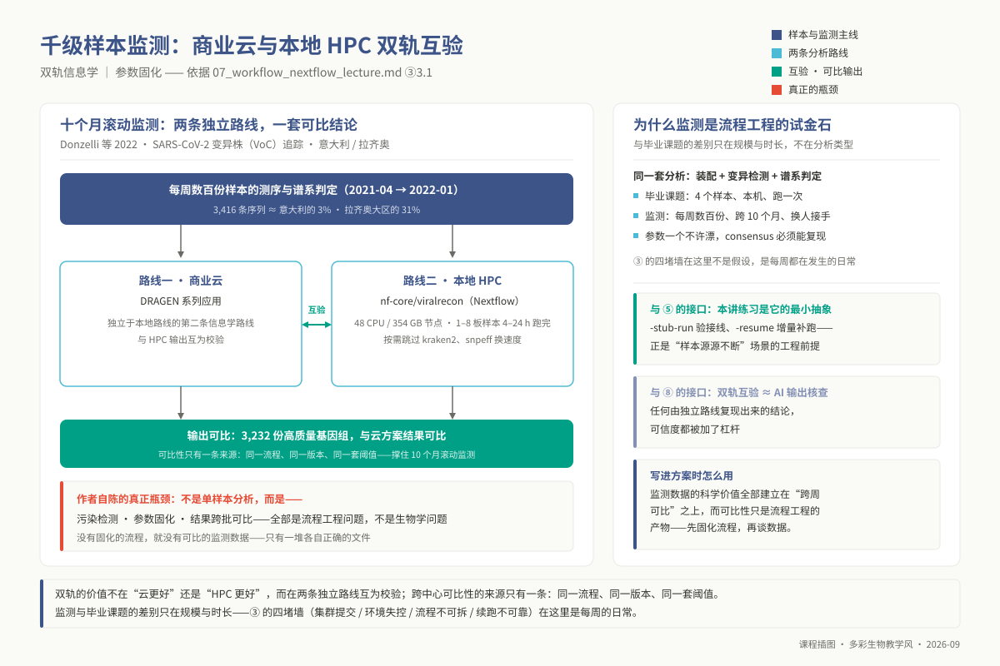
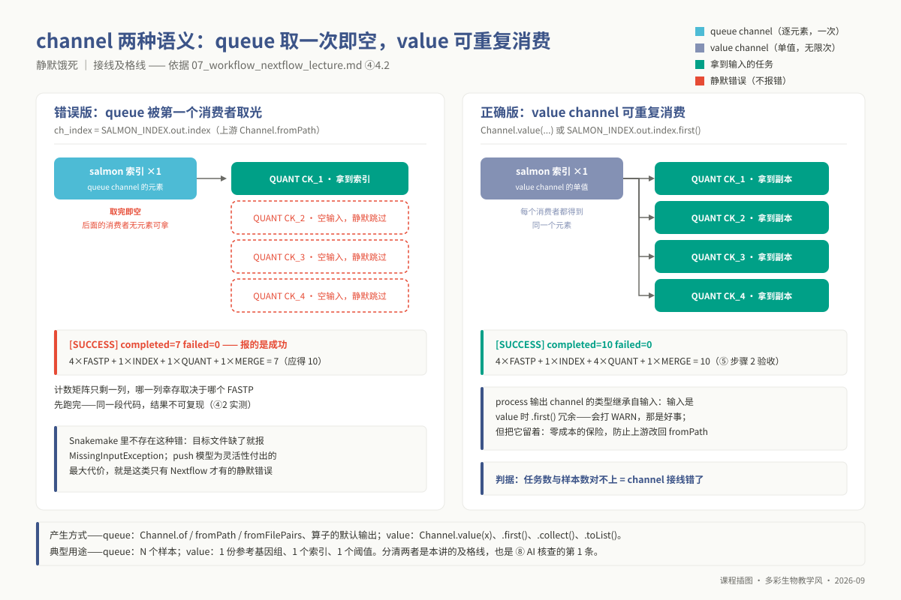
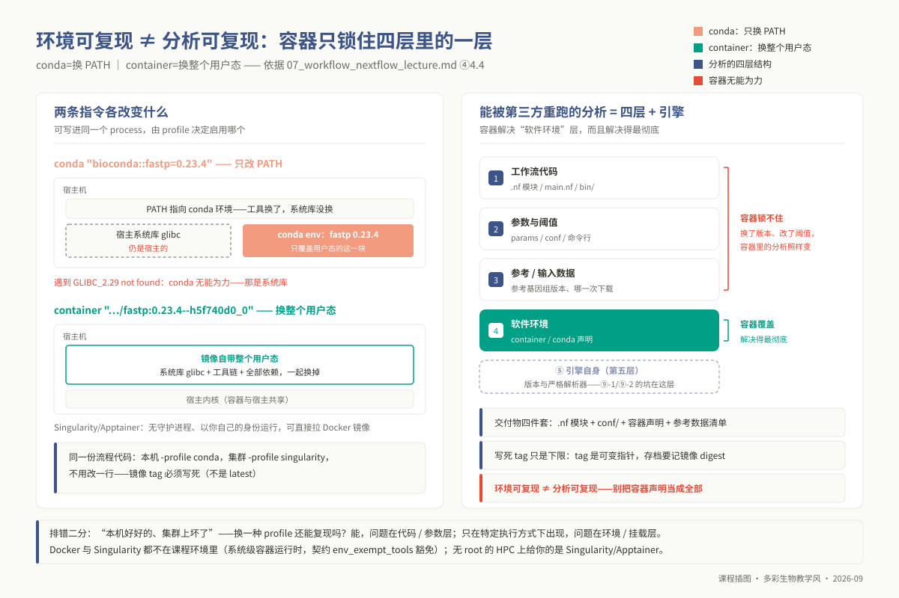
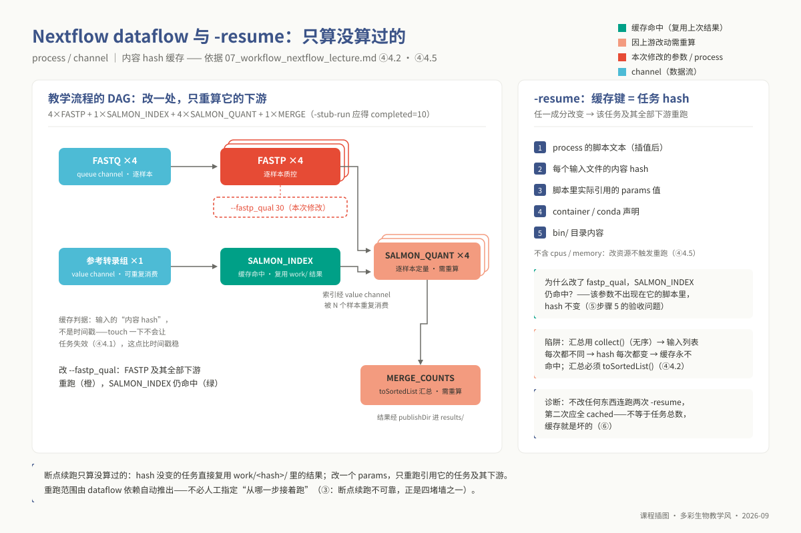
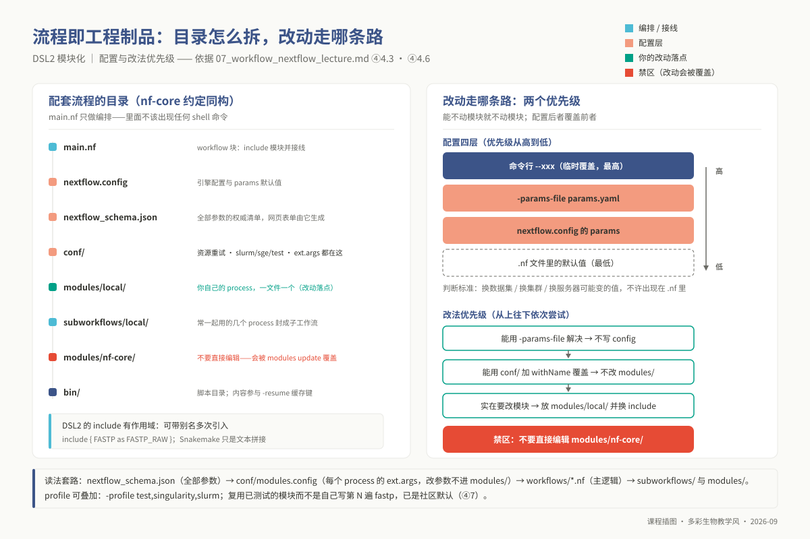
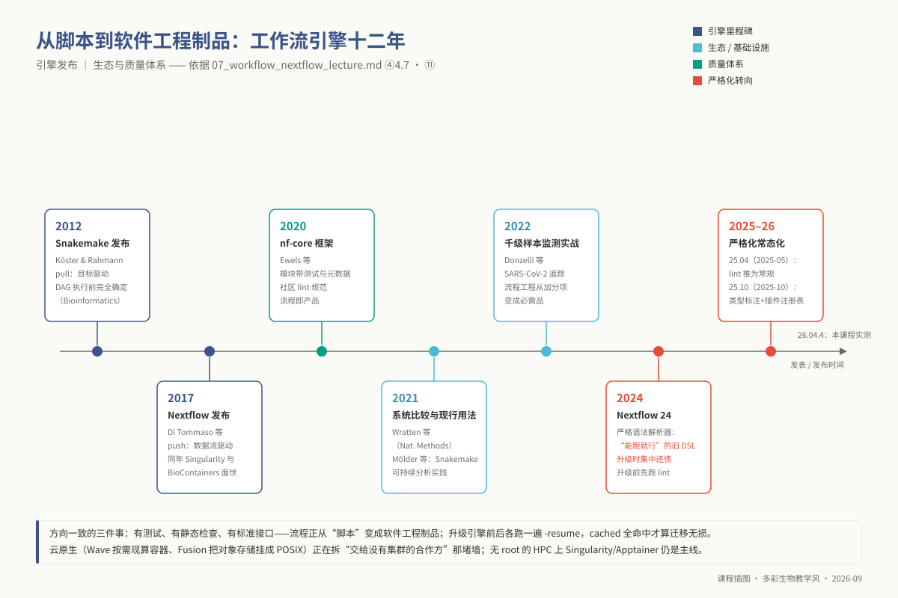

# 专题 p07：Nextflow / Snakemake 工作流开发

> **适用对象**：博士研究生（植物病理、昆虫、农药、微生物等专业）｜授课方式与学时：2 学时理论 + 2 学时实践，共 4 学时。
>
> **阅读重点**：本讲从已有的 Snakemake 经验出发，比较 Nextflow DSL2 的数据流、模块化和集群部署，重点阅读 ④ 的范式与复杂性边界，以及 ⑩ 的迁移练习。

<!-- 维护信息：环境 `conda activate ngs_phd_workflow`；配套流程 `03_code/phd/workflows/`（`main.nf` / `nextflow.config` / `conf/` / `modules/local/` / `subworkflows/local/` / `bin/`）；对照物 `03_code/master/pipelines/`（硕士 m08 Snakemake 版）。本讲承接 m08 的 rule/input/output/wildcards/`rule all`/`expand`/`--use-conda`。 -->

未修读硕士前置课程的同学，必须首先完成 `l1_p07` 的补丁模块（详见②）。**本讲实践环节将直接以你在硕士阶段或课题中跑通的真实 Snakefile 作为向 Nextflow DSL2 迁移的重构素材**；若缺乏自带流程，则使用仓库提供的等价参考版本。

## ① 学习目标

完成本讲理论与实操后，你应当能够：

1. **深刻剖析范式本质**：从计算图求值机制切入，阐明 Snakemake 基于文件的目标驱动（Pull）与 Nextflow 基于事件的数据流驱动（Push）在有向无环图（DAG）构建时机、样本动态枚举、中间产物隔离与生命周期管理上的根本差异，指出两者在处理动态分支时的设计得失。
2. **驾驭响应式流通道**：严格区分 Queue Channel（单次消费型瞬态流）与 Value Channel（不可变广播型单例）的状态机行为，准确推演多任务并发消费时的非阻塞竞争机制，消除由于通道误用导致的静默悬空与数据饥饿。
3. **架构 DSL2 模块化体系**：遵循关注点分离原则，编写封装了元数据上下文（`meta` map）、输入输出契约与原子空跑打桩（`stub:`）的独立 Process，通过 `modules/local/`、子工作流（Subworkflows）与 `include` 构建具备独立作用域的工程级分析管线。
4. **实施层级化配置工程**：解耦计算逻辑与运行环境，熟练运用 `params`、`nextflow.config` 及分层 profile，掌握配置覆盖的确定性优先级，实现单套核心逻辑在单机、SLURM 与 SGE 超算环境间的无缝切换。
5. **构建不可变容器隔离**：透彻理解 Conda 环境变量重定向与 Linux 无特权容器（Apptainer/Singularity）用户态文件系统隔离的本质差别，在无管理员特权的 HPC 环境中利用不可变镜像摘要（Digest）固化底层工具依赖。
6. **设计动态容错与弹性调度**：配置基于退出码（如 SIGKILL 137 与 SIGTERM 143）的自愈重试策略（`errorStrategy = 'retry'`），运用 `task.attempt` 实现计算资源的阶梯式动态提资，终结盲目预估内存导致的排队拥堵与作业崩溃。
7. **解构内容哈希断点续跑**：深入 Nextflow 缓存引擎底层，逐项拆解 `-resume` 缓存键的五大计算因子（脚本代码、输入文件元数据（默认路径+大小+mtime）、插值参数、容器摘要与外部脚本），精准诊断因非幂等脚本或无序收集算子引发的缓存失效。
8. **领会 nf-core 工业规范并权衡迁移**：熟练解构社区旗舰流程的目录分工与参数注入机制，理性权衡已有工作流资产的维护成本与迁移收益，避免盲目重构。

## ② 前置检查

进入本讲前，请对照下表确认关键技能储备：

| 模块 id | 本讲核心交汇点 | 基础缺漏的直接后果 | 验证自测题号 |
|---|---|---|---|
| `l1_p07` | ④ 范式深度对照的 Snakemake 镜像端、⑤ 迁移实操的输入素材、⑧ AI 转换输出的语义等价性核查 | 无法理解声明式规则与数据流通道的映射关系；面对 AI 编写的语法漂移丧失代码审查与纠错能力 | L1 自测 **Q9**（通读复杂 rule 判定通配符传播边界）、**Q10**（实操：编写并跑通最小 Snakefile —— **此即本讲迁移素材**） |
| `l0_01_linux` | ⑤ 集群作业提交、⑥ `work/` 哈希断点现场穿透诊断、⑨ 隐藏包装脚本（`.command.*`）执行跟踪 | 局限于作业调度器顶层报错，无法下潜至孤立执行目录逆向还原环境变量与进程崩溃实况 | **L0-1-Q3**（标准流管道与重定向）、**L0-1-Q5**（HPC 调度架构与批处理提交）、**L0-1-Q9**（SLURM/SGE 作业脚本编写）、**L0-1-Q10**（标准化分析工程目录树） |
| `l0_03_conda` | ④ Conda 运行路径机制与系统动态链接库缺陷、⑤ `-profile conda` 首次环境构建与分发限制 | 混淆依赖包版本缺失与宿主机底层 glibc ABI 不兼容，在无外网计算节点陷入依赖安装死循环 | **L0-3-Q9**（Conda 环境固化与环境规范文件导出）、**L0-3-Q10**（非交互式作业脚本中环境初始化激活片段） |

**教学边界声明**：本讲不再赘述 Snakemake 基础语法（参见 m08）、Conda 基础操作（参见 `l0_03_conda`）及本地 Docker 守护进程配置，默认学生已掌握 Linux 基础命令并能自主查阅集群手册。

## ③ 背景与科学问题

现代生命科学研究经常需要把单机上的探索性分析扩展到数百个样本、多个测序批次和异地合作实验室。你可能在 m08 阶段用 4 个测试样本验证过 Snakefile；当项目扩大到 180 个样本时，还需要处理四类工程问题：

| 工程高墙 | 具象化崩溃现场 | 系统瓶颈根源 | Nextflow 的工程解法 |
|---|---|---|---|
| **调度抽象断层** | 本地运行正常，但在集群提交时 `--cluster "sbatch ..."` 字符串极度臃肿脆弱，不同超算中心语法完全不兼容 | 流程引擎未能解耦"任务逻辑"与"计算底座"，调度指令硬编码 | Executor 抽象层 + 模块化 Profile 分层体系 |
| **底层运行态漂移** | 合作方节点抛出 `version 'GLIBC_2.29' not found`，Conda 束手无策，因其只能改写用户空间 PATH，无法替换宿主 glibc | 语言层包管理器无法跨越 Linux 内核与 C 运行库 ABI 兼容鸿沟 | Process 内置 `container` 原生绑定 + Apptainer 全系统镜像 |
| **拓扑复用壁垒** | 想将质控与伪比对子模块复用到另一个全基因组重测序项目中，只能全盘复制粘贴脚本并手工修补文件名 | 规则命名空间全局扁平化，`include` 本质为文本级宏拼接 | DSL2 作用域隔离 + Process/Subworkflow 函数式模块化 |
| **增量缓存黑箱** | 换目录或重新克隆后改了阈值，Snakemake 打印 `Nothing to be done`，或反之触发全量重跑 | 7.8 起默认 mtime/params/input/software-env/code 五类触发器全开，但除 mtime 外都依赖 `.snakemake/` 元数据，元数据一丢就退回只看时间戳 | 严格基于脚本内容、参数与数据特征的 SHA 内容哈希缓存（`-resume`） |

这四堵高墙直指现代计算生物学的一大核心哲学命题：**在硬件环境、底层库版本与批次样本均处于流变状态的真实世界中，一次生物信息学计算推断究竟在何种条件下才算被真正"固化"？**
简单的"数据 + 代码"无法构成可重复性的充分条件。真正的科学计算规范，必须将**从原始测序数据到最终表型统计推断的整套有向无环图、全部执行参数、环境镜像摘要及容错重试机制，封装为一个自包含的、可独立验证的数学对象**。

### 3.1 应用案例：疫情监测把"流程工程"从加分项变成必需品

**真实案例：Donzelli 等（*Comput Struct Biotechnol J*, 2022）——千级样本 SARS-CoV-2 谱系变异追踪的大规模双轨流程工程实践。**

```text
                  ┌─────────────────────────────────────────────────────────┐
                  │ 原始扩增子测序数据 (3,416 例临床样本 / Illumina COVIDSeq) │
                  └────────────────────────────┬────────────────────────────┘
                                               │
                       ┌───────────────────────┴───────────────────────┐
                       ▼                                               ▼
     ┌───────────────────────────────────┐           ┌───────────────────────────────────┐
     │   商业专有云体系 (Illumina DRAGEN)  │           │ 开源标准化体系 (nf-core/viralrecon)│
     │  - 高度集成化硬件加速与黑箱闭源算法    │           │  - Nextflow DSL2 驱动，完全透明开源 │
     │  - 跨批次版本随服务商静默升级       │           │  - Singularity 镜像固定环境工具链    │
     └─────────────────┬─────────────────┘           └─────────────────┬─────────────────┘
                       │                                               │
                       └───────────────────────┬───────────────────────┘
                                               ▼
                  ┌─────────────────────────────────────────────────────────┐
                  │ 变异位点 (SNV/Indel) 与 Pangolin 谱系分型结果双向交叉比对 │
                  │  - 结论：重测样本谱系 87% 一致；超谱系与高覆盖样本 100% 一致│
                  │  - 启示：工程固化的开源流程是消除技术偏差、支撑决策的基石 │
                  └─────────────────────────────────────────────────────────┘
```



*图 p07-2：双轨互验案例：商业云与本地 HPC 各跑一遍。*

- **科研背景与工程挑战**：针对高通量临床病毒监测，研究团队必须保证每周滚动产出的变异株监测报告跨中心、跨批次完全可比。面对拉齐奥大区 3,416 份连续样本，任何由于人工干预、服务器系统库升级或动态参数微调引入的隐性技术偏差，都会在病毒进化谱系树上引入虚假的突变假象。
- **信息学架构**：研究组部署了双轨并行验证体系——一方为高成本的商业云闭源分析流程（DRAGEN），另一方为基于 Nextflow 驱动的开源社区金标流程 **nf-core/viralrecon**。利用一台配备 48 核 CPU、354 GB 内存的本地超算节点，研究人员通过标准化容器镜像与统一资源配额，在 4–24 小时内滚动完成单批次 1 至 8 块 96 孔板的组装、变异过滤与谱系鉴定（优化后的流程显式跳过 fastp、Kraken2 等多个质控步骤）。
- **核心结论**：2021 年 4 月至 2022 年 1 月共产出 3,232 份高质量样本；重测样本的谱系判定 87% 一致，超谱系层级与高覆盖样本 100% 一致。作者特别强调，千级样本监测的真正技术挑战从不是单个算法的数学精度，而是**多样本并发的数据流编排、高防腐蚀的容错断点续跑、以及不可变计算环境的固化能力**。没有工程级工作流的刚性约束，滚动式的多组学监测只能退化为一堆无法彼此对齐的文件碎片。

## ④ 核心原理

### 4.1 范式差异：pull 与 push，本讲最重要的概念

现代工作流引擎的技术分野，本质上是**图论中两种截然相反的计算图求解策略**。理解这一差异，是避开 Nextflow 绝大多数高级陷阱的先决条件。

**Snakemake 采用目标驱动的拉取模型（Pull Model）**。其本质是**逆向依赖消解**：执行起始于终点 `rule all` 所声明的目标文件集合。引擎如同 Prolog 推理机，手持终极文件名，在所有规则的 `output` 模式中进行通配符逆向匹配（Regex Pattern Unification），反解出通配符的具象值，再将这些值代入上游规则的 `input`，层层向后回溯，直至触达原始物理文件。在第一个计算进程启动之前，**整个有向无环图（DAG）已经被全局解析并在内存中完全固定**，因此 `snakemake -n` 能够精确打印出整套生命周期内即将生成的全部任务清单。

**Nextflow 采用数据流驱动的推送模型（Push Model）**。其内核是**响应式反应器模型（Reactive Actor Network）**。执行起始于数据源头：`Channel.fromPath(...)` 监听或发射数据流元素，一旦管道中有数据单元就绪，便向连接其上的 Process 节点推送一个计算事件。Process 本质上是一个纯函数反应器，一旦其 `input` 契约所声明的全部通道均有数据到达，引擎便立刻派生一个具体的操作系统作业。因此，Nextflow 的 **DAG 不是在运行前静态求解出来的，而是在数据流动过程中自组织动态展开的**。

```text
Snakemake (Pull 范式):
  目标文件 (rule all) ──[逆向求解]──> 中间规则 ──[正则回溯]──> 原始输入 (DAG在执行前完全确定并冻结)

Nextflow (Push 范式):
  数据源通道 ──[事件推送]──> Process 反应器 ──[派生产物]──> 下游通道 (DAG在数据流动中逐步动态实例化)
```

两种范式映射到工程落地上，形成了六项深刻的系统行为反差：

| 架构维度 | Snakemake（Pull 范式） | Nextflow（Push 范式） |
|---|---|---|
| **任务派生仲裁者** | 终点目标文件名中通配符组合的取值空间 | 输入通道（Channel）中到达的数据元组（Tuple）数量 |
| **样本集注入机制** | `expand()` 算子在 `rule all` 处展开为目标文件全集 | 测序样本表（samplesheet）通过 `splitCsv` 逐行发射入流 |
| **计算图固定时刻** | 作业启动前全局确定，图拓扑支持严格静态全检（`-n`） | 随异步事件流推进动态实例化，静态 dry-run 仅能做近似投影 |
| **中间产物存储区** | 必须显式声明物理路径，中间文件直接散落在分析目录树中 | 统一隔离在 `work/<hash前两位>/<剩余hash>/`，仅 `publishDir` 产物可见 |
| **缓存失效判据** | mtime 加 `.snakemake/` 元数据里记录的 params/code/input 集合/软件环境 | 任务哈希：插值后脚本、输入值与输入文件（默认路径+大小+mtime）、容器/conda、引用的全局变量与 `bin/` 脚本等约 13 项 |
| **多样本并行语法** | 通配符隐式广播；合并汇聚时必须依赖显式 `expand()` | 通道逐事件自然并发；汇聚多样本时必须显式调用收拢算子（如 `collect()`） |

**范式批判与选型边界**：

1. **Pull 模型的天然局限在于"必须预知输出文件的精确命名模式"**。若上游任务是未知聚类的宏基因组分箱（不知道能得到几个 Bin）或带有复杂过滤分支的组装流程，Snakemake 必须依赖打破计算图的打补丁机制（`checkpoint`），暂停执行并强行重新求解 DAG。
2. **Push 模型的代价在于"不可预知全局静态视图"，并催生了数据流独有的静默错误**。在 Nextflow 中，若错误地将单次消费通道传给多个并行步骤，数据流被某一上游瞬间耗尽，后续步骤将**永远收不到事件输入，且不会抛出任何异常，最终以极具欺骗性的 `SUCCESS` 状态提早退出**。
3. **架构迁移的理智底线**：工作流引擎是手段而非研究目的。若你的课题处于单机稳定期、样本数不会膨胀、且合作团队均熟练掌握 Python 生态，维持 Snakemake 是最经济的策略；只有当面临跨超算无特权部署、需要深度复用 nf-core 社区资产、或面临高并发超大规模样本时，迁移到 Nextflow 才具备决定性价值。

### 4.2 DSL2 三件套：process / channel / workflow

Nextflow DSL2 的核心哲学是函数式流式编程。这三大概念构成了其全部表现力的骨架：

```groovy
process SALMON_QUANT {
    tag   "${meta.id}"                 // 进度展示与任务追踪的唯一元数据标识
    label 'process_medium'             // 抽象计算资源等级，具体数值外置于 conf/base.config

    conda     "bioconda::salmon=1.10.3"
    container "quay.io/biocontainers/salmon:1.10.3--haf24da9_3"

    input:
    tuple val(meta), path(reads)       // 元数据字典 (如 id, condition) 与数据路径协同流动
    path index                         // 接收自 Value Channel，支持被全量样本无限次重复只读引用

    output:
    tuple val(meta), path("${meta.id}.quant.sf"), emit: quant
    path "versions.yml",                          emit: versions

    script:
    """
    salmon quant -i ${index} -l ${params.salmon_libtype} \\
        -1 ${reads[0]} -2 ${reads[1]} -p ${task.cpus} -o ${meta.id}
    cp ${meta.id}/quant.sf ${meta.id}.quant.sf
    """

    stub:                              // 极速空跑模式：零耗时生成占位文件，校验整网拓扑连接
    """  printf 'Name\\tLength\\tEffectiveLength\\tTPM\\tNumReads\\n' > ${meta.id}.quant.sf  """
}
```

1. **Process（计算反应器）**：独立的局部执行环境。每个 Process 运行在一个被引擎严格隔离的 `work/` 临时子目录中，**严禁在脚本中出现绝对路径或隐式外部文件依赖**。注意三个工业级设计细节：其一，**`meta` Map 是流动元数据的核心载体**，样本属性（批次、处理组）作为一等公民与测序文件绑定；其二，**`stub:` 块提供了近乎零成本的拓扑冒烟测试能力**，在没有安装任何外部软件的轻量节点上亦能全速执行空跑验证；其三，为防止多样本输出文件名冲突导致覆盖，脚本层显式将通用名重命名为 `${meta.id}.quant.sf`。
2. **Channel（异步通信管道）**：连接 Process 的单向流。分清两种通道是写出健壮流程的红线：
   - **Queue Channel（队列通道）**：瞬态 FIFO 队列，由 `Channel.of`、`fromPath` 或算子产出。**每一个元素只能被下游单次消费**。若下游有多个分支并发尝试读取，元素将被率先就绪的分支夺取，导致其他分支饥饿。
   - **Value Channel（单例值通道）**：状态单例，由 `Channel.value()`、`.first()` 或 `.collect()` 产出。**支持被任意多个下游任务无限次重读引用**。基因组参考文件、全局索引及阈值参数必须通过值通道下发。
3. **Workflow（拓扑总线编排）**：纯声明式的接线层。在 `main.nf` 或子工作流的 `workflow` 代码块中，**禁止出现任何具体的 shell 执行逻辑**，其职责仅限于通道的初始化、算子流转以及 Process 节点的输入输出管道对接。



*图 p07-3：channel 语义：queue 取一次即空，value 可重复消费。*

### 4.3 模块化与配置分离

Snakemake 的 `include:` 本质上是源码级的文本拼接，极易引发规则命名冲突与变量污染。DSL2 引入了现代高级语言的作用域模块化体系：通过 `include { FASTP } from './modules/local/fastp.nf'` 引入原子模块，或使用 `include { FASTP as FASTP_POST }` 实现带别名的多次实例化。

**配置工程的分层与优先级**：
软件工程中应将**逻辑与参数解耦**。随物种、集群规格或批次规模变化的变量，不要硬编码在 `.nf` 源码中。Nextflow 提供了四级参数覆盖梯队：

$$\text{源码默认参数} \prec \text{nextflow.config (params 块)} \prec \text{-params-file params.yaml} \prec \text{命令行参数 (--arg)}$$

在资源层面，通过分立的 `base.config`（声明 `process_low/medium/high` 抽象等级）、`slurm.config` 与 `singularity.config`，学生可以在运行时通过 `-profile test,singularity,slurm` 将分析逻辑在个人笔记本与大型国家超算中心之间自如切换，无需改动任何一行流程逻辑。

### 4.4 容器集成：环境是换 PATH，容器是换整个文件系统

在科研计算中，“能够重现”不等同于“安装了相同的 Conda 环境”。还需要控制输入、参数、参考文件和执行引擎等因素：

```groovy
conda     "bioconda::fastp=0.23.4"                          // 机制：修改 PATH 与 LD_LIBRARY_PATH，强依赖宿主 Linux 内核与 C 运行库
container "quay.io/biocontainers/fastp:0.23.4--h5f740d0_0"  // 机制：通过内核 Namespace 虚拟化，挂载完整不可变的用户态根文件系统
```

Conda 的局限性在于其必须宿生在物理机操作系统的 ABI 接口之上。当物理服务器的系统级基础库（如 GNU C Library `glibc`、libstdc++）版本落后于编译环境时，Conda 会抛出不可解的动态符号链接断裂。Apptainer（原 Singularity）通过 Linux 无特权用户命名空间技术，将包含完整操作系统的镜像文件挂载为进程的根目录，实现了无需 root 权限的绝对用户态隔离。

```text
可复现性防线的分层固化：
  第一层：工作流控制逻辑 (.nf 源码，由 Git 跟踪)
    第二层：运行与分析参数 (params.yaml / nextflow.config，由 Git 跟踪)
      第三层：输入参考数据规范 (基因组版本、注释构建版本，不可随意替换)
        第四层：软件二进制环境 (Apptainer 镜像不可变哈希 digest)
          第五层：工作流引擎自身语义 (锁定 Nextflow 解释器版本)
```



*图 p07-4：可复现四层：conda 换 PATH，容器换用户态，引擎也要锁。*

**工程铁律**：镜像引用绝对不能使用浮动的 `:latest` 标签，必须显式锁死具体的发布哈希或构建标签（如 `0.23.4--h5f740d0_0`），唯有如此，方能在数年之后跨越底层硬件生命周期精准复盘。

### 4.5 集群部署与 `-resume` 的缓存机制

在异构高性能计算集群中，Nextflow 通过 Executor 抽象层接管了繁琐的作业提交生命周期。开发者只需声明抽象的计算需求，引擎便会自动将之编译为底层原生的 SLURM `sbatch` 或 SGE `qsub` 提交脚本，并周期性轮询作业监控接口。

```groovy
process {
    // 130..145 = 信号 2..17 的经验区间（常见 137=SIGKILL/OOM、143=SIGTERM/超时）；104 沿用 nf-core 模板惯例
    errorStrategy = { task.exitStatus in ((130..145) + 104) ? 'retry' : 'finish' }
    maxRetries    = 2
    withLabel: process_medium {
        cpus   = 4
        memory = { 8.GB * task.attempt }   // 动态内存阶梯扩展：首试 8GB，OOM 失败后自愈重试给 16GB、24GB
        time   = { 2.h  * task.attempt }
    }
}
```

这一弹性重试机制减少了为少数大样本给全部作业申请高配资源的需要，也有助于降低队列等待时间。

**内容哈希缓存机制（Content-based Hashing）**：
Nextflow 的 `-resume` 并不是粗暴地比对文件修改时间戳（mtime），而是为每个任务计算哈希（官方清单约 13 项，另含 session、任务名、stub、ext 等），教学上抓以下五项：

1. 该 Process 的完整 `script` 文本（经过变量完全替换插值后的内容）；
2. 每一个输入文件的元数据：默认是**完整路径 + 大小 + mtime**（`cache 'lenient'` 去掉 mtime，`'deep'` 才哈希内容）；
3. 脚本中引用到的全局变量（含 `params`）的具体值；
4. `container` 镜像标签与 `conda` 环境定义的字符指纹；
5. 项目 `bin/` 目录下嵌入的所有外置脚本的 SHA 校验和。

只要上述五项要素完全一致，引擎便直接建立符号链接复用历史计算结果。值得注意的是，资源指令本身不进哈希，**但脚本里插值了 `${task.cpus}`（课程 `SALMON_INDEX`/`SALMON_QUANT` 都写了 `-p ${task.cpus}`）时，改核数就改了脚本文本，任务会重算**；只改 `memory`/`time` 不会。反过来，未声明为输入的依赖文件被改了，哈希不变，`-resume` 会**误命中旧结果**。



*图 p07-1：断点续跑只算没算过的：内容 hash 未变的任务直接复用 work/ 下的结果。*

### 4.6 nf-core：怎么读，怎么改

国际生物信息学界最具影响力的流程生态是 **nf-core** 联盟。面对动辄包含数万行代码的社区流水线，博士生必须掌握结构化的源码解构与定制方法：

```text
nf-core 标准目录拓扑与改动落点：
├── main.nf                     # 流程执行入口，仅作初始化与引导
├── nextflow_schema.json        # 全部合法输入参数、类型与校验规则的权威 JSON Schema（首读）
├── conf/
│   ├── base.config             # 默认计算资源与弹性重试标签（调参入口）
│   └── modules.config          # 【核心定制点】通过 ext.args 为任意模块注入额外命令行参数
├── workflows/                  # 顶层业务编排逻辑
├── subworkflows/local/         # 本地组合子工作流
├── modules/
│   ├── nf-core/                # 社区受管原子模块（严禁直接手工修改！更新会被整体覆盖）
│   └── local/                  # 【本地定制点】放置自行编写或派生魔改的 Process 模块
```

**工程规范修改准则**：

- **微调算法参数**：严禁侵入修改模块代码本身，应在 `conf/modules.config` 中针对目标模块利用 `ext.args` 进行命令行参数注入。
- **替换模块实现**：若需使用自研算法替换官方模块，将重构后的 `.nf` 文件放入 `modules/local/`，并在工作流定义中修改 `include` 引入路径，绝不可直接就地修改 `modules/nf-core/` 目录下的代码。



*图 p07-5：nf-core 管线结构：改动落点与禁区。*

### 4.7 技术前沿（2023–2026）



*图 p07-6：工作流引擎时间线：2012 Snakemake → 2017 Nextflow → 2020 nf-core。*

近三年来，科学计算工作流正迅速向现代化软件工程体系靠拢，其发展呈现三大鲜明趋势：

1. **语法体系与静态类型检查工程化**：从 Nextflow 24.x 开始引入全新严格语法解析器，废弃了 Groovy 自由混入变量声明的旧式脚本风格；25.x（2025 年）进一步引入显式输入输出类型标注与原生的流程静态代码规范检查（`nextflow lint`）。工作流开发正彻底告别“黑盒脚本”时代，转入严密的静态语法防御。
2. **云原生动态构建与无 POSIX 存储演化**：Wave 容器服务已能根据 Process 中声明的 Conda 依赖或 Dockerfile 片段在云端实时自动构建出最小化轻量容器镜像；Fusion 虚拟文件系统则通过客户端技术将 S3/GCS 等对象存储挂载为兼容 POSIX API 的流式存储，彻底终结了超算集群共享网络存储（NFS/Lustre）的 I/O 拥塞。
3. **接口标准协议（WES / GA4GH）收敛**：跨平台工作流执行服务协议（Workflow Execution Service, WES）日渐成熟，使得同一条按照标准化 DSL2 与元数据契约（`meta` map、`versions.yml`）书写的工作流，能够无感无缝地在混合云、超算私有集群与桌面开发机之间进行自动化投递调度。

## ⑤ 操作步骤

所有操作步骤均在 `ngs_phd_workflow` 环境中开展。**请务必将教学流程复制至纯英文路径下执行**（Nextflow 24+ 解析器在处理包含中文字符的目录路径时会触发解析断裂，参见⑨-3）。

```bash
conda activate ngs_phd_workflow
nextflow -version                          # 确认运行时版本（推荐 24.04+，实测 26.04.4 兼容良好）
cp -r 03_code/phd/workflows ~/p07_nf && cd ~/p07_nf
```

**步骤 1 · 生成全受控小型测试数据集**（固定随机种子，脱机秒级生成）：

```bash
python3 03_code/master/pipelines/scripts/make_demo_data.py --outdir demo --reads-per-sample 3000
```

**步骤 2 · 执行零依赖拓扑打桩空跑（Stub-run）**：

```bash
nextflow run . -stub-run -profile test
```

终端输出期望出现 `[SUCCESS] completed=10 failed=0 cached=0`（精确对应 4×FASTP + 1×SALMON_INDEX + 4×SALMON_QUANT + 1×MERGE_COUNTS）。若出现 completed=7 或 4，说明发生了通道单次消费截断，必须立即排查接线逻辑。

**步骤 3 · 生成交互式计算图 DAG 并审阅模块边界**：

```bash
nextflow run . -stub-run -profile test -with-dag dag.html
```

使用浏览器审查 `dag.html`，对照 `subworkflows/local/quantify.nf` 验证通道分发与汇聚的正确性。

**步骤 4 · 本地全流程真实计算（基于 Conda Profile）**：

```bash
nextflow run . -profile test,conda
```

**步骤 5 · 人工故障注入与哈希恢复审计（断点续跑机制实测）**：

```bash
nextflow run . -profile test,conda                           # 基线完整运行
rm -rf results_test/quant/CK_1*                              # 模拟单一中间产物丢失
nextflow run . -profile test,conda -resume                   # 观察 cached 统计：因 work/ 哈希未变，快速复用恢复
nextflow run . -profile test,conda -resume --fastp_qual 30    # 变更上游参数：观察 FASTP 及下游重跑，而 SALMON_INDEX 依然命中 cached
```

**步骤 6 · 超算集群调度部署与监控**：

```bash
nextflow run . -profile test,singularity,slurm --queue <超算队列名> -resume   # SLURM 环境投递
# 观察后台守护进程：squeue -u $USER 验证作业提交、执行、动态重试与回收过程
```

**步骤 7 · 将个人已有 Snakefile 资产向 DSL2 标准重构**：
遵循由内而外的稳健重写顺序：先抽取单步 Process 运行 `stub-run` 跑通语法 → 再编排数据流 Channel → 抽取为独立模块与子工作流 → 最后将全部硬编码路径移入 `nextflow.config`。

## ⑥ 结果解读

### 1. `work/` 哈希目录：深入第一故障现场

当集群作业失败时，盲目在顶层日志中瞎猜是生信初学者的致命弱点。Nextflow 会在报错中打印具体的执行目录，例如 `Work dir: /path/to/work/3a/7f18b2...`。该目录内部保留了完整的底层现场：

| 内部隐藏文件 | 核心诊断价值与排查动作 |
|---|---|
| `.command.sh` | **变量插值完毕后的纯 Bash 执行体**。检查传参是否发生意外截断、变量是否被赋予空值 |
| `.command.run` | **引擎生成的完整底层包装脚本**。包含环境变量加载、Apptainer 挂载参数（`-B`）、目录初始化等全部底层细节 |
| `.command.err` | 该任务标准错误流（stderr）的最原始抓取内容，任何崩溃栈的直接源头 |
| `.command.out` | 任务标准输出流（stdout）捕获 |
| `.exitcode` | 进程终态退出码。`137` 标明被操作系统 cgroups 强制 OOM 终止；`143` 标明被超算调度器 Walltime 超时强杀 |

### 2. 执行度量报告与动态资源审计

生产级别流水线必须通过 `-with-report`、`-with-timeline` 与 `-with-trace` 产出运行分析：

- **`trace.txt`**：关键指标包含 `peak_rss`（物理内存消耗极值）与 `%cpu`。若声明了 16 核但 `%cpu` 长期徘徊在 100%，表明工具本身不支持多线程或 I/O 阻塞严重，应立即下调资源配额避免超算核心浪费。
- **`-resume` 行为模式判定**：
  - `completed=0 cached=10`：完美命中，无冗余执行；
  - `completed=6 cached=4`：参数局部微调触发的下游级联重算，属于预期内断点续跑。

### 3. 三大无报错性静默故障判据

1. **样本数量非预期截断，但终态标为 SUCCESS**：若 10 个样本的管线仅产出了 1 个样本的定量结果且不抛异常，说明参考通道使用了 Queue Channel 并被首个样本竞争抢夺，导致后续样本数据流饥饿。
2. **每次触发 `-resume` 均发生全量重算**：检查是否在下游汇总处使用了返回顺序不确定的 `collect()` 算子导致哈希输入波动，或脚本中注入了 `$RANDOM`、当前时间戳等动态非幂等因子。
3. **输出目录软链接失效**：若集群采用跨节点不同挂载卷，默认的 `publishDir mode: 'symlink'` 会在临时工作区被清理后产生大面积死链，正式交付必须严格使用 `mode: 'copy'`。

## ⑦ 统计插件

**本讲无独立统计要点。**

本专题不在契约 `stats_plugin_topics` 名单内。工作流编排引擎本身并不创造新的统计模型，亦不直接计算检验 $p$ 值或构建回归曲线。然而，**它为多组学分析的统计学严谨性提供了底层防线：在复杂的多步数据清洗与过滤中，杜绝人为隐性信息泄露，确保每一处统计推断的样本与参数上下文具备严格的确定性**。
可重复性研究显示，反复试用过滤阈值可能增加多重检验和数据勘探风险。本讲把阈值固定在 `params` 中，并记录容器摘要，使这些选择可追溯、可复核。

## ⑧ AI 辅助任务

**任务目标：利用大语言模型将一段实际科研中的复杂 Snakemake 规则体系迁移为 Nextflow DSL2，并实施严格的语义等价性防御审计。**

- **输入提示词架构**：提供完整的 Snakefile（包含 `expand`、通配符约束及集群资源标记），明确指定 Nextflow 目标版本为 24+，强制要求采用 DSL2 模块化规范、参数完全外置至 `params` 结构、且为每个 Process 提供 `stub:` 块。
- **五维严格防御审计矩阵**：

| 维度 | 审计重点 | 验证手法 | AI 代码常见漂移与伪特征 |
|---|---|---|---|
| **1. 通道语义** | 区分广播变量与流式数据 | 审查参考索引是否被包裹在 Value Channel 或挂接 `.first()` | 习惯性将索引输出当作常规 Queue 管道直连下游多任务，导致单次消费静默死锁 |
| **2. 并发拓扑** | 逐样本流水线与跨样本汇聚 | 运行 `-stub-run` 检查任务派生总数与样本全集的乘积关系 | 错误混用 `collect()` 将全样本压入单一任务，或遗漏聚合导致汇总步骤执行 N 次 |
| **3. 缓存确定性** | 验证断点续跑幂等性 | 无修改连续触发二次 `-resume`，确认缓存命中率为 100% | 在汇总合并步骤使用原生无序 `collect()`，生成伪随机输入文件列表破坏内容哈希 |
| **4. 资源插值** | 动态集群资源挂载 | 检查 Process 执行体中的线程变量引用 | 将 Snakemake 的 `threads:` 丢失或硬编码为常数，未调用 `${task.cpus}` |
| **5. 产物一致** | 中间与最终输出校验 | 在微型演示数据上分别执行两版流程，计算最终矩阵的 `md5sum` | 自由发挥篡改了输出目录层级结构或文件命名命名空间 |

- **提交规范**：提交包含 AI 原始输出、你标记出的高危逻辑漏洞清单、修正后的代码工程、以及在真实测试集上的双轨哈希对比报告。

## ⑨ 常见错误与排查

**1. 配置文件中混用动态脚本变量声明**（Nextflow 24+ 新型语法解析器拦截）

- **现象**：`Error nextflow.config: Variable declarations cannot be mixed with config statements`。
- **机理**：新版解析器为防止配置注入安全漏洞，将配置作用域严格限定为纯声明式键值对，彻底禁绝了 `def stamp = ...` 等随意执行的动态 Groovy 代码。
- **处置**：直接在配置值中以内联字符串表达，或通过外部环境变量及命令行参数传入。

**2. 顶层作用域混入 `workflow.onComplete` 闭包**

- **现象**：`Error main.nf: Statements cannot be mixed with script declarations`。
- **机理**：现代 DSL2 规范要求根脚本仅允许包含模块引入与组件声明，过程式监听逻辑破坏了解析器的语法纯洁性。
- **处置**：废弃冗余的自定义终端汇报，直接启用引擎原生的 `-with-report` 与 `-with-trace` 生成标准化指标。

**3. 模块引用抛出 `Invalid include source`**

- **现象**：Nextflow 报告无法加载指定路径下的 `.nf` 模块文件。
- **机理**：其一，新语法严格要求模块文件名带全 `.nf` 后缀；其二，**路径字符串中存在非 ASCII 编码字符（如中文路径）**，导致解释器底层 URI 编码转换失败。
- **处置**：补齐 `.nf` 后缀，且所有工作目录必须完全迁移至纯 ASCII 英文物理路径下。

**4. 声明输出 Glob 模式与物理产物名称失配**

- **现象**：`Missing output file(s) expected by process`，然而底层命令明明成功退出了。
- **机理**：Process 内部 shell 命令生成的物理文件名与 `output:` 声明的通配模式存在微小字母差异（如 `.clean.fq` 与 `.cleaned.fq`）。
- **处置**：直接切入报错提示的 `work/` 哈希子目录，执行 `cat .command.sh` 与 `ls -la` 审查现场。此时可深切体会 `stub:` 块在设计期前置排雷的巨大价值。

**5. 进程遭遇 SIGKILL 异常终止（Exit Code 137）**

- **现象**：任务意外中断，日志伴随 `terminated with an error exit status (137)`。
- **机理**：`137 = 128 + 9`（即收到 9 号强制终止信号 SIGKILL），典型动因为计算进程瞬时内存消耗超出底层 Linux cgroups 设定的容器内存硬上限，被内核 OOM Killer 直接截杀。
- **处置**：切勿盲目调大整个集群的默认内存；应通过 `trace.txt` 获取实际内存峰值，并在配置中依托 `errorStrategy = 'retry'` 与 `memory = { 8.GB * task.attempt }` 赋予受害任务弹性重试扩容空间。

**6. 计算节点抛出 `command not found`，但登录节点运行正常**

- **现象**：任务提交到 SLURM 节点后，最基础的分析工具均提示找不到命令。
- **机理**：非交互式集群作业执行时默认采用干净的登录环境，不继承用户当前交互终端中的 Bash 初始化配置与 Conda 环境变量。
- **处置**：严禁在作业提交前依赖手动预激活，必须依托 `-profile conda` 或 `-profile singularity` 将环境生命周期完全交由 Process 独立托管。

**7. `-resume` 机制全量失效，陷入重复计算**

- **处置路径**：按发生概率顺次排查：① 下游汇聚算子是否使用了无序的 `collect()`；② 执行脚本内是否引入了未经固定的动态随机数、当前系统时间戳或本地绝对路径；③ 是否清理或变更了底层 `work/` 与 `.nextflow/cache/` 目录；④ 容器镜像标签是否误用了浮动的 `:latest`。

**8. 转录本短于 k-mer：Salmon 警告后静默跳过**

- **机理**：salmon 1.10.3 对短于 $k$ 的转录本输出 `Entry with header ... had length less than equal to the k-mer length of 31` 警告并**跳过**，索引照样建成，这些转录本在定量里凭空消失；全部短于 $k$ 时 SIGABRT 退出（rc=134）。课程演示转录本约 1500 bp，$k=31$ 实测可建。
- **处置**：查 index 日志里的警告条数；需要时在 `conf/test.config` 下调 `salmon_kmer`。`-k ${params.salmon_kmer}` 插值进脚本，改参数后哈希变化，`-resume` 会自动重跑该步骤。

## ⑩ 思考练习

1. **（数据流与并发机制推演）** 假设某 Process 的输入端定义了两个通道：通道 A 为包含 4 个测序样本的 Queue Channel，通道 B 为仅包含 1 个参考基因组 fasta 文件的 Queue Channel。当该流程启动时，系统总共会实例化派生出几个任务？为什么？若将通道 B 转换为 Value Channel，派生结果将发生何种改变？若改用 `A.combine(B)` 算子操作，其任务派生行为与拓扑结构又将如何演化？
2. **（静默竞争破坏性实测）** 将配套教学管线 `quantify.nf` 模块中的 `.first()` 防御算子移除，并在 `main.nf` 中将输入通道定义从 `Channel.value(...)` 改写为 `Channel.fromPath(...)`。在未运行前推导 `-stub-run` 的终态任务计数与退出状态；随后在终端连续执行三次实测，记录每次能够成功完成定量的幸存样本名称是否一致，并深入论述该现象对科研实验"确定性与可重复性"的致命打击。
3. **（性能剖析与资源精细化重构）** 某大型项目在超算平台上的 `trace.txt` 显示，某耗时转录组组装任务的度量数据为：`realtime = 8.4h`，`peak_rss = 4.2 GB`，`%cpu = 104%`，而流程配置文件中为该任务申请了 `cpus = 32` 与 `memory = 120 GB`。请精准指出该任务配置中存在的两个极其严重的资源浪费漏洞，并提出符合工业标准的具体修改配置代码。
4. **（分布式缓存断点排错）** 某课题组同学将其在个人工作站上已完全跑通（`-resume` 缓存命中率为 100%）的工作流整个目录打包复制到超算共享存储卷上执行，却发现每次运行均触发大面积的全量重新计算。请列举出导致该现象发生的四种潜在底层系统机制，并为每种机制提供一条可执行的验证诊断命令。
5. **（范式深度代码对照）** 对照硕士 m08 的 `Snakefile` 与本讲配套的 `main.nf`，找出三处"功能完全等价但实现逻辑彻底异构"的代码实现片段（提示：多样本批次名单注入、全网共享只读索引传递、全样本表达矩阵最终汇聚），运用图论与操作系统并发原语，详述两种范式为何会演进出如此截然不同的代码语法。
6. **（工程技术选型权衡）** 你的实验室师兄在两年前基于 Snakemake 编写并发表了一套表观遗传多组学分析管线。现有一位新入学的师弟需要接手该课题，将样本量扩充至 400 个，并部署至学校新建的异构混合超算中心。作为实验室生信负责人，你是否建议其将其整体迁移为 Nextflow DSL2？请给出明确的决策，并列举三条硬性的判定标准；若建议迁移，请设计出一套能够充分证明迁移前后两套系统输出完全同构一致的科学验证方案。
7. **（🔬 毕业课题流程自检与终极交付设计 · 开放题）** 针对你博士毕业论文中最为核心的多组学数据处理管线：① 绘制其端到端的有向无环图（DAG），明确划分出逐样本执行节点与跨样本汇聚节点；② 管线中是否存在"输出产物数量在执行前完全无法预测"的动态分支？在 Snakemake 与 Nextflow 中分别应如何实现优雅表达？③ 梳理出至少 5 个审稿人必然会追问的关键质控与统计过滤参数，并将其标准化封装入 `nextflow.config` 的 `params` 块；④ 评估未来三年后第三方研究者复现你全部计算图谱所需的最小不可变资产清单，确认这些资产是否已全部受控归档于 Git 仓库与公共镜像仓库中。

## ⑪ 参考资料

### 经典文献

| 领域方向 | 权威文献 |
|---|---|
| Nextflow 理论与架构原著 | Di Tommaso, P., Chatzou, M., Floden, E. W., Barja, P. P., Palumbo, E., & Notredame, C. (2017). Nextflow enables reproducible computational workflows. *Nature Biotechnology*, 35(4), 316–319. [10.1038/nbt.3820](https://doi.org/10.1038/nbt.3820) |
| nf-core 社区质量工程体系 | Ewels, P. A., Peltzer, A., Fillinger, S., Patel, H., Alneberg, J., Wilm, A., Garcia, M. U., Di Tommaso, P., & Nahnsen, S. (2020). The nf-core framework for community-curated bioinformatics pipelines. *Nature Biotechnology*, 38(3), 276–278. [10.1038/s41587-020-0439-x](https://doi.org/10.1038/s41587-020-0439-x) |
| Snakemake 规则驱动原著 | Köster, J., & Rahmann, S. (2012). Snakemake—a scalable bioinformatics workflow engine. *Bioinformatics*, 28(19), 2520–2522. [10.1093/bioinformatics/bts480](https://doi.org/10.1093/bioinformatics/bts480) |
| Snakemake 现行实践与设计 | Mölder, F., Jablonski, K. P., Letcher, B., Hall, M. B., Tomkins-Tinch, C. H., Sochat, V., et al. (2021). Sustainable data analysis with Snakemake. *F1000Research*, 10, 33. [10.12688/f1000research.29032.2](https://doi.org/10.12688/f1000research.29032.2) |
| 科学工作流横向比较 | Wratten, L., Wilm, A., & Göke, J. (2021). Reproducible, scalable, and shareable analysis pipelines with bioinformatics workflow managers. *Nature Methods*, 18(10), 1161–1168. [10.1038/s41592-021-01254-9](https://doi.org/10.1038/s41592-021-01254-9) |
| Apptainer / Singularity 架构 | Kurtzer, G. M., Sochat, V., & Bauer, M. W. (2017). Singularity: Scientific containers for mobility of compute. *PLoS ONE*, 12(5), e0177459. [10.1371/journal.pone.0177459](https://doi.org/10.1371/journal.pone.0177459) |
| BioContainers 镜像标准化 | da Veiga Leprevost, F., Grüning, B. A., Alves Aflitos, S., Röst, H. L., Uszkoreit, J., Barsnes, H., et al. (2017). BioContainers: an open-source and community-driven framework for software standardization. *Bioinformatics*, 33(16), 2580–2582. [10.1093/bioinformatics/btx192](https://doi.org/10.1093/bioinformatics/btx192) |
| 大规模监测工程实战 | Donzelli, S., Ciuffreda, L., Pontone, M., et al. (2022). Optimizing the Illumina COVIDSeq laboratorial and bioinformatics pipeline on thousands of samples for SARS-CoV-2 Variants of Concern tracking. *Computational and Structural Biotechnology Journal*, 20, 2558–2563. [10.1016/j.csbj.2022.05.033](https://doi.org/10.1016/j.csbj.2022.05.033) —— ③ 3.1 的 nf-core/viralrecon 实战 |

### 官方文档与工程资源

| 资源类别 | 检索链接 / 仓库物理路径 |
|---|---|
| Nextflow 官方架构指南 | https://www.nextflow.io/docs/latest/ |
| 内容缓存与断点续跑规范 | https://www.nextflow.io/docs/latest/cache-and-resume.html |
| nf-core 社区管线与组件仓库 | https://nf-co.re/pipelines ｜ https://nf-co.re/docs/ |
| Snakemake 官方文档 | https://snakemake.readthedocs.io/ |
| Apptainer 用户手册 ｜ BioContainers 镜像集 | https://apptainer.org/docs/user/latest/ ｜ https://biocontainers.pro/ |
| **本讲配套可运行流程工程** | `03_code/phd/workflows/` —— `main.nf` / `nextflow.config` / `conf/` / `modules/local/` / `subworkflows/local/` / `bin/` |
| **功能等价 Snakemake 对照版** | `03_code/master/pipelines/`（m08 教学结课产出） |
| 运行环境定义 | `07_envs/conda/env_phd_workflow.yml`（`ngs_phd_workflow`；Docker/Singularity 由系统级承载） |
| 前置强化与自测对照 | `02_lectures/prerequisites/l1_phd/l1_phd.md` §`l1_p07`；`08_assessment/prerequisites/` L1 自测 Q9–Q10 |
| 超算与集群速查指南 | `09_resources/cheatsheets/linux_cluster_cheatsheet.md` |

### 案例数据集

**案例数据集 —— 复用 p03 截取后的 18 个样本**（`PRJNA661210` 子集）。数据体量适中、调度反馈迅捷，极其适合高频开展 `-stub-run` 拓扑测试与 `-resume` 断点重跑验证。同时配套保留纯离线可合成微型测试数据（4 个样本、60 条转录本、固定随机种子），用于环境初始搭建时的极速工程校验。**特别强调：所有实验数据及工程运行目录必须统一部署于纯 ASCII 字符物理路径下**（详见 ⑤ 步骤前置说明与 ⑨-3）。
