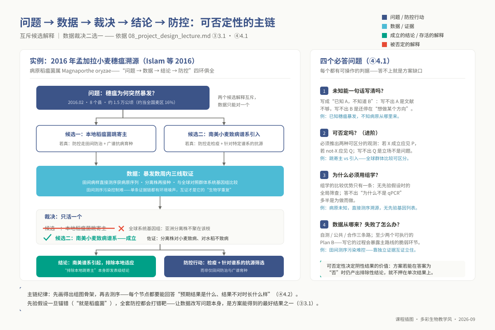
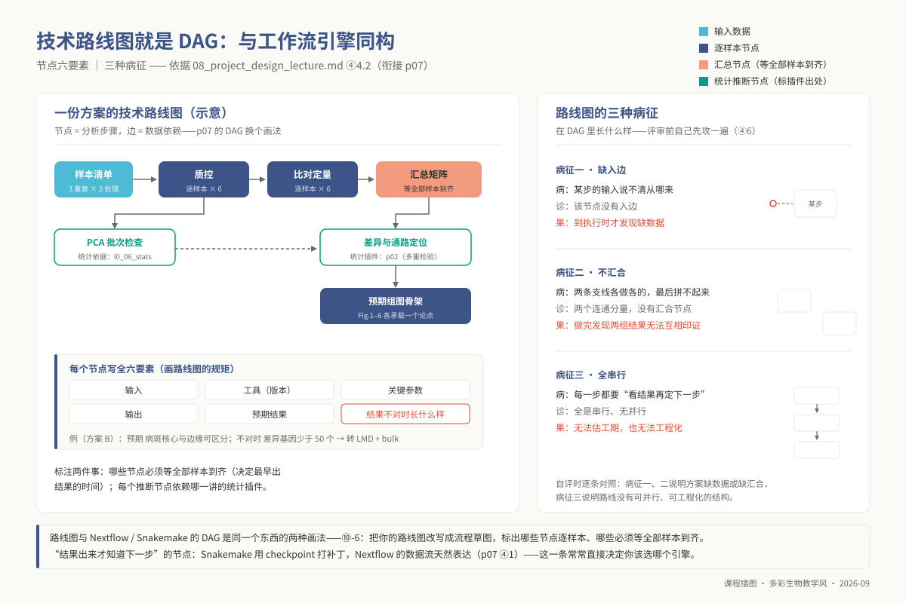
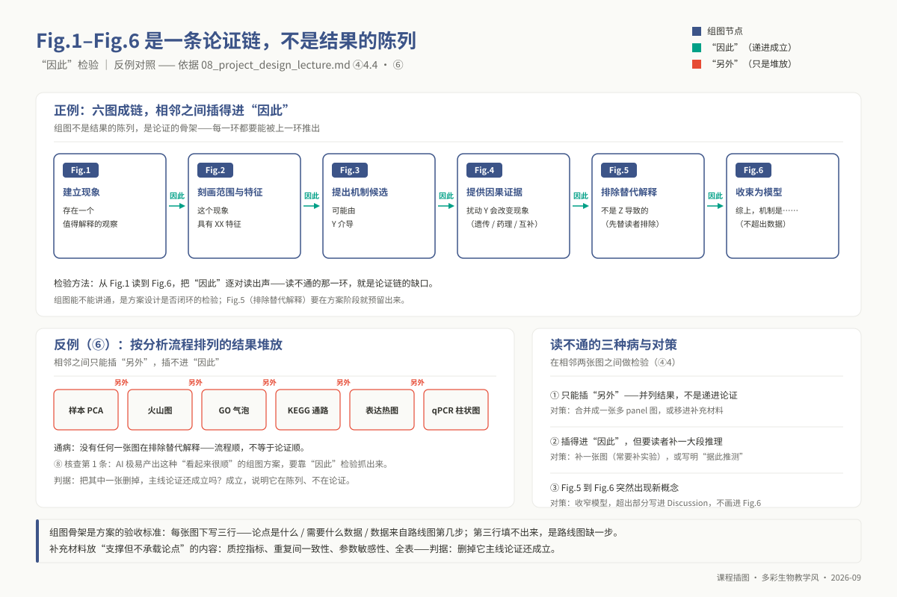

# 专题 p08：课题设计与汇报

> **适用对象**：博士研究生（植物病理、昆虫、农药、微生物等专业）｜授课方式与学时：2 学时理论 + 2 学时汇报与讨论，共 4 学时。
>
> **阅读重点**：本讲把前七讲的方法约束应用到你自己的课题，训练从科学问题、样本设计到组图叙事的可检验方案；重点阅读 ④ 的设计原则与 ⑩ 的方案迁移。

<!-- 维护信息：环境无专用环境，作图沿用 `ngs_phd_base` 的 R 绘图栈；本讲不发主线数据、不跑新流程，使用学生自己的课题材料。原「高级可视化」的配色、拼图、Circos、Inkscape 后处理和导出参数下沉至 `09_resources/cheatsheets/`。 -->

本讲是全课程的综合应用。p01 讨论了 AI 输出的验证，p02–p06 讨论了不同组学方法的统计边界，p07 讨论了可复现工作流。本讲把这些约束放回真实课题：你需要说明采集哪些样本、如何连接不同组学的推断，以及怎样把观测结果组织成可检验的论证。最终产出是一份包含研究设计和组图叙事的方案，而不是工具清单。

## ① 学习目标

完成本讲理论研讨与方案汇报后，你应当能够：

1. **确立科学哲学审视**：深刻辨析“问题驱动”（Hypothesis-Driven）与“技术驱动”（Technology-Driven）在科研认识论上的鸿沟，精准诊断开题方案中因追逐前沿测序热点而产生的冗余技术堆叠，确保每一组学步骤均具备明确的经验可证伪性。
2. **架构推断路线图**：运用有向无环图（DAG）的形式化语言，绘制个人博士课题的端到端计算生物学路线图，严格界定输入前置条件、算法版本、参数阈值、预期分布特征以及判定结果发生偏倚或技术失败的离散判据。
3. **论证资源与设计可行性**：基于统计功效（Statistical Power）、可检测效应量下限与基因组物理特征，严密论证样本容量、组学覆盖深度与重复层级（生物学独立重复 vs 技术测量重复）的合规性，为各关键推断节点量身定制具体的 Plan B 备选预案。
4. **锚定统计推断边界**：逐一标定课题路线图中所有假设检验节点对应的统计学理论根基（映射至 p02、p04、p05、p06 或 `l0_06_stats`），量化阐明在大规模多重假设检验中潜在的假阳性膨胀机制与控制策略。
5. **凝练单图论元假说**：为每个 Figure 写出一个可检验的科学论点，并在图注中标明样本量、检验统计量、$p$ 值、效应量置信区间和误差棒的含义。
6. **编织组图因果链条**：构建 Fig.1 至 Fig.6 的假说—证据链，逐图检查“因此（Therefore）”是否成立，避免用“另外（Moreover）”堆叠互不相连的结果。
7. **建立审稿人防御视角**：从审稿人的角度识别方案中的主要风险，如伪重复、批次混杂、因果方向错误和缺少正交验证。
8. **淬炼高压学术汇报**：在 8 分钟极简时限内清晰陈述课题的核心科学冲突、假说推演逻辑与图表论证架构，在 4 分钟质询辩论中精准区分客观推断边界与待补充的实验证据。
9. **实施同行盲审评议**：依据国际同行评议标准，对同侪的研究设计实施建设性批判，提供精确到参数配置与对照设计的可操作性改进方案。

## ② 前置检查

本讲是全课程知识体系的综合交汇点。本讲**不依赖硕士层特定章节（因此在 L1 映射表中无对应补丁）**，但要求全面调动 L0 阶段的统计推断、数据可视化与系统组织能力：

| 模块 id | 本讲核心运用场景 | 基础缺漏的直接后果 | 对应自测题号 |
|---|---|---|---|
| `l0_06_stats` | ④1 样本容量功效论证、④5 审稿人统计硬伤穿透、⑤ 步骤 4 推断节点数理依据标定 | 无法解释样本量为何选 3 而非 6，把技术重复当作生物学重复；面对多重检验假阳性与混杂因子毫无防御能力 | **L0-6-Q1**（检验方法选择）、**L0-6-Q5**（FDR 多重假设校正）、**L0-6-Q6**（批次效应与协变量控制）、**L0-6-Q7**（实验重复与检验功效） |
| `l0_02_r` | ④3 单图视觉语法设计、⑤ 步骤 5 组图占位图快速绘制、⑨ 绘图栈美学与技术排错 | 无法通过代码将数据分布转化为精确的视觉映射，方案讨论时拿不出可迭代的矢量化证据草图 | **L0-2-Q5**（ggplot2 嵌套图层语法）、**L0-2-Q7**（连续与离散变量视觉编码）、**L0-2-Q9**（高质量图形导出）、**L0-2-Q10**（可重复代码绘图封装） |
| `l0_01_linux` | ⑤ 步骤 2 异构组学原始数据资产治理；衔接 p07 部署工业化目录树规范 | 数据存储无版本溯源、元数据丢失，导致团队协作与多中心数据交接彻底瘫痪 | **L0-1-Q10**（超算平台科研工程目录分层规范） |

**课前必备资产清单**：① 一句话精确陈述的假说性科学问题；② 课题已有数据资产表（平台、文库类型、有效深度、重复数、产出时间戳）；③ 拟申请或补充测序的靶向数据规划；④ 本实验室已发表或投稿中的 2 篇标杆论文（作为本领域组图范式的参照系）。

## ③ 背景与科学问题

在博士生科研实践中，课题开题与课题执行往往呈现出两种截然不同的设计范式：

> **方案 A（技术驱动型）**：「拟针对水稻应对稻瘟菌侵染的时空动态，分别开展单细胞转录组（scRNA-seq）、空间转录组（10x Visium）及非靶向代谢组测序，利用 WGCNA 构建跨组学共表达网络，全面挖掘抗病调控关键核心基因。」
>
> **方案 B（假说驱动型）**：「已知稻瘟菌侵染 24 h 后在抗性品系中诱导局部过敏性坏死（HR），而在感病品系中形成浸润性菌丝扩展，但未知过敏性坏死核心区与外围启动防御反应的交界细胞在转录状态上存在何种因果分工。拟利用 24 h 侵染位点的空间转录组（3 生物学重复 × 2 品系），对比坏死核心区与外围交界带的微区特异性激活通路；若交界带测序未能检出超过 50 个高置信度抗性差异基因（检出下限），则迅速切入激光捕获显微切割（LMD）结合高深度 bulk RNA-seq 进行灵敏度补偿。」

方案 A 是典型的**技术驱动型方案**：先预设了当下最昂贵的技术清单，再去大海捞针式地寻觅生物学解释。这类研究在耗费数十万元测序经费后，往往退化为海量候选基因列表的机械罗列，因缺乏聚焦的因果机制而难以通过严苛的同行评议。方案 B 则是标准的**假说驱动型方案**：研究起始于一个具体的生物学未知，选用刚好能够解答该机制的时空组学分辨率，并为关键推断设定了严密的离散判定阈值与降级应急预案（Plan B）。

```text
方案设计的三大递进认识论层次：
  ┌────────────────────────────────────────────────────────────────────────┐
  │ 1. 认知设计层：问题究竟是真实未知还是伪概念？为何唯有组学能提供无偏证据？│
  └───────────────────────────────────┬────────────────────────────────────┘
                                      ▼
  ┌────────────────────────────────────────────────────────────────────────┐
  │ 2. 叙事论证层：海量数据如何凝结为环环相扣的 Figure 因果链条（因此律）？ │
  └───────────────────────────────────┬────────────────────────────────────┘
                                      ▼
  ┌────────────────────────────────────────────────────────────────────────┐
  │ 3. 评审防御层：审稿人如何从假重复、功效坍缩与伪相关视角发起攻击？      │
  └────────────────────────────────────────────────────────────────────────┘
```

**先画组图骨架**：Figure Mockup 不只是文章完成后的排版工作，也可以在立项时检验推断链。若在测序前无法画出 Fig.1 至 Fig.6 的因果草图，应先找出尚未说明的推断环节，再决定是否推进实验。

### 3.1 应用案例：一次"监测 → 防控"的完整链条——2016 年孟加拉小麦穗瘟

**真实案例：Islam 等（*BMC Biology*, 2016）——基于群体基因组流调溯源指导国家级植物疫情阻截战。**


*图 p08-1：genomic surveillance 直达田间：病样测的就是病原基因组（AI 生成示意图）。*

- **科学冲突与经验可否定性**：2016 年早春，孟加拉国西南部 8 个县突发小麦穗瘟，受灾约 1.5 万公顷（约占这 8 县麦区的 15%），个别田块减产达 100%。针对这一重大疫情，科学界形成了两个针锋相对且在逻辑上**绝对互斥**的假说：其一，本地亚洲水稻稻瘟菌（*Magnaporthe oryzae*）发生寄主跨界突变跳跃至小麦；其二，外来南美洲特化型小麦致病谱系（*Triticum* lineage）通过国际贸易远距离传入。两个假说直接决定了国家防控政策的分岔：前者要求在全境广泛施用杀菌剂并改良抗稻瘟种质，后者则要求立即封锁特定口岸检疫防线并引入专属抗麦瘟育种材料。
- **田间病原基因组学（field pathogenomics）**：研究团队在疫情暴发数周内，从田间有症状/无症状叶片提取总 RNA 做双转录组测序（101 bp 双端，每样本 0.69–1.26 亿条读段），读段同时比对小麦与稻瘟菌参考；没有靶向捕获，建库流程完整，省掉的是病原分离培养这一步。随后把样本 SNP 与全球稻瘟菌群体（含巴西小麦致病株）做系统发育比对（p04 工具集）。
- **结论与证据强度**：孟加拉样本以 >90% 的 bootstrap 支持聚入南美小麦致病谱系；群体层面用转录组 SNP（症状样本 12 高置信分型 15,871 个）与巴西 23 株做 Neighbor-Net。作者据此判断病原**很可能**由南美引入（原文为 most likely / probably，不是「证明」）。实际措施是烧毁 BADC 种子繁殖场（约 355 ha）与重病田，并建议借鉴巴西的抗病品种与杀菌剂管理经验；原文未提检疫清单调整。

```text
              ┌─────────────────────────────────────────────────────────┐
              │ 科学问题：孟加拉小麦穗瘟突发暴发，其真正生物学来源为何？ │
              └────────────────────────────┬────────────────────────────┘
                                           │
                   ┌───────────────────────┴───────────────────────┐
                   ▼                                               ▼
     ┌───────────────────────────┐                   ┌───────────────────────────┐
     │  假说 A (本地演化跨界跳跃)  │                   │  假说 B (外来南美谱系引入)  │
     │  - 预测：基因组同源于亚洲稻瘟 │                   │  - 预测：基因组同源于巴西菌株 │
     │  - 动作：全面喷施稻瘟农药    │                   │  - 动作：封锁检疫、引种抗麦抗源│
     └─────────────┬─────────────┘                   └─────────────┬─────────────┘
                   │                                               │
                   └───────────────────────┬───────────────────────┘
                                           ▼
              ┌─────────────────────────────────────────────────────────┐
              │ 关键数据裁决：直接病斑转录组 + 全球群体基因组系统发育比对 │
              │  - 结果：>90% bootstrap 聚入南美小麦分支；判为很可能引入  │
              │  - 启示：互斥假说的排他性设计赋予高通量数据以决定性裁决力 │
              └─────────────────────────────────────────────────────────┘
```



*图 p08-2：互斥候选解释只能活一个：问题 → 数据 → 裁决 → 结论 → 防控的主链（案例见上）。*


*图 p08-3：方案 A/B 对照：技术驱动 vs 问题驱动的四种病。*

## ④ 核心原理

### 4.1 假说驱动的设计哲学：四大核心叩问

科学研究不是技术工具的展示秀，而是对自然奥秘的逻辑审问。一份卓越的研究方案必须首先经受住四大核心叩问：

**第一问：你所针对的生物学未知，能否压缩为具备高度可否定性的单一论元？**
若无法将研究背景概括为“**已知核心事实 A，但未知关键机制 B**”的形式，说明研究者尚未准确切中领域前沿的认知脉搏。更为关键的是波普尔式的**可证伪性（Falsifiability）**要求：方案中推演的核心假说必须能够推导出一组**排他性的离散观测结果**——“若假说成立，预期观测到特征 $P$；若假说破产，预期观测到特征 $Q$”。如果无论测序数据呈现何种趋势，研究者均能通过事后合理化（Post-hoc Rationalization）强行自圆其说，则该方案在科学哲学层面根本不构成一个可检验的科学假说。

**第二问：为什么本研究必须依赖昂贵的高通量组学，而非轻量级经典分子生物学手段？**
组学技术的一个重要优势是：在缺乏候选集时，可以进行较广的筛选。若调控因子已经缩小到 10 个已知转录因子，RT-qPCR、Western Blot 或双荧光素酶报告实验通常具有更高的时间和空间分辨率，也更便于后续因果验证。方案应说明：为什么本课题仍需要全基因组或全转录组的范围？

**第三问：数据资产的采样结构与统计功效是否在数理上闭环？**
样本设计是实验科学的基石。必须从数理层面回答：自测样本的表型方差预期如何？拟采用的测序深度是否能够满足稀有转录本或低频变异检测的统计功效下限（参考 `l0_06_stats`）？能否先期整合公共数据库（如 SRA、GEO、TCGA）实施微型概念验证，以极小的时间成本校准初始假说？

**第四问：整个实验与分析链条中最脆弱的阿喀琉斯之踵在何处？**
任何复杂的科研管线都存在单点故障风险。方案中必须显式标定技术风险最高的突破口，并为之设计**具备即时可执行性的两套独立应急预案（Plan B）**。没有应急备选路径的方案，本质上是一场拿博士学位下注的豪赌。

### 4.2 技术路线图：科学推断的有向无环图（DAG）

技术路线图绝非美工绘制的几何色块图，它在数学本质上就是本课程 p07 所讲授的**依赖计算图（DAG）**。流程节点代表分析算子，有向边代表数据流动与前置状态约束。

```text
优质推断节点的六要素标准拓扑：
  [前置输入数据规范] ──> 【 算子名称 (严密工具版本号与物理执行环境) 】 ──> [下游标准化产物]
                            │   - 核心过滤参数与数理模型依据
                            │   - 期望的数据统计分布特征 (预期指标)
                            └── - 偏倚/失败特征判据 (异常报警响应)
```

**绘制科研路线图的四项工程军规**：

1. **输入与算子闭环**：严禁出现“孤立无入边”的数据生成节点，每一个分析算子必须明确写清输入来源、工具软件版本号（严禁出现“使用常用软件分析”等模糊字眼）及核心调优参数。
2. **离散异常判据**：每一个推断节点下方必须配套陈述“预期数据特征”与“**异常偏倚表现**”（例如：FastQC 接头污染超标、有效比对率低于 60%、单细胞线粒体占比超 20%），并指明触发异常时的回滚策略。
3. **汇聚屏障标记**：明确区分逐样本流式计算节点与跨样本必须同步等待的全量汇聚节点，准确预估跨阶段计算阻塞的物理时间开销。
4. **统计插件映射**：对涉及差异检验、聚类划分、关联映射与网络推断的节点，逐一标注其统计推断的理论支撑章节。



*图 p08-4：路线图即 DAG：节点六要素与三种病征。*

### 4.3 图表叙事·单图层面：一张 Figure 承载一个论点

在学术论文的可视化修辞体系中，**图注绝非图表内容的客观描述，而是论文核心论点的逻辑陈述句；图形本身则是支撑该陈述句的数理证据空间**。

- **不良图注（描述性清单）**：“图 3. 基因 X 在不同处理下的表达模式热图及相关统计结果。”（读者读完依然无法得知你的结论是什么）。
- **卓越图注（论点演绎型）**：“图 3. 病原菌侵染 24 h 特异性诱导转录因子 X 在木质部薄壁细胞高表达，且其表达丰度与寄主胼胝质沉积量呈显著正相关（$n=6$ 独立生物学重复；双侧 Wilcoxon 秩和检验，检验统计量 $W=34$，精确 $p=0.0087$；误差棒代表平均值 $\pm$ SD；原始散点完整呈现）。”

**四大视觉统计反模式（Anti-Patterns）深度剖析**：

| 视觉反模式 | 底层数理与统计失真机理 | 科学出版级替代规范 |
|---|---|---|
| **炸药图（柱状图 + 单侧误差棒）** | 均值与标准差对非正态分布、多峰分布（Multimodal）及微小样本完全不敏感；两组截然不同的底层散点分布可绘制出完全相同的柱状高度 | 全面废止炸药图；采用蜂群图（Beeswarm）、小提琴图（Violin）叠加半透明原始散点与中位数线 |
| **双 Y 轴共绘图** | 左右两侧 Y 轴的缩放比例（Scale）与平移截距纯属人为任意指定，研究者可通过调节轴范围恶意制造两条曲线“高度吻合”的伪相关幻觉 | 拆分为垂直排列但共享横轴时间/空间维度的上下双 Panel 结构 |
| **无距离度量注记的热图** | 层次聚类的距离矩阵（欧氏、皮尔逊、曼哈顿）与连接方式（Complete, Ward.D2）彻底决定热图拓扑；省略度量注记意味着结果完全不可复现 | 图注中显式声明行归一化算法（Row Z-score）、距离算法与聚类层次规则 |
| **孤立 $p$ 值崇拜** | 当样本容量足够大时，极其微弱、无生物学实际功能的微小效应亦可达成 $p < 0.001$；缺乏效应量度量的推断极易误导学术界 | 强制同时报告标准化效应量（Effect Size，如 $\log_2\text{FC}$、Cohen's $d$）及其 95% 置信区间 |

**排版铁律**：除特殊汉语言文学文献研究外，自然科学论文图内文字（轴标题、图例、面板标记）**严禁出现任何中文字符**，避免 Linux 绘图栈中文字体缺失造成的乱码或方块字符（详见 ⑨-3）。

### 4.4 图表叙事·组图层面：Fig.1–Fig.6 是一条论证链

一篇高水平生命科学学术论文的组图体系，本质上是一场高度形式化的逻辑演绎证明。标准的顶级期刊组图由 5 到 7 张核心图谱构成严密的推演闭环：

$$\text{Fig. 1 (确立现象)} \xrightarrow{\text{因此}} \text{Fig. 2 (解析特征)} \xrightarrow{\text{因此}} \text{Fig. 3 (提出靶标)} \xrightarrow{\text{因此}} \text{Fig. 4 (因果验证)} \xrightarrow{\text{因此}} \text{Fig. 5 (排除假象)} \xrightarrow{\text{因此}} \text{Fig. 6 (凝练模型)}$$

```text
逻辑连通性终极审查准则：
  若相邻两图之间能够顺畅填入【因此 (Therefore)】，论证链条高度稳固；
  若两图之间只能生硬填入【另外 / 此外 (Moreover)】，表明发生逻辑断层，陷入数据平铺直叙！
```

- **Fig. 1 建立现象**：在全基因组或宏观表型层面证实存在一个不可忽视、超越随机波动的生物学表型分岔。
- **Fig. 2 刻画特征**：利用高精度组学（单细胞/空间/表观），证明该现象在细胞类型、特定亚细胞区室或时间维度上的时空特异性边界。
- **Fig. 3 锁定靶标**：基于差异分析与调控网络，从海量全基因组背景中收敛出驱动该生物学行为的最关键核心分子或变异单倍型。
- **Fig. 4 因果干预**：开展逆向正交验证（基因敲除、CRISPR 抑制、外源添加或互补实验），证明扰动该核心靶标能逆转或阻断 Fig. 1 所见现象。
- **Fig. 5 排除替代机制**：这是区分顶尖论文与二流成果的分水岭。主动设计阴性对照与竞争通路排查，无可辩驳地证明“该现象绝非由于通用细胞凋亡、背景批次效应或通路 Z 的连带激活所致”。
- **Fig. 6 机制示意图**：收束为精炼的生物学作用机制拓扑模型，为本领域贡献具备预测能力的知识范式。



*图 p08-5：图表链条：正例「因此」链 vs 反例「另外」堆放。*

### 4.5 审稿人怎么看图：什么样的图会被要求重做

资深审稿人拿到手稿时的行为路径具有高度确定性：通读标题与摘要 $\rightarrow$ 快速扫视 Fig.1 至 Fig.6 及其图注 $\rightarrow$ 形成对论文科学可信度的第一先验预判 $\rightarrow$ 带着批判性挑剔回读正文方法节。因此，组图与图注构成了审稿人做出退稿或大修裁决的主战场。

审稿人视线聚焦的六大核心防御点：

1. **实验重复的统计本体**：样本量 $n$ 是否明确区分了生物学独立个体与同一样本的技术测定？将 1 只小鼠的 3 块组织切片称为 $n=3$ 生物学重复属于学术硬伤。
2. **离散散点透视**：当样本容量 $n \le 10$ 时，图形是否隐瞒了原始样本分布？不展示原始数据点直接标注误差棒的图注必然遭遇责难。
3. **假设检验的前提假设契约**：使用参数检验（如 Student's $t$ 检验）前是否验证了正态性与方差齐性？若样本偏态严重，是否选用了非参数检验？
4. **多重检验校正（FDR）的透明度**：在组学高维筛查中，是否对上万次独立比较实施了严格的 Benjamini-Hochberg (BH) 或 Bonferroni 惩罚？
5. **内建阴性/阳性对照（Controls）**：处理组的显著变化是否伴随基线溶剂对照（Vehicle Control）或 Mock 侵染对照？缺乏对照的组学折线图在科学上毫无意义。
6. **视觉欺诈式坐标轴修饰**：坐标轴是否存在恶意截断（Truncated Axis）以人为放大微小差异？对数坐标转换（$\log_{10}$）是否导致低表达离群值被隐形抹平？


*图 p08-6：审稿人六项检查：写作前先当一次自己的审稿人。*

### 4.6 方案评审要点：先自己攻一遍

在课题答辩或投稿之前，研究者应依据下述四维矩阵对个人方案开展模拟“红蓝对抗（Red Teaming）”：

| 审议维度 | 关键审查问询 | 终极合格判据 |
|---|---|---|
| **假说立论（Hypothesis）** | 该未知是否具备明确的假说可证伪性？回答它能否改变本领域的理论框架？ | 能够清晰写出互斥的预期结果 $P$ 与 $Q$；若结论为阴性，排除性事实依然具备独立发表价值 |
| **设计严谨（Rigor）** | 分析方法与数理模型是否能够支撑结论？统计推断的理论边界在何处？ | 路线图全节点标明工具与参数；差异检验、聚类与关联分析完全消除假阳性膨胀漏洞 |
| **数据配比（Data Sufficiency）**| 样本容量与测序深度是否经过定量功效估算？批次效应是否被正交平衡？ | 样本量经统计功效推导确定；生物学独立重复达标；混杂变量在实验设计阶段完成物理交错 |
| **因果闭环（Causality）** | 组学结论是否仅仅停留在相关性阶段？是否存在独立维度的正交因果扰动验证？ | 必须包含基因功能干预或正交分子生物学实验；关键推断节点配备落地可行的 Plan B 预案 |

### 4.7 技术前沿（2023–2026）

伴随国际生命科学界对科研诚信、透明度与可重复性危机（Reproducibility Crisis）的反思，课题设计与论文呈现机制正在经历三大深刻的技术范式演变：

1. **预注册研究报告（Registered Reports）成为黄金出版标准**：以 *Nature Human Behaviour*（Chambers & Tzavella 2022）等期刊为代表，研究者在正式开展任何测序或湿实验前，必须将研究假说、样本设计、统计检验模型与组图骨架提交期刊进行第一阶段同行评议（Stage 1 Peer Review）。一旦方案通过预评审即获得**原则性接收承诺（In-Principle Acceptance, IPA）**，随后产出的数据无论呈现显著阳性还是彻底阴性，均必须无条件正式刊发。这一制度彻底遏制了针对 $p$ 值的恶意数据钓鱼（p-hacking）。
2. **预印本公共时间戳与负结果资产化**：通过 bioRxiv 等开放平台建立带有不可伪造数字对象唯一标识符（DOI）的技术路线时间戳，抢占科学假说的学术发现优先权；同时，严谨证伪既有流行假说的排除性研究（Negative Results）正获得学术界的崇高评价。
3. **大模型辅助科研伦理透明化准则**：2023 年以 *Science* 社论（Thorp 2023）及施普林格·自然（Springer Nature）全集团政策为转折点，国际主流出版联盟明令禁止将生成式人工智能列为论文作者，要求作者在方法章节中详尽声明大模型的提示词（Prompts）、使用范围与人工验证记录，并严禁直接使用大模型生成或修改科研事实图表。

## ⑤ 操作步骤

本讲的核心实操产出为两份高标准的学术资产：**一份完整的博士课题计算生物学设计方案（Markdown/PDF）** 与 **一套可直接用于汇报展示的组图骨架草案（PPT/R 代码占位图）**。

**步骤 1 · 提炼高度可证伪的核心科学假说**（限时 15 分钟内完成）：

- 强制套用标准语法模板：“已知领域内核心事实 A，然而未知关键生物学分工 B；我们假设存在机制 C 调控该进程。若假设 C 成立，在扰动 D 下应当观测到特征 $P$；反之，若假设 C 破产，则必然观测到特征 $Q$。”

**步骤 2 · 构建结构化多组学数据资产清单**（填入方案文档表格）：

- 严禁出现“常规测序若干例”等粗糙表述。按行细化：组学类型、生物学独立样本数、处理批次、文库构建策略、靶向测序有效深度、测序深度数理估算依据（必须阐明深度如何保障低表达转录本检出）。

**步骤 3 · 绘制形式化技术路线推断 DAG**：

- 梳理从原始测序数据到机制结论的完整拓扑结构，逐一填充算子六要素（输入、软件名称与版本号、关键参数阈值、输出标准化格式、预期数据分布特征、离散异常报警判据）。

**步骤 4 · 逐节点标注统计推断理论映射**：

- 审核路线图中每一个涉及 $p$ 值或多维降维的节点，指明其所遵循的统计学假设检验方法、多重比较校正策略（如 BH-FDR < 0.05）以及在对应博士专题讲义（p02/p04/p05/p06）中的理论映射位置。

**步骤 5 · 架构 Fig.1–Fig.6 组图因果骨架**：

- 规划 6 张核心图版。为每个图版拟定两句话：第一句为该图的完整论点陈述句，第二句指明该图数据源自路线图的哪一步。随后执行“因此（Therefore）”逻辑连通性交叉审阅。

**步骤 6 · 实施全方位答辩前自我红蓝对抗**：

- 对照 ④6 的四维矩阵逐项自测打勾，诚实写出本设计目前所面临的**最大潜在致命伤**与对应的 Plan B 救济方案。

**步骤 7 · 开展课堂限时高压学术汇报**：

- 严格遵循国际顶级研讨会规则，每人独立汇报 8 分钟，随后接受评委与同学针对性提问 4 分钟。汇报幻灯片必须严格限制在 8–11 页之内：

| 页码区间 | 汇报核心板块 | 核心交待内容与考核权重要求 |
|---|---|---|
| **第 1–2 页** | **科学假说与背景** | 提炼已知事实与未解之谜；论证为何非组学不可（分值权重 18%） |
| **第 3 页** | **数据资产规划** | 实验设计、生物学独立重复设计、测序深度与功效估算依据 |
| **第 4–6 页** | **技术路线推断 DAG** | 详尽展示带异常判据的计算图，明确关键推断的统计学理论依据（分值权重 27%） |
| **第 7–8 页** | **组图叙事因果链** | 展示 Fig.1–Fig.6 组图骨架草图，逐页陈述核心论点与相邻衔接逻辑（核心考察项） |
| **第 9 页** | **正交因果扰动验证** | 详细列举独立于高通量测序的分子生物学干预实验计划 |
| **第 10 页** | **风险控制与 Plan B** | 剖析全流程中最易断裂的环节，出示具体的降级应对方案（分值权重 23%） |
| **第 11 页** | **项目执行甘特图** | 标定样本制备、算力配给、流程开发与论文撰写的时间里程碑 |

## ⑥ 结果解读

### 1. 博士课题设计方案综合评审量表（Rubric）

根据课程契约，博士课题方案设计占博士层总成绩的 **47%**。评分标准高度侧重于方案的推断严谨性与科学判断力，具体权重分配如下：

| 评估维度 | 相对权重 | 专家评审关键判据与采分点 |
|---|---|---|
| **问题清晰度** | 18% | 科学问题是否高度聚焦并具备明确的可证伪性；是否精准切中领域学术痛点 |
| **方法合理性** | 27% | 组学技术选型是否合理且无可替代；统计检验模型是否严谨，假阳性控制是否闭环 |
| **技术与风险细节** | 23% | 算子参数与计算环境是否详实；异常报警特征与两套 Plan B 备选方案是否具体可行 |
| **创新与整合度** | 13% | 分析策略是否具备非套路化的创新视角；跨组学整合是否具备内在生物学因果逻辑 |
| **汇报表达与图表叙事**| 9% | 组图骨架的“因此”因果链条是否连贯；幻灯片美学排版质量、时间把控与答辩表现 |
| **AI 使用与验证记录** | 10% | 是否针对大模型输出开展了多维等价性防御审计，是否具备完整的 Crossref 文献真伪核查证据 |

### 2. 方案典型失败病征（反面教材警示）

在同行答辩现场，以下三种病征最为频发且极易遭遇全票否决：

- **反面教材 1：杂乱无章的组学大拼盘**：方案中罗列了单细胞、空间转录组、蛋白质修饰组与宏基因组，但在技术路线终点，所有分支均指向“筛选出一批候选标志物”。若将其中任意两门组学删除，核心问题的解答完全不受影响，表明存在严重的盲目经费堆砌。
- **反面教材 2：流程图充当组图论证链**：组图布局为 Fig.1 测序质控、Fig.2 PCA、Fig.3 火山图、Fig.4 GO 富集、Fig.5 KEGG 气泡图、Fig.6 随机挑一个基因做 qPCR。这仅是生物信息学分析软件的默认产出时序，根本不构成学术论文的因果推论。整套图谱完全缺失排除替代机制的阴性对照。
- **反面教材 3：完全缺失工程救济预案**：在路线图中预设高难度的单细胞悬液制备或低投入量甲基化测序，但对“若细胞活率低于 70%”或“若免疫共沉淀富集倍数不达标”完全未置一词，仅仅以“将密切关注实验进展并积极排查”敷衍了事。

### 3. 方案终审自检清单（交付前必读）

- [ ] 科学假说已提炼为标准的“已知 A，未知 B”结构，具备排他的经验可否定性。
- [ ] 针对每一项组学分析，均能严密回答“为何不可使用低成本经典实验替代”。
- [ ] 数据资产清单中完整给出了生物学独立重复数与测序深度的数理功效依据。
- [ ] 路线图中每一个推断算子均完整标定了统计学方法、参数配置与异常报警特征。
- [ ] Fig.1–Fig.6 组图骨架经受住了严格的“因此”因果连通性审查，绝无生硬堆放。
- [ ] 所有图注均规范齐备样本容量 $n$、统计检验模型、精确效应量与误差棒定义。
- [ ] 针对技术风险最高的核心节点，已完备制定了两套具备落地操作性的 Plan B 方案。
- [ ] 图面矢量化元素中彻底清除了所有中文字符与炸药图视觉反模式。

## ⑦ 统计插件

**本讲无独立统计要点。**

本专题不在契约 `stats_plugin_topics` 名单内（该名单为 p02、p04、p05、p06）。本讲并不引入全新的数理统计分布推导，**但它是此前所有统计插件在真实科研实践中的集大成检验场**。
在课题方案的撰写中，严禁出现将统计推断退化为“运行软件默认选项得到 $p < 0.05$”的业余做法。方案中的每一处假设检验节点，都必须明确映射回前序章节的统计学与统计遗传学法则：

1. **样本容量与统计功效估算**：阐明在假定效应量下，现有样本容量如何避免统计功效严重不足（Underpowered Study）导致的假阴性与效应量虚高（Winner's Curse：低功效下按显著性阈值筛出的效应量，平均会高估真实效应）。
2. **差异与聚类的统计边界**：单细胞伪混杂汇总（Pseudobulk）与负二项广义线性模型（p02）；宿主-病原双转录组的竞争性比对偏倚与似然比检验（p03）。
3. **群体与关联的统计混杂校正**：群体结构中性漂移与选择压的 Tajima's $D$ 分辨率（p04）；全基因组关联分析中混合线性模型（MLM）对隐性亲缘关系的控制及 QQ 图分膨胀系数判定（p05）。
4. **高维相关网络的多重检验灾难**：组学特征共表达关联中数百万次假设检验的错误发现率（FDR）控制，以及从相关性跃迁至因果性时必须依赖的正交扰动边界（p06）。

## ⑧ AI 辅助任务

**任务目标：利用大语言模型为个人课题构思拟定一套包含 6 个面板的组图叙事框架，并运用学术文献数据库对 AI 引用的全部“支持性文献”实施原子级真伪溯源核查。**

- **提示词工程设计**：向大语言模型详尽输入你的科学假说、研究材料、拟采用的组学技术栈以及当前已掌握的初步数据，要求其严格按照学术论文逻辑生成 Fig.1 至 Fig.6 的因果组图框架，为每张图撰写学术规范图注，并**要求其逐条列举出国际权威期刊中采用类似图表范式的同类代表性论文（要求精确输出第一作者、发表年份、期刊名称与完整 DOI）**。
- **四维防御性反思与溯源核对矩阵**：

| 维度 | 审查核心目标 | 深度诊断手法 | AI 生成内容的典型缺陷与幻觉模式 |
|---|---|---|---|
| **1. 逻辑连通性** | 审查组图是否构成因果演绎闭环 | 逐图之间强行代入“因此”进行语义推理（④4） | 习惯性生成“质控 $\rightarrow$ PCA $\rightarrow$ 火山图 $\rightarrow$ 富集图 $\rightarrow$ 验证”的流水账工具排布，缺乏排除假象的机制图 |
| **2. 证据充分性** | 审查论点是否超出课题现有数据范围 | 对照路线图逐一审查图表所需的数据源节点 | 凭空臆造出超出课题设计的高精度数据（如在仅规划 bulk 测序的方案中排布高空间分辨率原位杂交图） |
| **3. 文献真实性** | 审查文献引用是否纯属大模型幻觉编造 | 调用 Crossref 元数据 API 实施严格的机器溯源校验（见下方实操） | 虚构高度逼真的标题与真实期刊组合，生成形似真实但不可解析的伪造 DOI（如伪造 Nature 前缀） |
| **4. 统计完备性** | 审查图注要素是否达到出版级标准 | 对照 ④5 审稿人视线清单逐项核查 | 图注辞藻华丽但空洞无物，完全遗漏具体的样本量 $n$、检验名称、多重比较校正方法及误差棒统计学定义 |

**文献真实性自动化核验实操指令集**：

```bash
# 1. 检测 DOI 是否已注册：-L 跟随跳转后输出最终状态码，非 404 即已注册，404 即未注册
curl -sIL -o /dev/null -w "%{http_code}\n" https://doi.org/10.1038/s41587-020-0439-x

# 2. 穿透 Crossref 开放学术元数据数据库，调取文献权威注册信息并比对题名与作者
curl -s "https://api.crossref.org/works/10.1038/s41587-020-0439-x" \
  | python3 -c "import json,sys; d=json.load(sys.stdin)['message']; \
print('Title: ', d.get('title',[''])[0]); print('Journal: ', d.get('container-title',[''])[0]); print('Year: ', d.get('issued',{}).get('date-parts',[['']])[0][0])"

# 3. 终极反向检索核验：登录 PubMed (https://pubmed.ncbi.nlm.nih.gov/) 交叉印证生物医学收录真实性
```

- **交付归档规范**：在课题设计附录中提交 AI 初始组图规划文本、你修订后的正式组图骨架对比说明，以及一份完整的《文献真伪鉴定核验表》（逐行注明 AI 推荐论文、DOI 解析状态、Crossref 比对吻合度、最终判定为“真实/编造/存疑”）。

## ⑨ 常见错误与排查

**1. Crossref API 返回 404 资源不存在（Resource not found）**

- **机理**：大语言模型基于自回归概率采样算法，极其擅长拼凑符合学术出版物命名模式的字符串。AI 生成的前缀（如 `10.1038/`）虽然属于 Nature 集团的合法前缀，但后缀数字完全是概率拼接的幻觉产物。
- **处置**：严禁直接引用未经解析核实的文献。立刻使用文章题目在 PubMed 或 Google Scholar 进行全文反向检索；若检索无果，该文献判定为伪造，从论述中彻底剔除并记录入 AI 防御日志。

**2. ggplot2 报 `Aesthetics must be either length 1 or the same as the data`**

- **机理**：在为组图绘制占位模拟图时，手工构建的分类元数据向量长度与主数据框的观测行数发生失配。
- **处置**：切忌在 `aes()` 中混入外部裸向量；必须将所有样本属性以结构化数据列形式严格整合进待绘图的数据框（`data.frame`）中统一映射。

**3. 导出矢量 PDF 图形在跨平台预览时出现文字方块乱码**

- **机理**：Linux 服务器或容器环境中默认缺失中文字体轮廓库，当 R 或 Python 绘图引擎尝试对汉字进行栅格化或字体嵌入时，底层 FreeType 库抛出字符编码映射失败。
- **处置**：**严格贯彻本课程英文标注铁律**——图内全部轴标题、图例、注解文字一律使用标准英文，中文解释一概在正文与图注中展现。

**4. 自动化作图脚本报 `cannot open file 'figures/…'`（课程 pin ggplot2 3.4.2；4.0 起 `ggsave` 改报 `Cannot find directory 'figures'`）**

- **机理**：绘图脚本预先假定输出目录已经物理存在，在新的超算节点或他人机器上重跑时发生依赖断裂。
- **处置**：在脚本头部显式嵌入防御性系统命令：`dir.create("figures", showWarnings = FALSE, recursive = TRUE)`，确保代码自包含可移植。

**5. 答辩现场评审专家发难：「这张图的核心科学结论究竟是什么？」**

- **机理**：图注仅罗列了测量对象与技术类型，缺失了明确可被证伪的结论性判断句，导致评审专家无法捕捉作者意图。
- **处置**：将图注首句严格改写为“本图证明了……”的肯定式论点句，并审查图面视觉重心是否与该论点精确聚焦呼应。

**6. 答辩现场评审专家质问：「Fig.3 和 Fig.4 之间存在巨大的逻辑跳跃，是如何过渡的？」**

- **机理**：论证链条发生断裂。Fig.3 挖掘出一组候选分子，Fig.4 却直接跳转到另一个不相关的表型观察，两图之间只能使用“此外”而无法使用“因此”进行承接。
- **处置**：在组图中补充能够建立直接功能关联的干预实验，或调整组图拓扑将旁支分析降格移入补充材料（Supplementary Figures）。

**7. 答辩现场评审专家追问：「你的图注中 $n$ 到底是多少？误差棒代表的是 SD 还是 SEM？」**

- **机理**：图注书写严重缺乏统计学严谨性，未标明基础实验计量参数。
- **处置**：全面套用标准化图注模板补齐细节：明确标注生物学独立重复数 $n$、误差棒统计定义（推荐 SD 反映样本离散度，或 95% 置信区间反映参数估计精度）、精确假设检验方法及多重检验校正算法。

## ⑩ 思考练习

1. **（科学哲学与假说重构）** 深入审视本讲 ③ 中的技术驱动型方案 A。请在不引入任何新组学技术的前提下，将其彻底重构为一个由假说驱动的高标准研究方案：明确提炼出“已知事实 A 与核心未知 B”，削减掉至少一个对回答核心问题无实质贡献的冗余组学维度，并严密论述为何削减该维度不会对最终的科学结论造成不可逆的逻辑缺损。
2. **（深度统计批判与视觉溯源）** 在某顶级期刊发表的论文中，作者出示了一张柱状图（Bar Plot），显示经药物处理后某转录因子表达量是对照组的 2.3 倍，柱头带有单侧误差棒，误差棒互不重叠，并标注了象征极其显著的极小 $p$ 值（$**p < 0.01$）；图注仅简短附注“数据代表平均值 $\pm$ SEM”。请从实验设计、样本容量、数据分布偏态、假阳性风险及视觉呈现失真等维度，列出四个必须向作者当面质询的尖锐学术问题，并详述若作者给出不同回答，将如何彻底推翻其当前的生物学结论。
3. **（视觉叙事重铸）** 检视你个人此前绘制的一张科研图表（或你所在实验室已发表论文中的核心主图），写出其当前承载的唯一科学论点。若发现该图无法用一句话提炼出可被反驳的假说结论，请运用本讲传授的视觉叙事法则，对其坐标映射、分组聚类及图注结构实施系统性重构。
4. **（因果论证拓扑审查）** 调阅你所属学科方向近三年发表在国际主流学术期刊上的一篇代表性研究论文，系统解构其自 Fig.1 至最终主图的演化逻辑，逐对检验其面板之间是否能够顺畅贯穿“因此（Therefore）”的因果递进律。找出该论文论证链条中最薄弱或跳跃最大的一处节点，深入剖析作者究竟是借助何种补充实验掩盖了这一缺陷，还是在正文讨论（Discussion）中进行了妥协性回避。
5. **（同行评议对抗演练）** 交换审阅同组另一位博士生的开题设计方案，依据 ④6 所确立的四维严密审查矩阵对其开展建设性学术批判。严禁给出“建议增加测序深度”等泛泛而谈的套话，必须出示至少一条精确到特定时间采样点、正交功能对照或替代统计模型的实质性修改意见。
6. **（工程架构与技术路线映射）** 将你个人的课题技术路线 DAG 转化为 Nextflow DSL2 或 Snakemake 的概念管道草图：清晰标明哪些步骤属于天然并发的逐样本进程（Process/Rule），哪些步骤属于跨样本屏障汇聚进程，并深入探讨对于“分析结果出炉后方能判定下一步分支走向”的动态节点，在工程管线层面应采用何种策略实施解耦。
7. **（🔬 博士毕业设计全景收官大考 · 开放题）** 这是本门课程对每位博士生的终极学术检阅。请直面你**真实正在开展的博士毕业课题**，全面完成以下推演：① 提炼出高度概括的假说陈述句，明确指明若该假说被最终证实，将如何改写本领域的理论图景；② 列出全套异构数据资产规划，对尚未产出的数据明确标注获取渠道与风险控制；③ 绘制形式化技术路线 DAG，对每个推断算子完成统计学理论与异常判据的完备标定；④ 搭建 Fig.1 至 Fig.6 的完整组图因果骨架，并指出当前整个叙事链中你最为担忧的技术命门所在；⑤ 针对最核心假设设计两套具备立即可操作性的 Plan B 路径；⑥ 直面学术生涯中最严酷的灵魂拷问——如果历经三年艰苦探索，最终所获得的全基因组及分子数据完全呈现阴性结果（即原假说破产），你的毕业论文将如何立论？这一颠覆性的阴性发现是否具备改写既有范式的独立发表价值？

## ⑪ 参考资料

### 经典文献

| 领域方向 | 权威文献 |
|---|---|
| 科研绘图十条黄金准则 | Rougier, N. P., Droettboom, M., & Bourne, P. E. (2014). Ten simple rules for better figures. *PLoS Computational Biology*, 10(9), e1003833. [10.1371/journal.pcbi.1003833](https://doi.org/10.1371/journal.pcbi.1003833) |
| 终结炸药柱状图的历史宣言 | Weissgerber, T. L., Milic, N. M., Winham, S. J., & Garovic, V. D. (2015). Beyond bar and line graphs: time for a new data presentation paradigm. *PLoS Biology*, 13(4), e1002128. [10.1371/journal.pbio.1002128](https://doi.org/10.1371/journal.pbio.1002128) |
| 论文结构化叙事十条准则 | Mensh, B., & Kording, K. (2017). Ten simple rules for structuring papers. *PLoS Computational Biology*, 13(9), e1005619. [10.1371/journal.pcbi.1005619](https://doi.org/10.1371/journal.pcbi.1005619) |
| 口头学术报告演示十条准则 | Bourne, P. E. (2007). Ten simple rules for making good oral presentations. *PLoS Computational Biology*, 3(4), e77. [10.1371/journal.pcbi.0030077](https://doi.org/10.1371/journal.pcbi.0030077) |
| 误差棒统计学内涵解析 | Krzywinski, M., & Altman, N. (2013). Points of significance: Error bars. *Nature Methods*, 10(10), 921–922. [10.1038/nmeth.2659](https://doi.org/10.1038/nmeth.2659) |
| 统计功效与样本容量权衡 | Krzywinski, M., & Altman, N. (2013). Points of significance: Power and sample size. *Nature Methods*, 10(12), 1139–1140. [10.1038/nmeth.2738](https://doi.org/10.1038/nmeth.2738) |
| 可视化配色与色盲可及性 | Wong, B. (2011). Points of view: Color blindness. *Nature Methods*, 8(6), 441. [10.1038/nmeth.1618](https://doi.org/10.1038/nmeth.1618) |
| 为什么多数发表成果是假的 | Ioannidis, J. P. A. (2005). Why most published research findings are false. *PLoS Medicine*, 2(8), e124. [10.1371/journal.pmed.0020124](https://doi.org/10.1371/journal.pmed.0020124) |
| 可重复科学的制度化宣言 | Munafò, M. R., Nosek, B. A., Bishop, D. V. M., Button, K. S., Chambers, C. D., Percie du Sert, N., et al. (2017). A manifesto for reproducible science. *Nature Human Behaviour*, 1, 0021. [10.1038/s41562-016-0021](https://doi.org/10.1038/s41562-016-0021) |
| 计算生物学工程组织标准 | Noble, W. S. (2009). A quick guide to organizing computational biology projects. *PLoS Computational Biology*, 5(7), e1000424. [10.1371/journal.pcbi.1000424](https://doi.org/10.1371/journal.pcbi.1000424) |
| 科学数据管理 FAIR 原则 | Wilkinson, M. D., Dumontier, M., Aalbersberg, I. J., Appleton, G., Axton, M., Baak, A., et al. (2016). The FAIR Guiding Principles for scientific data management and stewardship. *Scientific Data*, 3, 160018. [10.1038/sdata.2016.18](https://doi.org/10.1038/sdata.2016.18) |
| 预注册研究报告发展史 | Chambers, C. D., & Tzavella, L. (2022). The past, present and future of Registered Reports. *Nature Human Behaviour*, 6(1), 29–42. [10.1038/s41562-021-01193-7](https://doi.org/10.1038/s41562-021-01193-7) —— ④7 |
| 期刊 AI 作者伦理社论 | Thorp, H. H. (2023). ChatGPT is fun, but not an author. *Science*, 379(6630), 313. [10.1126/science.adg7879](https://doi.org/10.1126/science.adg7879) —— ④7 |
| 田间基因组流行病学实战 | Islam, M. T., Croll, D., Gladieux, P., et al. (2016). Emergence of wheat blast in Bangladesh was caused by a South American lineage of *Magnaporthe oryzae*. *BMC Biology*, 14, 84. [10.1186/s12915-016-0309-7](https://doi.org/10.1186/s12915-016-0309-7) —— ③ 3.1 应用案例 |

### 官方规范与研发工具

| 资源类别 | 检索链接 / 仓库物理路径 |
|---|---|
| DOI 官方网关 ｜ Crossref 元数据 API 与检索 | https://doi.org/ ｜ https://api.crossref.org/ ｜ https://search.crossref.org/ |
| PubMed 权威生物医学数据库 ｜ 撤稿追踪库 | https://pubmed.ncbi.nlm.nih.gov/ ｜ https://retractionwatch.com/retraction-watch-database-user-guide/ |
| Nature 系列期刊临床与生物学报告规范 | https://www.nature.com/nature-portfolio/editorial-policies/reporting-standards |
| EQUATOR Network 国际科研报告规范索引 | https://www.equator-network.org/ |
| ggplot2 官方指南 ｜ patchwork 组图排版框架 | https://ggplot2.tidyverse.org/ ｜ https://patchwork.data-imaginist.com/ |
| **作图技法与视觉美学速查表** | `09_resources/cheatsheets/`（配色规范、分面拼图与矢量导出指令集） |
| 统计学理论前置与自测对照 | `02_lectures/prerequisites/l0_06_stats/l0_06_stats.md` + `08_assessment/prerequisites/l0_06_stats_selftest.md` |
| R 语言视觉语法前置与自测 | `02_lectures/prerequisites/l0_02_r/l0_02_r.md` + `08_assessment/prerequisites/l0_02_r_selftest.md` |
| 各博士专题统计插件理论库 | p02 `topic02_scrnaseq_spatial` ｜ p04 `topic04_popgen` ｜ p05 `topic05_gwas` ｜ p06 `topic06_multiomics` |
| 路线图工程化衔接：工作流开发规范 | `02_lectures/phd/topic07_workflow_nextflow/07_workflow_nextflow_lecture.md` §④2 + `03_code/phd/workflows/` |
| 博士开题方案考核任务书与交付规范 | `08_assessment/phd/proposal/phd_proposal.md` |

### 案例数据集

**本讲不绑定任何特定的公共主线数据集，亦不要求使用统一的模拟数据。** 本讲以**每位博士生各自所属课题组真实的科学假说、样本设计与数据现状**为核心研讨对象。这一教学设定的初衷在于：研究方案的推导与组图因果链的构建，唯有投射在研究者真正需要承担科研责任的现实问题之上，才能彻底摆脱机械应试的思维惯性，真正激发博士生独立建构科学推断体系的学术主体性。
