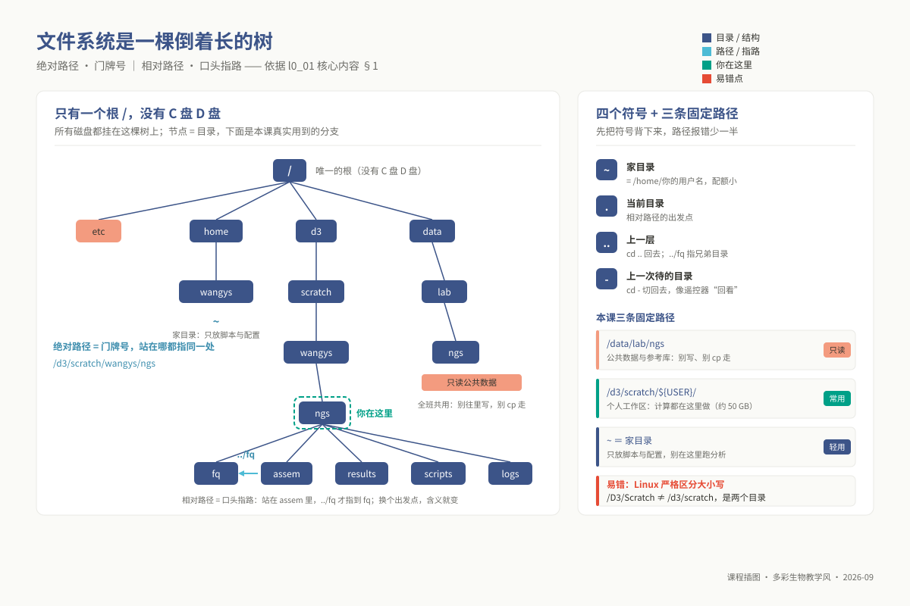
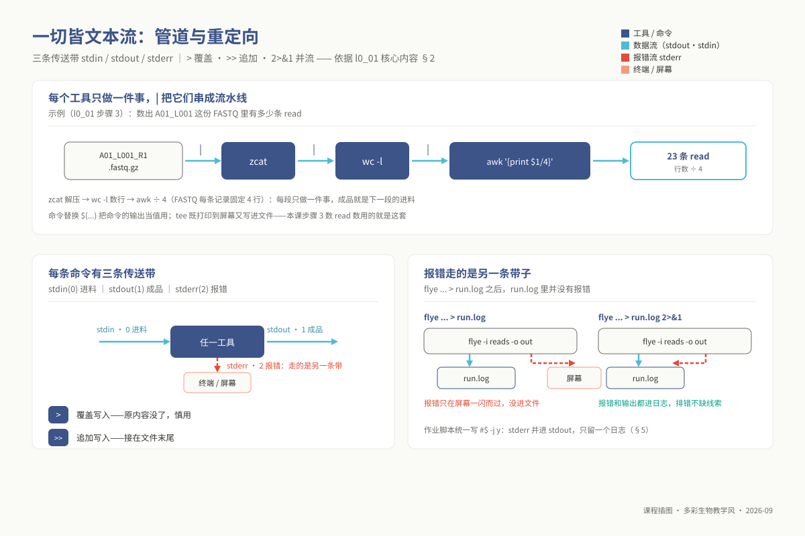
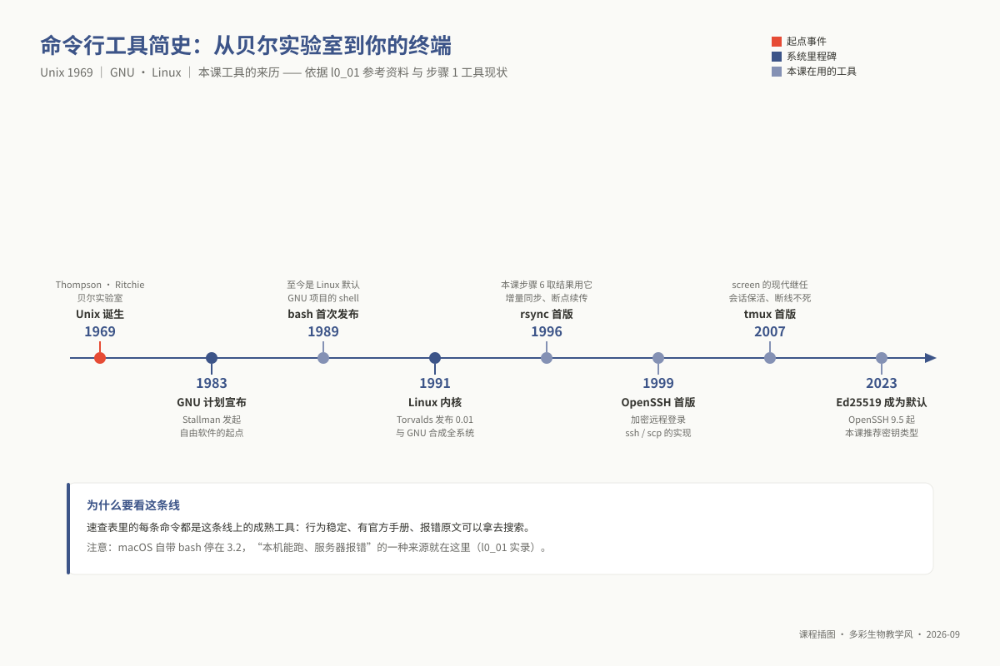

# L0-1：Linux 命令行与远程服务器

> **适用对象**：本科 / 硕士 / 博士 ｜ L0 预备课 ｜ 自学预估 4 学时
>
> **阅读重点**：登录服务器、管理文件、提交作业，并根据报错自查。完整命令清单见
> `09_resources/cheatsheets/linux_cluster_cheatsheet.md`；系统学习入口见参考资料中的 Software Carpentry。
>
> **注意**：不要在登录节点运行大任务；脚本中的路径与用户名使用变量。

<!-- 模块 id：l0_01_linux；契约：00_design/course_contract.yaml → prerequisite_packs.L0；范围：00_design/prerequisite_packs.md §二。 -->

---

## 学习目标

完成本模块后，你能够：

1. **登录**课程集群 `10.7.254.22`，用 `hostname` 说清自己此刻在登录节点还是计算节点；
2. **区分**绝对路径与相对路径，解释 `/`、`~`、`.`、`..`、`-` 各指向哪里，并据此定位任意文件；
3. **建立**规范的项目目录树，用 `ln -s` 接入公共数据而**不复制**；
4. **组合**通配符、管道、重定向与 `for` 循环，一条命令完成"对一批文件做同一件事"；
5. **用** `grep` / `cut` / `sort` / `uniq` / `awk` / `sed` 从文本结果里取出你要的行与列；
6. **用** `scp` / `rsync` 双向传文件，用 `screen` / `tmux` 保住断线不死的会话；
7. **写出**合法的 SGE 作业脚本（`#$` 头），用 `qsub` 提交、`qstat` 查状态、`qdel` 撤销、从日志定位失败原因；
8. **读懂** `chmod` / `ls -l` 的权限位，判断一条 `Permission denied` 是"脚本没执行权限"还是"往只读目录写"。

### 三层期望差异

| 层次 | 期望 | 自测参考线 |
|---|---|---|
| 本科（生信科班） | 目标 1–8 全部熟练；命令能默写，不必查速查表 | 诊断正确率参考 **≥ 80%** |
| 硕士（非生信为主） | 达到出口能力即可：**照着速查表能把事做对**，遇错能自己定位 | 参考 **≥ 60%** |
| 博士（非生信） | 同硕士。若已有服务器使用经验，重点看「集群作业提交」与「常见错误与排查」两节 | 参考 **≥ 60%** |

> 自测**完成即给分、不按对错计**（契约 `gate_mechanism.scoring: completion_based`）。上面的参考线只用于教师看错题分布，不用于评分。

## 为什么这是前置

三层课程的实践都需要使用命令行。下表列出后续专题中会用到的操作，你可以据此检查自己需要补齐哪些能力。

| 你会在哪卡住 | 具体场景 | 缺的是本模块哪一条 |
|---|---|---|
| **硕士 m02 基因组组装，第一次实践课** | Flye / Canu 组装单跑 1–3 小时、吃十几 GB 内存。不会写 SGE 脚本头就只能在登录节点敲 `flye ...`，**进程会被管理员 kill，几小时白跑**；同时全班的 `ls` 都被你拖卡 | 目标 7（`qsub` / `#$` 头 / `qrsh`） |
| **硕士 m02 / m03，实践课开场 10 分钟** | 手册第一步是 `mkdir -p /d3/scratch/${USER}/ngs/{...}` 与 `ln -s /data/lab/ngs/reads* ./`。不理解花括号扩展和软链接，要么目录建错位置，要么 `cp` 了几十 GB 数据把配额撑爆（`Disk quota exceeded`），后面全部步骤连锁失败 | 目标 2、3 |
| **硕士 m03 重测序变异检测** | `bwa mem ... \| samtools sort -o x.bam -` 是一条管道；VCF 过滤要按列判断（`awk '$6 > 30'`）。不会管道和按列取数，只能整条命令照抄，一改样本就报错 | 目标 4、5 |
| **硕士 m04 转录组，做表达矩阵那一步** | 12 个样本各一个 `featureCounts` 输出，要用 `for f in *.txt; do ... $(basename "$f" .txt) ...; done` 批量合并。手工一个个改文件名，12 个样本要 40 分钟，而且必错 | 目标 4 |
| **硕士 m07 宏基因组 / 博士 p02 单细胞** | 组装与比对单步跑几小时。SSH 一断，前台程序跟着被杀。不会 `screen` / `tmux`，晚上跑的任务第二天回来是空的 | 目标 6 |
| **博士 p05 GWAS，后 GWAS 挖掘** | PLINK / GEMMA 输出几十万行关联结果，要先 `awk '$12 < 5e-8'` 挑出显著位点再交给 R。把百万行结果整个拖进 Excel 是打不开的 | 目标 5 |
| **博士 p07 Nextflow / Snakemake 工作流开发** | 工作流的每条 rule 本体就是一段 shell；调试全靠看 `.command.log` / `logs/*.log`。不懂 stdout 与 stderr 是两条流（`> log 2>&1`），报错根本不在你看的那个文件里 | 目标 4 |
| **本科 u08 综合实践项目（24 学时课堂）** | 六个模块（survey / assem / anno / ident / phylo / pangenome）**全部**以 `qsub` 提交。本模块不过关，项目第一小时就卡死 | 目标 1–8 |
| **任何一次交作业** | 结果图和报告在服务器上，要 `scp` 下来；脚本里写死了 `/d3/scratch/zhangsan/`，助教复现时直接 `No such file or directory`，判为"不可重跑" | 目标 6，铁律 ② |

> **案例**：一份在本机"好好的"脚本，上了服务器秒报错。你在自己电脑上写好 `count_reads.sh`，`scp` 到集群提交，
> 作业秒结束，日志只有两行 `$'\r': command not found`——Windows 行尾（CRLF）的 `\r` 被 bash 当成了命令名的
> 一部分。更迷惑的是：服务器上 `cat` 脚本什么都看不出来（`\r` 不可见），要 `cat -A` 才能看到每行结尾的 `^M$`。
> macOS 用户的变体：系统自带的 bash 停在 3.2（多年不随系统更新），脚本若用了 bash 4+ 才有的 `declare -A`
> 关联数组，就会出现"本机报错、服务器正常"或反过来。教训：**"在我电脑上能跑"不是脚本正确的证据**——
> 证据是它在目标机器、目标解释器下跑通。两条报错的解法都见下文「常见错误与排查」。

完成本模块后，你应能识别上述问题，并找到相应的排查入口。

## 核心内容

### 1. 文件系统的拓扑本质与路径解析机制

在 Linux 的世界里，所有硬件设备与存储介质都被抽象在统一的虚拟文件系统（VFS, Virtual File System）之下。这里**没有 Windows 体系中的 C 盘、D 盘等独立盘符**，而是从全局唯一的根目录 `/` 开始，像一棵倒挂的大树向下方层层分支延伸。无论底层接入的是本地高速 NVMe 固态硬盘、企业级磁盘阵列（如本课集群的 `/d3`），还是通过网络挂载的只读存储（如 `/data`），它们都只是被“挂载”（mount）在这棵倒悬树的特定节点分支上。

理解路径时，先区分两种常用的文件定位方式：

- **绝对路径（Absolute Path）**：永远以根符号 `/` 起始（例如 `/d3/scratch/wangys/ngs/assem`）。它如同现实世界中的经纬度或法定门牌号，无论当前交互终端“身处何地”，绝对路径解析出的物理存储位置永远唯一且不可歧义。
- **相对路径（Relative Path）**：以当前工作目录（PWD, Print Working Directory）作为相对坐标原点（例如 `../fq/sample_R1.fq.gz`）。只要当前的出发位置发生改变，同样的相对路径就会指向完全不同的文件，甚至直接导致路径解析失败。

在日常交互中，有四个基准符号构成了目录导航的底层语汇：

- `~`：代表当前登录用户的家目录（即 `/home/用户名`）；
- `.`：代表当前工作目录自身；
- `..`：代表当前工作目录的直接父级目录（上一层）；
- `-`：代表前一次停留的工作目录（`cd -` 类似于遥控器的前一个频道回跳，底层通过读取环境变量 `$OLDPWD` 实现）。

必须时刻注意：**Linux 内核严格区分大小写**。在底层文件系统眼中，`/d3/scratch`、`/D3/Scratch` 与 `/d3/Scratch` 是三个截然不同的路径节点。

**本课程涉及的三条核心固定路径与其物理契约**：

| 路径 | 存储性质与契约用途 | 运维纪律与工程注意 |
|---|---|---|
| `/data/lab/ngs/` | **全局只读共享区**，存放原始测序数据与大型参考基因组数据库 | 严禁尝试写入，严禁直接 `cp` 复制完整数据集至个人目录 |
| `/d3/scratch/${USER}/` | **个人高速工作区**，所有比对、组装、中间临时文件均应在此进行 | 配额相对充足（约 50 GB），但属于临时计算区，需定期清理 |
| `~`（家目录 `/home/${USER}`） | **个人配置与代码区**，仅用于存放轻量脚本、环境配置与日志 | 挂载在系统根分区，存储配额极小，严禁在此跑分析大任务 |



*图 l0_01-1：文件系统是一棵倒挂的树：绝对路径是门牌号，相对路径是「从这儿往前走」。*

### 2. 进程模型、文件描述符与内核管道机制

Unix 哲学的核心基石之一是“一切皆文本流”以及“每个程序只做好一件事”。当一个程序被加载进内存成为进程时，Linux 内核会默认为该进程在进程控制块中分配一个文件描述符表（File Descriptor Table），其中最基础的前三个通道早已被标准化：

- **标准输入（stdin, 文件描述符 0）**：默认关联键盘输入，负责数据的接收入口；
- **标准输出（stdout, 文件描述符 1）**：默认关联终端屏幕，承载工具正常运转时的标准产出数据；
- **标准错误输出（stderr, 文件描述符 2）**：同样默认打印到终端屏幕，但独立于 stdout，专用于实时回传运行警告、进度跟踪与崩溃报错。

当我们在命令行中使用重定向操作符时，实际上是在通知内核在子进程执行前重新绑定这些文件描述符指向的文件表项：

- `>` 表示覆盖重定向：清空目标文件并将 stdout 写入其中；`>>` 表示追加重定向：在目标文件末尾追加写入；
- **标准错误输出的独立性**是生信分析中最容易被忽视的盲区：执行命令 `flye ... > run.log`，只是将文件描述符 1 重定向至 `run.log`，而绝大多数装配日志、警告乃至致命崩溃信息都是通过文件描述符 2（stderr）输出的。如果不做特殊处理，错误信息依然会直接喷涌在屏幕上，而翻开 `run.log` 却空无一物。要将标准输出与标准错误合并归档，必须显式书写 `> run.log 2>&1`（意为：将标准输出指向 `run.log`，再将描述符 2 复制指向描述符 1 所指的目标），或者在现代 Bash 中简写为 `&> run.log`。

管道符 `|` 则是操作系统在内存层面构建的一条高速传送带。当执行 `commandA | commandB` 时，内核并不会在磁盘上创建任何临时文件，而是在内存内核空间中开辟一段环形缓冲区（Ring Buffer，通常为 64 KB）。内核将 `commandA` 的标准输出直接对接为 `commandB` 的标准输入。上游生产一行，下游立刻消费一行；若缓冲区满，上游进程自动阻塞等待；若缓冲区空，下游进程挂起休眠。这种流式处理机制使得处理数百 GB 的测序数据时，内存开销始终保持在极低的常量级别。

在文件检索与模式匹配中，通配符并非由具体的生信软件解析，而是在命令执行前由 Shell 预先完成扩展展开（Pathname Expansion）：`*` 匹配任意长度的任意字符序列；`?` 严格匹配单个任意字符（例如 `sample_?.fq` 只能匹配 `sample_1.fq`，但绝不可能匹配 `sample_10.fq`）；`[0-9]` 则用于限定单字符的数值范围。



*图 l0_01-2：管道是流水线：stdin/stdout 接力，stderr 永远走另一条带子。*

### 3. 软链接的 Inode 机制与共享数据访问

公共测序数据可能有数十至数百 GB。如果每位同学都执行 `cp /data/lab/ngs/raw.fq ./`，重复副本会占用大量磁盘空间，并可能触发 `Disk quota exceeded` 报错。

正确的解法是建立**符号链接（Symbolic Link，常称软链接）**：`ln -s 目标源文件 链接名`。从文件系统底层来看：

- 软链接本身是一个具有独立 Inode（索引节点）的特殊小文件（体积通常仅几十个字节），其数据块内部仅仅记录了目标源文件的**路径字符串指针**；
- 当下游软件（如 BWA、FastQC）尝试通过软链接读取数据时，操作系统内核会自动解引用该路径，直接将读请求穿透至底层真正的原始数据块。
- **软链接的脆弱性与“断链”现象**：由于软链接内部只保存路径字符串，一旦目标源文件被重命名、移动到其他目录或删除，软链接就会失去指向的目标。此时使用 `ls -l` 会看到该文件名闪烁红色报警，尝试读取它（如 `head reads.fa`）内核会给出极其令人困惑的报错：`No such file or directory`。初学者常感到不可思议：“`ls` 明明能看到这个文件，为什么系统告诉我文件不存在？”其本质原因就在于——软链接文件本身存在，但它内部指针指向的终点早已消失。使用 `ls -lL reads.fa` 可以让 `ls` 尝试去追踪源文件，从而立刻暴露断链的真实物理状态。

### 4. 登录节点 vs 计算节点：集群算力拓扑的物理边界

高性能计算集群（HPC）绝非单一的一台“大电脑”，而是通过高速局域网互联的计算节点矩阵与管理网关的集合体：

- **登录节点（Login Node）**：全班所有同学通过 SSH 登录时，接入的仅仅是集群对外暴露的登录前台（例如 `login01`）。它的物理定位如同高铁站的**售票大厅**，唯一合规的用途是：编写与调试脚本、查看日志输出、整理轻量文本、以及向后台调度系统提交作业。登录节点的 CPU 与内存被所有在线用户共享，且运行着后台守护监控进程。
- **计算节点（Compute Node）**：成百上千台隐藏在机房深处、配备了海量 CPU 核心与数百 GB 内存的高配服务器。它们才是真正执行高强度序列比对、De Novo 组装、转录组定量的**高速列车**。

在登录节点运行 `flye` 或 `bwa` 等高负载分析，会占用其他用户共享的 CPU 与内存，可能使终端响应变慢。未经授权的高负载进程也可能被管理员终止，因此应通过调度系统申请计算资源。

接入计算算力只有两条规范路径：

1. **批处理作业调度（Batch Job）**：通过编写作业脚本并使用 `qsub 脚本.sh` 提交至排队系统。调度系统会根据资源空闲情况将作业自动分发到特定计算节点运行；
2. **交互式计算会话（Interactive Shell）**：使用 `qrsh` 命令向调度器申请在计算节点上开启一个即时终端，在申请到的独立节点上进行小规模计算与代码调试，操作结束后必须及时 `exit` 释放资源。

> **注意**：`screen` 或 `tmux` 用于保持会话，不能改变任务所在的机器。在登录节点的会话中启动组装，任务仍然运行在登录节点；保活工具不能代替作业提交。


*图 l0_01-3：售票大厅 ≠ 列车：登录节点只办手续，计算活儿要交给计算节点（AI 生成示意图）。*

### 5. SGE 作业脚本解构与环境变量隔离原理

本课程集群采用 Sun Grid Engine（SGE，即 Open Grid Scheduler）资源管理系统。向调度器下达指令的载体就是包含特殊注释头的 Shell 脚本：

```bash
#!/bin/bash
#$ -S /bin/bash      # 指定由 bash 解释器执行（避免系统默认退回 csh 导致语法报错）
#$ -N flye_assem     # 设置作业名，以此命名输出的 .o 与 .e 日志文件
#$ -cwd              # 强制要求作业在提交命令执行时的当前工作目录下启动
#$ -j y              # 将标准错误输出（stderr）合并至标准输出（stdout），统一写入单个日志
#$ -pe smp 4         # 向调度器申请 4 个并行计算核心（必须与软件命令中的线程参数保持一致）
```

**底层机理与陷阱**：

- 以 `#$` 开头的行在普通的 Bash 脚本语法中属于纯粹的注释行，但 SGE 调度器在读取脚本时会首先扫描文件头部，解析出这组配置并为作业申请相应的 CPU 与内存资源。因此，**所有 `#$` 指令必须紧随 `#!/bin/bash` 放置在脚本的最顶端**，中间绝不能插入任何可执行命令，否则后续的 `#$` 将被调度器直接忽略。
- **环境隔离公理**：计算节点上的作业由调度守护进程（`sge_execd`）以非交互式、非登录子 Shell（Non-interactive, non-login shell）的形式拉起。这意味着**它完全不会加载你交互终端中的环境变量，也不会自动执行你家目录下的 `.bashrc`**。你当前在登录节点终端里激活的 Conda 环境，在作业子 Shell 看来完全不存在。因此，作业脚本内部必须显式重新初始化并激活对应的 Conda 环境（详见 `l0_03_conda`）。

### 6. 文件权限体系与内核访问控制的反直觉规则

在 Linux 中，使用 `ls -l` 查看文件属性时，第一列展示了经典的 10 位权限掩码（如 `-rwxr-xr--`）：

- 第 1 位表示文件类型：`-` 为普通数据文件，`d` 为目录（directory），`l` 为软链接（symbolic link）；
- 紧随其后的 9 位被严格划分为三组，从左至右分别代表：**文件属主（Owner/User）**、**所属用户组（Group）**、以及**系统其他用户（Others）**；
- 每一组均包含三种基本权限：读 `r` (权值为 4)、写 `w` (权值为 2)、执行 `x` (权值为 1)。八进制数字如 `chmod 755 run.sh` 即代表属主具备读写执行（4+2+1=7），同组与其他用户具备读与执行（4+0+1=5）。

遇到 `Permission denied` 时，要区分权限作用于文件还是目录。同一字符在两者上的含义不同：

| 权限位 | 对普通文件的物理语义 | 对目录容器的物理语义 |
|---|---|---|
| `r` (Read) | 允许查看并读取文件的字节内容（如 `cat`、`head`、`grep`） | 允许列出该目录内部所包含的文件与子目录名称清单（如 `ls`） |
| `w` (Write) | 允许修改、覆写该文件的具体内容 | 允许在该目录下创建新文件、删除旧文件或对内部文件重命名（`touch`、`rm`、`mv`） |
| `x` (eXecute) | 允许内核将该文件作为可执行程序或脚本加载入内存执行 | **遍历权限（Traverse）**：允许进入该目录（`cd`）并通过该目录访问更深层的文件 |

**两个最反直觉的底层事实**：

1. **删除一个只读文件，看的是父目录的写权限，而不是文件自身的写权限**。因为文件名与 Inode 的映射关系是保存在父目录的“目录块数据”中的。只要你对父目录拥有写权限 `w`，哪怕一个文件自身的权限是只读的 `444`，你依然可以强行将其 `rm` 删除——你修改的并不是那个文件，而是父目录的清单。
2. **目录只有 `r` 没有 `x`，只能看名字却打不开内容**。如果对某个目录只赋予 `r` 权限而剥夺 `x` 权限，你能用 `ls` 看到里面有哪些文件名，但无法 `cd` 进去，也无法使用 `cat dir/file.txt` 读取具体内容；反之，若只赋予 `x` 而无 `r`，你无法用 `ls` 列出清单，但如果你精确知道内部某个文件的名字，你却可以直接 `cat dir/file.txt` 成功读出数据。

### 7. 进程生命周期与 POSIX 信号机制：解构神秘的 Killed

在操作系统内核中，任何处于运行态的程序都表现为一个进程，拥有唯一的进程标识符（PID）。而在多任务操作系统中，进程与进程之间、操作系统内核与进程之间最重要的异步控制通信方式就是 **POSIX 信号（Signal）**。

在生信分析的高强度计算中，最常打交道的三种信号具备截然不同的控制语义：

| 信号编号与名称 | 典型触发源 | 内核调度行为与进程下场 |
|---|---|---|
| `SIGINT` (信号 2) | 用户在终端按下快捷键 `Ctrl-C` | 优雅中断信号。用户空间程序可以捕获并注册处理函数，进行清理临时文件并退出，甚至在特定逻辑下选择忽略 |
| `SIGTERM` (信号 15) | 调度器 `qdel <JobID>` 或运维执行 `kill <PID>` | 标准终止信号。程序可以捕获该信号，执行写盘保存检查点、关闭文件句柄等善后清理工作，随后退出 |
| `SIGKILL` (信号 9) | 运维强制 `kill -9`，或 Linux 内核 **OOM Killer** 强行触发 | **内核级不可抗拒扑杀**。该信号直接由内核接管并销毁进程上下文，目标进程**无法捕获、无法拦截、无法做任何退出前的日志打印与现场善后** |

组装（Flye/Canu）或比对（BWA/STAR）任务有时只在日志末尾留下以下信息：

```text
Killed
```

进程无法捕获 `SIGKILL`，因此可能来不及记录终止原因。排查时可先检查以下两类资源限制：

- **物理内存击穿与 OOM Killer**：该计算节点的物理内存与 Swap 分区被彻底耗尽。Linux 内核为了保全整台机器不发生死锁崩溃，触发了 Out-Of-Memory Killer 机制，根据进程打分机制，直接向内存占用最大的生信进程发送了致命的 `SIGKILL`；
- **SGE 调度器资源超限熔断**：用户在 SGE 作业脚本中申请的内存限额（如 `h_vmem=8G`）被进程突破，底层 cgroups 监控检测到内存超标，调度器向该作业的所有子进程直接下发了强制终止。

> **自查**：看到 `Killed` 后，先核对申请的内存、实际数据规模和任务所在节点，再结合调度日志判断终止原因。

## 上机操作

> 全部在集群上做。每步都给了**预期输出**，对不上就去下一节查。

### 步骤 1：登录并确认自己在哪

```bash
ssh 你的用户名@10.7.254.22       # 首次会问 fingerprint，输完整的 yes（不是 y）
                                  # 输密码时屏幕无任何回显，这是正常的，照常敲完回车
hostname                          # 预期：login01 之类 —— 记住，这里不能跑分析
pwd                               # 预期：/home/你的用户名
df -h /d3/scratch                 # 看这块盘还剩多少空间
```

> **工具现状：为什么免密首选 Ed25519 密钥**。迟早要配免密。现行默认推荐是 Ed25519：OpenSSH 自
> 6.5（2014-01）起支持、**9.5（2023-10）起 `ssh-keygen` 默认生成它**——密钥短、验证快、无历史包袱；
> 老旧的 DSA 已被 OpenSSH 彻底移除，RSA 仍兼容但已非首选。生成与分发两条命令的系统版
> （`ssh-keygen -t ed25519` + `ssh-copy-id`）见本科 u01 讲义 ⑤ 步骤 0。



*图 l0_01-4：命令行工具半个多世纪：从 Unix 到 GNU/Linux，本课用的每件工具都有来历。*


*图 l0_01-5：Ken Thompson，Unix 与 B 语言创造者之一（照片：A.C.Diller，CC BY-SA 4.0，Wikimedia Commons）。*


*图 l0_01-6：Dennis Ritchie，C 语言与 Unix 的共同缔造者（照片：Denise Panyik-Dale，CC BY 2.0，Wikimedia Commons）。*

> **人物故事与 Unix 哲学：为了玩游戏而诞生的操作系统**
> 
> 我们常用的命令行工具，其根基都始于照片中的两位贝尔实验室传奇：**肯·汤普逊（Ken Thompson）**与**丹尼斯·里奇（Dennis Ritchie）**。
> 
> 1969 年，贝尔实验室退出了庞大而冗笨的 Multics 操作系统项目。汤普逊为了在实验室一台废弃且只有 8 KB 内存的 PDP-7 小型机上运行自己写的太空旅行游戏（*Space Travel*），趁着妻子带着孩子回加州探亲的一个月假期，在一台打字机终端前用汇编语言从零写出了一个轻量级操作系统的核心内核与文件系统。里奇将这个系统戏称为 **UNICS**（后改名 **Unix**），以此幽默地调侃 Multics 的臃肿。
> 
> 为了让 Unix 能在不同硬件架构间自由移植，丹尼斯·里奇在 1972 年创造了 **C 语言**；1973 年，他们做出了计算机史上最具革命性的决定——**用 C 语言重写了 Unix 内核**，彻底打破了此前操作系统必须绑定特定硬件汇编指令的桎梏。
> 
> 汤普逊还是个极具极客精神的实干家：他在文本编辑器 `ed` 中敲出 `g/re/p`（Global search for Regular Expression and Print）来全局搜索正则文本，后来嫌每次打开编辑器太慢，便花了一个通宵把这段逻辑抽离成一个独立工具，这就是生信日用千百次的 `grep`；而他和道格·麦克罗伊（Doug McIlroy）共同实现的**管道（Pipe `|`）**，更铸就了不可动摇的 **Unix 哲学**：*“每个程序只做好一件事；程序之间通过纯文本流协同工作”*。今天生信学者能将 `bwa mem | samtools sort` 一气呵成串联运行，不必在中途落地几十 GB 的中间文件，正是这套半个世纪前智慧的直接延续。

### 步骤 2：建项目目录 + 软链接接入数据

```bash
mkdir -p /d3/scratch/${USER}/ngs/{fq,assem,results,scripts,logs}
cd /d3/scratch/${USER}/ngs/fq
ln -s /data/lab/ngs/reads* ./     # -s 软链接；末尾 ./ 表示链到当前目录、保持原名
ls -lh
# 预期（行首那个 l 就是 link，大小只有几十字节）：
# lrwxrwxrwx 1 wangys stu 22 Aug 29 10:12 reads.fa -> /data/lab/ngs/reads.fa
head -n 2 reads.fa                # 能读到内容 = 链接是活的
```

**养成用 Tab 补全路径的习惯**——手打长路径是 `No such file or directory` 的头号来源。

### 步骤 3：造一个"混乱的测序目录"，练批量处理

自测的上机题就用这份数据，先在这里跑通（**不依赖公共数据，任何账号都能造**）：

```bash
mkdir -p /d3/scratch/${USER}/l0_playground && cd /d3/scratch/${USER}/l0_playground
for s in A01 A02 B07; do
  for L in L001 L002; do
    n=$(( (RANDOM % 20 + 5) * 4 ))                    # 随机行数，且是 4 的倍数
    yes $'@r\nACGTACGTAC\n+\nIIIIIIIIII' | head -n "$n" | gzip > "${s}_${L}_R1.fastq.gz"
  done
done
ls
# 预期：A01_L001_R1.fastq.gz  A01_L002_R1.fastq.gz  A02_L001_R1.fastq.gz ...（共 6 个）
```

一步步把"每个样本多少条 read"数出来：

```bash
zcat A01_L001_R1.fastq.gz | wc -l                     # 行数
zcat A01_L001_R1.fastq.gz | wc -l | awk '{print $1/4}'  # FASTQ 每条记录 4 行 → read 数

# 合并同一样本的两条 lane，按样本汇总：
for s in A01 A02 B07; do
  n=$(zcat ${s}_*_R1.fastq.gz | wc -l)
  echo -e "${s}\t$((n/4))"
done | tee read_counts.tsv
# 预期形如：
# A01     46
# A02     31
# B07     37        （每条 lane 5–24 条，合并后每样本 10–48 条）
```

`$(...)` 是命令替换（把命令的输出当值用）；`tee` 既打印到屏幕又写进文件。

### 步骤 4：文本处理三件套

```bash
sort -k2,2nr read_counts.tsv | head -n 1     # 按第 2 列数值降序，取 read 数最多的样本
awk '$2 < 40 {print $1}' read_counts.tsv     # 挑出 read 数 < 40 的样本名
awk '{s+=$2} END {print "total:", s}' read_counts.tsv   # 求和
cut -f1 read_counts.tsv | sed 's/^/sample_/'            # 取第 1 列并加前缀（sed 替换）
grep -c "" read_counts.tsv                              # 数行数
```

### 步骤 5：写作业脚本并提交

```bash
cat > count_reads.sh <<'EOF'
#!/bin/bash
#$ -S /bin/bash
#$ -N count_reads
#$ -cwd
#$ -j y
#$ -pe smp 1

echo "运行节点: $(hostname)"      # 好习惯：日志第一行记录跑在哪
echo "开始时间: $(date)"
for s in A01 A02 B07; do
  n=$(zcat ${s}_*_R1.fastq.gz | wc -l)
  echo -e "${s}\t$((n/4))"
done > read_counts_job.tsv
echo "结束时间: $(date)"
EOF

qsub count_reads.sh
# 预期：Your job 12345 ("count_reads") has been submitted
qstat -u $USER          # state 列：qw 排队 / r 运行中 / Eqw 出错卡住 / dr 正在删除
cat count_reads.o12345  # 日志在提交目录，文件名 = 作业名.o作业号
# 预期第一行的主机名【不是】登录节点；末尾有"结束时间"
```

失败时：`qstat -j 12345` 看 `error reason`；改完 `qdel 12345` 再重提（**`Eqw` 不会自己恢复**）。

### 步骤 6：传文件与保住会话

```bash
# scp 永远是 scp 来源 目标，且要在【自己电脑】上敲
scp 用户名@10.7.254.22:/d3/scratch/用户名/l0_playground/read_counts.tsv ./
scp ./my_script.sh 用户名@10.7.254.22:/d3/scratch/用户名/ngs/scripts/
rsync -avP 用户名@10.7.254.22:/d3/scratch/用户名/ngs/results/ ./results/   # 大目录、可断点续传

# 服务器上：会话保活
screen -S ngs      # 新建；Ctrl-a 再按 d 脱离；screen -ls 列出；screen -r ngs 接回
tmux new -s ngs    # tmux 版：Ctrl-b 再按 d 脱离；tmux ls；tmux attach -t ngs
```

## 常见错误与排查

> 全部是真实报错原文，撞上先 `Ctrl-F` 搜关键词。更多条目见 `09_resources/cheatsheets/linux_cluster_cheatsheet.md` §8。

| 报错原文 / 现象 | 原因 | 解法 |
|---|---|---|
| `ssh: connect to host 10.7.254.22 port 22: Connection timed out` | `10.x.x.x` 是内网地址，你不在校园网内 | 先连校园 VPN，`ping 10.7.254.22` 通了再 `ssh` |
| `Permission denied (publickey,password).` | 用户名/密码错，或大写锁定开着 | 密码无回显是正常的，别猛敲；连续失败会临时封 IP，等几分钟 |
| `WARNING: REMOTE HOST IDENTIFICATION HAS CHANGED!` + `Host key verification failed.` | 服务器重装/换机，指纹与本地 `~/.ssh/known_hosts` 不符 | **确认是管理员通知过的维护后**再 `ssh-keygen -R 10.7.254.22`。没确认前不要删——这条警告本来就是防中间人攻击的 |
| `-bash: cd: /d3/scratch/wangys/ngs: No such file or directory` | 目录没建，或把用户名写死成了别人的，或大小写写错 | 用 `${USER}` 不要硬编码；一律小写 `/d3/scratch`；用 Tab 补全 |
| `head: cannot open 'reads.fa' for reading: No such file or directory`，但 `ls` 里明明有 | **断链**：软链接指向的原文件被移走/路径拼错 | `ls -lL reads.fa` 验证；回头检查 `ln -s` 的目标路径。**不要用 `cp` 绕过去** |
| `cp: writing '/home/xxx/reads.fq.gz': Disk quota exceeded` | 家目录配额满，通常正因为你 `cp` 了本该 `ln -s` 的数据 | 删掉复制品改软链接；大文件一律放 `/d3/scratch/${USER}/`；`du -sh ~/* \| sort -h` 找占地大户 |
| `bash: ./run.sh: Permission denied` | 脚本没有执行权限 | `chmod +x run.sh` 后 `./run.sh`；或直接 `bash run.sh`（不需要执行权限） |
| `-bash: $'\r': command not found`，后跟 `syntax error near unexpected token $'\r'` | 脚本在 Windows 上编辑过，行尾是 CRLF。**Windows 用户最高频的一条** | `dos2unix run.sh`，或 `sed -i 's/\r$//' run.sh`。根治：编辑器行尾设为 LF，或直接在服务器上用 `vim`/`nano` 改 |
| `Killed` ／ `fork: retry: Resource temporarily unavailable` | 在登录节点跑了大任务，被 kill 或把节点撑爆 | 改用 `qsub`；调试用 `qrsh` |
| 作业状态卡在 `Eqw` | 提交即出错，**不会自己恢复** | `qstat -j <job-id>` 看 `error reason`（最常见是 `-cwd` 指向的目录不存在）；改完 `qdel` 重提 |
| 作业秒结束，日志只有 `xxx: command not found` | 脚本里没激活 conda 环境。**你终端里能跑通不代表作业里能跑通** | 在脚本内写 `source /opt/miniconda3/bin/activate` + `conda activate <env>`，见 `l0_03_conda` |
| 日志第一行 `运行节点: login01` | 你根本没提交作业，是 `bash job.sh` 直接跑了 | 立刻 `Ctrl-C`，改 `qsub job.sh`。**这条最需要自查** |
| 作业跑到一半莫名结束，日志末尾没有"结束时间" | 多半是**磁盘满**或内存超限，而不是参数错 | `df -h /d3/scratch`、`du -sh */`；**先查空间，再怀疑参数** |
| `scp` 卡住不动 / 报 `Connection refused` | 在**服务器上**敲了 `scp`，它反过来去连你的笔记本 | `scp` 一律在**自己电脑**上敲 |
| `qsub: command not found` | 不在集群上，或已经在计算节点内部 | 回到登录节点提交 |

## 自测入口

**自测文件**：[`08_assessment/prerequisites/l0_01_linux_selftest.md`](../../../08_assessment/prerequisites/l0_01_linux_selftest.md)

- **10 题，其中 3 道上机题**（第 8–10 题）。上机题的产出——一条命令、一份 `read_counts.tsv`、一个 SGE 脚本——**正是你第一次实践课开场就要用的东西**。
- **计分：完成即给分，不按对错计**。目的是让教师拿到错题分布，用首课的 15–20 分钟只过集中出错的点，不重讲。
- 因为不按对错计分，**参考答案直接附在自测文件末尾**。抄答案没有收益，公开答案让自测同时是学习工具。
- **通过标准**：10 题**全部作答**（含 3 道上机题的提交物）即视为完成。诊断参考线见上文「三层期望差异」，仅供教师看分布，不计入成绩。
- **时间点**：开课前 2 周发布，**开课前**提交。

**做不出来怎么办**：回到本文对应小节 → 仍不会就查 `09_resources/cheatsheets/linux_cluster_cheatsheet.md` → 还不会在自测里如实写"卡在哪一步"。**如实记录卡点比蒙对答案有价值得多**——它直接决定首课讲什么。

## 参考资料

### 课程内部材料

| 材料 | 路径 |
|---|---|
| Linux 与集群速查表（命令全清单、SGE 模板、报错速查） | `09_resources/cheatsheets/linux_cluster_cheatsheet.md` |
| 环境管理（本模块的 `command not found` 多半在这里解决） | `02_lectures/prerequisites/l0_03_conda/l0_03_conda.md` |
| 本科层展开版（同一内容的系统教学版，约 500 行） | `02_lectures/undergraduate/unit01_linux_conda/01_linux_conda_lecture.md` |
| 前置包定义与闸门机制 | `00_design/prerequisite_packs.md` |

### 官方文档

| 主题 | 链接 |
|---|---|
| GNU Bash 参考手册 | https://www.gnu.org/software/bash/manual/bash.html |
| GNU Coreutils 手册（`ls`/`cp`/`ln`/`sort`/`cut`/`wc`） | https://www.gnu.org/software/coreutils/manual/coreutils.html |
| GNU Grep 手册 ｜ GNU Sed 手册 ｜ GNU Awk 手册 | https://www.gnu.org/software/grep/manual/grep.html ｜ https://www.gnu.org/software/sed/manual/sed.html ｜ https://www.gnu.org/software/gawk/manual/gawk.html |
| OpenSSH `ssh` / `scp` 手册页 ｜ rsync 文档 | https://man.openbsd.org/ssh ｜ https://man.openbsd.org/scp ｜ https://rsync.samba.org/documentation.html |
| GNU Screen 手册 ｜ tmux Wiki | https://www.gnu.org/software/screen/manual/screen.html ｜ https://github.com/tmux/tmux/wiki |
| Open Grid Scheduler / SGE 手册页（`qsub`/`qstat`/`qdel`/`qrsh`） | http://gridscheduler.sourceforge.net/htmlman/manuals.html |
| 本课集群使用文档 | https://github.com/hnnd/bcl |

### 系统学习入口（想补全的人走这条）

| 主题 | 链接 |
|---|---|
| Software Carpentry: The Unix Shell（含配套练习数据，约 4 小时） | https://swcarpentry.github.io/shell-novice/ |
| The Linux Command Line（W. Shotts，免费 PDF）｜ 中文版 | https://linuxcommand.org/tlcl.php ｜ https://billie66.github.io/TLCL/book/ |
| Rosalind 生信编程练习题库 | https://rosalind.info/problems/locations/ |

### 文献

1. Wilson G, Bryan J, Cranston K, Kitzes J, Nederbragt L, Teal TK. Good enough practices in scientific computing. *PLOS Computational Biology*, 2017, 13(6):e1005510. doi:10.1371/journal.pcbi.1005510
2. Grüning B, Chilton J, Köster J, et al. Practical Computational Reproducibility in the Life Sciences. *Cell Systems*, 2018, 6(6):631–635. doi:10.1016/j.cels.2018.03.014

*L0 材料版本 v1.0 ｜ 依据 contract_version 1.1 ｜ 最后更新 2026-08-29*
