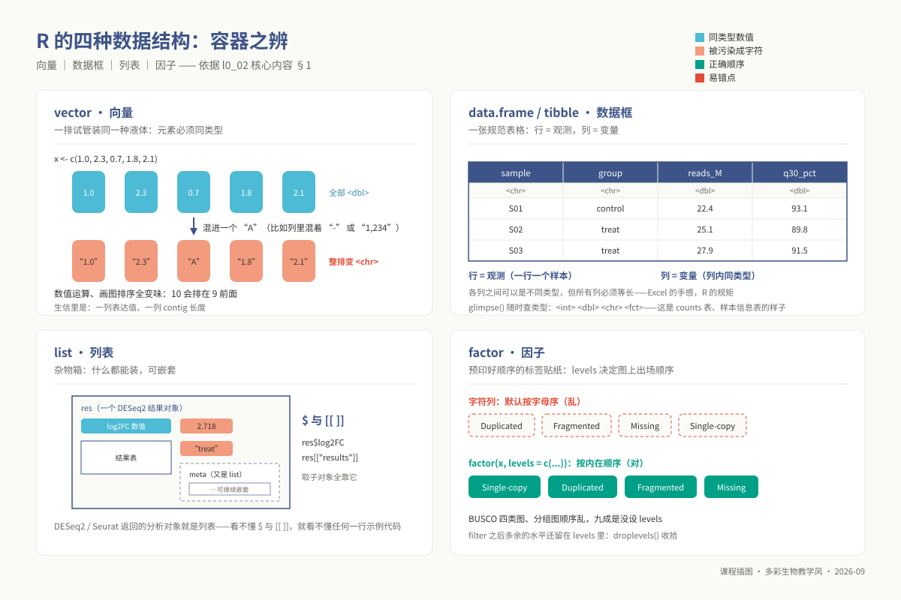
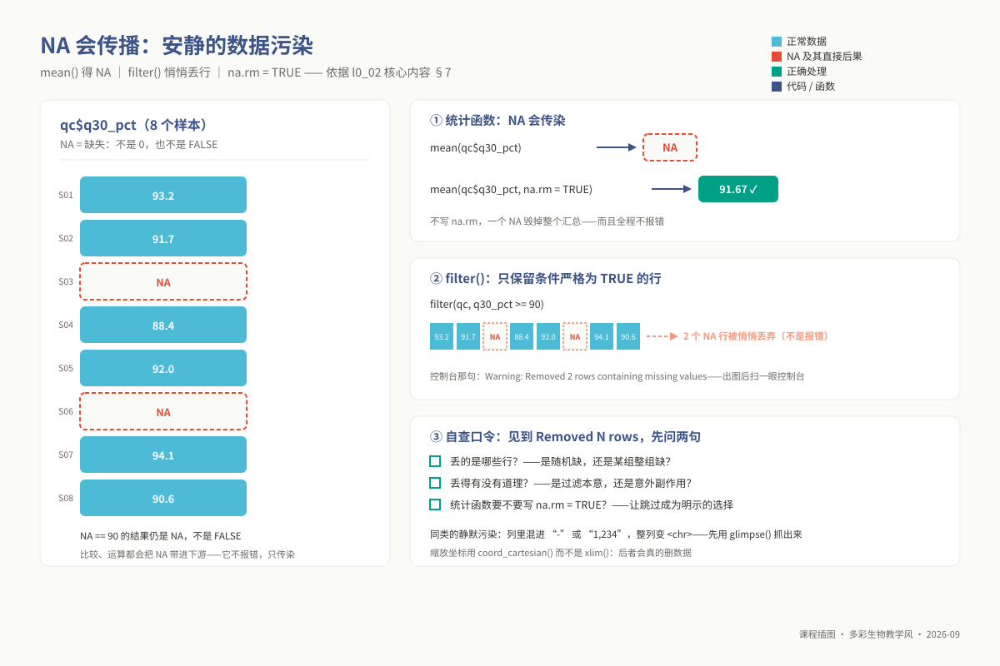
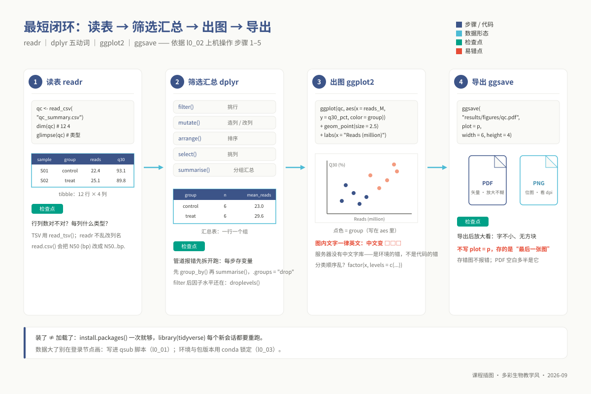
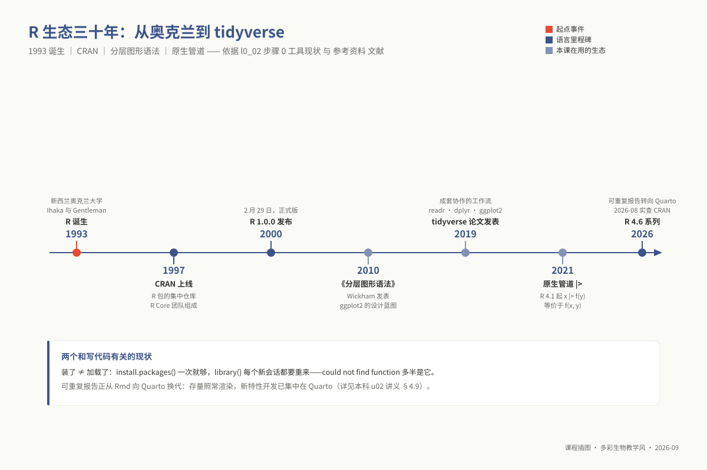

# L0-2：R / tidyverse / ggplot2 基础

> **适用对象**：本科 / 硕士 / 博士 ｜ L0 预备课 ｜ 自学预估 4 学时
>
> **阅读重点**：完成“读表 → 筛选汇总 → 出图 → 导出”，并检查每一步的结果。系统学习入口见参考资料中的 R4DS。
>
> **注意**：本模块图内文字（标题、轴名、图例、注释）统一用英文，中文解释写在报告正文。服务器缺少中文字库时，中文可能显示为方块 `□□□`。

<!-- 模块 id：l0_02_r；契约：00_design/course_contract.yaml → prerequisite_packs.L0；范围：00_design/prerequisite_packs.md §二。 -->

---

## 学习目标

完成本模块后，你能够：

1. **区分**向量 / 数据框 / 列表 / 因子，并用 `glimpse()` 判断某一列是数值还是字符；
2. **用** `readr` 把 TSV / CSV / 空白分隔的结果文件读成数据框，并确认行列数与类型正确；
3. **用** `dplyr` 五个动词（`filter` / `mutate` / `arrange` / `select` / `group_by`+`summarise`）完成筛选与分组汇总；
4. **用** `tidyr::pivot_longer()` 把宽表转成长表，并说明 ggplot2 为什么需要长表；
5. **用** ggplot2 图层语法画出散点图、柱状图、箱线图，并解释 `aes()` 里面与外面的区别；
6. **用** `labs()` / `scale_*_manual()` / `theme_bw()` 把图改成**脱离正文也读得懂**、且**全英文**的样子；
7. **用** `ggsave()` 导出 PDF / PNG，说明 `width`/`height`/`dpi` 各控制什么；
8. **在** RStudio Server 或 `Rscript` 两种方式下把上述流程跑通，并说清"装了包"与"加载了包"的区别。

### 三层期望差异

| 层次 | 期望 | 自测参考线 |
|---|---|---|
| 本科（生信科班） | 目标 1–8 全部熟练；能不查文档写出完整 ggplot 代码 | 诊断正确率参考 **≥ 80%** |
| 硕士（非生信为主） | 达到出口能力即可：**照着模板能改对**，图能出、能导出、报错能定位 | 参考 **≥ 60%** |
| 博士（非生信） | 同硕士。若从没用过 R，本模块是六个 L0 模块里**最该多花时间**的一个 | 参考 **≥ 60%** |

> 自测**完成即给分、不按对错计**。上面的参考线只用于教师看错题分布，不用于评分。

## 为什么这是前置

硕士层的 DESeq2、博士层的 Seurat 与 WGCNA 都需要 R。读懂数据结构和筛选代码，才能修改示例、定位报错并检查结果。下表列出后续专题需要的具体能力。


*图 l0_02-5：Ross Ihaka，R 语言共同作者（照片：Kristina D.C. Hoeppner，CC BY-SA 2.0，Wikimedia Commons）。*


*图 l0_02-6：Robert Gentleman，R 语言共同作者（照片：R Consortium，CC BY 3.0，Wikimedia Commons）。*

> **人物故事与 R 的起源：从两人的咖啡闲聊到全球生信底座**
> 
> 照片上的两位学者，就是 R 语言的缔造者：新西兰奥克兰大学的**罗斯·伊哈卡（Ross Ihaka，毛利族后裔，统计与图形学专家）**与**罗伯特·杰特曼（Robert Gentleman，加拿大统计学家与生物信息学家）**。
> 
> 1992 年在奥克兰大学任教期间，他们深感当时用于统计教学的商业软件（如贝尔实验室 S 语言的商业版 S-PLUS）许可证异常昂贵，学生在机房外根本无法自由安装实践。在走廊闲聊与午餐讨论中，两人萌生了一个大胆的想法：何不自己写一套轻量、开源且教学友好的统计计算环境？他们将 S 语言优雅的统计数据分析语法，与函数式编程语言 Scheme（Lisp 方言）强大的词法作用域（Lexical Scoping）机制相结合。因为两人的名字都以字母 **R** 开头（Ross & Robert），同时也是向 S 语言致敬，他们将这个新语言命名为 **R**。
> 
> 1995 年，在统计学界同仁的鼓励下，他们顶住压力将 R 源码以 GNU GPL 开源协议向全世界公开发布。更具历史意义的是，杰特曼随后前往哈佛大学与丹娜-法伯癌症研究所工作，于 2001 年发起并主持了 **Bioconductor** 开源项目。这一举动彻底改变了基因组学的研究范式：全世界生物学家开发的微阵列芯片、RNA-seq（DESeq2、edgeR）和单细胞分析算法全部以 R 包形式在 Bioconductor 汇聚。两位统计学家原本为了“让穷学生也能跑统计”的初心，最终演变成了当今全球生命科学大数据的通用操作系统。

| 你会在哪卡住 | 具体场景 | 缺的是本模块哪一条 |
|---|---|---|
| **硕士 m04 转录组，DESeq2 那一步** | `DESeqDataSetFromMatrix(countData, colData, design = ~ condition)` 要求 counts 矩阵的**列顺序**与 colData 的**行顺序**严格一致。不会 `read_tsv` + `select` + `match`，第一步就报 `Error: colnames(countData) must match rownames(colData)`，整堂课卡在这 | 目标 2、3 |
| **硕士 m04，拿到结果之后** | DESeq2 结果表两万行，要 `filter(padj < 0.05, abs(log2FoldChange) > 1) \|> arrange(padj)` 才能得到差异基因清单，再喂给 clusterProfiler。不会 dplyr 就只能导出到 Excel 手工筛——样本一换全部重来，且不可复现 | 目标 3 |
| **硕士 m06 扩增子** | vegan / phyloseq 全在 R 里；α 多样性箱线图、β 多样性 PCoA 散点图都要自己用 ggplot2 画 | 目标 5、6 |
| **博士 p02 单细胞与空间转录组** | Seurat 是 R 包，整个流程（`CreateSeuratObject` → `FindClusters` → `DimPlot`）都是 R 对象操作；Seurat 对象本身就是**列表**结构，不懂 `$` 和 `[[ ]]` 取子对象就看不懂任何一行示例代码 | 目标 1 |
| **博士 p01 AI 辅助工作流，本讲的核心实践** | 实践环节是**排查一段被植入错误的差异表达 R 脚本**。你要能读出"这里 `filter` 写成了 `pvalue` 而不是 `padj`"这类错误——**不会 R 就没法验证 AI 的输出，这一讲的全部意义就没了** | 目标 2、3 |
| **博士 p06 多组学整合** | WGCNA、MOFA2 都是 R 包，输入要求"行是样本、列是特征"的矩阵，而你手上的表往往是反的，得先转置/`pivot_longer` 再 `pivot_wider` | 目标 2、4 |
| **博士 p08 课题设计与汇报（含图表叙事）** | 要求"一张图承载一个论点"。图例是字母序、轴名没单位、颜色用红绿，论点就传不出去 | 目标 6 |
| **本科 u08 综合实践项目** | 报告要求四张图：k-mer 频谱、QUAST 指标对比、BUSCO 堆叠条形图、泛基因组组成。四张都用 ggplot2 画、`ggsave` 导出 | 目标 5、6、7 |
| **任何一次交报告** | 图上中文变方块 `□□□`，或导出的 PDF 是空白页（`ggsave` 存的是"最后一张图"而不是你要的那张），直接影响"报告规范性"得分 | 铁律、目标 7 |

> **案例**：同一段代码，两个环境的结果对不上。接手师兄留下的差异表达脚本重跑：全程不报错，但图和
> 论文里的对不上——类别轴顺序变了、某列从数值悄悄变成了字符。查半天发现是**包版本不同**：师兄的环境
> 是三年前装的，你的是新版，某个函数行为变了。这类事故最麻烦的地方正是**不报错**：报告里两张图自相
> 矛盾，却都"能跑通"。所以交报告要写 R 与各包的版本号（R 生态的版本锁定工具叫 `renv`，能固定整个
> 包库的版本，一句带过，本课不展开）；课程用 conda 环境做这件事，见 `l0_03_conda`。

本模块的读表、筛选、绘图和导出操作是这些专题的共同基础；各专题还会说明专用对象和分析方法的要求。

## 核心内容

### 1. 内存模型与四种基础数据结构

R 用于统计计算与数据建模，内部用 S-表达式（S-expression, SEXP）表示对象。初学时先区分以下四种数据结构，重点检查对象能存什么、如何取值，以及类型转换会怎样影响结果：

- **原子向量（Atomic Vector）**：R 中最不可分割的基准容器。它的底层是一段连续的物理内存，且遵循严格的**单一同质类型公理（Homogeneity）**。R 中没有标量（Scalar）概念，单个数字 `42` 实际上是长度为 1 的向量。当不同类型的数据混杂时，R 会触发不可逆的**类型隐式强制转换阶梯（Coercion Hierarchy）**：
  $$\text{Logical} \longrightarrow \text{Integer} \longrightarrow \text{Double} \longrightarrow \text{Character}$$
  这正是生信数据清洗中最高频的“静默崩塌”来源：一万行数值型的基因表达量中，只要混入哪怕一个空白符、破折号 `-` 或 `N/A` 字符串，整列向量就会被瞬间强制退化为字符型（`<chr>`）。此后所有的数值计算全部失效，绘图坐标轴也会退化为无序的离散字符串排列（例如字符串排序下 `"10"` 会荒谬地排在 `"2"` 的前面）。在读取数据后，必须第一时间调用 `glimpse(df)` 审查每列的底层数据类型标记（`<dbl>` 双精度、`<int>` 整型、`<chr>` 字符、`<fct>` 因子）。

- **因子（Factor）**：专为离散分类变量设计的结构。因子的底层本质上是一个**整型向量（Integer Vector）**，其上附加了一个名为 `levels` 的字符串属性表。在内存中，它只存 `1, 2, 3...` 等整数代号，打印时再映射为具体的标签名称。
  - **严重陷阱**：如果一个因子变量记录的是数字（例如测序深度分类 `f <- factor(c(10, 20, 50))`），直接执行 `as.numeric(f)` 不会提取出数字 10、20、50，而是提取出其内部的水平索引 `1, 2, 3`！正确提取真实值必须先解引用为字符：`as.numeric(as.character(f))`。
  - **可视化意义**：字符列绘制到 ggplot2 图像上时，默认遵循 ASCII 字母序排布；如果需要自定义有序展示（如对照组 `control` 必须在实验组 `treat` 前，BUSCO 评估必须按 `Single-copy`、`Duplicated`、`Fragmented`、`Missing` 顺序堆叠），必须使用 `factor(x, levels = c(...))` 显式绑定因子水平序列。
- **列表（List）**：R 中的异构容器与指针数组。列表中的每一个槽位（Slot）都可以装载不同长度、不同维度、甚至不同类型的任意对象（包括子列表、数据框、矩阵或拟合的模型）。后续在 DESeq2 中获得的 `dds` 对象、Seurat 中构建的单细胞对象，本质上都是在多层嵌套列表基础上通过 S3 或 S4 面向对象系统封装而成的。在语法上，使用单括号 `l[1]` 取得的是一个“仍然包裹在列表容器内的子列表”，而使用双括号 `l[[1]]` 或符号 `l$name` 才能真正穿透容器，取出其内部存储的原始数据对象。
- **数据框与现代 Tibble（`data.frame` / `tibble`）**：生信分析中最高频接触的表格结构。从内核视角看，**数据框本质上是一个由等长向量组成的列表**。每一列是一个原子向量，因此同一列内部必须类型绝对一致；但不同列之间可以自由具备不同的数据类型。Tidyverse 体系提供的 `tibble` 对传统数据框进行了现代加固：不再在读表时静默把字符串转为因子，打印时自动截断避免终端刷屏崩溃，且严格禁用部分匹配与降维退化。



*图 l0_02-1：四种容器之辨：向量、数据框、列表、因子——生信对象大多长在这四种形状上。*

### 2. Tidy Data 公理与长宽表转换机制

表格结构会影响后续的绘图与建模操作。Hadley Wickham 提出的**整洁数据（Tidy Data）**用以下原则组织数据：

1. **每个变量（Variable）必须独立形成一列**；
2. **每次观测（Observation）必须独立形成一行**；
3. **每个观测单元（Observational Unit）必须独立形成一张表**。

人类在日常办公中习惯阅读**宽表（Wide Format）**：例如一行记录一个菌株，后方并排排列 `Assembly_Size`、`N50`、`GC_Content`、`Busco_Complete` 等多列指标。这种结构对肉眼核对非常友好，但在计算几何中，它把本质相同的观测值（指标测量值）横向散落在了多个不同的变量列中。

**为什么 ggplot2 强制要求长表（Long Format）**：
ggplot2 的核心逻辑是将数据框中的**某一列向量**映射到视觉几何对象的**某一个审美通道（Aesthetic Channel）**（例如 X 坐标、Y 坐标、颜色或分面）。如果你想用分面图同时对比 12 个样本在 4 种评估指标上的数值分布，或者绘制多基因在不同处理下的表达轨迹，宽表根本无法提供单一的“指标名称列”供分面（`facet_wrap`）使用，也无法提供单一的“表达量列”供 Y 轴映射。

因此，必须掌握 `tidyr::pivot_longer()` 的折叠逻辑：

```text
宽表结构：Sample_ID | Contig_Count | N50_bp   | BUSCO_pct
           Canu_01   | 3            | 2100000  | 98.5
转换后长表：Sample_ID | Metric       | Value
           Canu_01   | Contig_Count | 3
           Canu_01   | N50_bp       | 2100000
           Canu_01   | BUSCO_pct    | 98.5
```

转换后，测量值集中在 `Value` 列，原来的指标名放入 `Metric` 列，便于分别映射到纵坐标和分面。

### 3. 图层语法（Grammar of Graphics）的代数解耦

ggplot2 并非简单的“绘图函数集合”，而是 Leland Wilkinson 图形语法理论在编程语言中的完整代数实现。其核心哲学是**图层的完全解耦与正交堆叠**。一张科研图表被严密拆解为七个独立的几何与统计图层，代码的编写顺序正是这些图层自底向上的物理渲染流水线：

$$\text{Data} \xrightarrow{\text{aes()}} \text{Geom} \xrightarrow{\text{Stat}} \text{Scale} \xrightarrow{\text{Coord}} \text{Facet} \xrightarrow{\text{Theme}}$$

1. **数据层（Data, `ggplot(data)`）**：声明作为底层几何宿主的数据框；
2. **美学映射层（Aesthetic Mappings, `aes()`）**：构建由数据列到视觉维度的对应函数（哪一列决定横坐标，哪一列驱动颜色渐变）；
3. **几何对象层（Geometric Objects, `geom_*()`）**：决定数据点如何被具象化呈现（点 `geom_point`、条形 `geom_col`、箱线 `geom_boxplot`、小提琴 `geom_violin`）；
4. **度量调整层（Scales, `scale_*()`）**：控制视觉通道的连续与离散映射刻度（坐标轴线性/对数变换、指定具体的十六进制色板、图例标记定义）；
5. **坐标系统层（Coordinate System, `coord_*()`）**：决定平面的几何投影（笛卡尔坐标 `coord_cartesian`、坐标轴翻转 `coord_flip`、极坐标转换 `coord_polar`）；
6. **分面切分层（Faceting, `facet_*()`）**：依据给定的分类变量，将整张大图自动裂变为排列规整的小多面子图矩阵（`facet_wrap` 或 `facet_grid`）；
7. **视觉主题层（Theme, `theme_*()`）**：控制一切与数据点本身无关的图表外部修饰（网格线粗细、背景白底 `theme_bw`、坐标轴文字角度与字号）。

图层结构便于逐项修改图形。例如，把 `geom_point()` 换成 `geom_boxplot()` 可以改变展示方式；随后检查映射、分组和标度是否仍适合新图形。

### 4. `aes()` 的数据驱动绑定 vs 静态属性配置

使用 ggplot2 时，需要区分“属性随数据变化”和“属性固定”两种设置方式：

```r
# 正确方式 A：数据驱动的动态美学映射（写在 aes 内部）
geom_point(aes(color = species))
# 内核行为：扫描数据框中的 species 列，将其每一个唯一的离散取值
# 分别分配不同的颜色，并在侧边自动生成对应的图例（Legend）。

# 正确方式 B：全局固定的静态视觉渲染（写在 aes 外部）
geom_point(color = "#0072B2", size = 3, alpha = 0.8)
# 内核行为：直接命令底层图形引擎，将所有散点统一渲染为蓝色、大小固定为 3、透明度为 0.8。
# 不存在任何变量驱动逻辑，因此绝不生成图例。

# 致命错误写法：将静态常量强行包裹进 aes 内部
geom_point(aes(color = "#0072B2"))
# 内核行为：ggplot2 遭遇该语句时，不会把它当成十六进制颜色，
# 而是会误以为当前数据存在一个名字叫 "#0072B2" 的单水平分类变量！
# 结果所有点会被涂成 ggplot2 调色板默认的第一个颜色（通常是粉红色），
# 并且图侧会产生一个荒唐的、标题为 color、内容写着 "#0072B2" 的虚假图例。
```

牢记判据：**凡是取决于数据列中数值大小/类别的特征，放进 `aes()`；凡是全局统一、人为敲定的固定外观，提到 `aes()` 外面。**

### 5. 图形设备、分辨率与排版几何学

在生信论文的撰写与投稿中，导出的图像往往因为清晰度不足或文字比例失调被期刊编辑退回。理解图形设备（Graphics Devices）是出图闭环的终点：

- **矢量图（Vector Graphics, PDF / SVG）**：底层记录的是点、线、多边形与字体字形的数学矢量坐标公式。无论如何在屏幕上放大、或者在出版印刷中进行多倍拉伸，图像边缘永远平滑锐利，绝不会出现马赛克像素。**论文提交初稿、终稿均应强制采用矢量格式导出**。
- **位图（Raster Graphics, PNG / TIFF）**：底层是一个由有限像素网格构成的离散点阵。只有在单细胞分析（包含 10 万个细胞散点）、宏基因组多样本热图等点图元极其海量的场景下才考虑使用，以防止生成的矢量 PDF 文件体积达到数百 MB 导致阅览器卡死。导出位图必须保证印刷出版级别的分辨率：`dpi = 300` 起步。

**排版几何学中的“尺寸反比佯谬”**：
使用 `ggsave("plot.pdf", width = 12, height = 8)` 导出时，参数 `width` 和 `height` 指定的是**最终图表的物理画布尺寸**（默认单位为英寸，1 inch = 2.54 cm）。而主题中设置的字号（如 `base_size = 12`）是绝对的印刷磅值（Points, 1 pt = 1/72 inch）。

- 当你把画布物理宽度放大一倍（从 6 英寸变成 12 英寸）时，12 pt 的文字在庞大的画布上所占的相对比例会**立刻缩水一半**，导出后在论文排版中缩回到单栏时，文字将变得极其微小难以肉眼辨认；
- **排版修正法则**：如果发现导出的 PDF 图内文字显得太小，**绝对不要盲目去调大代码里的 font size，而是应该首先把 `ggsave()` 的物理尺寸 `width` 和 `height` 缩小**。国际顶刊如 Nature、Science 的印刷版面是标准化的：单栏图（Single column）宽度约为 89 mm（约 3.5 英寸），双栏图（Double column）宽度约为 180 mm（约 7.0 英寸）。以 `width = 6, height = 4` 作为起步尺寸，往往能获得完美的视觉字体比例。

### 6. 科研绘图的色板科学与视觉无歧义性

颜色绝非仅为了美观，在科学图表中，颜色是数据信息传递的重要几何维度：

1. **彻底摒弃默认的红绿对比色**：全球男性人口中约有 8% 患有红绿色觉缺陷（Color Vision Deficiency, 常见如红绿色弱、绿色盲）。直接使用 R 默认调色板或纯红/纯绿对比，会导致这部分学者在阅读你的火山图或热图时完全无法区分上调与下调基因。推荐全面切换至 **Okabe–Ito 色盲友好色板**（蓝 `#0072B2`、橙红 `#D55E00`、绿 `#009E73`、粉紫 `#CC79A7`）；
2. **警惕彩虹色板（Rainbow / Jet Palette）的视觉欺骗**：彩虹色在明度（Luminance）上是非单调变化的，会在色谱黄绿交界处人为产生突兀的感知梯度，导致原本平滑连续的数值变动在视觉上显得像是一个断崖式的“人工阶梯边界”。对于连续型变量（如表达量、GC 含量），应强制采用感知均匀（Perceptually Uniform）的标度系统：`scale_fill_viridis_c()` 或 `scale_color_cividis()`；
3. **视觉负载上限法则**：人脑的工作记忆在快速扫描图表时，难以同时辨析超过 7 种不同的离散颜色。如果分组变量的水平多达十几个，强行使用不同颜色只会制造令人眼花缭乱的视觉噪声，此时必须主动放弃颜色维度，改用分面（`facet_wrap`）拆解。

### 7. 现代 R 管道、因子残留与缺失值 NA 的传播逻辑

- **原生管道符的语义本质**：R 4.1+ 引入了内核级原生管道符 `|>`（在此前被广泛使用的 magrittr 管道符为 `%>%`）。它的本质是纯粹的语法糖展开：`x |> f(y)` 在词法解析器中完全等价于 `f(x, y)`。左侧计算的表达式结果会自动被作为右侧函数的**第一个形参**注入；如果需要注入到非第一位置，在 R 4.2+ 中可以使用下划线 `_` 充当占位符（例如 `df |> lm(y ~ x, data = _)`）。
- **因子水平的“幽灵残留”**：对数据框执行行筛选时，例如 `df_treat <- filter(df, group == "treat")`，数据框中虽然已经剔除了全部对照组样本，但 `group` 变量的因子属性字典 `levels` 内部依然顽固地记录着 `"control"` 这一水平！当这张筛选后的表送进 ggplot2 绘图时，X 轴上会尴尬地出现一个没有任何数据点的空白柱位，图例上也会残留该分类。这是 R 为了保持多重比较时因子设计矩阵完整性而刻意保留的设计。消除该现象只需在过滤后显式调用 `droplevels()` 清理无用水平。
- **缺失值 `NA` 的三值逻辑与静默传播**：R 中的 `NA` 代表“完全未知的未知数”。因此，在逻辑运算中遵循三值逻辑（Three-valued logic）：`NA == "control"` 的运算结果并不是 `FALSE`，而依然是 `NA`！同理，任何包含 `NA` 的数学汇总函数（如 `mean(c(1, 2, NA))`）都会因为无法获知整体而返回 `NA`，必须显式附加 `na.rm = TRUE` 告知内核剔除缺失值。而在 `filter()` 动词中，它**只会保留逻辑判断严格为 TRUE 的行**，所有产生 `FALSE` 和 `NA` 的记录都会被无声剔除。在每次绘图后，如果看到控制台弹出警告：

  ```text
  Warning: Removed 12 rows containing missing values (geom_point).
  ```

  切不可熟视无睹——必须立刻核实这被丢弃的 12 行究竟包含哪些样本，是否是由于读表时的类型转换失误导致有效数字变成了 `NA`。



*图 l0_02-2：NA 会传染：mean 卡住、filter 悄悄丢行，先问「NA 去哪了」。*

## 上机操作

> 示例数据**在代码里现造**，不依赖任何外部文件，复制就能跑。



*图 l0_02-4：最短闭环：读表 → dplyr 五动词 → ggplot2 → ggsave，每步一个检查点。*

### 步骤 0：在哪跑 R

| 方式 | 怎么进 | 适合做什么 |
|---|---|---|
| RStudio Server | 浏览器打开教师给的地址，用集群账号登录 | **边写边看图，初学首选** |
| 服务器命令行 R | `conda activate ngs_ug_base` 后敲 `R`；退出 `q()` | 试一两行 |
| `Rscript` 非交互 | `Rscript plot.R input.tsv out.pdf` | 正式出图、写进 `qsub` 脚本 |

R 负责计算，RStudio 提供编辑和查看结果的界面。常用的四个面板是：左上脚本编辑器（`Ctrl+Enter` 执行一行）、左下控制台、右上环境，以及右下文件、绘图与帮助。

> **自查**：开始操作前，用 `getwd()` / `setwd()` / `list.files()` 确认工作目录和输入文件。

**包的安装与加载是两件不同的事**：

```r
install.packages("tidyverse")                      # 装 CRAN 包（一次就够）
if (!requireNamespace("BiocManager", quietly = TRUE)) install.packages("BiocManager")
BiocManager::install("DESeq2")                     # Bioconductor 包（DESeq2 / Seurat 生态在这）
library(tidyverse)     # 载（每个新 R 会话都要重来）：一次性加载 readr/dplyr/tidyr/ggplot2
```

> 课程环境里**优先用 conda 装**（`conda install -c conda-forge r-tidyverse`），见 `l0_03_conda`。

> **工具现状（2023–2026）**：R 主版本线仍是 **4.x**（2026-08 实查 CRAN，最新为 4.6 系列）。可重复报告
> 正从 Rmd 向 **Quarto** 换代：Rmd 仍被维护、存量文档照常渲染，但新特性开发已集中在 Quarto——
> 换代的来龙去脉与选型建议，系统版见本科 u02 讲义 §4.9
> （`02_lectures/undergraduate/unit02_r_visualization/02_r_visualization_lecture.md`）。



*图 l0_02-3：R 生态三十年：从 1993 年的 S 后继到 tidyverse 与原生管道。*

### 步骤 1：造数据、读入、确认类型

```r
library(tidyverse)
set.seed(42)                                    # 可复现的基本要求

qc <- tibble(
  sample   = paste0("S", sprintf("%02d", 1:12)),
  group    = rep(c("control", "treat"), each = 6),
  reads_M  = c(rnorm(6, 22, 3), rnorm(6, 25, 4)),
  q30_pct  = c(rnorm(6, 93, 1.5), rnorm(6, 91, 2.5)))
write_csv(qc, "qc_summary.csv")                 # 造一份 CSV，下一步当外部文件读

qc <- read_csv("qc_summary.csv")                # 逗号分隔；TSV 用 read_tsv()；
                                                # 无表头空白分隔用 read_table(col_names = c(...))
dim(qc)        # 预期：[1] 12  4
glimpse(qc)    # 重点看类型：sample <chr> / group <chr> / reads_M <dbl> / q30_pct <dbl>
head(qc)
```

> `read_csv()`（readr）比 base R 的 `read.csv()` 更快、不自动转因子、**不改列名**——`read.csv()` 会把 `N50 (bp)` 改成 `N50..bp.`，是"列名找不到"的常见来源。**本课程统一用 readr。**

### 步骤 2：dplyr 五个动词

```r
res <- qc |>                                        # |> 是 R 4.1+ 自带管道，等价于 %>%
  filter(!is.na(q30_pct), reads_M > 15) |>          # 筛【行】
  mutate(pass = if_else(q30_pct >= 90, "pass", "fail"),
         reads_M = round(reads_M, 1)) |>            # 新增/修改【列】
  arrange(desc(reads_M)) |>                         # 排序
  select(sample, group, reads_M, q30_pct, pass)     # 挑【列】

summary_tbl <- res |>
  group_by(group) |>
  summarise(n = n(), mean_reads = mean(reads_M),
            mean_q30 = mean(q30_pct), .groups = "drop")   # .groups="drop" 解除分组
print(summary_tbl)
# 预期（2 行 4 列的 tibble；set.seed(42) 下数值可复现）：
#   group       n mean_reads mean_q30
# 1 control     6       23.0     92.0
# 2 treat       6       29.6     90.1

long <- res |> select(sample, group, reads_M, q30_pct) |>
  pivot_longer(cols = c(reads_M, q30_pct),          # 宽转长
               names_to = "metric", values_to = "value")
```

### 步骤 3：三种基本图

```r
# ① 箱线图 + 原始点（比只画均值的柱状图诚实：柱状图把分布和离群值藏起来了）
p1 <- ggplot(qc, aes(x = group, y = q30_pct, fill = group)) +
  geom_boxplot(outlier.shape = 21) + geom_jitter(width = 0.15, size = 1.5, alpha = 0.6) +
  labs(x = "Group", y = "Q30 (%)", title = "Base quality by group") +
  theme_bw(base_size = 12) + theme(legend.position = "none")

# ② 散点图。size/alpha 写在 aes 外 = 固定设置
p2 <- ggplot(qc, aes(x = reads_M, y = q30_pct, color = group)) +
  geom_point(size = 2.5, alpha = 0.8) +
  scale_color_manual(values = c(control = "#0072B2", treat = "#D55E00")) +
  labs(x = "Reads (million)", y = "Q30 (%)", color = "Group")

# ③ 柱状图 + 分面。geom_col()：y 已是算好的高度（绝大多数情况用它）；
#    geom_bar() 默认 stat="count" 自己去数每类出现几次，你给它 y 就报错
p3 <- ggplot(long, aes(x = sample, y = value, fill = group)) + geom_col(width = 0.7) +
  facet_wrap(~ metric, scales = "free_y", ncol = 1) +   # free_y：两指标量纲不同，各用各的轴
  scale_fill_manual(values = c(control = "#0072B2", treat = "#D55E00")) +
  labs(x = NULL, y = "Value", fill = "Group") +
  theme_bw(base_size = 11) + theme(axis.text.x = element_text(angle = 45, hjust = 1))
```

### 步骤 4：让图脱离正文也读得懂（全英文）

```r
p <- p2 +
  labs(title  = "Higher yield does not rescue base quality",   # 标题说结论，别写 "Figure 1"
       subtitle = "12 RNA-seq libraries, Illumina PE150",
       x = "Reads (million)", y = "Q30 (%)",                   # 【轴名必须带单位】
       color = "Group",                                        # 图例标题，别留默认列名
       caption = "Source: qc_summary.csv") +
  theme_bw(base_size = 12) +
  theme(panel.grid.minor = element_blank(), legend.position = "top",
       plot.title = element_text(face = "bold"))
p
```

**验收清单**：两轴都有名字**且带单位**；图例有标题、类别名是人话；有内在顺序的类别按内在顺序排；**全英文、导出后放大看没有方块**；把图单独发给同学，他不看正文也能说出这图在讲什么。

### 步骤 5：导出

```r
dir.create("results/figures", recursive = TRUE, showWarnings = FALSE)  # ggsave 不会替你建目录
ggsave("results/figures/qc_scatter.pdf", plot = p, width = 6, height = 4, units = "in")
ggsave("results/figures/qc_scatter.png", plot = p, width = 6, height = 4, dpi = 300)
```

`plot =` 不写时默认存"最后画的那张图"——**脚本里务必显式写出来**，否则调整代码顺序后存错了图也不报错。

### 步骤 6：写成可重跑的脚本

```r
#!/usr/bin/env Rscript
# plot_qc.R —— 用法：Rscript plot_qc.R <in.csv> <out.pdf>
suppressPackageStartupMessages(library(tidyverse))
args <- commandArgs(trailingOnly = TRUE)          # 取命令行参数，不写死路径
if (length(args) < 2) stop("Usage: Rscript plot_qc.R <in.csv> <out.pdf>")
qc <- read_csv(args[1], show_col_types = FALSE)
p <- ggplot(qc, aes(x = reads_M, y = q30_pct, color = group)) + geom_point(size = 2.5) +
  scale_color_manual(values = c(control = "#0072B2", treat = "#D55E00")) +
  labs(x = "Reads (million)", y = "Q30 (%)", color = "Group") + theme_bw(base_size = 12)
ggsave(args[2], p, width = 6, height = 4)
cat("Saved:", args[2], "\n")                      # 好习惯：日志里留一句成功标记
```

```bash
Rscript plot_qc.R qc_summary.csv results/figures/qc_scatter.pdf   # 预期：Saved: results/figures/qc_scatter.pdf
```

> 数据大时绘图同样**不要在登录节点跑**，写进 `qsub` 脚本，见 `l0_01_linux`。

## 常见错误与排查

> 全部是真实报错原文，撞上先 `Ctrl-F` 搜关键词。

| 报错原文 / 现象 | 原因 | 解法 |
|---|---|---|
| `Error in library(tidyverse) : there is no package called 'tidyverse'` | 包没装，或用了系统自带的 R（没激活课程环境） | 先激活环境再进 R；`.libPaths()` 确认库路径；优先 `conda install -c conda-forge r-tidyverse` |
| `could not find function "%>%"` ／ `could not find function "ggplot"` | **装了 ≠ 加载了**：这个 R 会话里没 `library()` | 脚本**开头**写 `library(tidyverse)`；每个新会话都要重来 |
| `'lib = "..."' is not writable` | conda 环境的库目录没有写权限 | 优先用 conda 装；否则先 `dir.create(Sys.getenv("R_LIBS_USER"), recursive = TRUE)` 装到个人库 |
| `The following objects are masked from 'package:stats': filter, lag` | **正常提示不是错误**：dplyr 的 `filter` 覆盖了 stats 的同名函数 | 不用管；万一被反向覆盖，显式写 `dplyr::filter(...)` |
| `unable to start device X11cairo` ／ `unable to open connection to X11 display ''` | 在服务器上调用了需要图形界面的设备 | 出图一律走 `ggsave()` 存文件，不开交互窗口；要交互看图就用 RStudio Server |
| `Error in file(file, "rt") : cannot open the connection` | 路径不对（相对路径是相对 `getwd()`，不是相对脚本所在目录） | `getwd()` + `list.files()` 核对；脚本里用 `commandArgs()` 传路径 |
| 读进来只有 1 列，整行挤在一起 | 用 `read_csv()` 读了 Tab 分隔文件（或反过来） | 先 `head -n 3 文件` 看清分隔符；不确定用 `read_delim(file, delim = "\t")` |
| 数值列变成了 `<chr>` | 列里混进 `-`、`NA`、`N/A` 或千分位逗号 | `mutate(x = as.numeric(na_if(x, "-")))`；先 `glimpse()` 发现问题 |
| ``Error in `mutate()`: object 's1' not found`` | 列名拼错或大小写不符（**R 严格区分大小写**） | `names(df)` 打印真实列名逐字比对 |
| ``Error in `geom_col()`: Object 'contig' not found`` | `aes()` 里的列名不存在（是 `contigs` 不是 `contig`） | `names(df)` 核对 |
| `Error: stat_count() can only have an x or y aesthetic` | 给 `geom_bar()` 同时指定了 x 和 y | 高度已算好就用 `geom_col()` |
| **图是空白的**（只有灰底和坐标轴） | 数据被 `filter()` 全滤掉，或映射的列全是 `NA` | `nrow(df)`、`summary(df)` |
| **柱子全部一样高** ／ **x 轴是字母序** | 前者用了 `geom_bar()`（画的是"每类出现几次"）；后者该列是字符型、没设 factor levels | 改 `geom_col()`；`factor(x, levels = c(...))` |
| **图上文字全是方块 `□□□`**，控制台有 `conversion failure ... dot substituted` | Linux 没装中文字体 | **图内文字改英文**（课程铁律），中文写进报告正文 |
| `Warning: Removed 12 rows containing missing values` | **警告不是错误**，图照样出——12 个点因 NA 或超出坐标范围被悄悄丢了 | 确认是否有意；缩放坐标用 `coord_cartesian()` 而非 `xlim()`（后者会真的删数据）。**每次出图后扫一眼控制台** |
| `Error in ggsave(...) : Cannot find directory 'results/figures'` | 输出目录不存在，`ggsave` 不会替你建 | `dir.create("results/figures", recursive = TRUE, showWarnings = FALSE)` |
| **导出的 PDF 是空白页** | 只写了 `ggsave("x.pdf")`，而"最后一张图"不是你要的那张 | 显式写 `ggsave("x.pdf", plot = p, ...)` |
| **导出的图字特别小** | `width`/`height` 给大了（字号是绝对磅值） | 先把 width 调小，再考虑 `base_size` |

## 自测入口

**自测文件**：[`08_assessment/prerequisites/l0_02_r_selftest.md`](../../../08_assessment/prerequisites/l0_02_r_selftest.md)

- **10 题，其中 3 道上机题**（第 8–10 题）。上机题的产出——一份筛选后的表、一张 `ggsave` 出来的图、一段说明——**正是硕士 m04 拿到 DESeq2 结果后要做的第一件事**。
- **计分：完成即给分，不按对错计**。目的是让教师拿到错题分布，用首课的 15–20 分钟只过集中出错的点，不重讲。
- 因为不按对错计分，**参考答案直接附在自测文件末尾**。抄答案没有收益，公开答案让自测同时是学习工具。
- **通过标准**：10 题**全部作答**（含 3 道上机题的提交物：代码 + 图文件 + 说明）即视为完成。诊断参考线见上文「三层期望差异」，仅供教师看分布，不计入成绩。
- **时间点**：开课前 2 周发布，**开课前**提交。

**做不出来怎么办**：回到本文对应小节 → 仍不会就查 § 参考资料里 ggplot2 / dplyr 官方文档的函数页 → 还不会在自测里如实写"卡在哪一步"。**如实记录卡点比蒙对答案有价值得多**。

## 参考资料

### 课程内部材料

| 材料 | 路径 |
|---|---|
| R 所在环境的定义与安装方式 | `07_envs/conda/env_ug_base.yml`（`ngs_ug_base`）；环境操作见 `l0_03_conda` |
| 在服务器上跑 R 脚本、`qsub` 提交、`scp` 取图 | `02_lectures/prerequisites/l0_01_linux/l0_01_linux.md` |
| 本科层展开版（同一内容的系统教学版，约 500 行，含 k-mer / QUAST / BUSCO / 泛基因组四张项目图的完整代码） | `02_lectures/undergraduate/unit02_r_visualization/02_r_visualization_lecture.md` |
| 前置包定义与闸门机制 | `00_design/prerequisite_packs.md` |

### 官方文档

| 主题 | 链接 |
|---|---|
| R for Data Science (2e)，免费在线（**系统学入口**） | https://r4ds.hadley.nz/ |
| R 官方入门手册 An Introduction to R | https://cran.r-project.org/doc/manuals/r-release/R-intro.html |
| ggplot2 函数参考 ｜ ggplot2 book (3e) | https://ggplot2.tidyverse.org/ ｜ https://ggplot2-book.org/ |
| dplyr ｜ readr ｜ tidyr 官方文档 | https://dplyr.tidyverse.org/ ｜ https://readr.tidyverse.org/ ｜ https://tidyr.tidyverse.org/ |
| Posit（RStudio）IDE 用户指南 ｜ R Markdown 官方站 | https://docs.posit.co/ide/user/ ｜ https://rmarkdown.rstudio.com/ |
| viridis 色板（连续型数据默认选择）｜ Okabe–Ito 色盲友好配色出处 | https://cran.r-project.org/package=viridis ｜ https://jfly.uni-koeln.de/color/ |
| Bioconductor（DESeq2 / Seurat 生态的安装入口） | https://www.bioconductor.org/ |

### 文献

1. Wickham H. A Layered Grammar of Graphics. *Journal of Computational and Graphical Statistics*, 2010, 19(1):3–28. doi:10.1198/jcgs.2009.07098
2. Wickham H, Averick M, Bryan J, et al. Welcome to the Tidyverse. *Journal of Open Source Software*, 2019, 4(43):1686. doi:10.21105/joss.01686
3. Wong B. Points of View: Color blindness. *Nature Methods*, 2011, 8:441. doi:10.1038/nmeth.1618
4. Crameri F, Shephard GE, Heron PJ. The misuse of colour in science communication. *Nature Communications*, 2020, 11:5444. doi:10.1038/s41467-020-19160-7

*L0 材料版本 v1.0 ｜ 依据 contract_version 1.1 ｜ 最后更新 2026-08-29*
