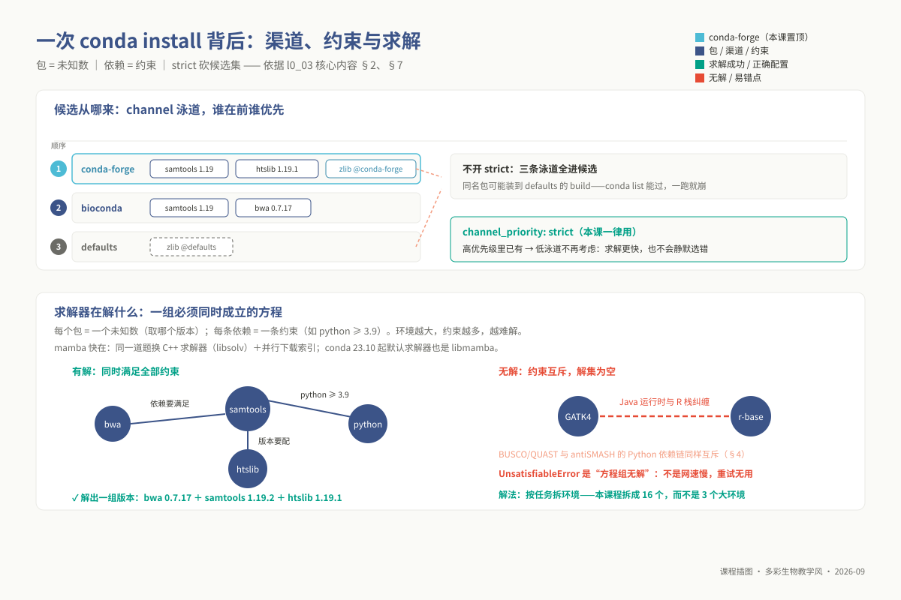
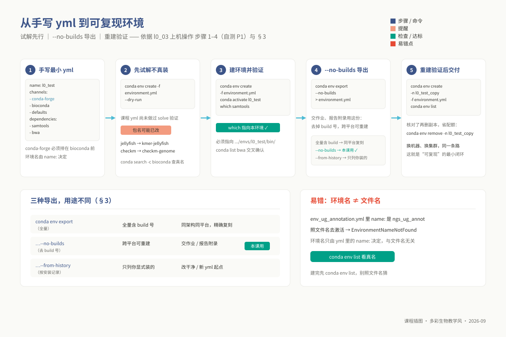

# L0-3：Conda / Mamba 环境管理

> **适用对象**：本科 / 硕士 / 博士 ｜ L0 预备课 ｜ 自学预估 2 学时
>
> **阅读重点**：在第一次实践课前创建可用的分析环境，练习激活、导出与排错。完整命令清单见 `09_resources/cheatsheets/conda_cheatsheet.md`。
>
> **自查**：配套自测见 `08_assessment/prerequisites/l0_03_conda_selftest.md`。

<!-- 模块 id：l0_03_conda；契约：00_design/course_contract.yaml → prerequisite_packs.L0。 -->

---

## 学习目标

**出口能力**：能创建、激活、导出、复现一个分析环境，并在环境出问题时自行定位。学完后应能独立完成（每条对应自测里的一道题）：

1. 说清 conda 与 mamba 的关系，并解释 mamba 为什么快；
2. 写出正确的 channel 顺序，解释 `conda-forge` 为什么必须排在 `bioconda` 前，以及 `channel_priority: strict` 改变了什么；
3. 从零创建并激活一个环境，用 `which` / `conda list` 验证工具确实来自这个环境；
4. 写出 `environment.yml`，说明 `conda env export`、`--no-builds`、`--from-history` 三种导出的差别与适用场合；
5. 解释本课程为什么把三层拆成 **16 个环境**而不是一层一个大环境，并说出你所在层次该建哪几个；
6. 认出「有些工具压根不走 conda」这一类情况，不在 yml 上白耗时间；
7. 在 SGE 作业脚本里正确激活环境——**这是本模块最高频、代价最大的一个坑**；
8. 看到 6 条常见报错的原文时，能在一分钟内说出原因与下一步动作。

## 为什么这是前置

硕士 m02 的组装实践就需要使用 Flye、QUAST、BUSCO，因此环境配置安排在 L0 中提前完成。先建立环境，可以把课堂实践时间用于分析与结果解释。

下表列出各层专题对环境管理的具体要求。非生信背景的学生可先按所在层次检查所需工具。

| 层次 | 卡点出现在 | 不掌握的后果 |
|---|---|---|
| 硕士 | **m02 基因组组装与比较 / 泛基因组** | 实践只有 2 学时。当场才第一次装 Flye / QUAST / BUSCO，`Solving environment` 一转十几分钟，一半时间没了；不知道要拆环境，还会试图把 BUSCO 和 antiSMASH 装进同一个 env，硬解到失败 |
| 硕士 | **m03 重测序与变异检测** | GATK4 的 Java 运行时与 R 栈依赖纠缠，solve 时间极长。不懂拆环境就卡在建环境，进不到变异检测本身 |
| 硕士 | **m06 扩增子测序分析** | QIIME2 官方要求**独立环境**。不知道这条规则的人会把它写进公共 yml，然后永远解不出来 |
| 硕士 | **m08 分析流程工程化** | Snakemake 的 `conda:` 指令给每条 rule 挂一个 yml。没建过环境，就看不懂这个指令在做什么 |
| 博士 | **p07 Nextflow / Snakemake 工作流开发** | Nextflow 的 process 可以用 `conda` 也可以用 `container`。不理解「环境=同一台机器上换 PATH，容器=换一整个文件系统」的区别，就无法判断该用哪个，`-profile singularity` 也只能照抄 |
| 博士 | **p02 单细胞与空间转录组** | Seurat（R）与 scanpy（Python）分属两个技术栈，本课放在同一个 `ngs_phd_sc` 环境里。不会查 `conda list` 就分不清「包没装」和「装在别的环境里」 |
| 本科 | **u06 起每个单元** | u06 组装、u07 注释、u08 项目分别用三个不同环境。u08 泛基因组要先在 `ngs_ug_annot` 跑 Prokka、再切到 `ngs_ug_phylo` 跑 Roary——不会切环境，项目第一天就停住 |
| 三层通用 | **任何一次 `qsub`** | 作业脚本是**非交互 shell**，不读你的 `.bashrc`，conda 未初始化。少写一行 `source`，作业秒退、日志里只有一行 `command not found` |
| 三层通用 | **交报告的时候** | 报告附录要求附 `environment.yml` 与关键工具版本号。写「用 Flye 组装」不够，得写清版本——不会导出就交不出可复现的结果 |

> **案例**："在我机器上能装"。你照一篇博客的 yml 在笔记本上装好了 BUSCO，同门拿同一份 yml 在集群上
> `conda env create`，`Solving environment: failed with initial frozen solve. Retrying with flexible solve.`
> 转了十几分钟，最后 `UnsatisfiableError` 甩出一长串包名。这不是"集群不行"——同一份 yml，两边 conda
> 版本、channel 配置不同，求解器面对的候选集就不同。解读路径是固定的：① 读冲突输出的**最后几行**，
> 找出互斥的那一对版本要求；② `conda config --show channels` 核对顺序、确认 `channel_priority: strict`；
> ③ 都没错就是**依赖真互斥**，按 §4 拆环境。别用"多试几次"跟求解器赌运气。

开始各专题前，先确认所需环境能够激活、工具能够找到。

## 核心内容

### 1. 环境隔离的物理本质：PATH 路由、硬链接与 RPATH 机制

创建 Conda 环境并不会启动一套虚拟操作系统。理解环境管理时，可以从命令查找、包文件存储和动态库查找三个方面入手：

1. **`PATH` 环境变量的栈顶劫持**：
   在 Linux 终端中输入任意命令（如 `samtools`）时，操作系统的 Shell 进程并不会全盘扫描整个硬盘，而是严格按照环境变量 `PATH` 中所记录的一组由冒号 `:` 分隔的目录路径，从左往右逐一搜寻匹配的可执行程序。
   执行 `conda activate l0_test` 时，Conda 本质上是在当前 Shell 进程上下文中执行了一段注入脚本，将当前目标环境的二进制目录（例如 `/home/user/.conda/envs/l0_test/bin`）强行插入到环境变量 `PATH` 的**最左端（最前端）**。此后，无论系统自带的 `/usr/bin/` 还是其他环境里是否存在同名的 `samtools`，Shell 都会在命中第一个路径后立即停止搜索并执行它。因此，“环境激活”本质上只是一个针对命令查找顺序的路由重定向。使用 `which samtools` 永远是验证当前环境是否正确激活的唯一黄金标准。

2. **全局缓存与硬链接（Hard Link）存储拓扑**：
   如果每个 Conda 环境都要将动辄数百 MB 的 Python 解释器、R 运行库和生信工具完整复制一遍，几十个独立环境很快就会将磁盘撑爆。Conda 采用的是**包缓存池 + Inode 硬链接**机制：
   - 任何通过 `conda install` 下载的软件包（压缩包），都会首先被解压保存在全局缓存目录 `pkgs/`（通常在 `miniconda3/pkgs/`）中；
   - 当在不同环境中安装同一个版本的软件包时，Conda 根本不会在磁盘上进行第二次数据复制，而是直接在对应环境的 `bin/` 或 `lib/` 目录下创建一个指向 `pkgs/` 中物理文件的**硬链接（Hard Link）**。
   - 硬链接与原文件共享相同的底层 Inode 编号与数据磁盘块，这意味着无论你克隆多少个相同的分析环境，它们在磁盘物理层面上**只占用一份实际存储空间**。只有当你从不同的 Channel 引入了不同的底层 build 版本时，才会真正消耗新的物理磁盘。

3. **动态链接库劫持与 RPATH 补丁技术**：
   生信软件多由 C/C++、Rust、Fortran 编写，高度依赖系统底层的共享动态链接库（Shared Objects, `.so` 文件，如 `libz.so`, `libhts.so`, `libstdc++.so`）。传统的 Linux 软件安装如果遇到系统自带库版本过旧，必须由管理员编译替换全局系统库，极易导致系统级崩溃（即经典的“依赖地狱”）。
   Conda 解决这一难题的核心武器是 **RPATH / RUNPATH 注入**。Conda 在为 Bioconda 编译构建二进制包时，会借助 `patchelf` 工具在 ELF 二进制文件的头信息中显式硬编码一段相对运行期库检索路径：`RPATH=$ORIGIN/../lib`。当可执行文件在内存中启动时，系统的动态链接加载器（`ld.so`）会被强制要求优先到该软件所在相对路径的 `../lib`（即当前 Conda 环境的独立 `lib/` 目录）中去寻找其依赖的特定动态链接库，而不是去读取操作系统的 `/usr/lib64`。这使得不同环境可以使用完全互斥的 GCC 运行时或 GLIBCXX 符号版本而互不干扰。

> **工具现状（2023–2026）**：传统 Conda 最为人诟病的是其依赖求解极其缓慢。自 Conda 23.10（2023-11）起，基于 C++ 编写的高性能求解器 `libmamba` 正式成为 Conda 的默认内核，使得原本需要十余分钟的依赖解析被大幅缩短至数秒；另一条更为激进的轻量路线是 **micromamba**——与 Mamba 共享同一套 C++ 核心代码库，被编译为单一的静态二进制文件，完全去除了 base 环境对 Python 解释器的捆绑，成为现代容器化与 CI 持续集成流程的首选。环境与容器的系统演进见本科 u01 讲义 §4.7–4.8。


*图 l0_03-1：activate 的本质：把环境 bin/ 插到 PATH 最前面——which 是唯一自检标准。*

### 2. Channel 优先级与二进制 ABI 兼容性铁律

在使用 Conda 安装生信工具时，绝大多数“运行报错”、“动态库符号找不到”或“求解极慢”的根源，并非在于软件本身，而在于频道配置（Channel Configuration）破坏了二进制应用程序二进制接口（ABI, Application Binary Interface）的兼容性。

必须严格固化以下频道顺序（通过 `conda config` 或 `~/.condarc` 声明）：

```yaml
channels:
  - conda-forge      # 必须置于最高优先级
  - bioconda
  - defaults
```

**底层机制与为什么必须如此**：

- `conda-forge` 是社区驱动的通用开源软件底层基座，提供极其现代且严格维护的编译工具链、C/C++ 基础运行时库（如 OpenBLAS、HDF5、Boost、zlib）；
- `bioconda` 则是专门面向生命科学领域的专用分发渠道，收录了上万种生物信息学工具。**Bioconda 官方在构建每一个生信软件包时，其持续集成构建服务器（CI）全部是挂载在 `conda-forge` 的基础库之上进行静态/动态链接编译的**。
- 如果将 `defaults`（Anaconda 官方商业默认源）置于前面，或者将 `conda-forge` 置于 `bioconda` 之后，Conda 求解器就会尝试从 `defaults` 中抽取基础系统库。虽然 `defaults` 里的某些库（例如 libcurl 或 libgsl）名字与 `conda-forge` 相同，但其编译参数、结构体内存对齐方式以及包含的符号版本完全不同。这会导致工具在安装时看似风平浪静，一旦运行就会抛出致命错误：

  ```text
  version `GLIBCXX_3.4.29' not found (required by ...)
  ```

  或者在底层矩阵运算中直接静默输出 NaN。

**`channel_priority: strict` 的布尔代数意义**：
通过执行 `conda config --set channel_priority strict`，用户向求解器下达了一条硬性剪枝规则：一旦某个软件包在高优先级 Channel（如 conda-forge）中存在，求解器在任何情况下都不再向下探查低优先级 Channel（如 defaults）中的同名候选版本。这一约束极大地压缩了求解器的状态遍历树，不仅将因 ABI 冲突引发的静默崩塌从源头消灭，而且大幅提升了环境解析的收敛速度。

### 3. 三种环境导出机制的物理取舍

重跑分析需要记录计算环境。`conda env export` 的三种导出方式保留的信息不同，适用场景如下：

| 导出命令 | 产物内容特征 | 适用场景与工程代价 |
|---|---|---|
| `conda env export > environment.yml` | 包含每个包的包名、精准版本号、以及构建哈希标识（Build String，如 `py39h12deebd_1`） | **同平台精确逐字节复刻**。适合在相同操作系统与 CPU 架构的机器间迁移。在不同平台（如从 Mac ARM64 迁到 Linux x86_64）会因构建号不存在而直接报错终止 |
| `conda env export --no-builds > env.yml` | 包含包名与语义版本号（如 `bwa=0.7.17`），剥离了机器专有的构建哈希值 | **跨平台复现的标准规范（交作业、论文附录首选）**。既锁定了关键软件的大版本，又允许异构机器根据自身平台解析合适的底层二进制构建 |
| `conda env export --from-history > env.yml` | 仅仅记录用户通过 `conda install` 显式敲击过的顶层包名，不包含任何自动安装的下游传递依赖 | **极简配方**。适合作为构建干净新环境的基准种子文件，但由于下游依赖完全未锁定，复现时可能会拉取到更新的库导致不可预测的行为变化 |

**版本锁定的工程哲学**：在最初探索性构建分析流程时，不要将次要依赖的版本定死；待全流程完全调试跑通后，通过 `conda env export --no-builds` 提取版本快照回填进项目文档。这既保证了可复现性，又避免了因过早过度约束导致的求解死锁。

### 4. 模块化环境解耦：为什么课程拆分 16 个专用环境

将 BWA、GATK、Flye、BUSCO、DESeq2、QIIME2、antiSMASH 全部放入同一环境，会增加依赖冲突和维护的难度。课程按功能拆分环境，主要考虑以下三类问题：

1. **Python 生态的深层依赖链撕裂**：基因组质量评估工具 BUSCO 依赖于特定版本的 `augustus` 与 `sepp`，而次级代谢产物注释工具 antiSMASH 依赖于特定版本的 `scikit-learn` 与 `jinja2`。两者的依赖树在向下传递数层后，会对某个底层的 Python 核心扩展库提出相互排斥的版本要求（例如一个必须 `< 1.2`，另一个必须 `≥ 1.5`）；
2. **专有生态的严苛隔离要求**：微生物组核心套件 QIIME2 拥有自己极其庞大的内部依赖图谱，其官方明确警告必须部署在完全纯净的独立专属环境中，严禁与常规生信工具混装；
3. **语言运行时的交叉污染**：变异检测黄金标准 GATK4 基于 Java 运行时构建，并嵌入了大量的原生 R 绘图支持。将其与现代 R 语言生态（R 4.x 及 Bioconductor）强行揉搓在一起，往往会导致 Java 虚拟机（JVM）与 R 动态库之间的依赖冲突，导致求解器陷入无限回溯。

因此，本课程将本科、硕士、博士三层的计算栈严格解耦为 **4 + 6 + 6 = 16 个专用环境**（由契约 `levels.<level>.env_files` 与 `validate_course.py` 严格校验）。学生无需建立其他层次的环境，只需按当前专题激活对应的计算环境即可（例如组装切至 `ngs_ug_assembly`，注释切至 `ngs_ug_annot`）。

### 5. 软件分发生态的非 Conda 豁免清单

在生信领域，并不是所有软件都能或者都适合封装进 Bioconda。遇到 `PackagesNotFoundError` 时，必须具备识别“它本来就不走 Conda”的行业常识，避免在 Conda 上白白耗费时间：

- **受限于学术许可与商业协议的工具**：例如分泌蛋白预测工具 **SignalP**（受丹麦技术大学 DTU 专有学术版权保护，需使用教育邮箱注册申请下载源码包）以及变异功能注释工具 **ANNOVAR**（要求使用者签署官网学术许可协议，禁止第三方公开镜像再分发）。这类软件在法律层面上无法直接进驻 Bioconda 公共源；
- **特定语言独立生态分发包**：例如农艺性状关联分析工具 **GAPIT**，它以独立 R 脚本或 GitHub 源码包形式分发，Bioconda 中并未收录其构件；
- **系统级服务与桌面 GUI 应用**：例如网络可视化软件 **Cytoscape**（依赖本地桌面 Java 图形界面系统）以及 **Docker**（属于操作系统级特权容器运行时守护进程，普通用户无法通过 Conda 部署其服务端）；
- **环境隔离要求极致的独立套件**：如前所述的 **QIIME2**，必须按照其官方每月发布的标准化独立 yml 进行一键克隆，严禁强行作为普通依赖包安装进其他既有环境。

### 6. 集群 HPC 架构下的非交互子 Shell 环境变量隔离

本课程集群（SGE, Open Grid Scheduler）将 Conda 的基础安装树部署在共享网络存储路径 **`/opt/miniconda3`**。在日常交互与作业提交中，必须直面由于 Shell 会话生命周期不同所带来的环境隔离：

- **交互式登录会话（Interactive Login Shell）**：
  当你通过 SSH 连入登录节点时，系统会自动加载全套用户 Profile。敲击 `source /opt/miniconda3/bin/activate` 后，终端提示符前出现 `(base)`，此时 `conda` 命令与其底层的 Shell 劫持函数已经完全常驻于当前终端上下文中。

- **SGE 调度作业的非交互子 Shell（Non-interactive, non-login batch shell）**：
  这是生信分析中最具隐蔽性、导致无数任务秒退的工程巨坑。当使用 `qsub job.sh` 将脚本提交至后台计算网格时，负责执行的计算节点守护进程（`sge_execd`）会派生一个崭新的、独立的非交互子进程来执行该脚本。**这个子进程绝不会自动读取你的 `~/.bashrc`，也不会继承你刚才在登录节点终端中敲过的任何命令状态**！

此时，在作业脚本内部，不仅环境变量 `PATH` 退回到了系统的最原始状态，**连 `conda` 这个命令所依赖的底层 Shell 函数都根本没有被定义**。如果在脚本中只写一句裸的 `conda activate ngs_ug_assembly`，作业会在启动后的千分之一秒内直接崩溃退出，日志中只会留下一行极具欺骗性的报错：

```text
CommandNotFoundError: Your shell has not been properly configured to use 'conda activate'.
```

甚至如果连环境变量都没配好，会直接报错 `conda: command not found`。

**合规的黄金法则**：每一个提交至集群的作业脚本，其头部必须无条件书写以下两行环境初始化指令：

```bash
source /opt/miniconda3/bin/activate    # ① 在当前子 Shell 中声明并注入 conda 函数体系
conda activate 目标环境名               # ② 将目标环境的 bin/ 目录真正推至 PATH 栈顶
```

同时，一个作业脚本内部应当保持计算环境的纯粹性，**严禁在一个脚本内频繁来回切换不同 Conda 环境**。跨阶段的复杂分析（例如前一步在 `ngs_ug_annot` 跑 Prokka 注释，后一步在 `ngs_ug_phylo` 跑 Roary 泛基因组分析），正确的工程规范是将它们拆解为两个独立的作业脚本，通过 SGE 的 `-hold_jid` 参数实现任务的有向无环图串行调度。

### 7. SAT 依赖图求解器与布尔可满足性理论

在敲击 `conda install` 或创建环境时，屏幕上反复闪烁的 `Solving environment` 究竟在执行什么计算？从计算科学的角度来看，Conda 的依赖解析本质上是在求解一个经典的 **布尔可满足性问题（Boolean Satisfiability Problem, SAT）**：

- **状态空间建模**：求解器将候选 Channel 中的每一个包的每一个版本（甚至具体的每一个 build）都抽象为一个布尔逻辑变元 $x_i$（取值为 1 表示选中安装该特定版本，取值为 0 表示排除）；
- **约束子句构建（CNF Clauses）**：
  - 用户敲击的显式要求构成基础约束：例如要求安装 $A$，则必须有变元子句 $(A_{v1} \lor A_{v2} \lor \dots)$ 为真；
  - 软件包自身声明的依赖树构成蕴含子句：例如 $A_{v1}$ 声明依赖于 $B \ge 2.0$，则转化为逻辑命题 $A_{v1} \implies (B_{2.0} \lor B_{2.1} \lor \dots)$；
  - 互斥公理：同一个环境中同一个软件包至多只能有一个版本被激活，即 $\neg (A_{v1} \land A_{v2})$。
- **无解冲突（UnsatisfiableError）**：
  当一个环境中被塞入过多工具时，依赖关系会交织成极其稠密的复杂图谱。当上游工具 A 强制要求底层依赖 $D \le 1.10$，而工具 B 强制要求 $D \ge 1.15$ 时，整个布尔命题系统在数学逻辑上被严格证明**无可行解**。此时求解器会经过海次回溯搜索后抛出 `UnsatisfiableError`。

如果当前版本约束相互冲突，重复执行相同命令不能消除冲突。先查看日志中互斥的版本要求，再检查是否需要调整约束或按功能拆分环境。



*图 l0_03-2：channel 与求解器：优先级决定候选集，求解器在约束里找可行解。*

## 上机操作

在集群（或任一联网 Linux）上按顺序做完，约 40 分钟（多数时间在等下载）。



*图 l0_03-3：yml 工作流：声明 → 试解 → 建环境 → 导出 → 重建验证。*

### 步骤 1：初始化 conda 并配好 channel

```bash
source /opt/miniconda3/bin/activate
conda config --add channels defaults
conda config --add channels bioconda
conda config --add channels conda-forge      # --add 是插到最前，所以【倒着加】
conda config --set channel_priority strict
conda config --show channels                 # 核对：conda-forge > bioconda > defaults
conda install -n base -c conda-forge mamba   # 可选但强烈建议
```

### 步骤 2：手写一个最小 yml（这就是自测上机题 P1 要交的东西）

```bash
cat > environment.yml <<'EOF'
name: l0_test
channels:
  - conda-forge
  - bioconda
  - defaults
dependencies:
  - samtools
  - bwa
EOF

conda env create -f environment.yml --dry-run   # 先试解，不真装
conda env create -f environment.yml             # 通过后再真建（或用 mamba）
conda activate l0_test
which samtools && conda list bwa                # which 必须指向 .../envs/l0_test/bin/
```

### 步骤 3：导出并复现

```bash
conda env export --no-builds > environment.yml          # 覆盖手写版；自测 P1 交的就是它
conda env create -f environment.yml -n l0_test_copy     # 验证它真能重建
conda env list && conda env remove -n l0_test_copy      # 核对后删掉副本，省配额
```

### 步骤 4：先 `--dry-run` 再动手——课程 yml 尚未做过 solve 验证

**必须说明的一个现实**：`07_envs/conda/` 下这 16 个 yml **尚未在有网络的机器上做过 solve 验证**（编写它们的环境拉不到 bioconda
索引）。所以**首次使用前一律先试解**：`conda env create -f <file> --dry-run`。若包名解析失败，最可能的两处替换是：

| 写在 yml 里的 | 试试改成 | 备注 |
|---|---|---|
| `jellyfish` | `kmer-jellyfish` | bioconda 上两个名字都出现过 |
| `bioconductor-ggtree` | `r-ggtree` | 渠道归属变动过 |

用 `conda search -c bioconda <包名>` 查真名。**这不是本课程的疏漏，而是真实科研的常态**：一份 yml 在别人机器上解不出来，
你要能自己判断是包名变了、channel 没配、还是依赖真冲突——这项判断力就是本模块的出口能力。

### 步骤 5：写一个能跑的 SGE 作业脚本（自测上机题 P2）

```bash
#!/bin/bash
#$ -N l0_conda_test          # 作业名（是 #$ 不是 #）
#$ -cwd                      # 在提交目录运行——该目录必须存在
#$ -j y                      # 标准错误并入标准输出
source /opt/miniconda3/bin/activate    # 【必须】非交互 shell 里 conda 未初始化
conda activate l0_test                 # 【必须】切到目标环境
echo "host=$(hostname)  env=${CONDA_DEFAULT_ENV}"
which samtools && samtools --version | head -1
```

`qsub run_test.sh` 提交 → `qstat` 看状态（`Eqw` 表示出错且不会自愈，须 `qdel` 后改正重提）
→ `cat l0_conda_test.o*` 看日志，`env=` 那一行必须是 `l0_test`。

## 常见错误与排查

> 全部是真实报错原文，遇到时直接 `Ctrl-F` 搜关键词。排错前先敲**自检三连**：`conda env list`（我在哪个环境）
> → `which <命令>`（这个命令来自哪里）→ `conda list <包>`（到底装没装）。

| 报错原文 / 现象 | 原因 | 解法 |
|---|---|---|
| `bash: conda: command not found` | 这个 shell 没初始化过 conda（新终端，或 `qsub` 的作业脚本里） | `source /opt/miniconda3/bin/activate`。作业脚本里**必须**写这一行 |
| `CommandNotFoundError: Your shell has not been properly configured to use 'conda activate'.` | `conda` 这个**程序**找得到，但 `conda activate` 这个 **shell 函数**没被定义（常见于用绝对路径调 conda，或在脚本里只 `export PATH` 没 source） | `source /opt/miniconda3/bin/activate`；或执行一次 `/opt/miniconda3/bin/conda init bash` 后重新登录。**注意区别于上一条**：上一条是找不到 conda，这一条是 conda 在但 activate 不在 |
| 作业日志里只有一行 `samtools: command not found`，作业秒退 | 脚本里漏了激活，或激活了不含该工具的环境。**本模块最高频、代价最大的坑** | 脚本里补 `source /opt/miniconda3/bin/activate` + `conda activate <env>` 两行；再用 `echo ${CONDA_DEFAULT_ENV}` 自证 |
| `PackagesNotFoundError: The following packages are not available from current channels:` `- jellyfish` | ① channel 没配全；② 包名变了；③ 它本来就不走 conda | `conda config --show channels` 确认 bioconda 在列；`conda search -c bioconda <包名>` 查真名（`jellyfish`→`kmer-jellyfish`、`checkm`→`checkm-genome`）；再对照上面的 `env_exempt_tools` 表 |
| `Solving environment: failed with initial frozen solve. Retrying with flexible solve.` 之后长时间无进展 | 求解器在巨大的版本组合空间里回溯。诱因：channel 顺序写反、一个环境塞太多工具、pin 得过死 | 按序试：① 改用 `mamba env create -f xxx.yml`；② `conda config --set channel_priority strict`；③ 核对 channel 顺序；④ 仍不行就**拆环境**——别把 BUSCO 和 antiSMASH 装一起 |
| `UnsatisfiableError:` 后跟一长串冲突列表 | 工具之间依赖真的互斥 | **不要硬解**。按任务拆成多个环境，这正是本课程分 16 个环境的原因 |
| `CondaHTTPError: HTTP 000 CONNECTION FAILED for url <https://conda.anaconda.org/bioconda/linux-64/repodata.json>` | 网络不通或代理没配。集群**计算节点常常不能直连外网** | 在**登录节点**建环境（登录节点通常有外网），建好后作业里只 `conda activate` 不装包；或按管理员给的镜像源配 `~/.condarc` |
| `cp: writing '/home/xxx/pkgs/...': Disk quota exceeded` ／ 建环境到一半失败 | conda 的 `envs/` 与 `pkgs/` 缓存吃满了家目录配额（一个生信环境几个 GB 很常见） | `conda clean -a` 清缓存；`du -sh ~/.conda/*` 找占地大户；长期方案是在 `~/.condarc` 里把 `envs_dirs` / `pkgs_dirs` 指到 `/d3/scratch/${USER}/` |
| `EnvironmentNameNotFound: Could not find conda environment: ngs_ug_annotation` | **拿文件名当环境名了**。`env_ug_annotation.yml` 的 `name:` 是 `ngs_ug_annot` | `conda env list` 看真实名字。环境名只由 yml 里的 `name:` 决定 |
| 环境已激活，但 `which samtools` 指向 `/usr/bin/samtools` | 提示符变了而 PATH 里另有更靠前的来源（`module load` 的、或系统自带的） | `conda list samtools` 确认包在不在；在则检查是否 `module` 与 conda 冲突，`module purge` 后重试 |

## 自测入口

**自测文件**：`08_assessment/prerequisites/l0_03_conda_selftest.md` ｜ **10 题**，含 **2 道上机题**
（P1 建含 samtools + bwa 的环境并导出 `environment.yml`；P2 写 SGE 作业脚本片段）。

**计分：完成即给分，不按对错计。** 目的是拿诊断数据（教师据此在首次课用 15–20 分钟只过集中出错的点），不是筛人。
**因此参考答案直接附在自测文末**——抄了也不加分，公开答案让自测同时成为学习工具。
**提交物**：① 10 题答题；② P1 导出的 `environment.yml` **文件本体**（不是截图，它正是后续课堂要用的东西）；③ P2 的脚本片段。

**三层的期望差异**（同一份材料，不同的通过线）：

| 层次 | 诊断参考线 | 额外要求 |
|---|---|---|
| 本科 | 正确率 ≥ 80%（生信科班，理应掌握更好） | 4 个本科环境**全部建好**并通过 `conda env list` 自证 |
| 硕士 | 正确率 ≥ 60% | 至少建好 `ngs_ms_base`；开课前完成 m02 所需环境的 `--dry-run` 试解 |
| 博士 | 正确率 ≥ 60% | 同硕士；另需能说清「conda 环境 vs 容器」的区别——p07 要用 |

跟不上时的回查路径：本模块 → `09_resources/cheatsheets/conda_cheatsheet.md`（纯命令速查）→ `07_envs/conda/README.md`（拆分理由与 yml 清单）。

## 参考资料

### 官方文档

| 主题 | 链接 |
|---|---|
| Conda 官方文档 ｜ 管理环境（本模块权威出处） | https://docs.conda.io/projects/conda/en/stable/ ｜ https://docs.conda.io/projects/conda/en/stable/user-guide/tasks/manage-environments.html |
| Bioconda 使用说明（channel 顺序的官方要求） ｜ conda-forge 文档（`channel_priority`） | https://bioconda.github.io/ ｜ https://conda-forge.org/docs/ |
| Mamba 文档 ｜ Open Grid Scheduler / SGE 手册页（`qsub`/`qstat`/`qdel`） | https://mamba.readthedocs.io/en/latest/ ｜ http://gridscheduler.sourceforge.net/htmlman/manuals.html |

### 文献

1. Grüning B, Dale R, Sjödin A, et al. Bioconda: sustainable and comprehensive software distribution for the life sciences. *Nature Methods*, 2018, 15:475–476. doi:10.1038/s41592-018-0046-7
2. Grüning B, Chilton J, Köster J, et al. Practical Computational Reproducibility in the Life Sciences. *Cell Systems*, 2018, 6(6):631–635. doi:10.1016/j.cels.2018.03.014
3. Wilson G, Bryan J, Cranston K, et al. Good enough practices in scientific computing. *PLOS Computational Biology*, 2017, 13(6):e1005510. doi:10.1371/journal.pcbi.1005510

### 课程内部材料

| 材料 | 路径 | 用途 |
|---|---|---|
| Conda / Mamba 速查表 ｜ 环境拆分理由与全部 yml | `09_resources/cheatsheets/conda_cheatsheet.md` ｜ `07_envs/conda/README.md` + `env_*.yml` | 前者纯命令速查（本模块不重复它）；后者是 16 个环境的定义与冲突说明 |
| 前置包定义与自测闸门机制 | `00_design/prerequisite_packs.md` | 本模块的范围界定出处 |
| 本科 u01 讲义（Linux + Conda 系统教学版） ｜ 本模块自测（含参考答案） | `02_lectures/undergraduate/unit01_linux_conda/01_linux_conda_lecture.md` ｜ `08_assessment/prerequisites/l0_03_conda_selftest.md` | 想系统学时读前者；后者是本模块闸门 |

*模块版本 v1.0 ｜ 依据 contract_version 1.1 ｜ 最后更新 2026-08-29*
