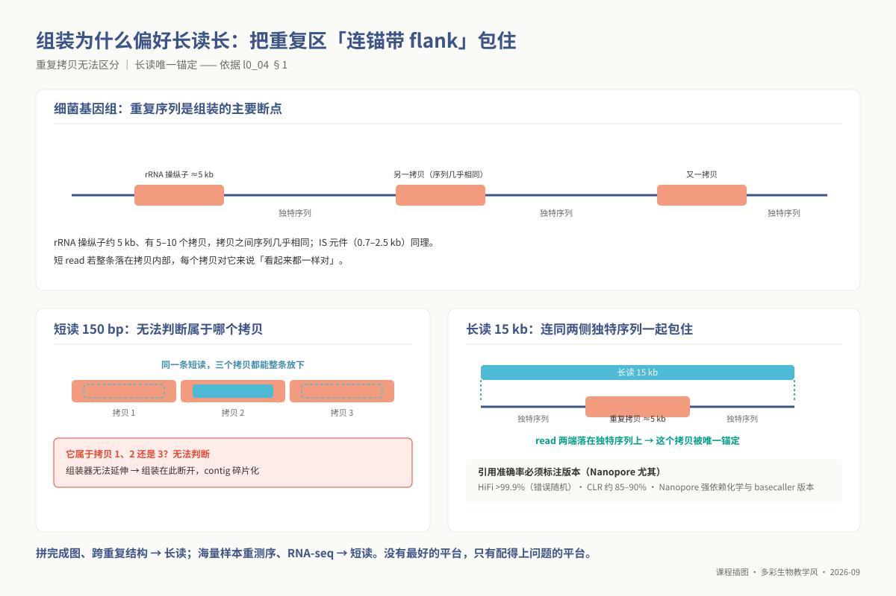
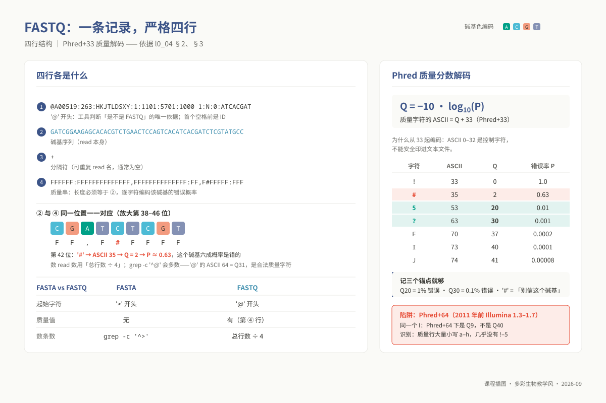
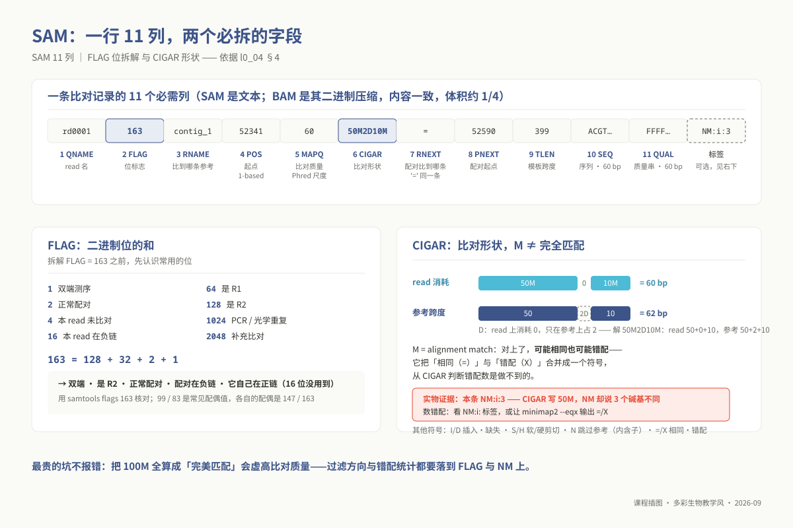
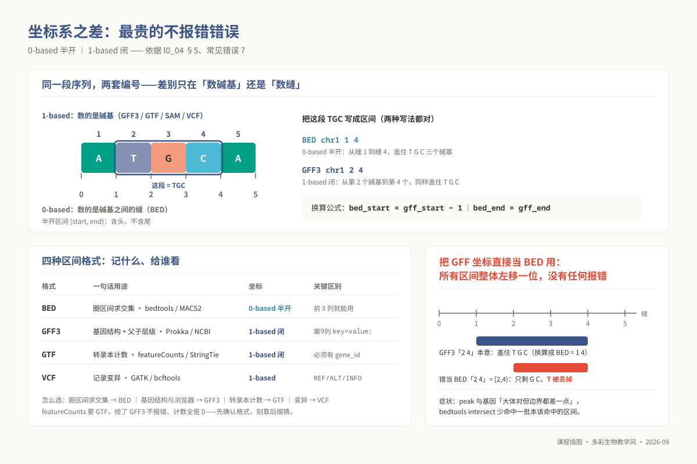

# L0-4：测序原理与 FASTQ / FASTA / SAM 格式

> **适用对象**：本科 / 硕士 / 博士 ｜ L0 预备课 ｜ 自学预估 4 学时
>
> **阅读重点**：识别测序文件、解释字段、读取质量值。展开学习见 `02_lectures/undergraduate/unit03_seq_principles_formats/`；字段细节见 `09_resources/cheatsheets/file_formats_cheatsheet.md`。
>
> **自查**：`08_assessment/prerequisites/l0_04_formats_selftest.md` 共 10 题，第 8–10 题为上机题，使用 `bash / awk / python3 / samtools`。

<!-- 契约：00_design/course_contract.yaml → prerequisite_packs.L0.l0_04_formats。 -->

---

## 学习目标

完成本模块后，你能够：

1. **对比** Illumina / PacBio / Nanopore 在读长、准确率、错误模式、成本四个维度的差异，并据此为一个给定问题选平台。
2. **解码** FASTQ：说出四行各是什么，把任一质量字符换算成 Q 值与错误率（`Q = -10 log₁₀P`，Phred+33）。
3. **判断** 文件是 FASTA 还是 FASTQ、是否压缩——**不看文件名，看内容**。
4. **读懂** 一行 SAM 的 11 列，手工拆解 FLAG，算出 CIGAR 在 read 与参考上各跨多少 bp。
5. **说明** 为什么 CIGAR 的 `M` 不等于"完全匹配"，以及这个误解会导致什么错误结论。
6. **区分** BED / GFF3 / GTF / VCF 的用途，说清 **0-based 半开** 与 **1-based 闭区间** 的差别在哪一步咬人。
7. **统计** 序列文件的条数、碱基总量、N50 与估算深度，并判断这批数据够不够用。

## 为什么这是前置

文件格式知识会用于参数选择和结果检查。下表列出后续专题中的使用场景：

| 你会卡在哪 | 卡住的具体形态 | 缺哪条能力 |
|---|---|---|
| **硕 m03 重测序与变异检测** | `samtools view -f 2 -F 3852` 只能整条抄。过滤方向写反（`-f` 写成 `-F`）不报错，只让你少掉一半 read，而你以为数据本来就这么少 | FLAG 位（4） |
| **硕 m04 转录组 · featureCounts** | featureCounts 要 **GTF**，你给了 GFF3——不报错，计数全是 0，然后开始怀疑比对 | GTF 与 GFF3 的差别（6） |
| **硕 m05 调控组 · peak 注释** | MACS2 输出 **BED（0-based 半开）**，注释是 **GTF（1-based 闭）**。直接 `bedtools intersect` 让每个 peak 整体左移一位，边界处关联全错——**没有任何报错** | 坐标系差一（6） |
| **硕 m02 / 本科 u06 组装** | Canu、Flye 的输入是 FASTA 或 FASTQ，参数还分 `--pacbio-raw` / `--pacbio-hifi`。格式判断错，第一条命令就跑不起来；深度判断不出，跑三天出一堆碎片 | 格式判别 + N50/深度（3、7） |
| **博 p04 群体基因组 / p05 GWAS** | VCF 是全流程唯一输入。要把关联位点映射回基因，就得在 VCF（1-based）与 BED/GTF 之间换算 | VCF 与坐标系（6） |
| **本科 u05 比对与 BAM** ｜ **三层每次实践的第一步** | 拿到一行 SAM 说不出第 2、6 列是什么，排序索引去重全靠抄；数据到手第一件事是"这是什么"，判断错了报错往往指向毫不相干的地方 | SAM 11 列（4）；全部 |

**最贵的两个坑都不报错**（本模块反复强调的原因）：**CIGAR 的 `M` 不等于完全匹配**（`150M` 的 read 可能有 10 个错配）；**BED 是 0-based 半开，GFF/SAM/VCF 是 1-based 闭**（混用只让所有区间错一位）。**不报错的错误最贵——它会一路走到你的结论里。**

> **案例**：一条被破坏的 FASTQ 行，如何静默地毁掉下游。某批数据传输中断、末尾缺行，
> 有人手工删了几行凑成 4 的倍数（「常见错误」4 明令禁止的原因就在这里）。若缺行发生在**文件
> 中部**，从缺行处起"序列行"会配上别人的"质量行"，此后每条记录整体错位——行数仍能整除 4、
> FastQC 照样出报告，但 %GC、质量分布全部失真，比对率下降却查不出原因；错误直到比对或变异
> 检测阶段才以"说不通的结果"现形，彼时距离真正的病因已隔了几个环节。防线三件套：传输后
> `md5sum` 对账、`zcat f.fq.gz | wc -l` 整除 4、read 数与数据提供方核对。**验证"文件没坏"
> 只要一分钟，解释"结果为什么不对"要一星期。**

## 核心内容

### 1. 三大测序平台的技术物理原理与误差模式图谱

FASTQ 中的碱基与质量值来自测序仪对光学或电流信号的解读。理解数据如何产生，有助于解释误差模式、判断质控警告，并为科研问题选择合适的平台：

| 评价维度 | Illumina（短读长） | PacBio SMRT（长读长） | Oxford Nanopore（超长读长） |
|---|---|---|---|
| **测序物理原理** | 边合成边测序（SBS）+ 荧光可逆终止阻断剂 | 零模波导孔（ZMW）单分子荧光实时监测 | 蛋白纳米孔阻抗电流波动（Squiggle）解码 |
| **典型读长范围** | 50–300 bp（主流为双端 PE150） | CLR 10–30 kb；**HiFi 15–25 kb** | 数 kb 至 Mb 级（取决于 DNA 提取的完整度） |
| **单分子/单次准确率** | 极高（Q30+ 碱基通常 > 85%–90%） | 原始 CLR 约 85%–90%；**HiFi 模式 > 99.9%** | 中至高（~Q15–Q25，**高度取决于化学试剂与 Basecaller 版本**） |
| **固有系统误差特征** | **3' 端循环递增的系统性质量衰退**，以碱基替换为主 | **无序列偏好性的纯随机泊松误差**；原始读长以 InDel 为主 | **均聚物（Homopolymer，如 AAAAA）** 长度判定困难 |
| **单位碱基成本** | **最低**，通量巨大 | 较高 | 中等；但仪器购买门槛极低（便携式 MinION） |
| **生信主打场景** | 重测序变异检测、RNA-seq 定量、扩增子测序 | 复杂植物/微生物完成图组装、全长转录组、结构变异检测 | 现场快速病原检测、超大结构变异跨越、原生 DNA 甲基化直读 |

**三大平台的物理机理与误差根因深度剖析**：

1. **Illumina 的相位去同步化（Phasing / Pre-phasing）**：
   Illumina 在 Flowcell 表面通过桥式扩增或纳米孔阵列形成上千个相同 DNA 分子的“分子簇”（Cluster）。测序反应在微流控芯片中逐轮循环进行：每轮注入带有荧光基团和 3'-O-叠氮甲基保护基的 dNTP，聚合酶掺入单个碱基后由于保护基阻断停止合成；激光激发荧光拍照记录 A/C/G/T；随后通过化学试剂切除保护基与荧光基团，进入下一轮循环。
   **为什么 3' 端质量必然衰落**：理论上整个分子簇的上千个分子是步调一致的。但在物理化学世界中，反应不可能达到 100% 完美：
   - **Phasing（掉队滞后）**：少数分子的阻断基团未能被有效切除，或者酶掺入失败，导致该分子落后了整整一个循环；
   - **Pre-phasing（抢跑超前）**：少数 dNTP 的保护基脱落，导致聚合酶在一轮循环中连续掺入了两个碱基，超前跑到了下一个循环。
   随着测序循环次数的增加（到 120–150 个循环），簇内成千上万个分子的合成步调彻底被去同步化，单个激光焦点采集到的荧光变成了混杂的光谱信号，信噪比剧烈下挫。**这是化学动力学决定的物理必然性**，导致所有 Illumina 数据的 3' 末端质量曲线都会发生自然下坠。

2. **PacBio SMRT 的零模波导孔（ZMW）与 CCS 环状共识自校错**：
   PacBio 的芯片表面蚀刻有成千上万个直径仅数十纳米的金属小孔——零模波导孔（Zero-Mode Waveguide）。在物理光学中，当波导孔直径远小于激发光波长时，光波无法穿透，仅能在孔底数十纳米的浅层区域形成指数衰减的倏逝波（Evanescent wave）。
   测序时，单一分子的耐热 DNA 聚合酶被固定在波导孔的最底部。带有四色荧光修饰在焦磷酸基团上的 dNTP 自由扩散进孔中。当聚合酶捕获并正在掺入特定碱基时，荧光基团在孔底有效激发体积内停留数十毫秒，发出持续的荧光脉冲；一旦磷酸二酯键合成完毕，焦磷酸基团脱落并迅速扩散出孔外，荧光熄灭。
   **HiFi 模式的数学魔法**：PacBio 将待测双链 DNA 两端连接发卡接头（SMRTbell）闭合成环。高保真聚合酶以此环状模板持续进行滚环复制（Rolling Circle Replication），绕着正负链连续读取数十圈（Passes）。虽然由于光学噪声和酶停滞，单圈原始读长（CLR）的错误率高达 10%–15%，但**这种错误在序列位置上服从纯粹的独立同分布随机泊松过程**。通过对同一物理分子正负链的 10–30 次独立读取序列执行多序列比对（MSA）并计算贝叶斯共识（Circular Consensus Sequencing, CCS），随机插入与缺失在统计共识下被以对数速率消除，最终产出读长达 15–25 kb、准确率超过 Q30（99.9%）的 HiFi Reads。

3. **Oxford Nanopore 的离子阻抗信号与同聚物盲区**：
   Nanopore 在高阻抗脂质双分子膜上嵌合人工修饰的蛋白质纳米孔（如 R9.4 或 R10.4 突变体），并在膜两侧施加恒定偏置电压，形成稳定的皮安级（pA）微弱离子电流。连接有马达蛋白（解旋酶）的单链 DNA 被引导至孔口，在 ATP 驱动下以恒定速度穿孔而过。
   当核苷酸穿过纳米孔最狭窄的“阅读区域”（Reader head）时，孔道内部的空间被部分物理阻碍，导致流过的离子数发生变化，形成特征性的微安级阻抗电流台阶（称为 Squiggle 信号）。随后，基于循环神经网络（RNN）或 Transformer 架构的 Basecaller 模型将这串时间序列电流反向解码为具体的碱基序列。
   **同聚物误差的本质**：纳米孔的狭窄感应区内实际上同时容纳了大约 5–6 个连续核苷酸（即一个 6-mer 窗口）。如果遭遇连续的单核苷酸重复（Homopolymer，例如 `AAAAAAAAAA`），当 DNA 向前移动一位时，孔内的 6-mer 依然是全 `A`，电流阻抗值几乎完全处于静止平坦状态。神经网络必须依赖马达蛋白的步进时间来推断穿过了几个 `A`，极易发生“少判一个”或“多判一个”的 InDel 误差。

**为什么大基因组组装高度依赖长读长**：
细菌基因组的核糖体 RNA 操纵子（rRNA operon）长度约为 5 kb，在单个基因组中往往存在 5–10 个序列几乎完全相同的拷贝；此外还散落着大量 0.7–2.5 kb 的插入序列（IS 元件）。如果采用 150 bp 的短读长进行组装，整条 read 会完全陷入这 5 kb 的完全相同序列内部，德布鲁因图（de Bruijn Graph）在此处产生无法解开的复杂纽结，导致组装序列在此彻底断裂成成百上千个小 contig。

而 15 kb 的长读长能够一举将整个 5 kb 的 rRNA 操纵子跨越，并将读长的两端牢牢锚定在两边独一无二的基因组非重复骨架上，从而实现染色体级别的“一菌一条环状完成图”。



*图 l0_04-4：长读为什么能跨越重复：短读在重复区里迷路，长读两端锚定独特序列。*

### 2. FASTQ 规范：严格四行契约与 Phred 标度的对数代数

FASTQ 是下机测序数据的事实工业标准。每一个测序读段（Read）在物理文件上被严格约束为**连续的四行结构**：

```text
@A00519:263:HKJTLDSXY:1:1101:5701:1000 1:N:0:ATCACGAT   ← 第 1 行：以 '@' 开头，包含仪器唯一标识、芯片号、Flowcell 物理坐标与 Index
GATCGGAAGAGCACACGTCTGAACTCCAGTCACATCACGATCTCGTATGCC    ← 第 2 行：测序判读出的真实核苷酸序列（A, C, G, T 及无法识别的 N）
+                                                       ← 第 3 行：分隔符（可选择性在此重复第一行的名字，通常简写为单个 '+'）
FFFFFF:FFFFFFFFFFFFFF,FFFFFFFFFFFFFF:FF,F#FFFFF:FFF     ← 第 4 行：ASCII 质量字符串，字符数必须与第 2 行序列长度严格一致
```

**生信工程师必须掌握的三大底层事实**：

1. **统计 Read 数**：本例每条记录占 4 行，可用总行数除以 4：`zcat sample.fq.gz | wc -l | awk '{print $1/4}'`。

   不要用 `grep -c '^@'` 统计 read 数。`@` 的 ASCII 值为 64，在 Phred+33 编码中，$64 - 33 = 31$，对应 Q31。它可以出现在质量行的开头，`grep` 会把这些质量行也当作序列头，造成计数偏大。

2. **Phred 分数的对数代数定义**：
   测序仪判读每个碱基时，底层的 Basecaller 软件会通过高斯混合模型或神经网络估算出该位置判错的后验概率 $P_{\text{error}}$。Phred 标度将这一极其悬殊的概率压缩为紧凑的整数标度：
   $$Q = -10 \times \log_{10}(P_{\text{error}}) \iff P_{\text{error}} = 10^{-\frac{Q}{10}}$$
   **牢记三个核心基准标杆**：
   - **Q10**：$P = 10^{-1} = 0.1$，即该碱基有 **10%** 的几率判定错误（粗糙数据）；
   - **Q20**：$P = 10^{-2} = 0.01$，即该碱基有 **1%** 的几率判定错误（准确率 99%，通常为短读长的可用基准线）；
   - **Q30**：$P = 10^{-3} = 0.001$，即该碱基仅有 **0.1%** 的几率判定错误（准确率 99.9%，高通量测序的黄金发表标准）；
   - 在 Illumina 体系中，字符 `#`（ASCII 35，对应 $Q = 2$）代表测序仪光学算法主动放弃标记：“该碱基信号过差，请下游完全不要信任”。
3. **Phred+33 偏移量与历史兼容陷阱**：
   在 ASCII 编码标准中，十进制 0 到 32 全部属于非打印的“控制字符”（如空字符、换行符、响铃、退格键），直接存入文本会导致终端乱码或解析崩溃。为了能够将 $Q = 0$ 安全地表示为可打印纯文本字符，Sanger 与 NCBI 制定了 **Phred+33** 编码标准：将质量值加上 33 映射到 ASCII 字符。例如 $Q = 37$ 对应 $37 + 33 = 70$，即大写字母 `F`。
   **历史深坑**：在 2011 年之前，早期的 Illumina 1.3–1.7 平台曾推行过 **Phred+64** 编码体系（起始偏移为 64）。在 Phred+64 体系下，字母 `I`（ASCII 73）代表的是极差的 $73 - 64 = Q9$，而在现代的 Phred+33 体系下它代表极高的 $73 - 33 = Q40$！下载十年前的历史公共数据时，若发现质量行大量出现小写字母 `a`–`h` 且几乎找不到 `!`、`#`、`5`，必须意识到这是 Phred+64 数据，需先使用 seqtk 或 Trimmomatic 进行标度转换。



*图 l0_04-1：FASTQ 严格四行：质量行是 Phred+33 编码的「每个碱基错多少」。*

### 3. FASTA 格式与基因组数据的本质判别

与 FASTQ 相比，FASTA 是剥离了质量值行之后最为极简的核酸/氨基酸表达格式：

- 第一行以大于号 `>` 起始，随后紧跟该序列的唯一标识符（ID），第一个空格或制表符之后的内容通常作为可选的注释描述；
- 后续各行均为纯粹的序列字符，**且规范允许单条序列在多个文本行之间折行排列**。

**不能仅靠后缀名判断文件属性**：
在生信项目中，`.fa` 或 `.fasta` 后缀**绝不代表它就是参考基因组**！De Novo 组装得到的 contig/scaffold、Prokka 预测出的蛋白质序列（`.faa`）、编码区核酸（`.ffn`）、乃至被去除了质量值的原始 PacBio 长读长，都可以是 FASTA 格式。
区分文件的真实生物学身份，依赖的是**序列条数与长度分布的统计特征**：

- 如果一个 FASTA 文件包含数十万条序列，平均长度在 10–20 kb，那它必然是未组装的长读长测序原始数据；
- 如果一个细菌基因组的 FASTA 文件仅包含 1 到 5 条序列，长度在数 Mb 级别，那它代表组装完成的高质量基因组骨架。

### 4. SAM / BAM 结构代数：11 个强制列、位标志掩码与 CIGAR 语义

当测序 reads 通过 BWA、Bowtie2 或 minimap2 比对到参考基因组后，产出的格式便是 **SAM（Sequence Alignment/Map）** 及其二进制压缩索引版 **BAM**。除以 `@` 开头的元数据头（Header）外，每一行比对记录由固定的 **11 个强制列（Compulsory Fields）** 构成：

| 列序号 | 字段名称 | 数据类型 | 核心物理与生物学语义 |
|---|---|---|---|
| 1 | `QNAME` | String | 测序读段的唯一名字（对应 FASTQ 第 1 行去掉 `@`） |
| 2 | **`FLAG`** | Int | **正交位掩码（Bitwise Flag）**，一个整数记录比对的全部布尔状态组合 |
| 3 | `RNAME` | String | 比对命中的参考序列名称（如 `chr1`、`contig_01`）；未比对则为 `*` |
| 4 | `POS` | Int | 该 read 在参考序列上的起始比对坐标，**基于 1-based 系统** |
| 5 | `MAPQ` | Int | 比对质量值（Mapping Quality, 同样基于 Phred 标度，反映比对位置的唯一性） |
| 6 | **`CIGAR`** | String | **简明不协调比对表示符**，记录序列与参考相比的比对形状拓扑 |
| 7 | `RNEXT` | String | 配对 read（Mate）比对到的参考序列名（若与当前 read 相同，简记为 `=`） |
| 8 | `PNEXT` | Int | 配对 read 在参考序列上的 1-based 起始比对坐标 |
| 9 | `TLEN` | Int | 观测到的测序文库模板物理跨度（Insert Size，正负号反映链方向） |
| 10 | `SEQ` | String | 该 read 的核苷酸序列（如果比对到负链，此处已被反向互补转换） |
| 11 | `QUAL` | String | 该 read 的 Phred+33 质量字符串（与 SEQ 对应） |

**FLAG 位掩码的二进制数学原理**：
FLAG 列的数字绝非普通的自增计数，而是采用计算机底层的**二进制位掩码（Bitmask）** 技术进行多布尔属性的压缩存储。每一个二进制位（Bit）严格独立代表一个正交的生物学属性：

| 二进制位权值 | 对应的物理状态含义 |
|---|---|
| **1 (0x1)** | 属于双端测序（Paired-end sequencing）数据中的一个成员 |
| **2 (0x2)** | 物理文库大小与链朝向完全符合预期的**完美成对配对（Proper pair）** |
| **4 (0x4)** | 当前 read 本身**未成功比对（Unmapped）** |
| **8 (0x8)** | 与它配对的 Mate read 未成功比对 |
| **16 (0x10)** | 当前 read 比对到了参考基因组的**反向负链（Reverse strand）** |
| **32 (0x20)** | 配对的 Mate read 比对到了反向负链 |
| **64 (0x40)** | 当前 read 是双端测序中的 **第一端（Read 1 / R1）** |
| **128 (0x80)** | 当前 read 是双端测序中的 **第二端（Read 2 / R2）** |
| **256 (0x100)** | 次优比对（Not primary alignment，存在其他更高分数的比对位点） |
| **512 (0x200)** | 未能通过测序平台或上游的质控过滤器（QC fail） |
| **1024 (0x400)** | 属于 PCR 扩增扩充物或光学重复（PCR or optical duplicate） |
| **2048 (0x800)** | 补充比对（Supplementary alignment，如嵌合体跨越断裂点的局部比对） |

**手工拆解 FLAG = 163 的计算逻辑**：
采用贪心减法将十进制数字分解为 2 的整数次幂之和：
$$163 - 128 = 35 \implies 35 - 32 = 3 \implies 3 - 2 = 1 \implies 1 - 1 = 0$$
由此可知：$163 = 128 + 32 + 2 + 1$。对照位权表立刻解析出其物理图景：这是一条**双端测序数据（1）**、两端均**合规完美配对（2）**、配对的 Mate 比对在**负链（32）**、而它自身是**第二端 R2（128）**；同时由于 16 这一位为 0，暗含了它自身比对在**正链**上。
在实际工程中，使用 `samtools view -f 2 -F 3844` 可以精准过滤掉次优比对、未比对以及 PCR 重复，仅留下高置信度的黄金比对用于变异检测。

**CIGAR 字符串的致命陷阱：`M` 不等于完全匹配**：
CIGAR（Compact Idiosyncratic Gapped Alignment Report）用来精炼描述 read 与参考序列之间的局部对齐形状：

- `M`（Alignment Match）：**表示对齐状态，但绝不代表序列完全相同！** 在 SAM 规范中，`M` 同时涵盖了“碱基相同（Identical）”与“碱基错配（Mismatch, SNP）”两种状态；
- `I`（Insertion）：在 read 中存在、而参考基因组中缺失的插入碱基（消耗 read 长度，不消耗参考坐标）；
- `D`（Deletion）：在参考基因组中存在、而 read 中丢失的缺失碱基（不消耗 read，消耗参考坐标）；
- `S`（Soft clipping）：软剪切，序列保留在第 10 列中，但在比对时不参与对齐（常用于剪除残余接头或嵌合臂）；
- `N`（Skipped region）：在 RNA-seq 比对中专门用来跨越内含子（Intron）的跳过区域（消耗参考坐标）。

**典型案例推导**：
对于一条长度为 60 bp 的 read，若其 CIGAR 记录为 `50M2D10M`，且附加标签为 `NM:i:3`：

- **消耗 Read 长度**：$50(M) + 0(D) + 10(M) = 60\text{ bp}$（与 SEQ 列完全吻合）；
- **跨越参考基因组区间**：$50(M) + 2(D) + 10(M) = 62\text{ bp}$；
- **错配数量**：CIGAR 中的 `60M` 看起来像是完全对齐，但标签 `NM:i:3` 明确指出其中有 3 个碱基与参考基因组不同（即包含了 3 个 SNP 错配）。如果想要从 CIGAR 中直接肉眼分辨错配，必须让比对器输出扩展 CIGAR（即用 `=` 表示完全相同，用 `X` 表示绝对错配，如 `minimap2 --eqx`）。



*图 l0_04-2：SAM 11 列与 CIGAR：一条比对记录的全部信息都在这一行里。*

### 5. 四大区间格式与坐标系统的几何之辨

区间求交、特征富集和变异注释需要结合不同格式的文件。使用前先确认格式用途和坐标定义：

| 格式标准 | 最适生物学场景 | 坐标系基准 | 核心列与层级语法特征 |
|---|---|---|---|
| **BED** | 纯几何区间运算（Peak 区域、探针捕获目标区） | **0-based 半开区间** $[start, end)$ | 最简前 3 列（染色体、起始、终止），可扩展至 12 列 |
| **GFF3** | 全基因组特征层级注释（物种基因、mRNA、外显子） | **1-based 闭区间** $[start, end]$ | 第 9 列严格遵循 `key=value;` 语法，用 `ID` 与 `Parent` 构建严格的父子继承树 |
| **GTF** | 转录本定量与表达丰度计算（featureCounts, StringTie） | **1-based 闭区间** $[start, end]$ | GFF 2.0 方言，第 9 列严格遵循 `key "value";`，强制要求存在 `gene_id` 与 `transcript_id` |
| **VCF** | 记录单核苷酸变异（SNP）、短片段插入缺失（InDel）与结构变异 | **1-based** 点/闭区间 | 包含 `##` 头部元数据定义字典；正文 8 个固定列（`CHROM`, `POS`, `ID`, `REF`, `ALT`, `QUAL`, `FILTER`, `INFO`）及样本基因型列 |

**0-based 半开区间 vs 1-based 闭区间的数学本质**：
混用坐标定义可能造成没有报错的边界偏移。可以用同一个三碱基区间比较两种表示方法：

- **1-based 闭区间（GFF / GTF / VCF / SAM）**：人类最直观的数数方式。序列第一个碱基编号为 1，第 $N$ 个碱基编号为 $N$。区间 $[2, 4]$ 意味着涵盖了第 2、第 3、第 4 共三个物理碱基。在闭区间下计算区间长度，**必须使用加一公式**：
  $$\text{Length} = \text{End} - \text{Start} + 1 = 4 - 2 + 1 = 3$$

- **0-based 半开区间（BED）**：计算机底层数组切片（Slice）与空间几何学的标准定义。**它计数的不是碱基实体本身，而是碱基之间的“间隙缝隙”或切点**。序列最前端的起点缝隙为 0，第一个碱基与第二个碱基之间的缝隙为 1。半开区间记为 $[start, end)$，意味着包含起始切点，但不包含终止切点。
  **为什么 BED 要采用这种反人类直觉的几何设计**：在 0-based 半开区间下，**区间长度直接等于两数相减，无需任何加一微调**：
  $$\text{Length} = \text{End} - \text{Start} = 4 - 1 = 3$$
  同时，两个相邻接的区间（例如外显子 1 为 $[0, 100)$，外显子 2 为 $[100, 250)$）其连接点数值天然重合（$100$），这使得计算机在底层执行区间合并（Merge）和树状相交查询（Interval Tree）时具备极致的高性能与零边界歧义。

**两套坐标转换黄金法则**：
$$\text{BED\_Start} = \text{GFF\_Start} - 1, \quad \text{BED\_End} = \text{GFF\_End}$$
如果把 GFF 的坐标原封不动复制进 BED 文件交给 `bedtools`，所有的特征区间都会在物理上**整体向右偏移 1 个碱基**，导致所有剪接位点（Splice Site）和启动子区分析全部失真，且全程没有任何工具会发出警告！



*图 l0_04-3：坐标之辨：1-based 数碱基、0-based 数缝，BED 与 GFF 差一错就是丢碱基。*

### 6. BAM 高性能随机访问机制：BGZF 分块压缩与索引分箱

BAM 并非简单的将整个 SAM 文本用普通 `gzip` 压缩打包。若采用标准 `gzip` 压缩一个 50 GB 的比对文件，由于霍夫曼编码与 LZ77 窗口是整流串联的，当你在 IGV 浏览器中想要查看某个基因（例如 `chr1:1,000,000-1,005,000`）时，计算机必须从磁盘的第一字节开始将前面的数 GB 数据全量解压，这会导致网络与内存彻底被拖垮。

BAM 能够实现**毫秒级局部随机跳转访问**，依靠的是两大底层支撑架构：

1. **BGZF（Blocked GNU Zip Format）分块压缩容器**：
   BGZF 将庞大的 SAM 文本流在物理上切分成无数个独立的“压缩数据小块”（Blocks）。**每一个小块在解压后的原始文本大小被强制限制在 64 KB 以内**。每一个小块被独立进行 `deflate` 压缩，并在小块的头部注入特殊的扩展字段（包含当前块的物理字节跨度）。
   这意味着：BGZF 文件本身是一个合法的标准 gzip 文件，因此常规的 `zcat x.bam` 不会报格式错误；但反过来，你可以单独只抽取解压其中的某一个 64 KB 小块，而完全无需触碰文件的其余任何部分！

2. **虚拟文件偏移量（Virtual File Offset）与 `.bai` 索引分箱**：
   为了精准定位某个特定染色体区域的数据究竟落在哪个 BGZF 物理块中，`samtools index` 构建了一个基于 R-Tree 思想的层级分箱索引文件（`.bai`）。
   `.bai` 将参考染色体递归划分为不同跨度的区间箱（Bins），并记录了对应的 **64 位虚拟文件偏移量（Virtual Offset）**：
   $$\text{Virtual Offset} = (\text{Block\_Address} \ll 16) \mid \text{Block\_Inner\_Offset}$$
   其中高 48 位精确记录该 BGZF 块在整个硬盘文件中的物理字节起始偏移，低 16 位记录该条比对记录在解压后 64 KB 内存块内的相对偏移位置。
   当在 IGV 中拉取特定坐标时，软件首先毫秒级检索 `.bai` 二进制索引表，计算出覆盖该区间的几个特定虚拟偏移量，然后直接调用系统的 `seek()` 系统调用，精准定位并仅下载解压这几个特定的小块。这就解释了为什么数十 GB 的 BAM 可以在桌面端流畅可视化。

> **工具现状（2023–2026）｜ CRAM 格式的全面成熟**：
> 针对大规模全基因组重测序数据带来的海量存储压力，EBI 开发了 **CRAM（Compressed Alignment/Map）** 格式。其核心思想是“基于参考基因组的差分编码（Reference-based compression）”：由于测序 reads 绝大多数碱基与参考基因组完全一致，CRAM 在存储时不记录这些重复的 `A/C/G/T`，而是仅记录一条指令：“此处比对完全匹配参考”，仅仅显式存储那些真正变异的 SNP 和 InDel。这使得 CRAM 文件体积比标准 BAM 再压缩 30%–60%。目前 HTSlib 1.22+ 已默认将 CRAM 3.1 视为核心生产格式。但在下游复杂工具适配中，BAM 依然是稳定性最高的通用基石。

## 上机操作

> 只依赖 `bash` / `awk` / `python3` / `samtools`，任意 Linux 机器可跑。数据用**固定随机种子**现场生成，**每个人得到的数字完全一样**，方便自查。

### 步骤 0 ｜ 生成演示数据（约 5 秒）

```bash
mkdir -p ~/l0_04_demo && cd ~/l0_04_demo
# ① 2 条 read 的 FASTQ（第 2 条的质量行故意以 '@' 开头，用来演示计数陷阱）
cat > demo.fq <<'EOF'
@READ_0001 1:N:0:ATCACG
GATCGGAAGAGCACACGTCTGAACTCCAGTCAC
+
FFFFFF:FFFFFFFFF,FFFF#FFFFFFFFFFF
@READ_0002 1:N:0:ATCACG
TTGACCATGCGCATTAGGCCTAAGCTTGACCAT
+
@IIIIIIIIIIIIIIIIIIIIIIIIII?55555
EOF
# ② 一条 SAM 记录（FLAG=163，CIGAR=50M2D10M，NM:i:3）
printf '@HD\tVN:1.6\tSO:coordinate\n@SQ\tSN:contig_1\tLN:100000\n' > demo.sam
printf 'rd0001\t163\tcontig_1\t52341\t60\t50M2D10M\t=\t52590\t399\t%s\t%s\tNM:i:3\n' \
  "$(printf 'ACGT%.0s' {1..15})" "$(printf 'F%.0s' {1..60})" >> demo.sam   # SEQ/QUAL 各 60 bp
# ③ 模拟 PacBio 长读长 FASTA：1200 条，目标基因组按 100 kb 计
python3 - <<'PY'
import random
random.seed(7)                                    # 固定种子 → 结果可复现
with open("longreads.fa", "w") as fh:
    for i in range(1200):
        L = int(random.lognormvariate(8.6, 0.8)) + 500
        fh.write(f">m64011_demo/{i}/ccs\n" + "".join(random.choice("ACGT") for _ in range(L)) + "\n")
PY
gzip -kf demo.fq          # 同时留一份压缩版，供步骤 1 对比
```

### 步骤 1 ｜ 判断"这是什么文件"，并解码质量字符

```bash
file longreads.fa demo.fq.gz            # ASCII text = 纯文本；gzip compressed data = 已压缩
head -c 2 longreads.fa | od -An -tx1    # 3e 6d → '>' 开头，纯文本 FASTA
head -c 2 demo.fq.gz   | od -An -tx1    # 1f 8b → gzip 的 magic number
head -1 longreads.fa                    # 首字符 '>' → FASTA；压缩文件用 zcat ... | head -1
grep -c '^>' longreads.fa                       # FASTA 计数        → 1200
zcat demo.fq.gz | wc -l | awk '{print $1/4}'    # FASTQ 计数        → 2    ✅ 正确
grep -c '^@' demo.fq                            # 错误做法          → 3    ❌ 多数了 1
```

```text
longreads.fa: ASCII text, with very long lines (18946)
demo.fq.gz:   gzip compressed data, was "demo.fq", ...
 3e 6d          ← longreads.fa 的 magic：'>' ，纯文本
 1f 8b          ← demo.fq.gz 的 magic：gzip
>m64011_demo/0/ccs                ← head -1 的结果
1200   2   3    ← 三个计数依次为 FASTA / FASTQ(正确, =行数÷4) / grep(错误, 多数了 1)
```

**多出来的那个 `@`，就是第 2 条 read 质量行的行首**（`@` = ASCII 64 = Q31，完全合法）。

接着解码质量。先自己算：第 1 条 read 质量行第 22 个字符是 `#`，ASCII 35 → `Q = 35−33 = 2` → `P = 10^(−0.2) ≈ 0.63`，**这个碱基有六成几率是错的**。再让机器验证：

```bash
sed -n '4p' demo.fq | awk '
  BEGIN { for (i = 33; i <= 126; i++) ord[sprintf("%c", i)] = i }   # 建"字符→ASCII"查表
  { for (i = 1; i <= length($0); i++) {
      ch = substr($0, i, 1); q = ord[ch] - 33                       # Phred+33 解码
      printf "pos=%d\tchar=%s\tASCII=%d\tQ=%d\tP=%.4f\n", i, ch, ord[ch], q, 10^(-q/10) } }' \
| sed -n '1p;22p'
```

```text
pos=1	char=F	ASCII=70	Q=37	P=0.0002
pos=22	char=#	ASCII=35	Q=2	P=0.6310
```

### 步骤 2 ｜ 读一行 SAM：列、FLAG、CIGAR

```bash
samtools view demo.sam | cut -f1-9        # 只看前 9 列，避免长序列刷屏
samtools flags 163 99 83                  # 官方解码：核对手工拆分；99/83 是常见配偶值
python3 -c "import re; o=re.findall(r'(\d+)([MIDNSHP=X])','50M2D10M'); print(
 'read 上消耗 =',sum(int(n) for n,c in o if c in 'MIS=X'),'| 参考上跨度 =',sum(int(n) for n,c in o if c in 'MDN=X'))"
```

```text
rd0001	163	contig_1	52341	60	50M2D10M	=	52590	399
0xa3	163	PAIRED,PROPER_PAIR,MREVERSE,READ2
0x63	99	PAIRED,PROPER_PAIR,MREVERSE,READ1      ← 99/83 是常见配偶值，各自的配偶是 147/163
0x53	83	PAIRED,PROPER_PAIR,REVERSE,READ1
read 上消耗 = 60 | 参考上跨度 = 62
```

这条记录带 `NM:i:3` —— **CIGAR 写着 `50M`，`NM` 却告诉你有 3 个碱基与参考不同**。这就是"`M` ≠ 完全匹配"的实物证据。

### 步骤 3 ｜ 序列统计：条数 / 碱基量 / N50 / 深度

```bash
awk '/^>/{if(l)print l; l=0; next}{l+=length($0)}END{if(l)print l}' longreads.fa \
| sort -nr | awk -v g=100000 '
    {len[NR]=$1; tot+=$1}
    END{ half=tot/2; acc=0
         for (i=1; i<=NR; i++) { acc+=len[i]; if (acc>=half) { n50=len[i]; break } }
         printf "条数=%d  总量=%.2f Mb  最长/最短=%d/%d bp  平均=%.1f bp  N50=%d bp  深度=%.1fX\n",
                NR, tot/1e6, len[1], len[NR], tot/NR, n50, tot/g }'
samtools faidx longreads.fa && head -2 longreads.fa.fai   # 建索引，之后可按名字取子序列
```

```text
条数=1200  总量=9.41 Mb  最长/最短=94597/1056 bp  平均=7840.8 bp  N50=10254 bp  深度=94.1X
m64011_demo/0/ccs	4585	19	4585	4586
m64011_demo/1/ccs	18946	4624	18946	18947
```

**怎么读**：深度 94X（长读长细菌组装建议 ≥ 50X）✅；N50 10.3 kb > rRNA 操纵子的约 5 kb，能跨过主要重复区 ✅；最长 read 94 kb 说明 DNA 提取完整 ✅ → **可以进组装**。`.fai` 四列是序列长度、字节偏移、每行碱基数、每行字节数，有它才能**不读整个文件**取出任意区间（IGV 加载、`samtools faidx x.fa 名字:起-止` 都依赖它）。**N50 大 ≠ 组装好**——把错误连接强行接成超长 contig 也能得到漂亮的 N50，它必须和 contig 数、总长度、BUSCO 一起看。课程内可一条命令跑完本步：`bash 03_code/undergraduate/scripts/03_parse_fastq_stats.sh longreads.fa 100k`。

## 常见错误与排查

> 报错均为实际复现所得原文（samtools 1.22.1、FastQC v0.12.1、GNU awk 5.1.0）。

**错误 1 ｜ 对没压缩的文件用 `zcat`** —— `zcat longreads.fa` 报 `gzip: longreads.fa: not in gzip format`。**原因**：`zcat` 只看开头两个 magic byte（`1f 8b`），**不看文件名**；更迷惑的是文件名带 `.gz` 但内容没压缩，报错一模一样。**解法**：先 `file 文件名` 或 `head -c 2 文件名 | od -An -tx1`；纯文本用 `cat`/`head`，gzip 才用 `zcat`。

**错误 2 ｜ 把 FASTA 喂给只认 FASTQ 的工具**

```text
$ fastqc -o . longreads.fa
Failed to process longreads.fa
uk.ac.babraham.FastQC.Sequence.SequenceFormatException: ID line didn't start with '@' at line 1
```

**原因**：FastQC 只认 FASTQ，首行是 `>`。**解法**：确认格式再选工具；长读长 FASTA 用步骤 3 的统计方式（详见 `l0_05_qc`）。**注意**：v0.12.1 下这个错误退出码是 1，但**输入文件路径写错时 FastQC 只打印一行 `Skipping ...` 并返回 0**——那才是 `set -e` 拦不住的情况，见 `l0_05_qc` 常见错误 2。

**错误 3 ｜ `grep -c '^@'` 数出的 read 数偏大** —— `grep -c '^@'` 得 3，`wc -l ÷ 4` 得 2。**原因**：`@` = ASCII 64 = Q31，是合法质量字符，可出现在第 4 行行首。**解法**：永远用 `zcat f.fq.gz | wc -l | awk '{print $1/4}'`。

**错误 4 ｜ FASTQ 被截断** —— `fastqc -o . bad.fq` 报 `SequenceFormatException: Ran out of data in the middle of a fastq entry.  Your file is probably truncated`。**原因**：末尾缺行——`scp` 中断、磁盘写满，或 `zcat big.fq.gz | head -1000 > small.fq` 时管道被提前关闭。**解法**：`zcat f.fq.gz | wc -l` 必须能被 4 整除；`md5sum` 与数据提供方核对后**重新传输**。**不要手工删几行凑成 4 的倍数**——中间也可能缺行，凑数只是把错误藏起来。

**错误 5 ｜ BAM 打不开** —— `samtools view nope.bam` 报 `[E::hts_open_format] Failed to open file "nope.bam" : No such file or directory`。**原因**：路径写错（最常见），或 BAM 在传输中被当文本处理坏了。**解法**：确认路径；文件确实存在却仍报错时，`head -c 4 x.bam | od -c` 看开头是不是 `BAM\1`。

**错误 6 ｜ 序列条数只有 1，碱基总量却正常** —— **原因**：换行符是 Windows 的 `\r\n`，或所有 `>` 行丢失，整个文件被当成一条序列。**解法**：`cat -A 文件 | head` 看行尾（Windows 换行显示为 `^M$`），用 `dos2unix` 或 `sed -i 's/\r$//'` 修复。

**错误 7 ｜ 坐标错一位** ⚠ **不报错的那个** —— **症状**：peak 与基因的关联"大体对但边界都差一点"，或 `bedtools intersect` 少命中一批本该命中的区间。**原因**：把 GFF/VCF 的 1-based 坐标直接写进 BED，或反过来。**解法**：转换时显式写 `bed_start = gff_start − 1`；用 bedtools 时确认每个输入的真实格式，别靠后缀猜。**它没有任何提示，只能靠事先知道来避免——这就是它被列进出口能力的原因。**

**错误 8 ｜ 用 CIGAR 数错配** ⚠ **同样不报错** —— **症状**：统计"完美比对的 read 数"时把 `100M` 全算成完美匹配，得到虚高的比对质量。**原因**：`M` 合并了 `=` 与 `X`。**解法**：用 `NM:i:` 标签（`samtools view f.bam | grep -o 'NM:i:[0-9]*'`），或让比对器输出 `=`/`X`（`minimap2 --eqx`）。

## 自测入口

**自测文件**：`08_assessment/prerequisites/l0_04_formats_selftest.md` ——共 **10 题，第 8、9、10 题为上机题**。

**计分方式：完成即给分，不按对错计**（契约 `gate_mechanism.scoring: completion_based`）——目的是拿诊断数据，不是筛人。因为不按对错计分，**参考答案直接附在自测文件末尾**：抄答案没有收益，公开答案让自测同时成为学习工具。**提交物**：第 8–10 题各要求一份可检查的产出（解码表 / FLAG 拆解过程 / 统计结果），**正是后续课堂第一步要用的东西**，不是额外作业。

**材料可跳过，自测不可跳过**（`00_design/prerequisite_packs.md` §四）：本科生的 u03 已系统覆盖本模块内容，**不必再读一遍材料**；但**自测一律要做**——否则教师首课前拿不到本科生的错题分布，闸门的诊断功能就废了。科班学生在 FLAG 位和 `awk` 上同样常有盲区。

| 层次 | 通过线 |
|---|---|
| **本科（生信科班）** | 通过线更高：10 题全做，第 8–10 题产出与预期数值一致，**且能说出自己错在哪一步** |
| **硕士（非生信专业）** | 10 题全做，达到出口能力即可：上机题产出正确，概念题允许有偏差 |
| **博士（非生信专业）** | 同硕士；另需在 L1 补丁中确认 VCF 相关章节（p04 / p05 依赖），见 `02_lectures/prerequisites/l1_phd/` |

**做不出来怎么办**：每题标了它检验哪条出口能力，回本材料对应小节重看。**开课前 2 周发布，首次课 15–20 分钟只过集中出错的点，不重讲。**

## 参考资料

**文献（DOI 可核验）**

1. Goodwin S, McPherson JD, McCombie WR. Coming of age: ten years of next-generation sequencing technologies. *Nature Reviews Genetics*, 2016, 17:333–351. DOI: 10.1038/nrg.2016.49 ——三平台对比的主要依据。
2. Ewing B, Green P. Base-calling of automated sequencer traces using phred. II. Error probabilities. *Genome Research*, 1998, 8:186–194. DOI: 10.1101/gr.8.3.186 ——Phred 分数的原始定义。
3. Cock PJA, Fields CJ, Goto N, Heuer ML, Rice PM. The Sanger FASTQ file format... and the Solexa/Illumina FASTQ variants. *Nucleic Acids Research*, 2010, 38:1767–1771. DOI: 10.1093/nar/gkp1137 ——Phred+33 与 Phred+64 的权威说明。
4. Li H, Handsaker B, Wysoker A, et al. The Sequence Alignment/Map format and SAMtools. *Bioinformatics*, 2009, 25:2078–2079. DOI: 10.1093/bioinformatics/btp352 ——SAM 格式、FLAG 与 CIGAR 的原始定义。
5. Danecek P, et al. The variant call format and VCFtools. *Bioinformatics*, 2011, 27:2156–2158. DOI: 10.1093/bioinformatics/btr330 ｜ Quinlan AR, Hall IM. BEDTools. *Bioinformatics*, 2010, 26:841–842. DOI: 10.1093/bioinformatics/btq033 ——VCF 与 BED 的原始出处。
6. Wenger AM, et al. Accurate circular consensus long-read sequencing... *Nature Biotechnology*, 2019, 37:1155–1162. DOI: 10.1038/s41587-019-0217-9 ——HiFi / CCS 方法学。
7. Treangen TJ, Salzberg SL. Repetitive DNA and next-generation sequencing. *Nature Reviews Genetics*, 2011, 13:36–46. DOI: 10.1038/nrg3117 ——"长读长为何能跨重复区"的理论出处。
8. Fritz MHY, et al. Efficient storage of high throughput DNA sequencing data using reference-based compression. *Genome Research*, 2011, 21:734–740. DOI: 10.1101/gr.114819.110 ｜ Bonfield JK, et al. CRAM 3.1: advances in the CRAM file format. *Bioinformatics*, 2022, 38:1497–1503. DOI: 10.1093/bioinformatics/btac010 ——CRAM（参照参考压缩）的原始出处与 3.1 版进展，「工具现状」小节的依据。

**官方规范与课程内部材料**

| 资源 | 链接 / 路径 |
|---|---|
| **SAM/BAM 规范**（FLAG 与 CIGAR 的权威出处） | https://samtools.github.io/hts-specs/SAMv1.pdf |
| VCF 规范 ｜ GFF3 规范 | https://samtools.github.io/hts-specs/VCFv4.3.pdf ｜ https://github.com/The-Sequence-Ontology/Specifications/blob/master/gff3.md |
| SAM FLAG 在线解码器（Broad）｜ BED/GTF 说明（UCSC FAQ）｜ samtools 文档 | https://broadinstitute.github.io/picard/explain-flags.html ｜ https://genome.ucsc.edu/FAQ/FAQformat.html ｜ http://www.htslib.org/doc/samtools.html |
| **文件格式速查表**（字段级细节查这里，本材料不重复） | `09_resources/cheatsheets/file_formats_cheatsheet.md` |
| 本模块自测 ｜ 配套统计脚本 | `08_assessment/prerequisites/l0_04_formats_selftest.md` ｜ `03_code/undergraduate/scripts/03_parse_fastq_stats.sh` |
| 展开版讲义（本科层载体，约 500 行） ｜ 下一模块 | `02_lectures/undergraduate/unit03_seq_principles_formats/` ｜ `02_lectures/prerequisites/l0_05_qc/` |
