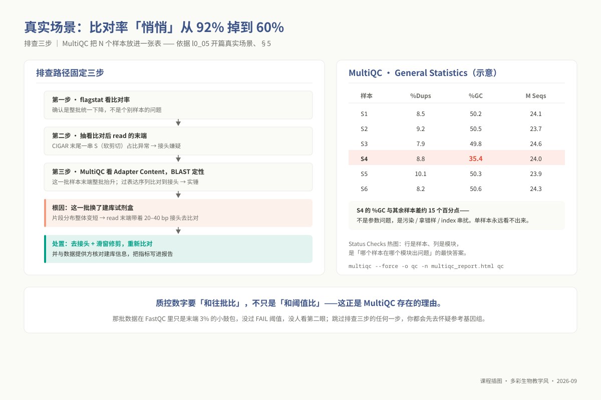
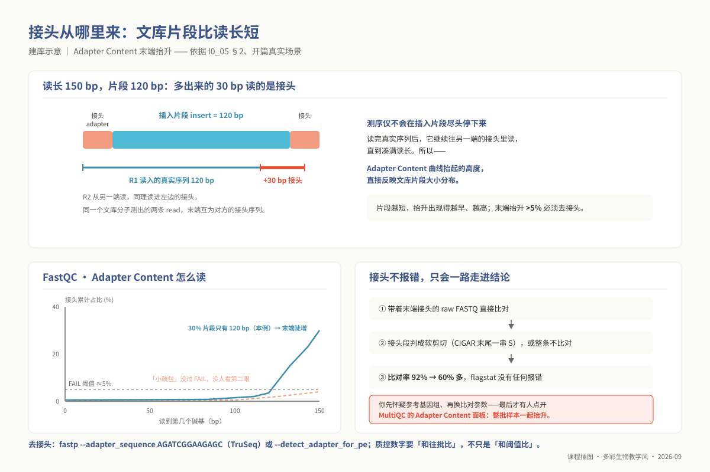
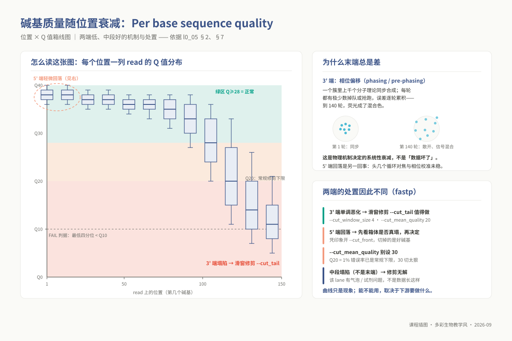

# L0-5：FastQC / MultiQC 质量控制

> **适用对象**：本科 / 硕士 / 博士 ｜ L0 预备课 ｜ 自学预估 3 学时
>
> **阅读重点**：运行质控、读懂报告，并根据下游任务决定是否过滤。展开学习见 `02_lectures/undergraduate/unit04_qc_preprocessing/`。
>
> **自查**：先完成 `l0_04_formats`；工具环境见 `07_envs/conda/env_ug_base.yml`。配套 `08_assessment/prerequisites/l0_05_qc_selftest.md` 共 10 题，第 8–10 题为上机题。

<!-- 契约：00_design/course_contract.yaml → prerequisite_packs.L0.l0_05_qc。 -->

---

## 学习目标

完成本模块后，你能够：

1. **说出** 不做质控的三个具体代价（比对率下降、假变异、组装碎片化），以及**过度清洗**的代价。
2. **逐模块解读** FastQC 报告：每个模块的横纵轴、正常长什么样、异常指向什么原因。
3. **区分** "真问题"与"这类数据本来就长这样"——**能举出至少两个"红灯不是问题"的例子并说明为什么不该处理**。
4. **运行** `fastp` 完成去接头、滑窗修剪、长度过滤，并逐个解释所用参数为什么取这个值。
5. **运行** `multiqc` 汇总多样本报告，从汇总视图指出哪个样本离群、依据哪一列。
6. **判断** 长读长数据（PacBio / Nanopore）该看哪些指标、**不该**看哪些，并说明理由。
7. **写出** 一段带数字依据的书面质量结论：数据是什么 → 数字 → 与判据比 → 结论 → 预处理选择及理由。

## 为什么这是前置

质控为下游分析提供数据质量依据。即使流程能够继续运行，也需要先判断输入数据是否适合当前任务。

| 你会卡在哪 | 卡住的具体形态 | 缺哪条能力 |
|---|---|---|
| **本科 u05 / 硕 m03 比对** | 拿未去接头的 raw FASTQ 直接比对，比对率只有 60%，末端一大截软剪切（CIGAR 里的 `S`）。你会去怀疑参考基因组、换比对软件，唯独想不到是接头 | 接头识别与去除（4） |
| **硕 m04 转录组** | RNA-seq 的 *Per base sequence content* 前 12 bp 必然报红。**不知道这是随机六聚体偏差的人会把前 12 bp 裁掉**，换来更短的 read 和更差的比对特异性——为了让 FastQC 变绿而损失数据 | 红灯辨析（3） |
| **硕 m04 / 博 p02 差异表达** | RNA-seq 的 *Duplication Levels* 报红是高表达基因的真实信号，**误做去重会削掉真实表达量**，差异表达结果整体失真 | 红灯辨析（3） |
| **硕 m03 变异检测** | 不修剪末端低质量碱基，Q10 段落每 10 个碱基错 1 个，在中等深度位点被 caller 当成真 SNP。**假变异不报错，只会进你的结果表** | 修剪判据（4） |
| **硕 m02 / 本科 u06 组装** | 错误碱基在组装图里造出大量假分支，组装器无法延伸，contig 数暴涨 | 目标 1 |
| **本科 u08 / 硕 m02 长读长项目** | 拿 FastQC 去看 PacBio 数据，得到一条无意义的锯齿曲线和一堆 FAIL，然后不知所措。**长读长根本不该跑 FastQC** | 长读长质控（6） |
| **硕 m06 扩增子 / m07 宏基因组** | 16S 的 *Per base sequence content* 全程报红是设计使然（测的就是同一段保守区）。当成问题去修剪会破坏后续 DADA2 去噪 | 红灯辨析（3） |
| **任何一份要交的报告** | 只写"数据质量良好"四个字。**结论后面没有数字，这一项直接失分** | 目标 7 |

> **提示**：质控的目标是判断数据是否适合下游分析。FastQC 展示数据特征，是否可用还要结合实验设计和分析目的判断。

> **案例**：比对率"悄悄"从 92% 掉到 60%。某批样本换了建库试剂盒，片段分布整体变短，
> *Adapter Content* 在 FastQC 里只是末端 3% 的小鼓包——没过 FAIL 阈值，没人看第二眼。直接
> 比对：read 末端带着 20–40 bp 接头，比对软件把这段判成软剪切（CIGAR 末尾一串 `S`）甚至整条
> 不比对，`samtools flagstat` 的比对率从往批的 92% 掉到 60% 多。**全程没有任何报错**——你会
> 先怀疑参考基因组、再换比对参数，最后才有人点开 MultiQC 的 *Adapter Content* 面板，发现这
> 一批样本整批抬升。排查路径固定三步：`flagstat` 看比对率 → 抽看比对后 read 末端的 `S` 占比
> → 回头看 MultiQC 的 adapter 曲线并把过表达序列 BLAST 定性。**质控数字要"和往批比"，不只是
> "和阈值比"**——这正是 §5 MultiQC 存在的理由。



*图 l0_05-4：一个真实排查案例：比对率 92%→60%，从 flagstat 查到孔板串样。*

## 核心内容

### 1. FastQC 的统计检验本质与启发式阈值局限

FastQC 不需要参考基因组，直接统计输入 FASTQ 的碱基质量、序列组成与复杂度。阅读报告时，要同时理解指标含义和判读边界：

1. **红黄绿灯（PASS / WARN / FAIL）是经验启发式规则，绝非统计假设检验**：
   这是绝大多数初学者最常陷入的认知误区。FastQC 界面上的警告与报错，**既没有设定严格的统计零假设（$H_0$），也没有计算过任何统计显著性 p 值**。报告中的所有警报阈值，均是英国 Babraham 研究所基于**均一打断的经典全基因组 DNA-seq（标准 WGS 文库）**的先验经验数据硬编码设定的（例如规定：若任意位置的低四分位数低于 Q10，或者中位数低于 Q25，直接亮起红灯 FAIL）。
   只要你所分析的数据类型不是均一打断的常规基因组 DNA（例如转录组 RNA-seq、微生态扩增子、甲基化 Bisulfite 测序），其生物学内禀规律天然就会违背上述经验假设。在这些场景下，**报告中的红灯往往是该实验成功的直接证明，而非数据存在缺陷**。

2. **底层统计的抽样机制与位置截断**：
   FastQC 对“碱基质量分布”和“GC 含量”模块执行的是对全量 Reads 的无偏遍历统计；但对于计算开销极大的 **“序列重复水平（Duplication Levels）”** 与 **“过表达序列（Overrepresented sequences）”**，为了保证执行速度，**软件只追踪在文件前 100,000 条 reads 中首次出现的序列，再在全文件范围内统计它们的出现次数**，且会把长于 75 bp 的 read 截到前 50 bp 再比对。如果原始数据来自多个测序 Lane 的拼接，或者测序前台存在批次漂移，文件头部的数据并不能百分之百代表整体。

3. **现象报告与病因诊断的逻辑断层**：
   FastQC 只能客观报告“数据呈现出什么形态”（例如某个模块提示某段序列占比高达 2%），但它**完全无法解释造成该现象的生物学或物理学原因**。这一段高频序列究竟是由于建库片段过短读穿导致的测序接头残留？是高表达的持家基因转录本？是文库制备中的核糖体 RNA（rRNA）去除失败？还是外源细菌噬菌体（如 PhiX 校准品）的严重污染？唯一的判定路径是复制该异常序列，通过 NCBI BLAST 等同源检索工具进行定性确证。

### 2. 十大核心模块的生物化学与物理机理深度剖析

| 核心质控模块 | 统计坐标轴与可视化呈现 | 理论正常形态 | 异常报警的底层物理/生化根因 |
|---|---|---|---|
| **Basic Statistics** | 统计摘要表格 | 总条数、读长、平均 %GC 与实验设计严格吻合 | %GC 偏离预期物种 10% 以上 → 严重杂菌污染或标签混淆串样 |
| **Per base sequence quality** | 测序位置（Cycle）× Q 值箱线图 | 箱体全程沉浸在绿色安全区（$Q \ge 28$），末端允许轻微下倾 | 某特定位置突然断崖式下跌或中段塌陷 → 微流控芯片气泡或进样阀试剂阻塞 |
| **Per tile sequence quality** | 测序位置 × Flowcell 芯片物理 Tile 编号 | 全局呈现纯净均匀的深蓝色热图 | 出现局部的红色明亮条带 → Flowcell 局部物理划痕、气泡滞留或荧光簇过度聚集 |
| **Per sequence quality scores** | 单条 Read 平均 Q 值 × 频数分布 | 呈现右偏单峰，峰值高耸于 Q35+ 之上 | 出现明显的双峰分布（存在低 Q 独立次峰）→ 测序过程中特定光学通道失焦 |
| **Per base sequence content** | 测序位置 × 四种碱基百分比折线 | A/T 平行，C/G 平行，四条线沿位置绝对平直延伸 | 头部 10–15 bp 剧烈锯齿波动 → **随机引物反转录热力学偏倚（见 §3）** |
| **Per sequence GC content** | 单条 Read 的 GC% × 频数曲线 | 与理论高斯理论拟合线重合的单正态样峰 | **双峰、多峰或不对称肩峰 → 样本存在严重的外源生物污染** |
| **Per base N content** | 测序位置 × 无法识别碱基 N 比例 | 曲线紧紧贴合在 0% 底部基线 | 某特定循环位置突然向上飙升 → 该循环对应波长的激光成像仪突发故障 |
| **Sequence Length Distribution** | 读长长度（bp）× 条数频数 | 原始下机数据为一根单一严格的离散竖线（如 150 bp） | **清洗过滤后呈现非均匀分布完全属于正常预期**（修剪接头与滑窗截断所致） |
| **Sequence Duplication Levels** | 重复深度分级 × 占文库比例 | DNA-seq 绝大多数序列仅出现 1 次（非重复占比 > 80%） | 高度重复占比异常偏高 → PCR 扩增轮数过多（DNA）或高表达丰度（RNA） |
| **Adapter Content** | 测序位置 × 各接头累计检出比例 | 全长贴近 0% 水平线 | 曲线在 3' 末端呈现单调向上扬起 → **文库物理片段短于设定读长（读穿）** |

**接头污染（Adapter Contamination）的物理几何学**：
接头（Adapter）为何会出现在读段中，可以从文库结构理解。在本例的建库流程中，DNA 片段化后通过加 A 尾连接接头，形成 `[接头1]-[真实插入片段 Insert]-[接头2]` 的结构。测序引物结合在接头 1 的末端，自 5' 向 3' 端延伸读取。

- 如果超声打断或酶切得到的 Insert 片段足够长（例如平均 350 bp），采用双端 PE150 测序，R1 读前 150 bp，R2 读后 150 bp，双端均不会触碰到对侧的接头；
- **读穿现象（Read-through）**：若建库片段筛选不佳，大量文库分子的 Insert 长度仅有 70–100 bp，当测序仪进行到第 71 或第 101 个循环时，真实的 DNA 模板已经合成完毕，DNA 聚合酶**顺势强行向后继续读入对侧的接头 2 序列**！
因此，Adapter Content 曲线从第几个碱基开始向上翘起、最终翘起的高度，在几何物理上严格等价于该测序文库的片段大小（Insert Size）的下四分位数分布。



*图 l0_05-1：接头从建库来：insert 比读长短，读到末尾全是接头。*

### 3. 红灯辨析：四大“无需处理”的反直觉典型实例

科学质控的核心素养在于**克制清洗的冲动**。过度清洗（Over-trimming）不仅会损失宝贵的有效测序通量，还会由于破坏序列真实特征引发下游比对和定量的系统性偏差。必须熟记以下四类“报警即正常”的经典场景：

1. **RNA-seq 数据在 *Per base sequence content* 模块前 10–15 bp 全面报红**：
   在转录组文库制备中，mRNA 断裂后需要利用“随机六聚体引物（Random Hexamer Primers）”进行逆转录合成 cDNA 第一链。然而，生物化学研究（Hansen et al. 2010, *Nucleic Acids Research*）早已严格证实：**所谓的随机六聚体在热力学上根本不是真随机**！不同六聚体与 RNA 二级结构的退火结合常数存在数十倍的天然差异，导致逆转录酶优先结合特定富含 G/C 或特定基序的模板位点。这种生化退火偏倚使得所有 RNA-seq 读段的最初十几个碱基呈现出高度固定、跨样本极其一致的核苷酸组成波动。现代剪接比对软件（如 STAR、HISAT2）在比对打分算法中完全兼容这一系统特征。**严禁出于“消除红灯”的目的强行将 reads 前 12 bp 切除**——这种盲目裁剪会显著缩短 read 长度，大幅降低剪接位点的跨越比对特异性！

2. **高深度 RNA-seq 数据在 *Sequence Duplication Levels* 模块剧烈报红**：
   真核生物细胞中不同基因的转录丰度跨越了 5 到 6 个数量级。高表达的持家基因（如肌动蛋白 Actin、GAPDH）以及残留的核糖体 RNA，在一个细胞中存在成千上万个完全相同的转录本拷贝。测序时自然会抽取到大量序列起点完全相同的 reads。**这是真实表达丰度的物理体现，绝不是 PCR 错误扩增的垃圾！** 在 RNA-seq 差异表达分析中**绝对不能进行去重处理**，否则会将最高表达量的基因强制“削平”到与低表达基因相同的基准线，彻底破坏真实的表达定量跨度。

3. **微生态 16S / 18S / ITS 扩增子测序全模块大面积亮红**：
   扩增子测序是针对特定保守区域（如细菌 16S rRNA 的 V3–V4 区）利用特异性通用引物进行扩增测序。所有测序分子在同一个位置上天然具备相同的核苷酸基序。其 *Per base sequence content* 四条折线天然不可能平行，*Per sequence GC content* 也会聚集在保守区的固定 GC% 上，*Overrepresented sequences* 更是会被目标保守片段填满。**如果在扩增子质控中看到这些红灯，它证明靶向 PCR 扩增非常成功，严禁对其进行任何基于碱基平衡的过滤**。

4. **亚硫酸氢盐测序（Bisulfite-seq）的极低 C 与极高 T**：
   在 DNA 甲基化测序中，未甲基化的胞嘧啶（C）被亚硫酸氢盐化学脱氨转化为尿嘧啶（U），并在随后的 PCR 扩增中被读取为胸腺嘧啶（T）。因此文库中的 C 含量会断崖式暴跌，GC 频数曲线严重左移变形。**该模块报红正是化学转化彻底的直接金标准**。

**质控工程判断的核心准则**：
面对每一个红灯报警，必须在心中反问：“**这个异常究竟是测序仪技术故障导致的垃圾，还是该特定实验类型内在的生物化学特征？**”如果属于后者，保留它们就是尊重客观科学事实。

反之，以下五类异常属于必须立即介入处理的真实缺陷：

- *Adapter Content* 末端超过 5% 抬升 $\implies$ 必须进行双端去接头；
- *Per base sequence quality* 3' 末端箱体沉入红区（$Q < 20$）$\implies$ 必须实施自尾端的滑窗动态修剪；
- *Per sequence GC content* 出现明显偏离物种主峰的杂峰 $\implies$ 必须抽取异常区间序列执行 BLAST 定性筛查；
- *Per base N content* 局部异常升高 $\implies$ 截断或丢弃高 N 比例的读长；
- 修剪后长度极短的碎片读长（如 $< 35–50\text{ bp}$）$\implies$ 必须坚决丢弃，防止引发非特异性多重比对。


*图 l0_05-3：红灯不一定是问题：四种「别动手」的情形与五种「必须处理」。*

### 4. fastp 现代预处理流水线的算法设计与参数调优

在传统生信流程中，研究人员通常组合使用 FastQC、Trimmomatic 和 Cutadapt，但这种多阶段工具链需要将未压缩的中间数据多次反复写盘与读盘，造成极大的 I/O 瓶颈。现代生信标准流程已全面切换至单通道高通量工具 **fastp**：它在内存中单遍扫描（Single-pass）FASTQ 文本流，同步完成超高速去接头、质量修剪、过滤统计并直接输出交互式 HTML/JSON 报告。

深入掌握其底层算法与核心参数调优逻辑：

| fastp 核心参数 | 底层算法机制与物理作用 | 生产环境下的参数取值判据 |
|---|---|---|
| `--detect_adapter_for_pe` | **双端重叠推断算法（Overlap-based detection）**：比对 R1 与 R2 序列，若发现两端存在高分反向互补重叠区，即可在代数上精准求解出插入片段大小及接头起始边界 | **双端测序推荐无脑开启**。即使建库试剂盒未知，也能以极高特异性自动扣除接头 |
| `--adapter_sequence` | 显式指定接头序列（标准 TruSeq 常见 `AGATCGGAAGAGC`） | 当已知精准的测序文库试剂盒时配合使用，双重锁定接头前缀 |
| `--cut_tail` | **自 3' 尾端向前推进的动态滑窗质量修剪** | **必须开启**。直接应对 Illumina 3' 末端相位偏移衰退的最有效工具 |
| `--cut_front` | 自 5' 前端向后推进的滑窗质量修剪 | **常规数据强烈建议禁用**。5' 端质量通常极高，盲目开启常会误切正常碱基 |
| `--cut_window_size 4` | 滑动窗口的宽度大小（Window Size） | 设为 4 是经过大量实证的黄金分割点。窗口过窄（如 1）会对单个随机低质量碱基过度敏感造成误截；过宽则反应迟钝 |
| `--cut_mean_quality 20` | 触发剪切的窗口平均 Phred 质量阈值 | 设为 20 对应 1% 错误率下限。**严禁盲目调高至 30**，否则会导致读长被大面积腰斩 |
| `--length_required 50` | 质量修剪后允许保留的最小读长底线（Length Filter） | **根据原始读长动态裁定**：PE150 数据设为 50，PE100 设为 36。低于此长度的比对特异性极差 |
| `--json` | 导出结构化机器可读的 JSON 汇总报告 | **必须保留**。这是下游 MultiQC 自动化聚合多样本指标的关键输入源 |

### 5. MultiQC 架构：跨样本宏观批次效应与离群样本诊断

在真实科研项目中，样本往往是以批次（几十至数百个）为单位进行生产的。逐一打开 50 份独立的 FastQC HTML 网页寻找蛛丝马迹在工程上是不可行的。**MultiQC 的战略价值，在于将局部单样本的“微观体检”提升为全局文库的“宏观横向对齐”**：

- **自动化递归解析引擎**：执行命令 `multiqc -f -o qc/ qc/` 时，MultiQC 会递归扫描目标目录下所有生信软件产出的中间数据，自动识别 FastQC 的 `fastqc_data.txt`、fastp 的 `*.fastp.json`、BWA 的比对日志等；
- **排查真实科研中最隐蔽的系统性事故**：
  1. **General Statistics 综合概览表**：纵向对比全样本的 `%GC`。若某单个样本的 GC 含量系统性偏离其他平行重复组达 10%–15%，这绝对不是参数问题，而是严重的实验室**串样、外源组织污染或细菌滋生**；
  2. **FastQC Mean Quality Scores 曲线叠合视图**：全样本的质量衰退曲线叠合在一张画布上。若绝大多数样本平稳维持在 Q35，唯独某一个样本在循环第 40 位起全线塌陷，能立刻精准锁定该样本在 Flowcell 测序时所在物理通道的异常；
  3. **Overrepresented Sequences 跨样本聚类**：若某段未识别的神秘高频序列同时出现在全批次样本中，提示为通用的引物二聚体或 PhiX 测序对照品污染。

### 6. 长读长质控的范式转换（PacBio / Nanopore）

许多习惯了二代测序的研究人员，拿到 PacBio 或 Nanopore 的数据后，第一反应依然是去跑 FastQC 并寻找“按循环位置排布的质量箱线图”。**这是一种严重的分析范式错位**：

1. **为什么在长读长上绘制“按位置对齐的 Q 值图”在数学上毫无意义**：
   Illumina 数据的每条 read 长度高度均一（全部为 150 bp），第 100 位对于所有分子都代表着“靠近 3' 末端的特定化学循环”。而长读长测序产出的 reads 长度服从宽广的长尾分布（从 500 bp 到 100 kb 不等）。FastQC 强行把所有 reads 的第 100 位堆叠在一起统计，这一位对于 500 bp 的短片段是末期，对于 50 kb 的超长片段才刚刚起始——**把生物物理状态完全不同的观测混合在一个统计箱体内，计算出的均值和中位数没有任何物理可解释性**。

2. **长读长的全新核心质量判据体系**：
   长读长的核心价值在于利用连续单分子跨越复杂基因组重复区。因此，质控关注的焦点全面转移至**长度拓扑与连续性指标**：
   - **Read N50（读长 N50）**：将所有 reads 按长度由长到短排序并累加，当累加碱基数达到总产出的一半时，当前这条 read 的长度即为 Read N50。细菌基因组完成图要求 Read N50 **显著大于 5 kb**（必须能跨过 rRNA 操纵子）；
   - **长度频数分布曲线**：健康的单分子长读长文库应呈现平滑的单峰并附带向右延伸的长尾；如果峰位异常聚集在 1–2 kb 以下，说明 DNA 在提取或建库震荡过程中发生了严重的物理剪切降解；
   - **测序深度覆盖度（Sequencing Depth）**：长读长细菌组装建议有效深度 $\ge 50\times$（$100\times$ 最佳）。
   - **长读长绝对不应盲目执行外部质量修剪**：下游的长读长组装软件（Flye, Canu）内部自带了基于重叠群（Overlap）的高性能纠错算法。在组装前用工具去截断或修剪长读长，不仅不会提升准确率，反而会人为破坏 reads 跨越超长重复序列的物理长度优势！



*图 l0_05-2：质量分布怎么读：末端衰减是常态，看的是「拐得多难看」。*

## 上机操作

> 数据用**固定随机种子**现场生成，**每个人得到的数字完全一样**。环境：`conda activate ngs_ug_base`（fastqc 0.12.1 / fastp / multiqc）。

### 步骤 1 ｜ 生成一份"有毛病"的演示数据

```bash
mkdir -p ~/l0_05_demo && cd ~/l0_05_demo
mkdir -p raw qc/fastqc_raw qc/fastqc_clean qc/clean qc/fastp_reports
# FastQC 与 fastp 都不会自动创建输出目录——先建好可省掉两类报错（见「常见错误」1、4）
python3 - <<'PY'
import random
random.seed(42)                                   # 固定种子 → 结果可复现
ADAPTER = "AGATCGGAAGAGCACACGTCTGAACTCCAGTCAC"    # Illumina TruSeq 接头开头
def qual(pos, n):                                 # 质量沿位置衰减，模拟相位偏移
    return chr(max(2, int(38 - 20 * (pos / n) ** 2)) + 33)
with open("raw/demo_R1.fq", "w") as fh:
    for i in range(2000):
        insert = 70 if i % 10 < 3 else 100        # 30% 的片段短于读长 → 读进接头
        seq = ("".join(random.choice("ACGT") for _ in range(insert)) + ADAPTER)[:100]
        fh.write(f"@READ_{i:05d} 1:N:0:ATCACG\n{seq}\n+\n"
                 + "".join(qual(p, 100) for p in range(100)) + "\n")
PY
gzip -f raw/demo_R1.fq
```

### 步骤 2 ｜ 跑 FastQC，在终端里读结论

```bash
fastqc -q -t 2 -o qc/fastqc_raw raw/demo_R1.fq.gz
unzip -p qc/fastqc_raw/demo_R1_fastqc.zip demo_R1_fastqc/summary.txt
```

```text
PASS	Basic Statistics	demo_R1.fq.gz          FAIL	Per base sequence quality	demo_R1.fq.gz
PASS	Per sequence quality scores	demo_R1.fq.gz  FAIL	Per base sequence content	demo_R1.fq.gz
PASS	Per sequence GC content	demo_R1.fq.gz      PASS	Per base N content	demo_R1.fq.gz
PASS	Sequence Length Distribution	demo_R1.fq.gz  PASS	Sequence Duplication Levels	demo_R1.fq.gz
PASS	Overrepresented sequences	demo_R1.fq.gz     FAIL	Adapter Content	demo_R1.fq.gz
```

（实际输出是一行一个模块，共 10 行；此处并排排版以节省篇幅。）

**三个 FAIL，但它们不是三个问题。** 先别动手，先追原因：*Adapter Content* FAIL 说明末端有接头；*Per base sequence content* FAIL 是因为 30% 的 read 末段是**同一条固定的接头序列**，把该位置碱基组成拉偏了——**它是接头的后果，不是独立问题**；*Per base sequence quality* FAIL 才是另一件事（末端质量衰减）。**一次处理（去接头 + 末端修剪）能同时解决三个红灯——这就是"先诊断再动手"的价值。**

参数：`-t 2` 一个线程处理一个文件（只有 1 个文件时给再多线程也不会更快）；`-o` 目录**必须已存在**；输入是**文件列表**不是目录；`-q` 安静模式，适合写进作业脚本。每个输入产出 `*_fastqc.html`（浏览器打开）与 `*_fastqc.zip`（内含 `summary.txt` 与 `fastqc_data.txt`，可命令行解析）。

### 步骤 3 ｜ 用 fastp 清洗

```bash
fastp -i raw/demo_R1.fq.gz -o qc/clean/demo_R1.clean.fq.gz \
    --adapter_sequence AGATCGGAAGAGCACACGTCTGAACTCCAGTCAC \
    --cut_tail --cut_window_size 4 --cut_mean_quality 20 \
    --length_required 50 --thread 2 \
    --html qc/fastp_reports/demo.fastp.html --json qc/fastp_reports/demo.fastp.json
ls -lh qc/clean/       # ← 跑完永远看一眼输出文件大小，"没报错"不等于"结果正确"
```

```text
Read1 before filtering:  total reads: 2000  total bases: 200000  Q20: 190000(95%)   Q30: 128000(64%)
Read1 after  filtering:  total reads: 2000  total bases: 172152  Q20: 172152(100%)  Q30: 128000(74.3529%)
Filtering result:
reads passed filter: 2000        reads failed due to low quality: 0
reads failed due to too many N: 0    reads failed due to too short: 0
reads with adapter trimmed: 608      bases trimmed due to adapters: 13848
```

**该看到的变化**：Q20/Q30 百分比**上升**（95%→100%、64%→74.4%）；`reads with adapter trimmed: 608` 与生成数据时设定的 30%（600 条）吻合，也与 FastQC 的 Adapter Content FAIL 相互印证；总 read 数**只略降或不降**——若一次掉了七成，那是参数太狠，先看 `reads failed due to` 三行是哪条吃掉了数据。

### 步骤 4 ｜ 复检并对比：注意那个"变差了却正常"的指标

```bash
fastqc -q -t 2 -o qc/fastqc_clean qc/clean/demo_R1.clean.fq.gz
diff <(unzip -p qc/fastqc_raw/demo_R1_fastqc.zip demo_R1_fastqc/summary.txt | cut -f1,2) \
     <(unzip -p qc/fastqc_clean/demo_R1.clean_fastqc.zip demo_R1.clean_fastqc/summary.txt | cut -f1,2)
multiqc --force -o qc -n multiqc_report.html qc     # 汇总；报告是 HTML，用 scp 拉回本地看
```

```text
2c2   < FAIL Per base sequence quality      ---   > WARN Per base sequence quality
4c4   < FAIL Per base sequence content      ---   > PASS Per base sequence content
7c7   < PASS Sequence Length Distribution   ---   > WARN Sequence Length Distribution
10c10 < FAIL Adapter Content                ---   > PASS Adapter Content
```

**三个 FAIL 全部消除**（两个到 PASS，一个到 WARN）。但 *Sequence Length Distribution* **从 PASS 掉到了 WARN**——**这不是问题**：修剪让 read 长度不再整齐划一，分布从一根竖线变成一个分布，FastQC 的阈值因此报 WARN。**"清洗后某个指标变差"本身不是失败的证据**，得看它变差的原因。这是本模块第三个"红灯不是问题"的实例，而且是你自己动手做出来的。单样本看不出 MultiQC 的价值——**它的意义在于把 N 个样本放进一张表**；改种子多造几个样本再汇总，然后在 *General Statistics* 里找离群样本。

### 步骤 5 ｜ 长读长：换一套指标

对 `l0_04_formats` 上机步骤 0 生成的 `longreads.fa`（或任何 PacBio / Nanopore 数据）：

```bash
# 不要跑 FastQC。改看读长分布与产出量：
awk '/^>/{if(l)print l; l=0; next}{l+=length($0)}END{if(l)print l}' longreads.fa \
| sort -nr | awk -v g=100000 '
    {len[NR]=$1; tot+=$1}
    END{ half=tot/2; acc=0
         for (i=1; i<=NR; i++) { acc+=len[i]; if (acc>=half) { n50=len[i]; break } }
         printf "条数=%d  总量=%.2f Mb  N50=%d bp  最长=%d bp  深度=%.1fX\n",
                NR, tot/1e6, n50, len[1], tot/g }'
```

```text
条数=1200  总量=9.41 Mb  N50=10254 bp  最长=94597 bp  深度=94.1X
```

课程内也可直接用配套脚本：`bash 03_code/undergraduate/scripts/04_run_fastqc.sh --long longreads.fa qc_long 100k`。**写成结论时该长这样**：

> 本数据为 PacBio 长读长（FASTA，无质量值行），共 1200 条 read，碱基总量 9.41 Mb，read N50 = 10 254 bp，最长 read 94 597 bp；按目标 100 kb 估算深度约 94×。该深度高于长读长细菌组装通常要求的 50×，N50 远超 rRNA 操纵子长度（约 5 kb），可跨越主要重复区，**判定数据满足组装要求**。未做质量修剪，原因是 Canu 与 Flye 在组装流程内已含 read 纠错环节，外部修剪会缩短 read、削弱跨重复区的能力。

**注意这段话的结构**：数据是什么 → 数字 → 拿数字和判据比 → 给结论 → 说明预处理选择及理由。**每一句后面都有依据。** 只写"数据质量良好"在任何一层的报告里都会失分。

## 常见错误与排查

> 报错均为实际复现所得原文（复现环境 FastQC v0.12.1、fastp 1.0.1、MultiQC v1.17；课程 ngs_ug_base 为 fastp 1.3.6 / MultiQC 1.14（硕士 ngs_ms_base 钉 fastp 0.23.4），措辞可能略有差异，关键词一致）。**注意退出码——这是本模块最容易被忽略的一节。**

**错误 1 ｜ FastQC 输出目录不存在** —— `fastqc -o qc/fastqc_raw raw/demo_R1.fq.gz` 报 `Specified output directory 'qc/fastqc_raw' does not exist`，退出码 **2**。**原因**：FastQC 不会自动建目录。**解法**：任何 `-o` 之前先 `mkdir -p`。

**错误 2 ｜ 输入文件不存在——它不报错，退出码还是 0** ⚠ **本模块最重要的一条**

```text
$ fastqc -o qc missing.fq.gz ; echo "exit=$?"
Skipping 'missing.fq.gz' which didn't exist, or couldn't be read
exit=0
```

**原因**：路径写错或当前目录不对时，FastQC 把它当"跳过"而非错误。**后果**：作业脚本里的 `set -e` **拦不住**，流水线一路绿灯跑到底，而你以为质控做过了，其实一个文件都没处理。**解法**：跑完数一下产出个数——`ls qc/*.html | wc -l`，对不上就是有文件被跳过了。
> **版本差异**：同一个 v0.12.1，**格式错误**（错误 3）和**文件截断**的退出码是 **1**（`set -e` 能拦住），只有**文件不存在 / 不可读**才返回 0。**不要指望退出码替你把关，跑完自己 `ls` 一眼。**

**错误 3 ｜ 对 PacBio / FASTA 数据跑 FastQC**

```text
$ fastqc -o . reads.fa
Failed to process reads.fa
uk.ac.babraham.FastQC.Sequence.SequenceFormatException: ID line didn't start with '@' at line 1
```

**原因**：FastQC 只认 FASTQ。**解法**：长读长数据本来就不该跑 FastQC（原理见「核心内容」§6），改用上机步骤 5 的读长统计。**他真正的错误不是"格式不对"，而是"选错了工具"**——修正方向不是把 FASTA 转成 FASTQ。

**错误 4 ｜ fastp 输出目录不存在（版本行为不同，都很坑）** —— fastp **1.0.1** 报 `ERROR: Failed to write: nodir/o1.fq.gz`，退出码 255，但错误行在很后面、容易被淹没在统计输出里；fastp **0.22.0** 更糟：**完全没有错误信息，统计照常打印，退出码 0**，但输出文件根本不存在。**解法**：`mkdir -p` 之后再跑，并且**跑完一定 `ls -lh` 看输出文件大小**——这是本模块最值得养成的习惯。

**错误 5 ｜ fastp 参数名写错** —— `fastp ... --quality 20` 报 `undefined option: --quality`。**原因**：fastp 没有 `--quality`（那是别的工具的写法）。**解法**：`fastp --help | grep -i qual` 查真实参数名——质量相关的是 `--qualified_quality_phred` 与 `--cut_mean_quality`。**不要凭记忆拼参数**，不同工具的同名概念参数名常常不同。

**错误 6 ｜ MultiQC 找不到任何结果** —— 输出 `No analysis results found. Cleaning up..`。**原因**：搜索目录里没有 MultiQC 认识的报告——最常见是路径指到了空目录，或 FastQC 那一步其实失败了（见错误 1、2、3）。**解法**：先确认 `ls qc/fastqc_raw/*.zip` 有东西，再让 MultiQC 扫它的**上级目录**。

**错误 7 ｜ MultiQC 生成了 `multiqc_report_1.html`** —— 提示 `Existing reports found, adding suffix to filenames. Use '--force' to overwrite.`。**后果**：你打开的还是旧报告，看不到修改后的结果，会得出完全错误的结论。**解法**：加 `--force`。

**错误 8 ｜ MultiQC 起不来：`ModuleNotFoundError: No module named 'numpy'`** —— 报错栈里的路径是 `~/.local/lib/python3.10/site-packages/multiqc/...`。**原因**：调用到的是**用户 pip 装的那份 multiqc**，不是 conda 环境里的那份，依赖没装全。**解法**：`which multiqc` 确认路径落在 `.../envs/ngs_ug_base/bin/` 下；若不是，说明 `PATH` 里 `~/.local/bin` 排在前面，重新 `conda activate` 或用环境内的绝对路径调用。**"装了两份、跑到错误那份"在集群上极常见，`which` 是第一个该敲的命令。**

**错误 9 ｜ HTML 报告在服务器上打不开** —— 服务器通常没有图形界面，`firefox report.html` 报 `Error: no DISPLAY environment variable specified`。**解法**：`scp user@server:/path/multiqc_report.html ./` 拉回本地，或用 VS Code Remote 预览。**别在服务器上装浏览器。**

**错误 10 ｜ 清洗后 `reads passed filter` 只剩 30%** —— 几乎一定是参数太狠：`--cut_mean_quality` 设成了 30，或 `--length_required` 对读长而言过大（PE100 的数据要求 ≥ 80 bp）。**解法**：看 fastp 的 `reads failed due to` 三行是哪条吃掉了数据，再改对应参数。**另一种情况**：清洗后 Q30 反而下降 → 你开了 `--cut_front`，在 5' 端质量本就好的数据上切掉了好碱基，同时留下 3' 端的坏碱基。

## 自测入口

**自测文件**：`08_assessment/prerequisites/l0_05_qc_selftest.md` ——共 **10 题，第 8、9、10 题为上机题**。

**计分方式：完成即给分，不按对错计**（契约 `gate_mechanism.scoring: completion_based`）——目的是拿诊断数据，不是筛人。因为不按对错计分，**参考答案直接附在自测文件末尾**：抄答案没有收益，公开答案让自测同时成为学习工具。**提交物**：第 8–10 题各要求一份可检查的产出（模块解读表 / 清洗前后对比 / 长读长质量结论段落），**正是后续每个实践专题第一步要交的东西**，不是额外作业。

**材料可跳过，自测不可跳过**（`00_design/prerequisite_packs.md` §四）：本科生的 u04 已系统覆盖本模块内容，**不必再读一遍材料**；但**自测一律要做**——否则教师首课前拿不到本科生的错题分布，闸门的诊断功能就废了。

| 层次 | 通过线 |
|---|---|
| **本科（生信科班）** | 通过线更高：第 8 题要对**报告中出现的每一个模块**写解读；第 10 题的结论段落须每句带数字 |
| **硕士（非生信专业）** | 10 题全做，达到出口能力即可：第 8 题写清 3 个 FAIL 各自的原因与处理决定，第 9、10 题产出正确 |
| **博士（非生信专业）** | 同硕士——质控在博士层各专题中是默认的第一步，不再重讲 |

**做不出来怎么办**：每题标了它检验哪条出口能力，回本材料对应小节重看。**开课前 2 周发布，首次课 15–20 分钟只过集中出错的点，不重讲。**

## 参考资料

### 文献（DOI 可核验）

1. Chen S, Zhou Y, Chen Y, Gu J. fastp: an ultra-fast all-in-one FASTQ preprocessor. *Bioinformatics*, 2018, 34:i884–i890. DOI: 10.1093/bioinformatics/bty560 ——fastp 原始论文。
2. Chen S. Ultrafast one-pass FASTQ data preprocessing, quality control, and deduplication using fastp. *iMeta*, 2023, 2:e107. DOI: 10.1002/imt2.107 ——fastp 更新版说明。
3. Ewels P, Magnusson M, Lundin S, Käller M. MultiQC: summarize analysis results for multiple tools and samples in a single report. *Bioinformatics*, 2016, 32:3047–3048. DOI: 10.1093/bioinformatics/btw354
4. Bolger AM, Lohse M, Usadel B. Trimmomatic: a flexible trimmer for Illumina sequence data. *Bioinformatics*, 2014, 30:2114–2120. DOI: 10.1093/bioinformatics/btu170 ——读旧文献时会遇到，本课程不作主用工具。
5. Hansen KD, Brenner SE, Dudoit S. Biases in Illumina transcriptome sequencing caused by random hexamer priming. *Nucleic Acids Research*, 2010, 38:e131. DOI: 10.1093/nar/gkq224 ——**§3 第 1 条"红灯不是问题"的原始出处**。
6. Amarasinghe SL, Su S, Dong X, Zappia L, Ritchie ME, Gouil Q. Opportunities and challenges in long-read sequencing data analysis. *Genome Biology*, 2020, 21:30. DOI: 10.1186/s13059-020-1935-5 ——§6 长读长质控逻辑的依据。
7. De Coster W, et al. NanoPack: visualizing and processing long-read sequencing data. *Bioinformatics*, 2018, 34:2666–2669. DOI: 10.1093/bioinformatics/bty149 ——长读长专用质控工具（NanoPlot / NanoFilt），课程环境未纳入，供进阶参考。
8. Koren S, et al. Canu: scalable and accurate long-read assembly. *Genome Research*, 2017, 27:722–736. DOI: 10.1101/gr.215087.116 ｜ Kolmogorov M, et al. Assembly of long, error-prone reads using repeat graphs (Flye). *Nature Biotechnology*, 2019, 37:540–546. DOI: 10.1038/s41587-019-0072-8 ——"长读长为何不外部修剪"的依据：两者都内含纠错环节。

### 官方文档与课程内部材料

| 资源 | 链接 / 路径 |
|---|---|
| **FastQC 各模块逐个讲解**（§2 的权威出处，必读） | https://www.bioinformatics.babraham.ac.uk/projects/fastqc/Help/ |
| FastQC 主页 ｜ MultiQC 文档 ｜ fastp 仓库 | https://www.bioinformatics.babraham.ac.uk/projects/fastqc/ ｜ https://multiqc.info/docs/ ｜ https://github.com/OpenGene/fastp |
| NCBI BLAST（查过表达序列的来源） | https://blast.ncbi.nlm.nih.gov/Blast.cgi |
| 本模块自测 ｜ **前置模块**（Phred / FASTQ 结构 / 格式判别） | `08_assessment/prerequisites/l0_05_qc_selftest.md` ｜ `02_lectures/prerequisites/l0_04_formats/` |
| 展开版讲义（本科层载体，约 480 行） ｜ 环境定义 | `02_lectures/undergraduate/unit04_qc_preprocessing/` ｜ `07_envs/conda/env_ug_base.yml` |
| 配套脚本（短读长四步 + `--long` 长读长模式） | `03_code/undergraduate/scripts/04_run_fastqc.sh` |
