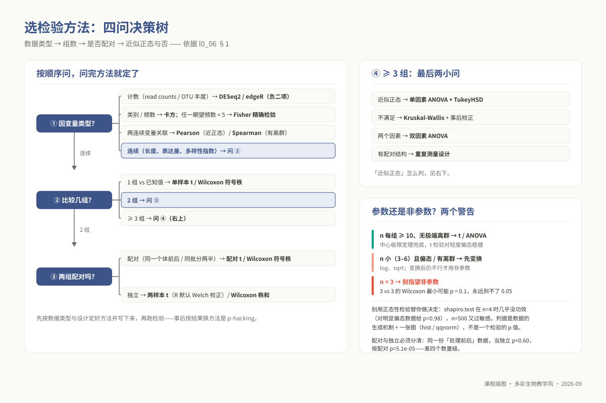
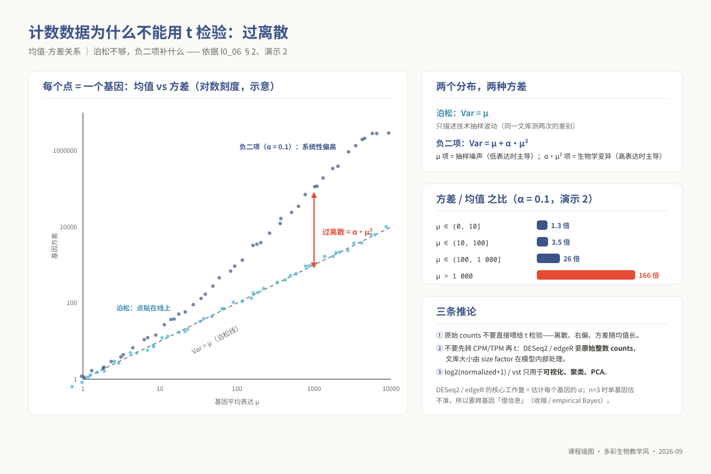
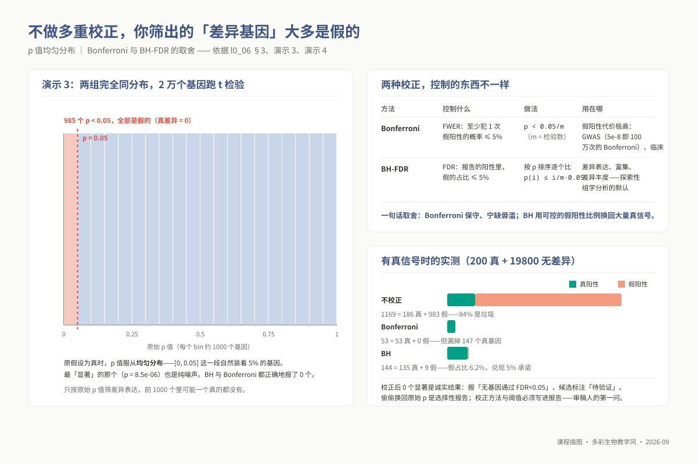
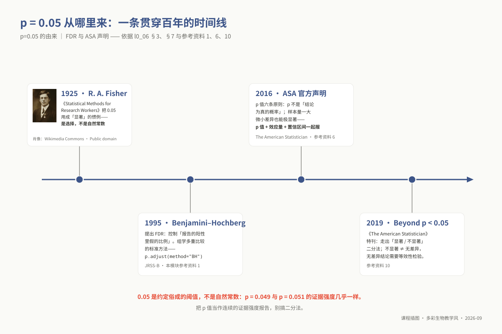
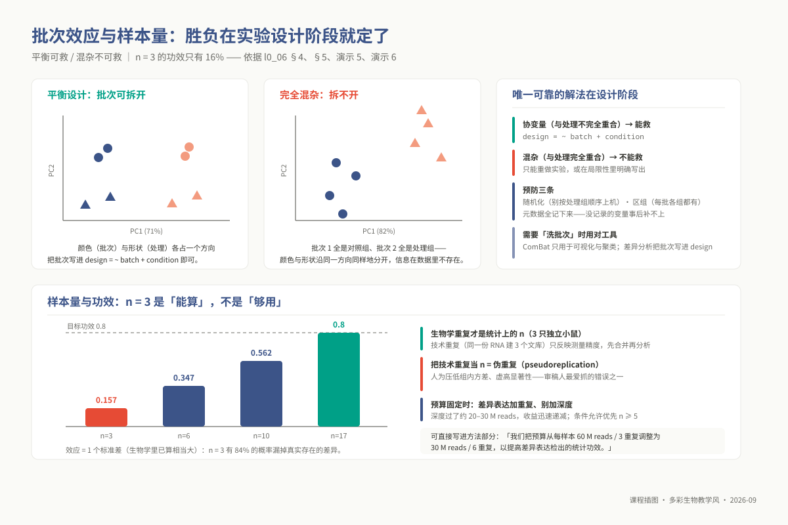

# L0-6：生信统计基础（方法选择层）

> **适用对象**：本科 / 硕士 / 博士 ｜ L0 预备课 ｜ 自学预估 4 学时
>
> **阅读重点**：根据数据选择方法，解释结论的假阳性风险。具体模型及推导见各专题的统计插件。
>
> **注意**：本模块没有对应的本科正课单元，三层学生均须单独完成。上机只使用 R 自带函数，可在 RStudio、RStudio Server 或服务器 `Rscript` 中运行。

<!-- 模块 id：l0_06_stats。 -->

---

## 学习目标

完成本模块的阅读与 6 个上机演示后，你能够：

| 出口能力 | 具体表述 |
|---|---|
| **O1 方法选择** | 给定一份数据，**说出**数据类型（连续 / 计数 / 比例 / 类别）、分组数、是否配对，并据此**选出**该用 t / Wilcoxon / ANOVA / Kruskal-Wallis / 卡方 / 相关中的哪一个，**说明**理由 |
| **O2 计数数据** | **解释**为什么测序计数不能直接当正态数据做 t 检验；**说明**泊松为什么不够、负二项补了什么，并把它和 DESeq2 / edgeR 的设计对应起来 |
| **O3 p 值语义** | 用一句话**正确陈述** p 值是什么；**指出** 4 种常见的错误解释错在哪；**说明**为什么 `p > 0.05` 不等于"无差异" |
| **O4 多重检验** | **判断**一个分析要不要校正；**选择** Bonferroni 还是 BH-FDR 并给出理由；**解释**"BH 校正后 0 个显著"意味着什么 |
| **O5 批次与协变量** | 从 PCA 图上**识别**批次分离；**区分**混杂变量与可校正的协变量；**指出**一个设计里批次与处理是否已经无法拆分，并**给出**预防方案 |
| **O6 样本量与功效** | **区分**生物学重复与技术重复；**判断**给定重复数能否支持结论；在固定预算下**权衡**测序深度与重复数 |

**三层期望不同，材料相同**：

| 层次 | 通过线 | 期望 |
|---|---|---|
| 本科（生信科班） | 自测正确率 **≥ 80%** | 六项出口能力全部达成，能对同学的分析提出统计质疑 |
| 硕士 / 博士（多数非生信背景） | 自测正确率 **≥ 60%** | 达到"**能为自己的数据选对方法、能解释结论的可信度**"即可，不要求做推导 |

低于参考线不扣分（自测**完成即给分**），但会被列入首课 15–20 分钟错题复盘名单。

## 为什么这是前置

运行分析流程后，还需要说明结果为什么可信。DESeq2 的差异基因筛选涉及 p 值与 FDR，GWAS 的关联分析涉及群体结构；这些方法需要共同的统计基础。

下表列出后续专题需要判断的具体问题：

| 你会在哪卡住 | 具体场景 | 后果 |
|---|---|---|
| **硕士 m04 转录组** | 2 万个基因各得到一个 p 值，你直接按 `p < 0.05` 筛出约 1000 个"差异基因" | 即使**两组之间真的一点差异都没有**，也会有约 1000 个基因 `p < 0.05`——这 1000 个几乎全是假阳性。你拿去做 GO 富集，富集出来的通路同样是假的。见下方**演示 3**，你会亲眼看到这个数字 |
| **硕士 m06 扩增子** | 两组各 3 个重复，做 β 多样性组间检验，得到 `p = 0.1`，你写"两组无显著差异" | 3 vs 3 的 Wilcoxon 秩和检验，**理论上能取到的最小 p 值就是 0.1**——无论两组差得多离谱，它永远不可能 `< 0.05`。你报告的不是"无差异"，是"这个设计根本检验不出任何东西"。见**演示 1** |
| **硕士 m03 重测序** | 调变异过滤阈值时全凭"别人也这么设" | 说不清放宽阈值多召回了多少真变异、多引入了多少假阳性 |
| **博士 p05 GWAS** | QQ 图上观测点**整体**高于对角线（λ 明显 > 1） | 这是**群体结构未校正**的典型信号，不是"我找到了好多关联位点"。不认识它，你会把一批分层假象当成候选基因往下做 |
| **博士 p04 群体基因组** | 做 HWE 检验筛位点、看 LD 衰减 | 不知道大样本下极小的偏离也会显著，阈值只能按经验定 |
| **博士 p06 多组学** | 上万个基因两两算相关，挑 `r > 0.8` 的边建网络 | 不校正的话，纯噪声也能构出一张漂亮的网络 |
| **本科 u08 综合项目** | 报告里要写：BUSCO 完整性 **92%** 算好还是不好？ANI = **94.8%** 到底算不算同一物种？UFBoot 支持率 95 是什么意思？k-mer 拟合出的基因组大小可信到几位？ | 报告变成流水账——只贴数字不解释。项目评分表「技术准确性」30 分里明确有一条"**数字解读有无硬伤**"。这几个数字的解读能力**全部来自本模块**，u08 讲义不重复讲 |
| **投稿 / 答辩** | 审稿人问："你的重复数如何支持这个结论？" | 答不上来。这句话在实际审稿意见里出现的频率，高于任何工具使用问题 |

关于 u08 那几个数字，本模块提供的**判据**是：

- **BUSCO 92%**：这是"在给定 lineage 数据库下单拷贝直系同源基因的命中率"，**不是**基因组完整度的绝对度量。判断好坏要看**同类物种的经验分布**（细菌用 `bacteria_odb10` 通常 ≥ 95%），92% 需要解释缺的 8% 去哪了；D（重复）偏高提示组装冗余，不是生物学重复。
- **ANI 94.8%**：95% 是**经验分布的拐点**，不是自然常数。94.8% 落在边界带里，正确写法是"接近但低于常用阈值，需结合 16S、系统树位置与表型综合判断"，而不是"因此不是同种"。**阈值不是判决书**——这条同样适用于 `p < 0.05`。
- **bootstrap / UFBoot 支持率**：衡量的是"数据重抽样下该分支的**稳定性**"，**不是**"该分支为真的概率"。这和"p 值不是结论为真的概率"是同一个逻辑错误的两个版本。
- **k-mer 拟合的基因组大小**：拟合值带不确定性，k 值会**系统性**改变估计——所以项目手册要求跑 k=17/21/25 三档对比，报告里要给区间而不是一个数。

> **案例**：解释分析结果时，需要回答“多重校正了吗？样本量怎么定的？”
>
> 对第一问，说明校正方法（BH / Bonferroni）、阈值及选择理由，参照演示 4；演示 3 中的 985 个假阳性说明了遗漏校正的风险。
>
> 对第二问，可以给出事前功效计算：演示 6 用 `power.t.test` 根据效应、方差与目标功效倒推 n。若样本受预算限制，则说明 n = 3 属于探索性分析，并交代后续验证安排。

**更深的统计在哪里等着你**（本模块不讲，见下方 §核心内容 6）：GLM 与离散度估计在硕士 m04，混合线性模型与群体结构校正在博士 p05，PERMANOVA 在硕士 m06。

## 核心内容

### 1. 统计推断决策树与数据生成机制

选择检验方法前，先检查数据如何产生、实验如何分组，以及数据是否满足方法假设。不能仅因为熟悉 `t.test` 就对所有数据使用它。

方法选择只需依次澄清四个核心问题：

```text
① 因变量（响应变量）的数学类型是什么？
   - 离散非负计数（Read counts / OTU 丰度 / 表达矩阵） ──→ 严禁套用正态分布，转入 §2 负二项 GLM（DESeq2/edgeR）
   - 无序分类 / 频数计数（突变型/野生型、有/无、抗性/敏感） ──→ 卡方独立性检验；若任一单元格期望频数 < 5 ──→ Fisher 精确检验
   - 两个连续变量的双变量关联分析 ──→ 满足双变量正态与线性 ──→ Pearson 相关；存在极端离群值或单调非线性 ──→ Spearman 秩相关
   - 连续型测量值（物理长度、相对多样性指数、标准化后的特征值） ──→ 进入第 ② 步
② 比较的组数有几组？
   - 1 个样本组与已知理论常数比对 ──→ 单样本 t 检验 / Wilcoxon 符号秩检验
   - 2 个样本组之间的均值/中位数比较 ──→ 进入第 ③ 步
   - ≥ 3 个样本组之间的比较 ──→ 进入第 ④ 步
③ 两个比较组之间是否存在配对/区组依赖结构？
   - 配对设计（同一批个体的处理前 vs 处理后、同一块叶片接种的左右两半、同一样本两套技术） ──→ 配对 t 检验 / Wilcoxon 符号秩检验
   - 独立双样本（完全不同的独立个体随机分组） ──→ 独立双样本 t 检验（默认采用 Welch 方差不齐校正）/ Wilcoxon 秩和检验
④ ≥ 3 组比较的方差分析：
   - 单因素满足近似正态与方差齐性 ──→ 单因素方差分析（One-way ANOVA）+ 事后多重比较（Tukey HSD）
   - 不满足正态假设或样本量过小 ──→ 非参数 Kruskal-Wallis 检验 + 事后 Dunn 检验
   - 涉及两个独立实验因素（如温度 × 菌株） ──→ 双因素方差分析（Two-way ANOVA，评估主效应与交互效应 Interaction）
```

**参数检验 vs 非参数检验的真实数学边界**：
许多人形成了一种机械认知：“只要数据不服从正态分布，就一律改用非参数检验（如 Wilcoxon 秩和检验）”。这种不加审视的教条在小样本实验中极其危险：

1. **中心极限定理与 t 检验的稳健性**：当每组样本量达到中等规模（$n \ge 10\sim 15$）且无毁灭性极端离群值时，依据中心极限定理（CLT），样本均值的抽样分布会迅速逼近正态分布。t 检验对于轻微至中度的偏态具有极强的容忍度。
2. **小样本非参数检验的数学天花板**：
   对于生物学实验极其常见的 $n = 3 \text{ vs } 3$ 设计，**非参数检验在数学排列组合上存在绝对的显著性死锁**！Wilcoxon 秩和检验的统计量是将两组数据混合排秩后的秩次和。在 3 对 3 的设计中，将 6 个不同的秩次分配给两组，所有可能的排列组合总数仅有：
   $$\binom{6}{3} = \frac{6 \times 5 \times 4}{3 \times 2 \times 1} = 20\text{ 种}$$
   哪怕两组数据发生了人类肉眼可见的绝对分离（一组数值为 1, 2, 3，另一组数值为 100, 200, 300），最极端的单侧排列概率只有 $1/20 = 0.05$，**双侧检验的最小可能 p 值在代数上永远等于 $2/20 = 0.10$**！换言之，在 $n=3$ 的条件下，无论组间差异多么惊人，Wilcoxon 检验在数学上**绝对不可能输出 $p < 0.05$**。如果你在报告中写下“3 对 3 的 Wilcoxon 检验 $p = 0.1$，两组无显著差异”，你所报告的根本不是“生物学上没有差异”，而是当众展示了你采用了在数学上无法工作的实验设计。

3. **彻底破除对正态性检验（Shapiro-Wilk）的病态依赖**：
   严禁用 `shapiro.test(x)$p.value > 0.05` 作为决定“使用参数还是非参数”的自动化开关。Shapiro-Wilk 检验的功效受样本量控制极其严重：在小样本（$n = 4$）时，即使输入高度倾斜的对数正态数据，检验功效几乎为零，依然会给出 $p = 0.98$ 的假象（“看不出不正常”）；而在超大样本（$n = 500$）时，轻微到毫无实际影响的微小扰动都会触发 $p < 0.001$ 的显著报警。**路线决定的首要依据是数据底层的物理生成机制**（例如测序计数天然非负离散，不可正态）结合探索性分布图（直方图、Q-Q 图与箱线图），而非将裁判权外包给一个死板的假设检验。

**配对设计的惊人威力**：
在真实实验中，个体间的基线差异（如不同小鼠的体质量基础、不同田块的土壤基质背景）往往极为巨大。若按独立双样本处理，个体间的基线方差会被算入“组内误差方差（Residual Error）”，导致分母上的标准误虚高，检验功效被彻底稀释。而配对检验将分析焦点锁定在“同一个体处理前后的差值 $\Delta = \text{After} - \text{Before}$”之上，在代数上扣除了所有与处理无关的个体异质性。

在后续演示 1 中你会亲眼看到：同一份实验数据，配对处理给出极度显著的 $p = 5.07 \times 10^{-5}$，而按独立两样本处理则直接沦为毫无统计意义的 $p = 0.601$——两者相差整整四个数量级！



*图 l0_06-1：检验方法决策树：数据类型 → 组数 → 配对与否，先问对问题再挑工具。*

### 2. 测序计数数据与负二项分布的物理必然性

在转录组（RNA-seq）、表观调控（ChIP-seq/ATAC-seq）或微生物扩增子分析中，我们获取的核心定量矩阵是由纯整数构成的 **Count 表（落入某基因或某区间的总 reads 数）**。

将测序计数直接喂给基于正态分布的传统模型（如普通线性模型或 Student's t 检验），会遭遇三个不可调和的数理冲突：

1. **离散与非负性**：计数只能是 $0, 1, 2, \dots$ 等非负整数。低表达基因的计数值高度堆积在 0 附近，分布呈现极端的不对称右偏长尾，而正态分布假定数据是连续的且在负无穷到正无穷对称延伸；
2. **均值与方差的内禀耦合**：正态分布假设总体方差 $\sigma^2$ 是一个与总体均值 $\mu$ 完全独立的恒定常数。但在一切计数过程中，均值越大的特征，其绝对波动幅度必然随之剧烈放大，方差随均值单调递增。

**泊松分布（Poisson）的局限与过离散（Overdispersion）**：
在概率论中，如果测序 reads 在基因组上的落点服从纯粹的独立随机抽样，计数应服从泊松分布：$Y \sim \text{Pois}(\mu)$。泊松分布拥有一个极其严苛的代数特性——**等离散性（Equidispersion）：其方差在数学上严格等于其均值**：
$$\text{Var}(Y) = \mu$$
在生物学测序中，泊松分布**仅仅能够精确刻画“技术重复（Technical Replicates）”的抽样散斑噪声（Shot Noise）**——即从同一个提取好的 RNA 文库中取样测序两次的波动。
然而，任何真实的科学实验都必须依赖“生物学独立重复（Biological Replicates）”——来自不同培养皿、不同株系、不同活体动物的样本。在生物体内部，由于微观转录脉冲、微环境差异和遗传背景微调，即使在同一处理组内，特定基因在不同个体中的真实转录本浓度本身就具有真实的涨落波动。这种生物学真实变异，叠加在仪器抽样噪声之上，导致测量数据的**实际观测方差远远大于均值**。这种现象被称为**过离散（Overdispersion）**。

**负二项分布（Negative Binomial, NB）的代数模型**：
如果假定技术抽样噪声服从泊松分布，而真实的生物学分子浓度自身服从 Gamma 分布，两者的连续混合（Poisson-Gamma Mixture）在代数积分上严格推导出的边际分布，正是现代生信的核心基石——**负二项分布**：
$$\text{Var}(Y) = \mu + \alpha \mu^2$$
其中 $\mu$ 为该基因在当前组内的期望表达均值，$\alpha$ 被称为**离散度参数（Dispersion Parameter）**：

- **低表达区间（$\mu \to 0$）**：二次项 $\alpha \mu^2$ 远小于一次项 $\mu$，方差近似等于均值，此时**物理抽样技术噪声（泊松项）占统治地位**；
- **高表达区间（$\mu \gg 1$）**：二次项 $\alpha \mu^2$ 迅速膨胀并彻底掩盖一次项，此时**生物学天然异质性（二次项）占绝对统治地位**。

**DESeq2 与 edgeR 的核心工程贡献**：
理解了负二项模型，就能彻底看懂 DESeq2 和 edgeR 的设计灵魂：
在现实科研中，受限于经费与样本获取难度，每组的生物学重复数往往只有 $n = 3$。在只有 3 个样本的极小样本下，对两万个基因独立去拟合单基因的离散度 $\alpha_i$，其方差估计的抽样不确定度极大，会导致大量假阳性与假阴性。
DESeq2 的突破在于引入了**经验贝叶斯收缩（Empirical Bayes Shrinkage）**：它假设全基因组范围内，均值相近的基因应当共享相近的生物学变异规律。软件先在均值-离散度散点图上拟合出一条全局趋势曲线，随后将各个基因不可靠的独立离散度估计值，向这条全局曲线进行加权“经验收缩”。离散度估计被全基因组信息拉回到了高度稳健的合理区间。

**生信工程师必须践行的三条分析红线**：

1. **严禁对原始整数 Count 矩阵直接做 t 检验**；
2. **严禁自己先计算 CPM/TPM/FPKM 再进行常规统计检验**。DESeq2/edgeR 的广义线性模型必须接收未经任何人工除法修剪的**原始整数 Counts**，文库大小的系统性差异由模型内部的“有效测序深度系数（Size Factor / TMM Normalization Factor）”作为偏移量（Offset）在似然函数内严密处理；
3. 只有在**数据降维可视化、PCA 探索、无监督聚类和绘制热图**时，才可以使用消除均方自相关性的方差稳定变换值（`vst`、`rlog`）或 `log2(normalized_counts + 1)`。



*图 l0_06-2：计数数据为什么用负二项：过离散把泊松的方差假设打破。*

### 3. p 值的认识论语义、多重假设检验与 FDR 控制

**p 值（p-value）**容易被误解为“结论为真的概率”或“效应有多大”。在解读组学结果前，先明确它回答的问题，再区分以下四类常见误读。

**p 值的定义**：

> **在假定零假设（$H_0$, 通常为“两组总体均值完全没有任何真实差异”）严格成立的前提下**，仅凭随机抽样波动，观测到当前手头样本统计量、或者比当前统计量**更加极端**的结果的条件概率：
> $$p = P(\text{Data} \ge \text{Observed} \mid H_0)$$

**四类常见错误解释**：

| 典型错误表述 | 底层逻辑漏洞剖析 | 严谨的科学报告语言 |
|---|---|---|
| **“$p = 0.03$，因此这个基因有 97% 的概率确实存在差异表达”** | **条件概率反转谬误（逆概率谬误）**。p 值是 $P(\text{Data} \mid H_0)$，绝非 $P(H_1 \mid \text{Data})$！要反推结论为真的后验概率，必须引入先验几率并依据贝叶斯定理推导 | “在无处理效应的零假设前提下，仅凭随机波动出现当前或更极端差异数据的概率为 3%” |
| **“基因 A 的 $p = 10^{-6}$，基因 B 的 $p = 0.01$，所以基因 A 的生物学表达差异幅度比 B 更大”** | **混淆效应量与统计显著性**。p 值是效应大小（Effect Size）、样本量（$n$）与噪声方差三者的复合投影。只要样本量 $n$ 足够庞大，微小到毫无生物学功能的 0.1% 漂移也能算出 $p < 10^{-20}$ | 必须同时展示**效应大小（$\log_2\text{FC}$ 及其置信区间）与显著性 p 值**，两者不可偏废 |
| **“$p = 0.08 > 0.05$，证明两组样本没有任何差异，处理无效”** | **未拒绝不等于证明成立**。未能拒绝 $H_0$ 可能仅仅是因为实验的样本量太小、检验功效（Power）不足，导致无法从噪声中检出真实差异 | “在当前样本量下未能检出具有统计学显著性的差异”，若要证明“等效”需实施等效性检验（TOST） |
| **“$p = 0.049$ 说明有显著科学发现，而 $p = 0.051$ 意味着没有发现”** | **盲目二分法思维**。0.05 仅仅是 20 世纪统计学先驱 Fisher 随手给出的经验建议阈值，绝非物理宇宙的客观离散常数。两者的证据强度几乎完全相同 | 将 p 值视为对零假设不相容性的**连续性证据度量**，如实报告具体数值与置信区间 |

**组学多重检验中的假阳性累积**：
单次假设检验中，我们将显著性水准设定为 $\alpha = 0.05$，意味着“即使零假设为真，我们也允许有 $5\%$ 的最大概率错误地宣告发现显著性（第一类错误，假阳性）”。
但在全基因组转录组分析中，我们是在同一个表达矩阵中同时对 $m = 20,000$ 个基因各自独立进行一次显著性检验！
如果这 20,000 个基因在真实的生物体内**完完全全没有任何差异表达（$H_0$ 对全量基因 100% 成立）**，那么在这两万次独立检验中，期望出现的假阳性“显著基因”数量为：
$$E(\text{False Positives}) = m \times \alpha = 20,000 \times 0.05 = \mathbf{1000}\text{ 个！}$$
后续的演示 3 会用计算机随机数生成纯净的高斯白噪声并执行 20,000 次 t 检验，你将亲眼看到代码准确输出 **985 个 $p < 0.05$ 的假阳性差异基因**！如果不经过任何多重校正直接筛出这 1000 个基因去跑 GO/KEGG 富集，富集出来的通路完全是纯噪声编织出的幻觉。

**两种常用多重检验校正方法的比较**：

| 多重检验校正方法 | 底层严格控制的统计量指标 | 数学阈值准则 | 适用科研场景与权衡代价 |
|---|---|---|---|
| **Bonferroni 校正** | **族错误率（Family-Wise Error Rate, FWER）**：要求在所有 $m$ 次检验中，**哪怕发生哪怕 1 次假阳性**的总体概率不超过 $\alpha$ | 单基因原始阈值修正为：$p < \frac{\alpha}{m}$ | **极其保守，宁缺毋滥**。适合假阳性后果极为严重的终极筛选。典型场景：**GWAS 全基因组关联分析**（$5 \times 10^{-8}$ 即为一百万个独立 SNP 检验按 $\alpha=0.05$ 计算的 Bonferroni 阈值）以及关键临床伴随诊断 |
| **Benjamini–Hochberg 算法（BH-FDR）** | **错误发现率（False Discovery Rate, FDR）**：控制在最终宣布为“阳性显著”的所有候选名单中，**假阳性基因所占的期望比例**不超过 $q$ | 将全量原始 p 值升序排秩 $p_{(1)} \le p_{(2)} \dots \le p_{(m)}$，寻找满足 $p_{(k)} \le \frac{k}{m} \times q$ 的最大切点 $k$ | **探索性组学研究的黄金通用标准**。广泛应用于转录组差异表达、ChIP-seq Peak 富集、宏基因组差异物种筛选。研究者坦然接受“筛选出的 200 个差异基因中可能有大约 10 个是假阳性”，因为后续必然会通过实验手段验证 |

**校正后没有显著结果（FDR 全部 $> 0.05$）怎么办**：

没有基因通过 FDR 阈值也需要如实报告。可能的原因包括效应较弱、组内变异较大，或样本量 $n$ 不足；需要结合实验设计和效应量继续判断。

- **正道工程伦理**：如实报告“在 FDR < 0.05 阈值下全基因组无基因通过多重检验校正”，随后在论文中公开按效应量（$\log_2\text{FC}$）绝对值排序靠前、原始 p 值较小的 Top 20 候选基因作为“探索性观察候选”，并加黑明确标注“未通过多重检验校正，结论必须依赖 qPCR 或生化实验独立验证”；
- **学术违规歧途（P-Hacking）**：偷偷把校正后的 $q$ 值（padj）换回原始未经校正的 $p$ 值汇报；或者连续不断地变换过滤门槛（一会儿试 $p < 0.01$，一会儿试 $|\log_2\text{FC}| > 1.5$），直到列表凑出看起来好看的几十个基因为止。这种做法在审稿阶段一旦被要求提供完整脚本，必定导致整篇论文被直接拒稿。



*图 l0_06-3：p 值直方图与 FDR：一万个检验里 985 个假显著，校正不是可选项。*



*图 l0_06-6：p=0.05 的百年：一条约定俗成的阈值，不是自然常数。*


*图 l0_06-5：R. A. Fisher，现代统计学奠基人之一（照片：公有领域，Wikimedia Commons）。*

> **人物故事与统计史话：费希尔的“女士品茶”与 p=0.05 的偶然诞生**
> 
> 照片中的绅士是现代统计学与现代演化综合理论的奠基人——**罗纳德·艾尔默·费希尔（Ronald A. Fisher，1890–1962）**。今天生信分析中用到的方差分析（ANOVA）、极大似然估计、试验设计三原则（随机化、重复、区组化），几乎全部出自他在英国洛桑农业试验站（Rothamsted）的研究。
> 
> 科学史上最著名的轶事之一便发生在这里：某天下午茶时，藻类学家缪丽尔·布里斯托尔（Muriel Bristol）博士坚称自己能尝出一杯奶茶究竟是“先加奶”还是“先加茶”。多数人对此付之一笑，费希尔却敏锐地将其转化为一道严肃的统计命题：如何用数学证明她并非瞎猜？他当场设计了一个双盲随机实验，准备了 8 杯外观一致的奶茶（4 杯先奶、4 杯先茶），完全随机打乱后请她品尝。仅凭瞎猜而全部猜对的组合概率为 $1 / \binom{8}{4} = 1/70 \approx 0.014$。布里斯托尔最终奇迹般地全部猜中！费希尔据此建立了超几何分布的精确检验方法，这就是今天在富集分析中大名鼎鼎的**费希尔精确检验（Fisher's Exact Test）**。
> 
> 那么图 l0_06-6 中统治科学界百年的 **$p=0.05$** 阈值从何而来？1925 年，费希尔出版巨著《研究工作者的统计方法》（*Statistical Methods for Research Workers*）。在缺乏电子计算机的年代，为了方便实验学者查表，他没有给出繁复的连续概率分布全表，而是为了排版便利，选取了“1/20（即 5%）”这一简单整数比例作为临界值。费希尔本人再三强调这只是一条“个人研究中建议做进一步复验的经验参考线”，从未主张将其作为非黑即白的科学真理裁判所。而在高通量测序的 20,000 个基因检验中，若仍机械死守单个 $p < 0.05$ 而不做多重假设检验校正，等待实验者的将是上千个伪阳性假象。

### 4. 批次效应的代数本质与协变量混杂几何

在高通量实验中，**批次效应（Batch Effect）**是摧毁科学结论的头号隐形杀手。它是由于非生物学实验条件在时间或空间上的离散变动所引起的系统性数据偏移：不同星期提取的 RNA、不同试剂盒批号、不同测序 Lane 通道、不同操作实验员、甚至不同机房的恒温箱温度漂移。

批次效应的危险性在于：**它不是随机无规律的白噪声，而是呈现高度协同的系统性偏移**，在表型上与真实的处理效应完全一致，极易被误判为重大生物学发现。

**平衡设计 vs 完全混杂设计：几何与代数的生死之别**：
利用主成分分析（PCA）对样本表达矩阵降维投影视觉化，是诊断批次效应的第一道防线：

- **可挽救的平衡区组设计（Balanced Block Design）**：
  在实验规划阶段，将对照组与实验组均匀分布在各个批次中（例如批次 1 包含 2 个对照与 2 个处理，批次 2 同样包含 2 个对照与 2 个处理）。
  在 PCA 空间中，你会清晰看到：**样本点沿主成分 1（PC1）按“批次”分开，而沿主成分 2（PC2）按“实验处理”分开**。在设计矩阵中，批次向量与处理向量处于正交或近正交状态（线性无关）。此时，在统计建模（DESeq2 设计公式）中将批次作为**协变量（Covariate）**显式纳入：
  $$\text{design} = \sim \text{Batch} + \text{Condition}$$
  广义线性模型能够依靠最小二乘或极大似然估计，在代数上完美将批次的基准偏移剥离，准确估算出纯净的生物学处理效应。

- **无药可救的完全混杂设计（Completely Confounded Design）**：
  实验设计存在严重缺陷：第 1 周完成所有的 3 个对照组样本提取并送测，第 2 周再做所有的 3 个处理组样本。
  此时，在数学逻辑上，**批次向量与实验处理向量发生完全重合（完美共线性，Collinearity）**！在 PCA 图上，颜色（批次）与形状（处理）沿同一坐标轴完全重叠分离。
  **极其重要的科学认知**：面对完全混杂的数据，**世间任何统计学软件、任何批次校正算法（包括被滥用的 ComBat 或 sva）在数学上都根本不可能将它们拆开**！因为将这 3 对 3 的巨大差异解释为“处理药物有效”，或者解释为“第 2 周的测序仪酶活性偏高”，在代数似然上是 100% 等价的。用 ComBat 强行去抹平批次，会把真实的生物学处理效应一同无情抹杀。此时唯一的科学响应是：承认数据彻底报废并重新规划实验，或者在论文中坦率承认“批次与处理完全混杂，无法下定论”。

**实验设计阶段的三大铜墙铁壁**：

1. **彻底随机化（Randomization）**：文库在 96 孔板中的排布、上机测序 Lane 的分配，必须使用随机数发生器打散，严禁按“前一半对照、后一半处理”的顺序排布；
2. **严格区组化（Blocking）**：大批量实验分批次进行时，确保每一个批次内部包含各个实验分组的完整对子；
3. **全生命周期元数据归档（Metadata Tracking）**：RNA 提取日期、操作人员工号、裂解耗时、RIN 质量值、建库试剂批号必须形成不可篡改的元数据表格。**只有被记录下来的技术变量，事后才有资格作为协变量放进统计模型进行校正**；未被记录的隐蔽批次，将永远潜伏在数据深处变成无法解释的系统偏差。



*图 l0_06-4：批次与样本量：平衡可救、混杂不可救；n=3 的功效只有 16%。*

### 5. 统计功效与样本量决策：破除 n=3 的盲从迷思

在论文答辩与投稿审稿中，最常遭遇审稿人一针见血的质问：“**你的重复数如何支撑当前推断结论？**”许多研究生习惯性回答“大家都做 3 个重复”，这种答复在严谨的学术评审中是苍白无力的。

**统计功效（Statistical Power）的物理内涵**：
$$\text{Power} = 1 - \beta = P(\text{Reject } H_0 \mid H_1 \text{ is TRUE})$$
即：**在真实世界中两组之间确实存在生物学差异的前提下，你的实验设计在统计检验中能够成功检测出该差异的真实概率**。国际科学界普遍公认的合格功效基准线是 **$1 - \beta \ge 0.80$**（即允许有 20% 的第二类错误/漏检几率）。

统计功效被四个相互锁定的数学参数严格绑定：
$$\text{Power} = f(\text{Effect Size } \delta, \text{ Variance } \sigma^2, \text{ Sample Size } n, \text{ Significance Level } \alpha)$$
固定其中任意三个量，第四个量在代数上唯一确定。

**$n = 3$ 的残酷数学真相**：
在后续的演示 6 中，使用 R 官方内置的标准功效计算工具 `power.t.test` 进行精确求解：
设定一个相当显著的生物学效应量（均值差异等于 1 个标准差：$\delta/\sigma = 1.0$，这在生物学中已属非常剧烈的变动），在显著性阈值 $\alpha = 0.05$ 条件下：

- 当 $n = 3$ 时，实验的真实统计功效仅有 **$0.157$（15.7%）**！
- 当 $n = 6$ 时，功效回升至 $0.347$；
- 当 $n = 10$ 时，功效达到 $0.562$；
- 要稳定达到 80% 的合格功效，**每组样本量必须达到 $n = 17$**！

**为什么大量生物学实验无法在他人实验室复现**：
当统计功效低至 15.7% 时，意味着一个真实存在的生物学效应，你在做实验时有 **高达 84.3% 的极高概率根本检测不出来**！这就解释了为什么同一个基因在这一次实验里能测出差异，下一次重复却“消失了”；也解释了为什么在 $n = 3$ 的条件下得出“$p > 0.05$ 所以无差异”的断言是极度苍白可笑的——因为你的实验本身根本没有能力捕捉它。

**伪重复（Pseudoreplication）的学术红线**：
为了强行凑出 $n = 3$ 或更大的样本量，绝不能在样本定义上弄虚作假：

- **真·生物学重复（Biological Replicates）**：来自完全独立的生物学生命个体、独立的细胞批次培养、或独立的田间农艺试验小区。**只有它们才代表自然界真实的个体异质性分布，才是统计推断中的有效自由度样本 $n$**；
- **伪·技术重复（Technical Replicates）**：同一只小鼠的脾脏提取出的同一管 RNA 分装成 3 个 Eppendorf 管建库，或者同一个测序文库上机测了两次，或者同一份 cDNA 上机跑了 3 个 qPCR 复孔。**技术重复只能用来评估操作人员和测量仪器的测量稳定性，在统计推断中必须先计算均值合并为单一数据点，严禁直接作为独立样本量 $n$ 计算自由度**！把技术重复冒充生物学重复，会人为低估生物学变异并虚构膨胀自由度，属于严重的学术不端行为。

**固定经费下的战略权衡：深度 vs 重复数**：
在真实科研中，经费往往是刚性受限的。如果只有测 180 M reads 的固定预算，摆在面前有两种路线：

- 方案 A：每组 3 个重复，每个文库追求 60 M reads 的超高测序深度；
- 方案 B：每组 6 个重复，每个文库测 30 M reads。
**生信统计学的定论毫不含糊：坚决选择方案 B！**
实证研究的结论是：在固定深度下增加生物学重复，差异基因检出率持续上升（Schurch et al. 2016, *RNA*：建议至少 6 个重复）；而 20–30 M reads 是转录组的常用深度惯例，越过后中高表达基因的检出边际收益明显变小；决定差异基因检出统计功效的绝对瓶颈是**生物学个体的离散度变异，而不是每个个体的技术测序深度**。将预算分配给更多的生物学重复，是大幅提升统计功效与科研可信度的唯一科学路径。

### 6. 知识图谱边界：专业统计在各专题中的纵深布局

本着“**通用统计奠定基石，专业模型深嵌专题**”的教学设计原则，本先导模块（L0-6）旨在为三层次全员建立共同的推断公理底座（决策树、负二项、p 值与 FDR、批次与功效）。

脱离具体生物学数据空讲复杂模型往往无法真正被学生吸收。因此，更高阶的专业统计方法被深度集成在后续各层次的专业专题中：

| 进阶高阶统计模型 | 所在正课专题章节 | 为什么必须与该专题深度绑定教学 |
|---|---|---|
| **广义线性模型（GLM）、离散度收缩与 Wald 检验** | 硕士 **m04** 转录组测序 | 必须结合 RNA-seq 真实表达矩阵与设计公式 `~ condition` 落地 |
| **混合线性模型（LMM）、群体结构主成分与 QQ 图膨胀因子 $\lambda$ 诊断** | 博士 **p05** GWAS 复杂性状分析 | 必须结合几十万个 SNP 的基因型矩阵与 Manhattan 曼哈顿图展开 |
| **距离矩阵置换多元方差分析（PERMANOVA）、多样性测度与稀释抽平之争** | 硕士 **m06** 扩增子与微生态 | 必须与 Bray-Curtis 距离矩阵、OTU 组成性数据绑定 |
| **组成性数据对数比变换（CLR）、零膨胀模型（Zero-inflated Models）** | 硕士 **m07** 宏基因组学 | 宏基因组分类单元丰度受测序恒定总通量约束，属于典型的单纯形组成性数据 |
| **不可见重现率（IDR, Irreproducible Discovery Rate）与泊松 Peak Calling** | 硕士 **m05** 调控组学与表观遗传 | 必须结合 ChIP-seq/ATAC-seq 的富集峰与对照背景信噪比推演 |
| **单细胞聚类稳定性、高维流行降维中的伪重复（Pseudoreplication）** | 博士 **p02** 单细胞与空间转录组 | 单细胞中每个细胞并非完全独立的生物学样本，涉及复杂的层次混合模型 |
| **高维组学相关性网络中的假阳性爆炸、共表达网络模块识别（WGCNA）** | 博士 **p06** 多组学数据整合 | 涉及数万个特征两两相关计算时的软阈值幂律变换与模块拓扑重叠度 |
| **哈迪-温伯格平衡检验（HWE）、连锁不平衡（LD）衰减模型** | 博士 **p04** 群体基因组学 | 纯粹的群体遗传学与等位基因频率动力学演化模型 |

当在后续课程中遇到这些高阶模型时，你会发现其底层依然牢牢依附在本先导模块所确立的推断统计底座之上。

### 7. 统计学概念的终极审视：自由度与效应量

在结束本模块的核心知识梳理前，必须彻底肃清两个在日常文献阅读中极易被含混带过的核心概念：

- **自由度（Degrees of Freedom, $df$）的物理本质**：
  自由度绝非教科书公式末尾随手减去的一个抽象小角标。它的物理内涵是：**在整个样本数据集中，真正能够自由提供全新独立信息、未被模型预先耗尽的有效证据份数**。
  例如计算 $n = 6$ 的样本方差时，由于算法预先消耗了样本去计算样本均值 $\bar{x}$，已知均值的前提下，一旦确定了前 5 个数字，第 6 个数字就被物理锁死，因此描述波动的有效独立信息仅剩 $n - 1 = 5$ 份。自由度越小，t 分布的尾部越厚重，同样数值的偏移就越难被判定为显著。
  **特别注意配对设计的自由度**：对于 8 对“处理前后”的个体，配对分析是将每一对合成为一个差值 $\Delta_i$。独立提供证据的差值只有 8 个，因此计算差值均值后，自由度为 $df = 8 - 1 = 7$，**绝不是独立两样本的 $8 + 8 - 2 = 14$**！看到自由度，脑海中浮现的必须是“该推断结论背后究竟有几份相互独立的真凭实据”。

- **效应量（Effect Size）与统计显著性的世纪之辨**：
  统计学 p 值在本质上是一个混合了“真实生物学效应大小”、“样本量规模”以及“系统内部噪声”的复合代数产物。因此，**单一的 p 值绝对无法回答“这个处理效果究竟有多大”**！
  - 效应量指标（如对数倍数变动 $\log_2\text{FC}$、组间标准化均值差 Cohen's d、决定系数 $R^2$、优势比 Odds Ratio）直接回答“差异在物理和生物学上的客观幅度”；
  - 置信区间（Confidence Interval, CI）直接回答“基于当前数据，该真实效应量的估计不确定性区间究竟有多宽”；
  - p 值仅仅回答“在假设没有差异的前提下，当前观测是否容易被纯粹的随机波动所解释”。
  在 2016 年美国统计学会（ASA）关于 p 值的里程碑式官方声明及 2019 年“超越 $p < 0.05$（Moving to a World Beyond $p < 0.05$）”特刊之后，国际顶尖科学期刊正全面推行**科学报告新范式：在展示 p 值的每一处，强制性同步报告效应量及其 95% 置信区间**。这项严谨的学术规范，将贯穿三层次课程的每一次作业与结课报告。

## 上机操作

**运行方式**：把每段代码贴进 RStudio 逐段跑，或存成 `.R` 文件用 `Rscript demo.R` 跑。**所有代码只用 R 自带函数**，无需安装任何包；每段都写了 `set.seed`，**你得到的数字应当和材料里写的完全一致**——对不上说明代码贴漏了。图的**标题、轴标签、图例一律用英文**（Linux 服务器上中文字体常显示为方块），中文解释写在你的报告正文里。

### 演示 1：决策树落地——配对、非参数与小样本的天花板

```r
# 1a. 配对 vs 独立：同一份数据，两种做法差四个数量级
set.seed(11)
before <- rnorm(8, mean = 10, sd = 3)        # 8 个个体处理前
after  <- before + rnorm(8, mean = 1.2, sd = 0.5)   # 每个个体都升高约 1.2
t.test(before, after, var.equal = TRUE)$p.value   # 当成独立两样本 → 0.601
t.test(before, after, paired = TRUE)$p.value      # 按配对处理     → 5.07e-05

# 1b. 小样本非参数的天花板：3 vs 3 永远做不出 p < 0.05
wilcox.test(1:3, 4:6)$p.value      # 最极端的分离情形 → 0.1
wilcox.test(1:4, 5:8)$p.value      # 4 vs 4 最极端     → 0.0286

# 1c. 别用正态性检验替你做决定：n=4 时它什么也看不出来
set.seed(2026)
b <- rlnorm(4, meanlog = 1.5, sdlog = 1)   # 明显偏态的对数正态数据
shapiro.test(b)$p.value                    # → 0.981，"完全看不出不正态"
```

**要记住的三件事**：① 配对没识别出来，等于把最大的信号源（个体基线差异）当成了噪声；② `n = 3` 的组间比较，非参数检验**在数学上不可能**给出 `p < 0.05`，报"无显著差异"是在报告设计缺陷；③ 正态性检验在小样本下没功效、大样本下过敏感，方法选择要看**数据的生成机制**和图，不是看它的 p 值。

### 演示 2：计数数据的均值-方差关系（亲眼看到过离散）

```r
set.seed(20260829)
n_gene <- 2000; n_rep <- 6
mu <- 2^runif(n_gene, 1, 12)          # 2000 个基因，真实均值从 2 到 4096
pois_mat <- t(sapply(mu, function(m) rpois(n_rep, lambda = m)))          # 只有抽样噪声
nb_mat   <- t(sapply(mu, function(m) rnbinom(n_rep, mu = m, size = 10))) # size=10 即 alpha=0.1

mean_p <- rowMeans(pois_mat); var_p <- apply(pois_mat, 1, var)
mean_n <- rowMeans(nb_mat);   var_n <- apply(nb_mat,   1, var)
png("fig_meanvar.png", width = 1600, height = 800, res = 150)
par(mfrow = c(1, 2), mar = c(4.5, 4.5, 3, 1))                # 图内文字一律英文
plot(mean_p, var_p, log = "xy", pch = 16, cex = .4, col = "#3B75AF",
     xlab = "Gene mean count", ylab = "Gene variance", main = "Poisson: variance = mean")
abline(0, 1, col = "red", lwd = 2)
plot(mean_n, var_n, log = "xy", pch = 16, cex = .4, col = "#C44E52",
     xlab = "Gene mean count", ylab = "Gene variance", main = "Negative binomial: overdispersed")
abline(0, 1, col = "red", lwd = 2); dev.off()

# 方差/均值 之比随表达量怎么变（负二项）
round(tapply(var_n / mean_n, cut(mean_n, c(0, 10, 100, 1000, 1e5)), median), 1)
#   (0,10]  (10,100]  (100,1e+03]  (1e+03,1e+05]
#      1.3       3.5         26.4          166.3
```

**你应该看到**：左图的点几乎全部落在红色的 `y = x` 线上（泊松：方差 = 均值）；右图的点系统性地位于红线**上方**，而且**表达量越高偏离越远**。这就是过离散。最后那张小表把它量化了：低表达基因方差只是均值的 1.3 倍（抽样噪声主导），高表达基因方差是均值的 166 倍（生物学变异主导，即 `α·μ²` 项）。**一个假定方差恒定的 t 检验，无法同时处理这两端。**

### 演示 3：2 万个"无差异"基因，有多少个 p < 0.05

这是理解 FDR 最有冲击力的一次演示——**两组数据来自完全相同的分布，真差异为零**。

```r
set.seed(42)
n_gene <- 20000; n_each <- 3
ctrl <- matrix(rnorm(n_gene * n_each), nrow = n_gene)   # 两组
trt  <- matrix(rnorm(n_gene * n_each), nrow = n_gene)   # 完全同分布，无任何真差异
pv <- vapply(seq_len(n_gene),
             function(i) t.test(ctrl[i, ], trt[i, ], var.equal = TRUE)$p.value, numeric(1))
sum(pv < 0.05)                          # → 985   （约 20000 × 5%）
sum(p.adjust(pv, "BH")         < 0.05)  # → 0
sum(p.adjust(pv, "bonferroni") < 0.05)  # → 0
min(pv)                                 # → 8.5e-06，最"显著"的那个也是纯噪声

png("fig_null_pvalues.png", width = 900, height = 700, res = 150)
hist(pv, breaks = 50, col = "#8FB4D9", border = "white",
     xlab = "Raw p-value", main = "20,000 null genes: p-values are uniform")
abline(v = 0.05, col = "red", lwd = 2, lty = 2); dev.off()
```

**你应该看到**：直方图**平坦**——原假设为真时 p 值服从均匀分布，`[0, 0.05]` 这一段自然装着 5% 的基因。**985 个"显著"基因，全部是假的。** 而 BH 与 Bonferroni 都正确地报告了 0 个。请把这个数字记住：**你的差异表达列表如果只按原始 p 值筛，前 1000 个里可能一个真的都没有。**

### 演示 4：Bonferroni vs BH——有真信号时的取舍

```r
set.seed(7)
n_gene <- 20000; n_true <- 200; n_each <- 10
delta <- c(runif(n_true, 1.0, 3.5), rep(0, n_gene - n_true))   # 前 200 个基因有真差异
c2 <- matrix(rnorm(n_gene * n_each), nrow = n_gene)
t2 <- matrix(rnorm(n_gene * n_each, mean = rep(delta, n_each)), nrow = n_gene)
p2 <- vapply(seq_len(n_gene),
             function(i) t.test(c2[i, ], t2[i, ], var.equal = TRUE)$p.value, numeric(1))

is_true <- seq_len(n_gene) <= n_true
for (m in c("none", "bonferroni", "BH")) {
  hit <- p.adjust(p2, m) < 0.05
  cat(sprintf("%-11s 报告=%5d  真阳性=%3d  假阳性=%4d  假阳性占比=%.3f\n",
      m, sum(hit), sum(hit & is_true), sum(hit & !is_true),
      ifelse(sum(hit) > 0, sum(hit & !is_true) / sum(hit), 0)))
}
# none        报告= 1169  真阳性=186  假阳性= 983  假阳性占比=0.841
# bonferroni  报告=   53  真阳性= 53  假阳性=   0  假阳性占比=0.000
# BH          报告=  144  真阳性=135  假阳性=   9  假阳性占比=0.062
```

**你应该看到**：不校正的列表里 84% 是垃圾；Bonferroni 一个假的都没放进来，但把 200 个真基因中的 147 个漏掉了；BH 找回 135 个真基因，代价是混入 9 个假的——**假阳性占比 6.2%，正是它承诺控制的 5% 量级**。探索性组学分析选 BH，GWAS 这种要逐个跟进验证的场景选 Bonferroni。

### 演示 5：批次效应在 PCA 上长什么样

```r
set.seed(1234)
n_gene <- 2000; n_samp <- 8
group      <- rep(c("A", "B"), each  = 4)     # 处理组
batch_bal  <- rep(c("B1", "B2"), times = 4)   # 平衡设计：每批 2A + 2B
batch_cnf  <- rep(c("B1", "B2"), each  = 4)   # 混杂设计：批次 == 处理组

base  <- rnorm(n_gene, 8, 2)                                  # 基因基线表达
g_eff <- c(rnorm(200, 1.2, 0.3), rep(0, n_gene - 200))        # 200 个基因响应处理
b_eff <- rnorm(n_gene, 0, 1.0)                                # 批次给每个基因一个偏移
noise <- matrix(rnorm(n_gene * n_samp, sd = 0.3), n_gene, n_samp)
mk <- function(bt) matrix(base, n_gene, n_samp) +
        outer(g_eff, as.integer(group == "B")) +
        outer(b_eff, as.integer(bt == "B2")) + noise

png("fig_batch_pca.png", width = 1600, height = 800, res = 150)
par(mfrow = c(1, 2), mar = c(4.5, 4.5, 3, 1))     # 颜色=批次，形状=处理组；图内文字英文
for (nm in c("balanced", "confounded")) {
  bt <- if (nm == "balanced") batch_bal else batch_cnf
  pc <- prcomp(t(mk(bt)), scale. = FALSE)
  vp <- round(100 * pc$sdev^2 / sum(pc$sdev^2), 1)
  plot(pc$x[, 1], pc$x[, 2], pch = ifelse(group == "A", 16, 17), cex = 2,
       col = ifelse(bt == "B1", "#3B75AF", "#C44E52"), main = paste0("Design: ", nm),
       xlab = paste0("PC1 (", vp[1], "%)"), ylab = paste0("PC2 (", vp[2], "%)"))
  legend("topright", c("Batch 1", "Batch 2", "Group A", "Group B"), bty = "n", cex = .8,
         col = c("#3B75AF", "#C44E52", "black", "black"), pch = c(15, 15, 16, 17))
}
dev.off()
```

**你应该看到**：左图（平衡设计，PC1 ≈ 71%）颜色沿 PC1 分开、形状沿另一方向分开——批次和处理**各占一个方向，可以拆开**，把 `batch` 写进 design 公式即可。右图（混杂设计，PC1 ≈ 82%）颜色和形状**沿同一方向、同样地分开**——你无法判断 PC1 上的分离究竟是处理造成的还是批次造成的。**这时任何"去批次"软件都救不了你**，因为区分它们所需的信息在数据里根本不存在。请把这张右图记成实验设计阶段的警报器。

### 演示 6：样本量与功效

```r
power.t.test(n = 3, delta = 1, sd = 1, sig.level = 0.05)$power   # → 0.157
round(sapply(2:12, function(n) power.t.test(n = n, delta = 1, sd = 1)$power), 3)
#   n= 2     3     4     5     6     7     8     9    10    11    12
#  0.091 0.157 0.222 0.286 0.347 0.406 0.461 0.513 0.562 0.607 0.649
ceiling(power.t.test(power = 0.8, delta = 1, sd = 1)$n)          # → 17
```

**你应该看到**：效应等于 1 个标准差、每组 n = 3 时，功效只有 **15.7%**——真差异存在，你也有 84% 的概率漏掉。要达到 0.8 的功效，每组需要 **17** 个重复。组学实验里 n = 3 是常态，所以**差异表达分析本质上是在低功效条件下做筛选，结论必须靠验证实验兜底**——这句话请写进你的讨论部分。

## 常见错误与排查

本节列的不是软件报错，而是**统计上的错误**——每条给"错在哪 + 正确做法"。

| # | 错误 | 错在哪 | 正确做法 |
|---|---|---|---|
| 1 | "p = 0.02，所以这个基因有 98% 的概率真的差异表达" | 把 p 值当成"结论为真的概率"。p 值是**假设无差异**时看到当前数据的概率，条件方向恰好相反 | 写"在无差异假设下观测到这么极端数据的概率是 2%"；要谈"结论为真的概率"需要贝叶斯框架或 FDR，不是 p 值 |
| 2 | 直接对原始 counts 做 t 检验 | ① counts 离散、右偏、方差随均值增长，正态假设不成立；② 未处理文库大小差异，测得深的样本每个基因都"更高"，检出的是深度不是生物学 | 用 DESeq2 / edgeR，输入**原始整数 counts**（工具内部做归一化与负二项建模）。只有画图/聚类/PCA 才用 `log2(CPM+1)` 或 `vst` |
| 3 | 把同一份 RNA 建的 3 个文库当成 n = 3 | 伪重复。技术重复只反映测量精度，会人为压低组内方差、虚高显著性——审稿人最爱抓这一条 | 技术重复先**合并**（求和/求均值）成一个生物学样本值再进分析；n 只数独立的生物学个体 |
| 4 | 2 万个基因，按原始 `p < 0.05` 筛出 1000 个"差异基因" | 没做多重检验校正。演示 3 证明：**完全没有真差异**时也会有约 985 个 `p < 0.05` | 一律用 `p.adjust(pv, "BH")` 后再筛；报告里写清用了哪种校正、阈值多少 |
| 5 | 批次 1 全做对照、批次 2 全做处理，事后用 ComBat"去批次" | 批次与处理**完全混杂**，两者的信息在数据里不可分离。ComBat 去掉批次的同时会把处理效应一起去掉 | 设计阶段就区组+随机化，每批各组都有；已经做成这样的数据，只能重做，或在局限性里明确写出"批次与处理不可分离" |
| 6 | "p = 0.31 > 0.05，因此两组无显著差异，证明处理无效" | 没拒绝 ≠ 证明相等。n = 3 时功效只有 16%（演示 6），这个 p 值几乎不携带信息 | 写"在当前样本量下未检出差异"，并报告效应大小的**置信区间**与功效；要主张"等效"需做等效性检验（equivalence testing） |
| 7 | 先跑 t 检验不显著，改跑 Wilcoxon，再不行就去掉一个"离群"样本 | 事后按结果挑方法/挑样本（p-hacking）。每多试一次，假阳性率就上升一档，报告的 p 值已经失去意义 | **分析前**按数据类型与设计定好方法并写下来；剔除样本必须有**独立于结果**的理由（QC 指标、建库失败），并在方法里报告 |
| 8 | 3 vs 3 做 Wilcoxon，得到 p = 0.1，写"无显著差异" | 3 vs 3 的 Wilcoxon **最小可能 p 值就是 0.1**（演示 1b），它永远不可能显著 | 换成能用的方法（如基于置换的检验并说明其分辨率下限），或直接承认样本量不足以做该检验 |
| 9 | 把 PCA 上两组分开就当作"两组有显著差异" | PCA 是**无监督降维**，不是假设检验，没有 p 值。分开可能来自批次，也可能是随机的（尤其高维小样本） | PCA 用来**看结构、查批次**；组间差异的显著性另做检验（并注意 §6 里 PERMANOVA 属于 m06 的内容） |
| 10 | 用 `shapiro.test` 的 p 值决定"用 t 还是 Wilcoxon" | 小样本没功效（n = 4 对明显偏态数据给 p = 0.98），大样本又过度敏感。这个决定不该外包给一个检验 | 看**数据类型与生成机制** + 一张 `hist`/`qqnorm` 图；计数数据无论正态性检验结果如何都走负二项路线 |
| 11 | FDR 筛完是空的，于是回退到原始 p 值；或只报 p 值不报效应大小 | 前者是换标准直到结果好看（选择性报告）；后者忽略了样本量足够大时微小差异也能极显著 | 如实报告"BH 校正后无基因通过 FDR < 0.05"，另给 log2FC 排序的候选列表并标注"待验证"；p 值 + 效应大小 + 置信区间三者一起报 |

## 自测入口

**自测文件**：[`08_assessment/prerequisites/l0_06_stats_selftest.md`](../../../08_assessment/prerequisites/l0_06_stats_selftest.md)

| 项目 | 说明 |
|---|---|
| 题量 | **10 题**，其中 **3 道上机题**（含 1 道契约点名的必考题：给定 counts 表说明为什么不能直接做 t 检验） |
| 计分 | **完成即给分、不按对错计**，计入总成绩 5–10%（本科 10%，硕博各 8%） |
| 参考答案 | **直接附在自测文件末尾**（`## 参考答案与评分要点`）。因为不按对错计分，公开答案让自测同时成为学习工具——先自己做完再对答案，效果最好 |
| 诊断参考线 | 本科 **≥ 80%**，硕博 **≥ 60%**。低于参考线不扣分，但会进首课错题复盘名单 |
| 发布 / 提交 | 开课前 2 周发布，首课前提交；首课用 15–20 分钟**只过错题**，不重讲。提交物 = 每题文字回答 + 上机题的 R 代码与输出（截图或粘贴文本均可） |

**为什么要有上机题**：选择题能猜也能抄，上机题的产出（一段说明、一组数字、一张图）直接反映能力，而且**正是后续课堂要用的东西**——演示 3 的那 985 个假阳性，你在 m04 会再遇见一次。**做自测之前**，请确认这 6 个问题你都能不看材料回答：

1. 一份"处理前 / 处理后同一批个体"的数据，该用哪个检验？漏了这个特征会怎样？
2. 为什么 DESeq2 要用负二项而不是泊松？多出来的那一项在描述什么？
3. `p = 0.03` 用一句话怎么正确表述？它**不能**表述成什么？
4. 2 万个基因做检验，为什么必须校正？Bonferroni 和 BH 各控制什么、各用在哪？
5. 一张 PCA 图上批次和处理沿同一方向分开，意味着什么？还能救吗？
6. 你的实验是 n = 3，审稿人问"重复数如何支持结论"，你怎么回答？

## 参考资料

**文献**（下列条目均可核验；没有把握的 DOI 一律不写，只给作者 + 期刊 + 年份）

1. Benjamini Y, Hochberg Y. Controlling the false discovery rate: a practical and powerful approach to multiple testing. *Journal of the Royal Statistical Society: Series B*, 1995. doi:10.1111/j.2517-6161.1995.tb02031.x —— **BH-FDR 的原始论文**，`p.adjust(method = "BH")` 就是它。
2. Anders S, Huber W. Differential expression analysis for sequence count data. *Genome Biology*, 2010. doi:10.1186/gb-2010-11-10-r106 —— DESeq 原始论文，负二项 + 均值-方差关系的经典论述，演示 2 的理论出处。
3. Love MI, Huber W, Anders S. Moderated estimation of fold change and dispersion for RNA-seq data with DESeq2. *Genome Biology*, 2014. doi:10.1186/s13059-014-0550-8 —— DESeq2；离散度收缩的细节属硕士 m04，本模块只需知道它为什么存在。
4. Robinson MD, McCarthy DJ, Smyth GK. edgeR: a Bioconductor package for differential expression analysis of digital gene expression data. *Bioinformatics*, 2010. doi:10.1093/bioinformatics/btp616 —— 另一条负二项路线。
5. Leek JT, Scott E, Bradley E, Storey JD, et al. Tackling the widespread and critical impact of batch effects in high-throughput data. *Nature Reviews Genetics*, 2010. —— 批次效应的标准参考，§4 的来源。
6. Wasserstein RL, Lazar NA. The ASA's Statement on p-Values: Context, Process, and Purpose. *The American Statistician*, 2016. —— 美国统计学会关于 p 值的官方声明；§3 那张"p 值不是什么"的表直接对应它的六条原则。另见 Storey JD, Tibshirani R. Statistical significance for genomewide studies. *PNAS*, 2003（q 值）。
7. Halsey LG, Curran-Everett D, Vowler SL, Drummond GB. The fickle P value generates irreproducible results. *Nature Methods*, 2015. —— 小样本下 p 值本身极不稳定，配合演示 6 读。
8. Schurch NJ, Schofield P, Gierliński M, et al. How many biological replicates are needed in an RNA-seq experiment and which differential expression tool should you use? *RNA*, 2016. —— 重复数问题的实证研究，§5 的来源。
9. Krzywinski M, Altman N. *Points of Significance* 专栏. *Nature Methods*, 2013–2015. —— 每篇两页、面向实验生物学家的统计短文系列（功效、重复、多重检验、批次），本模块最好的补充读物。
10. Wasserstein RL, Schirm AL, Lazar NA. Moving to a World Beyond "p < 0.05". *The American Statistician*, 2019, 73(sup1):1–19. doi:10.1080/00031305.2019.1583913 —— ASA 2016 年声明（条目 6）的官方后续：走出"显著性"二分法、改报效应量与置信区间，§7 效应量报告趋势的出处。

**官方文档**

| 主题 | 链接 |
|---|---|
| R `stats` 函数索引（`t.test` / `wilcox.test` / `chisq.test` / `aov` / `kruskal.test` / `prcomp` 全在这里） | https://stat.ethz.ch/R-manual/R-devel/library/stats/html/00Index.html |
| `p.adjust`（Bonferroni / BH / Holm 等） | https://stat.ethz.ch/R-manual/R-devel/library/stats/html/p.adjust.html |
| `power.t.test`（功效与样本量） | https://stat.ethz.ch/R-manual/R-devel/library/stats/html/power.t.test.html |
| DESeq2 官方 vignette（负二项与 design 公式的实际写法） | https://bioconductor.org/packages/release/bioc/vignettes/DESeq2/inst/doc/DESeq2.html |
| `sva` / ComBat（批次校正，用于可视化） | https://bioconductor.org/packages/release/bioc/html/sva.html |

**课程内交叉引用**：范围边界与"哪些统计放哪里"的完整对照表见 `00_design/prerequisite_packs.md` §二 · `l0_06_stats`；契约定义（`scope_included` / `scope_excluded` / `stats_plugin_topics`）见 `00_design/course_contract.yaml`；本科项目里那几个数字的用法见 `01_syllabus/syllabus_undergraduate.md` §3.2 与 `02_lectures/undergraduate/unit08_project/08_project_lecture.md`。
