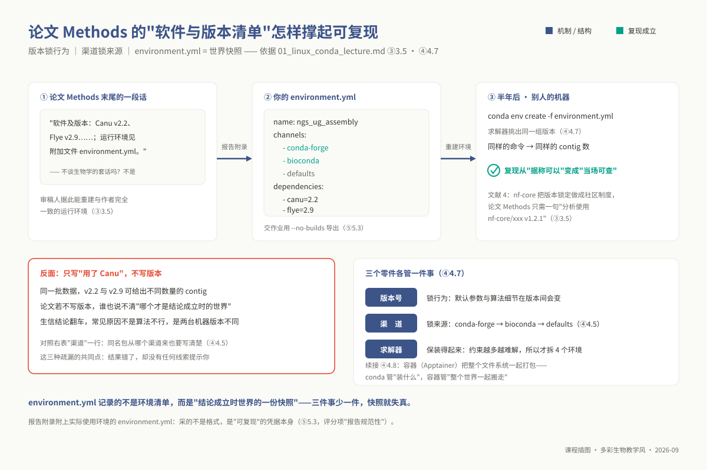
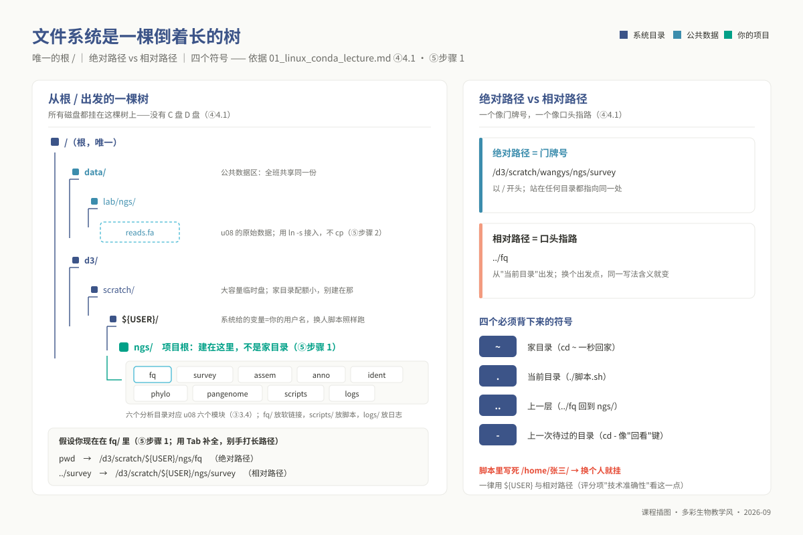
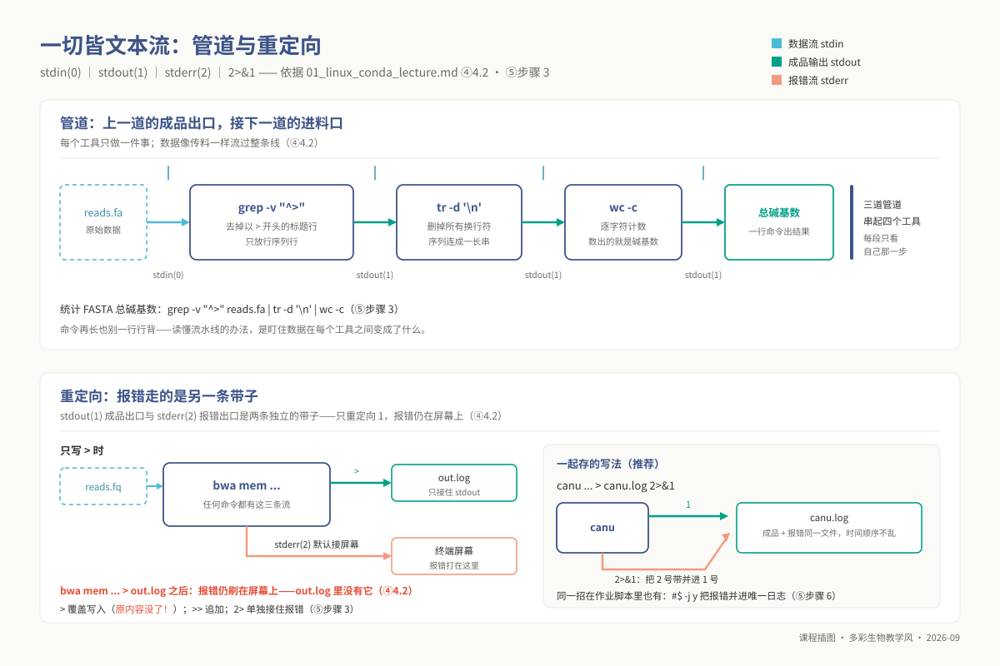
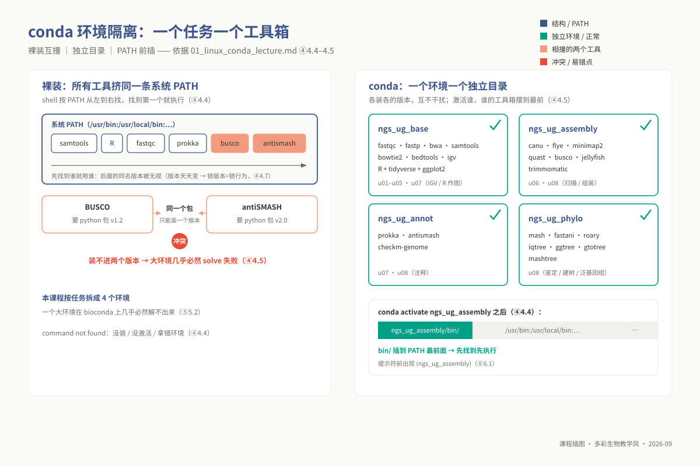
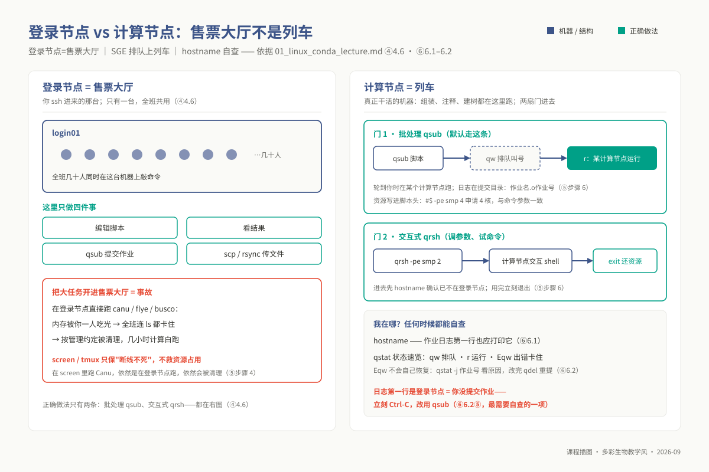
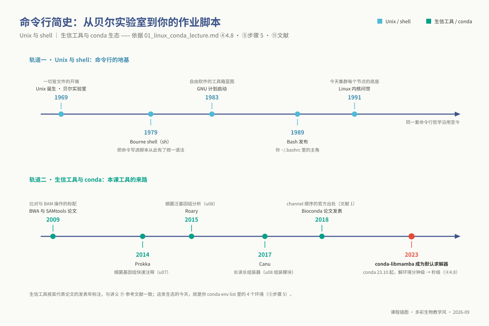

# 单元 u01：Linux 命令行与 Conda 环境

> **适用对象**：本科 ｜ 线上先导自学 ｜ 单元 id `u01` ｜ 自学量预估 4 学时
>
> **阅读重点**：本讲帮助你用命令、输出和排错路径理解 Linux 文件系统、Conda 环境与作业调度。完成后，你可以把目录组织、环境检查和资源判断迁移到后续单元。
>
> **注意**：共享登录节点只执行轻量操作；需要较多 CPU、内存或 I/O 的任务提交到计算节点。
<!-- 维护信息：大纲 `01_syllabus/syllabus_undergraduate.md` §五「单元 u01」；章节模板为契约 `lecture_template`；contract_version 1.1。 -->

---

## ① 学习目标

完成本单元的系统学习与终端实操后，你应当能够：

1. **解析集群拓扑与登录交互**：安全登录计算集群 `10.7.254.22`，从操作系统资源调度与进程生命周期层面，清晰阐明登录节点（网关与编排）与计算节点（算力承载）的职责分工，解释为何高并发、大内存分析任务必须依托作业调度系统（SGE）提交。
2. **掌握路径与寻址**：使用绝对路径和相对路径定位文件，解释 `/`、`~`、`.`、`..` 与 `-` 的含义。
3. **架构规范工程目录树**：遵循规范化科研目录标准，在个人工作区自动化搭建模块化项目骨架，深入理解软链接（Symbolic Link）的元数据指针机制，实现对海量原始测序数据的“零拷贝”接入与安全复用。
4. **执行流式文本处理**：解释标准输入、标准输出和管道的关系，组合文本工具完成序列文件的基本统计。
5. **部署跨网络传输与长程会话**：熟练运用 `scp` 与 `rsync` 协议在本地个人工作站与远程集群之间实施安全、可断点续传的双向数据同步；熟练使用终端多路复用器（`screen`/`tmux`）守护后台长周期会话，规避网络抖动导致的任务崩溃。
6. **管理 Conda 环境**：解释 `$PATH` 的搜索顺序和依赖求解的作用，完成课程环境的创建、激活、导出（`environment.yml`）与复现，并说明 `strict` 渠道优先级的用途。
7. **编写标准化调度批处理脚本**：编写符合 Sun Grid Engine (SGE) 调度规范的 `#$` 作业描述脚本，熟练运用 `qsub`、`qstat` 与 `qdel` 管理作业生命周期，并穿透底层日志定位进程退出与环境缺失的根源。
8. **诊断常见故障**：根据 `command not found` 等报错，区分程序缺失、环境未激活和 PATH 混用，并按步骤记录排查结果。

## ② 前置检查

**本讲即两个 L0 模块的本科教学落地版**——完成本单元讲义精读并通过配套实践自测，即可视为完成 L0 基础储备，无需重复修读：

| L0 模块 id | 核心主题 | 本讲知识点映射 | 对应自测与考核要求 |
|---|---|---|---|
| `l0_01_linux` | Linux 命令行交互与远程集群操作 | ④ 核心原理 + ⑤ 步骤 0–4、步骤 6（SGE 批处理作业编排） | L0-1 自测第 1–6 题；上机考核 U01-P1、U01-P2 |
| `l0_03_conda` | Conda / Mamba 环境隔离与可复现工程 | ⑤ 步骤 5（依赖求解、环境快照导出、跨平台复现） | L0-3 自测第 1–4 题；上机考核 U01-P3 |

**本讲为全课程第一站，零 Linux 经验也可以开始**。进入终端实战前，请确认以下三项基础条件：

| 准备项 | 状态确认指标 | 缺漏处理指引 |
|---|---|---|
| 本地终端模拟器 | macOS/Linux 打开系统自带「终端」；Windows 运行 PowerShell 或 WSL2 | 亦可使用成熟的 SSH 客户端（如 MobaXterm 或 Xshell） |
| 集群计算账号 | `ssh 用户名@10.7.254.22` 可成功接收到登录密码提示符 | 联系任课教师开通专属账号，**严禁借用或共享同侪账号** |
| 校园局域网接入 | 终端执行 `ping 10.7.254.22` 具备稳定网络回显响应 | 该 IP 属于校内专网网段，校外自学前必须预先连接学校 VPN 客户端 |

**后续依赖链**：u02 的 R 绘图栈使用 `ngs_ug_base`；u04–u07 的核心工具都需要正确激活环境；u08 的资源密集任务通过 `qsub` 提交。完成本讲后，建议保留自己的目录树、环境快照和排错记录，作为后续单元的检查材料。

## ③ 背景与科学问题

在经典分子生物学实验中，研究者的操作对象是微升管中的试剂与移液枪；而在现代高通量生物信息学中，操作对象演变为存储在大型分布式服务器硬盘中数十亿条碱基字符。本单元不直接推导具体的生物学演化假说，而是聚焦于生命科学迈入“干实验”时必须攻克的**底层工程计算架构问题**：当数十吉字节（GB）甚至太字节（TB）级别的三代长读长原始数据存储在中心服务器的 `/data/lab/ngs/reads.fa` 时，**我们如何在不将海量数据搬迁至个人本地笔记本、不耗尽公共服务器计算资源、且在数年之后仍能向学术同行无损重现完全相同分析结果的前提下，驱动整个自动化分析流？**

```text
从生物学样本到计算工程环境的桥梁：
  [ 湿实验高通量测序仪 ] ──> 产出数十 GB 原始序列文件 (/data/lab/ngs/reads.fa)
                                  │
                                  ▼ (面临三大现实工程瓶颈)
  ┌───────────────────────┬───────────────────────┬───────────────────────┐
  │ 1. 数据体量与跨网瓶颈  │ 2. 共享算力资源抢占  │ 3. 软件运行环境腐蚀  │
  │ 拒绝本地盲目拷贝下载   │ 拒绝登录节点盲目重算   │ 拒绝全局软件随意覆盖  │
  │ 解决方案：SSH + 软链接 │ 解决方案：SGE 批处理  │ 解决方案：Conda 多环境 │
  └───────────────────────┴───────────────────────┴───────────────────────┘
```

**为什么高通量生物信息学必须建立在 Linux 命令行基础之上**？

1. **数据吞吐与 I/O 处理瓶颈**：普通图形界面办公软件在打开超过 2 GB 的文本文件时即会遭遇内存溢出崩溃。Linux 命令行工具（如 `head`、`less`、`grep`）直接基于内核文件描述符实施流式内存映射，仅按需调入当前屏显的数据片段，即便处理 100 GB 级别的大文件也能在数毫秒内获得实时响应。
2. **算法生态的天然 UNIX 亲和性**：国际主流生信工具（如比对算法 BWA、基因组组装器 Canu、注释引擎 Prokka）生而为管道自动化批处理服务，其设计遵循“单功能微内核”哲学，原生不提供任何图形外壳。
3. **科学推断的绝对可复现性**：图形界面的点选操作转瞬即逝、无从审计。而在 Linux 终端中，分析人员输入的每一行命令、调用的每一个超参数均被显式记录在文本脚本中，能够无缝纳入 Git 版本受控管理，随时供同行独立核验。

### 3.4 本单元在 u08 综合项目中的位置

u08 实践项目是一场历时 3 天（24 集中学时）的高强度细菌全基因组重构与泛基因组演化攻关（以约 4 Mb 的模式菌株 PacBio 测序数据为实战对象，统一部署在 `10.7.254.22` 集群）。本单元正是该综合大项目的**第一块基石**：

| 项目手册规范对应节 | 项目现场操作要求 | 本讲教学对应知识点 |
|---|---|---|
| §3.3 运行环境初始化 | `source /opt/miniconda3/bin/activate` $\rightarrow$ `conda activate` | ⑤ 步骤 5：环境初始化与激活 |
| §3.4 模块化目录树搭建 | `mkdir -p /d3/scratch/${USER}/ngs/{survey,assem,anno,ident,phylo,pangenome}` | ⑤ 步骤 1（自动化脚本 `01_setup_project_dirs.sh`） |
| §4.1 原始数据接入 | `ln -s /data/lab/ngs/reads* ./` | ⑤ 步骤 2：建立数据软链接 |
| §4.1–§4.6 全流程计算 | 编写标准化 `#$` 作业脚本并依托 `qsub` 异步投递 | ⑤ 步骤 6（作业模板脚本 `01_qsub_hello.sh`） |
| 结课报告规范性附录 | 导出并递交无冗余的 `environment.yml` 作为可重复凭证 | ⑤ 步骤 5.3：环境快照导出 |

**实践启示**：在项目第一天的第一个小时内，全班所有同学执行的完全是本单元传授的标准规范。若本单元基础未夯实，学生将遭遇大量如“路径拼写断裂导致数据未读入”、“环境未激活抛出 command not found”等基础工程阻碍。

### 3.5 应用案例：论文 Methods 里那段"软件与版本清单"是怎样撑起可复现的

**案例：Ewels 等（*Nature Biotechnology*, 2020）——nf-core 社区标准驱动的生物信息学可重复性宣言。**

翻开国际顶尖生命科学期刊的研究方法（Methods）小节，读者总能看到一段高度形式化的文字：详细列明了整套研究所依赖的算法名称、精确版本号、核心命令行参数与依赖包清单。这绝非例行公事的套话，而是科学结论得以立足的法理凭证。在生信分析中，**两台物理机上因软件小版本差异所引发的“静默偏倚”屡见不鲜**：以三代基因组组装为例，同一款组装器的 v2.2 与 v2.9 在相同的 PacBio 读长集上，由于内置纠错图剪枝阈值的细微演进，可能产出完全不同拓扑结构的重叠群（Contigs）。

若作者未在论文中精确锁定软件版本并公开环境元数据，后人将陷入无法判别“哪一个是真相”的泥潭。
国际 nf-core 联盟（Ewels et al., 2020，详见 ⑪）将这一逻辑推升为现代学术标准：论文只需声明所依托的标准流程版本，审稿人便可凭借随附的 Conda 环境描述或不可变容器镜像，在分钟级内原地重建与第一作者完全同构的计算环境。

```text
可复现科学研究的三大基石：
  [ 算法版本锁定 ] ──> 保证算法数学模型与默认启发式参数的绝对一致
         │
  [ 渠道来源隔离 ] ──> 消除底层动态共享库 (glibc/libstdc++) 的编译 ABI 冲突
         │
  [ 求解环境快照 ] ──> 导出 environment.yml，供全球同行一键无损复盘
```



*图 u01-6：Methods 可复现三零件：版本、渠道、求解器——environment.yml 就是凭据链。*

## ④ 核心原理

本科生阶段的原理学习**重在建立扎实直观的计算物理与系统心智模型**。以下六大核心比喻与底层机理解构，覆盖了生信工程师日常操作中最为关键的知识点。

### 4.1 文件系统是一棵倒着生长的倒悬树

在 Windows 操作系统中，数据被分割在独立的盘符（C盘、D盘）之中；而在 Linux 架构下，**全系统仅存在唯一的根命名空间，即根目录 `/`**。所有的物理机械硬盘、固态硬盘阵列、分布式网络存储卷（NFS/Lustre），均被抽象挂载为这棵单根巨树上的某一个分枝节点。

```text
Linux 单根树状命名空间：
                         / (根目录)
            ┌────────────┼────────────┐
          /bin         /data        /d3
        (系统命令)   (中心公共库)     (高性能大容量计算盘)
                         │            └── scratch
                      /lab                    └── ${USER} (个人安全沙箱)
                        └── ngs                       └── ngs
                              └── reads.fa                    ├── survey
                                                              ├── assem
                                                              └── fq
```

- **绝对路径（Absolute Path）**：如同国家邮政系统中的标准法定门牌号（例如 `/d3/scratch/wangys/ngs/survey`），无论当前工作终端处于文件树的哪个坐标，该路径所定位的物理实体恒定唯一。
- **相对路径（Relative Path）**：如同日常生活中的口头指路（例如 `../fq/reads.fa`），其最终解析位置严格依赖于当前工作目录（Working Directory）这一参照原点。
- **核心保留元字符**：`~` 锚定当前登录用户的家目录（`/home/username`）；`.` 锚定当前所在的工作节点；`..` 沿树干反向退回上一层父级节点；`-` 记录最近一次访问的物理历史节点（相当于遥控器的回看切屏功能）。在编写工程化脚本时，**严禁使用写死具体用户名的绝对路径**，必须采用环境变量 `${USER}` 与标准相对路径，确保管线具备跨账号的可移植性。



*图 u01-3：文件系统树：公共数据放 /data，项目文件放 /d3/scratch/$USER，别写死 /home/张三。*

### 4.2 一切皆文本流：标准管道与重定向的流水线本质

UNIX 哲学的大厦建立在两根支柱之上：**“每个工具仅专注做好一件小事”** 与 **“一切输入输出皆可抽象为字节流”**。
每一个在 Linux 中启动的独立程序，在操作系统内核中被自动赋予三个标准 I/O 文件描述符（File Descriptors）：

- **标准输入 `stdin` (文件描述符 0)**：程序的标准进料口，默认绑定键盘输入设备。
- **标准输出 `stdout` (文件描述符 1)**：程序的标准合格产物出口，默认绑定终端显示屏幕。
- **标准错误 `stderr` (文件描述符 2)**：程序的警报与故障诊断日志出口，独立流向显示屏。

```text
管道连接内核环形缓冲区 (Ring Buffer)：
  [ 命令 A (如 zcat) ] ──(stdout: 1)──> [ 内核管道内存缓冲 ] ──(stdin: 0)──> [ 命令 B (如 grep) ]
          │                                                                     │
     (stderr: 2) ───────────────────> 终端显式报警 <────────────────────── (stderr: 2)
```

重定向符 `>` 截断了本该流向屏幕的 `stdout`，将其原子性覆写至磁盘物理文件中；`>>` 则将流以追加模式附加至文件末尾。最为关键的技术陷阱在于：**当生信软件抛出致命错误时，报错信息默认走 `stderr(2)` 通道**。若仅使用 `bwa mem ... > align.log`，屏幕虽然保持安静，但所有错误信息依然会漏掉；只有使用 `> align.log 2>&1`，方能强制将通道 2 的流汇合进通道 1，实现运行全景日志的完整受控封存。



*图 u01-2：管道与三条流：stdout 接力干活，stderr 走另一条带子——> 与 2>&1 之辨。*

### 4.3 软链接的元数据指针机制：告别磁盘空间灾难

在超算平台中，原始高通量测序数据动辄数十吉字节。`ln -s 目标源文件 链接实体名称` 并不会在磁盘磁道上开辟新的存储空间复制这批碱基，其在底层仅仅在文件目录表中开辟了一个极小的索引节点（Inode），其内部仅存储了一条指向源文件绝对坐标的路径文本指针。

```text
软链接的本质是指针寻址：
  [ 个人目录软链接: reads.fa ] ──[ 仅包含路径字符串指针 (约30字节) ]──> [ /data/lab/ngs/reads.fa ] ──> (物理磁盘几十GB数据块)
```

**工程警示与死链（Broken Link）防御**：
当源文件被管理员移动或重命名后，软链接将失去目标指针，蜕变为“死链”。在终端中死链通常显示为醒目的红色高亮；此时执行读取命令会抛出令人困惑的 `No such file or directory`。验证软链接活性的黄金法则即使用 `ls -lL`（跟随测试）或 `head -n 2` 确认指针终点的数据可达性。

### 4.4 `command not found` 的机理：遍历 `$PATH` 寻径机制

当你在提示符后敲击回车时，操作系统的 Bash 解释器并不知道这个字符串的含义。系统内核严格依赖全局环境变量 `$PATH` 中声明的目录序列（目录间以冒号 `:` 隔开），**从左至右**逐一在物理磁盘中检索是否存在同名的可执行文件二进制。

```text
Bash 执行命令时的路径搜索流水线：
  用户输入 "jellyfish"
          │
          ▼
  检索 $PATH: [/d3/scratch/.../envs/ngs_ug_assembly/bin] : [/usr/local/bin] : [/usr/bin]
                            │                                     │                │
                      [命中! 立即执行]                     (若左侧未命中)    (若前驱均未命中)
```

这揭示了三大核心现象的数理机理：

1. **`conda activate` 的本质操作**：无非是利用 Shell 内部函数，将当前特定虚拟环境的 `bin/` 绝对路径硬性插入至 `$PATH` 的**最左端**，实现当前环境工具对系统旧版本工具的优先级遮蔽。
2. **多环境混淆**：若在激活了 `ngs_ug_base` 的环境中执行 `canu`，系统因在该环境的 `bin/` 中搜寻不到目标，最终必然抛出 `command not found`。
3. **集群批处理环境丢失**：超算调度器在计算节点初始化子进程时，默认不会执行用户个人的交互式环境脚本，导致 `$PATH` 处于纯净初始态，因此作业脚本内部必须无条件重新执行初始化与环境激活。

### 4.5 Conda 运行环境隔离：解决多依赖图冲突的唯一利器

在生物信息学发展史中，不同的高通量分析工具往往基于特定年代的 Python 版本与第三方 C/C++ 动态库开发（例如 BUSCO 对 Python 库版本的严格限制与 antiSMASH 对底层 HMMER、BioPython 版本的特定诉求完全互斥）。若试图将所有工具集中全局编译在单一操作系统环境中，必然遭遇不可调和的动态链接库版本冲突（Dependency Hell）。

```text
全局裸装 vs Conda 隔离环境沙箱：
  [ 全局混合环境 (灾难) ] ──> 同时安装工具A与工具B ──> 争夺 libc.so.6 / Python 库版本 ──> 依赖崩溃!

  [ Conda 模块化沙箱 ]
    ├── envs/ngs_ug_base/      ──> 封装质控与基础比对工具栈
    ├── envs/ngs_ug_assembly/  ──> 封装长读长组装与评估工具栈
    ├── envs/ngs_ug_annot/     ──> 封装原核生物基因注释工具栈
    └── envs/ngs_ug_phylo/     ──> 封装进化树与泛基因组工具栈 (R/BioPerl)
```

**渠道优先级（Channel Priority）为什么不可随意颠倒**：
Conda 软件包由全球社区在不同的编译基座上构建。`bioconda` 仓库中的生信专用二进制，是严格链接在 `conda-forge` 社区所维护的基础 C 库（如 OpenBLAS、zlib）之上的。若学生将 `defaults` 放置在最前，求解器将拉取 Anaconda 官方构建的底层动态库，极易在运行时触发符号链接缺失（Symbol lookup error）。本课程强制贯彻 `conda-forge` $\succ$ `bioconda` $\succ$ `defaults` 的三级严格顺序。



*图 u01-1：裸装共用一条 PATH 互相覆盖（左）；conda 一个环境一个独立目录，各装各的版本（右）。*

### 4.6 登录节点与计算节点：售票大厅绝不可开进高速列车

高性能计算集群在物理架构上是由高速低延迟局域网（如 InfiniBand）互联的一组计算机阵列。

- **登录节点（Login Node）**：作为整个集群面向公网开放的唯一网关，其职能如同火车站的**售票大厅与调度服务台**。其计算资源有限，面向全校数十名师生共享，仅被允许用于编写调试脚本、审阅分析日志以及通过调度命令投递任务。
- **计算节点集群（Compute Nodes）**：配备海量多核 CPU 与大容量 ECC 内存的高性能计算列车，隐藏在内网之后，专门承载基因组比对、组装图遍历等高负载运算。

```text
集群拓扑与任务分发模型：
  [ 用户终端 ] ──(SSH)──> [ 登录节点 login01 (售票大厅) ] ──(禁止直接运行重负荷任务!)
                                     │
                             (编写 SGE 作业脚本)
                                     │
                                     ▼ (执行 qsub 投递)
                          [ SGE 资源调度中心 (排队叫号) ]
                                     │
           ┌─────────────────────────┼─────────────────────────┐
           ▼                         ▼                         ▼
  [ 计算节点 node01 ]        [ 计算节点 node02 ]        [ 计算节点 node03 ]
  (48核 / 256GB 内存)        (48核 / 256GB 内存)        (48核 / 256GB 内存)
  (承载组装进程: Canu)       (承载注释进程: Prokka)     (承载建树进程: IQ-TREE)
```

若有同学在登录节点直接敲击 `canu -p ecoli ...`，该程序将瞬间吞噬数十个核心与上百 GB 内存，导致登录节点陷入彻底的 I/O 阻塞假死，全班同学的 SSH 终端全部卡顿断开。按集群管理约定（登录提示：超过 5 分钟的进程会被终止），这类进程会被管理员清理；实测并非自动强杀，但赌不得，数小时的计算可能白跑。**大任务必须编写 SGE 批处理脚本，依托 `qsub` 异步投递**。



*图 u01-4：登录节点是售票大厅：只做编辑、提交、看队列，计算请上计算节点。*

### 4.7 为什么"可复现"需要环境管理：版本、渠道、求解器各管一件事

为确保科学研究的严谨性，`environment.yml` 的导出绝非形式主义，它在工程维度牢牢固化了三层约束：

1. **语义版本（Semantic Versioning）约束**：锁定软件主、次与修订版本，固化其内置的统计学模型与启发式剪枝阈值；
2. **构建渠道（Channel）约束**：锁定软件包编译时的依赖生态拓扑，规避因系统底层 ABI 漂移导致的隐性数值溢出；
3. **约束满足求解器（Solver）快照**：用一份精确的数学组合，记录在某一历史时刻该依赖关系曾被成功求解并跑通这一确定性物理事实。

### 4.8 技术前沿（2023–2026）：求解器演化与现代容器架构



*图 u01-5：命令行工具双轨史：Unix→Linux 三十年，生信工具链→Bioconda 十年。*

近三年来，生信基础设施在两项关键技术上迎来了质的飞跃：

1. **底层求解器全面由 Python 跃迁至 C++（Mamba 引擎的官方收敛）**：长期以来，Conda 采用 Python 原生编写的 SAT 求解器，当生物学包依赖树过于繁复时，其在内存中的图遍历极其缓慢，常陷入长达数小时的 `Solving environment` 假死。从 Conda 23.10 开始，利用 C++ 高性能重写的 **`libmamba` 求解器正式成为官方默认核心**，将依赖解析耗时从十分钟级断崖式压缩至数秒以内。
2. **Apptainer（Singularity）无特权容器的普及**：Conda 解决了用户空间软件包的版本共存，但依然依赖宿主机的 Linux 内核及基础动态库。现代顶级超算普遍部署以 Apptainer 为代表的容器引擎，它不仅支持以普通用户身份运行，更将包含操作系统根文件系统在内的全部二进制打包为单个只读不可变镜像（SIF 格式），为多组学自动化分析提供了终极确定性保障。

## ⑤ 操作步骤

全部终端指令均在指定服务器集群上实操演练。请严格遵循“阅读参数含义 $\rightarrow$ 终端键入验证 $\rightarrow$ 审查输出特征”的完整闭环，切忌盲目复制粘贴。配套自动化脚本存放于 `03_code/undergraduate/scripts/`。

### 步骤 0：建立 SSH 远程加密交互会话

```bash
# 基础登录：ssh 用户名@集群网关主机地址
ssh wangys@10.7.254.22

# 高级图形转发：-X 开启 X11 协议隧道，支撑远程启动桌面级生物学工具 (如 u07 的 IGV)
ssh -X wangys@10.7.254.22

# 【强烈推荐】在本地个人电脑终端生成现代高强度 Ed25519 密钥对，实现一劳永逸的免密直连
ssh-keygen -t ed25519 -C "student_ngs@stu.edu.cn"   # 连续回车三次，保持默认存储路径
ssh-copy-id wangys@10.7.254.22                      # 最后一次输入密码，将公钥植入服务器授权池
```

*首次连接时，终端会呈现远程主机的 SHA256 密钥指纹并询问连接确认，必须键入完整的 `yes`；随后输入密码时，出于操作系统安全防窥设计，屏幕不会显示任何星号或字符回显，输入完毕直接敲击回车即可。*

### 步骤 1：拓扑巡检与标准化科研工程目录构建

```bash
pwd                 # 显示当前工作目录绝对路径 (Print Working Directory)
ls -lh              # 列表长格式审查 (-l 打印权限/所有者/体积，-h 人性化转换为 KB/MB/GB)
ls -ltr             # 强化排序 (-t 按时间排序，-r 逆序，确保最新产出的数据始终沉底可见)
df -h /d3/scratch   # 检查刮擦盘剩余空间（经验建议：使用率高于约 85% 就先清理）

# 严禁在配额仅有 20GB 的个人家目录下展开组装！在 /d3/scratch 建立专属安全沙箱
# 变量 ${USER} 会自动解析为你的登录账号名，保障脚本的可移植性
mkdir -p /d3/scratch/${USER}/ngs/{survey,assem,anno,ident,phylo,pangenome}
mkdir -p /d3/scratch/${USER}/ngs/{fq,scripts,logs}
# 参数 -p 保障了父级目录递归自动建立，且目录已存在时幂等不报错
```

执行配套目录自动化脚本：`bash 03_code/undergraduate/scripts/01_setup_project_dirs.sh`，脚本将在你的工作区内精准完成六大分析模块子目录的原子初始化。

### 步骤 2：建立原始测序数据的无损软链接

```bash
cd /d3/scratch/${USER}/ngs/fq
# 为 /data/lab/ngs/ 下的测序数据建立软链接，./ 代表链接放置在当前目录
ln -s /data/lab/ngs/reads* ./

ls -lh reads*       # 审查软链接属性，行首应呈现标识软链接的字母 'l'
# 期望显式特征：reads.fa -> /data/lab/ngs/reads.fa
head -n 2 reads.fa  # 关键测试：能成功读取前两行代表指针通畅，未发生死链
```

### 步骤 3：流式文本挖掘、跨进程管道与重定向实操

```bash
# 1. 快速探查与增量监控
head -n 20 reads.fa               # 抓取文件头部前 20 行，快速识别 FASTA/FASTQ 格式
tail -f ../logs/canu.log          # -f 参数实时挂起监听正在持续增长的计算日志 (Ctrl-C 退出)
less -S reads.fa                  # 交互式分页审查 (-S 禁止长行折叠，空格翻页，q 键优雅退出)
zcat sample.fq.gz | head -n 8     # 核心技能：免解压直接读取压缩流，节省数十 GB 磁盘空间

# 2. 文本过滤与字段结构化截取
grep -c "^>" reads.fa             # 利用正则锚定行首，极速统计 FASTA 格式包含的总序列条数
grep -v "^#" annot.gff | cut -f1,4,5 | head  # 管道接力：剔除注释行，精确抽取第 1、4、5 核心列

# 3. 复杂统计流水线推演
# 纯流式计算总碱基数：过滤掉标题行 -> 移除所有换行符 -> 统计纯字节数
grep -v "^>" reads.fa | tr -d '\n' | wc -c

# 极速推导 FASTQ 测序 Read 总数 (行数除以 4)
zcat sample.fq.gz | wc -l | awk '{print $1/4}'

# 4. 标准输出与报错合并受控重定向
bash run_pipeline.sh > run.log 2>&1  # 将 stdout 与 stderr 统一封存至单一日志
```

运行封装脚本 `01_seq_stats.sh`：`bash 03_code/undergraduate/scripts/01_seq_stats.sh reads.fa`，脚本将输出该测序文件的序列条数、总碱基数、平均读长、最长/最短读长与估算深度（不计算 N50，N50 在 u06 由 QUAST 给出）。

### 步骤 4：文件安全跨网流动与终端长程会话守护

```bash
# 【必须在本地个人电脑终端敲击】实现文件安全同步
# 1. 上传本地实验记录至服务器：scp 源物理文件 目标服务器路径
scp ./experiment_notes.md wangys@10.7.254.22:/d3/scratch/wangys/ngs/
# 2. 下载远程分析成果报表至本地：
scp wangys@10.7.254.22:/d3/scratch/wangys/ngs/assem/quast_out/report.txt ./
# 3. 大体量目录带进度断点续传：
rsync -avP wangys@10.7.254.22:/d3/scratch/wangys/ngs/anno/ ./local_anno/

# 【在服务器端执行】终端多路复用会话保护，规避校园网断线导致任务夭折
tmux new -s ngs_work   # 开启名为 ngs_work 的持久沙箱会话
# 会话内脱离保持后台运行：依次键入快捷键 Ctrl-b，松开后单按 d (Detach)
tmux ls                # 审查当前系统存在的守护会话清单
tmux attach -t ngs_work # 无论何时何地重新登录，一秒接回原有工作现场
```

### 步骤 5：Conda 环境工业级初始化、配置与环境导出

**5.1 初始化并设定严格渠道拓扑**：

```bash
source /opt/miniconda3/bin/activate        # 初始化 Conda 底层运行时
conda config --add channels defaults
conda config --add channels bioconda
conda config --add channels conda-forge   # 倒序添加，最终确保 conda-forge 拥有顶格优先级
conda config --set channel_priority strict # 启用严格优先级策略，消除依赖解算混乱
conda config --show channels              # 核验渠道列表顺序
```

**5.2 建立本课程四大隔离环境**（环境定义受控存放于 `07_envs/conda/`）：

| 环境唯一命名 | 规范配置文件 | 核心工具集成 | 对应教学单元 |
|---|---|---|---|
| `ngs_ug_base` | `env_ug_base.yml` | fastqc, multiqc, fastp, bwa, bowtie2, samtools, igv, R-base, tidyverse, ggplot2 | u01–u05、u07 IGV 模块、u02 全部可视化 |
| `ngs_ug_assembly` | `env_ug_assembly.yml` | jellyfish, canu, flye, minimap2, trimmomatic, quast, busco | u06 基因组组装、u08 测序调查与组装实战 |
| `ngs_ug_annot` | `env_ug_annotation.yml` | prokka, antismash, checkm-genome | u07 结构注释、u08 次级代谢产物挖掘 |
| `ngs_ug_phylo` | `env_ug_phylo.yml` | mash, fastani, mashtree, gtotree, iqtree, roary, ggtree | u08 物种鉴定、系统发育与泛基因组全谱 |

```bash
cd 07_envs/conda
conda env create -f env_ug_base.yml       # 执行物理构建 (或 mamba env create -f env_ug_base.yml)
conda activate ngs_ug_base                # 激活基础环境
which samtools && R --version | head -n 1 # 执行原子冒烟测试，确认工具均来自该沙箱 bin/
```

执行自动化构建测试脚本：`bash 03_code/undergraduate/scripts/01_conda_env_setup.sh base assembly`。

**5.3 导出确定性环境规范文件**：

```bash
# 滤除本地动态编译哈希号，导出支持跨操作系统架构重构的轻量规范 (大作业附录必须递交此件)
conda env export --no-builds > environment.yml
```

### 步骤 6：编写并投递 SGE 高性能计算批处理脚本

创建标准作业脚本 `kmer_count.sh`：

```bash
#!/bin/bash
#$ -S /bin/bash                  # 显式声明子进程解释器为标准 bash
#$ -N kmer_count                 # 声明作业在调度监控体系中的全局名称
#$ -cwd                          # 关键指令：强制在当前提交所在的物理目录内启动任务
#$ -j y                          # 将 stderr 自动合并至 stdout，输出单一结构化运行日志
#$ -pe smp 4                     # 向系统申请绑定 4 个共享内存 CPU 核心

# 核心防线：集群计算节点不继承终端交互环境，必须显式引导并激活专属环境
source /opt/miniconda3/bin/activate
conda activate ngs_ug_assembly

echo "=== 作业启动元数据审计 ==="
echo "执行物理计算节点: $(hostname)"
echo "当前激活的沙箱环境: ${CONDA_DEFAULT_ENV}"
echo "启动时间戳: $(date)"

cd /d3/scratch/${USER}/ngs/survey
jellyfish count -C -m 21 -s 1000000000 -t 4 -o reads.jf <(zcat ../fq/*.fq.gz)
jellyfish histo -t 4 reads.jf > reads.histo

echo "完成时间戳: $(date)"
echo "=== 作业成功结束 ==="
```

```bash
qsub kmer_count.sh               # 投递异步批处理作业，屏幕返回专属 Job ID (如 12345)
qstat                            # 审查当前排队与执行状态 (qw 代表排队等待，r 代表执行中)
qstat -j 12345                   # 深度审查作业运行详情 (若作业异常中止，错误根因在此展现)
less kmer_count.o12345           # 审查标准作业输出日志，确认计算节点产物
```

通过执行教学冒烟脚本 `qsub 03_code/undergraduate/scripts/01_qsub_hello.sh`，快速完成集群提交连通性测试。

## ⑥ 结果解读

### 6.1 各操作步骤"正常态"的特征指纹

| 关键操作节点 | 正常态系统响应特征与诊断指标 |
|---|---|
| SSH 安全网关接入 | 终端输出服务器欢迎横幅，命令提示符变更为 `[wangys@login01 ~]$` |
| 软链接数据映射 | 执行 `ls -lh` 时，权限位首字母为 `l`，明确展现 `reads.fa -> /data/lab/ngs/reads.fa` 映射指针 |
| Conda 沙箱环境激活 | 终端提示符前缀被动态插入 `(ngs_ug_base)`；`which samtools` 绝对路径包含 `.../envs/ngs_ug_base/bin/` |
| SGE 批处理作业投递 | 终端返回 `Your job 12345 ("kmer_count") has been submitted` |
| 调度日志落盘审计 | 作业生成的 `.o12345` 日志第一行打印的主机名为计算节点（如 `node03`），绝非 `login01` |
| 环境快照导出产物 | `environment.yml` 中 `name:` 字段精准匹配，`dependencies:` 列表中系统记录了依赖版本条目 |

### 6.2 异常态故障模式深度穿透（五大约束陷阱）

**① 软链接“死链”指针悬空陷阱**：

- **表现**：`ls` 列表中软链接呈现鲜艳的红色高亮闪烁；试图执行 `head reads.fa` 时抛出 `cannot open: No such file or directory`。
- **机理**：创建软链接时源文件路径发生微小拼写错误，或源数据在后序维护中被物理迁移，导致符号指针指向了不存在的虚拟坐标。
- **排错**：运行 `ls -lL reads.fa` 直接探测源端；核对源文件绝对路径后通过 `ln -sf /真/实/路/径 ./reads.fa` 覆盖修复。

**② Conda 环境“伪激活”与系统全局包抢占**：

- **表现**：虽然提示符已经变更为 `(ngs_ug_base)`，但执行 `which samtools` 依然返回 `/usr/bin/samtools`。
- **机理**：该虚拟环境中实际并未成功安装该工具，Bash 在当前沙箱的 `bin/` 中搜寻失败后，按照 `$PATH` 顺序回退至底层宿主系统目录。
- **排错**：执行 `conda list samtools` 确认该沙箱是否真包含该包；若不包含，说明**拿错了工具箱**，应切换至对应环境。

**③ 作业调度陷入永久挂起的 `Eqw` 僵死态**：

- **表现**：`qstat` 列表中作业状态长久显示为 `Eqw`，不推进亦不退出。
- **机理**：SGE 调度器在计算节点初始化作业执行环境时即遭遇底层致命阻碍（例如脚本中声明的 `#$ -cwd` 目录在计算节点无法访问，或脚本中包含 Windows 回车符）。
- **排错**：必须执行 `qstat -j <JobID>`，定位底部的 `error reason` 明确根本原因；随后执行 `qdel <JobID>` 释放队列。

**④ 作业瞬间秒退且日志抛出 `command not found`**：

- **机理**：批处理脚本内遗漏了 `source /opt/miniconda3/bin/activate` 与 `conda activate`，导致计算节点在无生信工具的裸机默认 `$PATH` 下运行。

**⑤ 日志元数据暴露违规在登录节点运行**：

- **表现**：日志第一行打印的运行节点主机名为 `login01`。
- **机理**：学生误将作业当作常规 Bash 脚本直接在交互终端敲击 `bash kmer_count.sh` 执行，严重违背集群规范。

### 6.3 存储配额与空间“健康体检”

大型基因组从头组装（如 Canu）在遍历重叠图与错误纠正阶段，会产生超过原始数据量 10 倍以上的庞大临时碎片文件。

- **定期执行磁盘水位普查**：`df -h /d3/scratch`，磁盘接近写满时，大文件写入可能中途失败，产物被截断却不一定报错（经验建议使用率保持在约 85% 以下，并核对产物大小/行数）。
- **定位空间过度膨胀源**：执行 `du -sh /d3/scratch/${USER}/ngs/* | sort -h`，精准识别无用的大型日志或中间产物并执行受控清理。

## ⑦ 统计插件

**本讲无独立统计要点。**

本单元为全课程的技术底座，聚焦于操作系统命令行规范、I/O 调度与虚拟环境构建，输出物为规范的工程目录树、批处理脚本与环境配置文件，**不涉及从高通量测序数据中提取生物学信号，亦不产生依赖概率模型推断的统计学结论**（本专题不在契约 `stats_plugin_topics` 名单中）。
然而必须指出，**严格的环境版本控制是整套课程乃至现代科学统计严谨性的物理前提**：在后序涉及差异表达检验（u04/u05）与多重假设检验校正的计算中，统计模型参数在不同软件补丁版本间的微小调整均会导致最终判定显著性的差异基因集合发生漂移。本讲通过锁定环境快照，为全课程统计推断的绝对稳定性筑牢了基石。

## ⑨ 常见错误与排查

### 9.1 登录、网络与密钥认证故障

| 报错控制台原型 | 操作系统底层物理机理 | 标准自愈解决方案 |
|---|---|---|
| `ssh: connect to host 10.7.254.22 port 22: Connection timed out` | 本地处于校园局域网外部，物理路由无法直接跨越公网送达私有网段 | 启动校园网官方 VPN 客户端，在本地确认 `ping 10.7.254.22` 产生低延迟回显后再行登录 |
| `Permission denied (publickey,password).` | 身份凭证不匹配：用户名输入有误、键盘大写锁定开启、或多次输错触发服务器防暴力破解临时 IP 封锁机制 | 严谨核对用户名与初始密码；输入密码时屏幕无任何符号回显属正常现象；若连续失败三次请静置 5 分钟重试 |
| `WARNING: REMOTE HOST IDENTIFICATION HAS CHANGED!` | 远程主机重装系统或迁移网卡，导致其公钥特征与本地 `~/.ssh/known_hosts` 中记录的指纹产生冲突 | 经向机房管理员核实确系系统维护后，本地执行 `ssh-keygen -R 10.7.254.22` 清除旧有指纹记录即可恢复 |

### 9.2 文件系统、权限与路径定位故障

| 报错控制台原型 | 操作系统底层物理机理 | 标准自愈解决方案 |
|---|---|---|
| `cd: .../survey: No such file or directory` | 目标物理路径未创建，或路径中硬编码了他人用户名而非当前动态账户 | 使用 `${USER}` 变量重构路径；运行 `01_setup_project_dirs.sh` 批量创建；高频使用 Tab 键智能补全 |
| `ln: failed to create symbolic link: File exists` | 当前目录下已存在同名物理文件或历史软链接残余 | 审查已存在文件的真实性；若确需覆盖，可使用 `ln -sf` 实施强制指针刷新（**警惕：-f 会无条件销毁同名物理文件**） |
| `syntax error near unexpected token $'\r'` | 脚本在 Windows 系统下经过编辑保存，行尾注入了不可见的 CRLF 回车换行符，Linux 将 `\r` 误判为命令名 | 在集群端执行 `dos2unix kmer_count.sh` 或 `sed -i 's/\r$//' kmer_count.sh`，彻底剥离回车符 |
| `cp: writing ...: Disk quota exceeded` | 个人家目录（`/home/username`）触发了管理员设定的物理硬配额限制（常为 20GB） | 严禁在家目录直接存放海量测序数据；全面改用软链接接入；大任务工作区必须无条件迁移至 `/d3/scratch/${USER}/` |

### 9.3 Conda 环境构建与依赖求解死锁

| 报错控制台原型 | 操作系统底层物理机理 | 标准自愈解决方案 |
|---|---|---|
| `bash: conda: command not found` | 当前 Shell 会话尚未加载 Conda 的初始化引导脚本 | 执行 `source /opt/miniconda3/bin/activate`；批处理作业脚本首部必须无条件写入该指令 |
| `EnvironmentNameNotFound: Could not find: ngs_ug_base` | 该命名空间的环境尚未构建，或当前 Conda 根路径指向了他人账号目录 | 执行 `conda env list` 查看实际可用沙箱；依照指导手册执行 `conda env create -f env_ug_base.yml` 进行重构 |
| `Solving environment: failed with initial frozen solve` | 软件依赖版本组合产生互斥约束，SAT 求解器陷入大规模回溯组合爆炸 | ① 改用基于 C++ 的 `mamba env create -f xxx.yml`；② 检查 `conda config --set channel_priority strict` 是否就绪；③ 确认 channels 是否满足指定顺序 |
| `PackagesNotFoundError: The following packages are not available` | 软件源配置缺失，或生物学工具名在社区生态中已发生演变命名迁移 | 执行 `conda config --show channels` 确认 bioconda 处于活跃态；注意 CheckM 真实包名为 `checkm-genome` |

### 9.4 SGE 资源调度器异常

| 报错控制台原型 | 操作系统底层物理机理 | 标准自愈解决方案 |
|---|---|---|
| `denied: host "login01" is no submit host.` | 用户试图在非受权的辅助节点敲击 `qsub` | 运行 `hostname` 确认当前节点坐标，必须在受权的主登录节点或提交节点执行批处理投递 |
| 作业卡死 `Eqw` 且显示 `can't chdir to ...` | 脚本中启用了 `#$ -cwd`，但发起提交的目录在计算节点尚未完成网络挂载或已被误删 | 先行在文件系统中建立完备的目标目录，改完脚本后执行 `qdel` 终结挂起任务并重新投递 |
| 日志终端仅留下冰冷的 `Killed` | 进程瞬时物理内存消耗突破了 Linux 内核 cgroups 或 SGE 申请的硬内存上限，被系统 OOM Killer 强杀 | 增加并行核数申请（`#$ -pe smp 8`），并在组装器内部通过参数显式限制内存峰值（如 Canu 的 `maxMemory=`） |

## ⑩ 思考练习

1. **（文件树与寻址机制推演）** 假设当前终端位于 `/d3/scratch/wangys/ngs/survey`，你需要读取同级模块中 `/d3/scratch/wangys/ngs/fq/reads.fa` 的数据：请写出两种符合规范的相对路径表达方式，以及一种标准绝对路径表达方式；深入解释若将包含硬编码路径的分析脚本原样打包交由同组同学执行，哪种写法必然触发崩溃，底层系统原因何在？
2. **（内核管道与流式解析综合设计）** 给定一个包含数万条序列的多行 FASTA 格式文件 `reads.fa`，请编写一行高效的单行 Shell 命令（One-liner），要求在不生成任何磁盘临时文件的前提下，精确输出其中**长度最长的那条序列的实际碱基字符数**。（思考提示：FASTA 序列可能跨越多行折叠存储，单纯使用 `grep -v "^>"` 后的 `wc -L` 能否得到真实物理长度？如何巧妙运用 `awk` 处理多行记录？）
3. **（空间指针与物理存储实验）** 在你的个人工作区 `fq/` 目录下，分别采用 `cp` 与 `ln -s` 两种方式将公共目录下的 `/data/lab/ngs/reads.fa` 接入本地。运用 `ls -lh` 与 `du -sh` 命令观察两者的磁盘空间度量指标，并清晰解释其差异背后的操作系统 Inode 原理；若机房管理员在深夜将公共库文件重命名为 `reads_v2.fa`，两种接入方式各自会呈现出怎样的终态表现？
4. **（路径遍历与沙箱隔离实战）** 在终端顺次执行 `conda activate ngs_ug_base` 后键入 `which quast`，记录控制台回显；随后执行 `conda activate ngs_ug_assembly` 并再次键入 `which quast`。深入比对两次输出的路径结构，运用本讲 ④4 节讲授的 `$PATH` 变量从左至右线性遍历机理，完整推演两次执行背后的系统寻径全过程。
5. **（调度脚本逆向排错与重构）** 某同学编写了如下 SGE 作业脚本向集群投递，任务提交后立即卡死在 `Eqw` 状态且未产出任何有效分析日志。请指出该脚本中存在的**四处致命规范性错误**，并给出符合工业标准的完整重构版本：

   ```bash
   #!/bin/bash
   # -N busco_run
   #$ -cwd
   cd /d3/scratch/zhangsan/ngs/assem
   busco -i flye.fasta -m genome -l bacteria_odb10 -o busco_out
   ```

6. **（🔬 毕业设计工程架构自主规划 · 开放实战）** 针对你本科毕业设计中即将面对的一组真实高通量测序数据：① 规划出一套层次清晰的科研项目工作区目录树结构；② 阐述你将如何利用软链接机制安全接入原始数据资产；③ 结合分析任务的依赖特征，论证你准备将其拆分为几个独立的 Conda 隔离环境以及各环境的命名规范；④ 明确划定哪些轻量操作被允许在登录节点实时处理，哪些繁重分析必须严密封装为 SGE 批处理作业，给出量化的判据基线。

## ⑪ 参考资料

### 官方规范与工程指南

| 资源类别 | 检索链接 / 官方文档门户 |
|---|---|
| GNU Bash 官方参考手册 ｜ Coreutils 核心工具集 | https://www.gnu.org/software/bash/manual/bash.html ｜ https://www.gnu.org/software/coreutils/manual/coreutils.html |
| GNU Grep 正则表达式指南 | https://www.gnu.org/software/grep/manual/grep.html |
| OpenSSH 标准手册 ｜ rsync 高性能同步工具 | https://man.openbsd.org/ssh ｜ https://rsync.samba.org/documentation.html |
| tmux 终端多路复用官方指南 | https://github.com/tmux/tmux/wiki |
| Conda 官方架构指南 ｜ Mamba 引擎文档 | https://docs.conda.io/projects/conda/en/stable/ ｜ https://mamba.readthedocs.io/en/latest/ |
| Bioconda 软件分发社区规范（渠道优先级黄金准则） | https://bioconda.github.io/ |
| conda-libmamba 现代高性能求解器规范 | https://conda.github.io/conda-libmamba-solver/ ｜ https://apptainer.org/docs/ |
| Open Grid Scheduler / SGE 批处理调度系统手册 | http://gridscheduler.sourceforge.net/htmlman/manuals.html |
| Software Carpentry: Unix Shell 经典教程 | https://swcarpentry.github.io/shell-novice/ |
| The Linux Command Line 经典教程（W. Shotts 著） | https://linuxcommand.org/tlcl.php |

### 经典学术文献

1. Grüning B, Dale R, Sjödin A, et al. Bioconda: sustainable and comprehensive software distribution for the life sciences. *Nature Methods*, 2018, 15:475–476. doi:10.1038/s41592-018-0046-7
2. Grüning B, Chilton J, Köster J, et al. Practical Computational Reproducibility in the Life Sciences. *Cell Systems*, 2018, 6(6):631–635. doi:10.1016/j.cels.2018.03.014
3. Wilson G, Bryan J, Cranston K, et al. Good enough practices in scientific computing. *PLOS Computational Biology*, 2017, 13(6):e1005510. doi:10.1371/journal.pcbi.1005510
4. Ewels PA, Peltzer A, Fillinger S, et al. The nf-core framework for community-curated bioinformatics pipelines. *Nature Biotechnology*, 2020, 38:276–278. doi:10.1038/s41587-020-0439-x ——③ 3.5 应用案例出处，大型自动化生信管线可重复性基准。

### 课程内部规范与配套资产

| 课程资产 | 存储路径 / 引用位置 |
|---|---|
| 本科生教学大纲（u01 条目） ｜ 前置包体系架构规范 | `01_syllabus/syllabus_undergraduate.md` ｜ `00_design/prerequisite_packs.md` |
| 本科层 4 大 Conda 环境规范与解剖依据 | `07_envs/conda/README.md` |
| 本讲配套自动化工程脚本集 | `03_code/undergraduate/scripts/`（包含目录初始化、环境配置、调度冒烟与序列统计脚本） |
| 综合大项目实战操作指南（🔒 锚定外部规范） | `<课程材料目录>/学生实验操作手册.md` |

*讲义版本 v2.1 ｜ 依据 contract_version 1.1 ｜ 最后更新 2026-09-11*
