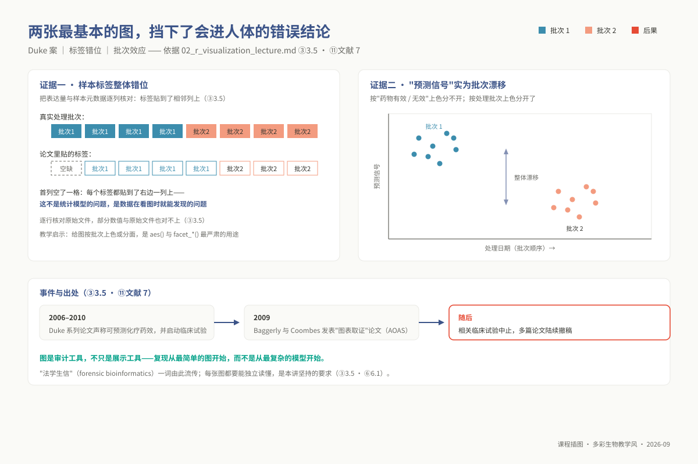
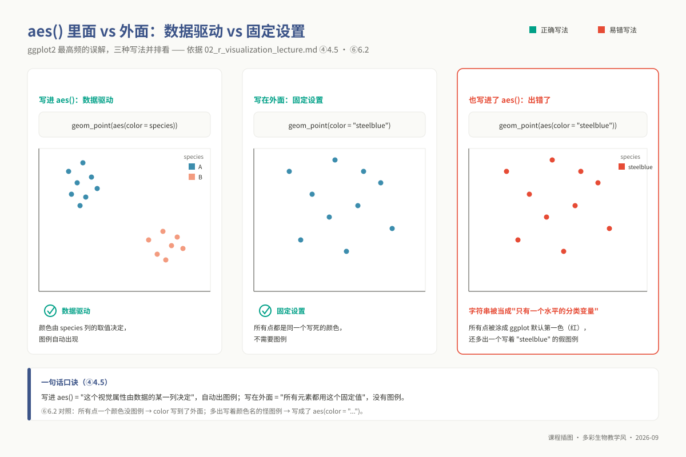
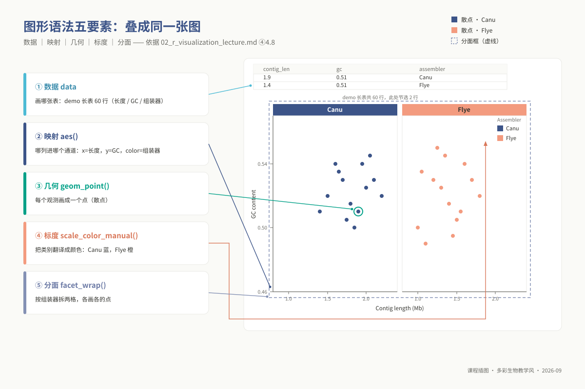
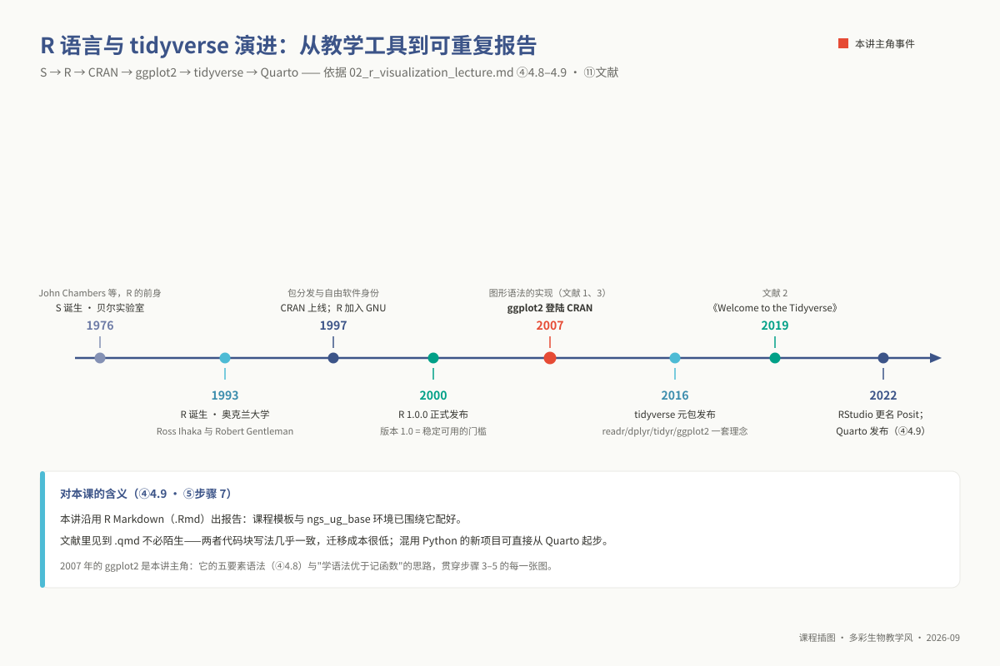

# 单元 u02：R 与数据可视化

> **适用对象**：本科 ｜ 线上先导自学 ｜ 单元 id `u02` ｜ 自学量预估 4 学时
>
> **阅读重点**：本讲把 R 数据结构、整洁数据和图形语法连接起来。你将从组学表格开始，完成数据整理、绘图和导出，并检查排序、标度或批次结构是否影响图形解释。
<!-- 维护信息：大纲 `01_syllabus/syllabus_undergraduate.md` §五「单元 u02」；章节模板为契约 `lecture_template`；contract_version 1.1。 -->
> **提示**：图版中的标题、坐标轴、分面、图例和刻度统一使用英文；中文解释写在报告正文。这样可以减少服务器渲染时的字体依赖。

---

## ① 学习目标

完成本单元的理论学习与代码推演后，你应当能够：

1. **剖析 R 底层数据结构**：从内存布局与类型强制转换机制切入，严密区分向量（Vector）、矩阵（Matrix）、数据框（Data Frame）、列表（List）与因子（Factor）的代数特征，准确解释其在生信组学实体中的映射关系。
2. **规范解析异构组学表格**：熟练利用 `readr` 引擎高速解析各类生物信息学生产工具的输出产物（包括 QUAST 组装报告、BUSCO 完整度评估、Roary 泛基因组矩阵与 GFF 注释），妥善处置特殊表头、缺失值编码与元数据注释行。
3. **执行整洁数据变换**：说明“整洁数据”准则，使用 `dplyr` 动词清洗观测表，并用 `pivot_longer` 完成长表转换。
4. **解构图形语法五要素**：遵循 Hadley Wickham 的分层图形语法（Layered Grammar of Graphics），独立构建包含数据、美学映射（Aesthetic Mapping）、几何对象（Geom）、标度转换（Scale）与分面系统（Facet）的高质量科研图版。
5. **精准掌控美学作用域**：透彻辨析 `aes()` 内部动态数据映射与外部静态物理属性设定的执行机制差异，杜绝由于作用域混淆产生的虚假图例或单色覆盖故障。
6. **应用可读的视觉规范**：使用 Okabe–Ito 和 Viridis 标度，识别彩虹色与只显示均值的柱状图可能造成的误读，并为图版补充必要的单位和图例。
7. **部署可移植脚本与矢量渲染**：深刻理解物理尺寸（Inches）与绝对排印磅值（Points）的反比几何机理，使用 `ggsave()` 导出满足国际期刊要求的矢量 PDF 与高解析度 PNG，并编写支持命令行传参的自动化 `Rscript` 批处理脚本。

## ② 前置检查

**本讲即 L0 模块 `l0_02_r` 的本科系统落地版**——完成本单元讲义精读并通过配套实践自测，即可视为完成 L0 基础储备，无需重复修读：

| L0 模块 id | 核心主题 | 本讲知识点映射 | 对应自测与考核要求 |
|---|---|---|---|
| `l0_02_r` | R / tidyverse / ggplot2 数据分析与科学绘图 | ④ 核心原理 + ⑤ 全部实操步骤（五要素、宽长变换、多图绘制） | L0-2 自测第 1–10 题；上机考核 U02-P1、U02-P2 |
| `l0_01_linux` ｜ `l0_03_conda` | Linux 命令行操作 ｜ Conda 虚拟环境管理 | **两者均为硬性前置**：必须熟练在终端中检索分析产物路径；本讲的 R 运行时及绘图扩展包统一封装于 `ngs_ug_base` 环境中 | L0-1 第 1–4 题；L0-3 第 1–2 题 |

**开工前 30 秒环境健康自检**（终端执行下述命令，确认 R 引擎与核心库版本正常就绪）：

```bash
source /opt/miniconda3/bin/activate && conda activate ngs_ug_base
R --version | head -n 1 && R -e 'packageVersion("ggplot2"); packageVersion("tidyverse")'
```

*控制台应清晰打印出 R 4.3+ 以及 ggplot2、tidyverse 的版本号；若抛出 command not found 或无法加载包，必须先行返回 u01 重新检查环境。*

## ③ 背景与科学问题

在现代生命科学研究中，数据分析的终极产出**不是控制台上滚动的海量浮点数，而是能够经受住学术界严格审视的生物学判断**。而判断的高效传递，几乎全部依赖于结构化视觉图表的修辞力量。
以基因组从头组装为例：QUAST 报告显示组装器 Canu 产出了 3 条 Contig、N50 为 2.1 Mb，而 Flye 产出了 5 条 Contig、N50 为 1.7 Mb。若仅将这些离散数字平铺在表格中，读者需要在脑海中进行多次跨行数值比对与空间想象；而将其映射为一张带有误差分布与多指标分面的规范对比柱状图时，“课题为何最终抉择 Canu”的科学逻辑在数秒内便不言自明。

```text
从杂乱生信文本到发表级科学图谱的升华：
  [ 原始算法日志与报告 ] ──(readr / dplyr)──> [ 严格整洁数据框 (Tidy Tibble) ]
                                                       │
                                                       ▼ (应用图形语法映射)
  ┌────────────────────────────────────────────────────────────────────────┐
  │ 视觉修辞空间 (Aesthetic Mapping)：                                     │
  │  - 离散分类 ──> X 轴空间排列与色盲安全填充 (Okabe-Ito Palette)          │
  │  - 连续指标 ──> Y 轴高度与对数标度转换 (scale_y_log10)                 │
  │  - 指标维度 ──> 独立分面展示与自由坐标网格 (facet_wrap scales='free_y')│
  └───────────────────────────────────┬────────────────────────────────────┘
                                      ▼
             [ 具备独立学术自明性的出版级矢量图板 (PDF / SVG) ]
```

**为什么生信分析首选 R 与 ggplot2，而非 Excel 或纯 Python**？

1. **彻底告别鼠标点选的黑箱漂移**：Excel 的图表依赖鼠标拖拽与点选配置，操作过程无痕迹保留、无法版本化审计，且数据微调后必须全量人工重做。R 代码将整个数据清洗与视觉渲染固化为确定性的代码代数，支持秒级自动化批量重跑。
2. **生信统计生态的原生同构性**：高通量分析的核心算法（如 k-mer 基因组特征建模工具 GenomeScope 本身即为 R 脚本、进化树系统发育分析库 ggtree、以及硕博阶段必修的差异表达分析包 DESeq2/EdgeR）全量宿生在 R/Bioconductor 体系中。掌握 ggplot2 的图层映射语法，即可无缝复用于全生命周期的各种前沿组学图谱。

### 3.4 本单元在 u08 综合项目中的位置

u08 综合大项目是一场历时 24 集中学时的细菌基因组重构与泛基因组全谱实战。**本单元是支撑该项目最终考核报告的唯一图形生成中枢**，报告模板 §3“实验结果”小节所规定的全套核心图版均在本讲完成代码封包：

| 项目实操模块 | 考核核心图版需求 | 本讲教学对应步骤 | 课程标准配套脚本 |
|---|---|---|---|
| §4.1 基因组调查调查 (Survey) | k-mer 频谱分布曲线，标定测序错误峰、单倍体主峰及重复峰；解构 GenomeScope 建模原理 | ⑤ 步骤 4.1（折线图、对数坐标轴与横轴空间截断）及步骤 7（`commandArgs` 传参） | `02_plot_kmer_histogram.R` |
| §4.2 组装质量综合评定 | Canu 与 Flye 组装指标（Contigs、N50、最大长度）多维对比图 | ⑤ 步骤 4.2（分组柱状图、文本标签与自由坐标分面） | `02_plot_assembly_metrics.R` |
| §4.2 基因组完整度评估 | BUSCO 完整度（单拷贝、重复、片段化、缺失）堆叠百分比柱状图 | ⑤ 步骤 4.3（堆叠条形图、因子水平强制排序） | `02_plot_assembly_metrics.R` |
| §4.4–§4.6 演化与泛基因组 | IQ-TREE 最大似然进化树；Roary 核心/软核心/壳/云基因簇多维统计 | ⑤ 步骤 4.4（ggtree 系统发育树修饰与泛基因组柱状图） | `02_plot_tree_and_pangenome.R` |

**核心教学原则**：科研图表绝非文字报告的附属美化工具，每一张图都必须严密承载一个排他性的生物学推断论点。

### 3.5 应用案例：两张最基本的图，挡下了会进人体的错误结论

**真实案例：Baggerly 与 Coombes（*Ann Appl Stat*, 2009）——杜克大学临床试验丑闻中的法医学生物信息学（Forensic Bioinformatics）取证。**

2006 至 2010 年间，杜克大学顶级医学研究团队接连在顶级期刊发表重磅论文，宣称利用微阵列基因芯片表达谱训练出的统计模型，能够精确预测化疗药物对肺癌及乳腺癌患者的靶向敏感性，并据此开展了真实人体的临床治疗试验。美国安德森癌症中心（M. D. Anderson）的生物统计学家 Keith Baggerly 与 Kevin Coombes 在尝试复现其算法时，并未陷入复杂深度学习模型的数学死磕，而是利用 R 语言绘制了一系列**最基础的探索性数据分布图（Exploratory Data Analysis, EDA）**：将基因表达矩阵按芯片扫描时间序列排布，并与临床元数据进行散点映射。

图表揭示了触目惊心的真相：

- **标签整体偏移行移位**：作者在整理数据表格时发生了机械错位，导致样本 ID 与真实的药物敏感性标签整行偏移了一列；
- **批次效应伪装为生物学预测信号**：绘制分面图后发现，所谓具有高预测力的特征基因，其表达量的剧烈跳跃仅仅与微阵列芯片扫描的具体批次日期高度重合。

这一由基础可视化揭露的学术造假与严重失误震动了全球医学界，直接导致相关人体临床试验被紧急终止，数十篇高分论文被撤稿。“法医学生信”的经典案例深刻昭示：**可视化不是装饰品，而是数据科学家审查现实的最敏锐手术刀**。



*图 u02-7：一桩图表取证的案例：标签错位一列，预测信号其实是批次漂移（Duke 案）。*

## ④ 核心原理

### 4.1 五大基础数据结构的内存布局与类型强制转换机制

R 语言作为一门面向统计计算的高级语言，其数据模型建立在向量化代数基础之上：

```text
R 语言核心数据结构拓扑：
  [ 基础向量 Vector ] ──(同质标量线性序列)──> 纯数值型、字符型、逻辑型 (严禁混杂)
          │
          ├──(添加 dim 属性维数)──> [ 矩阵 Matrix ] (二维同质表格，支持线性代数运算)
          │
  [ 列表 List ] ───────(异质指针通用容器)──> 每个槽位可存放任意类型、任意长度的对象
          │
          └──(各元素等长且受管)───> [ 数据框 Data Frame / Tibble ] (列内同质，列间异质的二维表格)
```

**类型强制转换陷阱（Coercion Hierarchy）**：
向量具有严格的**类型同质性（Homogeneity）**。当向一个数值型向量中不慎混入单个字符（例如测序空值被表示为 `"-"`、`"NA"` 或带千分位逗号的 `"1,200"`）时，R 解释器会依照 `逻辑型 -> 整型 -> 双精度浮点型 -> 字符型` 的确定性单向链条，**静默将整列数据强行降级为字符型（`<chr>`）**。
后果：后续将其映射至 Y 轴时，ggplot2 将不再按数值几何距离排布，而是按字符 ASCII 码字典序排列（导致 `"10"` 排在 `"2"` 之前的荒诞现象）。**每次读取外部数据后，必须无条件执行 `glimpse(df)` 审查每列的数据类型**。

### 4.2 因子（factor）的内部整型编码与出场顺序仲裁

字符型数据在映射到离散轴或图例时，ggplot2 默认遵循纯粹的字母字典序（Alphabetical Order）。以细菌组装完整度评估（BUSCO）为例，字母序将迫使图例呈现为 `Duplicated -> Fragmented -> Missing -> Single-copy`，彻底破坏了生物学上从优质到劣质的内在认知逻辑。
**因子（Factor）本质上是一个带有 levels 属性标签的整型向量（Integer Vector）**。当显式定义 `levels = c("Single-copy", "Duplicated", "Fragmented", "Missing")` 时，底层存储的物理值被固定为 1、2、3、4。**因子 levels 的设定，是仲裁图表中几何条形空间排列次序与图例堆叠顺序的唯一法定依据**。


*图 u02-2：数据框解剖：行=观测、列=变量；因子 levels 决定图上出场顺序。*

### 4.3 整洁数据哲学（Tidy Data）与宽长表转换矩阵

Hadley Wickham 确立的整洁数据法则包含三大公理：

1. 每个变量（Variable）必须单独构成一列；
2. 每次观测（Observation）必须单独构成一行；
3. 每类观测单元（Observational Unit）必须形成一张独立的二维表。

生信工具默认产出的报表往往是面向人类阅读习惯的**宽表（Wide Format）**，例如 QUAST 报告中一行囊括了样本名、Contig 数量、N50、最大长度等多列数值。然而，**ggplot2 的美学映射引擎要求将“待分析的指标名称”本身作为一个离散变量、“具体数值”作为另一个连续变量映射至坐标轴**。
通过 `tidyr::pivot_longer()`，我们将宽表中的多列属性“折叠坍缩”为两列结构化长表（`names_to = "metric"`, `values_to = "value"`）。**初学者面对多指标并排绘制卡壳的根源，九成以上在于未将数据重塑为长表格式**。

### 4.4 分层图形语法：透明胶片图层的形式化叠合

Leland Wilkinson 与 Hadley Wickham 提出的图形语法将可视化解构为严格的代数系统。一张科学图表被视作由底层至顶层严格叠加的一叠透明胶片：

$$\text{Plot} = \text{Data} + \text{Aesthetic Mappings} + \text{Geometries} + \text{Scales} + \text{Coordinate System} + \text{Faceting} + \text{Theme}$$

这一语法的革命性优势在于**层级之间的绝对正交解耦**：在保持数据框与美学映射 `aes(x, y)` 恒定不变的前提下，仅仅将几何对象从 `geom_col()` 替换为 `geom_point()`，图表便由柱状图瞬时蜕变为散点图，无需重构任何前驱逻辑。

### 4.5 `aes()` 作用域法则：数据驱动映射 vs 静态物理赋值

这是初学者最常遭遇的逻辑混淆点：

- **写在 `aes()` 内部**：声明的是**数据驱动的美学通道映射**。它告诉引擎：“请将数据框中的某一列特征，映射为图元的某种视觉属性（如颜色、形状、尺寸）”，系统会自动创建对应的统计图例（Scale Legend）。
- **写在 `aes()` 外部**：声明的是**全局静态物理属性赋值**。它告诉引擎：“无论底层数据是什么，请无条件将所有几何图形强制渲染为此种物理样式”，系统不会创建任何图例。

```r
geom_point(aes(color = species))      # 正确：数据列驱动色彩，自动生成物种分类图例
geom_point(color = "#0072B2")         # 正确：全局常量赋值，所有点渲染为纯净深蓝，无冗余图例
geom_point(aes(color = "#0072B2"))    # 【典型错误】：将常量字符串误当作分类变量传入，
                                      # 导致图例中出现荒诞的 "#0072B2" 条目且颜色被系统默认色调覆盖
```



*图 u02-3：aes() 进出之辨：映射写进 aes()，常量写在 aes() 外——三写法并排。*

### 4.6 矢量物理学：物理排版尺寸与字号的几何反比律

科研绘图的物理载体分为两大阵营：

- **矢量图形（Vector Graphics，如 PDF / SVG）**：基于笛卡尔几何坐标与贝塞尔数学曲线构建，包含无限分辨率特性，无论放大多少倍数，边缘绝无像素锯齿，是国际学术期刊投稿的绝对强制标准。
- **位图点阵（Raster Graphics，如 PNG / TIFF）**：由离散像素网格阵列构成，放大后不可避免地暴露马赛克。

**排版几何反比律**：`ggsave(width = W, height = H)` 中的参数指定的是该图最终被打印或排版时的**物理绝对尺寸（默认单位为英寸 Inches）**，而代码中通过 `base_size` 指定的字号是**绝对排印磅值（Points，1 pt = 1/72 英寸）**。
若在未改动字号的前提下将 `width` 从 6 英寸盲目调大至 12 英寸，整张图的画布面积扩大了 4 倍，而 12 pt 的文字物理高度恒定保持在 12/72 英寸，其在全图中的视觉相对占比被严重稀释，导致“导出的图文字极其微小看不清”。**解决字号偏小问题的第一操作，永远是调小画布的物理宽高，而非盲目将字号数值改大**。

### 4.7 中文字符集缺失：Linux 环境豆腐块乱码的成因

在无图形界面的 Linux 服务器端，底层 FreeType 字体渲染引擎默认仅加载基本的 ASCII 与 Western Latin 字符轮廓库。当 R 绘图设备尝试将包含中文的字符串（如“基因组大小”）光栅化至 PDF 设备时，找不到对应的 Unicode 汉字字模映射，系统只能调用默认的未定义符号（Undefined Glyph，形如 `□` 的方块，俗称豆腐块）进行占位填充。
课程对此确立的工程准则为：**在根源上彻底规避在代码与图表中嵌入中文**，图内全英文标注，中文陈述严谨纳入正文。

### 4.8 图形语法五要素：为什么"学语法"优于"记函数"



*图 u02-1：数据→映射→几何→标度→分面，五要素逐层叠成同一张 ggplot 图。*

传统绘图库（如 base R 的 `plot()`）要求用户针对每一种图型记忆一套完全不同的函数名称与专有参数体系。而 ggplot2 的核心价值在于建立了一套通用的形式化语法系统：面对任何可视化任务，开发者唯一需要思考的只有五大核心正交组件：

1. **数据（Data）**：待分析的整洁数据载体（Tibble）；
2. **美学映射（Aesthetic Mappings）**：确定自变量与因变量绑定至哪个几何自由度；
3. **几何对象（Geometries）**：选定呈现数据特征的物理图形单元；
4. **标度（Scales）**：精细控制从抽象数值到具体物理视知觉（轴刻度、色彩区间）的线性或非线性函数转换；
5. **分面（Faceting）**：沿特定分类维度快速裂变生成子图矩阵。

### 4.9 技术前沿（2023–2026）：Quarto 引擎与多语言计算文档演进



*图 u02-6：R 语言三十年：1976 S → 1993 R → 2007 ggplot2 → 2016 tidyverse → 2022 Quarto。*


*图 u02-4：Ross Ihaka，R 语言共同作者（照片：Kristina D.C. Hoeppner，CC BY-SA 2.0，Wikimedia Commons）。*


*图 u02-5：Robert Gentleman，R 语言共同作者（照片：R Consortium，CC BY 3.0，Wikimedia Commons）。*

> **人物故事与图形传承：从奥克兰黑板到 Bioconductor 的生信图谱**
> 
> 照片中的**罗斯·伊哈卡（Ross Ihaka）**与**罗伯特·杰特曼（Robert Gentleman）**，于 1992 年在新西兰奥克兰大学共同敲下了 R 语言的第一行代码。伊哈卡不仅是敏锐的统计学家，更是计算机统计制图与人眼色彩感知理论的先驱，他关于感知均匀色彩空间的研究直接启发了后续 `colorspace` 与 ggplot2 调色板的发展；而杰特曼随后在 2001 年主持发起的 **Bioconductor** 计划，则将基因组序列对象、表达矩阵与统计图形无缝绑定，奠定了今日全球生物信息学数据可视化的标准生态。

近三年来，可重复性科学研究报告的工程生态正在经历重塑：
Posit 公司（原 RStudio）在 2022 年底正式推出了全新一代开源科学出版系统 **Quarto**。它继承了 R Markdown 的核心理念，但彻底摆脱了单一针对 R 语言的深度绑定，原生打通了针对 Python、Julia、Observable 以及 R 的多语言混合支持。在现代科学工作流中，生信学者既可使用 Python 运行深度学习模型，亦可在同一份 `.qmd` 计算文档中无缝调用 ggplot2 渲染发表级图谱，实现了代码执行、图表嵌入与学术论文排版的一体化自动化闭环。

## ⑤ 操作步骤

配套自动化脚本存放于 `03_code/undergraduate/scripts/`。本节代码均内置自包含测试数据，支持即拷即跑验证。

### 步骤 0：确定运行环境与工作空间定位

```bash
# 激活集成环境并进入交互式 R 终端
source /opt/miniconda3/bin/activate && conda activate ngs_ug_base
R
```

```r
# 在 R 控制台内执行路径定位检查
getwd()                   # 审查当前工作目录物理绝对坐标
dir.create("results/figures", recursive = TRUE, showWarnings = FALSE) # 提前准备成果输出目录
```

### 步骤 1：利用 readr 引擎高效读入生信异构表格

```r
library(tidyverse)        # 原子化加载 readr, dplyr, tidyr, ggplot2 等套件

# 1. 读取标准制表符分隔输出 (如 QUAST, Prokka 的 .tsv 文件)
quast_raw <- read_tsv("quast_out/report.tsv")

# 2. 读取逗号分隔的大型全景泛基因组矩阵 (如 Roary 的 .csv 文件)
roary_raw <- read_csv("pangenome/gene_presence_absence.csv")

# 3. 读取无表头的纯数字空格分隔频谱文件 (如 Jellyfish 的 .histo 文件)
kmer_raw  <- read_table("survey/reads.histo", col_names = c("depth", "n_kmers"))

# 【数据导入三部曲安全审查】
dim(quast_raw)            # 验证行数与列数是否符合预期
head(quast_raw, n = 3)    # 快速审查前 3 行数据排列
glimpse(quast_raw)        # 重点审查每列数据类型是否被正确解析 (<dbl>, <chr>)
```

### 步骤 2：运用 dplyr 五大核心动词实施数据代数重塑

```r
# 模拟构建一组典型的组装质控测试集
quast_demo <- tibble(
  assembler      = c("Canu", "Flye", "SPAdes", "Unicycler"),
  contigs        = c(3, 5, 42, 18),
  N50            = c(2100000, 1700000, 320000, 850000),
  largest_contig = c(2300000, 1950000, 450000, 1100000)
)

# 组合管道动词：清洗 -> 衍生新列 -> 排序 -> 投影挑选
quast_processed <- quast_demo |>
  filter(!is.na(N50) & N50 > 0) |>                              # 行筛选：剔除异常值
  mutate(N50_Mb = N50 / 1e6,                                     # 衍生列：碱基数换算为兆碱基 (Mb)
         quality = if_else(N50_Mb >= 1.0, "High", "Standard")) |>
  arrange(desc(N50_Mb)) |>                                       # 行排序：按 N50 降序排列
  select(assembler, contigs, N50_Mb, quality)                    # 列投影：精准抽取核心分析字段

# 核心实战：宽表向长表的代数折叠 (为多指标分面绘制做准备)
quast_long <- quast_demo |>
  select(assembler, contigs, N50, largest_contig) |>
  pivot_longer(
    cols      = -assembler,                                      # 保持 assembler 为主键列不动
    names_to  = "metric",                                        # 原列名折叠至 metric 列
    values_to = "value"                                          # 原数据值汇集至 value 列
  )
```

### 步骤 3：掌握 ggplot2 三类基础科研图型的构建

```r
set.seed(42)
demo_contigs <- tibble(
  assembler  = rep(c("Canu", "Flye"), each = 50),
  length_kb  = c(rnorm(50, mean = 80, sd = 15), rnorm(50, mean = 65, sd = 20)),
  gc_percent = c(rnorm(50, mean = 52, sd = 1.2), rnorm(50, mean = 52, sd = 1.5))
)

# 1. 结构化柱状图 (注意：高度已确定时严格选用 geom_col)
p_bar <- ggplot(quast_demo, aes(x = assembler, y = contigs, fill = assembler)) +
  geom_col(width = 0.55) +
  labs(x = "Genome Assembler", y = "Number of Contigs", title = "Contiguity Comparison")

# 2. 连续特征双变量散点图 (静态物理属性写在 aes 外部)
p_point <- ggplot(demo_contigs, aes(x = length_kb, y = gc_percent, color = assembler)) +
  geom_point(size = 2.5, alpha = 0.75) +
  labs(x = "Contig Length (kb)", y = "GC Content (%)", color = "Pipeline")

# 3. 稳健箱线图叠加真实观测散点 (揭示真实样本量与偏态分布)
p_box <- ggplot(demo_contigs, aes(x = assembler, y = length_kb, fill = assembler)) +
  geom_boxplot(outlier.shape = NA, alpha = 0.6) +                # 隐藏离群点避免与散点重叠
  geom_jitter(width = 0.15, size = 1.5, alpha = 0.5) +           # 叠加坡度抖动散点
  labs(x = "Genome Assembler", y = "Contig Length Distribution (kb)")
```

### 步骤 4：研制综合项目必须交付的四大核心图版

**4.1 基因组 Survey k-mer 频谱对数分布图**（对应项目 §4.1 手册要求）：

```r
# 模拟构建典型的双峰结构 k-mer 频谱数据
kmer_spectrum <- tibble(
  depth   = 1:120,
  n_kmers = c(1e7 * (1:10)^(-2.5), 2e5 * exp(-((11:120 - 45)^2) / (2 * 12^2)))
)

p_kmer <- ggplot(kmer_spectrum, aes(x = depth, y = n_kmers)) +
  geom_line(color = "#0072B2", linewidth = 0.8) +
  coord_cartesian(xlim = c(0, 100)) + scale_y_log10() +
  labs(x = "k-mer Depth (X)", y = "Frequency of Distinct k-mers (log10)",
       title = "k-mer Frequency Spectrum Analysis (k = 21)") + theme_bw(base_size = 12)
```

**4.2 QUAST 组装指标多维并排对比图**（对应项目 §4.2 决策依据）：

```r
quast_metrics <- tibble(
  assembler = c("Canu", "Flye"), contigs = c(3, 5), N50 = c(2.10, 1.70), largest = c(2.30, 1.95)
) |> pivot_longer(cols = -assembler, names_to = "metric", values_to = "value")
quast_metrics$metric <- factor(quast_metrics$metric, levels = c("contigs", "N50", "largest"))

p_quast <- ggplot(quast_metrics, aes(x = assembler, y = value, fill = assembler)) +
  geom_col(width = 0.55) + geom_text(aes(label = value), vjust = -0.4, size = 3.5) +
  facet_wrap(~ metric, scales = "free_y") +
  scale_fill_manual(values = c("Canu" = "#0072B2", "Flye" = "#D55E00")) +
  labs(x = NULL, y = "Metric Quantitative Value", title = "Assembly Assembly Metrics (QUAST)") +
  theme_bw(base_size = 12) + theme(legend.position = "none")
```

**4.3 BUSCO 基因组完整度堆叠条形图**（对应项目 §4.2 完整度评定）：

```r
busco_data <- tibble(
  assembler = rep(c("Canu", "Flye"), each = 4),
  category  = rep(c("Single-copy", "Duplicated", "Fragmented", "Missing"), 2),
  percent   = c(97.2, 0.8, 0.6, 1.4, 95.1, 2.3, 1.0, 1.6)
)
busco_data$category <- factor(busco_data$category, levels = c("Single-copy", "Duplicated", "Fragmented", "Missing"))

p_busco <- ggplot(busco_data, aes(x = assembler, y = percent, fill = category)) +
  geom_col(width = 0.55) +
  scale_fill_manual(values = c("Single-copy" = "#0072B2", "Duplicated" = "#56B4E9",
                               "Fragmented" = "#E69F00", "Missing" = "#B0B0B0")) +
  labs(x = NULL, y = "Benchmark Score Percentage (%)", fill = "Category",
       title = "Genome Completeness Evaluation (BUSCO bacteria_odb10)") + theme_bw(base_size = 12)
```

**4.4 系统发育进化树与泛基因组全谱**（对应项目 §4.4–§4.6 演化推断）：

```r
# 泛基因组分区条形图示例
pangenome_summary <- tibble(
  class = factor(c("Core", "Soft-core", "Shell", "Cloud"), levels = c("Core", "Soft-core", "Shell", "Cloud")),
  n_genes = c(3120, 210, 890, 1450)
)
p_pan <- ggplot(pangenome_summary, aes(x = class, y = n_genes, fill = class)) +
  geom_col(width = 0.6) + geom_text(aes(label = n_genes), vjust = -0.4, size = 3.5) +
  scale_fill_manual(values = c("Core" = "#0072B2", "Soft-core" = "#56B4E9", "Shell" = "#E69F00", "Cloud" = "#F0E442")) +
  labs(x = "Pan-genome Partition Class", y = "Number of Gene Ortholog Clusters",
       title = "Bacterial Pan-genome Gene Partition (Roary)") + theme_bw(base_size = 12) + theme(legend.position = "none")
```

*注：系统发育树绘制依赖 `ggtree` 包，该组件已随 `ngs_ug_phylo` 环境受控分发（参见配套脚本 `02_plot_tree_and_pangenome.R`）。*

### 步骤 5：注入出版级美学标签系统与色盲友好配色

```r
p_refined <- p_bar +
  labs(title = "Bacterial Genome Assembly Contiguity Performance",
       subtitle = "Benchmarked on 4 Mb PacBio raw reads using standardized HPC pipeline",
       x = "De Novo Assembler Engine", y = "Resolved Contigs Count",
       caption = "Data source: /data/lab/ngs/reads.fa; Analysis conducted in u08 project") +
  scale_fill_manual(values = c("Canu" = "#0072B2", "Flye" = "#D55E00", "SPAdes" = "#009E73", "Unicycler" = "#CC79A7")) +
  theme_bw(base_size = 12) +
  theme(plot.title = element_text(face = "bold", size = 13), panel.grid.minor = element_blank(), legend.position = "bottom")
```

### 步骤 6：利用 ggsave 执行无损物理矢量导出

```r
# 显式声明 plot 指针与物理尺寸单位导出矢量 PDF 与 300 DPI PNG
ggsave("results/figures/quast_metrics_eval.pdf", plot = p_quast, width = 7.0, height = 4.5, units = "in")
ggsave("results/figures/quast_metrics_eval.png", plot = p_quast, width = 7.0, height = 4.5, units = "in", dpi = 300)
```

### 步骤 7：编写支持命令行调用的可复现 Rscript 工程脚本

在服务器批处理模式下，绘图逻辑必须封装为无需人工交互干预的 `.R` 文件。配套生成测试脚本 `my_kmer_plot.R`：

```r
#!/usr/bin/env Rscript
suppressPackageStartupMessages(library(tidyverse))
args <- commandArgs(trailingOnly = TRUE)
if (length(args) < 3) stop("Execution halted: Usage -> Rscript my_kmer_plot.R <histo_path> <k_val> <out_pdf>")
histo_file <- args[1]; k_mer_size <- as.integer(args[2]); out_file <- args[3]
kmer_data  <- read_table(histo_file, col_names = c("depth", "n_kmers"))

p <- ggplot(kmer_data, aes(x = depth, y = n_kmers)) + geom_line(color = "#0072B2", linewidth = 0.8) +
  coord_cartesian(xlim = c(0, 120)) + scale_y_log10() +
  labs(x = "k-mer Depth", y = "Frequency (log10)", title = paste0("k-mer Spectrum (k = ", k_mer_size, ")")) + theme_bw(base_size = 12)

ggsave(out_file, plot = p, width = 6.0, height = 4.0, units = "in")
cat("[Pipeline Success] Vector PDF generated at:", out_file, "\n")
```

在 Shell 终端中非交互执行：

```bash
Rscript my_kmer_plot.R survey/reads.histo 21 results/figures/kmer_k21_spectrum.pdf
```

执行多参数专业对比脚本：`Rscript 03_code/undergraduate/scripts/02_plot_kmer_histogram.R results/figures/multi_k.pdf 17:survey/reads.k17.histo 21:survey/reads.histo`。

## ⑥ 结果解读

### 6.1 出版级科研图版的合格性自检金标准

| 审查维度 | 顶刊发表级合格标准 | 典型不合格表现（需就地打回重构） |
|---|---|---|
| **坐标轴度量体系** | 横纵轴均具备清晰的人类可读名称，且**强制携带物理量纲单位**（如 `Contig Length (Mb)`、`Frequency (log10)`） | 直接沿用算法内部变量名（如 `contig_len`、`v1`），完全缺失单位 |
| **分类逻辑顺序** | 离散属性严格依据生物学意义的因子 levels 排列（如 `Single-copy -> Missing`） | 沿用随机字母序，造成逻辑断裂颠倒 |
| **关键数值呈现** | 关键对比柱状图顶部通过 `geom_text` 显式标注精确数值 | 强迫审稿人通过肉眼比对坐标轴网格线猜测数值 |
| **文字与字体安全** | 彻底肃清任何中文字符，所有英文词汇均拼写无误；在 100% 视图下字迹锐利清晰 | 呈现中文豆腐块方块乱码；字号过小导致无法肉眼辨析 |
| **自明性（Self-containment）** | 包含标题、副标题与图例，任何同行学者**在完全不阅读正文的前提下能精准说出该图的核心结论** | 图面信息残缺，严重依赖正文上下文解释 |

### 6.2 异常绘图病征深度溯源（八大高危误区）

**① 渲染产出整幅灰白纯空图**：

- **机理**：数据在经过 `filter()` 管道时由于阈值设置过于苛刻导致观测行数被全部剔除为 0；或映射至坐标轴的整列均为 `NA` 缺失值。
- **排错**：在绘图代码前插入 `nrow(df)` 与 `summary(df)`，审查数据有效吞吐量。

**② 所有几何柱状条高度呈现完全一致的“平头”**：

- **机理**：使用了默认带有频数统计引擎的 `geom_bar()`，其内部计算的是“各分类标签出现的频度计数（count）”，若每行代表一个样本，则计数值恒等于 1。
- **排错**：当 Y 轴已经具备确定性数值时，必须无条件采用 `geom_col()`。

**③ 点群呈现单调灰色且未产生分类图例**：

- **机理**：错误地将分类映射语句书写在美学函数外部（如 `geom_point(color = species)`）。
- **排错**：凡是由数据列驱动的外观属性，必须强制包裹在 `aes()` 之内。

**④ k-mer 频谱呈现为贴近横轴的死线**：

- **机理**：未施加 `scale_y_log10()`。因为测序单碱基错误产生的 1 深度 k-mer 频数高达数千万，而主峰仅有数万，线性坐标轴下主峰被无情压缩为一个像素点。

**⑤ 导出矢量 PDF 图版字迹细小如尘**：

- **机理**：在 `ggsave()` 中设置了过大的物理宽高（例如 `width = 16, height = 12`），物理排版面积剧增导致绝对磅值字号被几何稀释。
- **排错**：将物理宽高下调至常规单栏（3.5 英寸）或双栏（7.0 英寸）标准尺寸。

**⑥ 终端刷出大面积黄字警告：`Removed N rows containing missing values`**：

- **机理**：使用了硬截断函数 `xlim()`，导致超出视窗的数据点在底层被物理剔除，破坏了统计计算上下文。
- **排错**：采用视窗平移缩放函数 `coord_cartesian(xlim = ...)`，该函数仅缩放显示视野，完全保留底层数据完整性。

## ⑦ 统计插件

**本讲无独立统计要点。**

本单元的知识定位为**探索性数据分析（EDA）与描述性可视化修辞**，主要任务是将既有算法产出的确定性指标（如 N50、Contig 数量、BUSCO 比例、k-mer 频数与基因簇数）进行视觉重塑，**不涉及构建概率分布模型、参数假设检验与假阳性错误率（FDR）控制等推断统计范畴**（本专题不在契约 `stats_plugin_topics` 名单中）。
然而必须严肃指出可视化中的**统计伦理防线**：在呈现连续型样本分布时，学术界已全面禁止仅展示均值与单侧误差棒的“炸药柱状图（Dynamite Plot）”，因为均值与标准差对多峰分布与异常极值完全脱敏。在本讲步骤 3 中，我们要求使用箱线图并叠加抖动散点（Jitter Points），向读者无保留地呈现最真实的样本底层离散空间。

## ⑨ 常见错误与排查

### 9.1 R 环境激活与第三方库依赖故障

| 报错控制台原型 | 操作系统底层物理机理 | 标准自愈解决方案 |
|---|---|---|
| `there is no package called 'tidyverse'` | 当前启动的 R 进程并未定位到本课程的虚拟环境库目录，或误用了系统全局原生 R | 终端首先执行 `conda activate ngs_ug_base` 后再启动 R，在控制台执行 `.libPaths()` 确认库路径精准指向当前沙箱 |
| `unable to start device X11cairo` | 在远程纯字符终端下试图调用依赖本地图形驱动的交互式弹窗函数（如 `plot()`） | 服务器批处理绘图一律通过 `ggsave()` 直接将渲染流输出为物理文件，严禁依赖桌面弹窗 |
| `The following objects are masked from 'package:stats': filter` | 这是**命名空间覆盖提示而非故障**：dplyr 的 `filter` 具有更高优先级 | 若确需调用底层 stats 包的滤波函数，显式通过 `stats::filter()` 指定命名空间 |

### 9.2 数据解析与字段类型推断异常

| 报错控制台原型 | 操作系统底层物理机理 | 标准自愈解决方案 |
|---|---|---|
| `cannot open the connection: No such file or directory` | 相对路径是相对于 R 进程当前的 `getwd()` 而言，并非相对于脚本文件本身存储的物理路径 | 运行 `getwd()` 审视当前路径；在终端中严谨通过命令行传参注入文件的绝对或相对路径 |
| `Discrete value supplied to continuous scale` | 试图将字符型变量强行映射至要求连续数值的标度轴上 | 执行 `glimpse(df)` 审查；使用 `mutate(val = as.numeric(val))` 实施显式类型强制转换 |
| `read_tsv 导入后整行挤压在单一列中` | 文件底层的实际物理分隔符为逗号或空格，而非制表符 `\t` | 使用终端 `head -n 2 filename` 探查真实字符构成；改用 `read_csv()` 或 `read_table()` |

### 9.3 dplyr 与数据代数操作故障

| 报错控制台原型 | 操作系统底层物理机理 | 标准自愈解决方案 |
|---|---|---|
| `object 'contig' not found` | 字段名称发生微小拼写偏差，或 R 严格的大小写敏感特性被忽略 | 执行 `names(df)` 打印出原始完整列名清单，逐字核对字段拼写 |
| `no applicable method for 'filter' applied to 'matrix'` | dplyr 核心算子仅支持对数据框（Data Frame）和 Tibble 实施拓扑变换，不支持纯数值矩阵 | 使用 `as_tibble(my_matrix, rownames = "gene_id")` 先行完成结构化转换 |

### 9.4 ggplot2 绘图引擎与美学映射故障

| 报错控制台原型 | 操作系统底层物理机理 | 标准自愈解决方案 |
|---|---|---|
| `stat_count() can only have an x or y aesthetic` | 对 `geom_bar()` 错误地同时赋予了 x 与 y 映射 | 若 Y 轴数值已经计算完毕，必须严格使用 `geom_col()` |
| `Aesthetics must be either length 1 or the same as the data` | 在 `aes()` 中错误引用了独立于数据框外部、且长度不匹配的孤立游离向量 | 将外部向量通过 `mutate()` 正式固化为数据框内部的列变量后再行映射 |
| `Cannot find directory 'results/figures'` | `ggsave()` 不具备底层目录递归自动创建功能，目标文件夹缺失 | 在执行保存前显式调用系统命令：`dir.create("results/figures", recursive = TRUE, showWarnings = FALSE)` |

## ⑩ 思考练习

1. **（类型系统与排序代数推演）** 在 R 中构造如下微型数据框：`test_df <- tibble(sample_id = c("S1", "S2", "S3"), read_count = c("100", "25", "5"))`。若直接将其映射绘制柱状图（`x = sample_id, y = read_count`），横坐标的几何排列顺序为何？请运用 R 语言底层类型强制转换法则解释其机理，并写出将其修正为真实数值排序所需的完整 `dplyr` 管道代码。
2. **（美学映射作用域破坏性实测）** 利用系统自带的 `iris` 数据集，分别编写三段绘图代码：① `geom_point(aes(color = Species))`；② `geom_point(color = "#0072B2")`；③ `geom_point(aes(color = "#0072B2"))`。在终端中实际渲染出这三张图，深入比对图 3 与前两者的系统差异，剖析大语言模型生成生信代码时为何频繁在作用域 ③ 上犯错。
3. **（整洁数据宽长表代数重塑）** 假设某细菌基因组在三种不同组装器下的产物包含如下指标宽表：`tibble(assembler = c("Canu", "Flye", "Hifiasm"), contigs = c(3, 5, 1), N50 = c(2.1, 1.7, 4.2), busco = c(98.1, 95.4, 99.2))`。在**绝对不使用** `pivot_longer()` 的前提下，能否仅凭单条 ggplot2 语句绘制出带分面的多指标并排对比柱状图？若不能，从图形语法代数映射理论深入阐述长表为何是数据可视化的本质必需。
4. **（k-mer 频谱物理判读与生物学外推）** 运行配套脚本 `02_plot_kmer_histogram.R` 绘制 k-mer 曲线。若某一送检的原核生物样本在主峰深度 $X=50$ 的基础上，于 $X=25$ 处清晰浮现出一个高度接近主峰一半的次级尖峰：请问该现象能否被解释为“细菌基因组的高杂合度现象”？在微生物基因组学中，该特征通常提示实验湿实验端遭遇了何种物理事故？
5. **（物理排版尺寸与字号几何学实验）** 针对同一张散点图对象，分别调用 `ggsave(..., width = 4, height = 3)` 与 `ggsave(..., width = 14, height = 10.5)` 导出两份 PDF 图版。在屏幕上以 100% 原始缩放比例打开两份文件：哪一份图版的文字视觉可读性更优？为什么？结合本讲 ④6 节讲授的排版几何反比律阐明其背后的数理机制。
6. **（🔬 毕业设计主图工业级设计 · 开放实战）** 检索一篇与你本科毕业论文研究方向高度相关的近三年顶刊论文（如 *Nature Microbiology* 或 *Genome Biology*），挑选其 Main Figures 中的任意一张多分面复合图版：① 拆解该图试图向审稿人传递的核心科学论断；② 逆向工程该图所调用的图形语法五要素（数据长表结构、美学映射通道、几何图元类型、标度转换与分面布局）；③ 评价该图在视觉修辞层面是否存在“炸药柱状图”、“彩虹色伪边界”或“双 Y 轴欺骗”等统计反模式，并提出你的重构代码设计案。

## ⑪ 参考资料

### 官方规范与研发指南

| 资源类别 | 检索链接 / 官方文档门户 |
|---|---|
| R for Data Science (2e) 经典教材（H. Wickham 著） | https://r4ds.hadley.nz/ |
| ggplot2 官方参考手册 ｜ The Layered Grammar of Graphics 专著 | https://ggplot2.tidyverse.org/ ｜ https://ggplot2-book.org/ |
| tidyverse 核心生态官方指南（dplyr / readr / tidyr） | https://www.tidyverse.org/ |
| Posit / RStudio 官方集成开发环境手册 | https://docs.posit.co/ide/user/ |
| Quarto 科学计算与动态出版引擎官方文档（第四代平台） | https://quarto.org/ |
| Okabe–Ito 色盲友好安全色板规范 | https://jfly.uni-koeln.de/color/ |
| ggtree 系统发育树可视化与注释专著 | https://yulab-smu.top/treedata-book/ |

### 经典学术文献

1. Wickham H. A Layered Grammar of Graphics. *Journal of Computational and Graphical Statistics*, 2010, 19(1):3–28. doi:10.1198/jcgs.2009.07098
2. Wickham H, Averick M, Bryan J, et al. Welcome to the Tidyverse. *Journal of Open Source Software*, 2019, 4(43):1686. doi:10.21105/joss.01686
3. Wilkinson L. *The Grammar of Graphics*. 2nd ed. Springer, 2005. doi:10.1007/0-387-28695-0
4. Wong B. Points of View: Color blindness. *Nature Methods*, 2011, 8:441. doi:10.1038/nmeth.1618
5. Crameri F, Shephard GE, Heron PJ. The misuse of colour in science communication. *Nature Communications*, 2020, 11:5444. doi:10.1038/s41467-020-19160-7
6. Yu G, Smith DK, Zhu H, Guan Y, Lam TT-Y. ggtree: an R package for visualization and annotation of phylogenetic trees with their covariates and other associated data. *Methods in Ecology and Evolution*, 2017, 8(1):28–36. doi:10.1111/2041-210X.12628
7. Baggerly KA, Coombes KR. Deriving chemosensitivity from cell lines: forensic bioinformatics and reproducible research in high-throughput biology. *Annals of Applied Statistics*, 2009, 3(4):1309–1334. doi:10.1214/09-AOAS291 ——③ 3.5 节法医学数据取证应用案例出处。

### 课程内部规范与配套资产

| 课程资产 | 存储路径 / 引用位置 |
|---|---|
| 本科生教学大纲（u02 条目） ｜ 前置包体系架构规范 | `01_syllabus/syllabus_undergraduate.md` ｜ `00_design/prerequisite_packs.md` |
| R 语言核心运行环境定义（`ngs_ug_base`） | `07_envs/conda/env_ug_base.yml`（ggtree 依赖封装于 `env_ug_phylo.yml`） |
| 本讲配套绘图自动化脚本集 | `03_code/undergraduate/scripts/`（包含 k-mer 频谱图、组装指标评估图与进化泛基因组图脚本） |
| 综合大项目实战操作指南（🔒 锚定外部规范） | `<课程材料目录>/学生实验操作手册.md` |

*讲义版本 v2.1 ｜ 依据 contract_version 1.1 ｜ 最后更新 2026-09-11*
