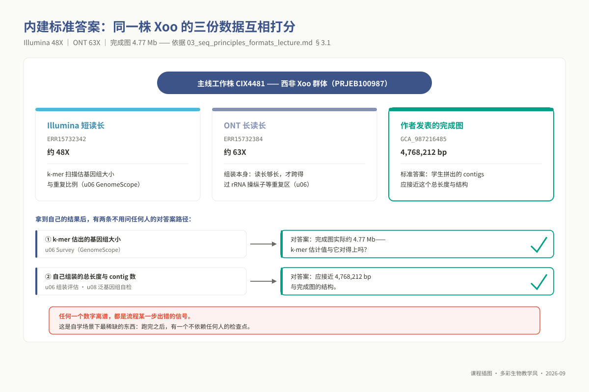
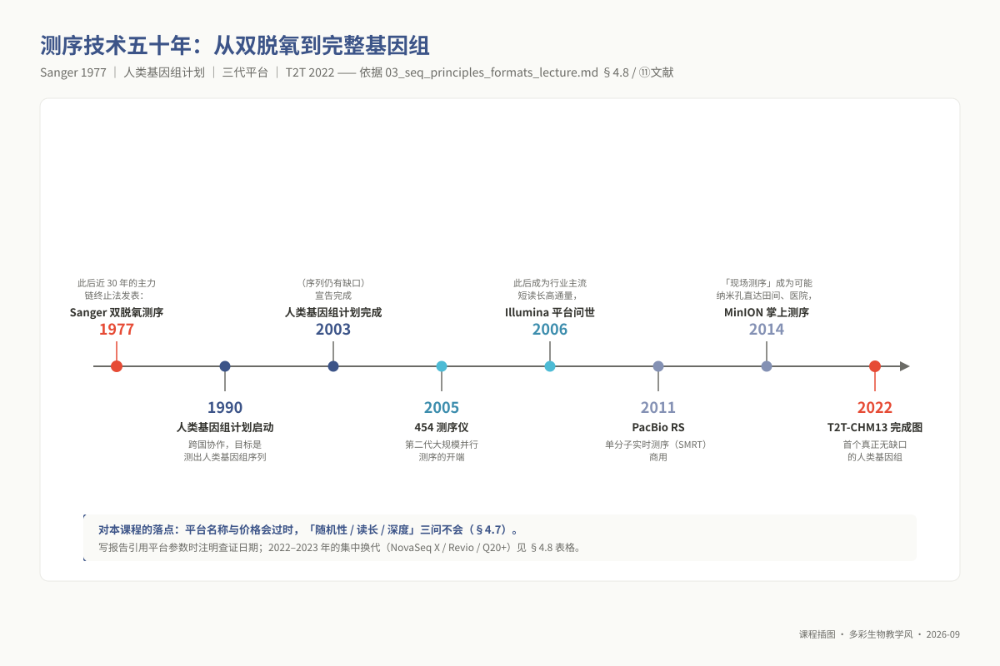
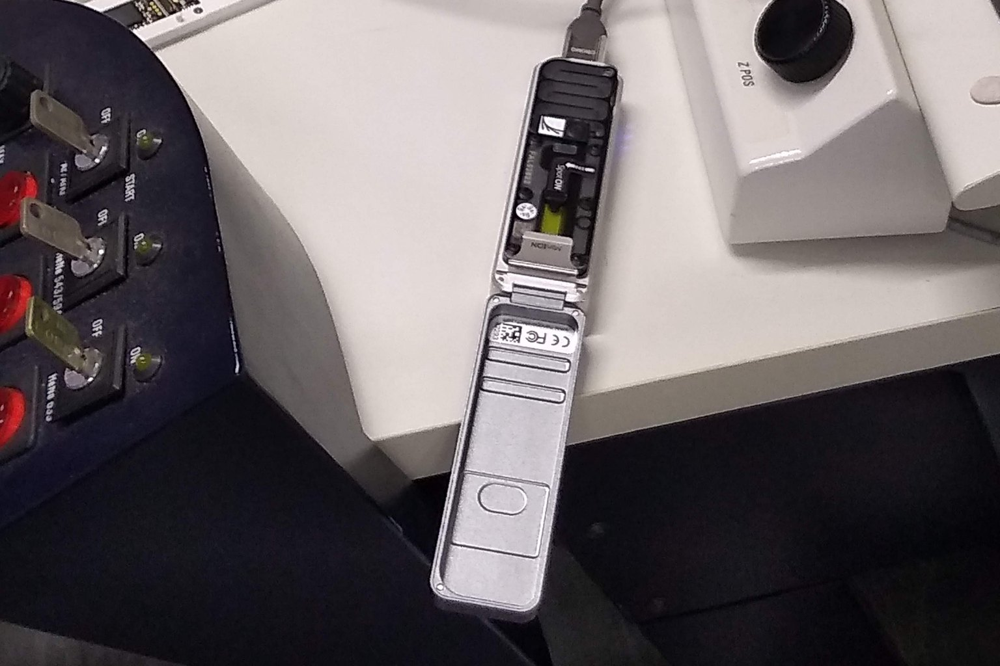
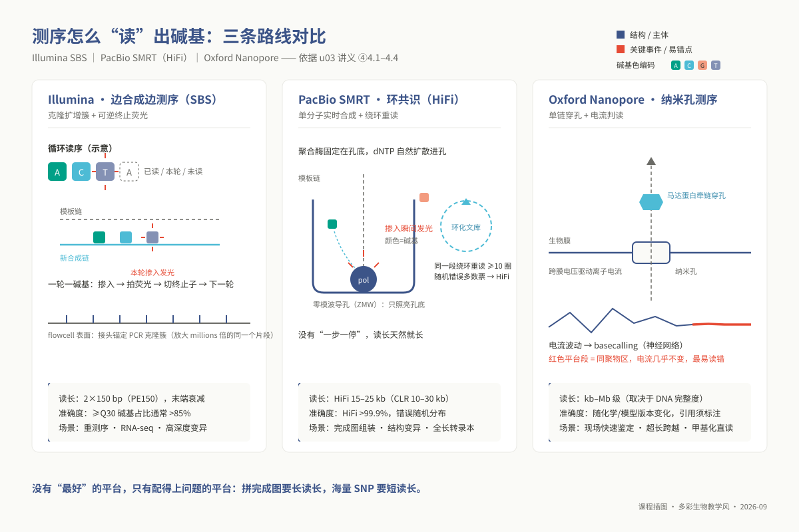
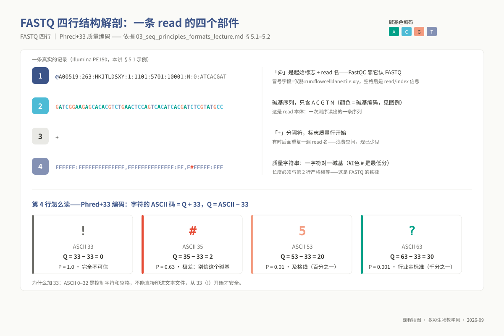
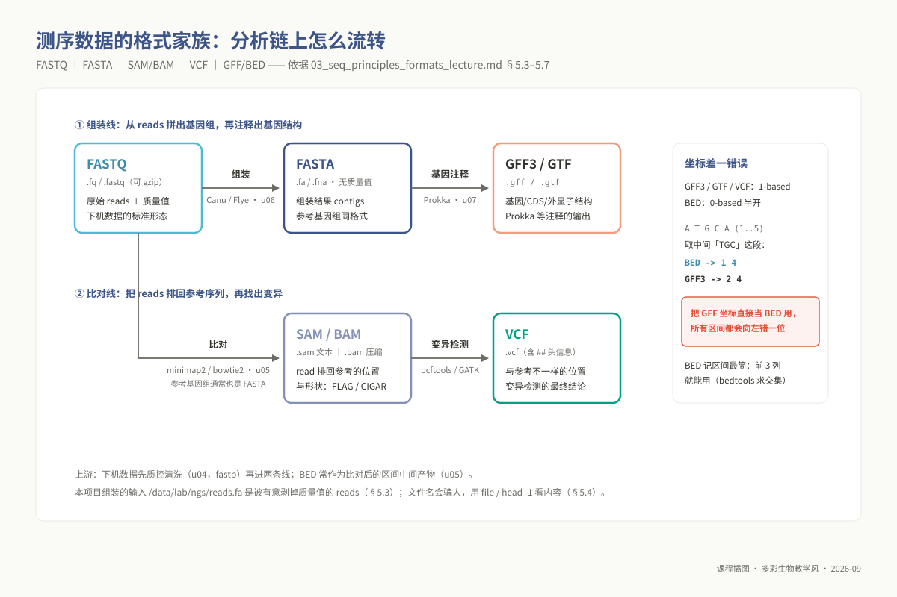

# 单元 u03：测序原理与数据格式

> **适用对象**：本科 ｜ 线上自学 · 4 学时（异步）｜ 环境：`ngs_ug_base`（本讲使用 bash / awk）
>
> **阅读重点**：本讲连接测序平台原理、FASTQ/FASTA 结构和 SAM/BAM 记录。你将通过手工解码与脚本统计，判断输入文件是否符合后续分析的基本条件。
<!-- 配套脚本：`03_code/undergraduate/scripts/03_parse_fastq_stats.sh`。 -->

## ① 学习目标

完成本单元的理论推演与格式实操后，你应当能够：

1. **解释测序反应机理**：按阶段复述 Illumina 边合成边测序（SBS）的主要过程，并用 Phasing / Pre-phasing 解释读段末端质量变化。
2. **多维解构主流测序平台**：对比 Illumina 短读长、PacBio SMRT 单分子实时测序（含 HiFi 环形共识）与 Oxford Nanopore 纳米孔电信号测序在读长跨度、单分子原始准确率、错误分布模式（随机分布 vs 系统性偏倚）、通量产出与建库 DNA 完整度要求上的差异，严密论证综合项目选用长读长的技术必要性。
3. **解释长读长与重复序列的关系**：用图论和“拼图”模型说明读长跨越重复序列时为何可能减少组装断裂，并指出仍需结合其他证据验证。
4. **逆向解码 FASTQ 质量体系**：熟练解析 FASTQ 四行记录的语法契约，透彻理解 Phred 质量分数对数换算公式与 ASCII+33 偏移编码，能够纯手工将特定质量字符换算为精确的单碱基判错概率。
5. **快速判别测序资产真实形态**：仅凭底层二进制特征与文本首行特征，精准甄别待处理文件是 FASTA 还是 FASTQ、是否经 gzip 真实压缩，避免因文件扩展名欺骗导致的上游指令报错。
6. **读取 SAM/BAM 记录**：定位 SAM 的 11 个核心列，拆解 FLAG（如 163），并区分 CIGAR 中的 `M` 与 `=`。
7. **仲裁区间注释与变异格式规范**：基于 0-based 半开区间与 1-based 全闭区间的坐标系几何模型，准确判断 BED、GFF3、GTF 与 VCF 的适用边界，规避常见的“差一错误”（Off-by-one Error）。
8. **自动化核算项目宏观度量指标**：运行配套脚本 `03_parse_fastq_stats.sh`，精确产出序列总数、有效碱基产出量、读长 N50 与全基因组测序覆盖深度，为综合项目报告提供合格的定量证据。

## ② 前置检查

**本讲依托的 L0 基础模块**：

| 模块 id | 核心主题 | 本讲知识点映射与依赖 | 对应自测与验收要求 |
|---|---|---|---|
| `l0_01_linux` | Linux 命令行操作与文本处理 | 纯文本与压缩流探查（`zcat`、`head`）、单向管道流、AWK 字段提取与条件过滤 | L0-1 自测第 1–5 题 |
| `l0_03_conda` | Conda 虚拟沙箱环境管理 | 激活集成环境 `ngs_ug_base`；保障基础系统依赖与脚本解析工具链就绪 | L0-3 自测第 1–3 题 |

**本讲即 L0 模块 `l0_04_formats` 的本科落地承载版**：学完本讲并独立完成配套自测，即视为掌握该模块全部能力，无需再修读其他材料。配套自测的三道核心上机题在讲义中均有精准映射：

- 第 8 题 $\rightarrow$ §5.2 节：手工解码 Phred 质量字符与判据推导；
- 第 9 题 $\rightarrow$ §5.5 节：二进制位运算拆解 SAM FLAG 163 真实含义；
- 第 10 题 $\rightarrow$ §5.3 与 §5.4 节：盲样判断 `/data/lab/ngs/reads.fa` 的数据特征并统计碱基产出。

## ③ 背景与科学问题

在综合实践项目（u08）的开篇，你将接到这样一项真实的计算生物学任务：**有一批从未知病害标本中提取并完成高通量测序的细菌样本，你需要从零开始将它的全基因组完整重构出来，并鉴定其所属物种与潜在耐药/致病风险。**
在敲下任何复杂的组装软件命令之前，每一位严谨的生信研究者必须首先回答三个基础却致命的技术问题：

1. **你手头拿到的数据文件究竟在物理上承载了什么？**
   在服务器 `/data/lab/ngs/reads.fa` 目录下，文件命名后缀是 `.fa`。它是已经拼装完毕的参考染色体吗？为什么里面没有任何碱基质量值？它与生物医药论文中常提到的双端测序原始压缩包（`sample_R1.fastq.gz`）究竟有何本质区别？若对数据格式判断失误，后续所有分析步骤都将在第一分钟抛出令初学者摸不着头脑的解析错误。

2. **现有数据测序覆盖度是否足以支撑无缝完成图重构？**
   在项目报告 §2.3 中，绝不能只填写“测序数据量充沛”等主观套话。你必须基于基因组物理尺寸估算公式，向学术界提供精确到小数点后一位的有效碱基总量（Total Bases）、等效覆盖深度（Sequencing Depth）与读长连续性（N50）。

3. **为什么本课题必须选用长读长（PacBio 或 ONT；本课公开数据 ERR15732384 是 ONT MinION），而非成本更低、通量更大的 Illumina？**
   原核生物基因组虽小（通常在 2–8 Mb 之间），但在其染色体骨架中广泛镶嵌着高度保守的核糖体 RNA 操纵子（rRNA Operon，单套长度约为 5 kb，常包含 5 至 10 份序列相似度超过 99% 的全同拷贝）、插入序列（IS Transposons）与串联重复基因簇。**Illumina 平台标准的 150 bp 读长远远无法跨越这些长程重复单元**。在拼装图谱中，短读长算法无法判定重复序列两侧的染色体侧翼区域应如何物理连接，导致组装图在此处断裂崩溃，最终只能产出数十个碎片状的 Contig。唯有采用物理读长（10–25 kb）远远超越重复区跨度的长读长测序，方能直接一跨而过，实现真正“一整条环状染色体（Complete Circular Genome）”的终极拼装。

### 3.1 应用案例：同一株 Xoo 的三种数据互相打分——主线里的"内建标准答案"

**真实案例：主线参考群体 PRJEB100987（西非水稻白叶枯病菌 *Xanthomonas oryzae* pv. *oryzae*, Xoo）多平台联合基准数据集。**

在真实科研中，验证分析是否成功最困难的一点在于“未知真理长什么样”。本课程选取的公开基准数据集具有极高的教学自省价值：研究团队针对工作菌株 **CIX4481**，同时测定了 Illumina 短读长、ONT/PacBio 长读长，并发布了经实验完全闭合确认的高精度完成图（Accession: `GCA_987216485`，全长 4,768,212 bp）。

```text
三维数据资产的内建逻辑自检闭环：
  [ Illumina 短读长 (ERR15732342, ~48X) ] ──> k-mer 频谱统计 ──> 预测基因组大小: ~4.75 Mb (低错误率保障)
                                                                       │ (绝对契合!)
  [ 已发表黄金完成图 (GCA_987216485) ] ────> 物理全长: 4,768,212 bp ────┤ (终极校验标准)
                                                                       │ (拓扑一致!)
  [ ONT MinION 长读长 (ERR15732384, ~63X) ] ──> 从头从长读长组装 ──> 产出单Contig环状染色体 (~4.77 Mb)
```

| 数据载体 | 平台与覆盖深度 | 核心科学与教学贡献 | 对应自检动作 |
|---|---|---|---|
| `ERR15732342` | Illumina 短读长，约 48X | 极低单点错误率，提供高质量 $k$-mer 频率分布，精准推导基因组物理大小与重复度 | 运行 GenomeScope 获得基因组体积基线 |
| `ERR15732384` | ONT MinION 长读长（ENA：38,078 条 / 302.67 Mb），按 4.7 Mb 约 63–64X | 读长横跨 5 kb 的 rRNA 操纵子，承载真正的物理连通性组装 | 驱动 Flye/Canu 产生无 Gap 连续 Contig |
| `GCA_987216485` | 实验闭合黄金完成图 | 4.77 Mb 确定性标准答案，供学生实时核验自身计算产物 | 评估 Contig 数量、总长度误差与共线性 |



*图 u03-7：工作株的三份数据与两条「对答案」检查点：48X/63X 测序 + 已发表完成图。*

## ④ 核心原理


*图 u03-5：Frederick Sanger（1918–2013），1977 年发表双脱氧链终止法，两度获诺贝尔化学奖（照片：公有领域，Wikimedia Commons）。*



*图 u03-6：测序技术五十年：1977 双脱氧 → 人类基因组计划 → 三代平台 → 2022 T2T 完整图。*

> **人物故事与科学丰碑：两度折桂诺贝尔的“实验台匠人”**
> 
> 翻开现代基因组学史的第一页，不可绕过的巨擘正是**弗雷德里克·桑格（Frederick Sanger，1918–2013）**。他是科学史上极罕见的“两度荣获诺贝尔化学奖”的科学大师（1958 年与 1980 年）。
> 
> 1958 年，桑格因完全测定牛胰岛素的氨基酸一级序列而摘得首个诺奖，一举终结了“蛋白质是无定形胶体”的历史偏见，首次证明生物大分子拥有精确可读的特定化学序列。随后他转向核酸，于 1977 年发明了举世闻名的**双脱氧链终止法（Sanger 测序法）**。他巧妙利用缺乏 3'-OH 的双脱氧核苷酸（ddNTP）在延伸反应中随机引发链终止，利用凝胶电泳按单碱基分辨率分离片段，测定了人类历史上第一个完整基因组——噬菌体 $\phi$X174（5,386 bp），开启了第一次基因组学革命。
> 
> 尽管享誉全球，桑格却始终保持着极致的谦逊与专注。他婉拒了英国王室授予的骑士爵位（Knighthood），理由是他不希望别人称呼自己为“爵士”：“爵士头衔会让你显得与众不同，而我只想做一个普通人”。在自传中，他将自己毕生的辉煌成就轻描淡写地概括为：*“我只是一个喜欢在实验室里摆弄实验的家伙（just a chap who messed about in a lab）”*。正是他开创的双脱氧链终止思维，直接启迪了后文 Illumina 平台基于“可逆阻断荧光基团”的边合成边测序（SBS）化学革命。

### 4.1 Illumina：边合成边测序（SBS）的分子物理过程

Illumina 平台是全球第二代高通量测序的绝对支柱。其核心机制是将数百亿个微观化学合成反应并行化映射于玻璃晶片（Flowcell）之上，严格分为四大物理步骤：

1. **文库构建（Library Prep）**：超声波或酶切将大分子 DNA 剪切为 300–500 bp 片段，在其两端分别连接人造寡聚接头（Adapters）。接头包含三大功能基团：**P5/P7 结合序列**（用于与芯片表面共价修饰的引物草皮杂交固定）、**测序引物结合位点**、以及 **8–10 bp 的 Index 条形码**（用于同一通道内数十个样本的物理混样区分）。
2. **桥式 PCR 成簇（Cluster Generation）**：单个 DNA 分子发出的荧光信号极其微弱，受限于光学相机的灵敏度阈值，无法被物理捕获。在 Flowcell 表面，单个单链分子以拱桥状折叠杂交，在恒温扩增酶驱动下原地进行 35 个循环的原位指数级扩增，最终在微米级物理斑点上聚集出上千条完全同源的克隆分子束，称为“簇（Cluster）”。一个簇即代表后续的一条独立测序序列（Read）。
3. **荧光可逆终止循环（SBS Cycles）**：体系中加入四种带有不同激发波长荧光标记、且 **3' 羟基被化学保护基团封闭**的特殊改性脱氧核苷三磷酸（dNTP）。由于 3'-OH 缺失，DNA 聚合酶在每次掺入一个碱基后便被强制中止。高分辨率荧光相机对全场进行四通道激光扫描捕获颜色；成像完毕后，注入裂解酶化学切断荧光基团与 3' 封闭基团，再生反应性 3'-OH，启动下一个循环。150 个循环即对应产出 150 bp 读长。
4. **图像识别与碱基判读（Base Calling）**：图像算法识别每个簇的荧光波长，并计算出判定该碱基物理概率的经验质量指标（Phred Q 值）。

```text
成簇去同步化 (Phasing / Pre-phasing) 物理衰减模型：
  起始循环 (第1轮)： [A][A][A][A][A][A] ──> 100% 同步发蓝光 (信噪比极高, Q > 38)
  ...
  末端循环 (第150轮):[A][A][A][C][A][未] ──> 杂合光斑与背景噪声干扰 (信噪比断崖式下挫, Q < 20)
                     (掉队/抢跑分子累积导致相位发散)
```

**为什么 3' 末端测序质量必然发生系统性衰退？**
簇内上千个分子虽然在理论上完全同步，但在真实的化学热力学过程中，每轮总存在极小概率（如 0.1%）的分子因酶切未彻底未能切除 3' 阻断基团而“掉队”（Phasing），或者单轮掺入失控而超前“抢跑”（Pre-phasing）。随着测序轮次推进至 100 轮以上，这些微观不同步分子在簇内逐渐占据显著比例。原本纯净的单一单色荧光蜕变为多种波长交织的杂色光斑，光学传感器的识别不确定性剧烈上升。**这是化学不完全反应随时间累积的物理必然规律，因此 FastQC 质量曲线的 3' 末端下坠属于普遍系统性特征**。

### 4.2 PacBio SMRT：零模波导孔与 HiFi 环形共识测序

Illumina 依靠“成千上万个分子共同发光”来克服光学检测灵敏度障碍；而 Pacific Biosciences 另辟蹊径，实现了**真正意义上的单分子实时监控**。

- **零模波导孔（Zero-Mode Waveguide, ZMW）物理学**：在由金属铝膜覆盖的硅晶片上，蚀刻出数百万个直径仅为 100 纳米左右的纳米微孔。由于孔径远远小于激发激光的波长，光波在物理上无法穿透小孔，只能在孔底数十纳米深度的微区内形成迅速呈指数衰减的倏逝波（Evanescent Wave），创造出仅有约 20 仄升（Zeptoliter, $10^{-21}$ L）的超微观测体积。这一微观体积彻底屏蔽了背景游离荧光分子，使固定在孔底的**单分子 DNA 聚合酶**在掺入荧光标记碱基时释放的脉冲光斑能够被实时视频摄像传感器清晰记录。
- **长读长与高错误率的物理根源**：由于完全摒弃了化学阻断基团，聚合酶以天然的高效催化速率持续进行链合成，读长可轻易达到数十千碱基（kb）。但在单分子检测尺度下，分子的布朗热运动、荧光基团的微观闪烁与脱落使得单次光学判读具有较高的随机错误率（在传统连续长读长 CLR 模式下错误率约为 10–15%，以碱基插入与缺失为主）。

```text
PacBio SMRTBell 环形拓扑与 HiFi 多数票共识消除随机错误：
                   ┌──────── 发夹接头 (Hairpin Adapter) ────────┐
                   ▼                                           ▼
      5' ═══════════════════════════════════════════════════════════ 3' (正链)
      3' ═══════════════════════════════════════════════════════════ 5' (反链)
                   ▲                                           ▲
                   └───────────────────────────────────────────┘
                                       │
                                       ▼ (单一聚合酶绕环连续滚环合成 10 次以上)
      原始读段: ──[正链1(错1处)]──[反链1(错2处)]──[正链2(错1处)]──[反链2(错3处)]──
                                       │
                                       ▼ (多重比对取逐位多数票共识 Circular Consensus Sequencing)
      HiFi 结果: ══════════════════ 高精度共识序列 (> Q30, 准确率 > 99.9%) ══════════════════
```

**HiFi（High-Fidelity）/ CCS（Circular Consensus Sequencing）的算法拯救**：
通过在双链 DNA 片段两端连接单链发夹状接头，形成拓扑闭合的哑铃状环形分子（SMRTBell）。聚合酶沿着这一环形拓扑反复旋转测序 10 圈以上。因为**单次读取的微观错误在时空上完全服从独立泊松分布（无位点特异性记忆）**，算法将同一分子的十余次正反读长拉平进行多重序列比对，取逐位点的“多数票共识”，从而在保留 15–25 kb 超长物理跨度的同时，将最终共识序列的准确率推升至 99.9%（Q30+）的惊人水准！

### 4.3 Oxford Nanopore：穿孔阻抗与皮安级电流指纹

在电解质绝缘生物薄膜上，镶嵌由大肠杆菌 CsgG 等重组工程蛋白构筑的微观纳米孔道。在两侧施加毫伏级直流电势差，驱动带电离子形成稳定的皮安级（pA）恒定基线电流。在马达蛋白（解旋酶）的分子级步进牵引下，DNA 单链以每秒数百个碱基的受控速度滑过孔道最狭窄处的收缩区。

- **阻抗特征信号识别**：不同碱基的空间立体位阻与电荷分布截然不同，当其穿过孔道时会引起离子电流特征性的阶跃波动。当前纳米孔收缩区一次容纳约 5–6 个连续核苷酸（$k$-mer），因此输出的电流信号是一个高度复杂的滑窗模拟连续波形。
- **深度学习 Basecalling 架构**：现代 Nanopore 算法利用深度循环神经网络（RNN）或 Transformer 架构，通过联结主义时序分类（CTC）模型将毫秒级皮安电流时序逆向解码为碱基序列。
- **技术优势与盲区**：理论上读长仅取决于离体核酸片段的分子量完整度（目前最长纪录已突破 4 Mb）；掌上测序设备（MinION）可直连普通笔记本 USB 接口，彻底将基因组学从中心实验室解放至野外实地。其核心物理痛点在于**均聚物（Homopolymer，如连续 7 个 A）的长度误判**，因相同碱基连续滑过孔道时电流处于完全平直状态，模型仅能依赖持续时间推算数量，极易诱发移码插入缺失偏差。



*图 u03-1：掌上测序仪 MinION 经 USB 直连笔记本——「现场测序」的硬件形态（照片：Cirosantilli2，CC BY-SA 4.0，Wikimedia Commons）。*

### 4.4 三大主流测序技术全景横向比较

```text
三大主流测序路线技术原理速写：
  1. Illumina:      微阵列成簇 ──> 荧光四色可逆阻断 dNTP ──> 逐轮步进拍照 (短、极准、通量之王)
  2. PacBio SMRT:   零模波导孔 ──> 聚合酶单分子荧光脉冲 ──> 环形滚环共识 (长且准、结构变异利器)
  3. Nanopore:      蛋白纳米孔 ──> 离子阻抗时变电流曲线 ──> 神经网络Basecalling (超长、现场、直接测甲基化)
```



*图 u03-2：三条「怎么读出碱基」的路线：Illumina SBS、PacBio HiFi 环共识、Nanopore 电流判读（红色为关键事件/易错点）。*

| 技术评价维度 | Illumina (NovaSeq / NextSeq) | PacBio SMRT (Revio / Sequel IIe) | Oxford Nanopore (PromethION / MinION) |
|---|---|---|---|
| **物理典型读长** | 50–300 bp（主流为双端 PE150） | CLR: 10–30 kb；**HiFi: 15–25 kb** | 10 kb 至数 Mb（完全取决于 DNA 提取完整度） |
| **单分子测序精度** | 极高（Q30 碱基占比通常超 85%） | CLR 单次约 85–90%；**HiFi 综合 > 99.9%** | 中至极高（随 R10.4 膜与 Duplex 模型持续拉升） |
| **典型系统误差谱** | 3' 末端逐步衰减，以单碱基替换为主 | **无序列特异性，完全随机离散分布**（以 Indel 为主） | 均聚物（同聚区）定量易失准，对特定碱基修饰敏感 |
| **单芯片通量极值** | 顶格（NovaSeq X Plus 可达 16 Tb/Run） | 中等（单 SMRT Cell 约 30–90 Gb） | 中至高（PromethION 48 可高并发扩展） |
| **单位碱基经济成本**| 极低（大规模大人群队列首选） | 较高（仪器与专属反应试剂价格高昂） | 设备采购门槛极低；单孔试剂消耗适中 |
| **模板核酸质控诉求**| 宽容（支持微量、微降解及石蜡包埋 FFPE 样本） | **极其严苛（必须提取超纯、无剪切高分子量 HMW DNA）** | 极严苛（决定能否冲击超长 Ultra-long 读长） |
| **核心生物学战役** | 全外显子重测序、群体 SNP 挖掘、普通 RNA-seq | **细菌从头完成图组装、复杂结构变异 (SV)、全长转录本** | 移动现场疫情快速筛查、着丝粒端粒超长贯穿、原生甲基化直读 |

### 4.5 细菌基因组组装中长读长的拓扑决胜机理

**拼图覆盖的几何学公理**：在组装图论（Assembly Graph）中，能够无歧义解析重复序列的充要条件，是**测序读长在物理跨度上必须严格大于重复单元全长，并延伸进入两侧唯一的单拷贝特异性染色体骨架序列（Flanking Sequences）**。

```text
短读长断裂 vs 长读长跨越的组装图拓扑模型：
  染色体物理真实结构: ──[唯一基因 A]──[ 5 kb rRNA 操纵子重复拷贝 1 ]──[唯一基因 B]──

  [ Illumina 150 bp 短读长处理 ]：
    碎片完全落入 5 kb 内部 ──> 无法判别其来自拷贝 1 还是拷贝 2 ──> 组装图形成循环坍缩节点 (Repeat Knot)
    最终产物：产生碎片化 Contig 1 (基因A) + 悬空 Contig 2 (rRNA) + 断裂 Contig 3 (基因B)

  [ PacBio 15 kb 长读长处理 ]：
    单条 Read 长度 15 kb ──[包含基因A]──[完整包裹 5 kb 重复单元]──[包含基因B]──
    两端独特锚定信息一击定乾坤 ──> 拓扑重叠图直接拉直平滑走通 ──> 形成完整闭合单染色体
```

细菌基因组绝非无重复的净土，其内部深嵌三大结构性组装屏障：

1. **rRNA 操纵子（16S-23S-5S 基因簇）**：全长约 5,000 bp，一个细菌基因组内常含有 5 至 10 处，序列全同度超过 99.5%。150 bp 短读长必然在此全军覆没；
2. **IS 插入转座元件**：长度 700 bp 至 2,500 bp，在病原菌适应环境与耐药质粒转移中频繁跳跃复制；
3. **前噬菌体与非核糖体多肽合成酶（NRPS）基因簇**：长达数十 kb 的高度模块化重复单元。

**结论**：综合项目必须将测序目标定位于“**完成图（Finished Genome）**”水准，因此选择 PacBio 长读长是基于拓扑学定理的唯一合理选择。

### 4.6 生信量化核心专业术语精准辨析

| 概念术语 | 标准数理定义与生信范式 | 极高频认知误区辨析 |
|---|---|---|
| **Read（读长序列）** | 单个测序物理感应单元一次性连续生成的碱基序列 | 长读长通常为 10–25 kb，短读长多为 150 bp |
| **Sequencing Depth（测序深度）** | 测序有效碱基产出总量除以目标生物基因组真实物理大小（单位：$X$） | 4 Mb 基因组若测得 400 Mb 碱基，则等效深度为 $100X$ |
| **N50 指标** | 将全量序列按长度降序排列并累加，累积碱基达到总量 50% 时对应的那条序列的物理长度 | 分为 Read N50（反映文库质量）与 Contig N50（反映组装质量），**两者绝对不可混淆** |
| **Contig（连续重叠群）** | 由连续重叠的 Reads 拼接而成、内部无任何未知未知碱基占位符（N）的物理序列实体 | 组装器的第一级核心确定性产出物 |
| **Scaffold（支架序列）** | 将多个 Contig 依据双端连接关系定向定序排列，中间未测通未知区域用 `N` 填补填充构成的长链 | 长读长组装通常能够一步成环，基本告别了 Scaffolding 步骤 |
| **Insert Size（文库插入片段跨度）** | 二代双端测序中，两端人工接头之间所夹持的真实目标生物基因组核酸片段长度 | **仅适用于短读长双端文库，三代单分子长读长完全不存在该概念** |

### 4.7 质量分数 Q 值：从单碱基误差到全实验风险估算

Phred 质量分数建立了对数尺度的判错概率模型：

$$Q = -10 \times \log_{10}(P_{\text{error}}) \iff P_{\text{error}} = 10^{-\frac{Q}{10}}$$

**两步跨越建立全实验维度的风险心智直觉**：

1. **从单个碱基跃迁至单条 Read**：$Q30$ 代表判错概率为千分之一（$0.1\%$）。对于一条 150 bp 的短读长，平均每 6–7 条才可能出现 1 个错误碱基；而对于 15 kb 的 PacBio CLR 原始读段，单点错误率达 $10\%$，意味着每条 Read 内部均匀混杂上千个错误碱基——单条读长本身在局部绝不可信！
2. **从单条 Read 跃迁至全基因组共识序列（Consensus）**：由于三代长读长的单点错误完全服从空间独立随机分布，当某一基因组位点拥有 $30X$ 独立且覆盖均匀的长读长覆盖时，所有 30 条 Read 在同一位点碰巧发生相同假阳性错误判读的联合概率在数学上趋近于 $(0.1)^{30} = 10^{-30}$，在统计物理上属于绝对不可能事件。**长读长凭借深度的非线性冗余投票，能够用单条粗糙的数据拼出整体近乎零误差的完美基因组**。

### 4.8 技术前沿（2023–2026）

近三年来，高通量测序工业界经历了又一轮波澜壮阔的硬核代际交替：

1. **短读长超级航母与亲和子打破垄断**：Illumina 正式交付 **NovaSeq X 系列**，单机单次运行可在 48 小时内吞噬 16 Tb 级超巨量数据，将全基因组重测序成本拉至 100 美元极限边缘；同时 Element Biosciences **AVITI** 商业平台凭借灵巧的亲和测序技术打入市场，为科研机构提供了极具竞争力的短读长替代方案。
2. **三代平台高通量工业化成熟**：PacBio 推出全新 **Revio 测序系统**，通过大幅提升单芯片 ZMW 纳米孔阵列密度至 2500 万个，将单机单日 HiFi 产出拔高 15 倍，推动长读长从贵族专项演进为大众常规工具；Oxford Nanopore 的 **R10.4.1 化学孔配合 Duplex 双链双向直读模型**，使单分子直接测序准确率稳步迈过 Q30 大关。
3. **端粒到端粒（T2T）完整人类基因组的划时代突破**：2022 年国际 T2T 联盟利用超长 Nanopore 与超准 PacBio HiFi 的“长长联合”策略，成功补齐了人类参考基因组（GRCh38）中残存二十余年无法攻克的最后 8% 顽固缺口（着丝粒超长卫星重复序列与异染色质区），正式发表了真正无缺口的人类完成图（Nurk et al., 2022，详见 ⑪）。

## ⑤ 操作步骤

### 5.1 FASTQ 四行记录的解剖学结构

FASTQ 格式作为高通量测序下机的工业级标准格式，每条读段严格由且仅由 4 行构成：



*图 u03-3：FASTQ 四行解剖：一条真实 Illumina 记录 + Phred+33 解码卡。*

```text
@A00519:263:HKJTLDSXY:1:1101:5701:1000 1:N:0:ATCACGAT
GATCGGAAGAGCACACGTCTGAACTCCAGTCACATCACGATCTCGTATGCC
+
FFFFFF:FFFFFFFFFFFFFF,FFFFFFFFFFFFFF:FF,F#FFFFF:FFF
```

- **第 1 行（起始标志 `@`）**：全局序列唯一标识行。包含仪器序列号、运行批次、Flowcell 物理芯片 ID、Lane 通道号、Tile 磁砖坐标、簇空间 X/Y 像素物理坐标，空格后跟随双端标识（`1` 或 `2`）、质控过滤位（`Y`/`N`）及样本 Index。**行首必须是 `@`，这是所有质控软件断定其为 FASTQ 的唯一标志**。
- **第 2 行（原始碱基序列）**：只允许出现大写 `A`、`C`、`G`、`T` 以及因信号完全模糊无法判定的未定碱基 `N`。
- **第 3 行（分隔符 `+`）**：承上启下的定位行，早期工具曾在此重复行 1 名称，现行规范统一简化为单独的 `+`。
- **第 4 行（ASCII 质量映射字符串）**：字符长度与第 2 行碱基数**必须严格保持 1:1 等长映射**，每个字符对应上方特定位点碱基的测序可信度。

### 5.2 Phred 质量分数：手工与 AWK 自动化解码

ASCII 码体系中，前 32 个字符属于控制字符（换行、回车、响铃），不可见且无法稳定打印。**Phred+33 体系将数值质量分 $Q$ 整体向右平移 33 个偏移量**，从 ASCII 33 号可见字符（`!`）起跑：

$$\text{ASCII 码值} = Q + 33 \iff Q = \text{ASCII 码值} - 33$$

**高频质量字符与置信度特征表**：

| 编码字符 | ASCII 原生十进制码 | 实际 $Q$ 值 ($ASCII-33$) | 对应物理判错概率 $P_{\text{error}}$ | 生信质控评级 |
|---|---|---|---|---|
| `!` | 33 | 0 | $1.0$ (100% 必然为错) | 完全不可信 |
| `#` | 35 | 2 | $0.63$ (63% 概率判错) | 极差（Illumina 标记无信号位点） |
| `5` | 53 | 20 | $0.01$ (1% 判错率, 99% 正确) | 最低可接受基线（Q20 及格线） |
| `?` | 63 | 30 | $0.001$ (0.1% 判错率, 99.9% 正确) | 国际学术发表基线（Q30 黄金标尺） |
| `I` | 73 | 40 | $0.0001$ (万分之一判错率) | 高精度卓越读段 |
| `J` | 74 | 41 | $0.00008$ | Illumina 仪器顶格上限 |

利用原生 AWK 在终端中对任意质量字符串实施物理级快速拆解：

```bash
echo 'IIII#5?J' | awk '
    BEGIN { for (i = 33; i <= 126; i++) ord[sprintf("%c", i)] = i }
    {
        for (i = 1; i <= length($0); i++) {
            ch = substr($0, i, 1)
            q  = ord[ch] - 33
            printf "位置:%2d | 字符:%s | ASCII:%3d | Q分数:%2d | 判错概率:%.5f\n", i, ch, ord[ch], q, 10^(-q/10)
        }
    }'
```

### 5.3 FASTA 格式：剥离质量信息的精简表达

当测序结果经过组装收束为确定性序列、或者分析对象为已固化的参考染色体时，庞大的每碱基质量值被剥离，数据退化为极度精炼的 FASTA 格式：

```text
>m64011_190830_220126/1/ccs  [以大于号 '>' 开头，紧随唯一命名标识]
ATGGCTAAGCTTGACCATGCGCATTAGGCCTAAGCTTGACCATGCGCATT
AGGCCTAAGCTTGACCATGCGCATT    [支持多行折叠换行存储，行数非固定]
```

**关键对比与认知纠偏**：`/data/lab/ngs/reads.fa` 内部包含数万条长度在 10 kb 左右的长条读段，**它是未经组装的原始长读段，绝非已经拼好的细菌参考基因组**！判定一个 FASTA 究竟是 Reads 还是 Assembly，核心在于审查其**条数与长度分布**：包含数万条十几 kb 序列的是未组装读段；而仅包含数条且长度在数 Mb 量级的是最终组装成果。

### 5.4 盲样特征辨识：三道原子排查指令

在开展分析前，严禁依赖文件扩展名下盲目断言，必须以操作系统层面的第一手物理指纹为准：

```bash
# 1. 穿透检验文件是否包含真实的 gzip 压缩流 (检测文件头魔数 1f 8b)
file /data/lab/ngs/reads.fa
# 终端若返回 "ASCII text"，代表为纯文本；若返回 "gzip compressed data"，方为真正压缩

# 2. 探查首字符确定语法规范 ('>' 代表 FASTA，'@' 代表 FASTQ)
head -n 1 /data/lab/ngs/reads.fa

# 3. 稳健核算测序读段实际总量
# FASTQ 数据必须使用标准行数除以 4 (严禁使用 grep -c "^@"，因 '@' 是合法的 Q31 质量字符!)
zcat sample_R1.fq.gz | wc -l | awk '{print "真实总读段数:", $1/4}'
# FASTA 数据通过行首大于号统计
grep -c "^>" /data/lab/ngs/reads.fa
```

### 5.5 SAM / BAM 格式解构：比对图谱与位运算 FLAG

SAM（Sequence Alignment/Map）是比对算法产出的通用纯文本规范，BAM 则是其经过 BGZF 算法紧密压缩的二进制镜像（体积缩减约 75% 且支持建立跳跃索引 `.bai`）。一条 SAM 记录固定包含 11 个必需列：

| 序号 | 字段标准命名 | 物理含义与约束规则 | 经典取值示例 |
|---|---|---|---|
| 1 | `QNAME` | 发生比对的原始测序读段唯一名称 | `read_0001` |
| 2 | **`FLAG`** | **二进制位掩码（Bitwise Flag），综合状态标记** | `163` |
| 3 | `RNAME` | 读段成功比对上的参考序列染色体名称 | `contig_1` |
| 4 | `POS` | 比对在参考序列上的物理起始坐标（**1-based**） | `52341` |
| 5 | `MAPQ` | 比对唯一性质量指标（同样遵循 Phred 标度） | `60`（代表比对极度可靠） |
| 6 | **`CIGAR`** | **比对拓扑形状简记字符串（详见下文解析）** | `50M2D10M` |
| 7 | `RNEXT` | 配对端另一条 Read 比对到的参考序列（`=` 代表同染色体）| `=` |
| 8 | `PNEXT` | 配对端另一条 Read 的比对起始坐标 | `52590` |
| 9 | `TLEN` | 观察到的推断模板片段物理跨度（有方向性） | `399` |
| 10 | `SEQ` | 比对上的真实碱基序列文本 | `ATCGGATC...` |
| 11 | `QUAL` | 对应碱基的原始 Phred+33 质量字符串 | `FFFFFFF:...` |

**深入剖析 FLAG = 163 的二进制代数分解**：
FLAG 是将十余个独立的布尔真假标志位，按二进制指数权重累加而成的复合整数：

$$163 = 128 + 32 + 2 + 1 = 2^7 + 2^5 + 2^1 + 2^0$$

- $128$：该读段在双端测序中属于 **Read 2**（后向读段）；
- $32$：与其配对的另一端 Read 1 比对到了负义链（Reverse Strand）；
- $2$：两端读段在物理跨度与方向上**构成了完美的正确配对（Proper Pair）**；
- $1$：该文库属于**双端测序（Paired-end）**。
- *（反推：由于位权 16 未被点亮，说明当前这条 Read 2 自身比对在参考基因组的正义链上）*。

在终端中验证解析：

```bash
samtools flags 163   # 控制台输出: 0xa3 163 PAIRED,PROPER_PAIR,MREVERSE,READ2
```

**CIGAR 简记字符串的真相：`M` 绝不等于完美匹配**
CIGAR（Compact Idiosyncratic Gapped Alignment Report）用来压缩记录比对的拓扑伸缩：

- **`M` (Alignment Match)**：代表读段与参考基因组在该区间**成功对齐**。**但在规范中，`M` 既包含完全相同的碱基对（`=`），也包含发生单点突变错配的碱基对（`X`）**！一条 CIGAR 显示为 `150M` 的读段，内部完全可能潜伏着 5 处 SNP 变异。欲获取精确突变数，必须调用 `NM` 扩展标签；
- **`I` (Insertion)**：读段中存在、但参考基因组缺失的插入位点（消耗 Read，不消耗参考）；
- **`D` (Deletion)**：参考基因组存在、但读段中缺失的物理缺口（消耗参考，不消耗 Read）；
- **`S` (Soft Clipping)**：读段末端的接头或劣质序列未参与比对，但在第 10 列 `SEQ` 中依然保留物理字符。

### 5.6 执行全流程快速质检脚本

```bash
cd /d3/scratch/${USER}/ngs
bash 03_code/undergraduate/scripts/03_parse_fastq_stats.sh /data/lab/ngs/reads.fa 4m 0
```

*传参说明：参数 1 传入目标文件绝对路径；参数 2 传入目标物种基因组预估大小（4m 即 4,000,000 bp）；参数 3 传入 FASTQ 抽样解码读段数（对于无质量行的 FASTA 传入 0）。*

### 5.7 区间特征与变异格式家族全景

```text
高通量分析主流格式生态流转关系：
  [ 原始测序 ] FASTQ ──(比对 BWA)──> 比对图谱 SAM/BAM ──(变异挖掘)──> 变异集 VCF
      │                                       │
  (从头组装)                                (基因预测)
      │                                       │
      ▼                                       ▼
  组装结果 FASTA ─────────────────────> 结构注释 GFF3 / GTF ──> 区间运算 BED
```



*图 u03-4：格式家族流转：组装线与比对线，各格式承载什么、在哪一步变身。*

| 格式名称 | 核心应用场景与表达目标 | 坐标定位哲学 | 关键字段语法特征 | 典型算法产出来源 |
|---|---|---|---|---|
| **BED** | 纯粹记录基因组物理区间的占位，用于求交集与重叠计算 | **0-based 半开区间** $[start, end)$ | 前 3 列固定为染色体、起始点、终止点 | bedtools, MACS2 peak 结果 |
| **GFF3** | 详尽记录基因组要素（Gene/mRNA/CDS）的层级父子结构 | **1-based 全闭区间** $[start, end]$ | 第 9 列为分号隔开的键值对，用 `ID=` 与 `Parent=` 构建层级 | Prokka, NCBI 官方基因组注释 |
| **GTF** | GFF2 的专有方言，专门优化用于转录本外显子结构重构 | **1-based 全闭区间** $[start, end]$ | 第 9 列严格要求包含 `gene_id "xxx"; transcript_id "yyy";` | Ensembl, featureCounts 计数引擎 |
| **VCF** | 记录单核苷酸多态性（SNP）与微小插入缺失（Indel） | **1-based 绝对坐标** | 包含 `##` 复杂元数据头信息，列中显式包含 `REF`, `ALT`, `FILTER` | GATK, bcftools call |

**0-based 半开区间 vs 1-based 全闭区间的致命“差一错误”推演**：
假设一段包含 5 个碱基的物理序列为：`A T G C A`。

- **1-based 全闭体系（人类直觉，GFF3/VCF 采用）**：坐标刻度落在碱基中心。若要圈定中间的 `TGC`，起始位点是第 2 位，终止位点是第 4 位，记录为 `[2, 4]`，区间长度计算为：$4 - 2 + 1 = 3$。
- **0-based 半开体系（计算机数组指针，BED 采用）**：坐标刻度落在碱基之间的物理间隙上。第 1 个碱基 A 的范围是 $[0, 1)$。圈定 `TGC` 时，起始切口落在第 1 个碱基之后（刻度 1），终止切口落在第 4 个碱基之后（刻度 4），记录为 `[1, 4)`，区间长度直接计算为：$4 - 1 = 3$。
**警示**：若直接将 GFF 的起始坐标不加处理填入 BED 文件的 start 列，整个生物学区间将在染色体上向左产生 1 个碱基的物理位移！

## ⑥ 结果解读

### 6.1 正常基准输出的度量审计

运行 `03_parse_fastq_stats.sh` 针对实验室内部数据 `/data/lab/ngs/reads.fa` 进行扫描，输出形如下例（**示意设例**，数字只用于练读输出；校外公开数据 ERR15732384 是 ONT，ENA 记录 38,078 条、302,672,631 bp，以你自己跑出的为准）：

```text
文件            : /data/lab/ngs/reads.fa
是否压缩        : 否（纯文本）
推断格式        : FASTA
基因组大小(估算): 4m = 4000000 bp
序列条数        : 58432
碱基总量        : 412663901 bp (412.66 Mb)
最短 / 最长     : 502 / 84120 bp
平均长度        : 7062.3 bp
中位长度        : 5218 bp
N50             : 11840 bp
估算测序深度    : 103.2 X  (碱基总量 / 基因组大小)
```

**实验决策标准判据**：

1. **测序深度深度审计（$103.2X$）**：对于原核细菌从头组装，长读长数据常用的经验下限约为 $\ge 50X$。当前数据突破 $100X$，完全满足 Flye 与 Canu 组装器执行强力自纠错（Error Correction）的数学充要条件。
2. **读长连续性审计（N50 接近 12 kb）**：读长 N50 达到 11.8 kb，最长序列达 84.1 kb，显著超越了细菌 5 kb 的最长 rRNA 重复单元，从物理层面宣告了获得“完整单 Contig 环状完成图”的必然性。

### 6.2 异常数据特征诊断（五大高危病征）

- **病征 A · 估算测序深度断崖式跌落（如仅有 $3.2X$）**：若在 4 Mb 基因组上仅获得 12 Mb 数据，极大概率是数据传输中断、或者误将单个切片小文件当作全量数据集。在该数据量下严禁启动组装，算法会因图连通性严重匮乏产出数千个几百 bp 的碎屑。
- **病征 B · 序列长度极端均一（N50、最长与最短均为 150 bp）**：表明实验数据被严重调包，当前处理的绝对不是宣称的 PacBio 长读长，而是 Illumina 短读长。
- **病征 C · 格式判定为 FASTQ 但行数无法被 4 整除**：控制台报警 `总行数不是 4 的整数倍`，表明网络传输中途截断或磁盘配额写满导致最后一条记录破损，必须使用 `md5sum` 与中心库比对后重新全量拉取。
- **病征 D · 碱基总量正常但总条数显示为 1**：文件包含 Windows 风格的 `\r\n` 换行符破坏了解析流，或者全部 `>` 描述行被误删，需使用 `dos2unix` 进行字符净化。

### 6.3 本讲在综合项目 u08 中的关键决策落点

在综合实践项目 u08 中，学生将遭遇本课程最具思维挑战的工程陷阱：

- 手册 §4.1 的 Jellyfish 频谱统计命令模板默认为：`jellyfish count ... <(zcat ../fq/*.fq.gz)`；
- 手册 §4.2 的 Canu 与 Flye 组装命令输入则明确为：`/data/lab/ngs/reads.fa`。

**极其严峻的工程现实**：服务器公共目录下的原始长读长数据 `/data/lab/ngs/reads.fa` 是**未经压缩的纯文本 FASTA 格式**！若不加思考照抄手册 §4.1 对其执行 `zcat`，系统将立即报出 `gzip: not in gzip format` 并导致管道中断。学生必须依据本讲传授的 `file` 探查技能，明确识别该数据为非压缩 FASTA，并主动将指令调整为 `jellyfish count ... /data/lab/ngs/reads.fa` 从而顺畅走通全流程。

## ⑦ 统计插件

**本讲无独立统计要点。**

本单元专注于测序物理化学过程的认知解构、底层生物信息文件格式规范的逆向解析以及宏观数据产出量（条数、碱基量、N50、深度）的描述性度量，**不涉及构建参数假设检验模型、计算显著性 $p$ 值或推断假阳性概率等推断统计学决策**（本专题不在契约 `stats_plugin_topics` 名单中）。
必须澄清的关键概念在于：Phred 质量得分虽然在形式上定义为 $Q = -10 \log_{10}(P)$，但这里的 $P$ 是由测序仪硬件制造商在出厂前，基于大量已知对照样本的光学亮度、信号发散度及信噪比拟合出的**经验校准概率（Empirical Probability）**，并非在特定生物学假说下由统计检验导出的“置信区间”或“第一类错误概率 $\alpha$”。关于高通量测序分析中多重假设检验校正的理论精髓，请系统参考 L0 统计前置模块 `l0_06_stats`。

## ⑨ 常见错误与排查

### 9.1 文件识别与格式校验错误

| 控制台核心报错原型 | 操作系统底层物理机理 | 标准自愈解决方案 |
|---|---|---|
| `FastQC: SequenceFormatException: ID line didn't start with '@' at line 1` | 误将 FASTA 格式（行首为 `>`）输入给了专为 FASTQ 设计的 FastQC 质检软件 | 明确数据为 FASTA 读段，停止运行 FastQC，改用本讲配套的脚本 `03_parse_fastq_stats.sh` 执行长读长宏观指标统计 |
| `gzip: .../reads.fa: not in gzip format` | 对未经 gzip 压缩的纯 ASCII 文本文件盲目调用了解压读取指令 `zcat` | 执行 `file filename` 查看真实类型；确认其为纯文本后直接使用 `cat`、`head` 或将文件名直接作为工具输入参数 |
| `Ran out of data in the middle of a fastq entry. File is probably truncated` | FASTQ 文件在传输中遭遇强制截断，文件尾部最后一条记录缺少了碱基行或质量行 | 检查磁盘使用率（`df -h`）；在服务器端核对 `md5sum`；彻底清除损坏文件并重新执行传输 |
| `grep -c '^@' 统计出的 FASTQ 序列数异常偏高` | ASCII 码 64 对应的正是字符 `@`（对应 Phred+33 质量值 Q31），质量行首的 `@` 被错误匹配 | 严禁利用正则匹配 `@` 统计 FASTQ，必须强制使用 `zcat fq.gz \| wc -l \| awk '{print $1/4}'` |

### 9.2 比对与区间格式处理错误

| 控制台核心报错原型 | 操作系统底层物理机理 | 标准自愈解决方案 |
|---|---|---|
| `samtools view: failed to open "sample.bam": No such file or directory` | 相对路径输入有误，或者 BAM 文件在跨网络传输中发生了命名截断或字节损坏 | 执行 `ls -lh` 核验路径；若文件存在仍报错，执行 `head -c 4 sample.bam \| od -c` 确认文件头四个魔数字节是否为 `BAM\1` |
| `FastQC 执行后终端未报错，但未生成任何报告文件` | FastQC 在遭遇输入文件路径不存在时，其内置策略仅打印 `Skipping missing file` 并不抛出非零退出码 | 切勿仅依赖 `set -e`，必须在脚本中显式通过 `ls -lh results/` 核验产物报告是否物理落盘 |
| `BED 提取的序列全部向左整体偏移了 1 个碱基` | 混淆了 0-based 半开区间与 1-based 全闭区间的代数差异，直接将 GFF 坐标填入了 BED 的起始位点 | 在将 GFF/VCF 区间迁移至 BED 格式时，必须对起始坐标执行 $\text{Start}_{\text{BED}} = \text{Start}_{\text{GFF}} - 1$ 的代数平移 |

## ⑩ 思考练习

1. **（Phred 质量矩阵逆向推算 · 必做）** 在某 Illumina 测序项目的 FASTQ 记录中截获如下片段：序列为 `GATCGGAAGAGCACACGTC`，对应的第 4 行质量字符为 `FFFFFF:FFFF,FFF#FFF`。(a) 运用本讲 ④1 节讲授的接头设计，序列前 12 个碱基呈现 `GATCGGAAGAGC` 高度提示文库发生了何种实验物理瑕疵？(b) 查阅 Phred+33 编码表，第 16 位的 `#` 对应的精确 $Q$ 分数及其判错概率 $P$ 是多少？(c) 字符 `F`、`:`、`,` 各自对应的 $Q$ 分数是多少？
2. **（SAM FLAG 二进制代数逆向工程）** 假定某二代重测序比对生成的 BAM 文件中，某条 Read 对应的 FLAG 值为 $83$：请在纸上运用 2 的幂次递减法将其完全分解为二进制位权组合，并逐一翻译出该 Read 的全套生物学比对状态（双端状态、配对合法性、自身正负链、配对端正负链及 R1/R2 属性）；深入解释 FLAG 83 与 FLAG 163 为什么在良性双端比对中往往成对成簇浮现？
3. **（CIGAR 拓扑解析与变异边界）** 某测序读段长度为 150 bp，在 BAM 文件中记录的 CIGAR 串为 `10S130M2I8M`：请精确计算该读段在参考基因组染色体骨架上实际跨越的物理碱基跨度（bp）？前 10 个碱基被标记为 `10S`（Soft Clipping）的物理含义是什么？比对算法为何不直接将其从 `SEQ` 字段中抹去？若另一条读段的 CIGAR 显示为绝对平直的 `150M`，能否断言该片段与参考基因组完全恒等无变异？为什么？
4. **（基因组宏观特征定量核算 · 上机实战）** 在集群终端中对主线数据 `/data/lab/ngs/reads.fa` 运行配套脚本 `03_parse_fastq_stats.sh`：将终端输出的有效序列条数、碱基总量、Read N50 与全基因组等效覆盖深度整理成一段严谨的学术陈述句，严格契合综合实践项目报告 §2.3 小节的规范要求；基于此度量数据，严密论证该批次数据是否足以支撑构建出高置信度的单一染色体完成图。
5. **（区间体系差一错误模拟）** 某生物技术公司在开展靶向测序捕获时，拟捕获人类第 1 号染色体上的外显子区间（GFF3 注释文件中标记为 `chr1 1000 1200`）：若生物信息分析人员直接将该坐标原封不动复制进探针捕获的 BED 文件（写为 `chr1 1000 1200`），探针在染色体物理上实际覆盖的碱基范围究竟对应原 GFF 注释的何种区间？这一疏忽将导致外显子的哪一个边界发生漏网失配？
6. **（🔬 毕业设计技术选型与格式架构 · 开放实战）** 针对你本科毕业设计中即将启动的一项真实基因组学研究（如“某种中草药内生真菌的全基因组重构与次级代谢产物合成酶挖掘”或“某种耐药菌质粒的动态追踪”）：① 结合本讲 ④4 节的七大技术维度，系统论证你的课题应当选取何种测序技术路线组合（纯 Illumina、纯 PacBio HiFi、还是短长联合 Hybrid 策略）；② 绘制一份从“测序仪下机原始资产”到“发表级最终变异/注释证据”的全生命周期数据格式流转拓扑图；③ 若因课题经费削减 50%，你将优先压缩测序深度还是降级技术平台？请从统计学发现功效与重复序列跨越拓扑的权衡视角，出示 300 字以上的技术抗辩案。

## ⑪ 参考资料

### 经典学术文献

1. Goodwin S, McPherson JD, McCombie WR. Coming of age: ten years of next-generation sequencing technologies. *Nature Reviews Genetics*, 2016, 17:333–351. DOI: 10.1038/nrg.2016.49 ——三代测序原理金标综述，§4.1–4.4 的核心理论基础。
2. Ewing B, Green P. Base-calling of automated sequencer traces using phred. II. Error probabilities. *Genome Research*, 1998, 8:186–194. DOI: 10.1101/gr.8.3.186 ——Phred 质量得分的原始数学定义。
3. Ewing B, Hillier L, Wendl MC, Green P. Base-calling of automated sequencer traces using phred. I. Accuracy assessment. *Genome Research*, 1998, 8:175–185. DOI: 10.1101/gr.8.3.175
4. Cock PJA, Fields CJ, Goto N, Heuer ML, Rice PM. The Sanger FASTQ file format for sequences with quality scores, and the Solexa/Illumina FASTQ variants. *Nucleic Acids Research*, 2010, 38:1767–1771. DOI: 10.1093/nar/gkp1137 ——Phred+33 与旧版 Phred+64 历史演变的权威说明。
5. Eid J, Fehr A, Gray J, et al. Real-time DNA sequencing from single polymerase molecules. *Science*, 2009, 323:133–138. DOI: 10.1126/science.1162986 ——PacBio SMRT 单分子测序技术奠基之作。
6. Wenger AM, Peluso P, Rowell WJ, et al. Accurate circular consensus long-read sequencing improves variant detection and assembly of a human genome. *Nature Biotechnology*, 2019, 37:1155–1162. DOI: 10.1038/s41587-019-0217-9 ——PacBio HiFi / CCS 算法突破原始论文。
7. Jain M, Olsen HE, Paten B, Akeson M. The Oxford Nanopore MinION: delivery of nanopore sequencing to the genomics community. *Genome Biology*, 2016, 17:239. DOI: 10.1186/s13059-016-1103-0
8. Treangen TJ, Salzberg SL. Repetitive DNA and next-generation sequencing: computational challenges and solutions. *Nature Reviews Genetics*, 2011, 13:36–46. DOI: 10.1038/nrg3117 ——§4.5 节长读长突破基因组重复序列拓扑的理论出处。
9. Amarasinghe SL, Su S, Dong X, Zappia L, Ritchie ME, Gouil Q. Opportunities and challenges in long-read sequencing data analysis. *Genome Biology*, 2020, 21:30. DOI: 10.1186/s13059-020-1935-5
10. Li H, Handsaker B, Wysoker A, et al. The Sequence Alignment/Map format and SAMtools. *Bioinformatics*, 2009, 25:2078–2079. DOI: 10.1093/bioinformatics/btp352 ——SAM/BAM 格式与 FLAG/CIGAR 规范的原始论文。
11. Danecek P, Auton A, Abecasis G, et al. The variant call format and VCFtools. *Bioinformatics*, 2011, 27:2156–2158. DOI: 10.1093/bioinformatics/btr330
12. Quinlan AR, Hall IM. BEDTools: a flexible suite of utilities for comparing genomic features. *Bioinformatics*, 2010, 26:841–842. DOI: 10.1101/gr.8.3.186
13. Nurk S, Koren S, Rhie A, et al. The complete sequence of a human genome. *Science*, 2022, 376:44–53. DOI: 10.1126/science.abj6987 ——T2T-CHM13 人类首个完整无缺口基因组，§4.8 节技术前沿出处。

### 官方规范与工程门户

| 规范资产 | 检索链接 / 在线标准定义 |
|---|---|
| SAM / BAM 格式官方全量规范手册 | https://samtools.github.io/hts-specs/SAMv1.pdf |
| VCF 变异检测格式官方规范（v4.3） | https://samtools.github.io/hts-specs/VCFv4.3.pdf |
| Broad 研究所在线 SAM FLAG 智能解码器 | https://broadinstitute.github.io/picard/explain-flags.html |
| GFF3 基因组特征注释标准（Sequence Ontology） | https://github.com/The-Sequence-Ontology/Specifications/blob/master/gff3.md |
| UCSC 基因组浏览器全套文件格式规范定义 | https://genome.ucsc.edu/FAQ/FAQformat.html |
| 测序巨头核心原理技术白皮书 | https://www.illumina.com/ ｜ https://www.pacb.com/ ｜ https://nanoporetech.com/ |
| SAMtools 核心软件算法指令集 | http://www.htslib.org/doc/samtools.html |

### 课程内部规范与配套资产

| 课程资产 | 存储路径 / 引用位置 |
|---|---|
| 本讲配套宏观特征解析自动化脚本 | `03_code/undergraduate/scripts/03_parse_fastq_stats.sh` |
| 后续衔接单元（u04 质量控制与预处理） | `02_lectures/undergraduate/unit04_qc_preprocessing/` |
| 综合大项目实战操作指南（🔒 锚定外部规范） | `<课程材料目录>/学生实验操作手册.md` |
| 结课综合实践项目标准化报告模板 | `<课程材料目录>/实践报告模板.md` |
| 本科生教学大纲（u03 条目） | `01_syllabus/syllabus_undergraduate.md` |

*讲义版本 v2.1 ｜ 依据 contract_version 1.1 ｜ 最后更新 2026-09-11*
