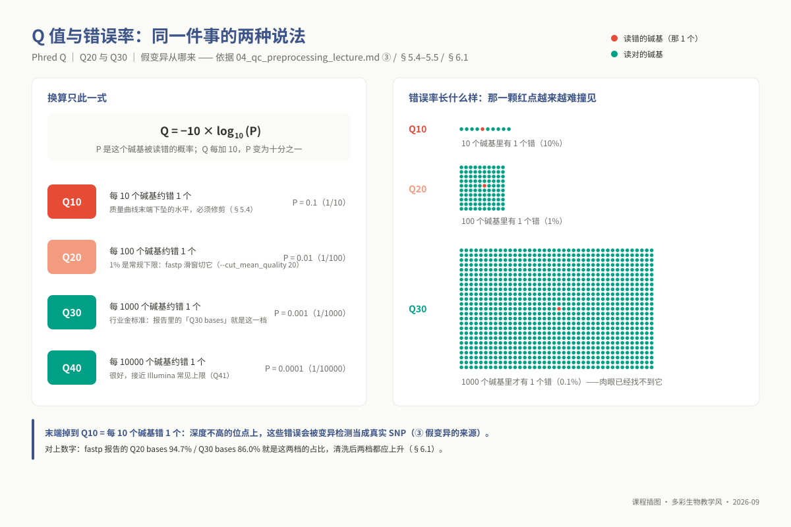
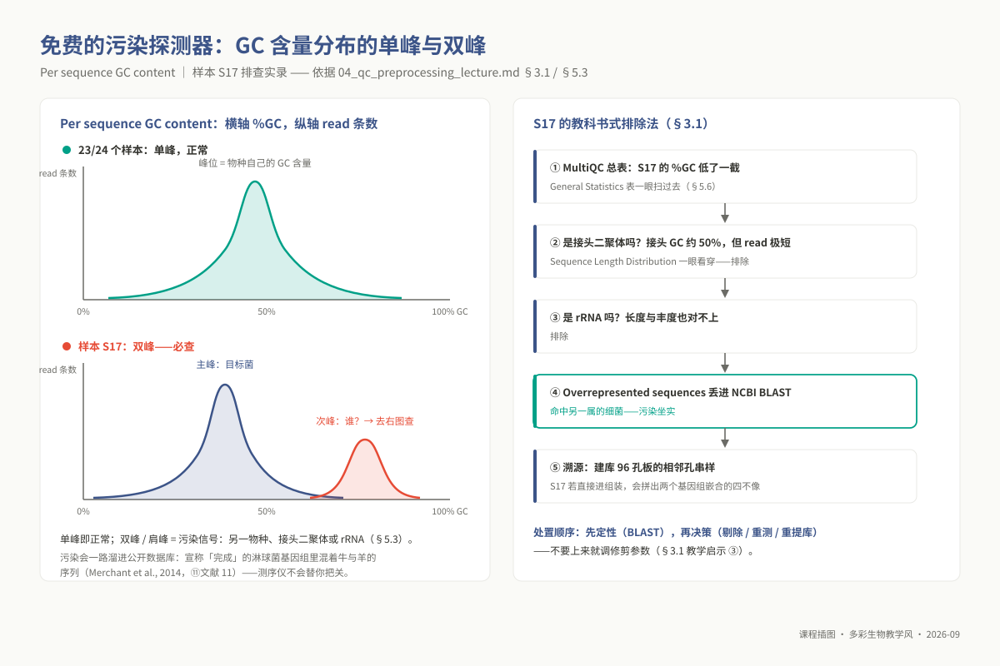
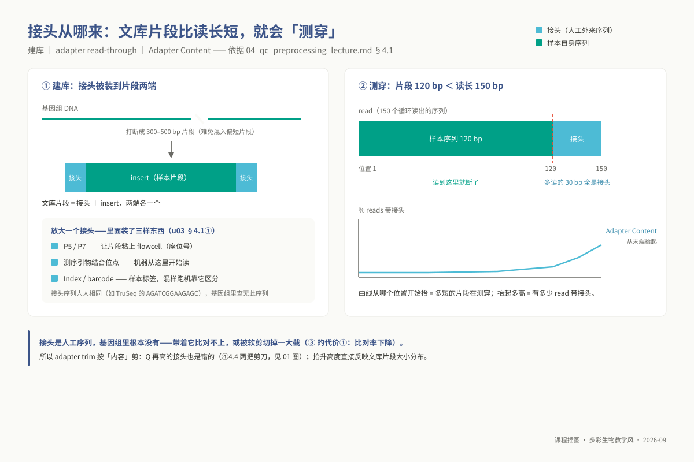
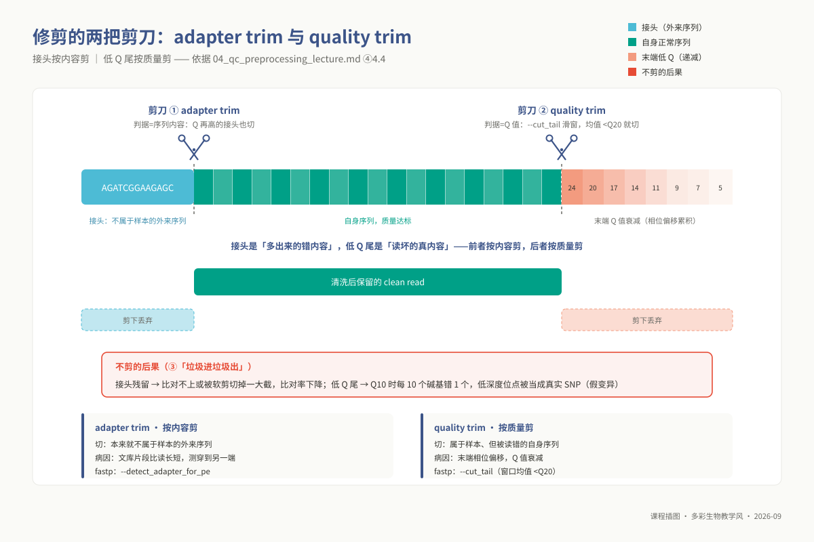

# 单元 u04：质量控制与数据预处理

> **适用对象**：本科 ｜ 线上自学 · 4 学时（异步）｜ 环境：`ngs_ug_base`（`fastqc` / `multiqc` / `fastp`）
>
> **阅读重点**：本讲从 FastQC 的指标出发，练习区分数据特征、实验问题和可修复的技术问题。你将比较清洗前后的报告，并为短读长与长读长数据选择合适的处理策略。
<!-- 配套脚本：`03_code/undergraduate/scripts/04_run_fastqc.sh`。 -->

## ① 学习目标

完成本单元的理论学习与质控实操后，你应当能够：

1. **解释输入质量的影响**：从比对、变异判断和组装三个环节说明接头与低质量碱基如何改变下游结果。
2. **多维逆向解构 FastQC 诊断雷达**：熟练解读 FastQC 报告的 11 大核心度量模块，准确指出各图表的物理横纵轴定义，掌握良性基准分布与典型异常偏移的底层形态。
3. **区分警报与故障**：区分仪器问题和建库技术的固有特征，列举至少两个 FastQC 显示 FAIL 但不应直接修剪的场景。
4. **驾驭一体化现代清洗引擎 fastp**：熟练配置 fastp 执行双端接头自动识别、末端动态滑窗质量修剪（Sliding Window Trimming）与长度阈值过滤，准确阐述每一个超参数背后的数理控制逻辑。
5. **实施全批次跨样本宏观质量审计**：运行 MultiQC 对数十个异构样本的质检日志进行自动化抓取与归纳，利用统计异常点（Outliers）快速锁定发生污染、降解或浓度异常的受损文库。
6. **比较平台的质控策略**：比较短读长与长读长的错误分布，并说明为何不能把短读长末端修剪规则直接套用于长读长组装数据。
7. **撰写出版级规范质量评估论述**：依据定量度量数据，为结课综合实践项目报告 §2.3 与 §2.4 撰写逻辑闭环、证据详实的书面数据质量评价与预处理决策陈述。

## ② 前置检查

**本讲依托的 L0 基础模块**：

| 模块 id | 核心主题 | 本讲知识点映射与依赖 | 对应自测与验收要求 |
|---|---|---|---|
| `l0_01_linux` | Linux 命令行操作与远程环境 | 通配符批处理、标准重定向、目录树自动化创建、跨网络远程获取 HTML 报告 | L0-1 自测第 1–5 题 |
| `l0_03_conda` | Conda 虚拟环境管理 | 激活并验证 `ngs_ug_base` 沙箱，确保 FastQC、fastp 与 MultiQC 可执行路径正确 | L0-3 自测第 1–3 题 |
| `l0_04_formats` | 测序格式规范（u03 核心载体） | Phred+33 字符映射体系、FASTQ 四行等长契约、FASTA 与 FASTQ 本质形态差异 | L0-4 自测第 1–7 题 |

**本讲即 L0 模块 `l0_05_qc` 的本科落地承载版**：学完本讲并独立完成配套自测，即视为掌握全套生信质控工程能力，无需重复修读。三道核心上机题在讲义中的映射如下：

- 第 8 题 $\rightarrow$ §5.2 与 §5.3 节：运行 FastQC 并对各模块实施独立学术判读；
- 第 9 题 $\rightarrow$ §5.5 与 §5.6 节：配置 fastp 实施清洗并利用 MultiQC 对比前后统计指标；
- 第 10 题 $\rightarrow$ §5.8 节：针对综合项目主线数据 `/data/lab/ngs/reads.fa` 开展长读长质控与决策推导。

## ③ 背景与科学问题

在现代生命科学研究中，“垃圾进，垃圾出”（Garbage In, Garbage Out）绝非一句抽象的口号，而是会在后续生物信息学推断中引发灾难性级联放大的**可量化物理代价**：

1. **序列比对率断崖式下挫**：人造接头寡聚核苷酸在目标物种参考基因组中根本不存在同源位点。若未剥除接头，比对算法只能将其强行判定为软剪切（Soft-clipping）或直接宣告比对失败，致使昂贵的高通量测序数据大量沦为无效废弃字节。
2. **多重检验伪阳性变异井喷**：当测序读段 3' 末端质量跌落至 Q10 时，每 10 个测序碱基中便有 1 个属于物理读错。在测序深度相对较低的位点，突变挖掘模型（如 GATK）极易将这 10% 的物理假信号误判为高置信度的单核苷酸多态性（SNP），诱发数以万计的伪突变位点。
3. **基因组重叠图拓扑灾难**：在从头组装算法中，未清洗的单点随机错误会在 de Bruijn 图或重叠图中制造大量死胡同（Tips）与虚假分叉泡状环（Bubbles），直接阻断组装器的延伸路径，将完整的染色体炸裂成数百个细碎的 Contigs。

```text
测序质量控制的辩证中道（平衡信息熵与噪声）：
  [ 原始粗糙测序流 ] ──(过度暴力修剪 Q > 30)──> 损失超 50% 有效信息，读长剧烈缩短，丧失比对特异性 (不可取!)
          │
          ├──(放任自流不做清洗)────────> 接头污染导致比对失败，低质末端导致假突变激增 (不可取!)
          │
          ▼ (工程级精准清洗)
  [ fastp 动态滑窗截断 + 接头识别 ] ──> 剔除真实技术外来噪声，完整保护核心生物学信号 (正道!)
```



*图 u04-2：Phred 质量尺：Q20=百分之一、Q30=千分之一，参数都锚在这把尺上。*

**科研质控的终极哲学准则**：
**质控的终极目标绝非盲目追求让 FastQC 仪表盘上的每一个指示灯都变成绿色，而是使数据纯度最大化契合特定下游算法的数学假定。**
在综合实践项目（u08）中，报告模板要求填写 §2.3「数据量和质量评估」与 §2.4「数据预处理方法」。面对项目实际下发的 PacBio 长读长数据（`/data/lab/ngs/reads.fa`），学生必须深刻领会：针对 Illumina 短读长设计的 FastQC 规则与针对三代长读长设计的自纠错组装算法，存在着截然不同的质控判据。

### 3.1 应用案例：一次 GC 双峰的排查实录——污染是怎样被一张图抓住的

**真实案例：Merchant 等（*PeerJ*, 2014）揭示的基因组测序跨物种污染事件与实验室混样排查。**

在某生物育种重点实验室的高通量测序批次中，技术人员对 24 个细菌临床分离株执行全基因组重测序。常规质检显示 23 个样本的各项指标全面呈现良性 PASS；唯独样本 S17 在 MultiQC 宏观总表中，其全基因组平均鸟嘌呤-胞嘧啶含量（%GC）较同组其他样本显著偏离了近 12 个百分点。
调取 S17 的 *Per sequence GC content* 分布曲线后，技术人员捕获了典型的**双峰共存结构（Bimodal GC Distribution）**：在目标病原菌 51% GC 的理论主峰之外，40% GC 区域异常隆起一个明显的次级峰形。随后展开了严密的排除法法医学生信排查：

1. 是否为接头二聚体污染？接头序列 GC 虽高但读长极短，而长度分布直方图显示全长均为 150 bp，排除；
2. 是否为高丰度 rRNA 操纵子污染？比对特定探针后丰度无法解释 25% 的高占位比，排除；
3. 调取 *Overrepresented sequences* 中的高频异常序列片段，提交至 NCBI 全球核酸数据库开展 BLAST 溯源检索，比对结果以 99.8% 的相似度直接命中宿主或另一种兼性厌氧菌序列！最终经实验台排查，确认为 96 孔板加样时相邻孔位的微量移液气溶胶串样交叉污染。

Salzberg 团队在系统审计公共数据库时证实，连国际顶级研究机构公布的部分所谓“已完成”基因组中，亦曾隐蔽混入牛羊甚至微生物的外源 Contigs（Merchant et al., 2014，详见 ⑪）。**下机质控是阻断实验污染污染全球公共知识库的最后一道关口**。



*图 u04-4：GC 双峰排查记：五步排除法把一板样本的串样揪出来。*

## ④ 核心原理

### 4.1 Illumina 测序技术误差的物理化学本质

1. **末端相位去同步化（Phasing Dephasing）**：正如 u03 所推演，荧光可逆终止化学反应的单步裂解效率无法达到理论上的 100%。成簇微米斑点内上千个单分子，随着反应进行到 120 轮以上，逐渐在时间维度上散开，导致激光共聚焦相机捕捉到的光斑成为混杂光谱，信噪比不可逆地下滑。**这是物理化学客观规律决定的系统性衰减，绝非文库彻底失败**。
2. **文库插入片段偏小导致的接头读穿（Read-through）**：在超声打断阶段，若 DNA 片段筛选下限失控，产生了一批长度小于测序读长（例如 $L_{\text{insert}} = 110\,\text{bp} < L_{\text{read}} = 150\,\text{bp}$）的过短文库。测序仪在读完 110 bp 真实基因组后，聚合酶并未停止，而是继续向后直接测定人工合成的 P7 接头序列。此时该 Read 末尾 40 bp 全由非生物学接头构成，若不切除必将破坏比对。



*图 u04-3：接头从哪来：insert 120 bp < 读长 150 bp，末尾 30 bp 全是接头。*

3. **PCR 扩增偏好诱发的伪重复（Duplicates）**：建库扩增过程中，部分小分子或特定 GC 比例的片段被 DNA 聚合酶高频反复复制，在芯片表面形成多个物理孤立但序列完全相同的簇。这种假冗余会严重扭曲覆盖深度，破坏变异检测模型中的等位基因频率（AF）推断。

### 4.2 FastQC 诊断软件的形式化运行边界

FastQC 是对未比对高通量数据的全盲“体检”软件。理解其底层行为必须把握三大边界：

1. **高阶复杂度模块基于抽样建模**：基础统计、每碱基质量与 GC 曲线会扫描全量数据；但 *Sequence Duplication Levels* 与 *Overrepresented sequences* 模块**只追踪在文件前 100,000 条 reads 中首次出现的序列**，再在全文件范围内统计这些序列的出现次数（长于 75 bp 的 read 截到前 50 bp 再比对）。若输入文件由不同批次粗暴合并拼接而成，局部抽样可能丧失全局代表性。
2. **报警阈值锚定于标准基因组 WGS 经验**：软件预设的绿黄红状态，完全是以标准二倍体或单倍体全基因组 DNA-seq 为基准标定的。面对特殊转录组、扩增子或靶向捕获文库，默认报警往往与生物学真相脱节。
3. **输出现象而非归因**：出现异常过表达序列仅反映“高频均一”这一信息学事实，至于是由于高表达管家基因、接头二聚体、还是外源噬菌体爆发，必须依靠研究人员结合 BLAST 开展进一步因果定性。

### 4.3 二代短读长 vs 三代长读长的质控范式分水岭

将短读长质检工具生搬硬套至长读长数据，是生信新手最频发的技术事故：

```text
质控范式的代际分水岭：
  [ Illumina 二代短读长 ] ──> 错误沿读段位置系统性衰减 ──> 依赖每碱基质量曲线，强制做末端截断与接头清洗

  [ PacBio / ONT 三代长读长 ] ──> 错误呈全长空间随机泊松分布 ──> 长度严重非均一，禁止做末端截断，重在监控 N50 与覆盖度
```

| 质量控制维度 | Illumina 二代短读长 | PacBio / Oxford Nanopore 三代长读长 |
|---|---|---|
| **错误空间分布** | 随物理位置递增，3' 末端呈现强系统性塌陷 | **沿全长完全独立随机分布**，无固定脆弱位点 |
| **每碱基质量曲线** | 极具诊断价值（直接指示从何处开始滑窗截尾） | **毫无诊断价值**（长度从几百到数万不等，横轴无法对齐，强行绘制成单条曲线毫无统计学意义） |
| **序列长度分布** | 物理高度均一（如标准 150 bp 纯竖线） | **极端非均一长尾分布**（直方图形状与 N50 是核心评估指标） |
| **人工接头残留** | 常见致命污染，必须依赖清洗软件剔除 | 测序仪主控软件在生成 HiFi 或下机时已完成内嵌接头剥除 |
| **质量修剪策略** | **必须修剪**（剔除低 Q 尾与短片段） | **绝对严禁盲目外部修剪**（下游 Canu/Flye 自带图论纠错与重叠过滤，外部修剪破坏跨越重复序列的物理长度优势） |

### 4.4 预处理的两把手术刀：去接头与质量修剪的边界

在 fastp 等清洗算法中，开发者必须精准区分两组作用机制完全异构的参数：



*图 u04-1：adapter trim 按内容剪掉接头，quality trim 按质量剪掉低 Q 尾——两把剪刀各治什么。*

- **接头剥除（Adapter Trimming，内容剪刀）**：剥除的是**本就不属于生物样本的外源人造序列**。判定仅依赖序列比对（`--detect_adapter_for_pe`）。即使该接头序列的测序质量达到顶格的 Q40，其在生物学上也是绝对的伪造数据，必须彻底剔除。
- **质量修剪（Quality Trimming，度量剪刀）**：修剪的是**虽然属于真实生物学样本、但因物理信号退化导致判错概率过高的自身序列**。判定基于滑窗内的平均 Phred 得分（`--cut_tail`）。即使该序列是核心基因，只要 Q 值低于阈值，为防止下游变异误判亦必须果断截断。

**RNA-seq 测序为什么严禁盲目执行 PCR 去重（Deduplication）？**
在 DNA-seq 中，两个独立片段具有完全相同起始和终止坐标的概率极低，出现相同读段基本可断定是由 PCR 扩增偏好诱发的无意义冗余，必须利用 Picard 等工具标记去重。然而在 RNA-seq 中，高丰度表达的看家基因（如肌动蛋白 Actin 或 GAPDH）在细胞内产生数以万计的真实转录本拷贝，它们被测序仪采样时必然产生海量物理坐标相同的真信号。若在此处机械执行去重，等于亲手将高表达基因的定量动态范围彻底抹平！

### 4.5 技术前沿（2023–2026）

1. **单通道一体化预处理引擎的演进**：传统时代“FastQC 探查 $\rightarrow$ Trimmomatic 清洗 $\rightarrow$ FastQC 复检”的三步磁盘高 I/O 交互模式，已被 **fastp** 等基于 C++ 高度优化的多线程一体化工具全面取代。2023 年发表的最新技术架构将接头探测、滑窗修剪、UMI 分子标签去重与前后动态对照报表合并为单次内存扫描完成。
2. **长读长专有质检生态确立**：社区不再强行将长读长灌入 FastQC，而是确立了以 **NanoPlot** 与 **NanoFilt** 为代表的单分子长读长专用分析套件。其核心将视觉重心置于二元散点密度图（读长 vs 质量分）、对数读长谱与动态 N50 步进折线图之上，真正契合了长读长数据的物理本质。

## ⑤ 操作步骤

全部操作在集群环境 `ngs_ug_base` 中执行。确保路径明确、参数规范。

### 步骤 1：规范构建分析工作区

```bash
cd /d3/scratch/${USER}/ngs
mkdir -p qc/{fastqc_raw,fastqc_clean,clean,fastp_reports}
# 严禁遗漏 mkdir -p：FastQC 与 fastp 在底层均无自动创建缺失多级目录的能力
```

### 步骤 2：对原始测序数据执行初始 FastQC 扫描

```bash
fastqc -t 4 -o qc/fastqc_raw data/*.fq.gz
# 参数 -t 4 启动 4 个并发线程（注意：FastQC 是单线程处理单文件，文件数需与线程数合理匹配）
```

执行完毕后，每个输入样本将产出 HTML 可视化网页与包含原始矩阵的 `.zip` 归档。在终端快速抽取结果概要：

```bash
unzip -p qc/fastqc_raw/sampleA_R1_fastqc.zip sampleA_R1_fastqc/summary.txt
```

### 步骤 3：FastQC 十大核心诊断模块逐一深度判定

| 诊断分析模块 | 核心坐标系物理定义 | 理论健康基准指纹 | 异常报警提示的真实故障物理根源 |
|---|---|---|---|
| **Basic Statistics** | 宏观统计属性表格 | 读段总数、长度及 %GC 与实验设计高度吻合 | 基础指标严重失配，提示测序量不足或物种混淆 |
| **Per base sequence quality** | 横轴：碱基循环位置；纵轴：Phred 质量箱线图 | 全程稳居绿色高信度区（$Q \ge 28$），末端微幅下倾 | 中段断崖式跌落表明 Flowcell 该轮次混入气泡或荧光酶失活 |
| **Per tile sequence quality** | 横轴：碱基位置；纵轴：Tile 物理磁砖编号；色阶：偏差 | 全图呈现纯净均一冷色冷蓝 | 浮现纵向炽热红斑，表明物理芯片局部产生划痕或光学遮挡 |
| **Per sequence quality scores** | 横轴：单条 Read 平均 $Q$ 值；纵轴：读段频数 | 呈现单峰分布，峰值锐利锚定于 $Q \ge 35$ 区域 | 浮现左侧低质量次峰，表明芯片边缘存在严重信号弥散 |
| **Per base sequence content** | 横轴：碱基位置；纵轴：A/T/C/G 四种碱基瞬时占比 | 四条折线彼此平行平直（AT 接近，GC 接近） | 前 10–15 bp 剧烈振荡（RNA-seq 随机引物常态）；全程失衡提示建库偏好 |
| **Per sequence GC content** | 横轴：GC 含量百分比；纵轴：读段数量 | 呈现平滑单峰理论正态拟合，主峰精准对齐物种特征 | **严重双峰或宽肩峰，明确指示外源物种物理污染或接头二聚体** |
| **Per base N content** | 横轴：碱基位置；纵轴：模糊未定碱基 N 占比 | 紧密贴合于零刻度线（接近 0%） | 某位点突发垂直脉冲，提示该循环激光器快门同步或电压异常 |
| **Sequence Length Distribution** | 横轴：读段长度（bp）；纵轴：读段频数 | 原始数据呈现单条垂直细线（长度绝对均一） | 清洗后呈现多峰连续分布属正常现象（滑窗修剪所致） |
| **Sequence Duplication Levels** | 横轴：相同序列出现频次；纵轴：序列占位比 | 绝大多数序列仅出现一次（DNA-seq 规律） | 极高重复在 DNA-seq 提示 PCR 扩增过冲；在 RNA-seq 提示高表达基因 |
| **Adapter Content** | 横轴：碱基循环位置；纵轴：接头累计污染率 | 呈现紧贴零刻度的水平死线 | 末端曲线抬头超过 5%（FastQC WARN；>10% 为 FAIL），提示文库片段小于读长，**强制要求清洗** |

### 步骤 4：质检红绿灯科学裁决（四项绝对不可误判的红灯）

**必须坚决介入工程清洗的场景**：

- *Adapter Content* 在 3' 末端显著抬升突破 5%；
- *Per base quality* 在末端跌破 Q20（判错率大于 1%；FastQC 默认 FAIL 线是中位数 <20 或下四分位 <5，WARN 线是中位数 <25 或下四分位 <10）；
- 经清洗后残留大量长度短于 50 bp 的碎屑读段（会严重诱发全基因组多重错误匹配）。

**红灯非故障：严禁盲目修剪的四大经典场景**：

1. **RNA-seq 转录组测序前 10–15 bp 的 *Per base sequence content* 爆表飘红：逆转录建库依赖的随机六聚体引物（Random Hexamers）并非理想随机，某些特定寡聚序列因热力学结合自由能差异与转录本结合概率天然偏高（Hansen et al., 2010，详见 ⑪）。这是物理化学必然产物，现代比对算法完全兼容，严禁为消除红灯而暴力裁切这 10 bp，裁切只会降低后续比对特异性**！
2. **RNA-seq 的 *Sequence Duplication Levels* 飘红**：高丰度表达的生物学必需基因必然被测得数万次，这是真实的生物学表达量信号，**严禁执行去重**。
3. **16S / ITS 扩增子测序的碱基含量全程严重红灯**：所有扩增产物均源于同一对引物所锚定的高度保守区，同一位点的碱基组成必然高度恒等，不均一性是实验设计的固有逻辑。
4. **亚硫酸氢盐测序（BS-seq 甲基化）的胞嘧啶 C 比例极低、胸腺嘧啶 T 比例畸高**：未甲基化的 C 被化学转化为 U 并在测序中体现为 T，这正是该实验的核心检测机理，**报红反向证实了化学转化反应完全彻底**！

### 5.5 配置 fastp 实施高质量自愈清洗

```bash
fastp \
    -i data/sampleA_R1.fq.gz  -I data/sampleA_R2.fq.gz \
    -o qc/clean/sampleA_R1.clean.fq.gz  -O qc/clean/sampleA_R2.clean.fq.gz \
    --detect_adapter_for_pe \
    --cut_tail --cut_window_size 4 --cut_mean_quality 20 \
    --qualified_quality_phred 15 --unqualified_percent_limit 40 \
    --length_required 50 \
    --thread 4 \
    --html qc/fastp_reports/sampleA.fastp.html \
    --json qc/fastp_reports/sampleA.fastp.json
```

*核心参数逻辑：`--detect_adapter_for_pe` 依据双端重叠区自动算法比对推断接头，杜绝手动输入错误；`--cut_tail` 仅在质量衰退的 3' 末端启用滑窗剪切；`--length_required 50` 丢弃剪切后短于 50 bp 的碎屑，有效封堵多重比对风险。*

### 步骤 6：清洗复核与 MultiQC 全批次全景扫描

```bash
# 对清洗后的产物重新跑一遍 FastQC 评估
fastqc -t 4 -o qc/fastqc_clean qc/clean/*.clean.fq.gz

# 递归抓取全目录下的 FastQC 压缩包与 fastp 生成的 JSON 报告进行全景聚类
multiqc --force -o qc -n multiqc_report.html qc
```

### 步骤 7：一键化全套工程流水线脚本应用

运行课程封装的标准化批处理脚本：

```bash
bash 03_code/undergraduate/scripts/04_run_fastqc.sh data/raw qc 4
```

### 步骤 8：长读长数据专用质控规程（综合项目实战必测）

针对综合项目数据 `/data/lab/ngs/reads.fa`，**绝对不可直接调用默认 FastQC**，必须执行长读长专用参数集：

```bash
bash 03_code/undergraduate/scripts/04_run_fastqc.sh --long /data/lab/ngs/reads.fa qc_long 4m
```

脚本将绕过无意义的每碱基质量曲线，直接统计长读长最关键的四大核心工程指标：总读段数、有效碱基总量、**Read N50**、以及针对 4 Mb 目标基因组的实际等效测序深度。

## ⑥ 结果解读

### 6.1 良性清洗产物的数据特征

审查 fastp 运行终态的控制台或 JSON 日志，健康的清洗过程应当呈现如下指纹：

- **有效过滤保留率极高**：`reads passed filter` 比例应当稳定处于 $95\% - 99\%$ 之间。
- **质量分级显著攀升**：Q30 碱基占位比显著提高约 $3\% - 8\%$，低质量末端被成功修剪。
- **接头成功定点清除**：`reads with adapter trimmed` 精准对齐 FastQC 在清洗前捕获的接头上升比例。在复检的 FastQC 报告中，Adapter Content 曲线被彻底压平至零坐标。

### 6.2 异常清洗与质检病征溯源

- **病征 A · 过滤保留率灾难性锐减（例如 `passed filter` 低于 40%）**：表明清洗阈值过于严苛。多因将 `--cut_mean_quality` 误设定为过高的 30（把大批良性碱基斩尽杀绝），或 `--length_required` 超过了原始读长的一半。
- **病征 B · 接头修剪计数始终为 0，但 FastQC 报告接头明显偏高**：自动双端重叠检测算法失效（通常由于文库片段过长重叠区太短）。必须在 FastQC 报告中查验接头类型，并在 fastp 中通过 `--adapter_sequence` 显式注入确定性寡聚序列。
- **病征 C · fastp 执行完毕无报错，但输出文件大小为 0 字节**：早期 fastp 版本在目标输出路径不存在时静默退出（见 ⑨ 错误 5）。**必须养成在操作后运行 `ls -lh qc/clean/` 查看物理文件大小的条件反射**。
- **病征 D · MultiQC 发现单一离群样本 GC 含量异常偏离**：该样本遭遇外源严重生物污染或加样串序，必须从后续下游分析队列中坚决隔离。

### 6.3 综合实践项目报告 §2.3 与 §2.4 的规范写法示范

在结课项目报告中，切忌书写泛泛而谈的套话。规范陈述示范如下：

> **§2.3 数据量和质量评估**：本项目采用实验室自测的 PacBio 单分子长读长测序数据（物理路径 `/data/lab/ngs/reads.fa`，FASTA 格式）。经 `04_run_fastqc.sh --long` 统计，测序共获取 58,432 条有效长读段，总计产出碱基 412.66 Mb，平均读长为 7,062.3 bp，读段 N50 达到 11,840 bp，最长单个读段为 84,120 bp。基于目标模式细菌 4 Mb 的基因组物理尺寸测算，实际全基因组等效测序覆盖深度达 103.2X。由于覆盖深度显著超越细菌组装黄金及格线（50X），且读长 N50 远超 5 kb 的保守核糖体操纵子长度，数据质量充分满足单 Contig 完成图组装的理论阈值。
>
> **§2.4 数据预处理方法**：鉴于 PacBio 原始读段单点错误服从空间独立随机分布，且下游组装器（Canu 与 Flye）内置了基于重叠图拓扑的深度自纠错（Consensus Error Correction）模块，本项目未执行二代常规的外部截断与过滤。外部暴力修剪会破坏长读段两端跨越复杂串联重复的物理锚定能力，故保持原始读长直接投递组装。

## ⑦ 统计插件

**本讲无独立统计要点。**

本单元产出的全部是指向测序数据物理形态的**描述性统计度量（Descriptive Statistics）**——包括碱基质量的分位数区间分布、GC 比例直方图、序列重复度分级、读长频率分布与 N50 指标。这些参数仅用于刻画输入数据集的经验几何属性，**不涉及参数假设检验、没有原假设与备择假设的构建、亦不计算统计学显著性 $p$ 值或推断假阳性发现率（FDR）**（本专题不在契约 `stats_plugin_topics` 名单中）。
必须澄清的是：FastQC 报告中的 PASS、WARN 与 FAIL，纯属软件开发者根据常规测序项目的历史均值人工设定的**经验工程工程过滤网（Heuristic Thresholds）**，绝不代表在统计学意义上推翻了某种概率模型。把 FastQC 的 FAIL 误判为“统计学显著异常”属于极其严重的生信常识性错误。

## ⑨ 常见错误与排查

### 9.1 格式误判与工具不兼容故障

| 控制台核心报错原型 | 操作系统底层物理机理 | 标准自愈解决方案 |
|---|---|---|
| `FastQC: ID line didn't start with '@' at line 1` | 误将无质量值的长读长 FASTA 格式直接喂给了仅吃 FASTQ 格式的 FastQC 软件 | 终止在 FASTA 上运行 FastQC，切换执行长读长专用统计命令：`04_run_fastqc.sh --long` |
| `Ran out of data in the middle of a fastq entry. File truncated` | FASTQ 文件在网络同步传输中意外中断，或磁盘配额超限导致尾部记录破损残缺 | 终端运行 `zcat fq.gz \| wc -l` 确认行数是否能被 4 整除；校验 `md5sum` 并重新执行文件传输 |

### 9.2 目录依赖与静默失败陷阱

| 控制台核心报错原型 | 操作系统底层物理机理 | 标准自愈解决方案 |
|---|---|---|
| `fastqc: Specified output directory '...' does not exist` | FastQC 不具备底层物理目录自动创建能力，指定的目标文件夹在磁盘上不存在 | 养成在调用工具前显式执行 `mkdir -p <输出目录>` 的良好工程防范习惯 |
| `fastp 执行退出码为 0，但 clean 目录下物理文件大小为 0 字节` | 某些 fastp 版本在目标输出路径不存在时，捕获异常未彻底，静默退出且掩盖错误码 | 强制预先建立目录；**每次清洗完毕后，必须无条件执行 `ls -lh qc/clean/` 核验物理文件大小** |
| `undefined option: --quality` | fastp 并不存在该参数，将其与旧版 Trimmomatic 的语法发生了记忆混淆 | 终端运行 `fastp --help \| grep -i qual` 审查真实参数；质量控制应选用 `--qualified_quality_phred` |

### 9.3 MultiQC 运行与环境隔离异常

| 控制台核心报错原型 | 操作系统底层物理机理 | 标准自愈解决方案 |
|---|---|---|
| `MultiQC: No analysis results found. Cleaning up..` | 指定的检索路径下不存在 MultiQC 能够识别的标准 JSON 或 ZIP 结构 | 确认输入路径包含已生成的 `fastqc_raw/*.zip` 或 `fastp.json`，确保将其上级目录传给 MultiQC |
| `Existing reports found, adding suffix to filenames` | 目标路径中已存在同名历史报表，MultiQC 默认追加 `_1` 后缀避免盲目覆盖 | 在执行命令中显式附加 `--force` 参数，实现报表的确定性原子覆盖更新 |
| `multiqc: ModuleNotFoundError: No module named 'numpy'` | 系统 `$PATH` 优先调用了用户主目录下未安装完整依赖的残缺 pip 包，而非 Conda 沙箱工具 | 终端执行 `which multiqc` 确认其来自 `.../envs/ngs_ug_base/bin/`；若存在全局污染，通过 Conda 绝对路径调用 |

## ⑩ 思考练习

1. **（质检模块生物学深度辨析）** 某同学对一批真核生物 RNA-seq 测序数据执行 FastQC 质检，结果显示 *Per base sequence content* 在前 12 bp 触发了刺眼的红色 FAIL 报警，且 *Sequence Duplication Levels* 同样严重超标显示为 FAIL。该同学随即调用工具强行将所有 Read 的前 12 个碱基彻底切除，并运行去重算法删除了 60% 的高频序列。请运用本讲 ④4 节的理论，深刻批判该同学的错误操作，阐明其做法将对下游基因表达定量研究造成怎样不可逆的系统性破坏。
2. **（fastp 参数敏锐性推演）** 假定你手头有一批二代 PE100 短读长测序数据，在套用标准清洗命令后，fastp 终端日志显示 `reads failed due to too short` 高达 42%，致使有效数据量严重损失。(a) 请精准指出是哪个清洗参数的设置与该批次数据的物理读长产生了严重失配？(b) 你建议将其调整为何种数值？依据何在？(c) 若仅仅调大 `--cut_mean_quality` 能否缓解这一过量截断现象？为什么？
3. **（全流程清洗与跨样本审计 · 上机实操）** 在服务器上运行 `04_run_fastqc.sh` 脚本对下发的短读长测试集执行全自动清洗。打开生成的 `multiqc_report.html` 交互式报表：(a) 截图对比清洗前后 Adapter Content 曲线的压制消除效果；(b) 查阅 General Statistics 总表，找出全批次中表现最为离群的一个样本，并明确写出你是依据哪一个统计学特征列做出的离群裁决。
4. **（长读长质控与项目立项论辩）** 在服务器中对项目核心长读长数据 `/data/lab/ngs/reads.fa` 执行 `--long` 质检模式。提取输出指标，回答：若该样本的测序深度仅有 8X，且 Read N50 仅为 1.2 kb，这批数据能否支撑组装出无缝的细菌环状染色体？若不能，从细菌基因组重复序列拓扑阻断的视角，向课题导师撰写一份 150 字的补测抗辩说明。
5. **（故障模拟与主动防御）** 故意制造并记录两类典型实验故障：① 尝试对未压缩纯文本调用 `zcat`；② 在未预先创建输出目录的前提下强行运行 `fastqc -o nodir`。在个人实验笔记中忠实记录操作系统的报错原文，并附注一句话的底层物理机理剖析。

## ⑪ 参考资料

### 经典学术文献

1. Chen S, Zhou Y, Chen Y, Gu J. fastp: an ultra-fast all-in-one FASTQ preprocessor. *Bioinformatics*, 2018, 34:i884–i890. DOI: 10.1093/bioinformatics/bty560 ——fastp 奠基之作，一体化预处理核心架构。
2. Chen S. Ultrafast one-pass FASTQ data preprocessing, quality control, and deduplication using fastp. *iMeta*, 2023, 2:e107. DOI: 10.1002/imt2.107 ——fastp 最新一代算法架构演进报告。
3. Ewels P, Magnusson M, Lundin S, Käller M. MultiQC: summarize analysis results for multiple tools and samples in a single report. *Bioinformatics*, 2016, 32:3047–3048. DOI: 10.1093/bioinformatics/btw354 ——MultiQC 多样本聚类报告系统。
4. Bolger AM, Lohse M, Usadel B. Trimmomatic: a flexible trimmer for Illumina sequence data. *Bioinformatics*, 2014, 30:2114–2120. DOI: 10.1093/bioinformatics/btu170
5. Hansen KD, Brenner SE, Dudoit S. Biases in Illumina transcriptome sequencing caused by random hexamer priming. *Nucleic Acids Research*, 2010, 38:e131. DOI: 10.1093/nar/gkq224 ——§5.4 节深入剖析 RNA-seq 随机引物化学偏好的理论源头。
6. Amarasinghe SL, Su S, Dong X, Zappia L, Ritchie ME, Gouil Q. Opportunities and challenges in long-read sequencing data analysis. *Genome Biology*, 2020, 21:30. DOI: 10.1186/s13059-020-1935-5 ——长读长质控与短读长差异的方法论基准。
7. De Coster W, D'Hert S, Schultz DT, Cruts M, Van Broeckhoven C. NanoPack: visualizing and processing long-read sequencing data. *Bioinformatics*, 2018, 34:2666–2669. DOI: 10.1093/bioinformatics/bty149
8. Koren S, Walenz BP, Berlin K, Miller JR, Bergman NH, Phillippy AM. Canu: scalable and accurate long-read assembly via adaptive k-mer weighting and repeat separation. *Genome Research*, 2017, 27:722–736. DOI: 10.1101/gr.215087.116 ——Canu 内置自纠错机制及长读长组装规范。
9. Kolmogorov M, Yuan J, Lin Y, Pevzner PA. Assembly of long, error-prone reads using repeat graphs. *Nature Biotechnology*, 2019, 37:540–546. DOI: 10.1038/s41587-019-0072-8 ——Flye 重复图算法原著。
10. Goodwin S, McPherson JD, McCombie WR. Coming of age: ten years of next-generation sequencing technologies. *Nature Reviews Genetics*, 2016, 17:333–351. DOI: 10.1038/nrg.2016.49
11. Merchant S, Wood DE, Salzberg SL. Unexpected cross-species contamination in genome sequencing projects. *PeerJ*, 2014, 2:e675. DOI: 10.7717/peerj.675 ——§3.1 节揭示高通量测序外源交叉污染排查案例的出处。

### 官方规范与工程门户

| 平台项目 | 官方规范链接 / 知识库索引 |
|---|---|
| Babraham 生物信息研究所 FastQC 官方项目主页 | https://www.bioinformatics.babraham.ac.uk/projects/fastqc/ |
| **FastQC 模块官方逐项说明手册（权威金标准，必读）** | https://www.bioinformatics.babraham.ac.uk/projects/fastqc/Help/ |
| MultiQC 官方参数手册与集成模块规范 | https://multiqc.info/docs/ |
| OpenGene fastp 官方开源代码仓库与算法更新跟踪 | https://github.com/OpenGene/fastp |
| NCBI 在线局部比对搜索工具（BLAST 序列定性溯源） | https://blast.ncbi.nlm.nih.gov/Blast.cgi |

### 课程内部规范与配套资产

| 课程资产 | 存储路径 / 引用位置 |
|---|---|
| 本讲配套质控全自动批处理工程脚本 | `03_code/undergraduate/scripts/04_run_fastqc.sh` |
| 长读长宏观特征统计驱动脚本（被调用依赖） | `03_code/undergraduate/scripts/03_parse_fastq_stats.sh` |
| 前序格式单元（u03 测序原理与数据格式） | `02_lectures/undergraduate/unit03_seq_principles_formats/` |
| 运行环境定义（包含 fastqc / fastp / multiqc） | `07_envs/conda/env_ug_base.yml` |
| 综合大项目实战操作指南（🔒 锚定外部规范） | `<课程材料目录>/学生实验操作手册.md` |
| 结课综合实践项目标准化报告模板（§2.3 与 §2.4） | `<课程材料目录>/实践报告模板.md` |
| 本科生教学大纲（u04 条目） | `01_syllabus/syllabus_undergraduate.md` |

*讲义版本 v2.1 ｜ 依据 contract_version 1.1 ｜ 最后更新 2026-09-11*
