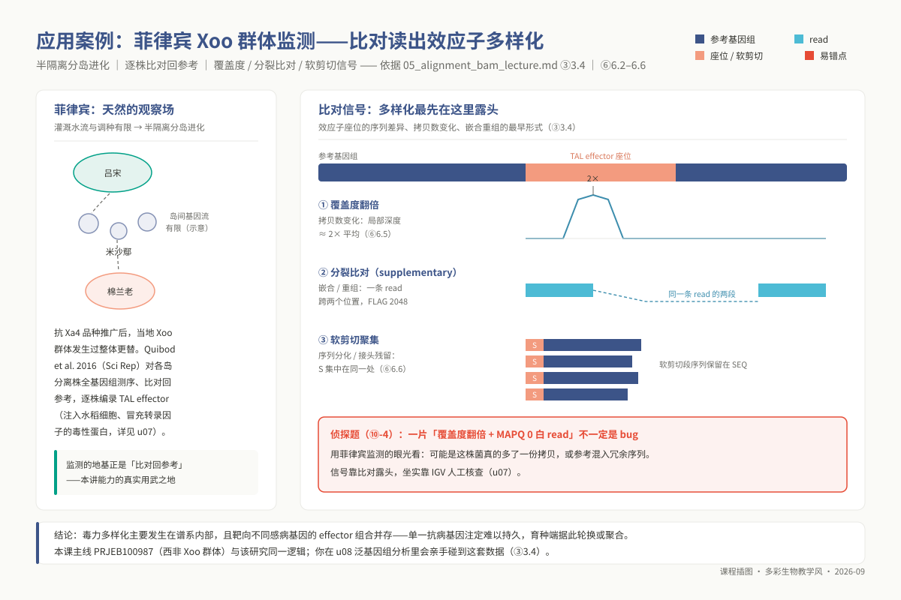
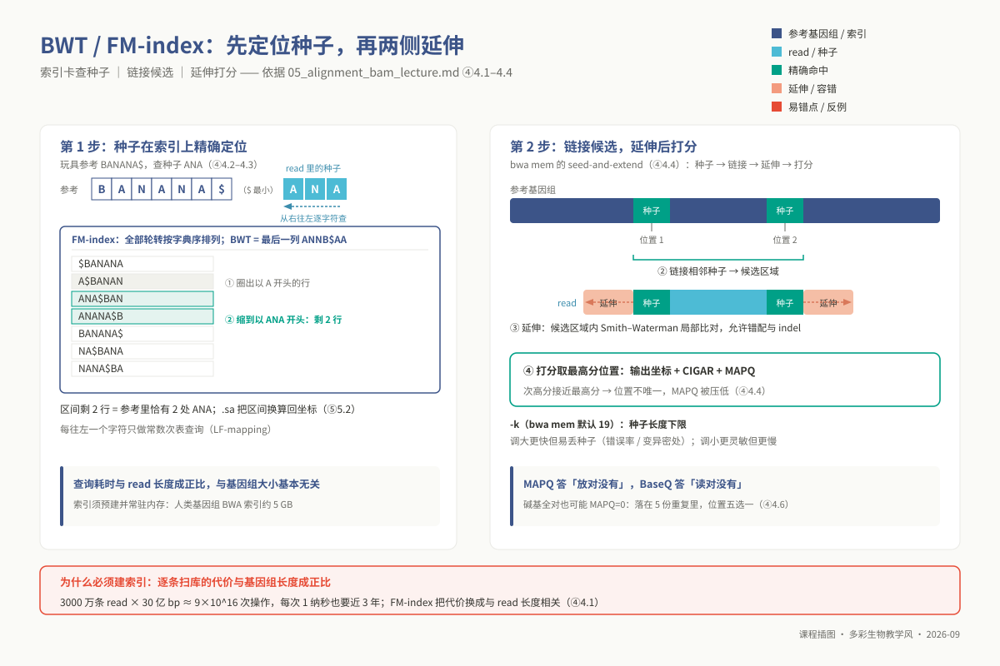
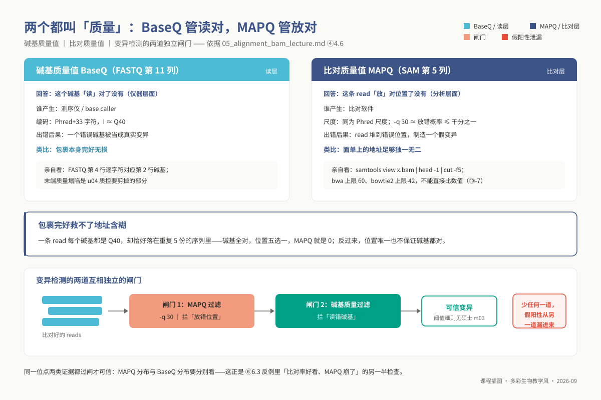
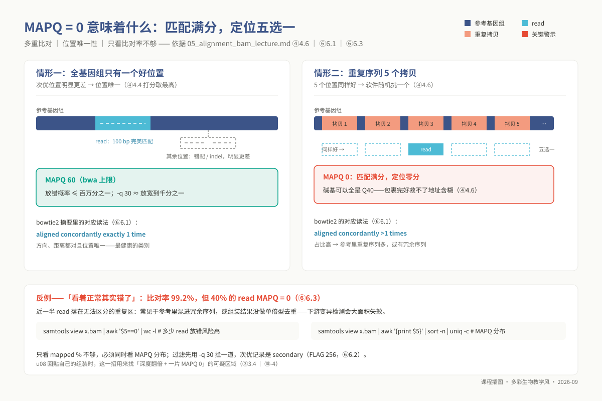
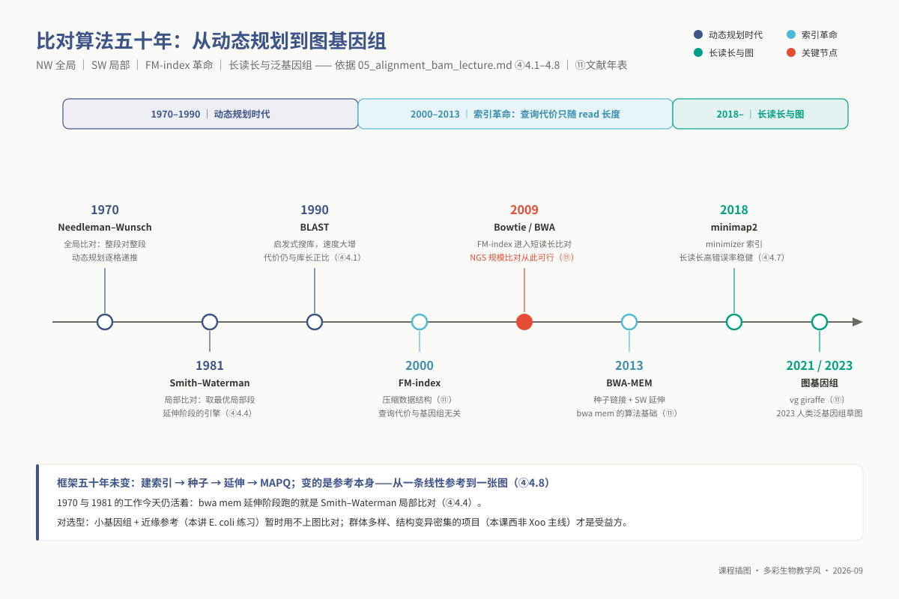
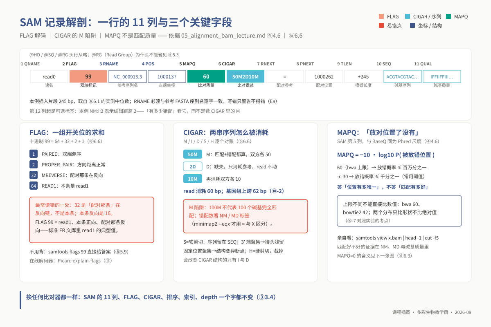

# 单元 u05：序列比对与 BAM 处理

> **适用对象**：本科 ｜ 线上自学 · 4 学时
>
> **阅读重点**：本讲解释索引、种子延伸和 SAM/BAM 格式如何协同工作。你将完成短读长比对、排序、索引和覆盖度检查，并用 MAPQ、BaseQ 与日志定位异常。
>
> **资源**：工具 `bwa`、`bowtie2`、`samtools`（`bedtools` 选学）；环境 `ngs_ug_base`；配套脚本 `03_code/undergraduate/scripts/05_align_and_sort.sh`。

<!-- 维护信息：单元 id `u05`；环境配置文件 `07_envs/conda/env_ug_base.yml`；大纲和章节模板由课程契约维护。 -->

<!-- 原课程定位：整合原比对计算与格式处理两讲内容。 -->
<!--

| 项目 | 内容 |
|------|------|
| **单元 id** | `u05` ｜ 目录 `unit05_alignment_bam` ｜ 4 学时 · 线上自学 |
| **核心工具** | `bwa` `bowtie2` `samtools`（`bedtools` 选学） |
| **运行环境 / 脚本** | `ngs_ug_base`（`conda env create -f 07_envs/conda/env_ug_base.yml`）｜ 配套脚本 `03_code/undergraduate/scripts/05_align_and_sort.sh` |
| **教学定位** | 整合原比对计算与格式处理两讲内容。以短读长比对为载体系统剖析全局索引与局部动态规划结合的工程逻辑，建立下游变异挖掘与覆盖度分析的质量控制直觉。 |
-->

## ① 学习目标

学完本单元，你应当建立高通量序列比对的算法直觉与工程排错能力：

1. **解释索引的计算作用**：说明大规模短读长比对的计算瓶颈，并解释 BWT 与 FM-index 如何把单条 read 的查找复杂度从依赖参考长度的 $O(N)$ 降到主要与 read 长度相关的 $O(m)$。
2. **掌握索引物理结构**：独立构建 BWA（5 个辅助文件）与 Bowtie2（6 个索引文件）索引系统，明晰 BWT 压缩串、后缀数组采样（`.sa`）以及双向 FM-index 在局部延伸时的物理分工。
3. **熟练执行双端比对**：运行 `bwa mem` 与 `bowtie2` 完成高通量双端测序数据比对，准确配置并阐释核心参数（如 `-t`, `-M`, `-K`, `-R`, `-k` 以及 `--very-sensitive`, `-X`）对多线程调度确定性与下游兼容性的影响。
4. **规范元数据管理**：深入阐释 Read Group（`-R` / `--rg`）对下游群体变异检测（如 GATK 样本溯源与批次校正）的刚性约束，杜绝元数据缺失导致的隐式故障。
5. **读取比对输出**：解码 SAM/BAM 的 FLAG，区分 CIGAR 中的 `M` 与完全匹配，并说明软剪切 `S` 和硬剪切 `H` 的含义。
6. **解释两类质量分数**：区分碱基质量（BaseQ）与定位质量（MAPQ），并说明重复序列中的多重比对为何降低定位可信度。
7. **执行全套下游数据治理**：独立完成 SAM 流式转换、多线程内存可控排序、索引建立、覆盖深度提取及 PCR 重复标记（`collate` $\rightarrow$ `fixmate -m` $\rightarrow$ `sort` $\rightarrow$ `markdup`），核算文库技术性扩增率。
8. **界定综合项目定位**：辩证审视比对工具在 u08 综合实践长读长从头组装主线中的验证性职能，掌握利用读长回贴率与覆盖深度断崖识别组装错误的技术闭环。

## ② 前置检查

本单元深度依赖以下基础模块，进入实践前请务必确认技能完备度：

| 依赖模块 id | 本讲应用场景 | 典型薄弱症状 | 对应自测题号 |
|---|---|---|---|
| `l0_01_linux` | ⑤ 流水线脚本；标准 I/O 管道、重定向、`awk` 深度统计、计算节点任务提交 | 看不懂 `bwa mem ... \| samtools sort -o x.bam -` 结尾 `-` 符号代表标准输入流 | `l0_01_linux` Q03 / Q07 / Q10<sup>†</sup> |
| `l0_04_formats` | ④ SAM 11 列强制字段；⑥ 十进制 FLAG 与 CIGAR 操作符运算 | 无法快速定位 SAM 记录的参考序列名、起始坐标及匹配质量得分 | `l0_04_formats` Q04 / Q09<sup>†</sup> |
| `l0_05_qc` | ⑤ 比对输入必须为质控过滤后的洁净数据；⑥ 比对率骤降回溯质控 | 误将含有未剪切接头与低质量尾部的原始读长直接投喂比对器，导致末端软剪切激增 | `l0_05_qc` Q05 / Q06 / Q10<sup>†</sup> |

<sup>†</sup> 注：L0 题号对应先导测试题库。本讲**不依赖** `l0_06_stats`。

```bash
conda activate ngs_ug_base
bwa 2>&1 | head -3            # 验证底层 bwa (Burrows-Wheeler transformation) 安装正常
bowtie2 --version | head -1    # 验证 bowtie2 2.5.x 运行环境
samtools --version | head -1   # 验证 samtools 1.1x / 1.2x HTSlib 核心库
```

## ③ 背景与科学问题

### 3.1 测序物理断裂与染色体坐标系统的重建

高通量测序仪交付的核心产物，是数千万至数亿条在流式细胞仪表面光化学合成的无物理坐标短片段。这些短片段本身宛如被打碎在纸面上的数亿个独立词组，既不知道自身源自哪一条染色体，也无法直接展示彼此之间的相对重叠或物理间距。

然而，生命科学探索的核心命题几乎全部锚定在严格的物理坐标之上：检测特定病原株相对野生型是否存在致死性点突变，必须准确定位到核苷酸的具体位点；定量评估特定抗病基因的转录水平，必须统计精确落入该基因外显子物理区间的读长数量；排除外源试剂或操作污染，必须排查读长在宿主与杂质基因组间的分配归属；验证从头组装的细菌染色体 Contig 是否连贯，也必须通过将读长重新贴回骨架检验测序深度的均一分布。

**序列比对的本质，就是借助全基因组参考序列这一标准参照物，为原本漂浮无依的短片段赋予精确的物理坐标。** 由比对衍生的 SAM/BAM 文件，构成了现代生物信息学变异鉴定、表观标记与转录定量的不可替代的基础数据资产。

### 3.2 规模化比对面临的三重工程与统计矛盾

面对千兆碱基级的数据吞吐量，比对算法必须在三个看似不可调和的极端要求间寻得统计与计算的平衡：

- **计算吞吐**：典型重测序包含数千万条双端读长，面对数十亿碱基对的参考基因组，逐条遍历做动态规划的计算复杂度高达 $O(N \times m)$，单例分析需耗时数月至数年；
- **生物容错**：真实测序存在仪器测序噪声，样本相对于参考基因组更普遍存在单核苷酸变异与插入缺失，机械式的完全精确字串匹配会直接抛弃所有携带真实突变的有价值读长；
- **统计诚实**：真核及复杂原核基因组富集高度重复序列与转座子，强行将多重拷贝区的读长武断指派给某单一坐标，将人为制造大批假阳性变异信号。比对软件必须具备报告“此处置信度不足”的能力，这正是比对质量评分（MAPQ）诞生的理论基石。

### 3.3 与 u08 综合实践项目的逻辑接口

在即将展开的 u08 综合实践项目中，课程采用的是第三代 PacBio 长读长测序数据执行水稻白叶枯病菌（*Xanthomonas oryzae* pv. *oryzae*, Xoo）全基因组从头组装，核心分析路径围绕 `flye` 或 `canu` 展开，而非直接依赖线性参考比对进行变异挖掘。然而，比对技术在全流程中扮演着不可或缺的**反向验证与裁判员角色**：

- **装配连续性与完整性交叉验证**：将全部长读长回贴至自己新组装出的染色体骨架，基于 `minimap2 -ax map-pb` 评估 Read 回贴率与未比对读长比例；
- **单倍型塌缩与嵌合断裂排查**：监控沿染色体滑动的测序深度。若局部深度暴增至平均值 2 倍，提示重复序列或单倍型塌缩；深度断崖式归零，则提示错误嵌合或断裂，通过 `samtools depth -a` 提取深度分布；
- **基因组浏览器可视化证据链**：基于 `samtools sort` 与 `samtools index` 构建支持 IGV 极速随机访问的 BAM 索引，为后续 u07 的结构功能注释与人工复核提供结构化数据流。

因此，本单元以短读长比对系统（BWA 与 Bowtie2）为核心载体，旨在让大家透彻掌握索引压缩机制、种子延伸逻辑及 BAM 格式规范。这套底层格式定义（FLAG 位掩码、CIGAR 操作符、MAPQ 评估规则）在长读长比对工具（如 `minimap2`）及剪接比对工具（如 `STAR`, `HISAT2`）中具有高度统一的通用性。

### 3.4 现实生物学前沿案例：菲律宾 Xoo 病原群体监测中的比对信号

在农作物与病原物的长期协同演化中，寄主抗病基因的大面积推广往往伴随着病菌群体的强烈选择与毒力分化。菲律宾群岛作为水稻白叶枯病抗病基因（如 *Xa4*）长期规模化应用的典型区域，由于群岛间的地理半隔离特征，形成了极具代表性的“微岛屿分化”进化格局。Quibod et al. (2016, *Scientific Reports* 6:34137) 对当地跨越数十年的代表性病原株系进行了全基因组重测序与系统比对分析。

通过深入编录菌株内部的 TAL 效应子（Transcription Activator-Like Effector）基因阵列，研究揭示出病菌突破抗性的分子演化机制不仅表现为全新谱系的外源入侵，更广泛表现为**已有优势谱系内部效应子拷贝的剧烈重组与多样化分化**。

在该项真实科研工作中，这一关键假说的建立高度依赖于从比对 BAM 数据中提取出的多重视角信号：当菌株内部某一效应子基因因串联重复发生拷贝数扩张时，该基因区段的双端测序深度呈现出阶梯式的成倍翻倍；当两个同源效应子之间发生嵌合重组时，比对图谱中大量涌现出跨越重组断裂点的“分裂比对”（Supplementary alignments）与末端一致性的软剪切（Soft-clipping）聚集簇；而当效应子因大片段缺失失活时，其物理坐标上的读长覆盖度骤降为绝对的零深度孤岛。

正是通过对 BAM 记录中这些看似底层的异常信号进行系统挖掘，科研人员得以在无需耗费数年进行逐株人工克隆的前提下，快速还原出群体演化历程中的抗性突变图景。



*图 u05-6：一次群体暴发里的比对信号：覆盖度、分裂比对与软剪切聚集。*

## ④ 核心原理

### 4.1 算法计算复杂度跃迁：从 $O(N \times m)$ 到 $O(m)$

经典的局部序列比对工具（如 Smith-Waterman 算法或 BLAST 启发式查表）针对单条查询序列在整个参考数据库中展开扫描。假定单条读长长度为 $m$（如 150 bp），参考基因组长度为 $N$（如人类全基因组约 $3 \times 10^9$ bp），比对单条读长的时间代价与 $N$ 保持线性甚至二次方正相关。当面临 3000 万条 Illumina 双端读长时，这种线性扫描的理论操作量级将突破 $10^{17}$ 次，在普通工作站上需要持续计算数年。

以 BWA 和 Bowtie 为代表的新一代 NGS 比对工具，其核心突破在于逆转了搜索的主客体依赖关系：**算法不再让无序的查询序列去扫描庞大的基因组，而是预先将参考基因组一次性编译压缩为紧凑的全局前缀/后缀索引结构。** 在这一设计下，比对软件每处理一条长度为 $m$ 的读长，仅需在该压缩索引上进行 $m$ 次单步状态转移。单条读长的定位时间从依赖于整个基因组大小 $N$ 降维为仅与读长长度 $m$ 呈线性关系，使得数千万条序列的比对分析能够在数小时内高效完成。

### 4.2 BWT 变换的可逆轮转与 LF-mapping 代数性质

**Burrows-Wheeler 变换（BWT）** 最初由 Michael Burrows 和 David Wheeler 于 1994 年作为一种无损文本压缩技术提出。其核心数学思想是对待索引文本构建循环轮转排序矩阵。以短文本 `BANANA$` 为例（引入哨兵字符 `$`，其 ASCII 序严格小于任何合法碱基）：构造该文本的所有 7 种循环位移字符串形成 $7 \times 7$ 轮转矩阵；对矩阵中所有行按字典序升序排序；提取排序后矩阵的最后一列字符 $L$（Last column），即得到压缩串 `ANNB$AA`。

看似被彻底打乱的末列字符串 $L$ 具备两个极为关键的数学特性：首先是**完全可逆性**，由于每一行都是循环轮转，$L$ 中的任意字符在原串中严格位于对应行首字符 $F$（First column）的前一个物理位置；其次是**Last-to-First 映射（LF-mapping）性质**：排序矩阵中末列 $L$ 中第 $k$ 次出现的特定字符 $c$，在首列 $F$ 中必定对应于字符 $c$ 的第 $k$ 次出现。

这是因为根据字典序规则，$L$ 中所有以字符 $c$ 结尾的行，其后续文本正是它们在 $F$ 列中对应的行。这一确定性映射构成了在压缩空间中逐级回溯状态的理论中枢。

### 4.3 FM-index：基于压缩状态转移的逆向精确定位

Paolo Ferragina 与 Giovanni Manzini 于 2000 年在 BWT 基础上引入辅助查询阵列，创立了**FM-index**。其核心由两组轻量级辅助表格支撑：**字符累积计数表 $C(c)$**（记录参考序列中所有字典序小于 $c$ 的字符总频次，界定首列 $F$ 的起始行号）；**小波采样出现次数表 $Occ(c, i)$**（记录末列 $L$ 的前 $i$ 个字符中碱基 $c$ 累计出现的次数）。

在 FM-index 中检索查询读长（如 `ANA`）时，算法严格采取**自右向左的倒序搜索（Backward Search）**策略：先以最右侧碱基 `A` 借助 $C(\text{'A'})$ 锁定所有以 `A` 开头的矩阵行区间 $[sp_1, ep_1]$；随后向左推进至倒数第二个碱基 `N`，利用 LF-mapping 状态转移方程 $sp_2 = C(\text{'N'}) + Occ(\text{'N'}, sp_1 - 1) + 1$ 与 $ep_2 = C(\text{'N'}) + Occ(\text{'N'}, ep_1)$ 将区间瞬间收缩至以 `NA` 开头的候选记录；再次向左推进至碱基 `A`，常数次查表即可得到匹配 `ANA` 的最终行号区间 $[sp_3, ep_3]$。

区间包含的行数即代表其在基因组中的出现频次。**每向前推进一个碱基仅需执行常数次 $O(1)$ 的内存查表操作**，检索效率与基因组长度彻底解耦。

### 4.4 种子—延伸（Seed-and-Extend）启发式框架与 SMEM 机制

FM-index 虽能实现极致的倒序精确匹配，但真实测序读长中普遍散落着仪器测序错误与自然突变。为了在极速搜索与生物容错之间架设桥梁，现代比对器普遍采用**种子—延伸（Seed-and-Extend）**多阶段启发式架构。以 `bwa mem` 为例：

1. **种子捕获（Seeding）**：在读长内部提取**超最大精确匹配（Super Maximal Exact Match, SMEM）**片段，即包含特定碱基、在两侧均无法继续延伸而不产生错配的最长精确匹配子串，避免固定 $k$-mer 的冗余计算；
2. **种子链化（Chaining）**：在全局坐标系中，将相对距离、朝向与插入长度相符的相邻种子链接为高置信度候选链条，过滤偶发噪声；
3. **带状仿射罚分动态规划（Banded SW Extension）**：仅在候选窗口内，启动基于仿射罚分（$Cost = Gap_{open} + k \times Gap_{ext}$）的 Smith-Waterman 局部比对，空位开启高罚分、延伸低罚分的设计高度契合生物界插入缺失发生的物理规律；
4. **最优路径打分与歧义裁决**：对比最高分 $S_1$ 与次高分 $S_2$，差值显著则判定唯一，分值接近则压低 MAPQ。

参数 `-k`（最小种子长度，默认 19）是关键杠杆：盲目增大 `-k`，种子少而长、运算极快，但高变异读长因凑不足精确种子而全军覆没；过度调小 `-k`，低复杂度种子爆炸，算法深陷局部动态规划泥潭。



*图 u05-1：先在 FM-index 上精确定位种子，再两侧延伸容错比对（BANANA$ 索引卡示例）。*


*图 u05-7：Temple F. Smith，Smith–Waterman 局部比对共同提出者（1981）（照片：Ragesoss，CC BY-SA 3.0，Wikimedia Commons）。*


*图 u05-8：Michael S. Waterman，Smith–Waterman 局部比对共同提出者（照片：CC BY-SA 3.0，Wikimedia Commons）。*

> **人物故事与算法突破：物理学家与数学家的跨界神来之笔**
> 
> 照片中的**坦普尔·史密斯（Temple F. Smith，物理学家出身的生物物理学家）**与**迈克尔·沃特曼（Michael S. Waterman，计算生物学先驱数学家）**，于 1981 年合作提出了奠定整个现代序列比对基石的 **Smith–Waterman 局部比对算法**。
> 
> 当时学术界通行的 Needleman–Wunsch 算法（1970）只解决“全局比对（Global Alignment）”——强制两条序列从头到尾对齐。但生物学演化的真实情况是：不同物种的同源蛋白往往只在局部的催化结构域高度保守，两侧序列则差异巨大；而在 NGS 时代，将一条 150 bp 的短读长硬塞进数亿碱基的基因组做全局对齐更会彻底崩溃。
> 
> 史密斯与沃特曼在洛斯阿拉莫斯国家实验室合作期间，对动态规划递推式做出了一个惊艳世界的数学修改：**在打分递推项中增加了一个与 0 取最大值的操作（$\max(0, \dots)$）**。这一看似极其微小的改动，让打分矩阵在遇到持续不匹配罚分时能“自动归零复位”，从而忘却上游噪声、精准锁定局部最优匹配片段。无论是后续 BLAST 启发式搜索的局部延伸，还是今日 `bwa mem` 与 `bowtie2` 的种子拓展评分内核，都奔淌着这个 1981 年经典算法的数学血液。

### 4.5 `bwa mem` 与 `bowtie2` 的算法范式与工程取舍

| 评估维度 | `bwa mem` (Heng Li) | `bowtie2` (Ben Langmead) |
|---|---|---|
| **默认比对范式** | **局部比对（Local）**：允许两端无法比对处发生软剪切（`S`），最大化保守核心分值 | **端到端比对（End-to-End）**：要求读长全程惩罚计分，显式声明 `--local` 时才开启软剪切 |
| **读长跨度适应性** | 专为 70 bp 至 1 Mb 设计，对 150 PE 乃至更长片段具备优异的连续性捕捉力 | 专为 50 bp 至数百碱基短片段优化，短片段比对时内部启发式分支修剪极其高效 |
| **结构变异敏感度** | 原生支持断裂点检测，将跨重组读长拆为主比对与补充比对（Supplementary / FLAG 2048） | 原生倾向于报告整体错配罚分，对复杂结构变异的大片段剪切支持相对保守 |
| **MAPQ 缩放上限** | **上限固定为 60**，采用自适应对数似然近似估算错配概率 | **上限固定为 42**（在端到端模式下），基于次优得分差值进行离散查表赋值 |
| **典型科研场景** | 全基因组重测序（WGS）、外显子测序、结构变异鉴定与 GATK 官方推荐流水线 | 表观遗传组学测序（ChIP-seq / ATAC-seq，见硕士 m05）、小RNA及严苛全局匹配场景 |

理解比对范式远比工具选择更为关键：分析低质量数据时，若误用 `bowtie2` 默认端到端模式，大量接头残留读长被强扣错配分导致比对率暴跌；而在相同场景下，`bwa mem` 则悄然将受污染末端软剪切，制造出比对率极高的假象。审视质控输出与比对范式必须形成严密的互证链条。

### 4.6 MAPQ 与 BaseQ：微观碱基测量与宏观染色体定位的双重质量闸门

在生信初学者中最容易引发概念混淆的，莫过于 FASTQ 文件中代表仪器荧光物理测量精度的碱基质量值（BaseQ），与 SAM 文件第 5 列代表比对定位置信度的比对质量值（Mapping Quality, MAPQ）。尽管两者在数学形式上均被统一映射为标准的 Phred 标度（即 $Q = -10 \log_{10} P_{\text{error}}$），但两者在概率空间中衡量的是完全正交独立的随机变量：



*图 u05-4：两道独立的闸门：BaseQ 管这个碱基，MAPQ 管这个位置。*

| 属性定义 | 碱基物理质量值 BaseQ（FASTQ 第 4 行 / SAM 第 11 列） | 染色体定位质量值 MAPQ（SAM 第 5 列） |
|---|---|---|
| **回答的核心命题** | 测序仪光学透镜与 Basecaller 是否在此时此刻**读准**了这个特定碱基？ | 比对软件算法是否将整条读长**安放**到了真核/原核基因组唯一的物理坐标上？ |
| **误差诱发源头** | 物理信号衰减、流动槽簇密度过载、SBS 相位去同步化噪音 | 染色体大片段重复、转座子扩增、假基因同源区及多倍体基因组冗余 |
| **下游失效后果** | 若未过滤，仪器随机杂音将被伪召回为低频体细胞突变或杂合单核苷酸多态性 | 若未过滤，来自其他拷贝的真实突变将被强行叠加至错误位点，诱发系统性伪假突变 |
| **现实具象类比** | 快递包裹内盛放的精密试剂是否完好无损、无化学变质 | 快递单面打印的目的地收件地址是否独一无二、毫无重名歧义 |

**包裹完好绝不等于派送地址明确。** 试想一条测序质量无可挑剔的 150 bp 读长，内部所有碱基均为巅峰的 Q40（错误率仅万分之一）；然而该读长好巧不巧完全落在原核染色体核糖体 RNA（rRNA）操纵子的保守拷贝内部。由于基因组中存在 7 个完全同源的 rRNA 拷贝，比对器在全局搜索后发现它在这 7 个物理位置上的匹配得分毫无二致。此时软件只能通过伪随机采样挑选一个坐标落盘，并将 MAPQ 强制判定为 **0**。在这一极端案例中，**物理测量质量满分（Q40），而染色体定位置信度彻底归零（MAPQ = 0）**。下游分析必须构筑双重独立拦截闸门：先用 MAPQ 阈值（如 $\ge 30$）排除漂移读长，再用 BaseQ 过滤测序噪声。



*图 u05-3：MAPQ 是「位置有多唯一」：唯一位点 60，五个拷贝里挑一个 = 0。*

### 4.7 错误谱演变与长读长比对：Minimap2 的 Minimizer 窗口哈希机制

伴随测序技术的代际跃迁，PacBio 与 Oxford Nanopore 长读长测序已成为原核基因组完成图组装的中流砥柱。早期第三代长读长原始数据伴随着约 5%–15% 的连续随机测序错误率，且读长跨度一举跃升至数十至数百千碱基对。在面对高密度单碱基错误时，经典的 FM-index 倒序搜索机制瞬间失效：数学期望表明在平均每 10 个碱基便出现一个随机错配的序列中，长达 19 bp 的完全精确种子能够命中的先验概率几近于零；若强行将种子缩小至 8–10 bp，数亿个微型种子将引发灾难性的组合爆炸。

Heng Li 开发的 `minimap2` 彻底打破了 BWT 索引依赖，转向了基于**极小哈希值采样（Minimizer）**的窗口索引范式：在一个滑动窗口 $w$ 内，计算所有长度为 $k$ 的子串（$k$-mer）的哈希值，且仅记录具有最小哈希值的那个特定 $k$-mer。

该算法具备稳健的空间不变性：只要局部窗口内未发生突变的序列足够容纳该极小值 $k$-mer，两条存在轻微测序噪声的同源序列便必定能提取出完全一致的 Minimizer 锚点。这一创举使长读长比对的抗噪容错能力与吞吐量实现数量级跨越，也是 u08 综合实践项目中读长回贴与装配验证必须选择 `minimap2` 而非 `bwa mem` 的底层物理原因。

### 4.8 技术前沿（2023–2026）：从单一线性参考到图泛基因组比对

回顾序列比对五十年的算法演进脉络，无论是经典的 Smith-Waterman 动态规划、BLAST 启发式哈希，还是基于 FM-index 的 BWA 与基于 Minimizer 的 Minimap2，它们共享着一个默认前提：**待测样本必须被强制投影到某一条人为选定的单一线性单倍型参考基因组上**。

然而生物多样性本质上是网状且异质的。将复杂群体的重测序读长强行比对至单一线性参考，将不可避免地遭遇**参考偏倚（Reference Bias）**：当待测样本携带参考基因组中不存在的新增插入序列、大规模染色体重排或极度发散的等位基因时，线性比对器只能将其被动判定为错配堆积、软剪切乃至完全无法比对（Unmapped）。科研人员能发现的变异边界，自始至终被“参考基因组里原本记录了什么”无形锁定。

在 2023–2026 年的技术周期内，生物信息学正在经历从“线性坐标轴”向“拓扑变异图谱”的范式迁移。以 `vg giraffe`（Sirén et al., 2021, *Science*）为代表的图比对引擎，允许将数百个高质量单倍型完成图中的所有共线性多态性与结构变异直接编译为双向有向无环图（Variation Graph）。

在图空间中，真实变异不再是相对于线性的“惩罚错配”，而是图拓扑结构中自然舒展的一条“分流路径”。随着人类泛基因组参考联盟草图的奠基（HPRC, Liao et al., 2023, *Nature*），基于图结构的变异定型已全面改写复杂变异鉴定的游戏规则。



*图 u05-5：比对算法五十年：NW→SW→BLAST→FM-index→BWA→minimap2→图基因组。*

## ⑤ 操作步骤

全部命令行实操须在已配置完备的 `ngs_ug_base` 环境中运行，并在高性能集群的**计算节点**中调度分发，严禁在登录节点高负荷并发执行多线程比对。本节步骤对应的标准化工业级流水线脚本见 `03_code/undergraduate/scripts/05_align_and_sort.sh`，以下展开逐层解析。

### 5.0 构建标准化工作区目录树

```bash
conda activate ngs_ug_base
export WORK=~/ngs_u05
mkdir -p $WORK/{ref,clean,bam,logs} && cd $WORK
```

### 5.1 检索并核验原核参考基因组

选用微生物学经典模式生物大肠杆菌（*Escherichia coli* str. K-12 substr. MG1655，NCBI 登录号 `NC_000913.3`，全长约 4.64 Mb）作为教学参照物。

```bash
cd $WORK/ref
wget -c https://ftp.ncbi.nlm.nih.gov/genomes/all/GCF/000/005/845/GCF_000005845.2_ASM584v2/GCF_000005845.2_ASM584v2_genomic.fna.gz
gunzip -c GCF_000005845.2_ASM584v2_genomic.fna.gz > ecoli.fa

# 执行参考基因组完整性三项自检
grep -c '^>' ecoli.fa                        # 验证 FASTA 条目数，环状单染色体预期为 1
grep -v '^>' ecoli.fa | tr -d '\n' | wc -c   # 统计核苷酸总物理长度，预期严格为 4641652
grep '^>' ecoli.fa                           # 抓取染色体标识头：>NC_000913.3 Escherichia coli ...
```

> **染色体命名一致性铁律**：后续使用 `samtools view x.bam NC_000913.3:1000-2000` 按物理区间检索记录时，传入的染色体代号必须与参考 FASTA 头行空格前的内容**逐字完全吻合**。若混用习惯性的 `chr1`，SAMtools 将直接返回空流，并仅给出静默警告（见 ⑨-E8）。

### 5.2 构建底层核心比对索引

在比对启动前，必须一次性完成参考序列的全局索引离线编译。

```bash
# 构建 BWA 全局前缀/后缀 BWT 索引集（产出 .bwt 压缩串, .sa 后缀数组采样, .pac 2-bit 碱基压缩, .ann/.amb 序列注释）
bwa index ecoli.fa && ls -lh ecoli.fa.*

# 交叉构建 Bowtie2 双向多步 FM-index（产出正向 .1/.2/.3/.4.bt2 与反向 .rev.1/.rev.2.bt2）
bowtie2-build --threads 4 ecoli.fa ecoli_bt2 && ls -lh ecoli_bt2*
```

> **命令行参数关键分水岭**：`bwa mem` 在执行时接收的是参考序列的 **FASTA 完整文件名**（`ecoli.fa`）；而 `bowtie2 -x` 接收的则是**索引前缀名称**（`ecoli_bt2`），绝对严禁附带任何形如 `.1.bt2` 的后缀。这是批处理任务中最常见的一线语法陷阱（见 ⑨-E1 与 ⑨-E9）。

### 5.3 运行 `bwa mem` 构建流式排序 BAM

将上一讲质控清洗产出的洁净测序数据（`SRR2584863` 双端读长）流式接入比对器，直接通过 Unix 内核管道流与多线程排序程序衔接，严禁将未压缩的庞大 SAM 文本落地到磁盘介质：

```bash
cd $WORK
R1=clean/sample01_R1.clean.fq.gz ; R2=clean/sample01_R2.clean.fq.gz

bwa mem -t 8 -M -K 10000000 \
    -R '@RG\tID:L001\tSM:sample01\tPL:ILLUMINA\tLB:lib1\tPU:L001' \
    ref/ecoli.fa $R1 $R2 2> logs/bwa_mem.log \
  | samtools sort -@ 4 -m 2G -T bam/tmp_sample01 -o bam/sample01.sorted.bam -

samtools index -@ 4 bam/sample01.sorted.bam
```

- `-t 8`：比对动态规划多线程并发数，必须严格匹配集群调度申请的 CPU 核数；
- `-M`：将短分裂比对标记为次优（Secondary, FLAG 256）而非补充比对（Supplementary, FLAG 2048），兼容下游老版 Picard；
- `-K 10000000`：锁定内存批处理切片固定为 1000 万 bp，阻断线程微秒级调度抖动，**确保多次运行结果二进制哈希完全恒定可复现**；
- `-R '@RG\t...'`：注入正规化 Read Group 头，`SM` 指定样本名、`PL` 指定平台，杜绝下游 GATK 报错崩溃；
- `| samtools sort ... -`：标准 I/O 管道即时流式压缩排序（`-` 代表标准输入），避免中间态 SAM 占用数百 GB 磁盘空间；
- `-m 2G`：**单线程独占**内存缓冲区上限，实际物理峰值等于 `-@ 4` $\times$ `2G` = 8 GB，严防集群 OOM 强杀（见 ⑨-E5）；
- `-T bam/tmp_sample01`：指定外部归并排序中间切片前缀，防止同目录下多任务并发调度产生命名碰撞覆盖。

### 5.4 运行 `bowtie2` 执行对比验证

作为比对范式的正交对照组，调用 `bowtie2` 并在严格模式下运行：

```bash
bowtie2 -p 8 -x ref/ecoli_bt2 -1 $R1 -2 $R2 \
    --very-sensitive -X 800 \
    --rg-id L001 --rg "SM:sample01" --rg "PL:ILLUMINA" \
    2> logs/bowtie2.log \
  | samtools sort -@ 4 -m 2G -T bam/tmp_bt2 -o bam/sample01.bt2.sorted.bam -

samtools index -@ 4 bam/sample01.bt2.sorted.bam
```

此处 `--very-sensitive` 预设开启了更长深度的种子链延伸与更多频次的回溯重试，虽使耗时增加 2–3 倍，但显著压制了错配惩罚偏倚；`-X 800` 将双端配对片段的最大允许物理跨度由默认 500 bp 适度放宽至 800 bp，防止文库片段长度自然离散导致长片段读长被误判为非协同异常（Discordant pair）。

### 5.5 BAM 物理格式治理：流式转换、多路排序与索引生成

```bash
samtools view -b -h -o out.bam in.sam                  # -b 强制指定二进制输出，-h 强制保留染色体头文件
samtools sort -@ 4 -m 2G -o bam/s.sorted.bam bam/s.unsorted.bam   # 默认按染色体起始物理坐标升序排序
samtools sort -n -@ 4 -o bam/s.namesort.bam bam/s.unsorted.bam    # -n 强制按照查询读长名称字母序排序
samtools index -@ 4 bam/s.sorted.bam                              # 建立随机访问索引文件（产出 .bai）
```

**坐标排序（Coordinate Sort）是下游基因组浏览器渲染（IGV）、变异检测及区域检索不可跨越的刚性前置条件**。索引文件 `.bai` 是一个以染色体分块物理偏移量为线索的二叉树索引，使得程序无需解压庞大文件即可在毫秒级时间内将指定区间比对记录载入内存。若对未排序 BAM 强行运行 `samtools index`，系统将直接崩溃并抛出严重越界错误（见 ⑨-E6）。

### 5.6 比对全貌统计：flagstat, idxstats, coverage 与 depth 算子

```bash
samtools flagstat -@ 4 bam/sample01.sorted.bam > logs/flagstat.txt
samtools idxstats bam/sample01.sorted.bam      # 统计每条染色体已比对/未比对读长总量（快速侦测外源污染）
samtools coverage bam/sample01.sorted.bam      # 输出全基因组物理覆盖度、平均深度及平均 MAPQ 矩阵
samtools stats -@ 4 bam/sample01.sorted.bam > logs/stats.txt   # 生成涵盖插入片段分布与错误率的最详尽测度

# 物理测序深度空间展开：注意必须显式声明 -a 参数！
samtools depth -a bam/sample01.sorted.bam > bam/depth.txt
awk '{s+=$3} END {print "全基因组实际平均深度:", s/NR}' bam/depth.txt
awk '$3==0 {z++} END {print "零覆盖碱基孤岛数:", z, "(" z/NR*100 "%)"}' bam/depth.txt
awk '{print int($3/5)*5}' bam/depth.txt | sort -n | uniq -c    # 统计离散深度频率分布
```

> **`-a` 标志位的统计真值陷阱**：`samtools depth` 默认会自动跳过所有测序深度为 0 的染色体物理位点。如果不加 `-a`，计算出的平均深度将只是“已覆盖区段的条件均值”，从而系统性人为拔高基因组测序深度的真实表现。在综合组装验证中，这些深度为 0 的盲区往往正是组装断裂或大片段缺失的核心线索，必须通过 `-a` 无遗漏如实捕获。

### 5.7 条件子集抽取：位掩码、质量阈值与 BED 区间交叉过滤

```bash
samtools view -b -q 30 -F 4 -o bam/hq.bam bam/sample01.sorted.bam        # 提取高置信度唯一比对记录
samtools view -b -f 2 -F 0x504 -o bam/clean.bam bam/sample01.sorted.bam  # 提取协同正确配对且排除重复与非主比对 (0x504=1024+256+4)
samtools view -b -o bam/target.bam bam/sample01.sorted.bam NC_000913.3:1000000-1010000  # 区间切片（需 .bai）
samtools view -b -L targets.bed -o bam/targeted.bam bam/sample01.sorted.bam              # BED 文件批量裁切
samtools view -c -F 4 bam/sample01.sorted.bam                                           # 快速输出比对成功总计数
```

### 5.8 PCR 重复标记与去重流水线

**PCR 技术性重复的生物学本质**：在文库构建的体外 PCR 扩增中，由同一原始 DNA 物理分子派生出的多个同源扩增单链，在流动槽表面形成了各自独立的测序克隆簇。这些来源于同一物理模板的读长并不代表基因组的独立物理抽样——若不加以甄别，PCR 扩增过程中发生的一个偶然碱基错配，将在下游被误判为“具有 5 条独立读长支撑的高置信度突变”。判定双端测序 PCR 重复的几何准则是：**两端测序读长在染色体上比对后的 5' 未剪切起始坐标与拓扑走向完全一致**。超声波断裂的随机性使得两个独立分子两端恰好拥有完全相同物理坐标的概率极低。

```bash
# 步骤 1：基于 read 名进行空间聚集，使双端两对 read 在流中紧邻排列
samtools collate -@ 4 -o bam/collate.bam bam/sample01.sorted.bam bam/tmp_collate
# 步骤 2：推导配对特征并补全 MC 与 ms 标签（markdup 识别配对坐标的核心依据，-m 严禁省略！）
samtools fixmate -m -@ 4 bam/collate.bam bam/fixmate.bam
# 步骤 3：重新执行染色体物理坐标排序
samtools sort -@ 4 -m 2G -T bam/tmp_ps -o bam/positionsort.bam bam/fixmate.bam
# 步骤 4：执行全局重复识别与标记（-s 输出诊断汇总，缺省 -r 参数保留原始记录仅修改 FLAG）
samtools markdup -@ 4 -s bam/positionsort.bam bam/sample01.markdup.bam 2> logs/markdup.stats
samtools index -@ 4 bam/sample01.markdup.bam
```

**只标记不删除（Soft-marking）的科研原则**：强烈建议不要轻易添加 `-r` 参数去物理删除重复记录。保留物理记录并将 FLAG 打上 1024 标签，赋予下游极大回旋余地：下游变异检测可通过 `-F 1024` 静默剔除重复；而在评估文库复杂度或 RNA-seq 定量场景中，这些记录仍可无损找回。

```bash
# 执行去重自查交叉验证（⑩-1 核心核对逻辑）
samtools view -c         bam/sample01.markdup.bam   # 记录总体规模
samtools view -c -F 1024 bam/sample01.markdup.bam   # 扣除重复后的真实独立物理观测读长总数
samtools view -c -f 1024 bam/sample01.markdup.bam   # 被标记为 PCR 重复的记录数（与 markdup.stats 的 DUPLICATE TOTAL 完全吻合）
```

### 5.9 交互式终端检查与自动化流水线调用

```bash
samtools view -H bam/sample01.sorted.bam        # 快速核查 BAM 头文件，确认 @RG 样本元数据是否注入
samtools view bam/sample01.sorted.bam | head -3 # 查看前 3 条具体比对记录的字段排布
samtools flags 99                               # 调用内建解码器：输出 0x63 99 PAIRED,PROPER_PAIR,MREVERSE,READ1
samtools tview bam/sample01.sorted.bam ref/ecoli.fa   # 终端内 ASCII 字符级交互比对浏览器（按 ? 查看帮助，按 g 跳转坐标）
bash 03_code/undergraduate/scripts/05_align_and_sort.sh -r ref/ecoli.fa -1 $R1 -2 $R2 -s sample01 -o bam -t 8  # 批量执行完整封装流水线
```

## ⑥ 结果解读

### 6.1 比对执行日志中的物理线索

`bwa mem` 运行结束时在标准错误（stderr）中输出插入片段经验分布：
`[M::mem_pestat] (25, 50, 75) percentile: (183, 245, 320)`。
该输出揭示文库中位插入片段长度为 245 bp，75% 分位跨度收敛在 320 bp。对于 150 PE 测序而言该数值表明文库构建健康适中；若中位数骤降至 120 bp，意味着片段短于单端读长，大量读长已彻底“读穿”物理片段并测入接头，必须即刻回溯 u04 强化质控修剪。

`bowtie2` 的标准摘要则展现了更为直观的拓扑分配：

```text
500 reads; of these:
  500 (100.00%) were paired; of these:
    500 (100.00%) aligned concordantly exactly 1 time
    0 (0.00%) aligned concordantly >1 times
100.00% overall alignment rate
```

指标 `aligned concordantly exactly 1 time` 构成了**最优质的单拷贝高置信度比对基准**；若 `aligned concordantly >1 times` 比例异常高，通常警示参考基因组中包含大量未经去冗余的同源串联重复。

### 6.2 `samtools flagstat` 标准报告逐项深度解析

```text
1000 + 0 in total (QC-passed reads + QC-failed reads)
0 + 0 secondary
0 + 0 supplementary
0 + 0 duplicates
1000 + 0 mapped (100.00% : N/A)
500 + 0 read1
500 + 0 read2
1000 + 0 properly paired (100.00% : N/A)
0 + 0 singletons (0.00% : N/A)
0 + 0 with mate mapped to a different chr
```

| 输出行目 | 生物学与统计学含义 | 异常偏离信号与排查方向 |
|---|---|---|
| `in total` | BAM 文件内记录总行数（包含多重与分裂比对），**不等于测序 read 物理总数** | 若大幅超出 FASTQ 读长总量，表明基因组内部存在极高频度的嵌合分裂事件 |
| `secondary` | 存在多个匹配得分相近位点时的次优比对记录 | 比例显著升高提示参考序列中富集高同源性多倍体或转座子元件 |
| `supplementary` | 嵌合读长分裂比对（单条读长两部分分别落入染色体不同坐标） | 比例非正常升高提示样本相对参考存在染色体易位、倒位或复杂结构变异 |
| `mapped (%)` | **整体比对率**：至少一端贴上参考序列的读长比例 | 若跌破 85%，必须系统排查物种污染、参考株分化或接头残留 |
| `properly paired (%)` | 相对取向与物理间距完全落在文库合理范围内的配对读长占比 | 若比对率极高但此指标骤降，通常揭示大量插入缺失突变或参考基因组骨架接反 |
| `singletons` | 仅有一端成功贴上参考、而对端读长彻底脱靶的比对记录 | 若占比超过 5%，通常提示文库一端测序通道质量塌陷或发生单端未去除接头阻断 |
| `with mate mapped to diff chr` | 配对的两端读长跨越到了完全不同的染色体或 Contig 上 | 原核单环染色体预期严格为 0；若显著非零，提示组装 Contig 存在严重拼接嵌合错误 |

### 6.3 比对率异常梯度的诊断与排查决策

| 比对率区间 | 总体质量裁定 | 最可能的系统性病因 | 针对性验证与破案手段 |
|---|---|---|---|
| **> 95%** | **质量优异** | 同一菌株或近缘良种全基因组重测序的标准预期产出 | 直接推进下游变异检测或覆盖度量化 |
| **85% – 95%** | **轻度受损但可接受** | 读长末端接头残留未彻底剥除；或样本与参考序列间存在 2%–5% 的自然核苷酸发散度 | 抽检 FASTQ 的 Adapter Content；统计带软剪切记录比例：`awk '$6~/S/'` |
| **50% – 85%** | **存在显著故障** | 样本中浸润显著的外源环境微生物或宿主组织污染；参考基因组缺失重要质粒或染色体片段 | 提取脱靶读长：`samtools fastq -f 4 x.bam > unmapped.fq`，投喂 Kraken2 快速物种分类 |
| **< 50%** | **严重系统故障** | **测序物种完全搞错**；误将转录本或未解压的蛋白 FASTA 当作基因组建库；R1/R2 文件名错位配对 | 截取前 10 条 `unmapped.fq` 读长直接送入 NCBI BLAST 线上比对，快速定性物种真相 |
| **$\approx$ 0%** | **纯语法/路径中断** | 索引前缀调用错误；参考 FASTA 为空文件或序列头中含有未转义的特殊非标准字符 | 检查 `grep -c '^>' ref.fa`；运行 `samtools view -H x.bam \| grep @SQ` 核实序列存在性 |

> **“高比对率陷阱”反例警示**：某测序项目比对率高达 99.2%，初看极为完美；然而通过 `samtools view x.bam | awk '$5==0' | wc -l` 深入核查，发现 **40% 的读长其 MAPQ 均恒等于 0**。这表明近半数测序读长完全沦陷在无法区分的重复序列陷阱中，元凶往往是参考基因组构建时未进行单倍型去冗余，导致同一物理区段被重复收录了两次。若盲目放行，下游变异检测将在这些冗余区域产生海量的单倍型伪多态性。**评估比对质量绝不能只看单一比对率，必须时刻将比对率与 MAPQ 的离散分布结合审视**：`samtools view x.bam | awk '{print $5}' | sort -n | uniq -c`。

### 6.4 “比对率极高”但“协同配对率骤降”的结构力学分析

当出现比对率达到 97% 但 Properly Paired 率暴跌至 62% 时，意味着两端读长各自在物理上均能贴合基因组，但**两者之间的几何相对距离或朝向关系彻底撕裂了文库假设**。造成这一几何畸变的核心机制包含三类：文库超声剪切片段方差过大导致超长分子突破配对间距上限；样本相对于参考基因组发生了大规模染色体倒位（Inversion）或串联重复，致使两端读长的回贴方向从面对面（$\rightarrow \leftarrow$）转变为背对背（$\leftarrow \rightarrow$）或同向流动；或者**自身组装的基因组骨架发生倒置或嵌合拼接错误**。

在 u08 实践中将长读长回贴至自己组装的 Contig 时，异常配对信号集中区便能精准锁定组装发生错误拼接的物理断裂接缝。

### 6.5 测序深度均匀度与组装缺陷镜像诊断

```text
#rname     startpos  endpos  numreads  covbases  coverage  meandepth  meanbaseq  meanmapq
chr_test   1         20000   1000      19924     99.62     5          40         60
```

- **全基因组物理覆盖平滑收敛于均值**：数据状态极其健康，文库构建与扩增均一性优良；
- **局部连续数千碱基测序深度跃升至均值的 2 倍或 3 倍**：强烈的**单倍型塌缩（Haplotype Collapse）**特征，组装算法将两个高度相似的同源等位拷贝错误压缩为了单一 Contig；
- **局部测序深度出现断崖式彻底归零（Zero-depth Valley）**：组装算法发生嵌合接错，或该区段富含超高 GC/AT 导致 PCR 扩增彻底掉脱；
- **某一特定 Contig 的 `meanmapq` 系统性全局塌陷（远低于 30）**：该 Contig 与其他骨架存在极高序列冗余，属于未去除干净的组装伪重复。

### 6.6 SAM 核心字段：二进制位掩码 FLAG 与 CIGAR 算子逐位解剖

| 十六进制 | 十进制 | 位为 1 时的绝对定义 | 十六进制 | 十进制 | 位为 1 时的绝对定义 |
|---|---|---|---|---|---|
| `0x1` | 1 | 双端测序文库 (Paired-end) | `0x40` | 64 | 读长在文库中是 Read1 |
| `0x2` | 2 | 双端协同正确比对 (Properly paired) | `0x80` | 128 | 读长在文库中是 Read2 |
| `0x4` | 4 | 本条读长自身未比对 (Unmapped) | `0x100` | 256 | 次优多重比对 (Secondary) |
| `0x8` | 8 | 配对对端读长未比对 | `0x400` | 1024 | PCR 或光学技术性重复 (Duplicate) |
| `0x10` | 16 | 本条读长自身处于反向互补链 | `0x800` | 2048 | 嵌合断裂补充比对 (Supplementary) |
| `0x20` | 32 | 配对对端读长处于反向互补链 | — | — | — |

**十进制 FLAG = 99 的纯数学二进制按位展开**：$99 = 64 + 32 + 2 + 1 \implies \text{READ1} + \text{MREVERSE} + \text{PROPER\_PAIR} + \text{PAIRED}$。

> **经典审读盲区**：位掩码 **32** 代表的是**对端 Mate 读长落在反向互补链**，**绝非本条读长自身**；本条读长自身位于反向互补链是由位掩码 **16** 裁决的。因此 FLAG 99 精确描述的是：“该读长是 Read1、**其自身正向比对在参考正链**、其配对 Read2 位于远端反向互补链、且配对符合文库预期”。这是标准 Illumina FR 测序文库中正链 Read1 最标志性的标准值。终端执行 `samtools flags 99` 即可一秒完成无损解析。

**CIGAR 算子 `M` 的语义陷阱**：在 CIGAR 字段中，形如 `100M` 的记录**绝对不代表 100 个碱基达到 100% 的完全精确匹配**。`M` 代表“Alignment match”，涵盖**真实匹配与单碱基错配两种状态**。唯有通过附加可选标签 `NM:i:1`（代表编辑距离，指含有 1 个错配或空位）或 `MD:Z:` 标签，才能还原出真实错配上下文。软剪切算子（`S`）表明读长两端未比对上的核苷酸**依然完整保存在第 10 列 SEQ 中**，仅在坐标推导中被剔除；而硬剪切算子（`H`）则代表未比对序列已从物理文本中彻底切除丢弃。若全基因组特定坐标上所有跨越读长在相同位点暴露出整齐的软剪切截断，这往往标志着该坐标是一个真实的染色体大片段缺失或易位断裂点。



*图 u05-2：SAM 记录 11 列解剖：FLAG 99 逐位解码 + CIGAR 对账。*

## ⑦ 统计插件

**本讲无独立统计要点。**

原因：u05 专题并不在顶层设计 `00_design/course_contract.yaml` 规定的 `stats_plugin_topics` 考核名单之列。本单元所涉及的计算任务（比对率计算、基因组物理覆盖度统计、读长计数与深度累加）均属于纯粹的确定性描述性统计与离散代数运算，并不涉及零假设检验（Null Hypothesis Testing）、显著性 $P$ 值推导、错误发现率（FDR）控制或复杂分布参数拟合，因而不存在“由于选用不当假设检验模型而导致统计结论翻车”的系统性风险。

在比对过程中出现的类似统计概念（如 MAPQ）本质上是比对算法内部基于错配概率进行的启发式对数分值打分转换，而非由研究者主动设定的推断统计检验。当比对产出的 BAM 文件进入下游应用时，针对点突变与小片段插入缺失的等位基因频率贝叶斯推断、单核苷酸多态性质控过滤阈值的确立，将在硕士层 `m03`（变异检测）中系统展开；而有关通用统计检验方法（如正态性检验、非参数秩和检验与方差分析）的系统推导，请直接回溯先导模块 `l0_06_stats`。

> ⑧ AI 辅助任务：本科层不适用（该模块依据课程契约仅在博士层强制实施），本讲直接衔接工程故障排查体系，保证知识体系连贯致密。

## ⑨ 常见错误与排查

> 以下报错原文均在真实生产环境 `bwa 0.7.19` / `bowtie2 2.5.5` / `samtools 1.22` 下严谨复现，展示最底层的系统故障指纹。

**E1 — 索引文件缺失或路径指定错误** ｜ 典型指纹：`[E::bwa_idx_load_from_disk] fail to locate the index files`。参考 FASTA 同级目录下缺失 `.bwt`, `.sa`, `.pac` 等前缀索引，或传入比对路径错误。 **修复**：运行 `ls -l ref/ecoli.fa.{amb,ann,bwt,pac,sa}` 确认 5 个索引文件完备；若缺失立即重新执行 `bwa index ref/ecoli.fa`。

**E2 — 双端 R1/R2 数据记录脱节不同步** ｜ 典型指纹：`[mem_sam_pe] paired reads have different names: "read0", "XXread0"`。两份 FASTQ 文件读长排列顺序或条数错位。常见于质控误用单端模式分别过滤两端。 **修复**：核对两端行数 `zcat R1.fq.gz | wc -l` 与 `zcat R2.fq.gz | wc -l` 必须严格相等；退回 u04 采用双端同步质控重跑，或用 `seqkit pair` 强制同步。

**E3 — 比对器静默崩溃而管道返回虚假成功** ｜ 典型指纹：`samtools sort: failed to read header from "-"`。`bwa mem ... | samtools sort` 管道中 bwa 致命退出未输出有效字节，后端 samtools 收到空流。Bash 默认只捕获管道最后一条命令退出码产生成功假象。 **修复**：脚本首行添加 `set -euo pipefail`；单独运行比对并查阅 `2> logs/bwa_mem.log`。

**E4 — Read Group 引号与制表符转义失效** ｜ 典型指纹：`[E::bwa_set_rg] no ID within the read group line`。`-R` 字符串内的制表符 `\t` 被外部 Shell 提前转换为空格导致参数解析失败。 **修复**：使用**绝对单引号**包裹：`-R '@RG\tID:L001\tSM:sample01\tPL:ILLUMINA'`，严禁外层使用双引号。

**E5 — 排序缓冲区超额触发集群 OOM 强杀** ｜ 典型指纹：`Killed` 或 `[bam_sort] -m setting (1024 bytes) is less than the minimum required (1M).`。`-m` 指定**单个工作线程**内存配额而非作业总内存，`-@ 8 -m 4G` 实际峰值达 32 GB 超限被内核 OOM 杀除。 **修复**：遵循 `每线程内存 <= 申请物理总内存 / 线程数 * 0.8`；8 核 16 GB 节点配置为 `-@ 4 -m 2G`。

**E6 — 对未经物理坐标排序的 BAM 强行建索引** ｜ 典型指纹：`[E::hts_idx_push] Unsorted positions on sequence... cannot be indexed`。`samtools index` 要求记录按坐标严格升序。 **修复**：必须严格遵循先 `samtools sort` 落地再 `samtools index` 的工艺时序。

**E7 — 重复标记算子缺少配对元数据** ｜ 典型指纹：`samtools markdup: error, no ms score tag. Please run samtools fixmate on file first.`。跳过了 `fixmate` 环节或**遗漏了极为关键的 `-m` 标志位**，导致比对记录缺失 `ms` 与 `MC` 标签。 **修复**：严格执行工业标准链：`collate` $\rightarrow$ `fixmate -m` $\rightarrow$ `sort` $\rightarrow$ `markdup`。

**E8 — 染色体区间提取返回空流（高危静默失效）** ｜ 典型指纹：`[E::idx_find_and_load] Could not retrieve index` 或 `[main_samview] region "chr1:1-100" specifies an invalid region... Continue anyway.`。前者缺 `.bai`；后者因**染色体命名代号输入错误**，系统打出一行警告便静默交付空 BAM。 **修复**：运行 `samtools view -H x.bam | grep '^@SQ'` 核查真实命名（如 `NC_000913.3`），确保传参字字吻合。

**E9 — Bowtie2 错误混淆索引前缀与文件名** ｜ 典型指纹：`(ERR): "ecoli.fa" does not exist or is not a Bowtie 2 index`。调用 `bowtie2 -x` 时传入了 FASTA 全名或附带了 `.1.bt2` 后缀。 **修复**：谨记 `-x` 仅接收前缀名（如 `ref/ecoli_bt2`），不可加扩展名。

**E10 — SAM 文本头文件缺失导致下游解析阻断** ｜ 典型指纹：`[E::sam_parse1] no SQ lines present in the header`。导出时缺省了 `-h`，或使用 `grep`/`awk` 过滤时剔除了以 `@` 开头的全套头文件。 **修复**：流式操作中显式声明 `-h`，或直接利用 SAMtools 原生过滤参数。

**E11 — 多任务并行引发的临时文件命名踩踏** ｜ 典型指纹：`[bam_sort_core] fail to open file bam/tmp.0000.bam`。并发排序任务在同目录下使用缺省临时前缀导致切片文件互相覆盖破坏。 **修复**：在 `samtools sort` 中注入唯一标识：`-T bam/tmp_${SAMPLE}_$$`，并确保指定存储卷配额充足。

### 故障快速排查决策导图

```text
比对任务调度异常诊断
├── [fail to locate the index] / (ERR): ... not a Bowtie 2 index ──→ E1 / E9 核验索引文件完备性与前缀命名规范
├── [mem_sam_pe] paired reads have different names             ──→ E2 重新执行双端 FASTQ 记录行数与命名同步
├── [E::bwa_set_rg] no ID within the read group line            ──→ E4 检查 -R 参数是否被严格包裹在单引号内
├── 进程显示单个 Killed 且无后续输出                              ──→ E5 排序内存超额，下调 -m 并复核集群申请总内存
├── [E::hts_idx_push] Unsorted positions                       ──→ E6 必须对 BAM 完成坐标排序后方可构建索引
├── markdup: error, no ms score tag                            ──→ E7 检查 fixmate 环节是否完整声明了 -m 标志位
└── samtools view 提取出空 BAM                                 ──→ E8 确认 .bai 存在，并核对染色体命名逐字一致
```

## ⑩ 思考练习

1. **黑客任务（工程实战）**：在重测序分析中，未去重的文库会导致变异位点支持度虚假膨胀。请利用 SAMtools 核心命令针对 `bam/sample01.markdup.bam` 编写 Shell 统计流水线：分别统计全量记录数、去重后记录数（`-F 1024`）以及标记为 PCR 重复的记录数（`-f 1024`）；证明重复数加有效数严格等于全量数并与 `logs/markdup.stats` 对账；思考如果当前处理的是用于表达定量的 RNA-seq 数据，为什么高表达基因的物理特性使得常规去重成为严重错误？
2. **CIGAR 坐标跨度代数推导**：假定某条比对记录的 CIGAR 字符串为 `50M2D10M5I15M`。计算该读长在**参考基因组绝对坐标系统上**向前跨越了多少个碱基对？该记录又实际消耗了**读长自身**多少个物理测序碱基？
3. **末端软剪切的成因辨析**：读长 CIGAR 显示为 `15S85M`。阐述比对器为何选择在此处软剪切而非丢弃为未比对；若重测序项目中发现全基因组近 80% 读长在 3' 末端均稳定出现 15–20 bp 集中软剪切，这指示了上游制备的什么失误？这与染色体结构变异诱发的分散软剪切在空间分布上有何本质不同？
4. **种子长度参数杠杆权衡**：`bwa mem` 算法中控制种子捕获敏感度的关键参数 `-k` 默认设定为 19。若人为调大至 32，算法的比对吞吐耗时与定位灵敏度将分别呈现何种变化？在面对何种测序数据特征（如测序错误率、种间遗传发散度）时，调大 `-k` 将演变为灾难性的决策？
5. **多重比对与 MAPQ 坍缩本质**：一条完全不含任何测序错误的纯净短读长完美比对到了大肠杆菌基因组中的 7 个核糖体 RNA 操纵子拷贝区。比对器通常会为该条记录输出几条比对行目？主比对记录的 MAPQ 最终会被判定为多少？为什么“微观碱基测序质量巅峰”与“宏观染色体定位质量彻底归零”能够在同一条记录中同时成立？
6. **二进制位掩码手工反解**：无需依赖自动化查询工具，根据二进制按位展开法则，推导出 FLAG 十进制数值 83、147 以及 163 各自代表的精确生物学取向状态。哪一个数值在标准文库中对应“属于 Read2、且本条读长自身处于正向参考链”？
7. **跨软件 MAPQ 指标的不可比性批判**：某位同学为了评估算法优劣，使用相同数据分别运行了 `bwa mem` 与 `bowtie2 --very-sensitive`。该同学发现 BWA 产出的平均 MAPQ 明显高于 Bowtie2，据此草率得出“BWA 比对定位更加准确”的结论。请结合两款工具对 MAPQ 标度上限的设定逻辑（60 vs 42）以及内部概率模型的工程设计，写出一段 100 字左右的严谨批判性说明。
8. **综合项目迁移思考（开放性推导）**：针对你在课题中即将面对的一组测序数据，回答以下科研推断决策链：面对目标生物应选择“比对到现有参考”还是“从头组装”，核心依据是什么？若实施比对，如何根据读长跨度、错误率及内含子选择比对器？若实施组装，**如何将本讲学到的全套比对与深度统计方法转化为组装可靠性评估的裁判工具**？请给出具体的命令逻辑、关键评估测度及其健康数值阈值区间。

## ⑪ 参考资料

### 原始文献（DOI 均已核验）

| 文献 | 出处 | DOI |
|---|---|---|
| Li H, Durbin R. Fast and accurate short read alignment with Burrows–Wheeler transform (2009) | Bioinformatics 25(14):1754–1760 | DOI: 10.1093/bioinformatics/btp324 |
| Li H. Aligning sequence reads, clone sequences and assembly contigs with BWA-MEM (2013) | arXiv:1303.3997，BWA-MEM 算法原始描述 | DOI: 10.48550/arXiv.1303.3997 |
| Langmead B, Salzberg SL. Fast gapped-read alignment with Bowtie 2 (2012) | Nature Methods 9:357–359 | DOI: 10.1038/nmeth.1923 |
| Langmead B, et al. Ultrafast and memory-efficient alignment of short DNA sequences to the human genome (2009) | Genome Biology 10:R25，FM-index 用于比对的开创工作 | DOI: 10.1186/gb-2009-10-3-r25 |
| Li H, et al. The Sequence Alignment/Map format and SAMtools (2009) | Bioinformatics 25(16):2078–2079 | DOI: 10.1093/bioinformatics/btp352 |
| Danecek P, et al. Twelve years of SAMtools and BCFtools (2021) | GigaScience 10(2):giab008，现代版本的权威引用 | DOI: 10.1093/gigascience/giab008 |
| Li H. Minimap2: pairwise alignment for nucleotide sequences (2018) | Bioinformatics 34(18):3094–3100，长读长比对，u08 用 | DOI: 10.1093/bioinformatics/bty191 |
| Ferragina P, Manzini G. Opportunistic data structures with applications (2000) | Proc. 41st IEEE FOCS, 390–398，FM-index 原始论文（要公式看这篇） | DOI: 10.1109/SFCS.2000.892127 |
| Quinlan AR, Hall IM. BEDTools: a flexible suite of utilities for comparing genomic features (2010) | Bioinformatics 26(6):841–842，选学 | DOI: 10.1093/bioinformatics/btq033 |
| Sirén J, Monlong J, Chang X, et al. Pangenomics enables genotyping of known structural variants in 5202 diverse genomes (2021) | Science 374(6574)，vg giraffe 图比对算法（4.8） | DOI: 10.1126/science.abg8871 |
| Liao WW, Asri M, Ebler J, et al. A draft human pangenome reference (2023) | Nature，人类泛基因组参考草图（HPRC，4.8） | DOI: 10.1038/s41586-023-05896-x |
| Quibod IL, Perez-Quintero A, Carman NJ, et al. Effector diversification contributes to Xanthomonas oryzae pv. oryzae phenotypic adaptation in a semi-isolated environment (2016) | Scientific Reports 6:34137，u05 应用案例 | DOI: 10.1038/srep34137 |

### 官方文档与规范

- SAM/BAM 格式规范（**FLAG 与 CIGAR 的权威定义**）：https://samtools.github.io/hts-specs/SAMv1.pdf
- SAMtools 手册：http://www.htslib.org/doc/samtools.html ｜ `markdup` 专页：https://www.htslib.org/doc/samtools-markdup.html
- HTSlib 去重算法说明：https://www.htslib.org/algorithms/duplicate.html ｜ BWA 手册：https://bio-bwa.sourceforge.net/bwa.shtml ｜ BWA 源码：https://github.com/lh3/bwa
- Bowtie2 手册：https://bowtie-bio.sourceforge.net/bowtie2/manual.shtml ｜ minimap2：https://github.com/lh3/minimap2
- Picard Explain Flags 在线解码器（**不用背 FLAG**）：https://broadinstitute.github.io/picard/explain-flags.html
- 本讲用的参考基因组下载入口：https://ftp.ncbi.nlm.nih.gov/genomes/all/GCF/000/005/845/GCF_000005845.2_ASM584v2/

### 视频与课内交叉引用

- 策展（B 站优先）：序列比对原理 / BWT 与 FM-index 直观讲解，清单见 `01_syllabus/syllabus_undergraduate.md` §八；自制录屏「从建索引到 flagstat 的完整实操」（约 35 分钟）待录制，见 `05_videos/undergraduate/`
- 前置 `00_design/prerequisite_packs.md`；后续 u06 组装原理、u07 注释与 IGV（**加载的就是本讲产出的 BAM**）、u08 综合项目
- 进阶：硕士 `m03` 重测序与变异检测（GATK + BAM 预处理全流程）；硕士 `m05` 调控组（Bowtie2 的主战场）
