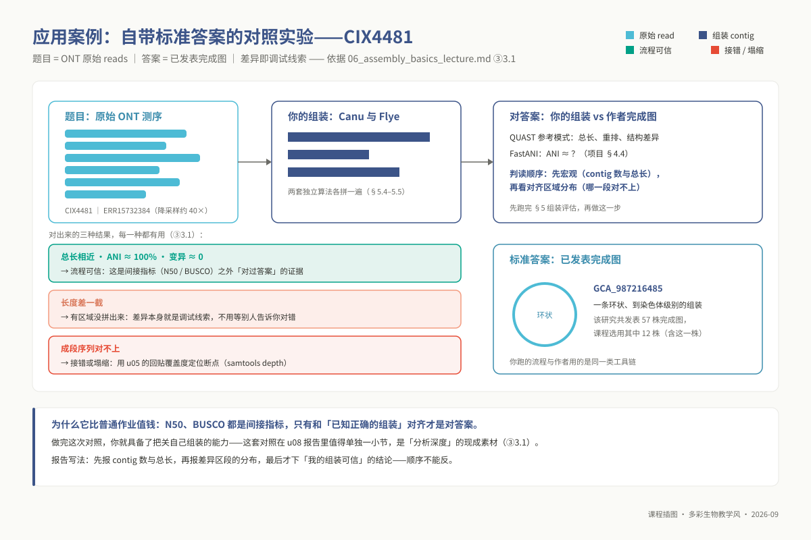
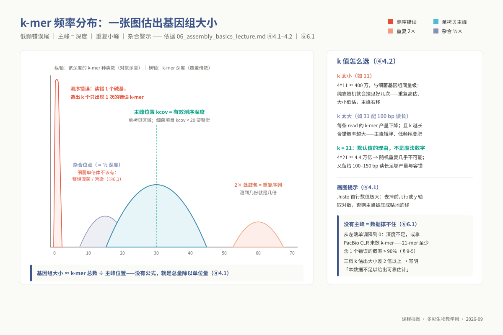
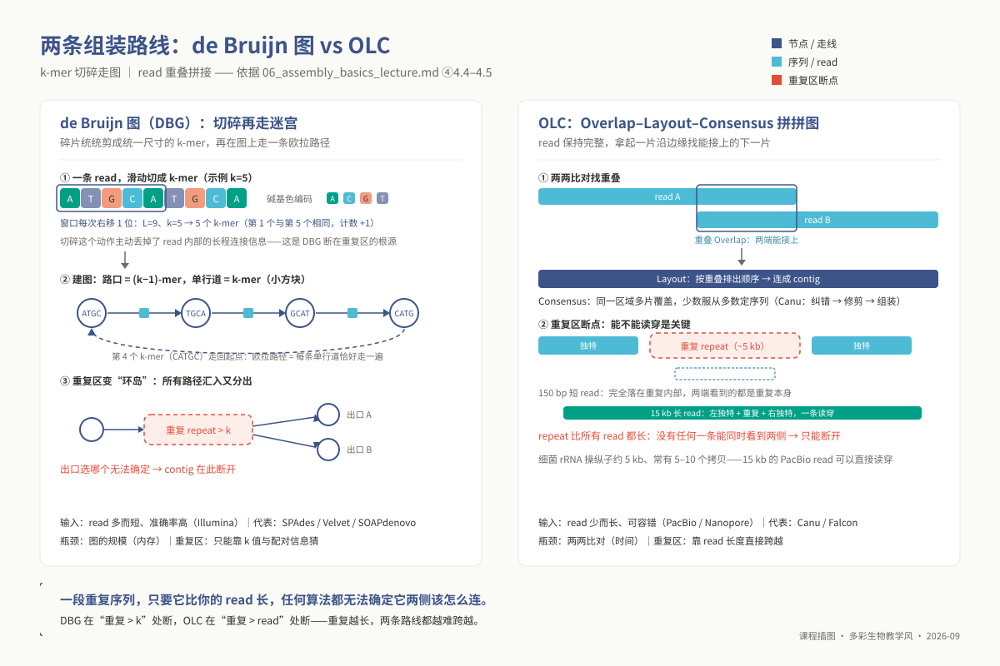
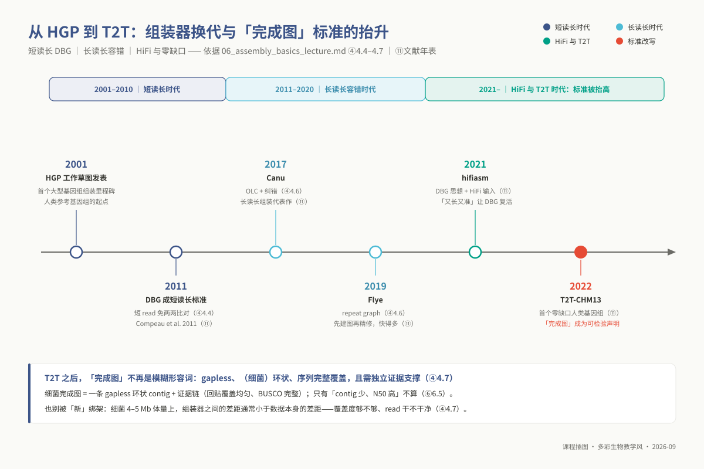
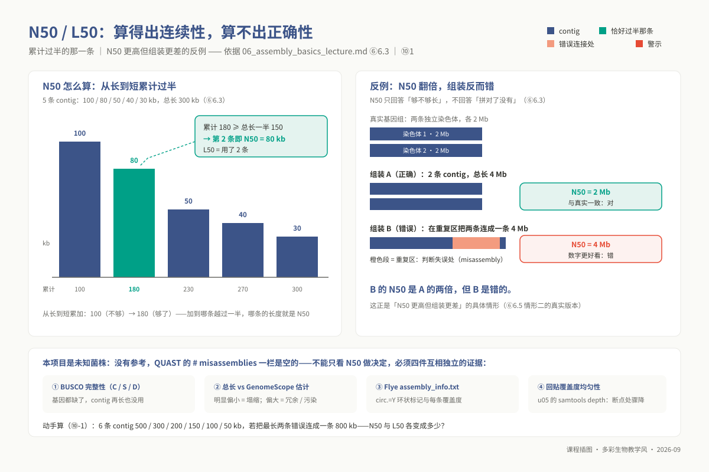

# 单元 u06：基因组组装原理与质量评估

> **适用对象**：本科 ｜ 线上自学 · 4 学时
>
> **阅读重点**：本讲从 $k$-mer 频谱和组装图出发，解释基因组勘测、组装与质量评估之间的证据关系。你将比较 Canu 与 Flye 的结果，并用连续性、完整性和回贴证据作出记录有依据的判断。
>
> **资源**：工具 `jellyfish`、`flye`、`canu`、`quast`、`busco`；环境 `ngs_ug_assembly`；配套脚本位于 `03_code/undergraduate/scripts/`。

<!-- 维护信息：单元 id `u06`；环境配置文件 `07_envs/conda/env_ug_assembly.yml`；大纲和章节模板由课程契约维护。 -->

<!-- 原课程定位：综合项目（u08）组装模块的核心前置原理课。 -->
<!--

| 项目 | 内容 |
|------|------|
| **单元 id** | `u06` ｜ 目录 `unit06_assembly_basics` ｜ 4 学时 · 线上自学 |
| **核心工具** | `jellyfish` `flye` `canu` `quast` `busco` |
| **运行环境 / 脚本** | `ngs_ug_assembly`（`conda env create -f 07_envs/conda/env_ug_assembly.yml`）｜ 配套脚本 `03_code/undergraduate/scripts/` |
| **教学定位** | 综合项目（u08）组装模块的核心前置原理课。从图论本质剖析重叠群恢复逻辑，系统建立无参考基因组情境下“基因组勘测—多策略组装—多维正交质检”的科学推断决策树。 |
-->

## ① 学习目标

学完本单元，你应当建立全基因组从头组装的图论思维与多维评估批判性眼力：

1. **解释 $k$-mer 频率谱**：说明错误低频尾、单拷贝主峰、重复峰和杂合半倍峰的可能来源，并区分观测与推断。
2. **理解 $k$ 值选型的尺度杠杆**：从字串信息熵与测序噪声容忍度的数学权衡出发，说明 $k$ 值在 17、21、25 间取舍对基因组大小与重复含量估计的拉动效应，阐述本项目选定 $k=21$ 的深层原理。
3. **独立运行基因组勘测（Genome Survey）**：掌握 `jellyfish count` 与 `histo` 处理多样本管道流的参数逻辑，熟练调度 GenomeScope 统计拟合工具，精准提取基因组预估大小、杂合度与重复序列占比。
4. **比较两类组装图**：比较 OLC 与 de Bruijn 图的节点、边、计算瓶颈和输入假设，并说明长读长跨越重复序列的作用。
5. **掌握工业级组装管线调度**：熟练编写基于 SGE 集群的作业投递脚本，规范配置 Canu 与 Flye 的核心计算参数，能够敏锐通过运行日志排查断点、内存瓶颈与计算资源分配冲突。
6. **解释连续性指标的边界**：计算 N50 与 L50，结合反例说明 N50 升高并不等于组装正确。
7. **掌握单拷贝直系同源基因完整性评估**：透彻解读 BUSCO 评估矩阵（C/S/D/F/M）的进化保守性逻辑，重点掌握重复比例（Duplicated, D）异常升高时排除外源污染、组装单倍型冗余与真实基因扩增的三步诊断法。
8. **形成完备的组装裁判决策链**：整合连续性（QUAST）、完整性（BUSCO）、拓扑闭合性（环状标记）与正交比对回贴深度，撰写具有严谨数值证据支撑的组装优选报告。

## ② 前置检查

本单元深度依赖以下基础模块，进入实践前请务必确认技能完备度：

| 依赖模块 id | 本讲应用场景 | 典型薄弱症状 | 对应自测题号 |
|---|---|---|---|
| `l0_01_linux` | ⑤ 集群作业调度；绝对路径、软链接、`qsub`/`qstat`/`qdel` 及标准 I/O 进程替换 | 误在共享登录节点高负荷跑大型组装，导致进程被系统看门狗瞬间强杀 | `l0_01_linux` Q06 / Q09<sup>†</sup> |
| `l0_03_conda` | ⑤ 运行环境隔离；SGE 脚本内的环境激活与工具链自检 | 作业脚本未显式继承 Conda 路径，导致后台批量抛出 `command not found` | `l0_03_conda` Q02 / Q07<sup>†</sup> |
| `l0_04_formats` | ④ FASTQ/FASTA 格式规范；短读长勘测与长读长组装的数据流分工 | 误将高错误率长读长直接投喂给 $k$-mer 勘测工具，导致谱图完全丧失主峰 | `l0_04_formats` Q01 / Q03<sup>†</sup> |

<sup>†</sup> 注：L0 题号对应先导测试题库。本讲与统计推断相关要点依赖 `l0_06_stats`，详见 ⑦ 节。

```bash
conda activate ngs_ug_assembly
which jellyfish canu flye quast.py busco   # 验证组装与评估五大核心工具链在当前 PATH 完整就绪
```

## ③ 背景与科学问题

### 3.1 测序物理碎片化与基因组拼图的因果困境

现代高通量测序仪交付给研究人员的，并非一条从头到尾连贯书写的细菌完整环状染色体，而是数以万计、彼此高度交叠的测序读长碎片。这些片段不仅物理方向随机、空间排列无序，更散落着测序仪固有的光电测量物理噪音。

面对这种断裂的数据现状，计算生物学必须依次攻克三大递进命题：

- **容量与复杂度前置勘测**：在调用上百核时算力展开计算前，能否仅凭读长统计特征，推断出目标生物基因组的物理大小、重复序列比例与杂合特征？若测序深度严重不足或重复序列占比过高，过早投入大规模组装无异于盲人摸象。
- **重叠图论空间的拓扑还原**：如何通过计算算法捕获成千上万读长间的物理重叠，在海量图分支中消除歧义，将碎片拼接为代表单体连续物理区段的重叠群（Contigs）？
- **无参照系下的自洽性质量裁决**：当研究对象为未知新物种、缺乏已知染色体作为参考金标准时，组装软件无论在何种参数下都会机械地吐出一个拼接文件。我们究竟凭借何种正交的生物学与统计学逻辑，判定当前拼接结果是逼近生物真实，抑或满纸荒谬？

**为什么必须双轨并行推进 Canu 与 Flye 两套组装系统**：未知菌株没有现成的标准答案可供比对。科学界确立事实的基石在于**独立算法的交叉互证**。基于 OLC 的 Canu 与基于 Repeat Graph 的 Flye 拥有完全独立的算法假设与误差模型。唯有当两套截然不同的图求解引擎在基因组绝大部分区间展现出高度吻合的共线性，且在单拷贝保守基因完整度上形成闭环时，研究者才能建立对从头组装结果的确定性信念。

### 3.2 现实生物学前沿案例：同一株菌的标准答案与完成图距离

在本课程设立的主线科研数据集 PRJEB100987（西非水稻白叶枯病菌 Xoo 群体进化研究）中，科研人员针对代表性菌株 CIX4481 同时开展了多平台测序。这为本讲的教学设计提供了弥足珍贵的**自带标准答案的对照实战体系**：

- **输入试题**：我们拥有该菌株原始的 Oxford Nanopore（ONT）长读长测序数据（`ERR15732384`，已标准化降采样至约 40× 理论深度）；
- **标准答案**：作者团队历经严格实验验证与人工校正，发表了该菌株染色体级别的一条环状闭合完成图（NCBI 登录号 `GCA_987216485`）。

这构成了生物信息学中绝佳的真值检验场景。当你遵循本讲的流水线利用 Canu 与 Flye 拼出自身的第一版 Contigs 后，你可以直接将自身的组装结果与作者团队发表的真实完成图并列投喂给 QUAST，甚至借助全基因组平均核苷酸一致度（ANI）展开全局对齐。若两套组装在物理全长、GC 含量与共线性上近乎完全重合（ANI $\approx 100\%$），说明你的组装工艺极其健壮；若出现宏观尺度上的序列缩水或局部错位，这种差异便成为了排查装配断裂、单倍型塌缩或嵌合接错的最直接现场线索。



*图 u06-5：对答案式组装练习：自己的 contigs 对照已发表完成图。*

## ④ 核心原理

### 4.1 $k$-mer 频率谱分析：无参考基因组情境下的物理体检

所谓 **$k$-mer**，是指在生物测序序列中以步长为 1 滑动截取的固定长度为 $k$ 的连续核苷酸子串。一条物理长度为 $L$ 的测序读长，在数学上恰好产出 $L - k + 1$ 个相互重叠的 $k$-mer。

利用 $k$-mer 频数推断全基因组物理大小，其底层依托的是**无偏随机物理抽样的泊松大数定律**。假设全基因组大小为 $G$，全基因组内绝大多数区域为独一无二的单拷贝序列。若测序平台以均匀随机方式对该基因组实施了 $C$ 倍的物理覆盖抽样，则全基因组中每个物理位点被测序仪覆盖的期望频次即为 $C$。将所有洁净读长切碎并统计每个独一无二 $k$-mer 的实际出现频次，绘制出的“$k$-mer 测序深度 vs 种类数量”直方图将展现出高度规律的统计特征：



*图 u06-2：k-mer 频谱：错误尾、杂合 ½× 峰、主峰与重复峰——组装前的体检图。*

- **测序错误低频长尾（Error Tail）**：位于频率谱最左侧极端低深度区间（深度 1–3）。仪器合成测序时产生的随机错配，会导致原本正确的 $k$-mer 变异为全新的假子串。由于测序错误在全基因组的随机离散性，绝大多数伪 $k$-mer 在整个数据集中仅出现 1 次。这类错误数量极为庞大，形成了图谱左侧冲天而起的衰减尖峰；
- **单拷贝基因组主峰（Main Peak）**：位于预期测序深度（如 30×–60×）附近的显著钟形隆起。它忠实对应着基因组中的单拷贝非重复区域。根据大数定律，主峰横坐标即代表全基因组的有效 $k$-mer 测序深度 $C_k$；
- **重复序列倍数峰（Repeat Peaks）**：分布在主峰右侧 $2C_k, 3C_k$ 等整数倍位置的次级鼓包。基因组中每存在一份完全同源的重复拷贝，其包含的 $k$-mer 被物理抽样的概率便成倍放大；
- **杂合多态性半峰（Heterozygous Peak）**：出现在主峰左侧约 $0.5C_k$ 处的特征肩峰。在二倍体真核生物中，父本与母本染色体存在差异的单核苷酸杂合位点仅拥有单倍型的一半测序深度。**原核细菌是严格的单倍体生物，若在细菌 $k$-mer 谱中观察到显著的半峰，这是样本中混入杂菌或发生异质污染的明确危险警报**。

**基因组物理全长的数学换算公理**：全基因组中所有独一无二的 $k$-mer 出现次数总和，在数学上严格等于基因组全长与主峰测序深度的乘积。因此：
$$\text{基因组物理全长 } G \approx \frac{\sum_{i=1}^{\infty} (i \times N_i)}{C_k}$$
式中 $N_i$ 代表出现频次严格为 $i$ 的 $k$-mer 种类总数。通过剔除左侧测序错误长尾后对面积进行积分求和，即可在开展耗时巨大的从头组装前，先验获取基因组大小的精确数学估计。

### 4.2 $k$ 值选型的空间分辨率与信噪比权衡

在提取 $k$-mer 特征时，$k$ 值的选取构成了信息敏感度与抗噪容错性之间的核心杠杆：

- **$k$ 值过小（如 $k=11$）**：所有可能出现的核苷酸排列组合总数仅为 $4^{11} \approx 4.19 \times 10^6$。在全长约 4–5 Mb 的典型原核基因组中，空间状态数与基因组容量发生同量级重合。纯粹依靠随机排列，大量原本独立的单拷贝位点便会偶发产生完全相同的 11-mer。这导致单拷贝主峰被虚假平移至高倍区间，系统性高估重复序列比例，并严重低估真实基因组大小；
- **$k$ 值过大（如 $k=31$ 配 100 bp 短读长）**：单条读长产出的 $k$-mer 总量骤降，降低了有效数据吞吐；更致命的是，根据二项分布概率模型，单个 $k$-mer 内部至少包含一个测序物理错误的先验概率随 $k$ 的增大呈指数级攀升。这会导致绝大部分有效 $k$-mer 发生突变并向左侧低频长尾坍缩，使主峰变得扁平弥散，甚至在低深度测序时彻底被错误噪声淹没；
- **理论黄金折中点（$k=21$）**：$4^{21} \approx 4.4 \times 10^{12}$，其空间容量远超细菌甚至人类基因组规模，彻底杜绝了随机碰撞假象；同时对 100–150 bp 的 Illumina 洁净读长保留了优良的容错窗口与丰度输出。

在综合实践中，规范规程要求同时对比 $k=17, 21, 25$ 三档拟合。若三档估计结果收敛在 10% 误差范围内，方可判定数据体检合格；若三档结果呈现发散性漂移，直接提示测序深度不足或文库物理质量崩溃。

### 4.3 GenomeScope 非线性混合模型拟合解读

GenomeScope 工具并不单纯进行经验性除法，而是将实际观测到的 $k$-mer 直方图分解为由四个具有明确生物学内涵的数学成分构成的负二项/泊松混合模型：即由测序错误模型、单倍型杂合成分、纯合单拷贝成分以及高阶多拷贝重复成分协同拟合。

审视拟合报告必须遵循严格的三步批判逻辑：

1. **核验拟合优度（Model Fit）**：图谱中黑色理论拟合曲线与蓝色实测直方图柱状的贴合程度必须达到 $90\%$ 以上。若拟合度低下或算法抛出无法收敛错误，下游所有推算数值均丧失统计真值支撑；
2. **确认有效测序深度（$kcov$）**：即单拷贝纯合主峰的波峰横坐标。在原核细菌组装中，$kcov$ 若低于 20×，表明物理采样深度薄弱，必须调低对后续组装连续性的预期；
3. **对照先验尺度核查预测全长（Haploid Length）**：细菌基因组通常紧凑分布在 2–8 Mb 之间。若推导出的全长显著偏离该区间，必须回溯排查参数配置与样本来源。

### 4.4 OLC 与 de Bruijn 图：组装图论的两大历史范式

从数学图论视角审视，从头组装的本质是在碎片构成的图网络中寻找能够还原生物染色体单体线性的最优重构路径。计算生物学在演化历程中形成了两大对立统一的求解流派：



*图 u06-1：两条拼法殊途同归：重复区比 k（或 read）长时，断链位置一模一样。*

| 算法范式 | 重叠—布局—共识（Overlap-Layout-Consensus, OLC） | de Bruijn 图（de Bruijn Graph, DBG） |
|---|---|---|
| **图拓扑核心定义** | **节点（Vertices）代表完整的 Read 序列**；当两条 Read 间存在足够长度且高相似度的重叠片段时，在两节点间建立有向边 | **节点代表固定长度的 $(k-1)$-mer 前缀/后缀**；每一条有向边严格对应一个连续的 $k$-mer 子串 |
| **染色体路径还原** | 寻找**哈密顿路径（Hamiltonian Path）**：在重叠图中寻找一条经过每个节点（即每条 Read）恰好一次的连通路径 | 寻找**欧拉路径（Eulerian Path）**：在转移图中寻找一条经过每条有向边（即每个 $k$-mer）恰好一次的连续遍历 |
| **计算复杂度本质** | 求解哈密顿路径在数学上属于 **NP-Complete 难题**；且构建重叠图需要进行全局两两全比对，计算复杂度为 $O(N^2)$ | 欧拉路径存在多项式时间线性求解算法 $O(\|V\| + \|E\|)$；仅需单次遍历所有读长即可完成建图 |
| **长程序列信息保留** | **完整保留单条 Read 的全局长程连接关系**，读长越长，越能无歧义跨越复杂重复结构 | **在建图初期主动将 Read 切碎为微型 $k$-mer**，彻底丢失了跨越 $k$ 长度以上的物理连接链条 |
| **典型代表工具** | 经典毛细管 Sanger 测序组装器、三代长读长组装器（**Canu**, Falcon） | 二代短读长主流组装器（SPAdes, Velvet, SOAPdenovo） |

**为什么短读长必须走向 DBG，而长读长让 OLC 重新焕发生机**：面对二代 Illumina 产生的数以亿计的短读长，OLC 全局两两比对的计算量将直接导致集群算力瘫痪，而 DBG 凭借线性的图构建开销成为了二代组装的唯一解；然而，DBG 将序列切碎的物理动作带来了灾难性代价——一旦基因组中存在任何长度超过 $k$ 的同源重复序列，该区域在图空间中便坍缩为一个兼具多个输入与输出的复杂交叉路口（Knot）。由于算法丧失了长程物理连接线索，无法决断进入该重复区的某条路径应当接入哪个出口，只能被迫将路径截断，导致重叠群发生碎裂。

### 4.5 长读长组装原核基因组的物理跨越机制

细菌基因组组装中存在一条坚不可摧的公理：**若一段同源重复序列的物理跨度严格大于测序读长的最大物理长度，任何算法都无法在数学上排他性地确定其两侧的基因组骨架该如何连接。**

原核生物全基因组中最具代表性的重复屏障，莫过于编码核糖体 RNA 的 **rRNA 操纵子（16S–23S–5S）**。该结构物理跨度约为 5 kb，在单一细菌染色体内部通常密集散落着 5 至 10 个核苷酸序列近乎 100% 恒定的重复拷贝：

- **在 150 bp Illumina 短读长体系下**：任何一条短片段只能完全淹没在 5 kb 重复序列内部。没有任何单条读长能够同时跨越该保守区的物理边界并触及两侧独特的非重复基因骨架。因此，在纯短读长组装中，每个 rRNA 操纵子都会造成 Contig 的物理断裂，致使原本连续的单个细菌环状染色体被切割为十数个至数十个互不相连的碎块；
- **在 10–20 kb PacBio / ONT 长读长体系下**：单条长读长能够以“左端 5 kb 独特单拷贝骨架 + 中间 5 kb 完整 rRNA 操纵子 + 右端 5 kb 独特相邻基因”的姿态实现**单分子物理穿透（Span）**。这条长读长本身就是连接重复区两侧序列的直接物理共价证据。算法无需任何猜度，直接将重复区完整跨越，从而将细菌全基因组一举组装为**一条闭合的环状完成图（Circular Chromosome）**。

### 4.6 Repeat Graph 架构：Flye 相对于 Canu 的算法革新

经典 OLC 组装器 Canu 遵循严格的“多轮自纠错（Correction）$\rightarrow$ 末端精确修剪（Trimming）$\rightarrow$ 图布局（Assembly）”经典三阶段推进。在处理高覆盖度长读长时，第一阶段的多对多两两比对占据了总运行耗时的 80% 以上，极度消耗集群算力。

Mikhail Kolmogorov 与 Pavel Pevzner 开发的 **Flye 组装器** 则提出了基于**重复图（Repeat Graph）**的全新工程路径：

- **构建低容错模糊片段（Disjointigs）**：Flye 在初始阶段并不急于进行耗时巨大的单碱基纠错，而是跳过全局纠错，直接将长读长中明显无歧义重叠的高置信度区段迅速拉伸拼接为一系列初级无分叉连续片段；
- **构建高阶重复拓扑图（Repeat Graph）**：算法将所有 Disjointigs 再次互相比对，构建出明确标注有单拷贝骨架区与多拷贝重复区拓扑朝向的重复图；
- **基于长读长穿透图分歧点**：Flye 仅在重复图的那些复杂分叉节点上，定向调阅能够跨越该节点的长读长进行路径解缠绕；最后对解析完成的连通路径实施单倍型一致性共识抛光。

这一精妙设计将密集计算严格限制在极少数重复结构周围，使 Flye 的组装速度比 Canu 提升数倍乃至十余倍；并且 Flye 能够在输出元数据 `assembly_info.txt` 中直接基于图的连通闭合性判定 Contig 是否形成**拓扑环状闭合（Circularized）**，为原核完成图判定提供了最关键的直接证据。

### 4.7 技术前沿（2023–2026）：hifiasm 与端粒到端粒（T2T）时代的完成图公理

在 2023–2026 年的技术演进周期中，随着 PacBio HiFi（高精度环形共识测序，准确率突破 Q30 且读长达到 15–20 kb）与超长 Oxford Nanopore 测序的深度普及，计算生物学确立了全新的组装黄金标准。

新一代组装引擎 **`hifiasm`**（Cheng et al., 2021, *Nature Methods*）巧妙实现了 DBG 思想在高精度长读长上的重新复苏：由于 HiFi 读长消除了二代测序的超短读长缺陷，同时消除了早期三代测序的随机高错误率，hifiasm 能够直接在长片段尺度上构建单倍型分辨图谱（Phased Assembly Graph），无需前置纠错即可在数小时内交付高精度的单倍型解析结果。

更为深刻的范式转移来自于人类端粒到端粒（Telomere-to-Telomere, T2T）联盟于 2022 年在 *Science* 奠定的人类基因组首个无缺口完成图（T2T-CHM13, Nurk et al., 2022）。T2T 的实现彻底拔高了国际生命科学界对“完成图（Complete Genome）”的判定门槛：在当前学术语境下，“完成图”不再是一个模棱两可的修饰词，而是具有严格排他性证明的物理状态——即染色体全序列必须实现绝对的零空洞无缺口（Gapless）、原核生物必须具备拓扑环状闭合自洽性（Circularization），且全长物理覆盖度必须具备均一无断崖的正交支撑。

 仅仅依靠 N50 数值较大或 Contig 数量较少，已绝不足以在严谨科研论文中声称获得了完成图。



*图 u06-4：从 HGP 到 T2T：组装器换代的时间线。*

## ⑤ 操作步骤

配套工业级流水线脚本位于 `03_code/undergraduate/scripts/`：包括 `06_kmer_survey.sh`（勘测）、`06_assemble_compare.sh`（组装）与 `06_assembly_eval.sh`（评估）。以下对核心命令实施解构剖析。

### 5.0 高性能集群调度纪律与 SGE 指令规范

项目集群采用 Sun Grid Engine（SGE）统一调度管理体系。全流程操作必须严格遵循计算与调度隔离红线：
> 严禁在共享登录节点直接发起多线程组装计算！任何涉及数据解压、哈希统计与图构建的操作，必须编写标准 Shell 作业脚本并通过 `qsub` 投递至计算节点执行。

```bash
qsub 06_kmer_survey.sh              # 向 SGE 队列投递批处理勘测任务
qstat -u ${USER}                    # 监控个人作业运行状态（qw: 排队, r: 运行, Eqw: 脚本语法或环境致命错误）
qstat -j <JOB_ID> | grep -A5 error  # 针对 Eqw 故障作业排查具体资源冲突日志
qdel <JOB_ID>                       # 强行终止误配置的死循环或越界作业
qrsh -pe smp 4                      # 交互式申请占用 4 核计算节点开展轻量级调试
```

标准 SGE 作业脚本头部的指令约束解析：

```bash
#!/bin/bash
#$ -S /bin/bash          # 强制指定 Bash 解释器，确保 <(...) 等进程替换语法得到原生支持
#$ -N u06_assem          # 声明任务在调度系统中的唯一作业代号
#$ -cwd                  # 强制程序在执行提交时的当前工作目录启动，确保相对路径有效性
#$ -j y                  # 将标准错误流（stderr）重定向合并至标准输出流（stdout），合并生成单一完整排查日志
#$ -pe smp 4             # 申请并行环境分配 4 个共享物理 CPU 核心
#$ -l h_vmem=8G          # 声明单核心虚存硬限额（总可用物理内存峰值 = 4 × 8G = 32G）
#$ -hold_jid u06_kmer    # 建立作业依赖链条：声明当前作业必须等待前序 u06_kmer 作业正常退出后方可启动
```

### 5.1 部署环境与标准化目录工程

```bash
source /opt/miniconda3/bin/activate
conda activate ngs_ug_assembly
mkdir -p /d3/scratch/${USER}/ngs/{fq,survey,assem/{canu,flye,eval},anno}
```

### 5.2 步骤一：Jellyfish 多线程流式 $k$-mer 频数统计

```bash
cd /d3/scratch/${USER}/ngs/survey
jellyfish count -C -m 21 -s 1000000000 -t 4 -o reads.jf <(zcat ../fq/*.fq.gz)
jellyfish histo -t 4 reads.jf > reads.histo
```

- `-C`（Canonical）：将每个 $k$-mer 与其反向互补链统一折叠合并计数。若遗漏该参数，双链分子相同区段将被错误拆分至两个独立子串，导致测序深度主峰腰斩、全基因组大小估计虚假膨胀一倍；
- `-m 21`：设定 $k$ 值为 21，规避微观随机碰撞；
- `-s 1000000000`：预设内存哈希桶规模为 10 亿槽位（非字节数），避免多轮磁盘换入换出引发性能劣化；
- `<(zcat ../fq/*.fq.gz)`：利用 Unix 进程替换机制将压缩数据实时解压为管道流传给程序，消除落盘解压中间文件的 I/O 负担；
- `histo`：提取统计矩阵，输出由“出现频次”与“该频次对应的 $k$-mer 种类数”构成的二维直方图文本，作为下游拟合的标准输入。

### 5.3 步骤二：GenomeScope 非线性模型拟合（外置脚本调用）

> **技术规程注记**：依据课程契约，`genomescope2` 在 `env_ug_assembly.yml` 中属于环境豁免工具。项目遵循经典工业方案，直接拉取官方核心 R 脚本执行：

```bash
cd /d3/scratch/${USER}/ngs/survey
wget https://raw.githubusercontent.com/schatzlab/genomescope/master/genomescope.R

# 位置传参规范：[直方图文件] [k值] [读长长度] [输出目录] [最大截断深度]
Rscript genomescope.R reads.histo 21 100 gs_k21 1000
Rscript genomescope.R reads.k17.histo 17 100 gs_k17 1000
Rscript genomescope.R reads.k25.histo 25 100 gs_k25 1000
```

> **📥 校外自学公开数据特别通道**：校外学生若无法访问 `/data/lab/ngs/` 内部目录，请执行 `bash 06_data/undergraduate/download_ug.sh --run --subsample --depth 40` 获取主线 Xoo CIX4481 数据集（包含 ONT 组装长读长与 Illumina 配套短读长）。注意在调用组装器时相应切换为 ONT 错误率模型参数。

### 5.4 步骤三：调用 Canu 执行长读长 OLC 组装

```bash
cd /d3/scratch/${USER}/ngs/assem/canu
canu -p test -d test-pacbio genomeSize=4m \
     useGrid=false maxThreads=4 maxMemory=28g \
     -pacbio /data/lab/ngs/reads.fa
```

- `genomeSize=4m`：**算法强制先验参数**。Canu 依靠该数值在预处理阶段推导文库覆盖倍数，进而决定自纠错阶段保留哪些最长读长；
- `useGrid=false`：阻断 Canu 内部再次嵌套派生 SGE 子作业，确保任务在当前申请到的 4 个核内完整自洽运行；
- `maxThreads=4` / `maxMemory=28g`：将资源占用严密收敛在当前调度作业分配的硬件配额内，杜绝内存溢出。

### 5.5 步骤四：调用 Flye 执行 Repeat Graph 组装

```bash
cd /d3/scratch/${USER}/ngs/assem/flye
flye --pacbio-raw /data/lab/ngs/reads.fa --out-dir out_pacbio --genome-size 4m --threads 4
# 若针对 ONT 公开数据：flye --nano-raw ERR15732384_ont_40x.fastq.gz --out-dir out_ont --genome-size 4.7m --threads 4
```

Flye 运行结束后的核心产物包括 `assembly.fasta` 与最为关键的元数据诊断表 **`out_pacbio/assembly_info.txt`**。该表逐行记录了各个重叠群的物理长度、相对测序覆盖度、重复拷贝数，以及染色体是否形成拓扑自闭合（`circ.` 列标记为 `Y` 或 `N`）。

### 5.6 步骤五：利用 QUAST 并行对比连续性与宏观指标

```bash
cd /d3/scratch/${USER}/ngs/assem/eval
quast.py ../canu/test-pacbio/test.contigs.fasta ../flye/out_pacbio/assembly.fasta \
         -o quast_results -t 4 -l "Canu,Flye"
```

一次性传入两套组装的 FASTA 文件，QUAST 将自动生成横向对照的汇总统计表 `report.txt` 与可视化网页报告 `report.html`。

### 5.7 步骤六：调用 BUSCO 进行单拷贝保守基因完整性测试

```bash
busco -i ../canu/test-pacbio/test.contigs.fasta -o busco_canu -m genome -l bacteria_odb10 -c 4
busco -i ../flye/out_pacbio/assembly.fasta      -o busco_flye -m genome -l bacteria_odb10 -c 4
```

参数 `-l bacteria_odb10` 规定了原核细菌界在进化历程中近乎 100% 保守存在的 124 个单拷贝直系同源基因集。在集群无外网连接时，应先在登录节点预拉取离线数据集，并在脚本中显式配置 `--offline --download_path` 路径规避网络阻塞。

## ⑥ 结果解读

### 6.1 $k$-mer 频率直方图的典型病理特征诊断

正常状态下的细菌直方图（30× 深度，$k=21$）呈现清晰的三段式结构：左端陡降的错误尾 $\rightarrow$ 深度 30 处的圆润单峰 $\rightarrow$ 深度 60 处微弱的重复凸起。

| 异常频率图景 | 底层物理机理推断 | 现场处置与应对决策 |
|---|---|---|
| **直方图完全缺失主峰**，从最高点单调滑落至 0 | 数据实际测序深度严重不足（$<10\times$）；或错误将高错误率的长读长当作二代短读长进行统计 | 严禁使用 PacBio 原始读长开展 $k$-mer 勘测；核实短读长真实数据量，适度下调组装预期 |
| **主峰位置异常塌陷在深度 3–5 处** | 文库测序通量极其匮乏，有效物理覆盖度逼近测序极限 | 后续从头组装极易产生碎片化，需立即向指导教师反馈补测 |
| **谱图中赫然出现两个高度接近的对称峰**，右峰恰为左峰 2 倍 | 样本中浸润了海量杂合单核苷酸多态性，**与细菌严格单倍体生理相悖** | 极度明确的**杂菌混染或实验室交叉污染证据**，必须在项目报告中重点推导定性 |
| 主峰右侧拖着极其厚重且无法衰减的高深度长尾 | 目标基因组中富集超大比例的高同源转座子或串联重复阵列 | 预期组装连通性将受到强烈阻碍，后续必须依靠超长读长加以穿透 |

### 6.2 GenomeScope 拟合指标与组装全长的宏观对照

在 `gs_k21/summary.txt` 交付的输出中，审阅时必须严格维持三项核心对账：

1. **`Model Fit` 必须 $\ge 90\%$**：若拟合失败，后续给出的基因组大小即为随机噪声，严禁抄入最终报告；
2. **`Heterozygous` 必须收敛在接近 $0\%$**：若单倍体细菌的拟合杂合度显著大于 0.5%，强力印证混菌事实；
3. **基因组估计大小（Haploid Length）与 QUAST 最终组装总长（Total length）的交叉验证**：
   - 若组装总长比估计大小**缩水超过 20%**（经验警戒线，非文献阈值）：警示组装算法发生了**严重的单倍型塌缩**，大量同源重复区域被粗暴压缩并折叠为了单份拷贝；
   - 若组装总长比估计大小**虚增超过 20%**：警示组装结果存在大量**未去冗余的伪重复碎片**，或者样本中混入了来自外源质粒或宿主环境的污染 Contig。

### 6.3 QUAST 连续性度量体系及 N50 的致命陷阱

| 连续性指标 | 精确计算定义 | 优质原核完成图的期望基准 |
|---|---|---|
| `# contigs` | 组装产出的有效序列总条数 | 1–3 条（单条完整染色体加上偶发附带的天然质粒） |
| `Total length` | 所有重叠群物理碱基长度代数总和 | 必须与 GenomeScope 勘测值高度吻合（误差 $<5\%$） |
| `Largest contig` | 整个组装集合中最长单条序列的绝对长度 | 极度接近基因组全长，表明实现了染色体单分子连续覆盖 |
| `N50` | 序列按长度降序排列后，**累计碱基跨度首次达到或超过组装总长 50% 时对应的那条 Contig 的长度**（QUAST 定义） | 接近全基因组物理总长 |
| `L50` | 达到 N50 阈值累计所**消耗的最少 Contig 数量** | 理想状态严格等于 **1** |
| `GC (%)` | 整体组装产物的平均鸟嘌呤与胞嘧啶比例 | 必须与该物种既有生物学文献记载高度自洽 |

**N50 算法的离散推导示例**：设某组装产出 5 条 Contigs，其长度降序排列为 100 kb, 80 kb, 50 kb, 40 kb, 30 kb，总长度 $G = 300\text{ kb}$，其 50% 阈值为 150 kb。从长到短执行前缀和累加：

- 累加第 1 条：100 kb（尚未达到 150 kb）；
- 累加第 2 条：$100 + 80 = 180\text{ kb}$（已成功跨越 150 kb 门槛）。
此时触发判定的第 2 条 Contig 其自身长度为 80 kb，故该组装的 **N50 为 80 kb，L50 为 2**。

> **组装质量评估第一定律：连续性绝不等于正确性。**
> N50 仅衡量几何碎片的大小，完全不对序列内部的拼接真伪做任何生物学背书。
>
> **反例推导**：假定待测菌株拥有两条天然独立的环状染色体，真实长度各为 2.0 Mb，基因组真实全长 4.0 Mb。
> - **真实准确组装 A**：软件正确解构了两条独立染色体，产物为 2 条均为 2.0 Mb 的 Contigs，总长 4.0 Mb，此时 **N50 = 2.0 Mb**；
> - **严重错误组装 B**：组装算法在两染色体共有的一段短转座子上发生决策错乱，**将两条完全不同的染色体错误嵌合缝合成了一条长度为 4.0 Mb 的单一伪染色体**。其组装总长同样为 4.0 Mb，但此时 **N50 虚假暴增至 4.0 Mb**。
>
> 在此极端场景下，**错误组装 B 的 N50 足足是正确组装 A 的两倍，但组装 B 属于严重的嵌合结构错配（Misassembly）**。在没有已知参考比对时，单看 N50 极易诱导研究者选错灾难性结果。因此，评价组装必须引入正交的基因完整性与覆盖深度综合仲裁。



*图 u06-3：N50 怎么算、怎么被骗：一条累计曲线与一个反例。*

### 6.4 BUSCO 直系同源基因完整性五维判定体系

BUSCO 通过探针序列在组装结果中搜寻进化保守的单拷贝基因，输出标准化格式如：`C:98.4%[S:97.6%,D:0.8%],F:0.8%,M:0.8%,n:124`（百分比必为 k/124 的整数计数换算：121+1+1+1）。

- **C（Complete）**：完整命中的基准比例（$C = S + D$），细菌高质量组装必须 $>95\%$；
- **S（Single-copy）**：以单拷贝状态完美无缺命中的黄金比例，越逼近 $C$ 越优秀；
- **D（Duplicated）**：完整检出但**在组装中出现了两次及以上**的异常比例，细菌中预期逼近 $0\%$；
- **F（Fragmented）**：发生部分片段断裂的残缺基因，反映 Contig 边界切断了开放阅读框；
- **M（Missing）**：完全未能检索到任何同源信号的缺失基因，若超过 3% 提示存在大片段骨架丢弃。

**重复率（D）异常升高时的三大根源辨析决策树**：

1. **外源生物序列浸润污染**：混入了携带同源基因的非目标菌株序列。此时 QUAST 显示组装总长显著超出预估大小，且全基因组 GC 呈现多峰分布；
2. **组装冗余与未合并单倍型（Haplotype Duplication）**：软件未能识别轻微测序错误引发的微小差异，将同一物理区域组装出了两套平行的 Contigs。此时检查这批重复基因区段的比对回贴深度，会发现其测序深度断崖式下降为背景均值的 $50\%$（即测序读长被分流到了两套冗余骨架上）；
3. **真实生物学串联复制事件**：该菌株特定基因组岛屿确实发生了适应性串联基因倍增。此时多拷贝基因表现为测序深度完全正常，且仅局限于极少数特定效应蛋白座位。

### 6.5 综合仲裁矩阵：Canu 与 Flye 的决选决策树

在综合实践项目报告中，研究者必须依照以下严密的五级证据优先级矩阵做出最终选型并陈述理由：

| 证据层级 | 评估测度 | 决策仲裁逻辑与红线规则 |
|---|---|---|
| **第一级：基因完整性** | **BUSCO 完整率（C）** | C 出现明显落后（差异 $>2\%$）的组装版本直接一票否决淘汰；核心基因丢失意味着下游功能注释全线崩溃 |
| **第二级：装配纯洁度** | **BUSCO 重复率（D）与全长自洽性** | D 异常高企且组装总长显著超出 GenomeScope 估算值的版本判定为冗余嵌合，优先级降级 |
| **第三级：几何连续性** | **Contig 离散数目、N50 与 L50** | 在前两级打平的前提下，优先选取 Contig 数量更少、L50 收敛于 1、N50 更高的健壮方案 |
| **第四级：拓扑自闭合性** | **Flye `circ.=Y` 环状染色体标记** | 原核生物若能提供首尾重叠自闭合证明，是跨入“完成图”门槛的核心加分项 |
| **第五级：下游级联兼容性** | **对后续 Prokka 注释与 Roary 泛基因组的支持** | 连续性优异的环状组装能彻底消除基因边界截断风险，为全课程提供最高质量的数据底座 |

## ⑦ 统计插件

**本讲无独立统计要点。**

原因：u06 专题并不在顶层设计 `00_design/course_contract.yaml` 规定的 `stats_plugin_topics` 考核名单之列。本单元所涉及的计算算法主要依托图论路径搜索、组合离散优化与经验直方图统计，并不涉及零假设检验或多重假设校正，因而不存在假设检验模型失配风险。

然而，本讲中产出的核心宏观数据在统计推断层面上直接依赖先导模块 `l0_06_stats` 的理论素养支撑：

- **GenomeScope 参数估计与置信区间**：拟合报告输出的并非孤立的确定性真值，而是非线性最小二乘估计给出的点估计与置信带；`Model Fit` 本质是残差平方和与总变异的拟合优度判定；
- **BUSCO 样本容量与估计精度**：在 `bacteria_odb10` 体系中，基因检验总量仅为 $n=124$。根据离散统计学抽样分布，单个基因检出状态的改变即可引起完整度波动近 $0.8$ 个百分点。因此，两套组装在 BUSCO 完整度上若仅存在 $<1\%$ 的微弱差异，绝不应在统计学上草率判定为优劣悬殊，必须结合连续性与覆盖深度交叉验证。

> ⑧ AI 辅助任务：本科层不适用（仅在博士层强制实施），本讲知识体系严密衔接一线排错指南。

## ⑨ 常见错误与排查

**E1 — 登录节点高负荷计算触发内核 OOM 强杀** ｜ 典型指纹：`Killed`。在共享登录节点直接发起 Canu 或大型解压计算，瞬间吃满物理内存，遭到系统看门狗通过 `SIGKILL` 强杀。 **修复**：严格通过 `qsub` 向计算节点投递批处理脚本；在提交前用 `hostname` 核验终端所处节点环境。

**E2 — Jellyfish 预置哈希桶超额导致内存分配崩溃** ｜ 典型指纹：`terminate called after throwing an instance of 'std::bad_alloc'` 或 SGE 日志报告 `job killed: vmem exceeded limit`。参数 `-s` 设定的初始槽位过大，超出了集群单个作业分配的虚拟内存上限。 **修复**：将作业脚本显式调整为 `#$ -l h_vmem=8G` 配 4 个核心（总计 32 GB）；并将 `-s` 适度下调为 `100000000`（Jellyfish 桶满后会自动展开多轮归并，运算变慢但绝不影响最终数值准确度）。

**E3 — `genomeSize` 数量级配置颠倒诱发灾难性丢弃** ｜ 典型指纹：Canu 输出 `Found ... (1.28 times coverage)` 或在自纠错阶段陷入无休止死循环。将 4 Mb 的原核基因组误写为 `genomeSize=4g`（识别为 40 亿 bp）或 `4k`。若误写为 `4g`，软件误判覆盖度仅有 1× 因而拒绝启动纠错；若误写为 `4k`，软件认为数据量过载而疯狂丢弃真实读长。 **修复**：严守单位量纲规范，原核细菌严格书写为 `genomeSize=4m`；修改后**必须彻底清空原 `-d` 输出目录**（`rm -rf test-pacbio`），杜绝旧有错误缓存污染。

**E4 — SGE 作业环境隔离引发工具链整体脱靶** ｜ 典型指纹：`line 42: canu: command not found`。SGE 计算作业默认在全新非登录 Shell 环境中启动，不继承当前交互终端的 Conda 变量。 **修复**：在每个作业脚本正文前强制引入环境初始化：

```bash
source /opt/miniconda3/bin/activate && conda activate ngs_ug_assembly
command -v canu >/dev/null || { echo "[FATAL] canu 未能在 PATH 就绪"; exit 1; }
```

**E5 — 误用高错误率长读长强行运行 $k$-mer 勘测** ｜ 典型指纹：`jellyfish histo` 产出的曲线完全没有主峰，从起点呈指数级断崖直落至 0。直接将未经纠错的 PacBio CLR 或 ONT 原始读长（含 10%–15% 随机物理噪音）喂入 $k$-mer 统计。在此类数据中，长达 21 bp 的子串几乎 100% 含有错误，无法沉淀出代表基因组真实拷贝的特征频数。 **修复**：基因组勘测必须严格选用配套的低错误率二代 Illumina 短读长（`*.fq.gz`）；长读长仅用于下游骨架组装，两套数据绝不可混淆颠倒。

**E6 — POSIX Shell 不兼容进程替换语法** ｜ 典型指纹：`syntax error near unexpected token '('`。脚本被底层系统默认的 `sh` 或 `dash` 唤醒，无法识别 Bash 独有的 `<(zcat ...)` 进程替换语法。 **修复**：作业头务必添加 `#$ -S /bin/bash`；在终端调试时坚决执行 `bash script.sh`，严禁使用 `sh script.sh`。

**E7 — BUSCO 输出路径参数格式越界** ｜ 典型指纹：`ERROR: Please do not provide a full path in --out parameter, use --out_path instead`。在 `-o` 参数中传入了带斜杠的复合路径（如 `-o results/busco_canu`）。 **修复**：`-o` 仅接收纯粹的文件名前缀名称（`-o busco_canu`）；如需重定位父级输出路径，请配合 `--out_path results/` 参数使用。

**E8 — GenomeScope 缺失底层非线性最小二乘依赖** ｜ 典型指纹：`Error in library(minpack.lm) : there is no package called 'minpack.lm'`。当前 R 环境缺失非线性回归拟合核心包。 **修复**：在当前 Conda 环境下执行 `conda install -y -c conda-forge r-minpack.lm` 补齐依赖。

**E9 — 依赖轮询导致计算槽位长期无效自锁死等** ｜ 典型指纹：评估脚本无限输出 `Waiting for assembly to complete...` 直至任务超时强退。组装作业在上游已遭遇致命错误崩溃退出，而后端监控脚本仍基于 `while [ ! -f ... ]; do sleep 300; done` 进行死等。 **修复**：摒弃低级的文件轮询机制，全面改用 SGE 调度系统的原生作业级联声明：`#$ -hold_jid u06_assem`，实现事件驱动的优雅调度。

**E10 — 作业投递由于硬件资源名未定义陷入挂起** ｜ 典型指纹：`qstat` 显示作业状态恒定为 `Eqw`。请求了集群中不存在的并行环境代号（如当前集群并行环境不叫 `smp` 或无法识别 `h_vmem`）。 **修复**：运行 `qstat -j <JOB_ID> | grep -A5 error` 抓取具体调度拦截原因；利用 `qconf -spl` 查阅本集群合法并行环境名称后修改作业头。

### 组装故障快速排查决策导图

```text
组装与勘测全流程故障排查导图
├── 运行显示单个 Killed 且进程消失            ──→ E1 严禁在登录节点计算，通过 qsub 投递至计算节点
├── std::bad_alloc 或 vmem exceeded          ──→ E2 下调 jellyfish -s 槽位参数并上调 h_vmem 配额
├── Canu 报告 1.28x coverage 或陷入死等       ──→ E3 检查 genomeSize 量纲，细菌严格设置为 4m
├── canu/flye: command not found             ──→ E4 确认作业脚本头部显式执行了 conda activate
├── k-mer 谱线无主峰一路向下滑落              ──→ E5 勘测必须使用短读长，严禁用三代高噪声长读长
├── syntax error near unexpected token '('   ──→ E6 作业头声明 #$ -S /bin/bash 确保进程替换可用
└── 作业投递后即刻陷入 Eqw 状态              ──→ E10 通过 qstat -j 抓取报错，核实集群并行环境名称
```

## ⑩ 思考练习

1. **离散累加代数推导（计算题）**：某基因组组装产物包含 6 条 Contigs，其长度降序排列为 500 kb, 300 kb, 200 kb, 150 kb, 100 kb, 50 kb。请准确计算该组装的全基因组总长度、N50 与 L50 数值；若某算法在重复区发生判断失误，将最长的前两条 Contigs 错误连成了一条长度为 800 kb 的嵌合序列，此时该组装的 N50 与 L50 分别演变为什么数值？结合此例阐述为什么单凭 N50 无法判定组装正确性。
2. **多维质检反常归因（综合判读题）**：某细菌组装产物的 BUSCO 结果显示为 `C:99.2%[S:52.4%,D:46.8%],F:0.0%,M:0.8%,n:124`，QUAST 显示其实测组装总长为 8.3 Mb，而前期 GenomeScope 拟合给出的单倍体大小为 4.2 Mb。请结合原核生物基因组特征，提出至少两种截然不同的可能机理，并分别设计出一组后续数据分析手段（如测序深度提取、物种分类检索）以做出排他性确诊。
3. **参数量纲与启发式决策机理（参数题）**：某位同学在运行 Canu 组装 4 Mb 细菌时，不慎将参数误配置为 `genomeSize=40m`。作业在集群中成功运行并产出了组装文件。请从 Canu 内部覆盖度换算、自纠错阶段读长筛选阈值的角度深入剖析：这套产出的 Contigs 是否具备可信度？为什么？
4. **组装仲裁与科学取舍（实战决策题）**：针对同一批测序数据，Canu 交付了 1 条包含全长但 BUSCO 完整度仅为 91.2% 的 Contig；Flye 交付了 5 条总长相近、但 BUSCO 完整度达到 98.4% 且最长重叠群标记为环状闭合的 Contigs。面对这一冲突，你将选择哪一套组装作为最终结果？阐明你的核心取舍逻辑，并说明若算力允许你将补充何种正交检查（如重测序读长回贴）来夯实你的选择。
5. **跨代测序数据特征与算法迁移（设计题）**：若实验条件受限，针对同一株未知病原细菌仅获得了双端 150 bp 的 Illumina 短读长测序数据。请参照本讲图论原理，阐述你应当选用何种算法范式（OLC 还是 DBG）的工具展开拼接；并定性预测产物的 Contig 数量与 N50 指标相比长读长组装将呈现何种宏观变化及其底层物理原因。
6. **综合科研迁移推演（开放性探索）**：选定一个你自身课题关注或感兴趣的代表性物种（如丝状真菌、植物病原细菌或昆虫共生微生物），检索其已发表的基因组规模、倍性与重复序列丰度背景，深入推演以下科学决策：
   - 为获得高质量染色体级别组装，你将选择何种测序技术组合？为什么？
   - 预期该物种在二代短读长 $k$-mer 频率谱中将展现出几个峰、分别分布在何处？
   - 在调用 BUSCO 进行质量评估时，你应当挑选哪一个特定的 lineage 数据库？为什么严禁直接机械照搬原核通用的 `bacteria_odb10`？
   - 若在你的目标物种组装中观察到 BUSCO 的 Duplicated（D）比例达到 40%，对该特定物种而言这更可能代表了何种生物学现实（如全基因组加倍或古多倍化）还是技术性组装失误？

## ⑪ 参考资料

### 核心文献（DOI 均已核验）

1. Marçais G, Kingsford C. A fast, lock-free approach for efficient parallel counting of occurrences of k-mers. *Bioinformatics*, 2011. doi:10.1093/bioinformatics/btr011
2. Vurture GW, Sedlazeck FJ, Nattestad M, et al. GenomeScope: fast reference-free genome profiling from short reads. *Bioinformatics*, 2017. doi:10.1093/bioinformatics/btx153
3. Ranallo-Benavidez TR, Jaron KS, Schatz MC. GenomeScope 2.0 and Smudgeplot for reference-free profiling of polyploid genomes. *Nature Communications*, 2020. doi:10.1038/s41467-020-14998-3
4. Compeau PEC, Pevzner PA, Tesler G. How to apply de Bruijn graphs to genome assembly. *Nature Biotechnology*, 2011. doi:10.1038/nbt.2023
5. Koren S, Walenz BP, Berlin K, et al. Canu: scalable and accurate long-read assembly via adaptive k-mer weighting and repeat separation. *Genome Research*, 2017. doi:10.1101/gr.215087.116
6. Kolmogorov M, Yuan J, Lin Y, Pevzner PA. Assembly of long, error-prone reads using repeat graphs. *Nature Biotechnology*, 2019. doi:10.1038/s41587-019-0072-8
7. Gurevich A, Saveliev V, Vyahhi N, Tesler G. QUAST: quality assessment tool for genome assemblies. *Bioinformatics*, 2013. doi:10.1093/bioinformatics/btt086
8. Simão FA, Waterhouse RM, Ioannidis P, et al. BUSCO: assessing genome assembly and annotation completeness with single-copy orthologs. *Bioinformatics*, 2015. doi:10.1093/bioinformatics/btv351
9. Manni M, Berkeley MR, Seppey M, et al. BUSCO update: novel and streamlined workflows along with broader and deeper phylogenetic coverage. *Molecular Biology and Evolution*, 2021. doi:10.1093/molbev/msab199
10. Cheng H, Concepcion GT, Feng X, et al. Haplotype-resolved de novo assembly using phased assembly graphs with hifiasm. *Nature Methods*, 2021. doi:10.1038/s41592-020-01056-5
11. Nurk S, Koren S, Rhie A, et al. The complete sequence of a human genome. *Science*, 2022. doi:10.1126/science.abj6987

### 官方文档与规范

- Jellyfish 官方手册：https://github.com/gmarcais/Jellyfish
- GenomeScope（本课采用的核心脚本库）：https://github.com/schatzlab/genomescope
- GenomeScope 2.0 文档：https://github.com/tbenavi1/genomescope2.0
- Canu 参数与 SGE 调度规范：https://canu.readthedocs.io/
- Flye 算法体系：https://github.com/fenderglass/Flye
- QUAST 评估套件：https://quast.sourceforge.net/
- BUSCO 直系同源库：https://busco.ezlab.org/

### 视频与课内交叉引用

- 策展指引：组装图论（OLC 与 DBG）前沿视频资源清单见 `01_syllabus/syllabus_undergraduate.md` §八，遵循真实核验标准；
- 课程内材料：配套流水线 `03_code/undergraduate/scripts/06_kmer_survey.sh`、`06_assemble_compare.sh`、`06_assembly_eval.sh`；运行环境 `07_envs/conda/env_ug_assembly.yml`；操作手册锚定 `<课程材料目录>/学生实验操作手册.md` §4.1、§4.2。

## ⑫ 与综合项目（u08）的对应关系

**本单元直接对应手册的两个模块**，构成了 u08 综合实践项目 Day 1–2 的全部技术基石。

| 实践模块 | 手册章节 | 本讲对应原理与操作 | 核心交付成果与对账标准 |
|---|---|---|---|
| **模块 1 · 基因组勘测 Survey** | §4.1 | §4.1–4.3、§5.2–5.3、§6.1–6.2 | $k$-mer 频率分布直方图（标定三峰）；$k=17, 21, 25$ 三档拟合对比；全长、杂合与重复三大定量指标 |
| **模块 2 · 基因组组装 Assembly** | §4.2 | §4.4–4.6、§5.4–5.7、§6.3–6.5 | Canu 与 Flye 两套组装 Contigs；QUAST 横向对比表；BUSCO 完整度矩阵；**具有数值支撑的最终选型科学论证** |

**环境与数据流对齐规则**：

- **数据流物理路径**：实验室集群内部路径为 `/data/lab/ngs/reads.fa`（PacBio 约 4 Mb）配合洁净短读长 `*.fq.gz`；校外自学采用 `download_ug.sh` 获取的真实 Xoo CIX4481 数据集；
- **集群作业准则**：计算任务必须通过 `qsub` 调度执行，严禁在登录节点高负荷启动；
- **下游流水线依赖**：你在本单元裁决选定的那套最优 FASTA 文件，将直接作为后续全部四个进阶模块的绝对输入底座——包括 u07 的 Prokka 结构功能注释、§4.4 物种分类鉴定（Mash/FastANI）、§4.5 核心基因树系统发育推断以及 §4.6 Roary 泛基因组构建。这一步的选型质量，将全局决定后续分析的可靠性。
