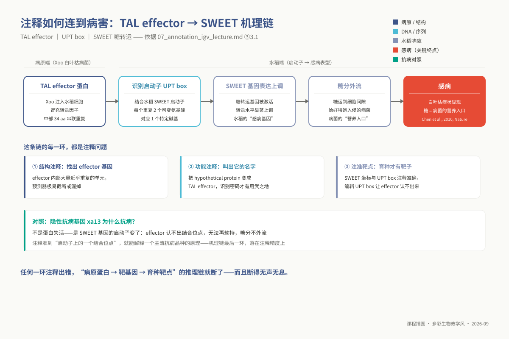
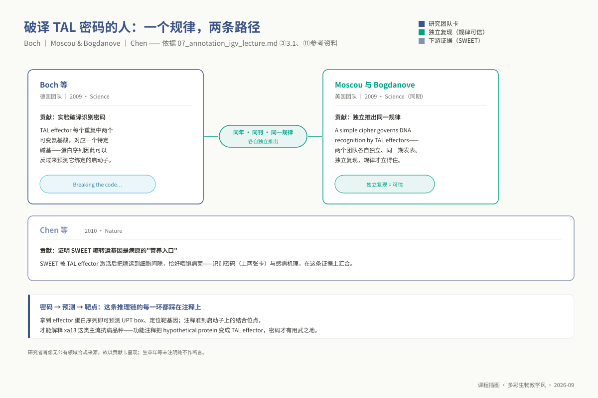
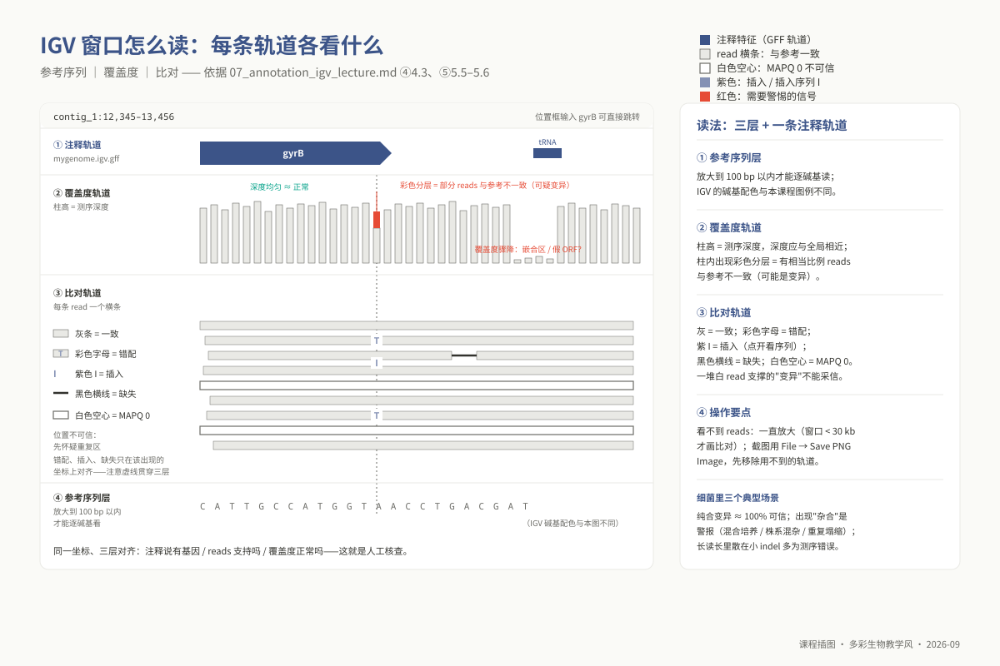
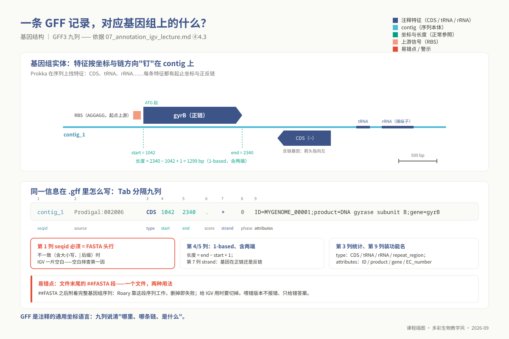
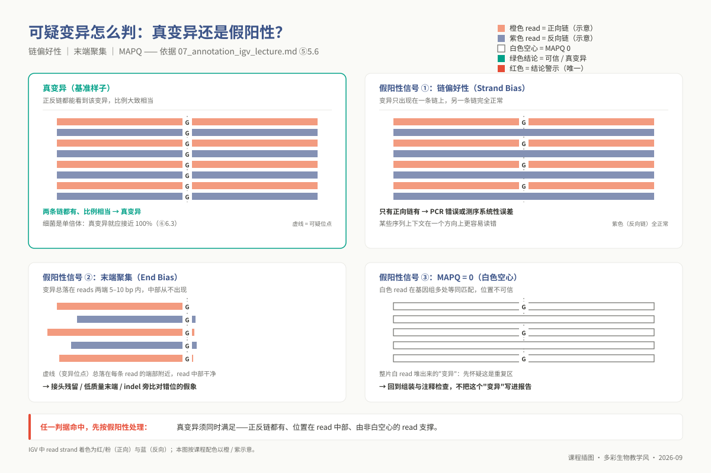
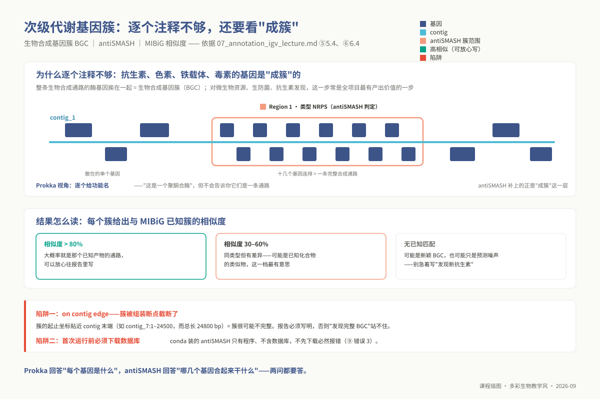

# 单元 u07：基因组注释与 IGV 可视化

> **适用对象**：本科 ｜ 线上自学 · 4 学时
>
> **阅读重点**：本讲连接结构注释、功能注释和 IGV 人工核查。你将运行 Prokka、antiSMASH 和 IGV 所需的准备步骤，检查注释、覆盖度和变异信号是否相互支持。
>
> **资源**：工具 `prokka`、`antismash`、`igv`（`checkm` 质检辅助）；环境为 `ngs_ug_annot` 与 `ngs_ug_base`；配套脚本位于 `03_code/undergraduate/scripts/`。

<!-- 维护信息：单元 id `u07`；大纲和章节模板由课程契约维护。 -->

<!-- 原课程定位：综合项目（u08）组装与下游分析之间的核心枢纽。 -->
<!--

| 项目 | 内容 |
|------|------|
| **单元 id** | `u07` ｜ 目录 `unit07_annotation_igv` ｜ 4 学时 · 线上自学 |
| **核心工具** | `prokka` `antismash` `igv`（`checkm` 质检辅助） |
| **运行环境 / 脚本** | 注释 `ngs_ug_annot` ｜ 可视化 `ngs_ug_base` ｜ 配套脚本 `03_code/undergraduate/scripts/` |
| **教学定位** | 综合项目（u08）组装与下游分析之间的核心枢纽。将无物理坐标的组装序列赋予结构与功能信息，建立基于基因组浏览器（IGV）人工核查变异与组装真实性的实证思维。 |
-->

## ① 学习目标

学完本单元，你应当建立原核生物基因组结构与功能注释的全局推断能力与现场核查眼力：

1. **区分结构与功能注释**：说明“哪里是基因”和“基因可能做什么”两个层次，并举例说明边界错误如何影响下游分析。
2. **解构 Prokka 工具链调度架构**：深入剖析 Prokka 作为元调度引擎的核心分工，透彻掌握 Prodigal（从头 CDS 预测）、Aragorn（tRNA 鉴定）、Barrnap（rRNA 隐马尔可夫模型扫描）与 BLAST/HMMER 分层功能分配的运行机制。
3. **明晰注释衍生文件体系与下游流向**：熟练解析 Prokka 产出的核心文件簇，掌握 `.gff` 作为 Roary 泛基因组分析唯一输入、`.faa` 作为系统发育进化树推断底座的刚性依赖关系。
4. **运行全套集群注释与次级代谢预测**：编写规范的 SGE 批处理作业脚本调度 `prokka` 与 `antismash`，提取基因总数、编码密度、tRNA/rRNA 拷贝数及生物合成基因簇（BGC）结构信息。
5. **掌握注释质量自检与反常归因**：计算全基因组编码密度与假定蛋白（Hypothetical protein）占比，根据数值偏离快速逆向诊断上游组装碎片化、单倍型未去重或数据库失配等隐性故障。
6. **熟练执行自定义参考基因组 IGV 挂载**：在本地图形化 IGV 环境中协同载入自组装基因组（`.fasta` + `.fai`）、修剪版注释轨道（`.igv.gff`）与回贴比对流（`.bam` + `.bai`），完成染色体微观尺度的人工复核。
7. **检查变异信号**：在 IGV 中检查链偏好、末端聚集和 MAPQ = 0 等线索，并记录支持或质疑该信号的证据。

## ② 前置检查

本单元深度依赖以下基础模块，进入实践前请务必确认技能完备度：

| 依赖模块 id | 本讲应用场景 | 典型薄弱症状 | 对应自测题号 |
|---|---|---|---|
| `l0_01_linux` | ⑤ 集群作业投递；`qsub`/`qrsh` 调度、GFF 文本 `awk` 提取、跨卷软链接与绝对路径管理 | 误在共享登录节点直接并发运行耗时巨大的 antiSMASH 计算，导致进程被强制清除 | `l0_01_linux` Q03 / Q07 / Q09<sup>†</sup> |
| `l0_03_conda` | ⑤ 运行环境精确隔离；注释环境 `ngs_ug_annot` 与展示环境 `ngs_ug_base` 的分工 | 在未预装 IGV 的注释环境中调用图形化界面，频繁遭遇 `command not found` 困扰 | `l0_03_conda` Q02 / Q08<sup>†</sup> |
| `l0_04_formats` | ④ GFF3 标准九列规范；FASTA 序列头行命名约束与 BAM 坐标对齐 | 忽视 GFF 文件末尾附加的 `##FASTA` 块，导致 IGV 解析中断或 Roary 输入报错 | `l0_04_formats` Q04 / Q05 / Q10<sup>†</sup> |

<sup>†</sup> 注：L0 题号对应先导测试题库。本讲**不依赖** `l0_06_stats`。

```bash
conda activate ngs_ug_annot && prokka --version && antismash --version   # 验证注释核心工具链
conda activate ngs_ug_base  && igv --version                             # 验证可视化工具环境
ls -lh /d3/scratch/${USER}/ngs/assem/canu/test-pacbio/test.contigs.fasta # 确认 u06 组装底座就绪
```

## ③ 背景与科学问题

### 3.1 从无序核苷酸长链到生命机理蓝图的语义赋予

上一单元通过长读长组装算法，成功将数以万计的测序碎片拼装为长度达数兆碱基的染色体骨架（Contig）。然而，这一段纯粹由 A、T、C、G 四种核苷酸字符交织而成的线形长链，本身并不直接回答任何生命科学命题：该病原株是否携带能够瓦解寄主防御的毒力基因？它能否自主合成新型抗菌活性代谢物？它抵抗重金属胁迫与抗生素筛选的分子开关位于何处？

要将一段物理测序序列转化为具备生物学解释力的基因组图谱，必须跨越**基因组注释（Genome Annotation）**这道中枢桥梁。注释包含两个相互依存且不可倒置的计算层级：

- **结构注释（Structural Annotation）**：定位全基因组所有具有转录或翻译潜能的功能元件物理坐标（“**基因在哪里**”），精确界定开放阅读框（ORF）的起始密码子、终止密码子以及核糖体结合位点；
- **功能注释（Functional Annotation）**：通过与已知公共蛋白质序列及隐马尔可夫模型数据库进行同源比对，为结构预测出的每一个编码序列赋予确切的生化功能描述、催化编号（EC Number）或结构域家族归属（“**基因干什么**”）。

**注释在综合项目中的枢纽地位**：注释绝非分析流程的终点，而是串联下游全部模块的数据总线。后续的泛基因组构建（Roary）直接吞吐注释交付的 `.gff` 文件，而系统发育树推断（GToTree）则严格依赖 `.faa` 蛋白质多肽序列。若注释阶段发生系统性偏差（如假 ORF 泛滥或关键功能漏判），下游所有比较分析虽能顺畅运行出图，但推导出的生物学结论将发生毁灭性漂移。

### 3.2 现实生物学前沿案例：Xoo 致病机理链与 TAL 效应子密码

在水稻白叶枯病菌（*Xanthomonas oryzae* pv. *oryzae*, Xoo）与寄主水稻的协同演化对抗中，病原菌演化出了多套致病机制：它经 II 型分泌系统分泌纤维素酶、木聚糖酶、果胶降解酶等细胞壁降解酶（Tayi et al. 2016），本案例聚焦的则是另一条路线——通过 III 型分泌系统（T3SS）向水稻叶肉细胞内部注射一类高度特异的**转录激活样效应因子（Transcription Activator-Like Effector, TAL effector）**。

TAL 效应子能够无缝伪装成水稻自身的真核转录因子，精准侵入水稻细胞核，结合并强制超量表达寄主水稻的内源感病基因——其中最核心的一类靶标正是 **SWEET 家族糖转运蛋白基因**（如 *OsSWEET11*, *OsSWEET14*；Chen et al., 2010, *Nature*）。

被强行激活的 SWEET 蛋白将水稻细胞内部宝贵的蔗糖与葡萄糖源源不断泵出至质外体间隙，直接沦为病菌生长繁殖的口粮，最终引发水稻叶片大面积枯死。

TAL 效应子之所以能够实现对植物启动子序列的精确锁定，源于其蛋白核心区包含一段串联排列的由 34 个高度保守氨基酸构成的重复单元。每个重复单元的第 12 和第 13 位氨基酸呈现超变特征（Repeat-Variable Diresidue, RVD），且这两个氨基酸与 DNA 上的单个碱基存在严格的简并对应识别密码（如 HD 特异识别 C，NG 特异识别 T，NI 特异识别 A，NN 特异识别 G 或 A；Boch et al., 2009, *Science*; Moscou & Bogdanove, 2009, *Science*）。

在这条由“病原效应蛋白 $\rightarrow$ 启动子 UPT box 结合 $\rightarrow$ 感病基因异常上调 $\rightarrow$ 植株发病”构成的致病因果链条中，**每一个关键节点的破解完全依赖于基因组注释的极高精度**：在病菌端，TAL 效应子基因内部由于高度富集几乎一致的 34 氨基酸串联重复序列，普通的结构注释软件极易在此处发生读框截断或误判为假基因；在功能注释端，唯有准确识别出该基因具备特定的结构域，才能进一步解码其 RVD 密码并预测其靶向位点；在寄主水稻端，唯有将 SWEET 基因的启动子物理坐标注释至单个核苷酸精度，抗病育种专家才得以利用 CRISPR 介导的启动子编辑技术精准破坏结合位点，培育出广谱高抗的新品种（如隐性抗病基因 *xa13* 的本质即为 SWEET 启动子变异导致病菌效应子“脱靶断粮”）。



*图 u07-1：TAL effector → UPT box → SWEET 上调 → 感病：每一环都是注释问题。*



*图 u07-6：破译 TAL 密码的人：一个规律，两条路径（贡献卡，无公开合规肖像故不画像）。*

## ④ 核心原理

### 4.1 原核生物结构基因预测的生物学与统计学线索

相较于真核生物复杂的断裂基因结构（外显子与内含子交替排布、选择性剪接调控），原核生物基因组的结构注释在计算算法上具有鲜明的生物学优势。原核基因组展现出极致的紧凑性：全基因组**编码密度普遍高达 85%–90%**，基因间区往往仅有数十个碱基对，且蛋白编码基因在物理上完全由**连续不中断的开放阅读框（Open Reading Frame, ORF）**构成。

经典原核从头基因预测引擎（如 Prodigal）主要依托三项正交的序列统计学线索展开概率建模：

1. **ORF 物理长度的统计显著性**：在任意随机核苷酸序列中，以三联体密码子为步长进行扫描时，遭遇三种终止密码子（TAA, TAG, TGA，在 64 种组合中占 3 席，概率 $p \approx 3/64 \approx 0.0469$）的数学期望距离仅为约 21 个密码子。一条连续延伸达到 300 个密码子（约 900 bp）且完全不含任何终止密码子的长 ORF，在随机泊松噪声中自发出现的先验概率约为 $(1 - 3/64)^{300} \approx 5.56 \times 10^{-7}$（四种碱基均匀、位点独立的简化模型）。因此，超长无中断读框本身就是存在真实转录翻译的强烈统计证据；
2. **翻译起始密码子模式匹配**：原核生物虽然以 ATG 为绝对主导起始信号，但仍广泛兼容 GTG（约占 10%–15%）甚至 TTG 等非经典起始密码子。算法需要结合上下游特征裁决读框的精确物理起始位点；
3. **核糖体结合位点（RBS / Shine-Dalgarno 序列）**：在功能性起始密码子上游 5–10 bp 的非翻译区间内，保守存在一段富含嘌呤的序列基序（典型共有序列为 `5'-AGGAGG-3'`，即 SD 序列）。该基序能够与原核核糖体小亚基 16S rRNA 的 3' 末端（反向 SD 序列 `3'-UCCUCC-5'`）发生碱基互补配对，指引翻译起始复合物的精确装配。Prodigal 动态提取全基因组的密码子使用偏好（Codon Usage Bias），并将 ORF 跨度、起始密码子权重与上游 SD 序列自由能结合，通过动态规划算法求解全基因组全局最优的基因坐标组合。

### 4.2 Prokka 注释调度流水线与分层功能赋值架构

在生信实践中必须澄清的一个根本认知是：**Prokka 并非一个单一的注释预测算法，而是一个高度工程化的自动化工作流调度引擎（Pipeline Orchestrator）**。Prokka 本身并不直接执行底层的序列特征提取，而是将计算生物学领域经过长期实战检验的各类成熟单项工具编排成严密的工艺链条：

| 流水线阶段 | 核心调用引擎 | 目标生物学元件 | 运行逻辑与技术特征 |
|---|---|---|---|
| **第一步：从头 CDS 预测** | **Prodigal** | 蛋白质编码序列（CDS） | 无监督地从待测基因组学习 GC 位置偏差、六聚体编码统计与起始密码子/RBS motif，再用动态规划确定基因与起点 |
| **第二步：转运 RNA 扫描** | **Aragorn** | tRNA 及 tmRNA 分子 | 基于 tRNA 二级结构三叶草模型与保守反密码子环进行空间拓扑扫描 |
| **第三步：核糖体 RNA 挖掘** | **Barrnap** | 5S, 16S, 23S rRNA | 基于隐马尔可夫模型（HMMER）对原核核糖体保守操纵子实施轮廓扫描 |
| **第四步：特殊调控元件** | **MinCED** / **Infernal** | CRISPR 间隔阵列 / ncRNA | 识别簇状规律间隔短回文重复序列，提取原核获得性免疫防御位点 |
| **第五步：分层功能注释** | **BLAST+** / **HMMER3** | 蛋白质生物学功能与命名 | 按照严格的可信度由高到低执行分级数据库级联检索 |

**分层功能注释的“先严后宽”原则**：
当 Prodigal 交付多肽氨基酸序列后，Prokka 绝非盲目开展全局数据库扫描，而是严格遵循严苛的证据层级逐级下沉检索：

1. **特异性高置信参考库**：若用户指定了同属高质量近缘物种的精选蛋白库（`--proteins`），优先开展高阈值比对，直接继承精确命名；
2. **精选核心数据库**：未命中的蛋白依次检索 ISfinder（转座子）、NCBI 抗性基因数据库以及 UniProt/Swiss-Prot 手工校正核心库；
3. **物种门类特异性库**：根据 `--kingdom` 参数调阅细菌属特异性隐马尔可夫模型库；
4. **结构域级别轮廓家族库**：未获得全长同源命中的序列，检索 Pfam 与 TIGRFAM 结构域数据库，提取保守功能域特征；
5. **保底兜底状态（Hypothetical Protein）**：若上述层级均未检出任何显著匹配，系统将该条目诚实记录为**假定蛋白（Hypothetical protein）**。
在科学研究中，大量的 `hypothetical protein` 绝非算法故障，而是真实反映了未知新物种中未被人类实验定型的基因暗物质。该比例通常收敛在 20%–40% 之间，过高或过低均提示注释配置失当。

### 4.3 GFF3 标准格式语法规范与 IGV 多轨渲染机制

**GFF3（Generic Feature Format Version 3）** 是生物信息学界记录染色体序列结构特征的通用标准规范。文件主体由制表符（Tab）分隔的 9 个标准列组成：

```text
contig_1  Prodigal:002006  CDS  1042  2340  .  +  0  ID=MYGENOME_00001;product=DNA gyrase subunit B;gene=gyrB
```

- **第 1 列（seqid）**：重叠群名称，**必须与输入 FASTA 序列头行第一个空格前的内容严格逐字完全一致**；
- **第 2–3 列（source / type）**：特征来源程序与本体论类型（如 `CDS`, `tRNA`, `rRNA`），下游统计各类元件总数的核心分类标签；
- **第 4–5 列（start / end）**：物理起始与终止绝对坐标。**GFF 严格遵循 1-based 且包含两端闭区间的定义**，基因实际长度严格等于 $End - Start + 1$；
- **第 7 列（strand）**：转录物理链方向，`+` 代表正向正链，`-` 代表反向互补链；
- **第 9 列（attributes）**：以分号分隔的自由键值对集合，容纳基因标识符（`ID=`）、产物功能名（`product=`）及规范基因简称（`gene=`）。

> **Prokka GFF 的双重语义构造**：Prokka 生成的原始 `.gff` 文件在结构特征行结束后，会在末尾追加一行关键声明 `##FASTA`，并在其后附带完整的染色体核苷酸序列。**下游 Roary 泛基因组分析工具强制依赖末尾的这一段序列开展多基因簇核酸对齐**；然而，部分单机版 IGV 在读取包含嵌入式 FASTA 的 GFF 时容易发生解析器假死。因此在进入 IGV 前，必须通过脚本将末尾序列切除，派生为专属的 `mygenome.igv.gff`。

**集成基因组浏览器（IGV）的三层渲染透视**：
在图形化交互中，IGV 从上至下由三组正交轨道构建出严密的实证视图：

- **顶层：染色体参考序列轨道**：在百碱基尺度下无损展示单核苷酸序列（A 绿、C 蓝、G 橙、T 红）；
- **中层：覆盖度轨道（Coverage Track）**：以柱状图形式展现物理比对深度。柱高真实反映测序丰度；若某一位点存在异质多态性，柱体内部会依照不同等位基因比例呈现彩色切片分层；
- **底层：单读长比对轨道（Alignment Track）**：平铺展现每一条独立比对的物理读长。灰色代表与参考序列完美匹配，彩色字符标示错配位点，紫色符号 `I` 标注插入事件，黑色细横线指示物理缺失，**白色空心长条代表 MAPQ 彻底归零的多重比对读长**。

将注释轨道叠加于比对轨道之上，研究者得以瞬间实现“**假说与事实的现场对照**”：注释声称此处存在一个关键酶基因，下方比对是否有均一连续的读长深度支撑？还是该区域测序深度彻底归零，警示此处仅仅是组装接错引发的伪假 ORF？



*图 u07-3：IGV 三层窗口：注释、覆盖度、比对各看什么。*



*图 u07-2：GFF3 九列：注释文件里到底标了什么。*

### 4.4 变异信号的人工核查：真变异与三类假信号的物理辨析

在利用 IGV 进行变异与注释复核时，测序深度柱上出现的彩色突变信号绝不能盲目采信为真实变异。必须通过三道物理与统计闸门进行交叉过滤：



*图 u07-4：真变异 vs 三类假信号：链偏好、末端聚集、MAPQ=0。*

1. **测序链偏好性（Strand Bias）**：将比对轨道设置为按读长链方向着色（`read strand`）。在真核与原核重测序中，**真实的生物学单核苷酸多态性必须在物理正向链（粉红）与反向互补链（浅蓝）上均获得对等比例的读长支持**。若某一变异在 20 条正向读长中全部出现，而在同等深度的反向读长中完全呈现野生型，这 100% 是体外扩增过程中特定 DNA 上下文导致的单链光化学测序假象；
2. **末端聚集偏好性（End Bias）**：若某一错配仅集中出现在读长物理末端的 5–10 bp 区间内，而在跨越该位点的读长中段从未检出，这是读长末端接头残留未剪切或末端测序错误率发散引起的局部比对错位；
3. **定位质量坍缩（MAPQ = 0）**：若支持突变位点的全部读长呈现白色空心状态，表明这些读长能够以相同得分比对到基因组的多个同源位点。此类“突变”往往是由于组装时同源区域塌缩，导致不同拷贝的读长被错误叠加至同一坐标所致。

### 4.5 次级代谢产物生物合成基因簇（BGC）与 antiSMASH

在微生物生理与药物研发中，微生物次级代谢产物（如各类抗生素、免疫抑制剂、铁载体及抗病毒素）的生物合成途径具有极其特殊的基因组空间拓扑：参与同一天然产物合成的全套生化酶、调控因子及自我抗性转运泵，在染色体物理坐标上紧密相邻排列，形成功能高度协同的生物合成基因簇（Biosynthetic Gene Cluster, BGC）。

Prokka 等通用注释工具只能孤立标注单个酶基因的名称，无法识别这种高阶的功能协同。**antiSMASH** 工具通过引入基于规则的聚类算法与隐马尔可夫模型，专门扫描原核基因组中的 BGC 特征：

- 准确定位**核心生物合成酶**（如非核糖体多肽合成酶 NRPS、聚酮合酶 PKS 及萜类环化酶）；
- 基于物理间距阈值向两侧延伸捕获辅助修饰酶与转运蛋白；
- 将预测出的基因簇与国际天然产物已知 BGC 数据库（MIBiG）进行全局共线性比对，量化相似度得分。

若 antiSMASH 报告中某一基因簇被打上 **`on contig edge`（位于 Contig 边缘）** 的警示标签，这明确指示该基因簇被组装断裂接缝强行截断，其全套合成功能可能并不完备。这一指标直接体现了组装连续性对下游代谢挖掘的制约效应。



*图 u07-5：基因连排成簇：antiSMASH 怎么把次级代谢基因簇找出来。*

### 4.6 技术前沿（2023–2026）：从规则启发式到深度学习端到端基因模型

在 2023–2026 年的技术演进浪潮中，基因组注释领域呈现出两大确定性跃迁趋势：
在原核生物领域，新一代注释工具 **`Bakta`**（Schwengers et al., 2021, *Microbial Genomics*）正在逐步承接 Prokka 的历史生态。Bakta 依托超大规模的预编译 UniRef 与精选微生物数据库，引入基于免比对（Alignment-free）子串匹配加速策略，不仅使功能命名命中率显著提升，更全面规范了对 NCBI 与 Sequence Ontology 标准词汇表的兼容。

在真核与复杂微生物领域，**`Helixer`**（Holst et al., 2025, *Nature Methods*）把深度学习与隐马尔可夫模型结合（论文题名即如此），从 DNA 序列直接预测基因结构，不需要转录组证据；**`BRAKER3`**（Gabriel et al., 2024, *Genome Research*）则走另一条路，整合 RNA-seq 与蛋白证据训练 GeneMark-ETP/AUGUSTUS。两者孰优取决于训练集覆盖、目标物种与参照物种的距离，以及独立验证，目前没有统一基准支持「取代」之说。

然而，无论底层算法如何更迭，掌握结构注释与功能注释的解耦逻辑，始终是每一位生信研究人员不可动摇的核心基本功。

## ⑤ 操作步骤

### 5.0 准备工作区与组装产物软链接

```bash
mkdir -p /d3/scratch/${USER}/ngs/anno && cd /d3/scratch/${USER}/ngs/anno
# 软链接承接 u06 自组装的 CIX4481 结果（test 只是 canu -p 前缀，不是 Canu 测试数据），规范命名为 genome.fasta
ln -sf /d3/scratch/${USER}/ngs/assem/canu/test-pacbio/test.contigs.fasta ./genome.fasta

# 执行输入基因组完整性双项自检
grep -c "^>" genome.fasta                                             # 核对 contig 数量
awk '/^>/{next}{n+=length($0)}END{print "组装物理总长 (bp):", n}' genome.fasta
```

### 5.1 投递 Prokka 标准化注释作业

配套标准化作业脚本位于 `03_code/undergraduate/scripts/07_run_prokka.sh`，核心作业结构如下：

```bash
cat > prokka_anno.sh << 'EOF'
#!/bin/bash
#$ -S /bin/bash
#$ -N prokka_ug
#$ -cwd
#$ -j y
#$ -pe smp 4
#$ -l h_vmem=8G
set -euo pipefail
source /opt/miniconda3/bin/activate
conda activate ngs_ug_annot

# --outdir 指定输出目录（必须不存在或加 --force）；--prefix 统一前缀；--locustag 基因标识前缀
prokka --outdir prokka_out --prefix mygenome --kingdom Bacteria \
       --cpus 4 --locustag MYGENOME genome.fasta
EOF

qsub prokka_anno.sh
qstat -u ${USER}
```

### 5.2 Prokka 核心输出文件簇的生物学分工

运行结束后，`prokka_out/` 目录下将衍生出一组规范化的数据资产，构成下游分析的核心输入：

| 产物文件名 | 物理数据结构与内容 | 下游流水线接口与学术用途 |
|---|---|---|
| **`mygenome.gff`** | 标准 GFF3 注释总表，末尾附加 `##FASTA` 原序列 | ⭐ **Roary 泛基因组分析的唯一合法输入**；IGV 注释加载基础 |
| **`mygenome.faa`** | 全基因组所有预测 CDS 翻译出的**蛋白质多肽 FASTA** | ⭐ **系统发育核心基因树构建（GToTree）**的输入；同源家族聚类 |
| `mygenome.ffn` | 所有结构基因的**编码区核苷酸 FASTA**（含 CDS, tRNA, rRNA） | 目标功能基因的引物设计、核酸多态性计算与单基因系统树构建 |
| `mygenome.fna` | 规范化重命名后的**基因组全序列 FASTA** | 确保后续分析所使用的重叠群 ID 与 GFF 记录绝对吻合 |
| `mygenome.gbk` | 融合核酸序列与多维注释的完整 GenBank 规范文件 | **antiSMASH 预测次级代谢基因簇的最佳输入**；NCBI 提交流程 |
| `mygenome.tsv` | 制表符分隔的逐基因信息总览表（含 locus_tag, product, EC） | 快速检索特定功能基因、统计未知蛋白分布 |
| `mygenome.txt` | 结构特征数量与序列长度的宏观统计摘要文本 | 第一时间用于注释质量快速筛查自检 |

```bash
cd prokka_out
cat mygenome.txt                     # 快速审阅宏观统计总览
grep -v "^#" mygenome.gff | head -5  # 查验 GFF 前 5 行结构字段
grep -c "^>" mygenome.faa            # 统计翻译蛋白质序列总量（必须与 CDS 数量恒等）
```

### 5.3 执行注释质量基准自检

调用配套脚本 `03_code/undergraduate/scripts/07_annotation_stats.sh`，提取关键质检测度：

```bash
cd /d3/scratch/${USER}/ngs/anno/prokka_out
# 1. 统计各类特征元件分布
awk -F'\t' '!/^#/ && NF>=3 {print $3}' mygenome.gff | sort | uniq -c | sort -rn
# 2. 严密计算全基因组编码密度（CDS 总碱基数 / 基因组总物理长度）
CDS_BP=$(awk -F'\t' '$3=="CDS"{s+=$5-$4+1} END{print s}' mygenome.gff)
GEN_BP=$(awk '/^>/{next}{n+=length($0)} END{print n}' mygenome.fna)
awk -v c="$CDS_BP" -v g="$GEN_BP" 'BEGIN{printf "全基因组编码密度: %.2f%%\n", 100*c/g}'
# 3. 统计未知假定蛋白（Hypothetical Protein）在全部 CDS 中的比例
TOTAL=$(awk -F'\t' '$2=="CDS"' mygenome.tsv | wc -l)
HYPO=$(awk -F'\t' '$2=="CDS" && $7 ~ /hypothetical protein/' mygenome.tsv | wc -l)
awk -v h="$HYPO" -v t="$TOTAL" 'BEGIN{printf "假定蛋白占比: %d/%d (%.2f%%)\n", h, t, 100*h/t}'
```

### 5.4 投递 antiSMASH 次级代谢产物基因簇挖掘作业

```bash
cat > antismash_anno.sh << 'EOF'
#!/bin/bash
#$ -S /bin/bash
#$ -N antismash_ug
#$ -cwd
#$ -j y
#$ -pe smp 4
#$ -l h_vmem=8G
set -euo pipefail
source /opt/miniconda3/bin/activate
conda activate ngs_ug_annot

# 推荐直接输入已由 Prokka 标注完成的 GenBank 文件，保留丰富基因上下文
antismash --output-dir antismash_out --taxon bacteria --cpus 4 prokka_out/mygenome.gbk
EOF

qsub antismash_anno.sh
```

### 5.5 准备并规范化 IGV 桌面可视化数据栈

运行配套数据治理脚本 `03_code/undergraduate/scripts/07_prep_igv_inputs.sh`，在集群端生成满足 IGV 极速随机访问的输入四件套：

```bash
conda activate ngs_ug_base && cd /d3/scratch/${USER}/ngs/anno
# 1. 为基因组 FASTA 构建二叉跳转索引（产出 genome.fasta.fai）
samtools faidx genome.fasta

# 2. 确保回贴 BAM 已经过坐标排序并建立索引（产出 .bai）
samtools sort -@ 4 -o reads.sorted.bam reads.bam && samtools index reads.sorted.bam

# 3. 生成 IGV 专属 GFF：彻底剥离末尾 ##FASTA 块，规避桌面客户端解析中断
awk '/^##FASTA/{exit} {print}' prokka_out/mygenome.gff > mygenome.igv.gff

# 4. 严密交叉核对 GFF 染色体名与 FASTA 索引头的一致性
cut -f1 mygenome.igv.gff | grep -v "^#" | sort -u | head -3
cut -f1 genome.fasta.fai | head -3
```

将文件同步拉回个人桌面运行环境：

```bash
mkdir -p ~/ngs_igv && cd ~/ngs_igv
scp <用户名>@10.7.254.22:/d3/scratch/<用户名>/ngs/anno/{genome.fasta*,reads.sorted.bam*,mygenome.igv.gff} ./
```

### 5.6 IGV 交互式核查操作流

启动本地 IGV（`igv`）并严格遵循以下时序挂载：

1. **加载染色体底座**：点击顶部菜单 `Genomes` $\rightarrow$ `Load Genome from File...` $\rightarrow$ 选定本地 `genome.fasta`（严防错选为普通 File 菜单）；
2. **加载注释总表**：点击 `File` $\rightarrow$ `Load from File...` $\rightarrow$ 导入 `mygenome.igv.gff`；
3. **加载比对验证流**：点击 `File` $\rightarrow$ `Load from File...` $\rightarrow$ 导入 `reads.sorted.bam`；
4. **定位与导航**：在顶部定位搜索框中输入特定基因代号（如 `gyrB`）或物理坐标（如 `contig_1:100000-120000`）；不断放大窗口至宽度 $<30\text{ kb}$，比对读长与错配细节即刻清晰呈现。

## ⑥ 结果解读

### 6.1 原核生物健康注释的核心基准指标（以 4 Mb 细菌为例）

| 核心质检指标 | 参考区间（4 Mb 级细菌的课程经验值，非通用判据，须按基因组大小换算） | 底层生物学依据与推导基准 |
|---|---|---|
| **CDS 预测总量** | **3500 – 4300 个** | 原核生物基因平均长度约 1 kb 且间区极短，**宏观表现为约每 1 kb 容纳 1 个编码基因** |
| **全基因组编码密度** | **85% – 90%** | 原核生物无内含子且演化压力高度精简，绝大部分物理序列均投入多肽编码 |
| **平均基因物理跨度** | 850 – 1000 bp | 对应典型球状功能蛋白质约 300 个氨基酸残基的结构约束 |
| **tRNA 基因数量** | 40 – 90 个 | 满足 20 种标准氨基酸多套密码子翻译转运的生理底线 |
| **rRNA 基因（feature）数** | 3 – 21 个（= 1–7 套 $rrn$ 操纵子 × 每套 5S/16S/23S 各一；feature 数 ≠ 操纵子数） | 原核生物核糖体快速合成的物理需求 |
| **Hypothetical 蛋白比例** | **20% – 40%** | 处于已知保守生化功能与种属特异性新基因之间的合理平衡带 |

### 6.2 注释异常特征与上游工程缺陷诊断决策表

| 观察到的异常病理特征 | 底层最可能的系统性故障 | 优先排查与验证闭环 |
|---|---|---|
| **预测基因总数严重偏低**（4 Mb 基因组仅检出 1200 个 CDS） | **上游组装极度碎片化**：大量 Contig 跨度短于 500 bp，导致绝大多数基因在物理两端被切断而遭抛弃 | 调阅 u06 的 QUAST 报告：检查 Contig 数量是否破千、N50 是否骤降至数 kb 级 |
| **预测基因总数异常虚高**（4 Mb 基因组检出超过 6000 个 CDS） | **组装单倍型未合并导致空间冗余**：同一物理片段被拼接出了多份平行副本 | 查阅 u06 BUSCO 报告：核查 **Duplicated（D）** 比例是否异常飙升（$>10\%$） |
| **全基因组编码密度跌破 70%** | 组装序列中浸润了大段非生物测序序列、海量未定 `N` 碱基孤岛或外源质粒杂质 | 运行 CheckM 评估样本污染度；在 IGV 中定位大段非编码空洞观察比对深度 |
| **Hypothetical 比例突破 60%** | 注释参数 `--kingdom` 误选；或上游装配引入密集移码错误导致翻译截断 | 复核命令参数；若为全新环境分离未知属，结合物种分类鉴定（FastANI）综合定性 |
| **tRNA 与 rRNA 数量近乎归零** | 组装算法在高度保守的 rRNA 操纵子与 tRNA 基因簇处发生单倍型塌缩或组装断裂 | 原核完成图不应出现此类缺失，必须重构长读长组装跨越策略 |
| **连续出现跨度超过 10 kb 的无注释空白区** | 真实的巨型原噬菌体插入岛；或**组装算法发生错误嵌合拼接拼接进来的假骨架** | 在 IGV 中核查该空白区：若该区段测序深度断崖式归零，坐实为嵌合组装错误 |

### 6.3 IGV 人工复核的三大典型生物学场景

- **真单倍体纯合变异**：特定位点覆盖深度充足，且垂直方向上所有跨越读长在正负链均近乎 100% 呈现一致的错配碱基，此为该菌株相对于参考骨架的高置信度真实变异；
- **伪多态性与污染警报**：在单倍体细菌中，某一位点的错配碱基比例稳定徘徊在 50% 附近。在排除了测序链偏好后，这强力指示培养物中混杂有两种亚型菌株，或者组装算法将两个同源旁系拷贝压缩合并到了单一坐标；
- **高密度 Indel 区域**：密集散落的单碱基插入（紫色）与缺失，常见于长读长均一化聚合物（Homopolymer）区域。若在同一物理位点缺乏多条独立读长的严格共识，通常属于三代测序的光电波动杂音。

### 6.4 antiSMASH 产物报告审阅规范

打开 `antismash_out/index.html`，系统将以交互式染色体图谱形式展开识别到的各个 Region 基因簇。重点审阅两项核心指标：

- **与已知 MIBiG 簇的相似度（Similarity）**：它是已知簇中在本簇里找到同源 hit 的基因所占比例，不是序列一致性，也不是产物概率。antiSMASH 官方说明：即使 100%，也不保证产生同一化合物；缺核心基因、identity 偏低或基因排列不同都会改变它。任何「能合成某化合物」的结论都需要化学或遗传实验另行验证；
- **边界完整性警示**：若基因簇被标注为 `on contig edge`，严禁在科研报告中武断得出“发现完整合成途径”的结论，必须如实交代该基因簇受制于组装断裂而发生片段缺失。

## ⑦ 统计插件

**本讲无独立统计要点。**

原因：u07 专题并不在顶层设计 `00_design/course_contract.yaml` 规定的 `stats_plugin_topics` 考核名单之列。本单元所涉及的核心计算（ORF 动态规划搜索、隐马尔可夫模型状态转移打分、同源序列局部对齐以及基因簇空间距离聚类）均建立在确定性模式识别与相似度矩阵基础之上，并不涉及原假设显著性检验（$P$ 值计算）、错误发现率控制或多元回归拟合，因此不存在统计模型选用不当导致的推断翻车风险。

关于富集分析（如 GO/KEGG 功能富集）中所必需的超几何检验与 Benjamini-Hochberg 多重检验校正理论，请系统参阅先导模块 `l0_06_stats`；本讲聚焦于建立结构与功能注释的数据治理能力与基因组浏览器实证核查直觉。

> ⑧ AI 辅助任务：本科层不适用（仅在博士层强制实施），本讲直接衔接工业级故障排查体系。

## ⑨ 常见错误与排查

**E1 — 重叠群命名超长触发 NCBI 规范阻断** ｜ 典型指纹：`Contig ID must <= 37 chars long: tig00000001|arrow|polished_round2_contig_1`。下游 NCBI 规范要求序列标识符严格控制在 37 字符以内。组装抛光软件层层追加后缀极易超限。 **修复**：在命令中追加 `--compliant --centre XXX` 由 Prokka 自动重新编号；或在组装后立即利用 `awk` 将序列头重命名为简洁格式（如 `>contig_1`），并同步更新后续比对文件。

**E2 — 输出目录已存在触发防覆盖保护** ｜ 典型指纹：`Folder 'prokka_out' already exists! Please change --outdir or use --force`。Prokka 默认拒绝覆盖已有文件夹以保护历史数据。 **修复**：每次运行指定全新的版本化目录（如 `prokka_v1`）；若确需覆写旧结果，显式追加 `--force` 参数。

**E3 — antiSMASH 缺少底层模型数据库** ｜ 典型指纹：`ERROR Missing data files: .../antismash/databases/pfam/...`。Conda 分发的 antiSMASH 仅包含运行代码，未打包数千兆的庞大生化数据库。 **修复**：在首次使用前，在联网环境下执行 `download-antismash-databases` 完成离线库部署，并通过 `antismash --check-prereqs` 确认就绪。

**E4 — IGV 自定义参考序列缺少索引文件** ｜ 典型指纹：`Error loading genome: ... Index file not found. Please index the fasta file (samtools faidx)` 或载入比对时提示缺少 `.bai`。 **修复**：在将数据拉回本地前，必须在服务器端完成 `samtools faidx genome.fasta` 以及对已排序 BAM 执行 `samtools index reads.sorted.bam`，并将衍生索引文件同名同步归档。

**E5 — IGV 载入数据后视窗呈现绝对空白** ｜ 典型排查路径：

1. **序列代号失配（最高危）**：核查 `mygenome.igv.gff` 第 1 列的重叠群名称是否与 `genome.fasta.fai` 第 1 列逐字完全相等；
2. **视野尺度过宽**：在全染色体宏观尺度下 IGV 默认隐藏所有读长，必须在搜索框内持续双击放大直至视窗宽度 $<30\text{ kb}$；
3. **未切除尾部序列段**：直接加载了包含 `##FASTA` 的原始 Prokka GFF 文件，导致部分版本 IGV 解析引擎挂起。必须严格使用经 `awk '/^##FASTA/{exit}{print}'` 清洗后的 GFF 文件。

**E6 — CheckM 质检引擎未锚定参考根目录** ｜ 典型指纹：`It seems that the CheckM data folder has not been set yet`。首次运行 CheckM 必须告知其直系同源数据库的物理存储绝对路径。 **修复**：执行 `checkm data setRoot /path/to/checkm_data` 显式完成环境注册。

**E7 — SGE 作业环境无法识别 Conda 激活指令** ｜ 典型指纹：`CommandNotFoundError: Your shell has not been properly configured to use 'conda activate'`。SGE 派生的计算环境未加载交互式终端配置。 **修复**：在作业脚本正文中强制执行 `source /opt/miniconda3/bin/activate && conda activate ngs_ug_annot` 显式注入 Conda 环境变量。

**E8 — 误切除 GFF 序列导致下游 Roary 核心基因归零** ｜ 典型指纹：Roary 顺利跑完但生成的泛基因组矩阵中核心基因（Core Genes）数量不可思议地收敛于 0。**将专门裁剪给 IGV 用的 `mygenome.igv.gff` 错误投喂给了 Roary**。Roary 内部必须从 GFF 末尾提取核苷酸序列执行聚类比对。 **修复**：提交给 Roary 的必须是 Prokka 交付的原始包含 `##FASTA` 的完整 `.gff` 原件，严禁混淆两个衍生分支。

### 注释与可视化故障排查决策导图

```text
注释全流程故障排查导图
├── Contig ID must <= 37 chars long           ──→ E1 执行 prokka 追加 --compliant 或预先用 awk 简化头行
├── Folder already exists                     ──→ E2 更换输出目录名，或确认后显式添加 --force
├── antiSMASH: Missing data files             ──→ E3 运行 download-antismash-databases 部署底层数据库
├── IGV 载入报错 Index file not found         ──→ E4 补齐 samtools faidx (.fai) 与 samtools index (.bai)
├── IGV 加载后视窗一片空白                    ──→ E5 核对 GFF 第一列命名、放大至 30kb 以内、剔除 ##FASTA
└── Roary 报告核心基因数量接近 0               ──→ E8 严禁用 IGV 裁剪版 GFF，必须向 Roary 提供完整原始 GFF
```

## ⑩ 思考练习

1. **定量合理性推算（计算题）**：某同学针对一个物理长度为 4.2 Mb 的原核完成图运行 Prokka，报告显示共识别出 3980 个 CDS、86 个 tRNA 与 6 个 rRNA，全基因组编码密度为 88.2%，未知假定蛋白（Hypothetical protein）占比为 28.5%。请评估该注释产出是否符合原核生物演化规律；若另一位同学针对相同大小的基因组运行注释，结果显示仅检出 1350 个 CDS，请指出其最可能在上游哪一步工艺中发生严重缺陷，并写出你在终端中定位该故障的具体 Shell 命令。
2. **数据总线依赖推导（文件流分析）**：不查阅任何讲义文本，默写出 Prokka 交付的核心文件产物 `.gff`, `.faa`, `.ffn`, `.gbk`, `.tsv`, `.txt` 各自的数据结构与信息载荷；并详细阐述在综合实践项目后续阶段中，哪一个进阶分析模块将分别把它们作为不可替代的输入源。
3. **静默失败机制剖析（工程反思）**：某研究小组在执行 Roary 泛基因组分析时，为了规避格式问题，误将经过 `awk` 切除末尾 `##FASTA` 序列块的 `mygenome.igv.gff` 作为输入文件打包提交。Roary 正常退出且未抛出任何报错，但最终统计出的物种核心基因数骤降至数十个。请深入剖析为何系统在发生严重错误时未向终端报错，并阐述在生物信息学实战中“隐性静默失败”为何远比“直接抛错崩溃”更具学术破坏力。
4. **染色体浏览器图谱侦探（实战判读）**：在 IGV 中审阅某一特定基因组区段时，你观察到该区段长达 15 kb 的物理区间内完全没有任何 Prokka 预测的 CDS 覆盖；同时在下方比对轨道中，该区段的测序覆盖深度呈现为绝对的零覆盖孤岛（Zero-depth）。请结合组装与注释的因果关系，推导该异常现象最可能的底层工程成因，并说明在最终科研报告中你将如何对该区段做出学术定性。
5. **变异信号正交过滤（质控判读）**：某位点在 IGV 中显示覆盖深度为 45×，其中有 15 条读长报告了确切的单碱基错配（A $\rightarrow$ G）。当你开启 `read strand` 按链着色后，赫然发现这 15 条携带变异的读长全部位于正链（粉红），而覆盖该位点的另外 30 条反链读长（浅蓝）全部呈现野生型 A。请对该变异的真实性做出裁决并说明物理机理；若该 15 条变异读长在正负链中呈现对称的对半分布，你的结论将发生何种反转？
6. **代谢通路边界完整性判断（科研推断）**：antiSMASH 分析报告在你的菌株中检出了一个高度疑似合成新型抗菌肽的非核糖体多肽合成酶（NRPS）基因簇，其物理坐标位于 `contig_3: 1–28400`，而 `contig_3` 自身的总物理跨度为 28850 bp。在撰写综合项目报告时，你是否可以直接声称“在待测菌株中完整鉴定到了该抗菌肽生物合成通路”？为什么？
7. **跨类群分析体系迁移推演（开放性探索）**：假定你未来所在实验室的研究对象从原核单倍体细菌扩展为一种**具有工业价值的单倍体真菌（如酿酒酵母或丝状真菌）**。请系统评估：本单元讲授的注释工具链中哪些环节可以直接复用？哪些软件必须被替代（如换用何种真核专用工具）？本讲建立的质检指标（如编码密度 85%–90%、每 1 kb 一个基因等）为何将彻底失效？其背后的真核染色体生物学机理是什么？

## ⑪ 参考资料

### 核心文献（DOI 均已核验）

1. Seemann T. Prokka: rapid prokaryotic genome annotation. *Bioinformatics*, 2014;30(14):2068–2069. doi:10.1093/bioinformatics/btu153
2. Hyatt D, Chen GL, LoCascio PF, Land ML, Larimer FW, Hauser LJ. Prodigal: prokaryotic gene recognition and translation initiation site identification. *BMC Bioinformatics*, 2010;11:119. doi:10.1186/1471-2105-11-119
3. Laslett D, Canback B. ARAGORN, a program to detect tRNA genes and tmRNA genes in nucleotide sequences. *Nucleic Acids Research*, 2004;32(1):11–16. doi:10.1093/nar/gkh152
4. Robinson JT, Thorvaldsdóttir H, Winckler W, et al. Integrative Genomics Viewer. *Nature Biotechnology*, 2011;29(1):24–26. doi:10.1038/nbt.1754
5. Thorvaldsdóttir H, Robinson JT, Mesirov JP. Integrative Genomics Viewer (IGV): high-performance genomics data visualization and exploration. *Briefings in Bioinformatics*, 2013;14(2):178–192. doi:10.1093/bib/bbs017
6. Page AJ, Cummins CA, Hunt M, et al. Roary: rapid large-scale prokaryote pan genome analysis. *Bioinformatics*, 2015;31(22):3691–3693. doi:10.1093/bioinformatics/btv421
7. Parks DH, Imelfort M, Skennerton CT, Hugenholtz P, Tyson GW. CheckM: assessing the quality of microbial genomes recovered from isolates, single cells, and metagenomes. *Genome Research*, 2015;25(7):1043–1055. doi:10.1101/gr.186072.114
8. Boch J, Scholze H, Schornack S, et al. Breaking the code of DNA binding specificity of TAL-type III effectors. *Science*, 2009;326(5959):1509–1512. doi:10.1126/science.1178811
9. Moscou MJ, Bogdanove AJ. A simple cipher governs DNA recognition by TAL effectors. *Science*, 2009;326(5959):1501. doi:10.1126/science.1178817
10. Chen LQ, Hou BH, Lalonde S, et al. Sugar transporters for intercellular exchange and nutrition of pathogens. *Nature*, 2010;468:527–532. doi:10.1038/nature09606
11. Schwengers O, Jelonek L, Dieckmann MA, Beyvers S, Blom J, Goesmann A. Bakta: rapid and standardized annotation of bacterial genomes via alignment-free sequence identification. *Microbial Genomics*, 2021;7(11). doi:10.1099/mgen.0.000685
12. Gabriel L, Brůna T, Hoff KJ, et al. BRAKER3: fully automated genome annotation using RNA-seq and protein evidence with GeneMark-ETP, AUGUSTUS, and TSEBRA. *Genome Research*, 2024;34(5):769–777. doi:10.1101/gr.278090.123
13. Holst F, Bolger A, Günther C, et al. Helixer: ab initio prediction of primary eukaryotic gene models combining deep learning and a hidden Markov model. *Nature Methods*, 2025. doi:10.1038/s41592-025-02939-1
14. Tayi L, Maku RV, Patel HK, Sonti RV. Identification of pectin degrading enzymes secreted by *Xanthomonas oryzae* pv. *oryzae* and determination of their role in virulence on rice. *PLoS ONE*, 2016;11(12):e0166396. doi:10.1371/journal.pone.0166396

### 官方文档与代码仓库

- Prokka 工具套件：https://github.com/tseemann/prokka
- Prodigal 算法体系：https://github.com/hyattpd/Prodigal
- antiSMASH 官方技术文档：https://docs.antismash.secondarymetabolites.org/
- MIBiG 已知次级代谢基因簇数据库：https://mibig.secondarymetabolites.org/
- IGV 桌面系统手册：https://igv.org/doc/desktop/
- GFF3 格式规范（Sequence Ontology）：https://github.com/The-Sequence-Ontology/Specifications/blob/master/gff3.md
- CheckM 质量评估体系：https://github.com/Ecogenomics/CheckM/wiki

### 视频与配套材料

- 视频策展：原核基因组注释与 IGV 可视化操作录屏清单见 `01_syllabus/syllabus_undergraduate.md` §八；
- 配套自动化脚本库（`03_code/undergraduate/scripts/`）：涵盖 `07_run_prokka.sh`（批处理注释作业）、`07_run_antismash.sh`（BGC 挖掘作业）、`07_annotation_stats.sh`（编码密度与假定蛋白自动化质检提取）以及 `07_prep_igv_inputs.sh`（IGV 索引与数据治理流水线）。

## 附：与综合项目的对应关系

**本单元直接对应《学生实验操作手册》§4.3 基因组注释模块。**

| 综合项目实战模块 | 手册章节对应 | 本讲技术映射与工程依赖 | 核心交付成果与对账标准 |
|---|---|---|---|
| 模块 2 · 基因组组装 | §4.2 | 上游输入：产出高质量 `genome.fasta` 组装序列（u06 承接） | 奠定全基因组注释的物理输入底座 |
| **模块 3 · 基因组注释** | **§4.3** | **本讲核心**：调用 Prokka 执行全基因组注释；调度 antiSMASH 解析次级代谢潜力 | 结构注释 GFF、蛋白质多肽 FAA、基因组注释统计小表及 IGV 核查截图 |
| 模块 4 · 物种分类鉴定 | §4.4 | 平行推进：物种属种信息核实后回填 GenBank 元数据 | 验证分类学自洽性 |
| 模块 5 · 系统发育进化 | §4.5 | 下游依赖：核心单拷贝蛋白序列直接提取自本讲产出的 `mygenome.faa` | 多序列比对与最大似然进化树构建 |
| 模块 6 · 泛基因组分析 | §4.6 | 下游依赖：Roary 批处理管道**强制仅吞吐本讲生成的原始 `mygenome.gff`** | 核心基因组与附属基因组图谱构建 |

```text
u06 组装 genome.fasta ──→ u07 注释 ──┬─→ mygenome.gff ──→ Roary 泛基因组构建（核心/附属基因分析）
                                     ├─→ mygenome.faa ──→ GToTree 系统发育核心基因进化树推断
                                     └─→ mygenome.gbk ──→ antiSMASH 次级代谢产物合成基因簇（BGC）
```

**实验环境与规程执行规范**：

- **数据流承接**：实验室内部集群数据源为 `/data/lab/ngs/reads.fa` 经 u06 组装产物；校外自学采用 `download_ug.sh` 获取的真实 Xoo CIX4481 组装产物（全长约 4.7 Mb，课程预期编码基因数约 4000–4600 个，未经实测）；
- **环境隔离要求**：注释流程严格在 `ngs_ug_annot` 环境中投递调度；本地可视化分析在 `ngs_ug_base` 环境中启动 IGV；
- **报告支撑规范**：注释基础统计表支撑项目报告 §3.1，两张高清晰度 IGV 核查截图（正常保守区 vs 结构可疑区）支撑报告 §3.2，次级代谢潜力与致病效应子解读支撑报告 §3.3。
