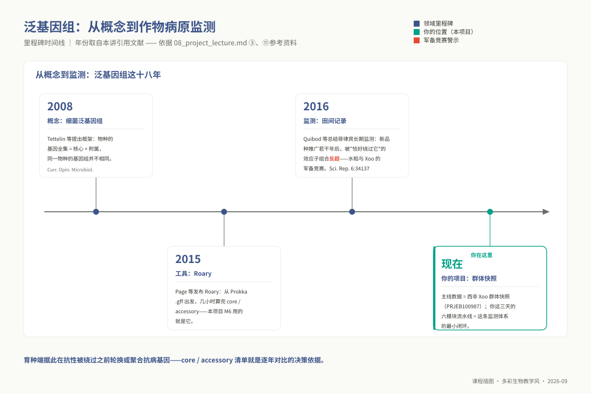
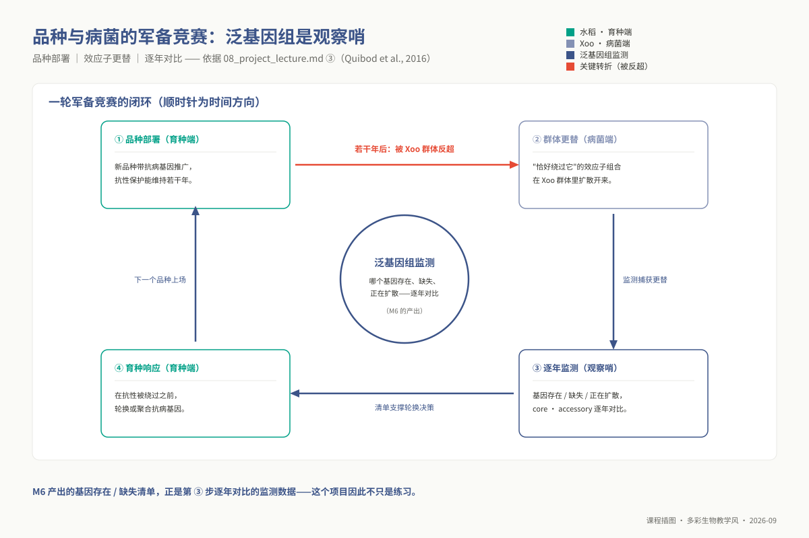
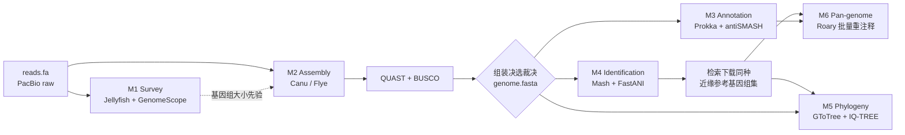
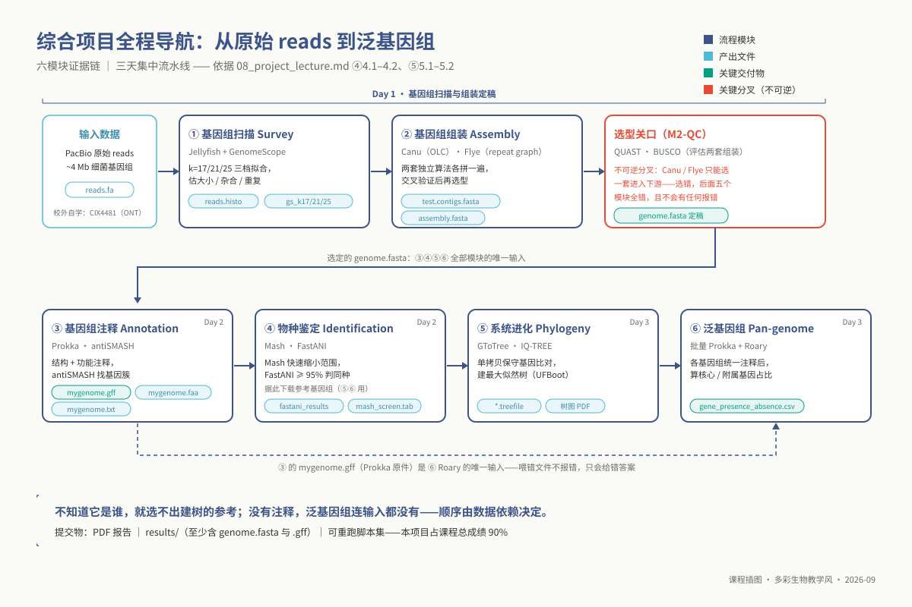
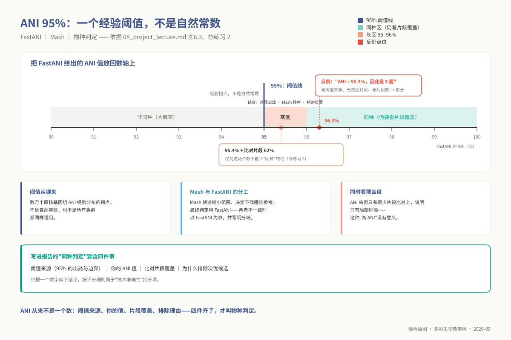
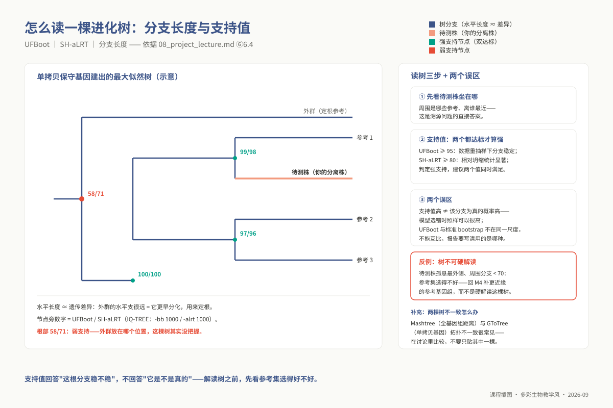
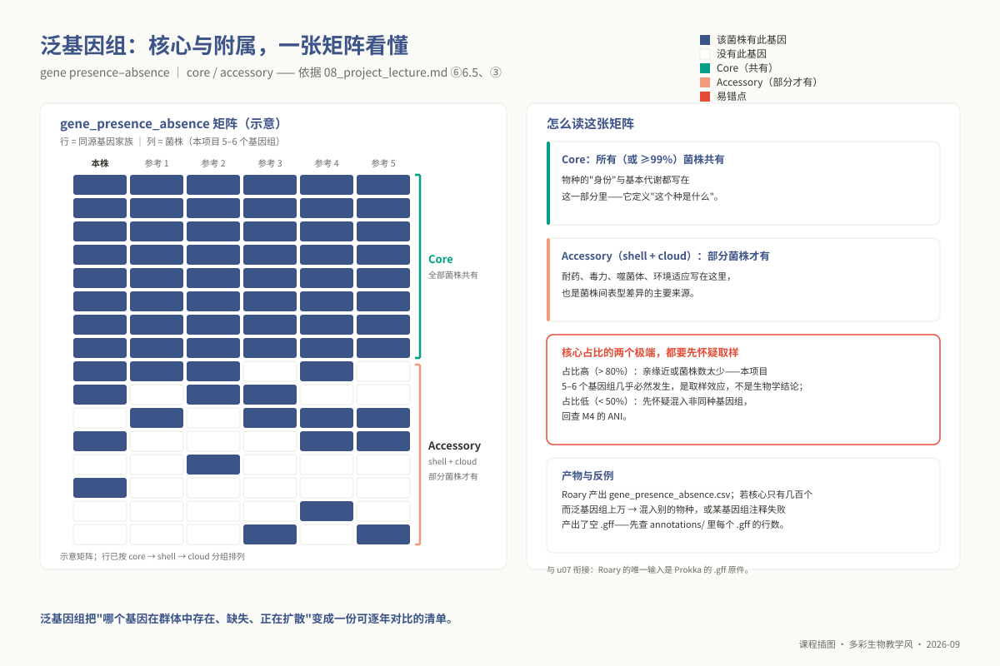

# 单元 u08：综合实践项目 —— 未知细菌基因组从组装到泛基因组

> **适用对象**：本科 ｜ 课堂集中项目 · 24 学时（3 天 × 8 小时）
>
> **阅读重点**：本讲帮助你把 u01–u07 的技能串成六个模块的证据链，并据此安排实战与报告判断。具体实验流程、命令和参数以《学生实验操作手册》为准；本讲补充前置检查、模块接口、排错和结果判定。
>
> **注意**：u08 在课程契约 `00_design/course_contract.yaml` 中声明为 `anchored: true`，操作手册路径为 `<课程材料目录>/学生实验操作手册.md`。

| 项目 | 内容 |
|------|------|
| **学时** | **24 学时（3 天 × 8 小时，课堂集中高强度实战）**；u01–u07 为异步先导自学，不占此 24 学时 |
| **数据与参考库** | 实验室内建数据：`/data/lab/ngs/reads.fa`（PacBio，约 4 Mb）；`/data/lab/ngs/db/`。**校外自学替代通道**：Xoo 主线数据集 `PRJEB100987` 的 CIX4481 株系（ONT 组装 + Illumina 扫描）+ 12 株高精度完成图 + 2 株外群，执行 `bash 06_data/undergraduate/download_ug.sh --run`（约 485 MB），详见 `06_data/undergraduate/README.md` |
| **计算集群** | 10.7.254.22，Sun Grid Engine（SGE）统一调度（必须 `qsub` 提交批处理，或 `qrsh` 交互） |
| **工作空间目录** | `/d3/scratch/${USER}/ngs/{survey,assem,anno,ident,phylo,pangenome}` |
| **课程考核权重** | 占全课程总成绩 **90%**（其余 10% 对应 L0 前置素养） |

## ① 学习目标

完成本项目全流程后，你应当建立独立应对真实未知微生物组学分析的端到端推断直觉与工程自洽能力：

1. **执行无参考基因组勘测（M1 Survey）**：调度 Jellyfish 与 GenomeScope 构建多尺度 $k$-mer 频率谱，比较 $k=17, 21, 25$ 的拟合差异，并记录其对基因组大小估计的影响。
2. **多轨组装与正交质量裁决（M2 Assembly）**：并行投递 Canu（OLC）与 Flye（Repeat Graph）两套异构图求解引擎，利用 QUAST 几何连续性指标与 BUSCO 单拷贝同源基因完整度执行排他性多维对账，撰写具备严密数值证据支撑的组装优选决策书。
3. **完成高精度结构与功能解析（M3 Annotation）**：驱动 Prokka 与 antiSMASH 完成全基因组 CDS、tRNA、rRNA 标注与次级代谢产物生物合成基因簇（BGC）定位，依据全基因组编码密度与假定蛋白比例排查上游组装隐患。
4. **进行原核分类鉴定（M4 Identification）**：解释 ANI 约 95% 阈值的适用边界，结合 Mash 和 FastANI 的结果，在灰区记录证据并选择参考基因组集合。
5. **推断多位点单拷贝超矩阵系统发育树（M5 Phylogeny）**：提取全基因组单拷贝核心基因构建串联超矩阵，运用 IQ-TREE 2 最大似然法构建高置信度进化树，准确区分超快自举检验（UFBoot）与近似似然比检验（SH-aLRT）的统计支持度内涵。
6. **分析泛基因组结构（M6 Pan-genome）**：运行 Roary，区分核心与附属基因组，并说明核心基因比例如何随抽样规模变化。
7. **交付高可复现性工程资产与学术报告**：建立标准化脚本工程组织规范，遵循科学规范撰写结构严密、图表自洽的 PDF 结题报告。

## ② 前置检查

本项目作为全课程唯一的终局实践综合大关，**严格建立在先导模块（L0）与前期 7 个单元的知识闭环之上**。任何一处基础缺陷都会在多任务并发排队时演变为致命的进度阻断。

### 2.1 L0 基础模块依赖矩阵

| 依赖模块 id | 在综合项目中的核心承载 | 技能缺失诱发的系统性事故 | 自测与补强路径 |
|---|---|---|---|
| `l0_01_linux` | 贯穿三天的全部命令行操作；软链接跨卷组织、`qsub` 任务分发、`grep`/`awk` 字段截取 | 无法独立编写 SGE 作业脚本，甚至无法在共享磁盘上建立合法的工作空间 | `l0_01_linux` Q01–Q10 强化通关 |
| `l0_02_r` | GenomeScope 频率谱绘图、COG 功能富集条形图、ggtree 系统发育树美化、泛基因组矩阵渲染 | 缺乏基础数据整形能力，无法在报告中交付合格的可视化矢量图表 | `l0_02_r` Q01–Q10 强化通关 |
| `l0_03_conda` | 四大任务隔离沙箱环境的自主调度；`command not found` 环境变量脱靶排查 | 第一天全天陷入环境冲突泥潭，导致作业后台批量静默崩溃 | `l0_03_conda` Q01–Q10 强化通关 |
| `l0_04_formats` | FASTA 命名规范、FASTQ 测序特征、GFF3 属性字段解构、Newick 树拓扑格式 | 误将缺少嵌入式序列的 GFF 喂入 Roary，引发核心基因组全线归零事故 | `l0_04_formats` Q01–Q10 强化通关 |
| `l0_05_qc` | 输入数据物理量核算、测序通量测算、三代测序随机噪声特征识别 | 在基因组勘测阶段误用高噪声长读长，导致直方图主峰完全丧失 | `l0_05_qc` Q01–Q10 强化通关 |
| `l0_06_stats` | **全项目宏观指标的理性审视底座**：BUSCO 抽样方差、ANI 经验阈值、自展支持率内涵 | 沦为机械的“数字搬运工”，无法在报告中展开具有批判力度的学术讨论 | `l0_06_stats` 达到 $\ge 80\%$ 正确率 |

### 2.2 进驻实战就绪清单（Day 1 上午前完成）

- [ ] 掌握 SGE 作业调度机制，能独立编写包含 `#$ -S /bin/bash`、`#$ -cwd`、`#$ -pe smp 4`、`#$ -l h_vmem=8G` 的批处理作业头；
- [ ] 确认完成 4 个专用 Conda 环境部署：`ngs_ug_base`、`ngs_ug_assembly`、`ngs_ug_annot`、`ngs_ug_phylo`，并通过 `which` 指令核验核心工具链路径就绪；
- [ ] 完整建立 `/d3/scratch/${USER}/ngs/{survey,assem,anno,ident,phylo,pangenome}` 六大子目录；
- [ ] 核验原始输入数据 `/data/lab/ngs/reads.fa` 存在性（校外运行 `download_ug.sh` 并确认 MD5 校验和全部吻合）；
- [ ] 熟读操作手册目录索引，明确各模块与先导单元的对应映射，杜绝无脑复制模板；
- [ ] 下载《实践报告模板.md》，明确图表、数据和文字阐释的归档要求，做到实验与报告同步推进。

## ③ 背景与科学问题

### 3.1 真实疾控与植保一线未知病原的系统学生信闭环

**沉浸式科研情境**：设想你作为生物信息分析骨干进驻国家病原微生物应急监测实验室。某日清晨，一线植保工作站送来一份从重大作物暴发性枯萎病灶中分离出的未知细菌分离株。由于病症极具侵略性，常规的平板生理生化表型测定与基于通用引物的 16S rRNA 基因测序给出了完全模糊的结论：生化特征指示属于黄单胞菌属（*Xanthomonas*），但 16S 序列与已知近缘种最高相似度仅为 97.8%，恰好卡在国际公认的“疑似潜在新物种”的统计灰区。为了抢在病害大面积蔓延前制定出靶向防控或抗性品种轮换方案，实验室即刻对该分离株完成了高通量长读长测序，并将原始读长文件交付给你。

面对未知的生命序列，生物信息学分析必须沿着一条高度内聚、因果相扣的证据链逐级突破三大核心命题：

- **物种定型：它是谁？** 16S 基因由于物理跨度短（约 1.5 kb）且序列高度保守，在同属不同致病变种间往往毫无分类分辨力；唯有从全基因组整体序列相似度（ANI）切入，方能给出排他性定种证据（由 M1 $\rightarrow$ M2 $\rightarrow$ M4 闭环裁决）；
- **系统发育：它从哪里来、在生命树上与谁最近？** 分离株绝非凭空产生。通过提炼全基因组保守单拷贝基因超矩阵构建最大似然系统发育树，方能推断其演化历史分支与可能的跨境传播源头（由 M5 模块解答）；
- **致病潜能：它能干什么、对寄主的危害机制何在？** 细菌的致病力、耐药谱与抗生素合成潜能完全铭刻在基因组中。同一种内的不同致病变种，往往因水平基因转移或基因簇得失而具有数以千计的基因差异（由 M3 结构注释与 M6 泛基因组挖掘解答）。

**三大命题在时序逻辑上绝对不可倒置**：若尚未完成高精度的从头组装，物种鉴定与功能注释便丧失了物理坐标支撑；若未能准确完成物种定型，后续系统发育分析便无法确立合理的参考菌株集合；若未能规范完成全套多株重测序数据的结构注释，泛基因组比较矩阵的输入将彻底坍塌。

### 3.2 农作物与病原物军备竞赛视野下的泛基因组快照

将视野由单一未知分离株放大至农业生态系统的宏观演化格局，我们会发现寄主作物的抗病育种与病原细菌的致病力分化是一场持续数十年的“分子军备竞赛”。当农业部门广泛推广部署某一携带特定抗病基因的水稻优良品种后，在强大的寄主免疫选择压下，病原菌群体内部能够绕过该抗性靶标的少数突变突变体将被剧烈富集，最终导致该抗病品种在数年内全面“破防”。菲律宾水稻白叶枯病长期监测研究（Quibod et al., 2016, *Scientific Reports* 6:34137）完整展现了这种周期性的群体更替动态。

泛基因组分析在此类研究中扮演着不可替代的“宏观雷达”角色。通过将数十个具有代表性的菌株划分为核心基因组（Core Genome，维持基础生理的核心中枢）与附属基因组（Accessory Genome，包含转座子、毒力效应子与适应性岛屿的可变宝库），科研人员得以建立群体致病基因图谱的动态预警系统。你在本次实践项目中所操控的西非 Xoo 核心数据集（`PRJEB100987`），正是一次真实的病菌群体空间快照。你这三天的工程实践，本质上是在亲手运行现代数字植保中最为核心的组学分析引擎。



*图 u08-5：泛基因组里程碑：2008 框架 → 2015 Roary → 2016 菲律宾监测循环 → 现在。*



*图 u08-6：品种与病菌的军备竞赛：泛基因组监测是观察哨。*

## ④ 核心原理：六大模块因果拓扑证据链





*图 u08-1：六模块证据链与唯一不可逆的选型关口（M2-QC）：顺序由数据依赖决定。*

### 4.1 六大模块的数学模型与计算图论剖析

从头组装到泛基因组的六大步骤，在算法与统计学层面上构成了一条严密的推断链条：

1. **M1 基因组勘测（Jellyfish + GenomeScope）**：基于短读长高保真 $k$-mer 频率谱，将测序错误长尾、纯合单拷贝主峰与串联重复峰建模为泊松与负二项混合分布。依据无偏随机抽样的大数定律，全基因组物理总长 $G$ 可由下式无参照先验推导：
   $$G \approx \frac{\sum_{i=1}^{\infty} i \cdot N_i}{C_k}$$
   其中 $N_i$ 为频次为 $i$ 的 $k$-mer 种类总数，$C_k$ 为主峰测序深度。该参数直接指导组装阶段的覆盖度阈值设定；

2. **M2 从头组装与质量仲裁（Canu vs Flye + QUAST/BUSCO）**：Canu 采用重叠—布局—共识（OLC）框架，引入自适应 $k$-mer 权重抑制高频重复单元，通过多对多全比对完成单碱基纠错后求解哈密顿重叠图；Flye 采用重复图（Repeat Graph）架构，首先构建无分叉的连续片段（Disjointigs），再将长读长作为线索在图空间中穿透 rRNA 操纵子等高同源重复分叉点。随后通过 QUAST 统计 N50 与最长 Contig，并结合 BUSCO 原核保守直系同源基因集（$n=124$）判定单拷贝完整率（$C \ge 95\%$）与重复冗余度（$D \le 2\%$）；
3. **M3 结构与功能注释（Prokka + antiSMASH）**：Prokka 调度 Prodigal 动态学习原核基因组密码子使用偏好（Codon Usage Bias），结合核糖体结合位点（RBS / SD 序列）自由能，通过动态规划算法求解全局最优 CDS 读框集合；同时调用 Aragorn 识别 tRNA 二级结构三叶草模型，Barrnap 轮廓 HMM 扫描 rRNA 操纵子。antiSMASH 运用基于生化规则的聚类算法识别非核糖体多肽合成酶（NRPS）与聚酮合酶（PKS）等次级代谢产物生物合成基因簇（BGC）；
4. **M4 物种分类鉴定（Mash + FastANI）**：Mash 引入 MinHash 局部敏感哈希技术，将全基因组压缩为固定规模（如 $s=1000$）的最小哈希值列表，利用两集合交并比极速近似 Jaccard 相似系数：
   $$J(A, B) = \frac{|A \cap B|}{|A \cup B|} \implies \text{突变距离 } D = -\frac{1}{k} \ln \frac{2J}{1+J}$$
   快速从数万原核参考库中筛选 Top 命中候选；随后 FastANI 将基因组切分为 1024 bp 片段实施双向全局比对，以 $\text{ANI} \ge 95.0\%$ 经验阈值作为同种分类学判定界限；

5. **M5 多位点系统发育推断（GToTree + IQ-TREE 2）**：GToTree 利用原核生物 74 个单拷贝保守基因 HMM 模型从各基因组多肽序列中提取同源片段，调用 MAFFT 开展多序列对齐，剪切后拼接为超长串联超矩阵；IQ-TREE 2 基于 ModelFinder 自动寻优氨基酸替代矩阵（如 LG+I+G4），运用最大似然法（Maximum Likelihood）求解最优树拓扑，并通过超快自举法（UFBoot $\ge 95$）与近似似然比检验（SH-aLRT $\ge 80$）提供分支统计置信度；
6. **M6 泛基因组比较矩阵构建（Roary）**：Roary 运用 CD-HIT 将所有菌株的蛋白序列实施 98% 序列一致度聚类，提取代表性序列开展 All-against-All blastp，并利用马尔可夫聚类算法（MCL）解析直系同源群。根据 Heap's 演化幂律公式：
   $$n = \kappa \cdot N^\gamma$$
   当 $\gamma > 0$ 时指示该物种拥有持续向外源摄取基因的“开放型泛基因组（Open Pan-genome）”，核心基因组占比随菌株纳入而渐进收敛，附属基因组则展现出无穷丰富度。

### 4.2 六大模块输入输出契约矩阵

在大型多步骤生物信息学工程中，理解软件命令的机械语法远不及透彻把握**模块之间不可逾越的契约流动**重要：

| 模块单元 | 核心计算引擎 | 输入消费数据源 | 关键交付数据资产 | 下游消费者与断链级联后果 |
|---|---|---|---|---|
| **M1 基因组勘测 (Survey)** | `jellyfish` + `genomescope` | 原始测序数据 `reads.fa` 或配套短读长 | 基因组大小、杂合度、重复率点估计 | 传递给 M2 作为组装器核心参数。若大小估错一个数量级，M2 读长保留逻辑全盘失真 |
| **M2 从头组装 (Assembly)** | `canu` (OLC) 与 `flye` (Repeat Graph) | 原始长读长 + M1 先验大小 | 两套候选 Contigs 组装结果 | 直接支撑后续 M3、M4、M5、M6 **全部模块**。若选错劣质组装，后续结论全盘失效且无系统报错 |
| **M2-QC 质量仲裁** | `quast` + `busco` | Canu 与 Flye 组装产物 | 连续性对比报表、单拷贝保守性矩阵 | 由**研究人员**行使学术决选权，锁定唯一的 `genome.fasta` 底座 |
| **M3 结构功能注释 (Annotation)** | `prokka` + `antismash` | 决选出的 `genome.fasta` | `.gff`, `.faa`, `.gbk` 及 BGC 报告 | `.gff` 是 M6 泛基因组的唯一合法输入；`.faa` 为系统发育提供多肽源 |
| **M4 物种分类鉴定 (Identification)** | `mash` + `fastani` | `genome.fasta` + RefSeq 数据库 | Mash 排名表、ANI 矩阵、近缘参考基因组 | **M4 产出的参考基因组清单是 M5 与 M6 的核心燃料**。参考选错，进化树拓扑彻底丧失科学意义 |
| **M5 系统发育推断 (Phylogeny)** | `gtotree` + `iqtree2` | `genome.fasta` + 参考序列集合 | 单拷贝保守基因串联对齐超矩阵、`.treefile` | 交付具有统计支持度的物种演化树拓扑 |
| **M6 泛基因组分析 (Pan-genome)** | `roary` | **所有待比对基因组的 Prokka 原生 `.gff`** | 核心/附属基因矩阵、泛基因组频率分布图 | 直接用于群体基因流动与适应性演化分析 |

### 4.3 极易导致全线失真的三条关键工程依赖约束

1. **M4 的副产物是 M5 与 M6 的必要原料**：物种分类鉴定的终极目标不仅是给出一个名称，更关键的是依据 Mash 与 FastANI 的排他性结果，**准确判定分离株所属的种，并从 NCBI 精确检索并下载 5–10 株经过人工检验的高质量近缘参考基因组**。操作手册中给出的 `GCF_000005845` 等下载指令仅仅是语法示例，绝对不是所有菌株通用的固定编号。若机械照抄示例编号，会导致用大肠杆菌的参考序列去分析黄单胞菌的分离株，系统发育树与泛基因组分析将瞬间沦为学术荒谬；
2. **跨环境串联执行的隔离纪律**：在执行 M6 泛基因组分析前，所有新下载的外部参考基因组**必须统一使用 `ngs_ug_annot` 环境中的 Prokka 重新执行格式化注释**，产出具备标准 `##FASTA` 标签的原生 `.gff` 文件；随后再切换至 `ngs_ug_phylo` 环境启动 Roary 聚类。在集群批处理作业中，一个 Shell 脚本严禁混用多套激活环境，必须严格拆解为两个串联推进的 SGE 独立脚本；
3. **M2 组装决选具有唯一不可逆的单向性**：一旦经过 QUAST 与 BUSCO 的严格裁决，敲定某一套组装（如 Flye 优于 Canu）作为最佳方案，**后续四个模块所有符号链接与输入路径必须坚决指向该选定结果**。严禁在报告文本中声称选择了 Flye，而下游比对、注释与树构建却依然沿用 Canu 的中间产物。这种言行不一的逻辑撕裂属于严重的技术准确性事故。

## ⑤ 操作步骤与日程导航

> **本讲定位为顶层导航，不机械复写操作手册既有代码。** 具体的命令细节与传参规范严格以《学生实验操作手册》对应章节为准。本节重点呈现各个作业的调度环境、耗时预算与工程时序控制。

### 5.1 模块调度总览与时空预算表

| 实践模块 | 手册章节锚定 | 调度 Conda 环境 | SGE 投递建议 | 4 核环境参考墙钟耗时 | 核心标志性产物文件 |
|---|---|---|---|---|---|
| **M1 勘测统计** | §4.1.3 步骤 2–3 | `ngs_ug_assembly` | **必须 `qsub` 调度** | 20–40 min（含三档 $k$ 值） | `reads.histo` 直方图二维文本 |
| M1 曲线拟合 | §4.1.3 步骤 4 | `ngs_ug_assembly` | 可在 `qrsh` 节点交互 | 2–5 min | `gs_k21/plot.png` 与 `summary.txt` |
| **M2 Canu 组装** | §4.2.3 步骤 2 | `ngs_ug_assembly` | **必须 `qsub` 调度** | **1.5–4.0 h（计算瓶颈）** | `test-pacbio/test.contigs.fasta` |
| **M2 Flye 组装** | §4.2.3 步骤 3 | `ngs_ug_assembly` | **必须 `qsub` 调度** | 25–60 min | `out_pacbio/assembly.fasta` 与 `assembly_info.txt` |
| M2 质量评估 | §4.2.3 步骤 4–5 | `ngs_ug_assembly` | **必须 `qsub` 调度** | 25–55 min（QUAST + BUSCO） | `quast_results/report.txt` 与 BUSCO 摘要 |
| **M3 Prokka 注释** | §4.3.3 步骤 2 | `ngs_ug_annot` | **必须 `qsub` 调度** | 8–20 min | `mygenome.gff`, `mygenome.faa` |
| M3 次级代谢挖掘 | §4.3.3 步骤 3 | `ngs_ug_annot` | **必须 `qsub` 调度** | 30–90 min | `antismash_out/index.html` 交互网页 |
| **M4 Mash 筛查** | §4.4.3 步骤 2 | `ngs_ug_phylo` | **必须 `qsub` 调度** | 约 30 min（含 6 GB 库下载） | `mash_screen.tab` 匹配排名表 |
| **M4 FastANI 验证** | §4.4.3 步骤 3 | `ngs_ug_phylo` | 可在 `qrsh` 节点交互 | 5–15 min | `fastani_results.txt` 矩阵文本 |
| **M5 基因树构建** | §4.5.3 步骤 3–4 | `ngs_ug_phylo` | **必须 `qsub` 调度** | 30–70 min（GToTree + IQ-TREE）| `Aligned_SCGs.faa.treefile` 进化树 |
| M5 树图美化 | §4.5.3 步骤 5 | `ngs_ug_phylo` | 在 `qrsh` 中运行 R 脚本 | 5 min | `phylogenetic_tree.pdf` 矢量图 |
| **M6 批量注释** | §4.6.3 步骤 3 | **`ngs_ug_annot`** | **必须 `qsub` 调度** | 40–80 min（多株批处理） | `annotations/*/*.gff` 标准 GFF 簇 |
| **M6 Roary 泛基因组** | §4.6.3 步骤 4 | **`ngs_ug_phylo`** | **必须 `qsub` 调度** | 20–50 min | `gene_presence_absence.csv` 存在矩阵 |

### 5.2 密集实战三天科学时序推进策略

- **Day 1：突破组装关口，确立基因组底座**
  - 上午：核验前置自查清单（§2.2）；投递 M1 基因组勘测作业；**在第一天上午尽早将 Canu 与 Flye 同时并发投递出去**。利用组装排队与计算的数小时空隙，深度研读操作手册。
  - 下午：回收组装产物，并发启动 QUAST 与 BUSCO 质检；**在第一天傍晚前彻底完成两套组装的横向对比，敲定最终的 `genome.fasta` 并固化选型论证文案**。
- **Day 2：完成结构功能解码，锁定系统分类边界**
  - 上午：基于选定的基因组投递 Prokka 结构注释与 antiSMASH 次级代谢基因簇挖掘；
  - 下午：推进 M4 物种分类鉴定。利用 Mash 锁定属种，**当天下班前必须完成 5–10 株高质量同种近缘参考基因组的下载与完整性校验**。
- **Day 3：解析系统发育树，绘制全群泛基因组图谱**
  - 上午：构建 M5 超矩阵系统发育树，完成 IQ-TREE 2 计算并导出带支持值标注的高质量树图；
  - 下午：对全套参考菌株执行 Prokka 批量注释，无缝衔接 Roary 泛基因组分析；收敛全套统计表格与矢量图表，完成结题报告定稿。

### 5.3 课程自建沙箱环境与手册预装环境映射

在既有实验手册中，所有作业脚本头部均缺省标注为 `conda activate ngs`。在本课程体系下，为确保环境长期稳定可复现，要求严格映射至 4 个自建任务沙箱中：

- M1 勘测与 M2 组装：`conda activate ngs_ug_assembly`
- M3 注释与 M6 批量重注释：`conda activate ngs_ug_annot`
- M4 鉴定、M5 进化与 M6 泛基因组聚类：`conda activate ngs_ug_phylo`
- 通用数据处理与 R 绘图：`conda activate ngs_ug_base`

若部分外置脚本（如 `genomescope.R`）未打包进 Conda 环境，请遵循手册指南通过 `wget` 拉取独立脚本并在包含 `r-base` 的环境中直接调用 `Rscript` 运行，无需强行安装至系统目录。

## ⑥ 结果解读与决策判定

### 6.1 M1 基因组勘测图谱解读法则

- **直方图单峰性验证**：原核细菌是严格的单倍体生物，健康的频率直方图必须且仅能展现出一个显著的单拷贝纯合主峰。若在主峰左侧深度对半处出现清晰的肩峰，直接揭示混菌感染；
- **$k$ 值尺度稳定性**：$k=17, 21, 25$ 三档模型推导出的基因组大小波动应收敛在 5% 以内。若发散严重，表明数据覆盖深度不足，必须在报告中客观讨论该局限性。

### 6.2 M2 组装质量综合决选决策逻辑

在评定 Canu 与 Flye 组装产物时，严禁以运行耗时作为取舍标准，必须依照以下优先级证据矩阵进行逐级仲裁：

1. **完整性第一原则**：BUSCO 检出率（Complete, C）出现实质性落后（差异 $>2\%$）的组装方案直接淘汰；
2. **装配冗余度核对**：检查 BUSCO 重复率（Duplicated, D）与组装总长。若某版本总长度显著超出 GenomeScope 估计值且 D 异常升高，警示该版本包含大量未合并的单倍型碎块，属于严重的冗余伪组装；
3. **连续性与闭合性综合评定**：在基因完整度相当的前提下，优先选取 Contig 数量收敛至个位数、N50 接近染色体全长且 Flye `assembly_info.txt` 明确给出 `circ.=Y` 拓扑闭合证明的方案。

### 6.3 M4 分类鉴定与 ANI 95% 边界审读

- **同种划界的经验统计阈值**：FastANI 全局双向平均核苷酸一致度 **$\text{ANI} \ge 95.0\%$** 是国际微生物界判定同一细菌物种的经验阈值标准；
- **95%–96% 临界灰区的综合裁决**：当 ANI 落在该敏感带时，单凭单个数字不足以支撑定种结论。必须协同审阅比对片段覆盖率（Query fragments aligned 占比）以及 Mash 的排序一致性；若比对覆盖度低于 60%，即便局部 ANI 偏高，亦不能草率下达同种结论。



*图 u08-4：ANI 阈值 95%：灰区 95–96% 要三证据，只报数字会翻车。*

### 6.4 M5 系统发育树支持值的统计学本质

在系统发育树中，绝不能将自展支持度等同于“该演化分支真实存在的后验概率”：

- **超快自举值（UFBoot $\ge 95$）**：表征在序列重抽样扰动下该拓扑分支的**统计稳健性**；
- **似然比检验值（SH-aLRT $\ge 80$）**：表征当前最优分支相较于零长度坍缩分支的**统计显著性**。
唯有两项指标协同达到强支持线的分支，方可在讨论中赋予演化溯源的生物学定性。



*图 u08-3：怎么读一棵进化树：外群定根、自展值、两个误区。*

### 6.5 M6 泛基因组核心与附属矩阵的演化透视

在 Roary 输出的 `gene_presence_absence.csv` 矩阵中，基因被经典划分为：

- **核心基因组（Core Genome，$\ge 99\%$ 菌株共有）**：对应物种不可或缺的核糖体、DNA 复制与基础碳代谢引擎；
- **附属基因组（Accessory Genome，包含 Shell 与 Cloud）**：对应质粒交换、噬菌体整合、毒力效应子及次级代谢基因簇。
在仅有 5–8 个近缘株系的小样本分析中，核心基因占比往往显现出 $>80\%$ 的宏观特征。必须明确指出这是由于抽样菌株数量有限导致的统计效应，严禁将其断言为该物种全群体的生物学生理定论。



*图 u08-2：presence/absence 矩阵：core/shell/cloud 三分与核心占比的判读。*

## ⑦ 统计插件

**本讲无独立统计要点。**

原因：u08 作为终局综合实践课程，不在 `00_design/course_contract.yaml` 规定的 `stats_plugin_topics` 独立考核名单之列。本项目并未引入需要单独推导的新统计假设检验，因而不设专题章节。

然而，在项目交付的全部成果中，**每一项关键科研裁决都与先导模块 `l0_06_stats` 紧密咬合**：

- BUSCO 的 $C$ 比例波动受制于有限样本容量（$n=124$）的抽样误差；
- ANI 的 95% 阈值是建立在对数万原核基因组双峰分布基础上的经验统计临界点，具有明确的边界不确定性；
- IQ-TREE 的 UFBoot 与 SH-aLRT 严格衡量数据重抽样下的方差特征，而非拓扑真值概率；
- 泛基因组核心基因规模的衰减轨迹，本质上遵循随样本量扩增的幂律递减统计规律。
若在报告撰写中对上述指标的统计学内涵产生混淆，应立即回溯先导模块 `l0_06_stats` 进行复习。

> ⑧ AI 辅助任务：本科层不适用（依据课程契约仅在博士层强制实施），本讲直接聚焦一线排错规范。

## ⑨ 常见错误与排查

**E1 — 登录节点高负荷计算触发资源强杀** ｜ 典型指纹：`Killed` 或 `-bash: fork: retry: Resource temporarily unavailable`。严禁在共享登录节点执行 Canu、BUSCO、antiSMASH 或 Roary。 **修复**：必须严格编写 Shell 作业脚本并通过 `qsub` 提交，或通过 `qrsh -pe smp 4` 申请独立节点开展交互调试。

**E2 — 作业脚本遗漏 Conda 环境变量初始化** ｜ 典型指纹：`canu: command not found` 或 `prokka: command not found`。SGE 派生的批处理环境不继承用户的交互式 Shell 配置。 **修复**：在每个作业脚本首行显式添加环境唤醒指令：`source /opt/miniconda3/bin/activate && conda activate <环境名>`。

**E3 — Canu 组装耗时超出预期与资源配额超限** ｜ 诊断法则：4 核跑 4 Mb 细菌长读长耗时 1.5–4 小时属正常物理现象。若集群排队阻塞，可战略性优选 Flye 组装作为替代路线，并在报告中客观说明该取舍逻辑；运行前务必通过 `du -sh /d3/scratch/${USER}/ngs/*` 核查个人磁盘配额（限额 50 GB），及时清理中间过程切片。

**E4 — NCBI 早期 FTP 协议拦截导致下载挂死** ｜ 典型指纹：`ftp://... : No such directory` 或网络连接重置。校园网安全策略普遍阻断了明文 FTP 连接。 **修复**：将下载 URL 前缀统一替换为标准 HTTPS 协议（`https://ftp.ncbi.nlm.nih.gov/...`），并附加 `-c` 断点续传参数。

**E5 — 基因组勘测输入数据类型混淆** ｜ 典型指纹：`zcat: ../fq/*.fq.gz: No such file or directory`。操作手册示例代码假定存在二代测序压缩数据，而实验室主线数据实际为 `/data/lab/ngs/reads.fa`。 **修复**：核查实际文件路径，在脚本中直接解引用真实物理数据，并在报告中如实阐明数据形态。

**E6 — Linux 文件系统路径大小写敏感性陷阱** ｜ 典型指纹：`cd: /D3/SCRATCH/...: No such file or directory`。被锚定的实验手册中部分代码块偶发将小写目录写成了全大写。 **修复**：谨记 Linux 系统严格区分大小写，统一规整为合法的 `/d3/scratch/${USER}/...` 路径。

**E7 — 计算节点脱网导致 BUSCO 数据库下载受阻** ｜ 典型指纹：`Cannot reach BUSCO datasets download server`。集群计算节点未配置外网穿透。 **修复**：优先复用本地共享库 `/data/lab/ngs/db/` 中已预置的 `bacteria_odb10`；或在登录节点预先拉取后追加 `--offline --download_path` 路径参数。

**E8 — GFF 格式混淆导致 Roary 核心基因组坍缩** ｜ 典型指纹：Roary 顺利跑完但生成的矩阵中核心基因数量不可思议地收敛于 0。向 Roary 错误投喂了经过裁剪的 `mygenome.igv.gff`，或误将 NCBI 未经注释的裸 `.fna` 混入输入池。 **修复**：提交给 Roary 的全部输入必须统一为由 Prokka 规范注释生成的、完整保留末尾 `##FASTA` 序列块的原生 `.gff` 原件。

### 综合项目故障诊断决策导图

```text
综合实践项目全流程故障快速排查导图
├── 运行显示单个 Killed 且进程消失            ──→ E1 严禁在登录节点计算，通过 qsub 投递至计算节点
├── canu/prokka/roary: command not found     ──→ E2 作业脚本头部显式添加 source activate 与 conda activate
├── Canu 运行异常缓慢或提示磁盘写满           ──→ E3 检查配额并清理 correction 中间缓存，或切换为 Flye 路线
├── ftp://... 下载超时断开                    ──→ E4 全面改用 https:// 协议头并添加 wget -c 断点续传
├── zcat 找不到 fq.gz 数据文件                ──→ E5 核验数据输入源，直接指定真实的 reads.fa 文件
├── BUSCO 报告无法连接下载服务器              ──→ E7 检查 /data/lab/ngs/db 预置库，配置 --offline 离线参数
└── Roary 产出的核心基因数量接近 0            ──→ E8 确认所有输入文件均为 Prokka 原生生成的含 ##FASTA 的 GFF
```

## ⑩ 思考练习

1. **组装决选综合仲裁（决策论证）**：针对同一份未知致病细菌的长读长测序数据，Canu 交付的组装结果显示其 BUSCO 完整度为 $C=98.4\%$（其中单拷贝 $S=91.9\%$，重复 $D=6.5\%$）；而 Flye 交付的组装结果显示其完整度同样为 $C=98.4\%$（其中单拷贝 $S=97.6\%$，重复 $D=0.8\%$）。两套算法在基因完整度指标上完全打平。请运用本讲理论，严密论述为何必须优选 Flye 方案进入下游；指标 $D$ 在细菌生理和组装算法两个维度上分别揭示了何种潜在风险？
2. **分类学临界阈值推演（统计边界）**：某分离株与 NCBI 最优参考株的 FastANI 结果报告为 $\text{ANI} = 95.4\%$，但双向成功比对的序列片段仅占待测基因组的 $62.0\%$。单凭这两个数字，你能否在严肃科研报告中将其直接裁定为同一物种？若只能在下游追加一项分析手段来辅助确证该物种归属，你将选择何种方法？为什么？
3. **因果拓扑断裂溯源（依赖链排查）**：在执行多菌株泛基因组分析时，若 Prokka 对某一个参考基因组的注释作业由于内存不足半途终止，交付了一个仅包含头文件的空 `.gff` 文件。阐述这一上游静默故障将如何在 Roary 的最终统计矩阵中扩散显现？在最终报告的哪张图表与哪个核心数值上会最先暴露出严重异常？
4. **自展支持率的学术批判（统计学素养）**：某同学在项目总结中撰写道：“本研究构建的最大似然系统发育树上所有关键分支的自展支持率均达到了 98 以上，因此该树拓扑真实反映了物种客观演化历史的概率为 98%”。请指出该论述中存在的两处严重统计学术语错误，并给出严谨合规的标准科学陈述。
5. **抽样规模演化动力学推导（群体遗传）**：在当前实践项目中，我们仅整合了 5–8 个代表性菌株开展泛基因组构建。设想在未来的深入研究中，该物种测序菌株数量规模化扩增至 500 株：全群的核心基因组（Core Genome）总规模与泛基因组（Pan Genome）总容量将分别呈现何种数学变化趋势？为什么？
6. **科研课题迁移方案设计（开放性探索）**：选定一个你未来在毕业论文或实验室课题中可能接触到的具体研究对象（如某类重要植物病原真菌、昆虫肠道共生菌群或环境宏基因组单细胞），撰写一份 300–500 字的分析策略重构书，作为报告未来展望部分的素材：
   - 本项目涵盖的六大模块中，哪几个模块可以直接复用？哪几个模块必须强制更换工具链（阐述具体替换方案与生物学理由）？
   - 若受限于科研经费，手头仅有二代 Illumina 短读长测序数据，你的组装与质控评定策略将发生何种根本性转变？
   - 若课题的核心科学假设并非物种鉴定，而是“精准挖掘与特定杀菌剂耐药表型高度连锁的候选功能基因”，你将如何重新设计六大模块的分析重心与因果推进时序？

## ⑪ 参考资料

### 课程权威锚定材料

| 文档名称 | 物理路径 | 核心规范与教学职能 |
|---|---|---|
| **学生实验操作手册**（1035 行，🔒 契约锚定，**流程、命令及参数以此为准**） | `<课程材料目录>/学生实验操作手册.md` | §4.1–§4.6 全流程命令行与参数规范；§5.3 评分标准细则；§6 常见故障 FAQ |
| **实践报告模板**（边做边填，规范归档） | `<课程材料目录>/实践报告模板.md` | 结题报告章节结构与标准学术图表排版规范 |
| 综合项目考核指南 | `08_assessment/undergraduate/project/undergrad_project.md` | 最终报告归档标准与成果提交打分维度 |
| 本科生教学大纲 | `01_syllabus/syllabus_undergraduate.md` | 三天实战日程与综合项目教学目标 |

### 核心工具权威文献（DOI 均已核验）

1. Marçais G, Kingsford C. A fast, lock-free approach for efficient parallel counting of occurrences of k-mers. *Bioinformatics*, 2011. doi:10.1093/bioinformatics/btr011
2. Vurture GW, Sedlazeck FJ, Nattestad M, et al. GenomeScope: fast reference-free genome profiling from short reads. *Bioinformatics*, 2017. doi:10.1093/bioinformatics/btx153
3. Ranallo-Benavidez TR, Jaron KS, Schatz MC. GenomeScope 2.0 and Smudgeplot for reference-free profiling of polyploid genomes. *Nature Communications*, 2020. doi:10.1038/s41467-020-14998-3
4. Koren S, Walenz BP, Berlin K, et al. Canu: scalable and accurate long-read assembly via adaptive k-mer weighting and repeat separation. *Genome Research*, 2017. doi:10.1101/gr.215087.116
5. Kolmogorov M, Yuan J, Lin Y, Pevzner PA. Assembly of long, error-prone reads using repeat graphs. *Nature Biotechnology*, 2019. doi:10.1038/s41587-019-0072-8
6. Gurevich A, Saveliev V, Vyahhi N, Tesler G. QUAST: quality assessment tool for genome assemblies. *Bioinformatics*, 2013. doi:10.1093/bioinformatics/btt086
7. Manni M, Berkeley MR, Seppey M, et al. BUSCO update: novel and streamlined workflows along with broader and deeper phylogenetic coverage. *Molecular Biology and Evolution*, 2021. doi:10.1093/molbev/msab199
8. Seemann T. Prokka: rapid prokaryotic genome annotation. *Bioinformatics*, 2014. doi:10.1093/bioinformatics/btu153
9. Ondov BD, Treangen TJ, Melsted P, et al. Mash: fast genome and metagenome distance estimation using MinHash. *Genome Biology*, 2016. doi:10.1186/s13059-016-0997-x
10. Jain C, Rodriguez-R LM, Phillippy AM, Konstantinidis KT, Aluru S. High throughput ANI analysis of 90K prokaryotic genomes reveals clear species boundaries. *Nature Communications*, 2018. doi:10.1038/s41467-018-07641-9
11. Konstantinidis KT, Tiedje JM. Genomic insights that advance the species definition for prokaryotes. *PNAS*, 2005. doi:10.1073/pnas.0409727102
12. Minh BQ, Schmidt HA, Chernomor O, et al. IQ-TREE 2: new models and efficient methods for phylogenetic inference in the genomic era. *Molecular Biology and Evolution*, 2020. doi:10.1093/molbev/msaa015
13. Hoang DT, Chernomor O, von Haeseler A, Minh BQ, Vinh LS. UFBoot2: improving the ultrafast bootstrap approximation. *Molecular Biology and Evolution*, 2018. doi:10.1093/molbev/msx281
14. Felsenstein J. Confidence limits on phylogenies: an approach using the bootstrap. *Evolution*, 1985. doi:10.2307/2408678
15. Page AJ, Cummins CA, Hunt M, et al. Roary: rapid large-scale prokaryote pan genome analysis. *Bioinformatics*, 2015. doi:10.1093/bioinformatics/btv421
16. Tettelin H, Riley D, Cattuto C, Medini D. Comparative genomics: the bacterial pan-genome. *Current Opinion in Microbiology*, 2008. doi:10.1016/j.mib.2008.09.006
17. Quibod IL, Perez-Quintero A, Carman NJ, et al. Effector diversification contributes to Xanthomonas oryzae pv. oryzae phenotypic adaptation in a semi-isolated environment. *Scientific Reports*, 2016. doi:10.1038/srep34137

### 工具官方文档

- Jellyfish: https://github.com/gmarcais/Jellyfish ｜ GenomeScope 2: https://github.com/tbenavi1/genomescope2.0
- Canu: https://canu.readthedocs.io/ ｜ Flye: https://github.com/fenderglass/Flye ｜ QUAST: https://quast.sourceforge.net/ ｜ BUSCO: https://busco.ezlab.org/
- Prokka: https://github.com/tseemann/prokka ｜ antiSMASH: https://docs.antismash.secondarymetabolites.org/
- Mash: https://mash.readthedocs.io/ ｜ FastANI: https://github.com/ParBLiSS/FastANI ｜ GToTree: https://github.com/AstrobioMike/GToTree
- IQ-TREE: http://www.iqtree.org/ ｜ Roary: https://sanger-pathogens.github.io/Roary/ ｜ ggtree: https://yulab-smu.top/treedata-book/

> 报告中所有参考文献严格采用 GB/T 7714-2015 格式标注。严禁引用未曾阅读或 DOI 未经核验的文献条目。
