<!-- @section: cover -->
<!-- _class: master cover -->

# 专题 m03：重测序与变异检测

**流程谁都能抄；能对每条阈值说出它在拦什么，才是本讲的出口。**

<div class="meta">

- 4 学时 ｜ 教材 §10.1–§10.6 ｜ 讲义 ⑤⑥⑦
- 环境 `ngs_ms_variant`（+ `ngs_ms_base`）｜ 脚本两份
- ⚠ §10.4.1–§10.4.8 是 p04 / p05 的 L1 锚点

</div>

<!--
旁白：这一讲管的是贴回参考之后的事：比对做完了，VCF 里躺着的那些差异，哪些是真的。流程谁都能抄，本讲要练的是另一件事——对每条阈值说出它在拦什么。四学时，前一半讲机制，后一半讲怎么读结果、怎么写报告。
-->
---

<!-- _class: master divider -->

<div class="num">01</div>

# 学习目标与前置

七条目标，四个 L0 模块

<!--
旁白：先看目标和前置。七条目标分三组：比对与证据、检出与过滤、判读与报告。前置是四个先导模块，往届卡住的地方多半在环境、格式和统计，反而不在变异检测本身——对照着过一遍，缺哪块先补哪块。
-->
---

<!-- @section: objectives -->
## 学完你应当能够（一）：比对与证据

- 解释索引为什么把查询代价和基因组大小脱钩
- 说明工具「更快」来自向量化和缓存优化
- 写出完整 `@RG`，说出缺了它哪步失败
- 解释 PCR 重复为什么是伪造的独立证据

<div class="ref">教材 §7.4.2、§7.4.7、§10.4.2 ｜ LO10-04</div>

<!--
旁白：第一组目标都落在证据上。先说索引：参考装进索引以后，查一个片段的代价跟着读长走，基本不看基因组大小，这两个量就这么脱钩了。但工具越跑越快，靠的是向量化和缓存友好，不是索引更大，两件事要分开记。再看 @RG：四个标签各有一个下游等着它，缺了 GATK 直接不干活，这不是格式洁癖。最后一条，PCR 重复伪造的是独立性——条数是真的，独立是假的。索引那条还有个边界：它只负责把候选位置圈出来，找得对不对，由延伸打分和 MAPQ 决定。四条合起来，其实在给「证据」下一个可操作的定义：支持这个位点的证据，到底算几条。
-->
---

## 学完你应当能够（二）：检出与过滤

- 解释 HaplotypeCaller 四层逻辑与倍性
- 说明 gVCF 怎样分开「没测到」与「没变异」
- 读懂 VCF 的两个断言和样本列的五个字段
- 为每条硬过滤阈值说出它在拦什么

<div class="ref">教材 §10.4.1、§10.4.4–§10.4.7 ｜ LO10-05、LO10-06</div>

<!--
旁白：上一组讲证据从哪来，这一组讲证据怎么变成一行记录。HaplotypeCaller 的四层逻辑决定读段怎么拼成候选单倍型，倍性决定候选空间有多大，两个一起定住「有没有变异」这个判断。gVCF 解决的是另一个麻烦：在稀疏 VCF 里，「没测到」和「没变异」长得一模一样，它让缺失变成一条带深度、带置信度的记录。最后落到 VCF 本身：两个断言，位点归位点、个体归个体，外加样本列的五个字段。文件里这两层是挨着的，分析时必须分开——位点级错了整行不可信，基因型级错了只坏那一列。后面的每一页，都会落在这两层中的一层上。
-->
---

## 学完你应当能够（三）：判读与报告

- 估算给定深度下 ALT 只剩一两条的概率
- 说明这个概率不是漏检率
- 设计带阴性对照与阈值敏感性的报告
- 产出八项齐备的变异检测报告

<div class="ref">教材 §10.4.6、§10.4.9、§10.6 ｜ LO10-07</div>

<!--
旁白：第三组目标是判读，也是这一讲真正的出口。你要会算一个概率：局部深度给定，ALT 证据少到只剩一两条的可能性有多大；算完还得说清它为什么不是漏检率——这是概念题，不是算术题。报告这边要求三件事：有阴性对照，做过阈值敏感性，八项要素齐备。做完这一组你应当明白，验收标准不是「跑通了」，是「能交代」：别人拿着你的报告，能看懂这些位点是在什么条件下得出的。三件事是一条链上的前后段，前面算不清，后面就写不出依据；算得出、说得清、写得全，缺一样，报告就只剩流程日志。
-->
---

<!-- @section: prerequisites -->
## 前置检查：四个 L0 模块

| L0 模块 | 本讲用在哪 | 没过关的症状 |
|---|---|---|
| `l0_01_linux` | `qsub` 提交；`awk` 处理 VCF | 登录节点跑到被杀 |
| `l0_04_formats` | SAM 结构；读 `flagstat` | 说不清 FLAG 与 MAPQ |
| `l0_05_qc` | 比对输入须是 clean 读段 | 用未去接头的 FASTQ |
| `l0_06_stats` | 阈值与假阳性率；深度—功效 | 说不清严与松的代价 |

<div class="ref">教材 §10.3 ｜ 讲义 ② ｜ 自测 L0-1-Q5、L0-4-Q4、L0-5-Q4、L0-6-Q4</div>

<!--
旁白：这张表四行，每行都是一种具体的失败样子，对照着看。Linux 没过关的人，会在登录节点直接跑 GATK，跑一会儿作业被系统杀掉；格式没过关，是说不清 FLAG 和 MAPQ 各管什么，看到 0x400 不知道是什么；质控没过关，是拿没去接头的 FASTQ 去比对，接头读穿一路变成假变异；统计没过关，是说不清阈值收严、放宽各付什么代价。这四个模块不是走形式，它们正好对着本讲最常出错的四个地方，哪条像你，先回去补哪块的自测。拿不准缺什么，最简单的办法是照实验指导第一步敲一遍，卡在哪就补哪。
-->
---

## 30 秒自查

```bash
conda activate ngs_ms_variant
bwa 2>&1 | grep -i version   # 0.7.17（脚本用它）
bwa-mem2 version | head -1     # 2.2.1（等价替代）
samtools --version | head -1 ; gatk --version | head -2
```

- 脚本用 `bwa`；`bwa-mem2` 索引格式不同，换了要重建

<div class="ref">教材 §10.3 ｜ 讲义 ②</div>

<!--
旁白：上机前先花三十秒确认环境，四行命令逐行看。第一行激活环境——为什么要先激活：作业不继承你终端里的变量，每个脚本开头都会自己激活一次。第二行查 bwa 的版本，`2>&1` 是因为 bwa 把版本打到标准错误，不重定向 grep 什么都看不到，顺序写反了就白写。第三行的 bwa-mem2 是等价替代，但索引格式不同，换了就得重建，不能拿 bwa 的索引糊弄它。第四行连查两个版本，看到 0.7.17 和 2.2.1 就算对。容易敲错的有两处：`--version` 少写一个横线，两行合成一行时漏掉中间的分号。这几条不用背，每次上机先跑一遍，能省掉后面一半的报错。
-->
---

<!-- _class: master statement -->

流程跑完、退出码 0、VCF 里有几万行——这三件事都不等于结果可信。

四个条件任何一条不成立，那一行仍然在，只是它承诺的东西不成立。

<!--
旁白：先停下来看本讲的底线。流程跑完、退出码 0、VCF 里有几万行，这三件事只证明程序没崩，不证明结果可信。下面四个条件是四道门：独立分子、质量可靠、单倍型合理、过滤过线，任何一道不开，那一行还躺在文件里，只是它承诺的东西不成立。所以后面每一节都在回答同一个问题：这道门禁靠什么成立，坏了会长什么样。四道门不是并列的检查项，是一条证据链——前一环断了，后面算得再精细，也是建在坏输入上。这一页最后还会再出现一次，到时候对照自己跑出来的数再看；写报告的时候它也值得回来看一眼，这是一份报告能不能信的最低标准。
-->
---

<!-- _class: master divider -->

<div class="num">02</div>

# 科学问题

重测序不是重拼序列，是找差异

<!--
旁白：进入正题之前，先把任务本身说清。重测序听着像「再测一遍」，做的事完全不同：不重建序列，只找差异。这个区别立住了，后面的阈值和报告才有落点——找差异要回答的不是「拼得对不对」，是「这条差异是真的吗」。
-->
---

<!-- @section: background -->
## 任务从「拼图」变成「找茬」

<div class="cols">
<div>

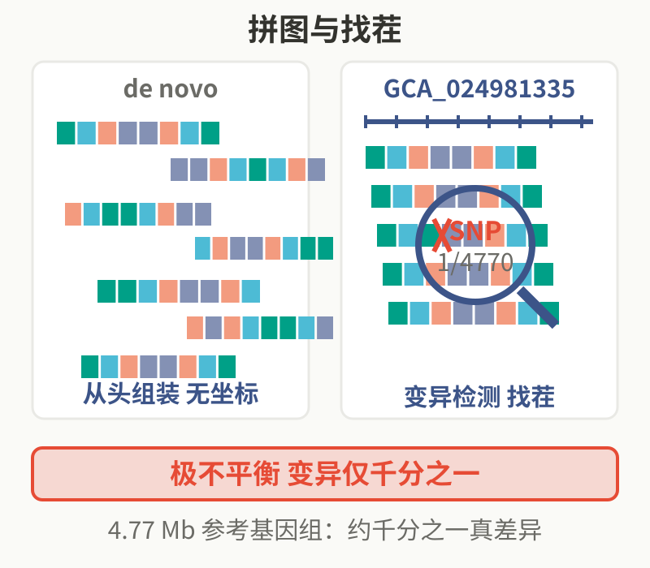

</div>
<div>

- 有参考：把读段贴回去，判断差异真假
- 应用：群体图谱、混合分组分析（BSA）、抗药位点、菌株鉴别
- 要位点还是要基因型，深度预算跟着定

</div>
</div>

<div class="ref">教材 §10.1 ｜ 讲义 ③ 3.1–3.3</div>

<!--
旁白：看左边的图。左边是 de novo 拼图：没有参考，读段要自己拼出坐标，难点在覆盖和重复；右边是找茬，参考已经给好，读段贴上去，任务变成判断差异真假。我们这份 4.77 Mb 的细菌参考上，真正的差异只占极少数，绝大多数位置都一样，要做的是在噪声里挑出那一小撮。右边三条讲深度怎么定：只报「哪里有变异」，深度可以浅；要报每个样本在这个位点是什么基因型，预算就得抬上去。补一句图里没画的：这个类比在重复区不成立，贴上去容易，贴对不容易。所以这一讲的主线不是工具，是「这个差异凭什么算数」，工具只是把这个判断拆成了可执行的步骤。
-->
---

## 一条真变异要同时满足四个条件

<div class="cols">
<div>

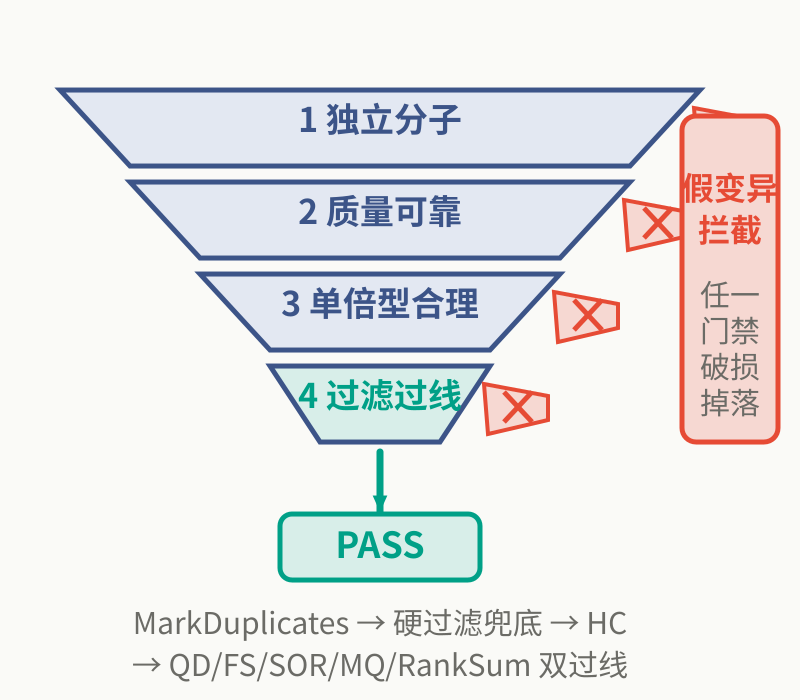

</div>
<div>

- 独立分子：读段来自不同原始分子
- 质量值可信，或明说没校正、用过滤兜住
- 倍性设对，且落在可判定区域里

</div>
</div>

<div class="ref">教材 §10.1 ｜ 四条分别展开于 §10.4.2–§10.4.8</div>

<!--
旁白：一条真变异要同时过四道门。独立分子这道门，要求支持它的读段来自不同原始 DNA 分子，去重守的就是它；质量这道门，要求碱基质量可信，或者流程明说没校正、拿过滤兜住；单倍型这道门，要求局部能拼出一条自洽的单倍型，倍性设对；最后一道过滤过线，位点和基因型都得过阈值。看图下方的箭头：任何一道破损，位点就掉到假变异那侧。四道门是有顺序的，前面的没守住，后面的分数再漂亮也白搭。还有一点：只有最后一道是显式的数字判断，前三道坏了不报错，只会让数字变得好看。排查也按这个顺序来，从最常见排到最贵，别跳步。
-->
---

<!-- _class: master figure -->

## 群体资源与方法双轨

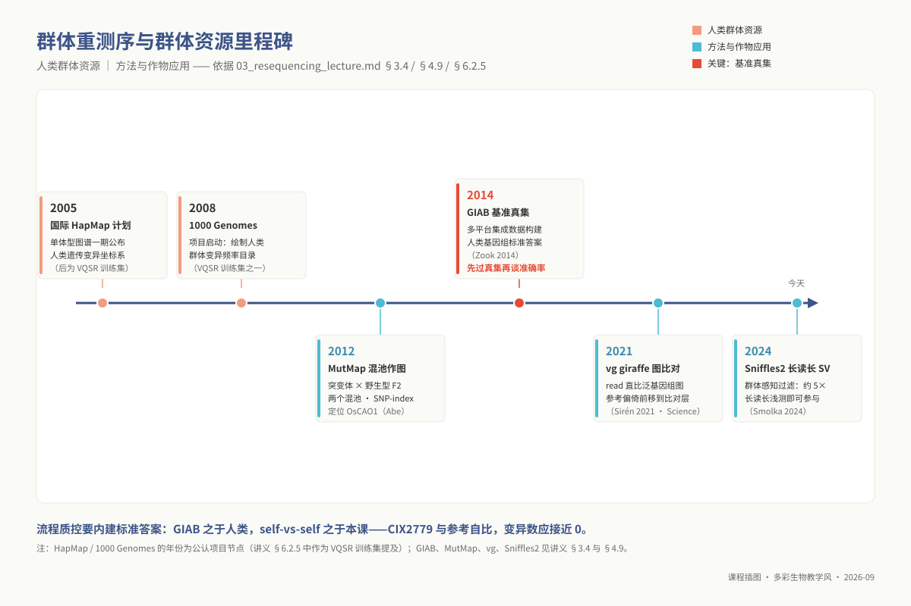

图内节号是讲义编号；「约 5×」是 5–50× 评测的浅端

<div class="ref">教材 §10.4.9、§10.4.12 图 10-1</div>

<!--
旁白：这张时间线分上下两轨。上轨是人类群体资源：2005 年 HapMap 给出单体型图谱，2008 年 1000 Genomes 启动，2014 年 GIAB 给出基准真集——三个节点合起来说明，VQSR 那类方法要训练资源、要真集，还要足够的样本量。下轨是方法：2012 年 MutMap 用混池作图定位基因，2021 年 vg giraffe 把读段直接比到图上，2024 年 Sniffles2 做长读长 SV。读图注意两处：图里的节号是讲义自己的编号，跟教材不是一套；「约 5×」是 5–50× 评测的浅端，不是通用下限。上下两轨其实在讲同一件事：方法的可信度，取决于它拿什么当标准答案——这就是最后那行「质控要内建标准答案」的出处。
-->
---

## 本课数据：12 株，其中一株就是参考

<div class="cols">
<div>

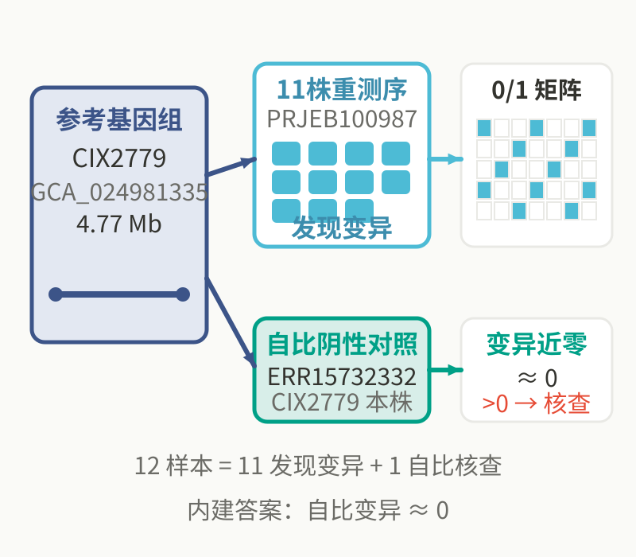

</div>
<div>

- `PRJEB100987` 12 株，各 145–195 MB
- 参考 `GCA_024981335` 4.77 Mb，取自其中一株
- 合计约 4.0 GB；自比对照的变异数应接近 0

</div>
</div>

<div class="ref">教材 §10.1、§10.6 ｜ 06_data/master/README.md m03（登记值）</div>

<!--
旁白：这套数据的结构请记住。12 株 Xoo 的 Illumina 双端数据，登录号 PRJEB100987，每个 run 下载下来 145–195 MB，合计约 4.0 GB。左边最关键：参考基因组 GCA_024981335，4.77 Mb，不是外来的标准株，而是这 12 株里 CIX2779 自己的完成图。所以数据分两块用：其余各株拿来发现变异；剩下这株拿自己的读段比对自己的图，当内建阴性对照，变异数应该接近 0。这套设计值钱的地方在于，没有真集你也能判断流程有没有错位。它同时提醒一件事：参考不是绝对正确的标准，它本身就是某个样本的一次组装结果。
-->
---

<!-- _class: master statement -->

CIX2779 既是 12 株之一，又是参考的来源。

同株读段比对自己的完成图，变异数应接近 0；这是设计预期，不是恒等式。

<!--
旁白：把上一页那句话再说重一点：CIX2779 既是 12 株之一，又是参考的来源，这不是巧合，是这套数据教学价值的所在。同株读段比对自己的完成图，变异数应该接近 0——但措辞要准：这是设计预期，不是恒等式。数明显不为 0 的时候，先怀疑流程，别急着解释成生物学差异；真的接近 0，也只说明可判定区域里没出问题，重复区和低覆盖区根本不在检验范围里。把预期的边界弄清，比记住那个数字重要。往下讲机制时，可以一直带着这个问题：这一环会不会把「接近 0」弄脏。预期写清楚，排查才有方向。
-->
---

<!-- _class: master divider -->

<div class="num">03</div>

# 核心原理

索引、重复、重校准、分型、过滤

<!--
旁白：下面是全讲最长的一段。顺序按「证据从哪来」排：索引和比对，重复，质量校正，分型，过滤。每一页都说两件事：机制是什么，它在哪儿失灵——前者决定你能不能用它，后者决定出了问题看哪里。只记机制不记边界，上机遇到异常就会归错因。
-->
---

<!-- @section: principles -->
## FM-index：把参考装进索引

- BWT 加累积频数、出现频数两张表（`C`/`Occ`）：每读一个字符查常数次表
- 查询代价随读长增长，基本不随基因组大小增长
- 只对精确搜索成立；完整比对还有种子、链化与延伸
- 更快的来源是向量化与缓存优化，不是索引更大

<div class="ref">教材 §7.4.2 ｜ 讲义 ④ 4.1</div>

<!--
旁白：先讲索引。把参考装进 FM-index，本质是把所有后缀按字典序排好，再记两张表：累积频数一张，每个字符出现的位置一张。这样查一个字符只要常数次查表，所以查询代价跟着读长走，基本不看基因组大小——「装进索引」说的就是这个。但它只对精确搜索成立：真正的比对还有种子、链化和延伸，索引只负责快速圈出候选位置。还有一个常见误解要拆掉：工具越跑越快，靠的是向量化和缓存优化，不是索引变大。打个比方，索引像书的目录，翻目录比翻全书快，可目录只帮你找到位置，找得对不对还得看内容。所以索引建好、比对率不错，只说明定位这步没出大问题，推不出变异可信。
-->
---

<!-- _class: master figure -->

## BWT 与后向搜索：`BANANA$` 的算例

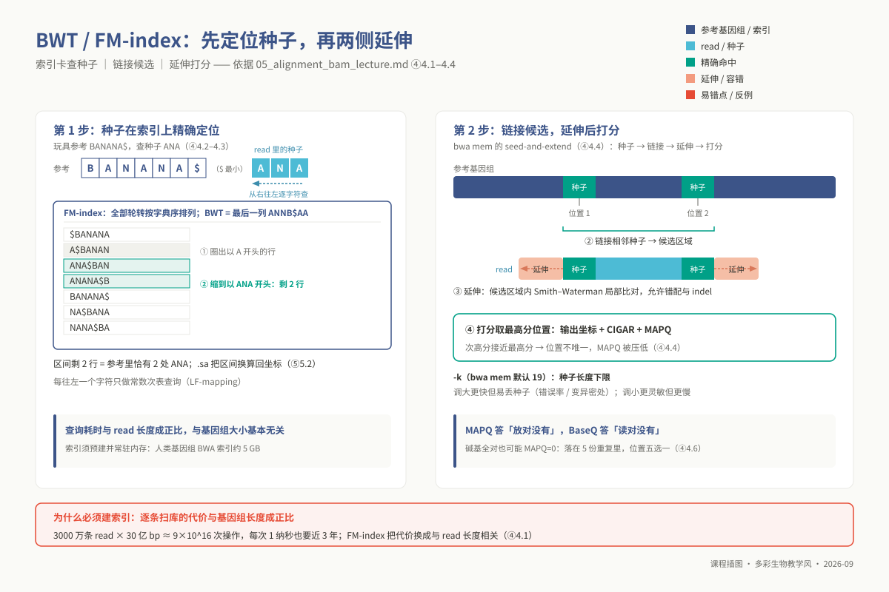

底栏 9×10¹⁶ 漏乘读长（按 150 bp 应为 1.35×10¹⁹）；4.77 Mb 参考索引无压力

<div class="ref">教材 §7.4.2 图 7-1 ｜ 讲义 ④ 4.1</div>

<!--
旁白：拿玩具算例把 BWT 走一遍。左边：参考是 BANANA$，加结束符一共七个字符，把所有轮转按字典序排成七行，最后一列连起来就是 BWT，就是图里那串字母。中间查种子 ANA：先圈出 A 开头的行，再缩到 ANA 开头的行，剩两行——参考里恰好有两处 ANA，用后缀数组就能换算回坐标。这就是后向搜索：每往左多看一个字符，只做常数次查表。底部给了个量级：逐条扫库要 9×10¹⁶ 次操作，注意这个数漏乘了读长，按 150 bp 算应该是 1.35×10¹⁹。听着吓人，但我们这份参考只有 4.77 Mb，索引毫无压力。BWT 不要求手算，只要求你看见「常数次查表」这句话是从哪来的。
-->
---

## 种子—链化—延伸，以及它在哪里失灵

<div class="cols">
<div>

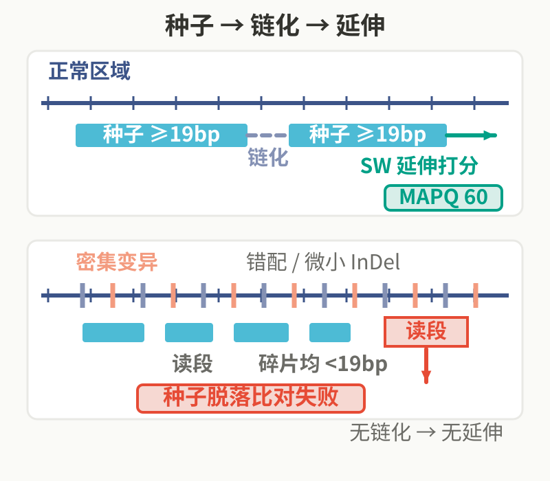

</div>
<div>

- `bwa mem -k` 默认 19；调大更快，变异密集处易丢
- 密集区切不出种子：读段直接丢，不是没变异
- 重复区几处一样好：MAPQ 压到 0，变异成片缺失

</div>
</div>

<div class="ref">教材 §7.4.3、§7.5.1 ｜ 讲义 ④ 4.1</div>

<!--
旁白：比对不是一个算法，是三步。先说种子：从读段里切出足够长的精确匹配片段，bwa mem 的 -k 默认 19，短于 19 的不当种子。再看链化：把落在同一片区域的种子连起来，形成候选。最后延伸：在候选区域里做带容错的局部比对，打分取最高，输出坐标、CIGAR 和 MAPQ。右边是它失灵的两处。变异密集的地方，读段被切碎，每段都短于 19，种子脱落，这条读段直接比对失败——这不是「这里没有变异」，是这里的信息根本没进来。重复区是另一个方向：几个位置一样好，MAPQ 被压到 0，那里的变异成片缺失。两处都不是随机漏检，是有方向、可预期的盲区，记住位置，讲失效条件时会回来对照。
-->
---

<!-- _class: master figure -->

## MAPQ = 0：碱基全对，位置五选一

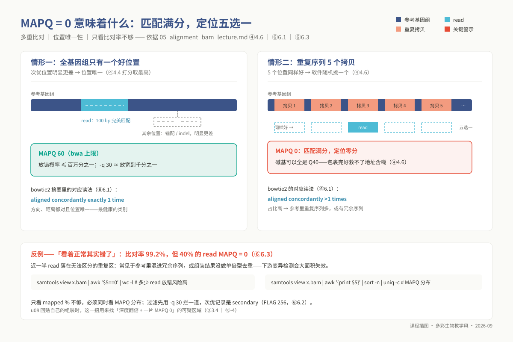

MAPQ 说的是位置唯一，不是碱基配得好；只看比对率不够

<div class="ref">教材 §7.4.6、§7.5.1 图 7-4</div>

<!--
旁白：这张图解释一个最容易被看漏的数字。上面情形一：读段在全基因组只有一个好位置，次优明显更差，MAPQ 给到 60，bwa 的上限。下面情形二：这段序列在参考里有五个几乎一样的拷贝，五个位置同样好，软件只能随机挑一个，MAPQ 就是 0。两件事要分开：MAPQ 说的是位置唯一性，不是碱基匹配质量。一条读段可以每个碱基都是 Q40、包裹完好，但地址含糊，MAPQ 照样是 0。所以只看比对率不够：比对率很高、里面一大片 MAPQ 0 的样本，下游变异检测会大面积失效，而报告上「比对率」那一栏很好看。这一页和上一页是同一个判断：读段落在哪，你信不信它的坐标。
-->
---

## `@RG` 四个标签，各接一个下游消费者

<div class="cols">
<div>

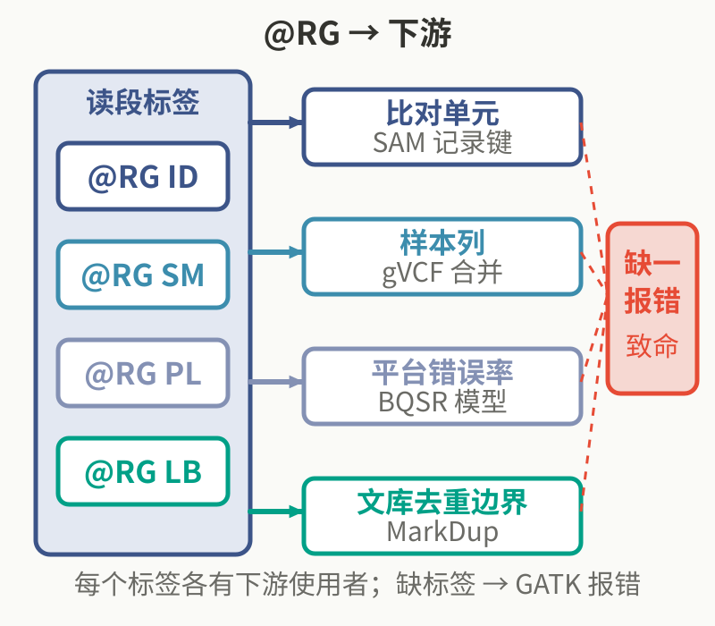

</div>
<div>

- 缺 `@RG`，GATK 直接退出；`SM` 写重却不报错
- `SM` 写重 → 两个样本静默合并成一列
- `LB` 写错 → 重复率高估或低估

</div>
</div>

<div class="ref">教材 §7.4.7、§10.4.2 ｜ 讲义 ④ 4.2</div>

<!--
旁白：@RG 看着是格式细节，其实是四个下游消费者的接口。ID 标识比对单元，也进读段标签；SM 决定 VCF 的样本列名，联合分型时决定哪些 gVCF 归到一个人；PL 是平台，进错误率模型和质量校正；LB 是文库，划出去重的边界。缺哪个都有对应后果，但狠不狠差别很大。缺 @RG 本身：GATK 直接退出，报错明确，反而好办。真正麻烦的是 SM 写重：不报错，两个样本静默合并成一列，你事后才发现样本数少了。LB 写错则是重复率高估或低估，数字看着正常，账已经错了。四个标签里只有缺 ID 会立刻报错，其余几个都沉默地改数字。
-->
---

## MarkDuplicates：靠什么判重复，边界在哪

<div class="cols">
<div>

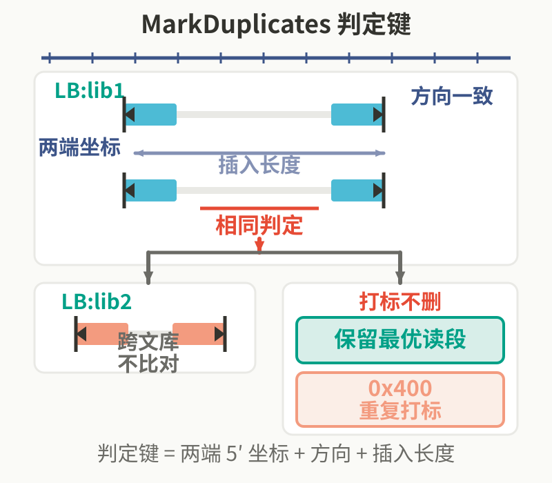

</div>
<div>

- `LB` 是分界：只在同一文库内部比坐标
- 光学重复另算：读段名要能解析出 tile/x/y
- 像素距离默认 100；patterned 流动槽才用 2500（本课未启用）

</div>
</div>

<div class="ref">教材 §10.4.2 ｜ `03_gatk_pipeline.sh` 未启用该参数</div>

<!--
旁白：去重的判定键只有三样：两端的 5′ 坐标、方向、插入片段长度。为什么是这三样？建库打断是随机的，两条独立分子三样全同的概率极低，全同就判成重复。边界有两处。一处在 LB：只有同一文库内部才互相比坐标，跨文库不比——上一页说 LB 划边界，就是这里。另一处是光学重复：同一个簇被传感器看成几个簇，识别要靠读段名里解析出 tile 和 x、y，解析不出来就只统计建库重复；像素距离默认 100，图案化流动槽才用 2500，本课脚本没有启用这个参数。最后记住：打标不删，只是给下游一个提示，深度账怎么算，看下游排不排它。判定键记住了，换平台、换建库方式时才知道哪些默认值要重设。
-->
---

## 一个错误分子被数成 8 票之后

<div class="cols">
<div>

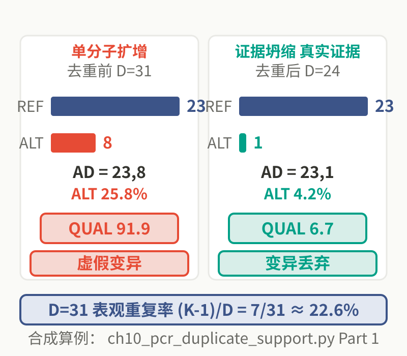

</div>
<div>

- 24 个分子：23 个各 1 份，1 个被扩增成 8 份
- 去重前判为变异，去重后证据不足被丢
- 标记不等于删除：`0x400` 只是标签

</div>
</div>

<div class="ref">演示 `ch10_pcr_duplicate_support.py --selftest`（2026-11-10 PASS）</div>

<!--
旁白：把上一页的机制换成数字看。合成布局是 24 个独立分子：23 个各一份，一个早期就带错的分子被扩增成 8 份，总深度 31。左边去重前：AD 写成 23,8，ALT 占比 25.8%，打分给出的质量代理是 91.9，看着是个漂亮变异。右边去重后：那 8 份塌成 1 份，AD 变成 23,1，占比掉到 4.2%，代理掉到 6.7，证据不足，被丢。顺带说一个常混的口径：表观重复率是 7 除以 31，约 22.6%，分子是重复多出来的 7 条，不是 8。看完留两个印象：证据会坍缩；标记不等于删除，0x400 只是标签，记录还在文件里。这组数只属于合成模型，真实重复簇不会这么整齐。
-->
---

## BQSR 校正的是随协变量漂移的系统偏差

<div class="cols">
<div>

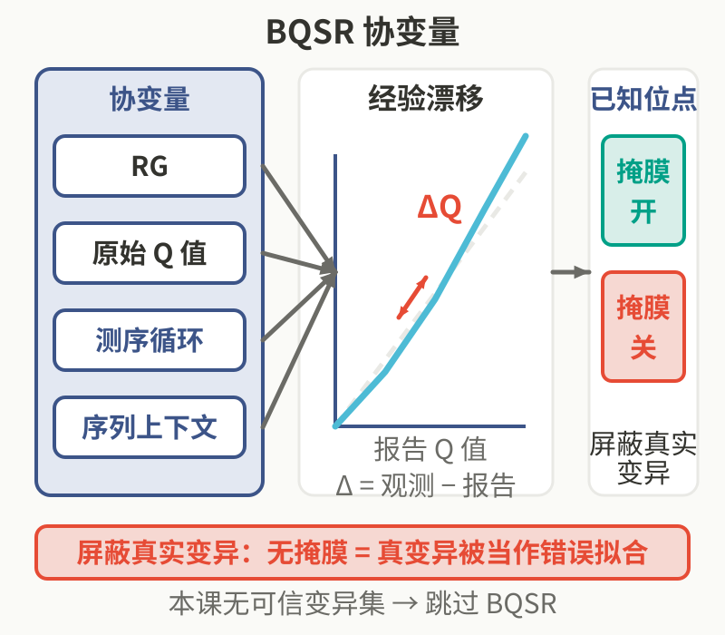

</div>
<div>

- 只改质量值，不改碱基序列
- 前提：known-sites 之外的错配都算技术错误
- 没有屏蔽集，真实变异会被当成错误学进去

</div>
</div>

<div class="ref">教材 §10.4.3 ｜ 讲义 ④ 4.4</div>

<!--
旁白：质量校正看图就够。左边四组协变量：read group、仪器报的原始 Q 值、测序循环、二核苷酸上下文。算法统计每种组合的经验错误率，跟仪器报的值比，得出差值，再把质量值按差值调回去。所以它只改质量值，不改碱基序列——校正之后再去看错配，碱基还是那些碱基，只是被赋予的错误概率变了。右边是前提：known-sites 掩膜。开掩膜时，已知变异位点不参与拟合；关掉掩膜，真实变异就被当成技术错误送进模型，模型学到的错误率里混进了真差异，这些位点的 Q 值随后被系统性调低。四组协变量各对一类漂移，缺了哪一组的稳定观测，这张表就估不准。
-->
---

## 本课为什么跳过 BQSR

- 这套数据没有独立验证过的 known-sites
- 脚本默认 `SKIP_BQSR=1`，跳过并在日志说明
- 自举有循环依赖，轮次没有通用标准
- 方法学写「无屏蔽集」，不写「因为非模式物种」

<div class="ref">教材 §10.4.3 ｜ `03_gatk_pipeline.sh` 第 58–74 行</div>

<!--
旁白：前提说清了，接着说我们为什么跳过。根本原因是这套数据没有独立验证过的 known-sites，没有可信的屏蔽集。脚本默认让 SKIP_BQSR 等于 1，跳过并在日志里说明，不是悄悄不跑。自举那条路走得通但麻烦：先跑一轮挑高置信位点当屏蔽集，再重跑——有循环依赖，轮几轮也没有通用标准。写方法学的时候要写「无屏蔽集」，不要写「因为是非模式物种」：物种不是理由，有没有可信屏蔽集才是，审稿时经常被追问到这里。跳过不等于不做质量检查：末端衰减、上下文错误、单链伪影都还在，它们会以 FS、SOR、ReadPosRankSum 的形式冒出来，交给后面的过滤处理。这是一个有理由的选择，不是省略。
-->
---

## HaplotypeCaller 四层：从活跃区到基因型

<div class="cols">
<div>

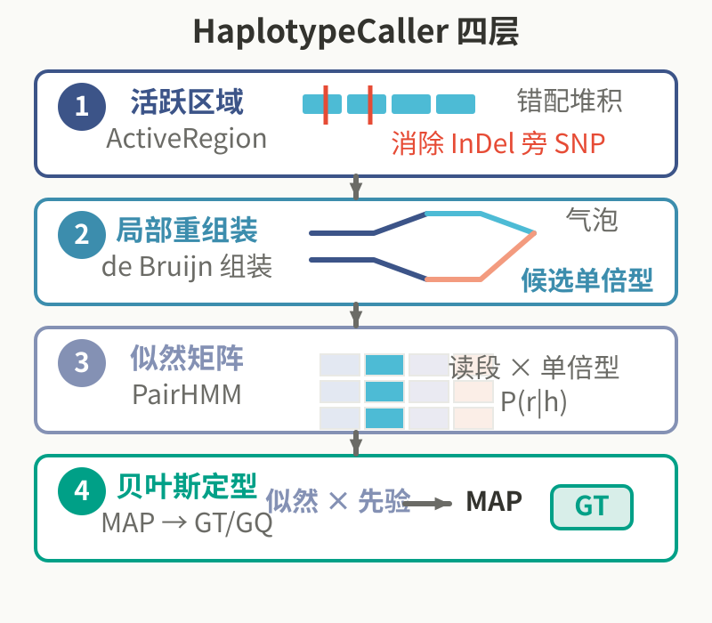

</div>
<div>

- 重组装把 InDel 当整体解，不再逐列数碱基
- PairHMM 算每条读段 × 每条单倍型的似然
- 似然乘先验取最大者为 `GT`，次优差为 `GQ`

</div>
</div>

<div class="ref">教材 §10.4.4 ｜ 讲义 ④ 4.5</div>

<!--
旁白：HaplotypeCaller 分四层，顺着箭头看。第一层活跃区域：用一个轻量的错配打分扫全基因组，只把明显高于局部背景的区段标出来，其余不管。第二层局部重组装：在活跃区里暂时抛开比对坐标，用读段重新建一个小图，剪枝后解出几条候选单倍型——这一步专门治堆叠法的老毛病：全局比对为了少开空位，会把一个真实的小 InDel 摊成一串错配，两侧读出一片假 SNP。第三层似然矩阵：用 PairHMM 算每条读段落在每条候选单倍型上的概率。第四层贝叶斯定型：似然乘先验取最大者给 GT，次优与最优的差转成 GQ。任何一层的前提不成立，后面的结论都跟着偏；这四个名字，读文档和报错时会反复遇到。
-->
---

## 倍性：设错会改变两处输出

<div class="cols">
<div>

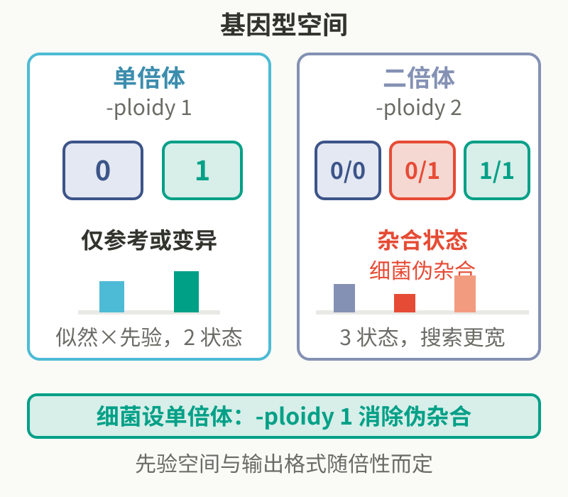

</div>
<div>

- 自交纯系仍是二倍体，`-ploidy` 写 2
- `--heterozygosity` 是位点级先验，不改变似然
- 单倍体写 `1`、缺失写 `.`；`0/1` 是二倍体

</div>
</div>

<div class="ref">教材 §10.4.1、§10.4.4、§10.4.8 ｜ 讲义 ④ 4.5</div>

<!--
旁白：倍性的关键是别把两个概念混了。左边单倍体：候选维度只有一个，GT 写单个数字，PL 只有两个值。右边二倍体：三个候选基因型，GT 写成 0/0、0/1、1/1，PL 三个值。细菌是单倍体，必须写 -ploidy 1；写了 2，算法就在三个状态里搜索，很容易造出伪杂合。反过来，自交纯系植物再纯合，两条同源染色体还在，仍是二倍体，写成 1 会把真杂合硬解释成单倍体。上面那行还纠正一个常见误解：--heterozygosity 是位点级先验，影响这个位点要不要进 calling，不动每个样本的似然。一句话记住：倍性看染色体拷贝数，不看纯合不纯合。还有条实用判据：看 GT 的形态，就能反推倍性设成了几。
-->
---

## gVCF：把「没测到」与「没变异」分开

<div class="cols">
<div>

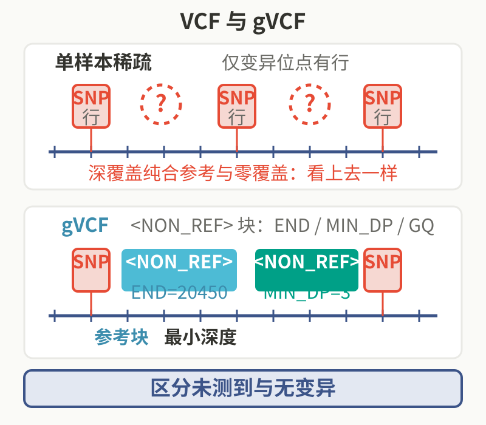

</div>
<div>

- 纯合参考和零覆盖，在稀疏 VCF 里长得一样
- `MIN_DP` 是块内最小值，不是整块深度
- 块内 GQ 低，就要回到逐位深度复核

</div>
</div>

<div class="ref">教材 §10.4.5、§10.5.4 ｜ 讲义 ④ 4.6</div>

<!--
旁白：gVCF 解决一个结构性问题。左边单样本稀疏 VCF：只有变异位点有行，中间两处问号——一处是高覆盖下确认的纯合参考，一处是深度为零没测到，文件里长得一模一样。右边 gVCF：没变异的连续区间压成参考块，块里带符号等位、区间终点、最小深度和置信度，「没变异」从此变成一条有深度的记录，联合分型才有据可依。读块看两个细节：最小深度是块内各位置深度的最小值，不是整块恒定深度；最小深度为 0 只说明块内至少有一处是 0，推不出整块没读段。块内 GQ 低的地方，还是得回到逐位深度复核，不能看见「有块」就放心。
-->
---

## 联合分型共享三处信息，救援有边界

- 三处共享：位点发现、等位候选、缺失矩阵
- 弱样本可被群体推过阈值，但不适用单例变异（singleton）
- 孤证不自动被压制：可能是真携带，也可能是伪影
- 建的是可比较的状态矩阵，不是绝对真实

<div class="ref">教材 §10.4.5 ｜ 讲义 ④ 4.6</div>

<!--
旁白：gVCF 是原料，联合分型是加工。所有样本的 gVCF 导进数据库再统一分型，信息在三处共享：位点发现，只要一个样本证据够，位点就进候选；等位候选，群体里出现过的 ALT 都进候选集；缺失矩阵，每个样本在每个候选位点上都有明确状态。由此有个常被夸大的能力，叫群体借力：低覆盖样本在某位点只有两条 ALT，单样本时容易被当错误，联合分型时可以被群体推过阈值。但救援有边界：只在群体里出现一次的等位没有别人可借，救不了。反方向也不成立：孤证不会自动被压制，可能是真携带，也可能是伪影。所以它建的是可比较的状态矩阵，不是绝对真实；报告里写联合分型，要交代哪些位点被救援过。
-->
---

## 结构变异（SV）只做概念：四类信号各有偏好

<div class="cols">
<div>

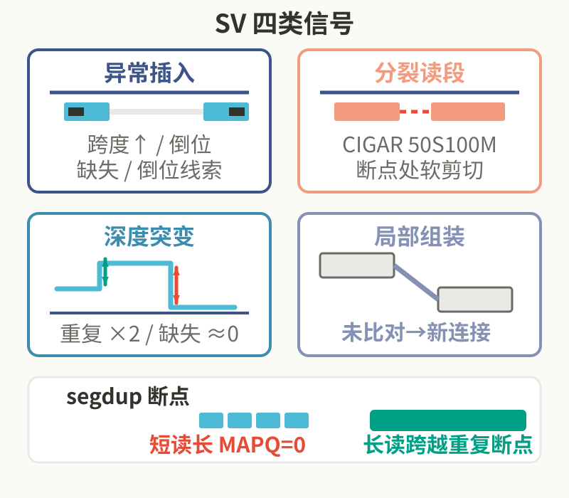

</div>
<div>

- 四类信号各有偏好，没有一种通吃
- 倒位、易位这类平衡 SV 不改深度，深度看不见
- 长读长把断点读过去，但不消除盲区

</div>
</div>

<div class="ref">教材 §10.4.1、§10.4.11（博士深入）｜ 讲义 ④ 4.7</div>

<!--
旁白：结构变异只讲概念，但概念要说准。短读长看 SV，靠四类间接信号：双端读对的插入片段异常和方向异常、分裂读段的软剪切、区域深度的跃升或骤降、把异常读段提出来做局部组装。四类各有偏好，没有一种通吃。第二类盲区要注意：倒位、易位这类平衡 SV 不改剂量，深度信号完全看不见它。断点位置是另一个坑：真实断点偏好落在重复序列里，读段一进重复区，MAPQ 就坍缩，异常读对和分裂读段同时失去定位能力。长读长把断点直接读过去，改善的是跨重复和断点分辨率，但不消除盲区——读段仍要能唯一比对。这节只要求说清四类信号各偏什么，细节留到博士层。
-->
---

<!-- _class: master divider -->

<div class="num">04</div>

# 操作流程

两套脚本，先看清谁做到哪一步

<!--
旁白：原理讲完，进操作。这一段不念命令，做两件事：看清两套脚本各自做到哪一步，看清集群上什么在登录节点做、什么必须投递。脚本没做的那几步，正是最容易出错、也最容易以为自己做完了的地方——边界比命令重要。
-->
---

<!-- @section: procedure -->
## 集群规矩：先读这段

- 登录节点只编辑、提交、看结果
- 一切计算走 `qsub`；先 `qrsh`（申请交互式计算节点）也行
- `qstat -u $USER`：qw 排队、r 运行、Eqw 出错
- 日志在同目录 `.o` 文件，先 `cat`

<div class="ref">教材 §10.6 ｜ 讲义 ⑤ 5.1</div>

<!--
旁白：上机前把集群规矩记牢。登录节点只做三件事：编辑、提交、看结果。一切计算走 qsub 投递，或者先用 qrsh 申请一个交互式节点再动手。原因很实在：GATK 这类工具吃内存，登录节点资源少，直接在上面跑，表现是进程被系统杀掉——不是报错，你连输出都看不到。qstat 看自己的作业：qw 排队，r 运行，Eqw 出错；看到 Eqw，第一件事是读日志，日志在同目录的点 o 文件里，别急着重新投一遍。这几条不是这套集群特有的，任何共享服务器都一样。规矩记住比命令记住有用，每次上机照做。
-->
---

## 两套脚本各自做到哪一步

<div class="cols">
<div>

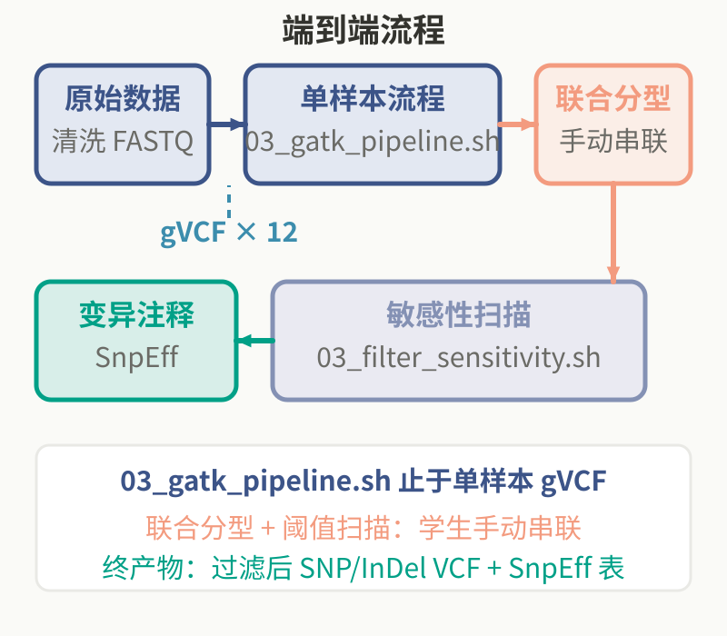

</div>
<div>

- `03_gatk_pipeline.sh` 到单样本 gVCF 为止
- 联合分型与注释按讲义 ⑤5.3–5.5 自行封装
- 敏感性脚本只扫阈值，不懂缺失值语义

</div>
</div>

<div class="ref">教材 §10.6 ｜ 讲义 ⑤ 5.1–5.5</div>

<!--
旁白：先把全讲最重要的一张边界图看明白。左边输入：原始数据清洗成 FASTQ。中间单样本流程，就是那份 GATK 脚本，从比对一路做到单样本 gVCF 就停了，联合分型不在里面。右边两件事要你自己串联：导入数据库加统一分型做联合分型，另一份脚本做阈值敏感性扫描。最右边才是终产品：过滤后的 SNP 和 InDel，加注释表。为什么把边界画出来？最常见的误会是「脚本跑完就有结果」，其实跑完你手上只有一批 gVCF。敏感性脚本也只扫阈值，它用另一套表达式引擎，不懂 GATK 的缺失值语义，替代不了过滤核查。所以上机第一步不是跑脚本，是数清自己手上有几个 gVCF。
-->
---

## 步骤一：三套索引与比对

```bash
[[ -e ref.fasta.bwt ]] || bwa index ref.fasta
[[ -e ref.fasta.fai ]] || samtools faidx ref.fasta
[[ -e ref.dict ]] || gatk CreateSequenceDictionary -R ref.fasta
RG="@RG\tID:${SAMPLE}\tSM:${SAMPLE}\tPL:ILLUMINA\tLB:lib1"
bwa mem -t 16 -M -R "${RG}" ref.fasta R1.fq.gz R2.fq.gz \
  | samtools sort -@ 4 -o ${SAMPLE}.sorted.bam -
samtools index ${SAMPLE}.sorted.bam
```

- `bwa-mem2` 是等价替代，索引格式不同，换了要重建
- 守卫只看 `.bwt` 在不在；换版本先做输出差分

<div class="ref">教材 §10.6、§7.4.7 ｜ `03_gatk_pipeline.sh` 第 36–46 行</div>

<!--
旁白：六行逐行看。前三行是三套索引：bwa 的索引、samtools 的 fai、GATK 的字典。前面的双竖线加方括号是守卫——文件不存在才建，建好就跳过；这也埋了个坑：守卫只看文件在不在，不看它是不是当前这份 FASTA 的，换参考时要把旧索引一起清掉。第四行拼 RG 字符串，四个标签用制表符分隔，这里的反斜杠加 t 必须真的变成制表符。第五行比对并直接排序，十六个线程，-M 让工具按较老的口径标记次级比对，管道末尾的减号表示从标准输入读。第六行建 BAM 索引。跑完应当看到参考旁边多出几个后缀文件，加排好序的 BAM 和它的 bai。最容易错的还是那个制表符被某一层转义吃掉，常见错误那节有专门的报错。
-->
---

## 步骤二、三：标记重复，跳过 BQSR

```bash
gatk MarkDuplicates -I s01.sorted.bam -O s01.dedup.bam \
    -M s01.dup_metrics.txt
# 光学重复参数未启用（默认 100；patterned 才用 2500）
# SKIP_BQSR=1：无独立可信 known-sites，跳过并写明
```

- `PERCENT_DUPLICATION` 进报告，没有统一红线
- 脚本没写 `-Xmx`，靠 `h_vmem=8G` 管住；手加要同步

<div class="ref">教材 §10.4.2、§10.4.3、§10.5.1 ｜ 脚本第 49–74 行</div>

<!--
旁白：这一步两件事：去重，跳过校正。第一行 MarkDuplicates，输入排序好的 BAM，输出带标记的 BAM，另出一份指标文件。注意「标记」这个词：默认不物理删除，只打标签。下面的注释交代两处边界：光学重复参数没启用，默认 100，图案化流动槽才用 2500；跳过质量校正的开关打开，因为没有独立可信的屏蔽集。指标文件里的重复率要进报告，但不设通用红线——它得跟文库和深度一起读，单独一个数说明不了好坏。最后是踩过的坑：脚本没写堆内存参数，靠作业系统的内存上限管着；你手工加堆参数，就得同步调作业上限，否则两边打架，作业会死在一个看起来莫名其妙的地方。
-->
---

## 步骤四、五：单样本 gVCF，再联合分型

```bash
gatk HaplotypeCaller -R ref.fasta -I s01.dedup.bam \
    -O s01.g.vcf.gz -ERC GVCF -ploidy 1 --native-pair-hmm-threads 4
gatk GenomicsDBImport --sample-name-map samples.map \
    --genomicsdb-workspace-path gvcf_db -L <contig>
gatk GenotypeGVCFs -R ref.fasta -V gendb://gvcf_db -O raw.vcf.gz
```

- `-L` 是必需项；contig 名从 `.fai` 取，别写死 `chr01`
- 脚本只到单样本 gVCF；后两步按讲义封装
- 映射表两列：样本名 + gVCF 路径，制表符分隔

<div class="ref">教材 §10.4.4、§10.6 ｜ 脚本第 70–73 行</div>

<!--
旁白：这一步到分型。第一行 HaplotypeCaller，三个关键参数：gVCF 模式让它写参考块而不是只写变异位点；倍性写 1，单倍体；线程数给 PairHMM。这一行跑完，每株得到一个 gVCF，脚本的职责到此为止。第二行把全部 gVCF 导进数据库：映射表两列，制表符分隔，第一列样本名、第二列路径，样本名要和 @RG 的 SM 一致，否则样本塌成一列。第三行在库上统一分型，写法是库路径前面加 gendb 和两个斜杠。还有一处必错点：区间参数在这里必需，contig 名必须取自 fai——写死成 chr01，返回 0 条，而且可能一声不响。
-->
---

## 步骤六：SNP 硬过滤逐条分开写

<div class="cols">
<div>

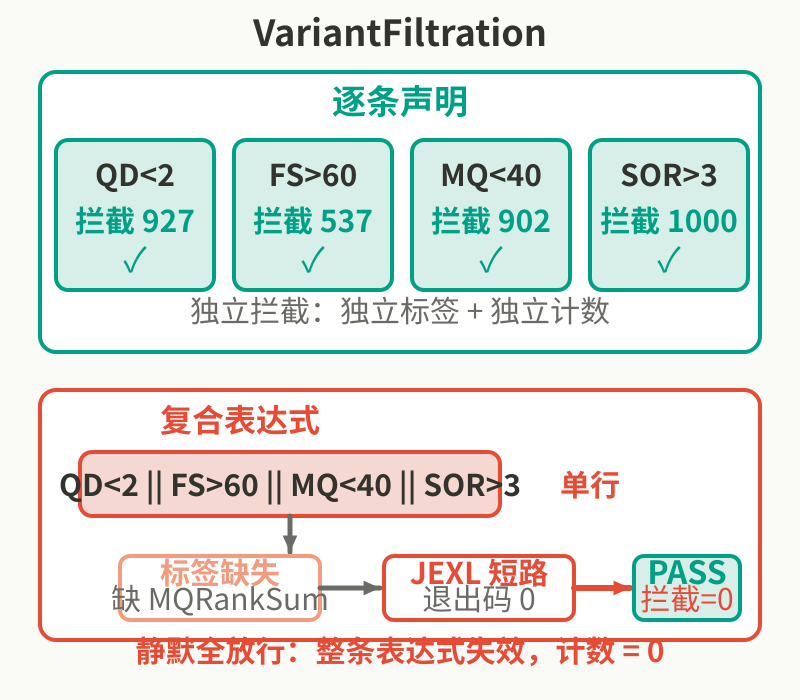

</div>
<div>

- `--filter-name` 与表达式成对且顺序对应
- 一条规则一个名字，才能逐条计数
- 拼成一条 `||`：碰上缺失标签整条放行

</div>
</div>

<div class="ref">教材 §10.4.7 ｜ 讲义 ⑤ 5.4（六条规则逐条声明）</div>

<!--
旁白：过滤有两种写法，左右各一种。左边逐条声明：一条规则一个名字、一个表达式，QD 一条、FS 一条、MQ 一条、SOR 一条，每条单独计数，能看出各自拦了多少——这里是 927、537、902、1000。右边复合写法：四条用或连成一行，看着省事，问题出在标签缺失的时候：表达式碰到一个这条记录里没有的标签，整条按不命中处理，记录保持 PASS，一条没拦住，退出码还是 0。所以规则不是越省事越好：可计数比好写重要，每多一条规则，就多一个能自查的数字。教材 §10.4.7 给了这组对照的实测表，值得对着看一眼。
-->
---

## InDel 与注释：只放宽两项阈值

```bash
gatk VariantFiltration -V indel.vcf.gz -O filt_indel.vcf.gz \
  --filter-name QD2   --filter-expression "QD < 2.0" \
  --filter-name FS200 --filter-expression "FS > 200.0" \
  --filter-name RPRS20 --filter-expression "ReadPosRankSum < -20.0"
gatk MergeVcfs -I filt_snp.vcf.gz -I filt_indel.vcf.gz -O filt_all.vcf.gz
bcftools view -f PASS filt_all.vcf.gz -Oz -o pass.vcf.gz
snpEff -v <db> pass.vcf.gz > annotated.vcf
```

- InDel 只放宽 `FS` 与 `ReadPosRankSum` 两项
- `VariantFiltration` 只打标签；删行靠 `-f PASS`
- 统计 HIGH 变异按位点去重，别按行重复计

<div class="ref">教材 §10.4.7、§10.4.10 ｜ 讲义 ⑤ 5.4–5.5</div>

<!--
旁白：InDel 的过滤和注释放在一起看。第一段是 InDel 的过滤，只放宽两项：FS 从 60 放到 200，ReadPosRankSum 从负 8 放到负 20，QD 不动。为什么只放这两项：InDel 比对时更容易出现局部单链偏好，这不是它更可信，而是这项检验在 InDel 上的基线本来就不一样；QD 没这个理由，所以不改。第二行把 SNP 和 InDel 的过滤结果合并成一份。第三行按 PASS 提取——这里要分清：过滤工具只打标签，删行是另一条命令干的，两者后果不同。最后做注释。统计影响最高的变异时按位点去重：同一个变异在多个转录本上会出多条注释，直接数行会重复计数。
-->
---

## 阈值敏感性：8 组网格，不是三组

<div class="cols">
<div>

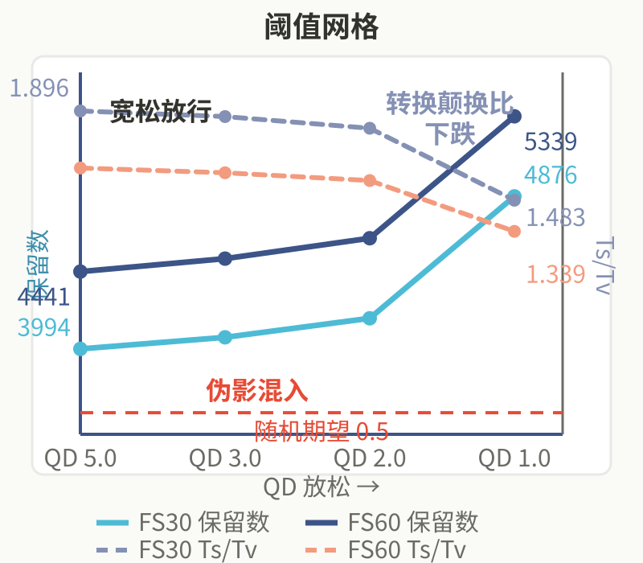

</div>
<div>

- 网格：QD 1/2/3/5 × FS 30/60；MQ 40、SOR 3 不动
- 输出：变异数、InDel 数、Ti/Tv、平均深度
- 小计算也走 `qsub`，脚本自带 SGE 头

</div>
</div>

<div class="ref">演示 `ch10_filter_thresholds.py --selftest`：3994→5339、1.896→1.339（合成算例）｜ 脚本 `03_filter_sensitivity.sh`</div>

<!--
旁白：敏感性扫描看这张图就够。横轴是 QD 的四档：5、3、2、1，从紧到松；每组再分 FS 三十、FS 六十两条，所以是 8 组，不是三组。纵轴看两个量：保留数和转换颠换比。图上的数来自合成算例：QD 固定 5，FS 从 30 放到 60，保留数从 3994 升到 4441，比值从 1.896 降到 1.632；QD 一路放宽到 1，保留数升到 5339，比值掉到 1.339。方向很稳：阈值放松，留的位点变多，质量代理变差。这组数只说明方向，别搬去真实数据。最后一句是纪律：小计算也要投递，脚本自带作业头，放登录节点跑照样被杀。
-->
---

<!-- _class: master divider -->

<div class="num">05</div>

# 结果解读与统计要点

四个数、两套断言、一张二项表

<!--
旁白：这一段换视角，从「怎么跑」转到「怎么读」。四个必须进报告的数，VCF 一行里的两套断言，六个体检指标，最后落到阈值背后的错误权衡。一行 VCF 里同时有好几个数，各答一个问题，混着用就会得出错误结论。
-->
---

<!-- @section: interpretation -->
## 结果解读：四个必须进报告的数

<div class="cols">
<div>

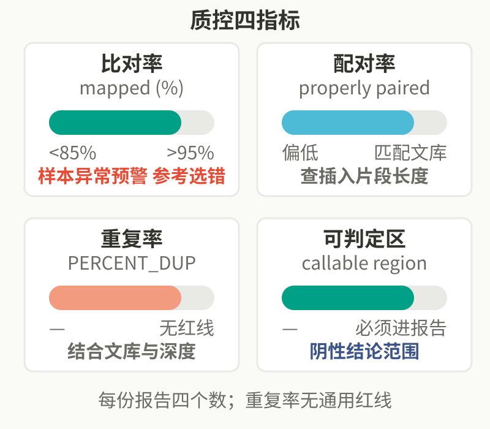

</div>
<div>

- `mapped (%)` 是记录级；<85% 先查参考选没选对
- 重复率没有统一红线，要结合文库与深度读
- callable 比例必须进报告，阴性结论靠它划界

</div>
</div>

<div class="ref">教材 §7.6 边界 3、§10.5.4 ｜ 06_data/master/README.md m03</div>

<!--
旁白：报告里必须有四个数，从左到右看。比对率是记录级的百分比，低于 85% 先查是不是选错了参考，这类异常通常一整批一起出现。配对率偏低，说明文库或插入片段有问题，去看插入片段长度分布。重复率这一栏特意没有红线，它必须结合文库和深度读，单独看没有诊断意义。可判定区域比例写着必须进报告，因为它界定阴性结论的范围：没有这个比例，「没有变异」和「没测到」还混在一起。前两个数是筛查，异常了提示你去查上游；后两个数是交代口径，缺了它们，报告里的结论别人没法判断。四个数里，没有一个能单独证明数据好。
-->
---

## 重复率不是一个孤立的健康指标

<div class="cols">
<div>

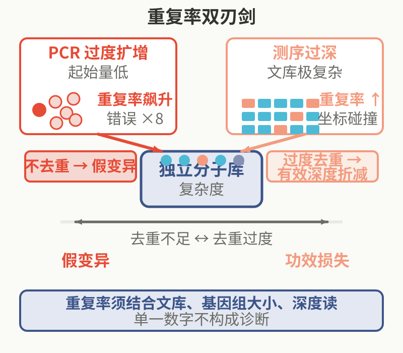

</div>
<div>

- 它是「我还剩多少独立分子」的代理
- 漏去重造出假变异，去重过头削掉真证据
- 报告写去重率，要同时写深度与文库

</div>
</div>

<div class="ref">教材 §10.4.2、§10.5.1</div>

<!--
旁白：重复率最容易被当成单一的健康分，所以单独讲一页。它是「我还剩多少独立分子」的代理，不是质量评分。往左看：起始量低、PCR 过度扩增，重复率飙升，一个错误被数成八份，不去重就出假变异。往右看：测序过深，或者文库里本来就有近似分子，坐标碰撞也推高重复率，这时候去重过头，把真实证据一起削掉，有效深度下降，功效跟着受损。同一张图上，去重不足和去重过度是方向相反的两种病，症状却都是「重复率不正常」。所以结论只有一句：报告写去重率，必须同时写深度和文库；这个数字单独看，几乎没有信息量。
-->
---

## 一行 VCF 同时做两个断言

<div class="cols">
<div>

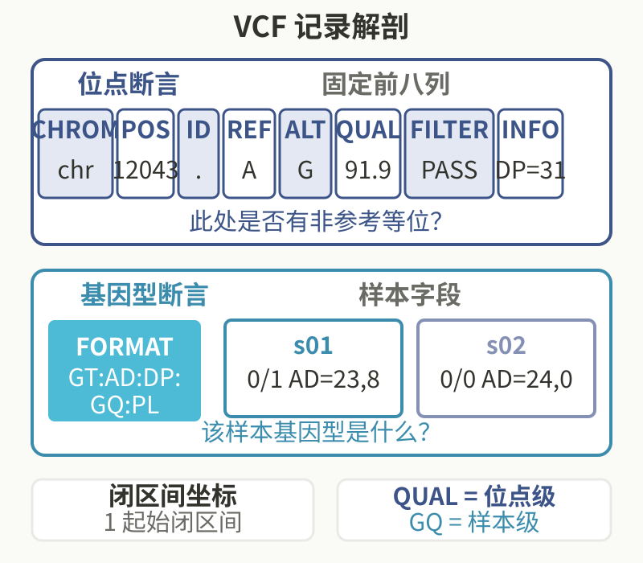

</div>
<div>

- 前 8 列全样本共享；第 9 列起每个样本一列
- `QUAL` 管位点，`GQ` 管个体
- 读文件第一件事是 `bcftools view -h`

</div>
</div>

<div class="ref">教材 §10.4.1 ｜ 讲义 ⑥ 6.2</div>

<!--
旁白：VCF 一行做两件事，这张解剖图把它们分开。上半是位点断言：前八列依次是染色体、位置、编号、参考等位、ALT、质量、过滤状态、附加信息，全样本共享，回答「这个位置有没有非参考等位」。下半是基因型断言：FORMAT 声明样本列里子字段的顺序，第十列起每个样本一列，回答「这个样本在这里是什么基因型」。所以 QUAL 管位点，GQ 管个体，两个数不能互相替代：位点质量高，不代表每个样本都分型对了。看文件的第一个动作不是翻记录，是读头：头里声明了哪些标签，决定后面过滤表达式能不能求值——这一条后面还会用到两次。
-->
---

## 设例读数：两个深度不是一回事

| 字段 | 值 | 读法 |
|---|---|---|
| `AC` / `AN` / `AF` | 3 / 4 / 0.75 | 1 + 2 = 3；3/4 |
| s01 的 `AD` | 22,20 | 平衡 0.476（20/42） |
| s02 的 `AD` | 0,25 | 平衡 1.0 |
| `DP` | INFO 88；样本 42+25 | 两套口径，不能互推 |

- `QUAL` 管位点有没有变异；`GQ` 管基因型对不对

<div class="ref">教材 §10.4.1（设例，非课程数据）</div>

<!--
旁白：设例的数字自己就能算。AC 是非参考等位的总数：s01 是 0/1，贡献一个；s02 是 1/1，贡献两个；加起来 3。AN 是分母，两个二倍体样本各出两个，共 4。AF 就是 3 除以 4，等于 0.75。再看观测：s01 的 AD 写成 22,20，等位平衡是 20 除以 42，得 0.476，跟杂合期望的一半很接近；s02 是 0,25，平衡等于 1，跟纯合非参考一致。最后一行坑最深：INFO 里的深度是 88，两个样本的深度加起来是 42 加 25 等于 67——两个口径不同源，不能互相替代，也不能拿它们反推 QD。这一页就是练一件事：分清哪些数能算，哪些数不能互相代。
-->
---

## `GT:AD:DP:GQ:PL`：推断与观测分家

<div class="cols">
<div>

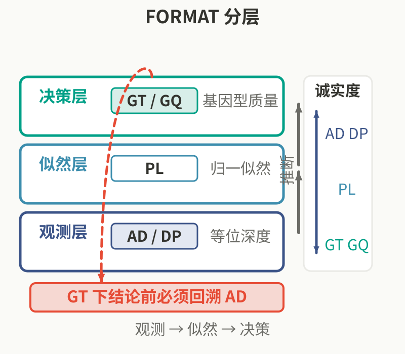

</div>
<div>

- `AD` 是观测，最诚实；`GT` 是推断
- `PL` 最优为 0，次小即 `GQ`，封顶 99
- `DP` 是该样本该位点深度；`QUAL` 不衡量个体

</div>
</div>

<div class="ref">教材 §10.4.1 ｜ 讲义 ⑥ 6.2.3</div>

<!--
旁白：FORMAT 里五个子字段，分三层。最底下是观测层：AD 和 DP——各等位多少条读段、这个样本这个位点多深，第一手观测，最诚实。中间是似然层：PL，各候选基因型的归一化似然。最上面是决策层：GT 和 GQ，推断出来的基因型和它的质量。图左侧向上的箭头是这个意思：越往上越是推断，越需要能退回观测去核对。所以看到 GT 就下结论之前，回看一眼 AD：一个「杂合」如果 AD 里 ALT 只有一条，那不是杂合的证据，那是一条读段的噪声。PL 还有惯例：最优值归一成 0，次小值就是 GQ，封顶 99——所以 99 只表示「至少到 99」，不是精确值。
-->
---

## `GQ` 与 `PL` 可以手算

<div class="cols">
<div>

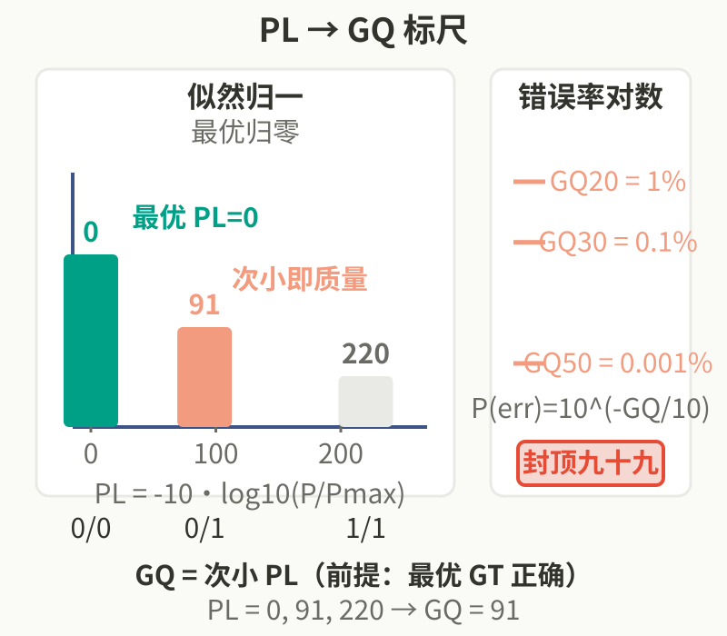

</div>
<div>

- 都是「在该位点存在变异」下的条件概率
- 次小 `PL` 封顶 99，超出按 99 记
- 报 `GQ` 要说明它依赖倍性与先验

</div>
</div>

<div class="ref">教材 §10.4.1</div>

<!--
旁白：GQ 和 PL 都能手算，算法就在图里。先把最优基因型归一成 0，其余按 Phred 刻度换算，数值越小越可能；GQ 取次小 PL。换算回概率是 10 的负 GQ 次方，所以 GQ 20 对应 1%，GQ 30 对应 0.1%，每加十掉一个数量级。套到设例上：第一个样本的 PL 是 512,0,548，次小那个按公式远超封顶，文件里写 99；第二个是 900,75,0，次小 75，GQ 就是 75。最后别漏一句：这是「该位点存在变异」条件下的概率，报 GQ 要说明它依赖倍性和先验——换个倍性，同一个数字含义就变了。
-->
---

## 六个指标（一）：`QD`、`FS`、`SOR`

<div class="cols">
<div>

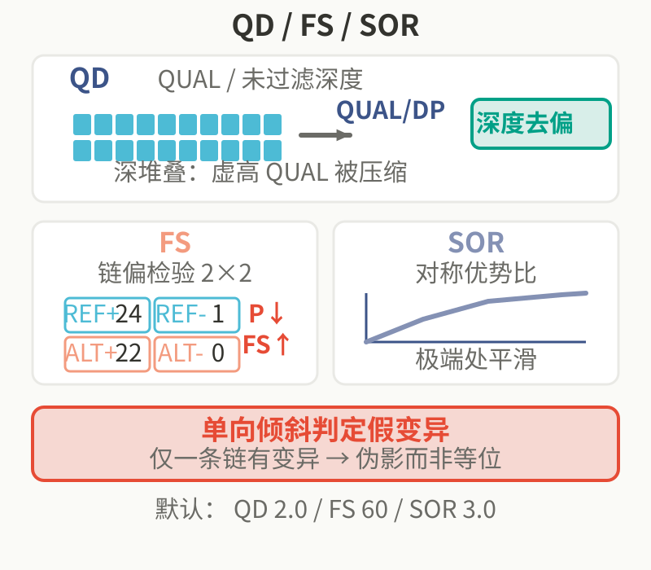

</div>
<div>

- `QD` 的分母是未过滤深度，不是 `INFO` 的 `DP`
- `FS` 与 `SOR` 同看链偏，不能互相替代
- 默认值是文档起点，不是本项目的正确值

</div>
</div>

<div class="ref">教材 §10.4.7（GATK 文档起点，非正确值）</div>

<!--
旁白：六个指标分两页，这页先看三个。QD 是 QUAL 除以支持变异的未过滤深度，作用是压掉深度堆出来的假置信度；注意分母不是 INFO 里的 DP，两处口径不同，不能拿 QUAL 除以 DP 复算它。中间 FS：把支持 REF 和 ALT 的读段按正负链摆成二乘二表，做 Fisher 精确检验再 Phred 化；只有一条链带变异时 p 值变小、FS 升高，那更像伪影而不是等位。右边 SOR 是同一件事的优势比形式。两个都看链偏，一个在极端处不稳，一个在高深度更平滑，所以要一起看。最后一行也记住：2.0、60、3.0 是文档给的起点，不是本项目的正确值，别抄进报告当结论。
-->
---

## 六个指标（二）：`MQ` 与两个秩和

<div class="cols">
<div>

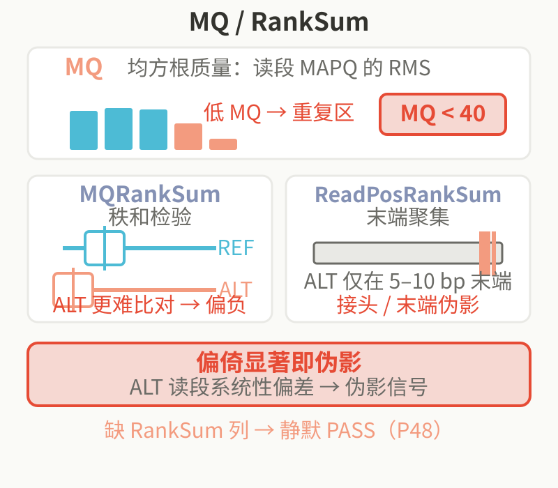

</div>
<div>

- `MQ` 看读段整体放得准不准，不是碱基质量
- 秩和类要两组都有足够观测，低深度常缺失
- 标签一缺失，就落进下一页那条失效的入口

</div>
</div>

<div class="ref">教材 §10.4.7</div>

<!--
旁白：后三个指标。MQ 是位点读段比对质量的均方根，量的是读段整体放得准不准，不是碱基质量；低于 40 通常意味着位点落在重复区或错配区。另外两个是秩和检验：MQRankSum 比较支持 ALT 和支持 REF 的读段在比对质量上的分布，ALT 更难比对时它偏负；ReadPosRankSum 比较变异碱基在读段内的位置，ALT 挤在末端就偏负，那是接头或末端伪影。这类检验有个共同前提：两组都要有足够观测才算得出来。低深度、单样本时它们经常直接缺失，而缺失时的行为，正是下一页那条失效的入口——看到「这条规则没拦任何位点」，先怀疑它根本没算。
-->
---

## 缺失标签：整条表达式不命中

<div class="cols">
<div>

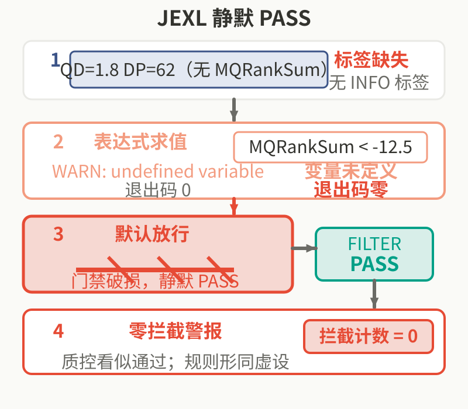

</div>
<div>

- 缺标签按「不命中」处理，记录保持 `PASS`
- 排在缺失标签后的条件被一起放行
- 把开关设成 `true` 会连低深度一起拦，是过度过滤

</div>
</div>

<div class="ref">教材 §10.4.7 实测表（GATK 4.6.2.0；4.4.0.0 未单验）</div>

<!--
旁白：一条不报错的失效，跟着四个格子走。先是一条记录有 QD 但没有 MQRankSum，标签缺失；接着表达式去求 MQRankSum 小于负 12.5，变量未定义，日志只有一行警告，退出码还是 0；然后默认参数把求值失败当成不命中，规则不打标签，记录保持 PASS；最后你事后按标签计数，发现这条规则拦了 0 个位点。全程质控看着通过，规则其实形同虚设。它还按整条表达式生效：缺失标签会把排在后面、本来能命中的条件一起放行，顺序不同，损失不同。把开关设成 true 确实能拦，但会把天然算不出秩和的低深度位点一起判成不合格——那是过度过滤，不是修复。
-->
---

## 打标签、删行、置缺失：后果相反

<div class="cols">
<div>

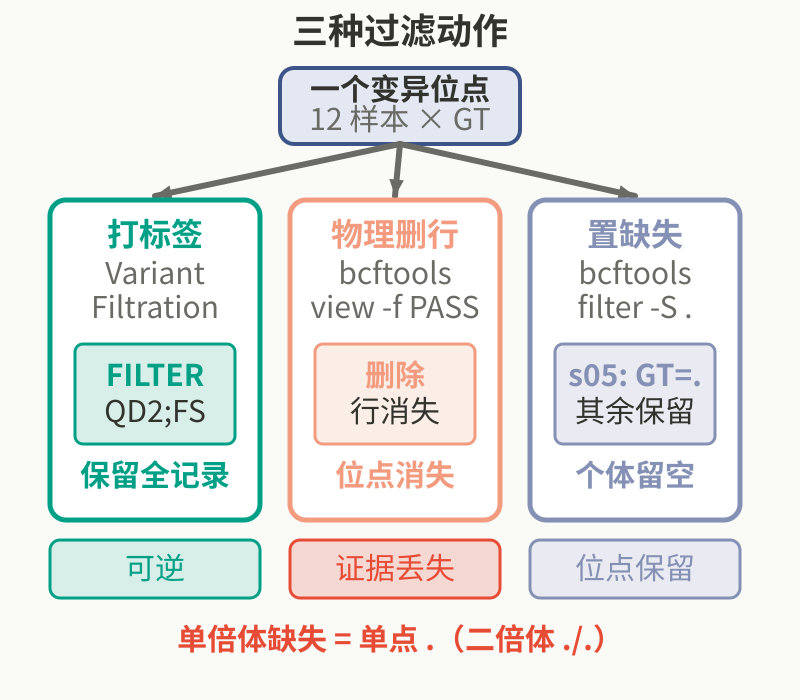

</div>
<div>

- `DP` 与 `GQ` 门槛是演示起点，先看自己的分布
- 单倍体 `DP` 只有一条染色体的读段，含义不同
- 低深度真杂合常只剩 1–2 条 ALT，别急着判假

</div>
</div>

<div class="ref">教材 §10.4.8</div>

<!--
旁白：三种动作，命令行长得很像，后果相反。打标签：过滤工具往 FILTER 列写规则名，行还在，证据还在，下游能复核。物理删行：按 PASS 提取，行没了，这个位点在所有样本里的证据一起没了。置缺失：位点保留，把某一个个体的基因型写成缺失——等于承认位点可信、这个样本证据不足；写法跟着倍性走，单倍体是单个点，二倍体是两个点加斜杠，看到二倍体形态就说明倍性参数没改。两条提醒：深度和 GQ 的门槛都是演示起点，先看自己的分布再定；单倍体的深度只有一条染色体的读段，跟二倍体同一个数字，含义不同。三种动作混着用，就会一边造出假纯合，一边丢真证据。
-->
---

<!-- _class: master warn -->
## 结果不对时长什么样（一）

| 现象 | 说明什么 | 先做什么 |
|---|---|---|
| `AD` 去重后掉到 1 | 证据靠重复撑起 | 做去重前后对照 |
| 某条规则计数为 0 | 标签缺失，静默放行 | 逐条计数；造缺标签文件复跑 |
| `GT` 出现 `0/1` | 倍性没设成 1 | 显式 `-ploidy 1` |

<div class="ref">教材 §10.5.1、§10.5.2</div>

<!--
旁白：三行排查表，对应三种不同的病因。第一行：去重后 AD 掉到 1，说明证据是靠重复撑起来的，动作是做去重前后对照，不是改阈值。第二行：某条规则计数是 0，说明标签缺失、静默放行，动作是逐条计数，再构造一个故意缺标签的小文件复跑。第三行：GT 出现 0/1，而这份数据是单倍体，说明倍性没设成 1，显式传参数重跑。三行的共同点：都不报错，只能靠数字形态认出来。报告里那几栏不是给审稿人看的，是给你自己发现问题的；填的时候多看一眼异常的行，比事后返工便宜。这三行值得贴在显示器旁边，上机时逐条对，别只看总数。
-->
---

<!-- _class: master warn -->
## 结果不对时长什么样（二）

- 自比变异数明显不为 0：链上有一环错了
- 查四步：倍性 → 参考与索引 → `@RG` → 重复区
- 某基因「没有变异」：先看它在不在可判定区
- 阴性结论只写「可判定区域内未检出变异」

<div class="ref">教材 §10.5.3、§10.5.4</div>

<!--
旁白：后果更重的一条来了。自比变异数明显不为 0，说明链子上有一环错了，不是这一株真的跟参考差那么多。查四步，顺序不能颠倒：先查倍性有没有显式设成 1；再查参考版本和三套索引是不是同一份 FASTA；然后查比对参数和样本标签，SM 有没有写成固定值；最后看非零位点是不是集中在重复区、低 MAPQ 区、深度异常区。这个顺序从最常见排到最不常见，也是从便宜排到贵。另一个方向是阴性结论：某个基因「没有变异」，先看它到底在不在可判定区里。所以阴性结论只写「在可判定区域内未检出变异」，多写一个字都是越界。这两页合起来，是本讲最实用的两张排查表。
-->
---

<!-- _class: master statement -->

没有可判定区域，就没有阴性结论。

自比接近 0 也只覆盖可判定区域；它不为 0，后面的结论都不可信。

<!--
旁白：一句话收口：没有可判定区域，就没有阴性结论。为什么这么绝对？VCF 只记录变异，不记录「这里测过而且确认没有」。要说某个基因没有变异，前提是这个基因每个位置都有足够深度、比对质量达标、caller 也算得出来——缺一个，那片区域就不该进分母。自比对照同理：它接近 0，只覆盖可判定区域；它不为 0，后面所有结论都不可信。所以在报告里，可判定区域不是附加说明，它是所有阴性结论的前提，也是审稿人最先看的一栏。报告里那句阴性结论，长度应该跟这段差不多；写进报告时，最好原样保留。
-->
---

<!-- @section: stats_plugin -->
## 每条阈值都是一次显式的错误权衡

<div class="cols">
<div>

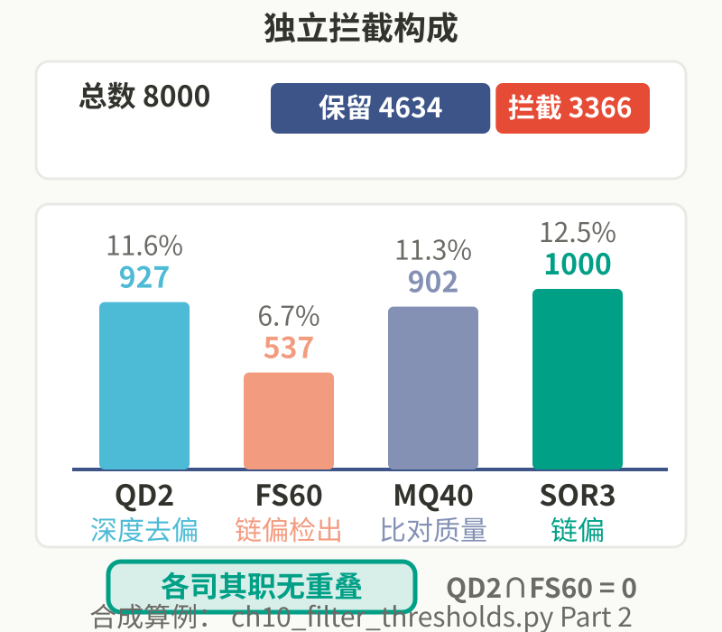

</div>
<div>

- 收严：假阳性降、假阴性升；放宽反过来
- 照抄文档不是答案；要做敏感性扫描
- 报告写清：选哪组、依据、相邻档差多少

</div>
</div>

<div class="ref">教材 §10.4.7、§10.4.9 ｜ 统计要点：阈值与假阳性率、深度—功效</div>

<!--
旁白：看这张拦截构成图：8000 个位点保留 4634，四条规则各拦 927、537、902、1000，占比都标出来了，而且彼此不重叠。为什么强调不重叠？这样你才说得清每条规则各拦了什么；一旦大量重叠，改一条阈值，另外三条的计数跟着变，敏感性就无从解释。代价往哪边走：阈值收严，假阳性降，假阴性升；放宽则反过来。所以照抄文档不是答案，要做敏感性扫描，看相邻档差多少。报告里要写的不是「我用了 QD 2」，而是选了哪一组、依据是什么、相邻档差多少。这页和前面讲过滤时那张图，用的是同一组数据。
-->
---

## 二项模型：`d = 10` 可以完全手算

<div class="cols">
<div>

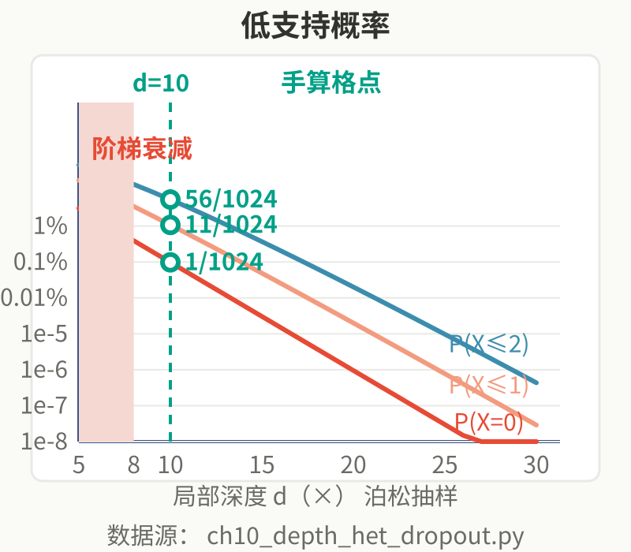

</div>
<div>

- `d` 是局部有效深度；`P(X≤2)` 不是漏检率
- `d = 5` 时 `P(X≤2)` 是 50%，`d = 10` 降到 5.469%
- `d = 10`：`P(X=0)=1/1024`、`P(X≤1)=11/1024`、`P(X≤2)=56/1024`

</div>
</div>

<div class="ref">演示 `ch10_depth_het_dropout.py --selftest` Part 1（合成算例）</div>

<!--
旁白：这道题可以完全手算。设一个二倍体样本在某位点真杂合，覆盖它的 d 条读段彼此独立，每条来自哪个等位各一半概率，支持 ALT 的条数就服从二项分布。d 等于 10 时：全不出现 ALT 是 1/1024，最多一条是 11/1024，最多两条是 56/1024，也就是 5.469%。图上三条曲线往下走，d 越小越危险：d 等于 5 时，ALT 证据不超过两条的概率是一半。一个关键区别：d 是局部有效深度，不是名义深度，模型只对前者成立。抛硬币的类比帮一半忙：真实读段不是公平硬币，带 ALT 的读段更容易被丢掉，所以真实流程的丢失往往比模型算的更重。
-->
---

<!-- _class: master quiz -->

## 课堂提问

`d = 8` 的 14.45%，能写成「真实漏检率 14.45%」吗？

<!--
旁白：先看问题：d 等于 8 时，ALT 证据不超过两条的概率是 14.45%，这个数能写成「真实漏检率 14.45%」吗？给大家三十秒。答案是：不能。它回答的是一个很窄的问题——在理想、固定深度的杂合位点上，ALT 证据不超过两条的概率有多大。真实流程里，一个位点报不报出来，还取决于读段能不能唯一比对、碱基质量够不够、caller 用什么规则、过滤放在哪、局部深度是不是真的等于 d。最常见的错答是「模型算出来的就是流程的性能」，把条件概率当成了流程指标；另一个常见错误是反过来说「所以模型没用」，其实它正好用来设计深度、解释低支持位点。两边错在同一个地方：没分清条件和无条件。
-->
---

## 低深度的方向性偏差：等位基因丢失

<div class="cols">
<div>

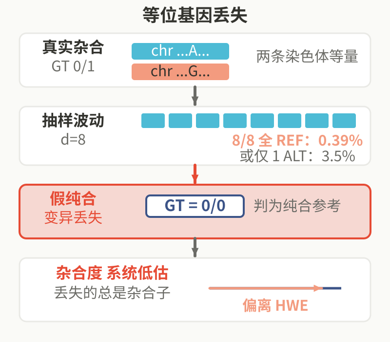

</div>
<div>

- 被写成 `0/0` 时 `GQ` 还可能不低
- 后果：偏离 HWE，PCA 反映的是深度不是血缘
- 本课 Xoo 是单倍体，这条不适用

</div>
</div>

<div class="ref">教材 §10.4.6 ｜ 群体层面留 ch20</div>

<!--
旁白：低深度还有方向性偏差。左边真实情况：杂合位点，两条染色体一条带 A 一条带 G，等量。中间抽样波动：局部深度只有八左右时，有一定概率八条读段全是参考，或者只剩一条 ALT。右边后果：后验落在纯合参考上，GT 写成 0/0，位点就丢了。麻烦在于这种情况下 GQ 可能还不低——文件很自信地认为自己看对了，所以不能靠 GQ 把它捞回来。方向还固定：丢的总是杂合，留的总是纯合，杂合度被系统性低估；群体层面会偏离哈迪温伯格平衡，做主成分分析时，成分反映的可能是深度而不是血缘。本课 Xoo 是单倍体，这条用不上，但做二倍体群体项目时它是必查项。
-->
---

## 没有真集时：四类证据

- Ti/Tv：随机期望 0.5；人类的 2.0–2.1 搬不到细菌
- 真集：必须跟样本、区域、变异类型对得上
- 孟德尔一致性：线索，不是总体错误率上界
- 多 caller 交集：交集外不全是假阳性

<div class="ref">教材 §10.4.9 ｜ 讲义 ⑦ 7.4</div>

<!--
旁白：没有真集，靠什么？四类证据，地位不同。Ti/Tv：随机模型下期望 0.5，真实变异集通常更高，人类全基因组经验区间 2.0 到 2.1——但那是人的口径，不能搬到细菌上，本课只报实测值，跟自己不同阈值横向比。真集：能用，但必须跟样本、区域、变异类型对得上，拿人类真集评细菌没有意义。孟德尔一致性：能提示候选问题，不是技术错误的直接判据，也给不出总体错误率的上界——三方被同一个系统偏差判成同一种基因型时，错误一个也检不出来。多 caller 交集：能提高纯度，但交集外不全是假阳性，而且几个工具共享同一套比对和参考时，错误会同步。
-->
---

## 最有力的一条：自比阴性对照

<div class="cols">
<div>

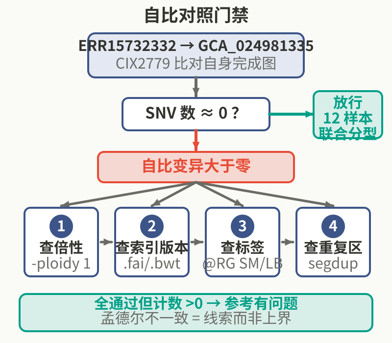

</div>
<div>

- 它检验整条流程是否自洽，不是某个位点
- 单独跑，不混入 12 株联合 VCF
- 不为 0 时四步顺序不能颠倒

</div>
</div>

<div class="ref">教材 §10.4.9、§10.5.3 ｜ README m03「务必让学生跑一遍」</div>

<!--
旁白：本讲最有力的一条：自比阴性对照。左边是设计：CIX2779 的读段比对自己的完成图，只问一个问题，变异数是不是接近 0。右边是决策树：接近 0 就放行，进群体联合分型；大于 0 就按四步查——倍性、索引版本、标签、重复区，顺序不能颠倒，因为这四步从最常见排到最不常见。最后说它的边界：它检验的是整条流程自洽，不是某个位点的真假。所以它要单独跑，不能混进联合 VCF 当第十三个样本——混进去就借了别人的证据，对照失效。它也不是全基因组检查，重复区和低覆盖区不在检验范围里。这条的价值不在于跑出 0，而在于它会把错位放大给你看。
-->
---

<!-- _class: master divider -->

<div class="num">06</div>

# 常见错误与课后

三条报错，一条不报错的

<!--
旁白：最后两段收尾。前面讲的是怎么把事做对，这一段讲做错时你看到什么。报错的反而好办，报错会告诉你缺什么；真正麻烦的是不报错的那些——它们让一份看起来很正常的输出，带着错误的结论走很远。
-->
---

<!-- @section: troubleshooting -->
<!-- _class: master warn -->
## 常见错误一：BAM 没有 Read Group

```text
... is missing the read group (RG) tag, which is required by the GATK.
```

- 成因是比对漏传 `-R`；重新比对是首选
- `AddOrReplaceReadGroups` 只给整文件一个 `RG`
- 它会丢掉 lane 信息，慎用

<div class="ref">教材 §7.5.4、§10.6</div>

<!--
旁白：第一个常见错误最好认：BAM 里没有 read group。报错原文写得很清楚，缺 RG 标签，而 GATK 要求必须有。成因通常是比对时漏传 RG 字符串。补救首选重新比对：比对时就把标签写进去，信息最完整，代价是重跑一遍。备选是事后加标签的工具，但它只能给整个文件一个 RG，lane 信息被压掉——多个 lane 的数据压成一个之后，质量校正和去重的分组都变粗，本来是分组的协变量变成了一个常数。所以这个工具慎用，能用重新比对解决就别用它，宁可多花一次比对的时间。报错里那半句话，考试也常拿来问。
-->
---

<!-- _class: master warn -->
## 常见错误二：标签不存在，阈值空转

<div class="cols">
<div>

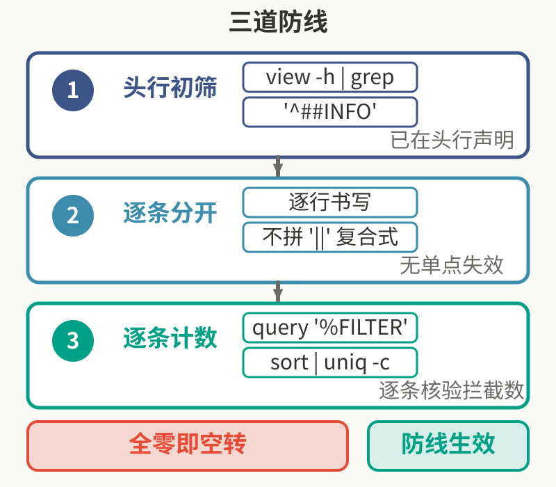

</div>
<div>

```text
WARN JexlEngine - ...
undefined variable MQRankSum
```

- 只有 WARN、退出码 0，这条阈值一条没拦
- 逐条分开写，再按 `FILTER` 逐条计数
- 计数为 0，造缺标签文件复跑

</div>
</div>

<div class="ref">教材 §10.4.7、§10.5.2 ｜ 讲义 ⑨ E7</div>

<!--
旁白：第二个错误不报错，所以更要记。警告只有一行：未定义变量 MQRankSum；退出码 0，输出文件正常生成，位点数看着也正常——别的规则还在工作。结果就是这条阈值一个位点都没拦，报告里却写着「已按该指标过滤」。图上是三道防线，按成本从低到高：先看头行有没有声明这个标签；再逐条分开写，一条规则一个名字，别用或把几条串起来；最后过滤完按 FILTER 列逐条计数，某条是 0 就去查。第三道最有效，它直接量出规则有没有干活。还差一道工：构造一个故意缺标签的小文件复跑，把检查变成可重复的。三道防线再加一道缺标签的复跑，是这类失效的标准处置。
-->
---

<!-- _class: master warn -->
## 常见错误三：`@RG` 的 `\t` 没了

```text
[E::bwa_set_rg] no ID within the read group line
```

- 真实成因是某一层转义把制表符吃掉
- 单双引号都保留 `\t`，「禁用双引号」不成立
- 传完立刻 `grep '^@RG'` 核对头行

<div class="ref">教材 §7.5.4 ｜ 讲义 ⑨ E10</div>

<!--
旁白：第三个错误是转义问题。报错说 read group 行里没有 ID，看着像标签写错了，真实成因往往是某一层把制表符吃掉了：字符串传进去时还是反斜杠加 t，到工具手里变成两个字符，整个 RG 被当成一段没有分隔的文本。常见的错误归因是「双引号会吃掉制表符，所以要用单引号」——这条不成立，单引号双引号都会保留反斜杠加 t，问题出在再往里的一层：变量展开、脚本传参、作业系统。最省事的验证是传完立刻 grep 头行，看是不是真的有了四个字段，别靠猜引号。猜来猜去，通常把一个真正的转义问题拖成半天。
-->
---

<!-- _class: master warn -->
## 不报错的空结果：contig 名与 `-L`

- `-L` 写死成 `chr01`，contig 名不对就返回 0 条
- 工具只打一行 warning，退出码 0
- 名字取自 `.fai`；单 contig 参考可不加 `-L`
- 任何区间查询都先确认记录数大于 0

<div class="ref">教材 §10.6、§7.5.3</div>

<!--
旁白：第四个错误连警告都很少：空结果。区间参数写死成 chr01，而这份参考的 contig 名不是这个，工具找不到就返回 0 条记录。它可能只打一行警告，退出码还是 0，文件也生成了，打开一看是空的。规矩三条：contig 名从 fai 里取，别凭印象写；单 contig 的参考可以不加区间参数；任何带区间的查询，第一步先确认记录数大于 0。第三条尤其重要——它把「没结果」和「没查到」分开：前者可能是生物学结论，后者是操作错误。这两件事在流程里长得一模一样，只有记录数能区分。这三条规矩适用于所有按区间取数的命令，不止这一处。
-->
---

## 排查路标

```text
跑不起来：dict does not exist → E1 三套索引
missing the RG tag → E2 回比对补 -R
OutOfMemoryError → E5 内存与堆匹配
只有 Killed → E9 估内存，退回 bwa index
跑完不对：某条过滤一条没拦 → E7 缺失标签
关注区无参考块 → §10.5.4 可判定区
样本塌成一列 → `@RG` 的 `SM`
```

<div class="ref">教材 §10.6 ｜ 讲义 ⑨ E1–E10</div>

<!--
旁白：排查路标，从跑不起来到跑完不对，分两段看。跑不起来的：报字典不存在，查三套索引建全没有；报缺 RG 标签，回比对补上；报内存溢出，核对堆内存和作业内存上限；只看到进程被杀、没有任何报错，就按数据量估内存，必要时退回单线程建索引。跑完不对的：某条过滤一条没拦，查缺失标签；关注区没有参考块，说明那块不在可判定区；样本塌成一列，查 SM。七行建议抄进实验记录，上机时按顺序对——排查最耗时间的不是修，是不知道从哪开始。路标只给方向，具体到每个报错还要回教材看那一节的机制。先定位阶段，再谈原因。
-->
---

<!-- _class: master divider -->

<div class="num">07</div>

# 课后与实验

任务卡、思考练习、实验指导

<!--
旁白：最后一段是课后。上机要交的三件事、几道思考题，和一份能被别人复核的报告长什么样。这一段没有新概念，都是把前面学过的东西固定成动作和标准，听的时候可以对照自己的课题过一遍。
-->
---

<!-- @section: wrapup -->
## 课堂实践（2 h）：三件事

- 跑脚本到 gVCF，记下 `flagstat` 等三项指标
- 按 `FILTER` 计数，某条为 0 就查标签
- 跑 8 组敏感性表，选一组并写依据

<div class="ref">教材 §10.6 ｜ 讲义 ⑤ 5.1–5.5</div>

<!--
旁白：两小时的实践就三件事，都有产出。先把脚本跑到 gVCF，记下比对率、配对率这几个数，不是跑完就算。再按 FILTER 列逐条计数，某条是 0 就去查标签——这一步能抓出静默失效。最后跑那八组敏感性扫描，选一组并写出依据。第三件看着最费时间，其实是报告的骨架：你选的阈值、为什么选、相邻档差多少，这三句话写不出来，报告就只是流程日志。时间安排上，前两件占大半，第三件可以边等作业边写。做完这三件，报告里最难的几栏数据就有了，剩下的只是写清楚。顺序也简单：先跑通，再抓错。
-->
---

## 思考练习：课堂选三题，Q8 必做

- Q1 为什么是 QD 2 / FS 60 / MQ 40
- Q2 120 × 8× 与 60 × 16× 怎么选
- Q6 `MAF > 0.05` 写进 π 脚本会怎样
- Q8 必做：自己课题的变异检测方案

<div class="ref">教材 §10.7 ｜ 讲义 ⑩</div>

<!--
旁白：思考题课堂选三题，必做的是最后一题。第一题问为什么是 QD 二、FS 六十、MQ 四十——考你能不能说出每个数在拦什么，而不是背下来。第二题是设计权衡：120 株八倍深度和 60 株十六倍深度怎么选，考你把深度花在位点数量上，还是花在基因型质量上。第六题是个陷阱：把次等位基因频率过滤写进多样性统计脚本会怎样，考你分没分清位点过滤和估计口径。第八题必做，因为它要求你把自己的课题写成一条过滤链：位点级做什么，基因型级做什么，哪些留给下一章。课堂讲不完的，带着问题去翻实验指导的对应步骤。
-->
---

## 一份可复核报告的八件事

<div class="cols">
<div>

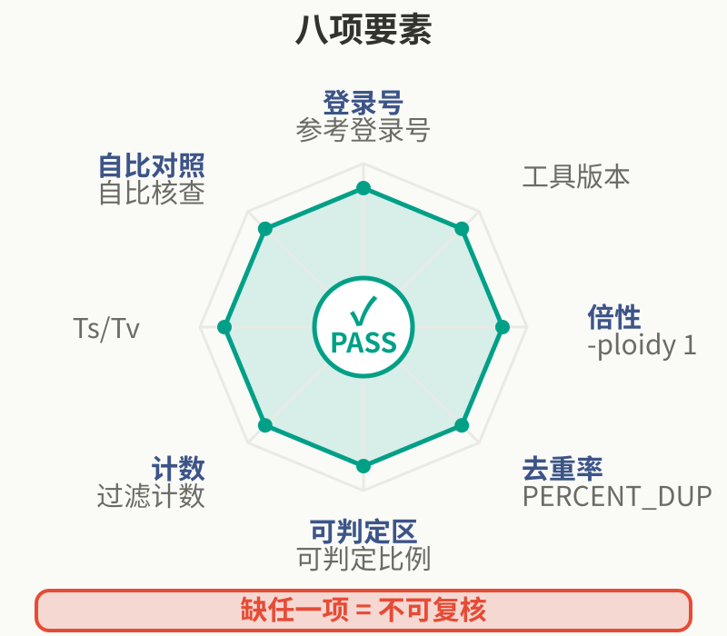

</div>
<div>

- `-ploidy` 不只写值，要写设置理由
- 已知限制照实写，别绕开
- 八项缺一，报告就不可复核

</div>
</div>

<div class="ref">教材 §10.6</div>

<!--
旁白：雷达图外圈八项，就是一份报告的验收标准：参考的登录号与版本、工具及版本、倍性取值与理由、去重率、可判定区域比例、过滤每条规则的逐条计数、Ti/Tv 实测值与自比结果、已知限制。图上那个勾的意思是：缺任何一项，这份报告就不可复核。为什么要写理由而不只是写值？读者要判断你的选择在这套数据上成不成立。为什么已知限制要照实写？限制不会因为你不写就消失，只会让下一个人重踩一遍，也可能让审稿人把结论读得比实际更强。把这张图当提交前的清单，逐项打勾，比事后补写省力——八项之间不能互相顶替，清单比记忆可靠。
-->
---

## 实验指导与收尾

- `11_lab_guides/master/03_resequencing_lab.md`
- 上机时手边打开：每步五栏，含出错信号
- 文献只给指针（讲义 ⑪），本 deck 不重复列

**这一步选定的阈值与口径，是后续群体分析的地基。**

<div class="ref">教材 §10.6、§10.7 ｜ 讲义 ⑩、⑪</div>

<!--
旁白：收尾三件事。实验指导在课程仓库里，上机时手边打开，每步五栏：做什么、敲什么、看到什么算对、看到什么说明错了。文献这一讲只给指针，要找就按实验指导里的入口去，不在这里重复列。最重要的一句：这一步选定的阈值和口径，是后面群体分析的地基——地基没打好，频率、连锁、关联全建在沙上。报告里每一栏都写清口径、写清理由，就是为了这个。开头那句话现在可以兑现了：流程谁都能抄，能对每条阈值说出它在拦什么，才算学完这一讲。说不出前提的变异，只是一个数字。
-->