<!-- @section: cover -->
<!-- _class: master cover -->

# m04 ｜ 转录组分析

**一份站得住的差异表达结论，要同时扛住三个追问：数字对不对、比较公不公平、可信度多少。**

<div class="meta">

- 4 学时（2 h 理论 + 2 h 实践）｜ 环境 `ngs_ms_transcriptome` + `ngs_ms_base`
- 讲义 `02_lectures/master/topic04_rnaseq/04_rnaseq_lecture.md`
- 教材 §14.1–§14.6 ｜ 脚本 `04_rnaseq_quant.sh`、`04_deseq2_analysis.R`
- L1 锚点：讲义 ④4.3 差异表达（p03）｜ ④4.4 矩阵形态（p06）

</div>

<!--
旁白：转录组这一讲要交付的东西很具体：一份站得住的差异表达结论。什么叫站得住？它得同时扛住三个追问——数字对不对、比较公不公平、可信度多少。前两个小时讲这三个追问，后两个小时上机把整条链跑一遍。
-->

---

<!-- _class: master divider -->

<div class="num">I</div>

# 学习目标

八条，对应 LO14-03–LO14-07

<!--
旁白：先看目标。八条分两组：前一组管选型和设计，后一组管结果和边界。现在记住个轮廓就行，等听到具体做法，你会知道该抓什么。
-->

---

<!-- @section: objectives -->
## 学完你应当能够（一）：选型与设计

- 判断三种建库各自保留哪一类转录本
- 说清 Salmon 与 STAR 失效方式不同
- 写出 `~ rep + time + treatment` 并算自由度
- 用 `relevel`、`contrast`、`description` 定方向

<div class="ref">教材 §14.4.1–§14.4.5 ｜ LO14-03、LO14-04</div>

<!--
旁白：这一组目标管的是动手算数之前的选型和设计。先说建库：polyA 富集、rRNA 去除、链特异性，各保留哪一类转录本——这是判断题，选错了后面任何一步都补不回来。再说定量：Salmon 和 STAR 出错的方式不一样。Salmon 在注释缺旁系同源时会把读段全分给留下的那个，两个基因的数都错；STAR 则在文库类型和取列上出错，给你一份几乎全是噪声的矩阵。然后是设计公式：写出 `~ rep + time + treatment` 并算自由度——系数五个，十二个样本减五个系数，残差自由度剩七。最后是方向：不靠字母序，靠 `relevel`、`contrast` 和 `description` 三道闸守着。这四条答得上来，设计部分就算过关。
-->

---

## 学完你应当能够（二）：结果与边界

- 区分 `padj` 为 `NA` 的三种成因
- 为每个下游方法选对矩阵形态
- 说清背景集用错时 p 值往哪偏
- 对只有 2 个重复的设计写清功效边界

<div class="ref">教材 §14.4.6–§14.4.9、§14.5.4 ｜ LO14-05–LO14-07</div>


<!--
旁白：这一组管结果和边界，也是最容易被跳过的一半。看到 `padj` 是 `NA`，要能分辨它是全零基因、Cook's 距离判出的离群，还是独立过滤——三种成因对应三种动作，其中一种根本不能救。下游方法各有各的胃口：差异检验要原始计数，PCA 和热图要方差稳定化之后的矩阵，两者不能互换。背景集用错时 p 值往哪偏，要能说清方向。最实用的是最后一条：手里只有两个重复，要写得出这份数据能做什么、不能做什么。两组目标连起来是一条链：选错建库，定量再准也白搭；选错矩阵，下游方法的前提被悄悄破坏。
-->

---

<!-- _class: master divider -->

<div class="num">II</div>

# 前置检查

四个 L0 模块，加一次环境自查

<!--
旁白：进正题之前先花几分钟自查。这一节不是复习课：把后面反复要用的四个基础模块点一遍，提前知道自己可能卡在哪。
-->

---

<!-- @section: prerequisites -->
## 前置检查：四个 L0 模块

| 模块 | 本讲用在哪 | 不过关的症状 |
|---|---|---|
| `l0_02_r` | 结果表筛选与作图 | 不会按 `padj` 筛 |
| `l0_04_formats` | 转录本 FASTA 与 `tx2gene` | 拿基因组 FASTA 建索引 |
| `l0_05_qc` | fastp、MultiQC | 想把重复读段全去掉 |
| `l0_06_stats` | 负二项、FDR、功效 | 说不清为何不用 t 检验 |

<div class="ref">教材 §14.3 ｜ 讲义 ② ｜ 自测题号见下一页</div>


<!--
旁白：这张表不是复习清单，是症状清单：不问你学过没有，只问你会不会做错。不会按 `padj` 筛结果表，说明 R 的那部分要补；拿基因组 FASTA 去建索引，是转录本和基因组两种文件没分清，症状是映射率低得反常；想把重复读段全去掉，是把 DNA 流程的习惯带进了 RNA；说不清为什么不用 t 检验，说明负二项和 FDR 还没接上。中间那列是诊断：哪条症状像你，就回去补哪个模块，别硬着头皮往下听。这四个模块的先后也是依赖的先后：先会用 R 看表，再分清文件格式，再谈质控，最后才是统计。下一页把环境拉起来，一条条验。
-->

---

## 30 秒自查

```bash
source /opt/miniconda3/bin/activate
conda activate ngs_ms_transcriptome
salmon --version          # 1.10.3
STAR --version            # 2.7.10b
Rscript -e 'packageVersion("DESeq2")'    # 1.42.0
Rscript -e 'packageVersion("tximport")'  # 应打印版本
```

- 前置自测：L0-2 第 3、4、6、8–10；L0-4 第 5–7
- L0-5 第 3(b)、4(a)(c)、8；L0-6 Q3、Q5–Q7、Q9、Q10
- `tximport` 报错才按讲义 ⑨-E0 补装（新版 yml 已包含）

<div class="ref">教材 §14.3 ｜ 讲义 ②、⑨-E0 ｜ 版本见 `env_master_transcriptome.yml`</div>

<!--
旁白：这五行请在登录节点敲一遍，每行都有含义。头两行激活 conda、进 `ngs_ms_transcriptome` 环境，顺序反了后面全报错。中间两行看版本：Salmon 应该是 1.10.3，STAR 是 2.7.10b；跟你环境里打印的对不上，先别急着跑流程——版本变了，默认行为也可能变，某个参数说不定从哪一版起就默认开启了。第五行查 R 包：`DESeq2` 是 1.42.0，`tximport` 那行只要能打印出版本就行，打不出来说明缺包，按讲义里的补装说明装好，再回计算节点。最容易被敲错的是引号：`packageVersion` 外面单引号，包名双引号，反了 R 不认。下面两行是前置自测的题号，哪条没底就回去补哪条。
-->

---

<!-- _class: master divider -->

<div class="num">III</div>

# 科学问题

三个追问，一条不能颠倒的检查链

<!--
旁白：科学问题这一节先立三个追问。为什么它们排在前头？因为后面所有技术细节该往哪看，全由这三个问题决定。追问过完，再给一条前提，把整讲的边界划出来。
-->

---

<!-- @section: background -->
## 三个追问，一条前提：量的是相对丰度

| 追问 | 错了会怎样 |
|---|---|
| 数字对不对 | 同源基因家族系统性错配 |
| 比较公不公平 | 报出一批假「全基因组下调」 |
| 可信度多少 | 富集出的通路整体偏移 |

- 定量错了，后两步会放大同一个错；限定的前提是相对丰度
- 设例：两万多基因筛出 800 个，不是本课数据

<div class="ref">教材 §14.1 ｜ 讲义 ③</div>


<!--
旁白：这张表是全讲的地图。三个追问看着并列，其实有先后：定量错了，后面两步会忠实地放大同一个错；归一化错了，检验会稳定地报出一批看起来很像结论的「全基因组下调」；检验对了而背景错了，通路层面的结论整体偏移。所以中间那列不是后果清单，是排查顺序——排查永远从上游往下游走，反过来查，下游的错会把上游的错伪装成生物信号，越查越乱。还有那条前提要划出来：转录组量的是相对丰度，不是绝对含量，所有倍数变化都是相对某个参照说的。至于两万多基因筛出 800 个，那是讲义里的设例，用来说明规模，不是本课数据的实测值。
-->

---

## 应用案例：转录组怎样找到感病基因

<div class="cols">
<div>

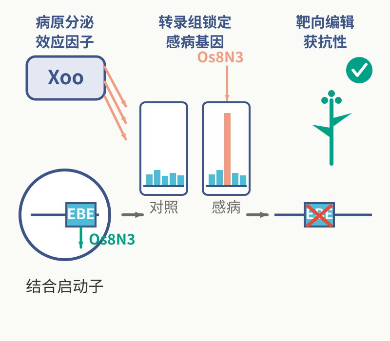

</div>
<div>

- 多数上调是普遍胁迫响应，要靠对照拆开
- *Os8N3* 只随特定 TAL effector 出现而诱导
- 突变后抗病：它是被病原利用的感病靶标

</div>
</div>

<div class="ref">教材 §14.4.10（Yang 2006；Li 2012）｜ 机理链见第 9 章图 9-1</div>

<!--
旁白：先看左边的机理图。水稻白叶枯病菌不直接杀死细胞，它把 TAL effector 送进宿主细胞，让 effector 去激活宿主的糖转运基因，等于替自己开了一条供糖通道。再看右边的三条。Yang 等 2006 年的做法，是比较携带不同 effector 组合的菌株侵染后的表达谱：大部分基因上调只是普遍胁迫响应，唯独 *Os8N3* 的表达严格跟着某个特定 effector 的有无走，这个「菌株乘基因」的模式把上万基因缩到一个候选。突变那条是反证：基因突变以后植株反而抗病，说明它不是防御基因，是被病原利用的感病靶标。读这张图的要点在最后：候选是被对照逼出来的，不是把上调倍数最大的挑出来。
-->

---

<!-- _class: master statement -->

转录组给候选与机制假设，因果要靠遗传或编辑实验。

任何一份差异基因清单都只到候选这一步。


<!--
旁白：这句话给整讲定了天花板：转录组能回答哪些基因变了、变了多少，回答不了谁让它变的。任何一份差异基因清单，哪怕富集出再漂亮的通路，都只到候选这一步；因果要靠突变体、编辑材料这类遗传实验补上。它也决定结论怎么写：看到上调，可以写「在这批样本里，这个基因处理后表达更高」；不能写「这个基因被激活了」，更不能写「它导致了表型」——中间那两级台阶，一级要机制实验，一级要遗传证据，都不是一张表达谱能给的。写讨论时把「候选」两个字写出来，比事后被审稿人追问省力得多。
-->

---

<!-- _class: master divider -->

<div class="num">IV</div>

# 核心原理

建库 · 定量 · 归一化 · 模型 · 结果表 · 富集

<!--
旁白：核心原理是全讲最长的一段，六个关键词：建库、定量、归一化、模型、结果表、富集。按数据流的顺序走，每一步都问同一个问题：它在什么条件下会给出错误答案而不报错。
-->

---

<!-- @section: principles -->
## 建库的两个决定，错了后面补不回来

| 选择 | 保留什么 | 代价 |
|---|---|---|
| polyA 富集 | 带 polyA 尾的转录本 | 不带尾的保留不到 |
| rRNA 去除 | 各类 RNA，含未剪接 | 要更高的测序量 |
| 链特异性 | 转录方向 | 成本略高，几乎没有别的代价 |

<div class="ref">教材 §14.4.1 ｜ 讲义 ④ 4.1</div>


<!--
旁白：建库有两个决定——说「决定」不说「偏好」，是因为做错了后面任何一步都补不回来。表格三行：polyA 富集留下带 polyA 尾的转录本，代价是不带尾的那一类基本保留不到；rRNA 去除把各类 RNA 都留下，包括没剪接完的，代价是测序量要往上加；链特异性保留转录方向，代价只是成本略高。第三列比第二列更该看：代价就是你事后会在结果里看到的偏差。判断顺序也固定：先问物种是真核还是原核，再问 RNA 完整度，最后问要不要看反义转录本和非编码 RNA。建库定的是这份数据能回答哪一类问题，而不只是答得好不好——这一步在分析阶段改不了。
-->

---

## polyA 保留的是「带尾的」，不是「编码的」

<div class="cols">
<div>

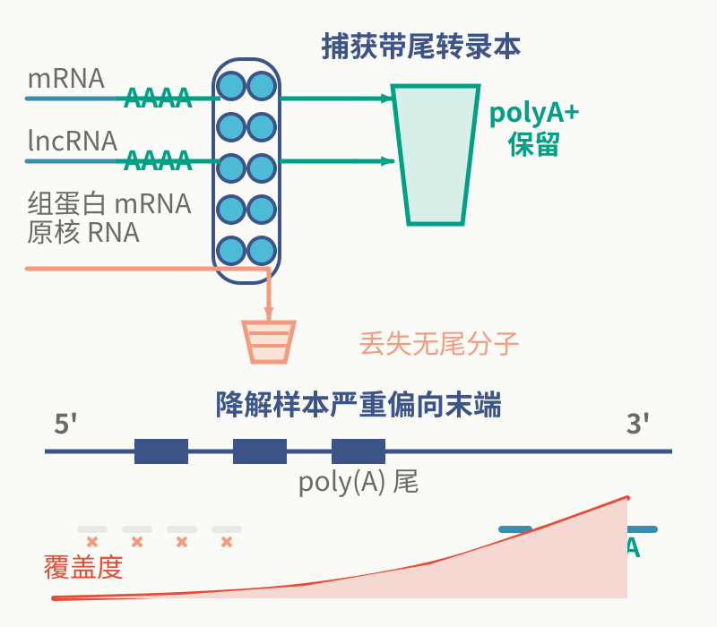

</div>
<div>

- 相当一部分长非编码 RNA 也带 polyA 尾
- 原核 mRNA 大多不带尾，不能用 polyA 建库
- 降解样本 3′ 偏倚严重，损失只能实测判断

</div>
</div>

<div class="ref">教材 §14.4.1 ｜ 讲义 ④ 4.1</div>


<!--
旁白：先拆一个常见误解：polyA 保留的是带尾的，不是编码的。图左边是带 polyA 尾的分子被引物抓走，右边不带尾的留在上清里被丢掉。中间那支最容易被忽略：相当一部分长非编码 RNA 也是聚合酶 II 转录的，同样带尾，polyA 文库会把它们一起留下——所以「polyA 没有非编码 RNA」这话不成立。反方向呢？原核 mRNA 大多不带尾，拿 polyA 建库去测细菌转录组，等于先把目标扔了。降解样本还要当心：RNA 从中间断掉，越靠 3′ 端越容易被抓到，覆盖出现 3′ 偏倚，损失多少只能靠实测覆盖曲线判断。所以拿到 polyA 数据的差异表，第一句该问：这张表覆盖了转录组的哪一部分。
-->

---

## 链特异性不是加分项，是默认项

<div class="cols">
<div>

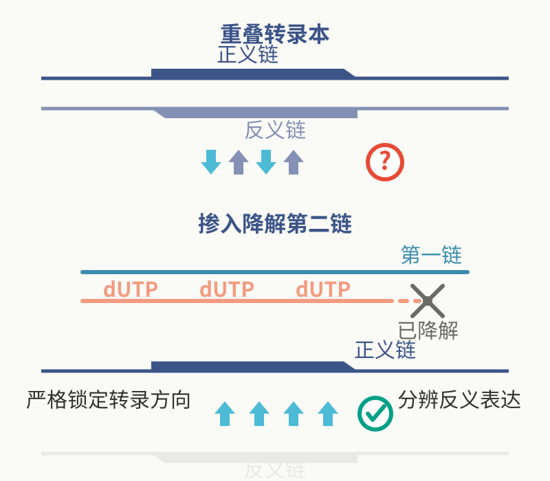

</div>
<div>

- 软件不报错，只给一份看似正常的矩阵
- Salmon 的 `-l A` 侦测文库类型，写 `lib_format_counts.json`
- RNA 两条纪律：常规文库不去重；前 12 bp 异常不处理

</div>
</div>

<div class="ref">教材 §14.4.1 ｜ 讲义 ⑤ 5.1</div>

<!--
旁白：链特异性不是锦上添花，是默认该选的。图上两个基因在基因组上重叠、方向相反，读段落在同一段坐标上——不记录读段来自哪条链，就分不清它属于哪个基因。最要命的是软件不报错，只给你一份看起来数值正常的矩阵。所以要靠 `-l A` 让 Salmon 自己侦测文库类型，结果写进 `lib_format_counts.json`，再看全样本的 `expected_format` 是否一致。RNA 还有两条自己的纪律：常规文库不去重，高表达基因的重复读段大多来自真实分子，去重反而把最可靠的证据削掉；前 12 bp 的组成异常也不处理，那是随机引物的偏好，动了它反而引入新偏倚。
-->

---

<!-- _class: master quiz -->

## 课堂提问

一份 polyA 文库的差异表里缺一组不带 polyA 尾的转录本，这是生物学结论，还是覆盖范围？

<!--
旁白：给大家三十秒，先别看答案。想的时候抓一个要点：这张表「有资格出现」的是哪些分子？答案偏向覆盖范围：建库时没保留，表里自然没有，跟它在处理前后变没变无关。所以正确的说法是「本实验的建库方式看不到这类转录本」，不能写「这类转录本没有响应」。最常见的错答是把缺失直接读成下调甚至沉默，那已经越过了数据能支持的范围。还有一种可能别漏：它们压根不在注释里，定量根本没有这些条目，那是参考集的问题，同样不是生物学结论。两种都推不出「没有差异」。
-->

---

## 两条路线：剪接感知比对与选择性比对

<div class="cols">
<div>

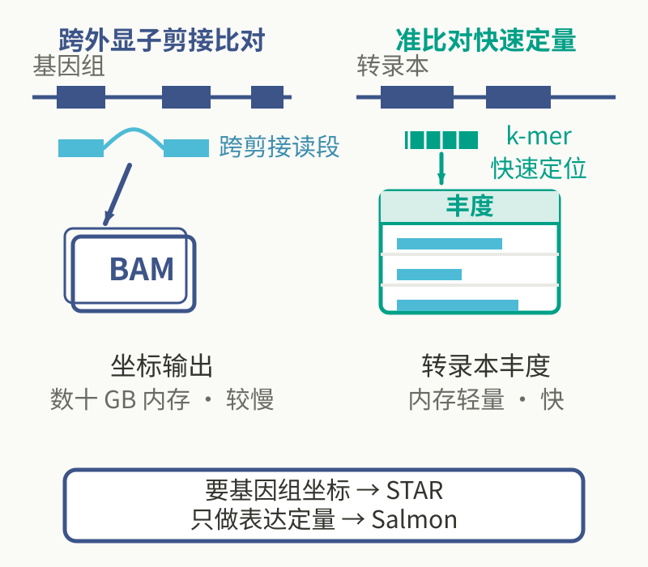

</div>
<div>

- 用 `--sjdbGTFfile` 先登记已知剪接位点
- 要可变剪接、看 IGV、与 m05 联合 → STAR
- 注释差时先补转录本，再谈定量

</div>
</div>

<div class="ref">教材 §14.4.2 ｜ 讲义 ④ 4.1</div>


<!--
旁白：两条路线的分工，图上画成两条轨道。上面 STAR：建索引时用 `--sjdbGTFfile` 把已知剪接位点先登记进去，比对时遇到剪接位点就断开，接着搜下一个外显子，产物是坐标 BAM。下面 Salmon：不追碱基坐标，只判断一条读段跟哪些转录本兼容，再按丰度分摊。选型可以压成三句话：只要表达量，走 Salmon；要可变剪接、要在基因组浏览器里看覆盖、要跟后面的染色质数据联合，走 STAR；注释太差时，先用 STAR 加组装把转录本补齐，再谈定量。最后这句最容易被跳过，也最容易让整条链白跑。两条路线产物形态不同，下游哪一步接哪条，选型时就要一起想。
-->

---

## 分不出去的证据：两条路线处理不同

<div class="cols">
<div>

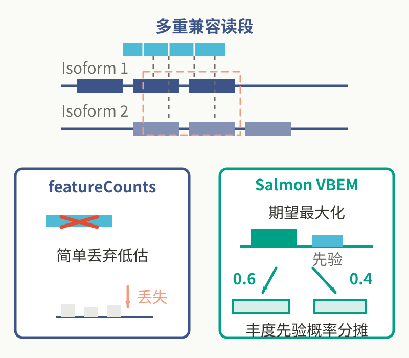

</div>
<div>

- 注释缺旁系同源：全给留下的那个，两个基因都错
- `featureCounts`（Subread 包）按 BAM 计数，常接 STAR
- 分摊的前提：候选转录本集与有效长度要对

</div>
</div>

<div class="ref">教材 §14.4.2 ｜ 讲义 ④ 4.1</div>

<!--
旁白：同一份数据为什么会数出两套结果？看图的中间：一段读段同时兼容两个基因，左边的路是丢弃，右边的路是分摊。`featureCounts` 默认把多重比对的读段丢掉，Salmon 用 EM 类迭代按当前丰度分摊。谁对？看你的基因家族。植物抗病基因、病原效应子这类高度同源的家族，丢弃会让表达量系统性偏低，分摊至少保住了这部分证据。但分摊有前提：候选转录本集要对，有效长度要对。注释里缺一个旁系同源，读段会被全部分给留下的那个——两个基因的数都错，而且不报错。所以两种口径都要写进方法学，当作一次敏感性分析。
-->

---

## STAR 的 `ReadsPerGene.out.tab` 是四列

<div class="cols">
<div>

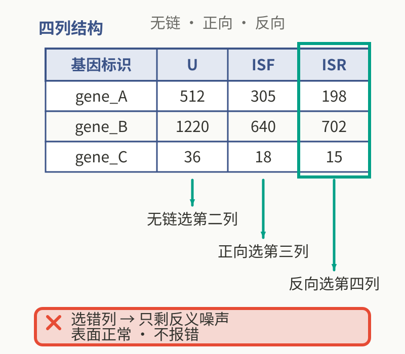

</div>
<div>

- `IU` 这类代号出自 Salmon 的 `lib_format_counts.json`
- 第 1 列是基因 ID，不是计数
- 判据：全样本 `expected_format` 是否一致

</div>
</div>

<div class="ref">教材 §14.4.2 ｜ 讲义 ⑤ 5.3</div>

<!--
旁白：STAR 的 `ReadsPerGene.out.tab` 是四列，照抄出错最容易出在这。图上看：第一列是基因 ID，不是计数，很多人第一眼就把整张表丢进差异分析。后面三列按链分开：第二列是无链计数，第三、第四列分别是第一条和第二条读段与 RNA 同向的计数。取哪一列由文库类型定：非链特异取第二列；链特异且第一条读段与转录本同向取第三列，反向取第四列。别背表——回到 `lib_format_counts.json` 看全样本的 `expected_format` 是否一致。一致才往下走；不一致，说明有样本的建库跟别人不一样，得在分析前解决。
-->

---

<!-- _class: master statement -->

换文库类型而不改列号，流程不会中断。

它只会交给你一份几乎全是噪声的计数矩阵。


<!--
旁白：这句话值得单独一页：换文库类型而不改列号，流程不会中断。不报错、不警告，只交给你一份几乎全是噪声的计数矩阵，而你会拿着它继续归一化、做检验、跑富集，最后得到一份格式完全正常的报告。这类错误比崩溃麻烦在哪？它不给追查的线索：退出码是零，日志里没有红字，你唯一的依据是几个诊断数字。所以要的不是更聪明的流程，而是几个能在半路拦住自己的检查点——映射率、文库类型、列数跟文库类型对不对得上。这也是「先看诊断量」放在流程最前面的原因：诊断量不解释结论，但它能拦住结论。
-->

---

## decoy 索引与 `-k`：两个容易照抄错的参数

<div class="cols">
<div>

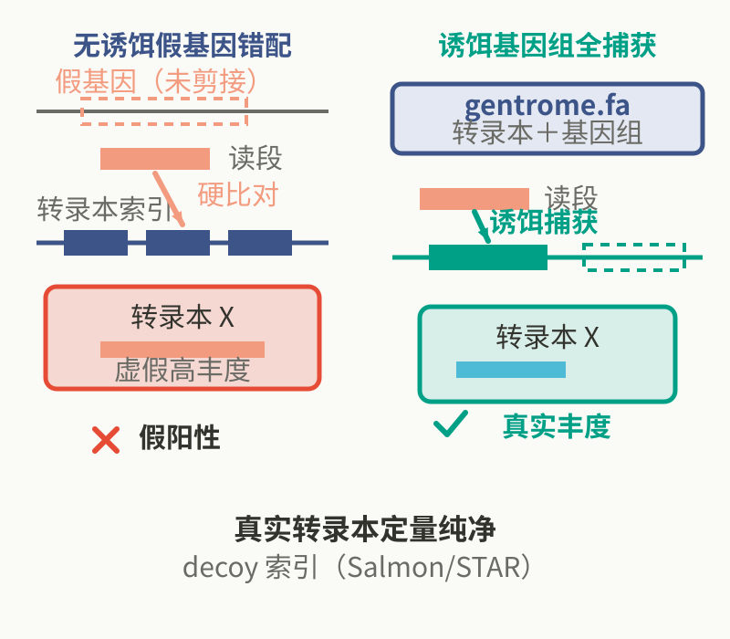

</div>
<div>

- `gentrome.fa` 是转录本在前、基因组在后，顺序不能反
- 基因组当 decoy：内含子残留、未注释区的读段有个去处
- `-k 31` 对 ≥75 bp 良好；更短的读段可调小，属经验值

</div>
</div>

<div class="ref">教材 §14.4.2 ｜ 讲义 ⑤ 5.2</div>


<!--
旁白：这两个参数，照抄别人命令时最容易出错。先看 `gentrome.fa` 的拼法：转录本在前、基因组在后，顺序不能反，反了索引就建错，而且往往不报错。再看基因组当 decoy 干什么用：内含子残留、gDNA 污染、未注释区的读段有了去处，不会被硬塞给某个长得像的转录本。`-k 31` 是官方文档的口径，对 75 bp 及更长的读段表现良好；更短的读段可以调小，但文档没给界限，讲义里的范围是经验值，别当判据。索引阶段的错最贵：参数错了，后面所有样本一起错，重建一次索引往往比重跑十个样本的定量还久。所以参数先查文档，别先信别人的命令。
-->

---

## TPM：先除长度，再除样本内 RPK 之和

<div class="cols">
<div>

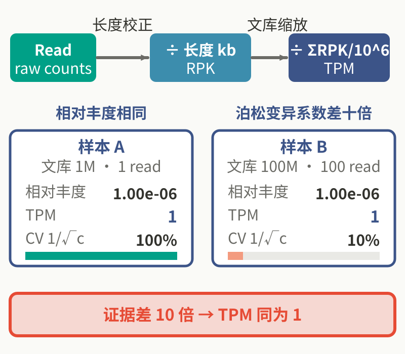

</div>
<div>

- 手算：2 kb 基因 200 read → RPK 100，总 RPK 5×10⁵ → TPM 200
- 每样本 TPM 总和恒为 10⁶，这是闭合约束
- TPM 只做样本内跨基因比较，不跨样本比倍数

</div>
</div>

<div class="ref">教材 §14.4.3 ｜ 演示 `ch14_tpm_rounding.py --selftest` Part 0</div>


<!--
旁白：TPM 就是两步除法，顺序别记反。先把每个基因的读段数除以它的长度（按千碱基计），得到每千碱基读段数，这一步管长度；再把结果除以样本内所有基因 RPK 之和，乘一百万，这一步管深度。旁边的手算走一遍：2 kb 的基因测到 200 条读段，RPK 是 100；样本总 RPK 五十万，TPM 就是 100 除以五十万再乘一百万，等于 200。每个样本的 TPM 总和恒为一百万——这是定义带来的闭合约束，不是巧合。所以 TPM 只能在样本内跨基因比，不能跨样本比倍数。顺序一旦反了，数值差得离谱，可看起来仍然合理，这才是它阴的地方。
-->

---

<!-- _class: master statement -->

TPM 相等，不等于证据量相等。

各基因长度都按 1 kb 计时，1 read @ 1M 与 100 reads @ 100M 的 TPM 同为 1，变异系数却是 100% 与 10%。


<!--
旁白：把上一个坑说透：TPM 相等，不等于证据量相等。图上两行，TPM 同样是 1，左边只有 1 条读段，右边有 100 条。注意前提：所有基因长度都按 1 kb 计时，TPM 才退化成「计数除以文库大小」，两边才会相等。证据量的差距用变异系数看：1 条读段是 100%，100 条是 10%。问题就出在这——TPM 把「测得多深」在除法里消掉了，而差异检验的分母正需要这层信息。所以两个 TPM 相除的比值，不能当倍数变化读；要报倍数，回到计数和模型。TPM 剩下的用处是回答「这个样本里谁最丰富」，或者给人看表达谱的整体形状。跨样本比较，回计数。
-->

---

## TPM 的两个硬伤：方差与组成性

<div class="cols">
<div>

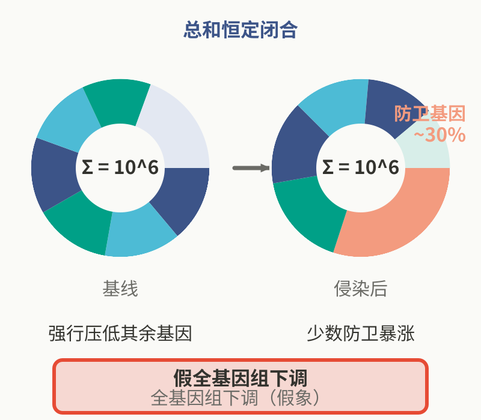

</div>
<div>

- 硬伤一：把「测到几条 read」的信息除掉了
- 负二项模型要计数与文库大小，不要点估计比值
- 闭合约束同时制造基因间的人为负相关

</div>
</div>

<div class="ref">教材 §14.4.3 ｜ 讲义 ④ 4.2</div>


<!--
旁白：TPM 的两个硬伤，一个在方差，一个在组成性——组成性说的就是那条闭合约束。先看左边：深度信息被除掉之后，同一个 TPM 可能来自 1 条读段，也可能来自 100 条，方差完全不同，而负二项模型要的恰恰是计数和文库大小，不是比值。再看右边：每个样本强制总和一百万，少数基因暴涨，其余上万个没动的基因在分母里被集体压低，读起来像「全基因组下调」。这种数据落在单纯形上，基因之间会出现人为的负相关，拿去做相关网络更是灾难。所以 TPM 表上看到「一片下调」，先怀疑闭合约束，别急着找生物学解释；跨样本比较回计数，让模型去估深度和离散度。
-->

---

## DESeq2 的解法：中位数比值

<div class="cols">
<div>

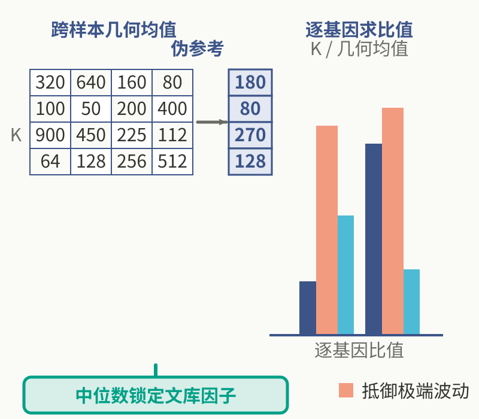

</div>
<div>

- 中位数崩溃点 50%：一半以上基因稳定即可
- edgeR 的 TMM 是同一思路的另一条实现
- 前提是多数基因没变；大规模响应会吸收真变化

</div>
</div>

<div class="ref">教材 §14.4.3 ｜ 讲义 ④ 4.2</div>

<!--
旁白：DESeq2 的解法是绕开闭合约束，不是去修 TPM。看图三步：先对每个基因跨样本取几何平均，拼出一个虚拟的伪参考样本；再算每个样本每个基因相对伪参考的比值；最后取该样本全部比值的中位数，当文库大小因子。为什么用中位数？它的崩溃点是 50%——只要一半以上的基因在处理前后基本稳定，少数极端基因的暴涨就动摇不了这个数。代价也在这：如果处理真的大面积改变了转录组，比如整个发育程序切换，「多数基因不变」这个前提本身不成立，估出的因子会把真实的全局变化吸收掉，所有基因的倍数一起偏向 1，而结果表上一点都看不出来。
-->

---

## 贯穿数据的设计：`~ rep + time + treatment`

<div class="cols">
<div>

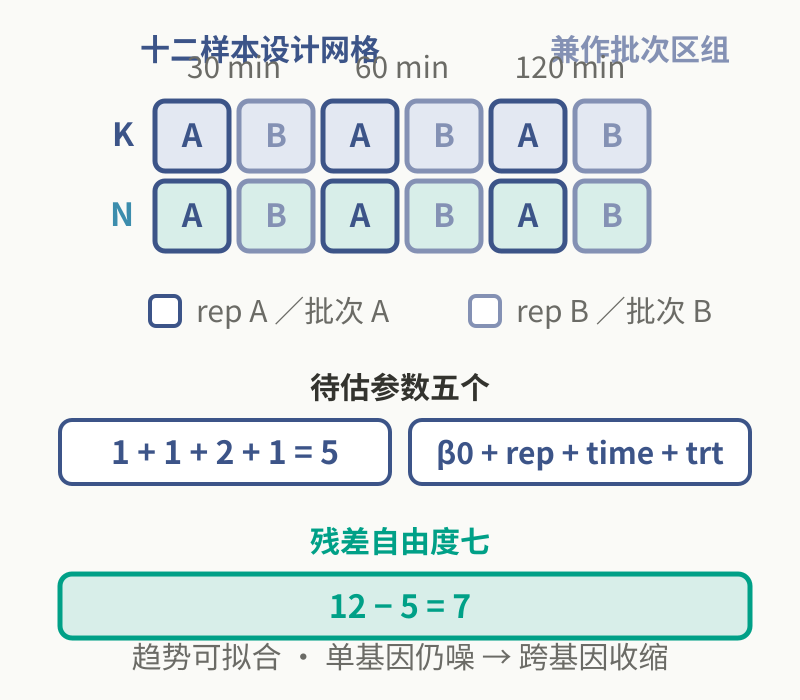

</div>
<div>

- `model.matrix()` 每列一个系数，共 5 列
- 截距是参考组合：`rep A` × 30 min × `K`
- 加批次不花样本，但占掉一个残差自由度

</div>
</div>

<div class="ref">教材 §14.1、§14.4.5 ｜ 数据见 `06_data/master/README.md`</div>

<!--
旁白：设计公式干的事，是把实验翻译成线性代数。`~ rep + time + treatment` 展开是 5 列：截距、`rep` 一列、`time` 两列、`treatment` 一列，每列一个待估系数，每行一个样本。表格第一行的注释要留意：截距不是「什么都没有」，它是参考组合——`rep A`、30 分钟、对照 `K`；其余每列都是相对这个组合的偏移，所以参考水平是谁，直接决定后面每个系数怎么解释。`treatment` 排在公式最后，`results()` 默认报的就是它。另外，加批次不花样本，但占掉一个残差自由度——这笔账后面还要算。
-->

---

## 方向靠三道闸，不靠字母序

<div class="cols">
<div>

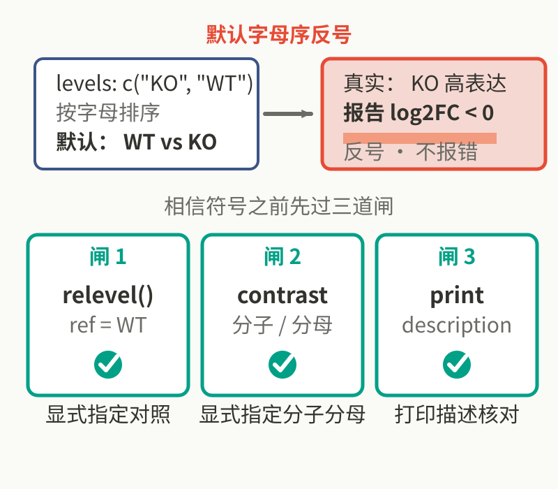

</div>
<div>

- `results()` 默认报设计公式最后一个系数
- 写 `~ treatment + rep` 就默认报批次效应
- `K` 排在 `N` 前是命名巧合，不是规则
- `description[2]` 要写 `treatment N vs K`

</div>
</div>

<div class="ref">教材 §14.4.5、§14.5.3 ｜ 讲义 ④ 4.3.3</div>

<!--
旁白：方向为什么不能交给字母序？R 的因子水平默认按字母序排，`results()` 默认报设计公式最后一个系数，也就是「最后水平相对第一水平」。处理组的名字要是恰好排在对照组前面，报出来的就是反方向，每个 `log2FC` 都反号，而且不报错。防它靠三道闸：建对象前用 `relevel` 显式指定参照；取结果时把 `contrast` 写全，分子分母都点名；拿到表后读 `description[2]`，看它是不是写清了谁对谁。我们这份数据的水平是 `K` 和 `N`，`K` 碰巧排在前面，参考水平正好是对的——但这是命名巧合，换一套命名就翻，所以三道闸一道都不能省。
-->

---

## 完全混杂无解，部分混杂要写进边界

<div class="cols">
<div>

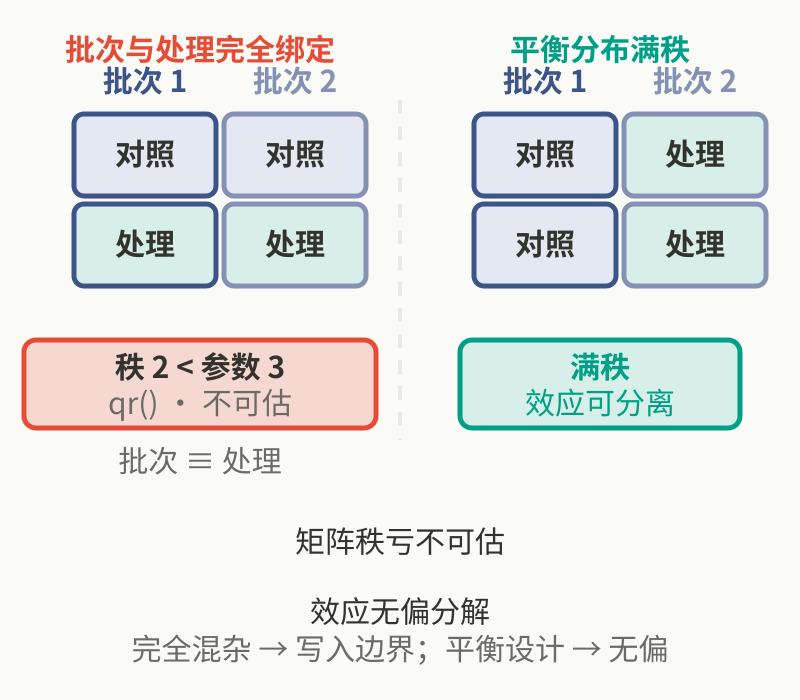

</div>
<div>

- 交叉表里的 0 格只是信号：判据是查 `qr()` 的秩
- 有 0 格也可能满秩；删项并不能消除混杂偏差
- 部分混杂能拟合，但处理效应分不干净

</div>
</div>

<div class="ref">教材 §14.4.5 ｜ 讲义 ⑨-E5</div>


<!--
旁白：完全混杂无解，部分混杂能算但要说清边界。看左边那张小表：对照全在批次一、处理全在批次二，两个 0 格。0 格只是信号，不是判据——真正的判据是设计矩阵的秩，用 `qr()` 一查就有：这个设计可估的独立方向只有两个，却要估三个参数，秩小于列数，DESeq2 直接拒绝拟合并报不满秩。右边是部分混杂：两个批次里都有处理，只是数量不等，模型能拟合，但处理效应和批次偏差分不干净，这个边界要写进方法学。还有一条：删掉批次项消除不了混杂，只是把它藏起来。设计阶段就把批次和处理的两向表打出来看一眼，比跑完再解释省事得多——秩亏报错反而是好事，它逼你停下来。
-->

---

## Wald 问一个系数，LRT 问被剔除的那组

<div class="cols">
<div>

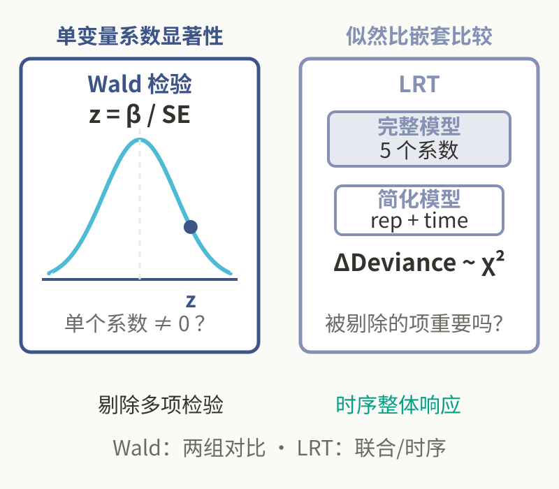

</div>
<div>

- `lfcThreshold = 1` 只能配 Wald，零假设改为 `|β| ≤ 1`
- LRT 的 `stat` 无方向，别拿来排序或读上下调

</div>
</div>

<div class="ref">教材 §14.4.6 ｜ 讲义 ④ 4.3.4</div>


<!--
旁白：两种检验问的不是同一个问题。Wald 拿一个系数除以它的标准误，零假设是这个系数为零，所以天然带方向，也带标准误，两水平的处理比较用它顺手。LRT 比较两个嵌套模型的似然，自由度等于被剔除的列数，适合问「一组列合起来有没有效应」。图下两条易错点：`lfcThreshold` 只能配 Wald——它把零假设改成「效应不超过某个值」，这种复合零假设放到 LRT 下软件直接报错；LRT 的 `stat` 没有方向，只表示两个模型的似然差多大，别拿它的正负读上下调，也别拿它给 GSEA 排序。选哪种，看你问的是单个比较，还是一组嵌套模型；报告里也要写清，别只说一句「用了 LRT」。
-->

---

## LRT 检验的是被剔除的那一项

<div class="cols">
<div>

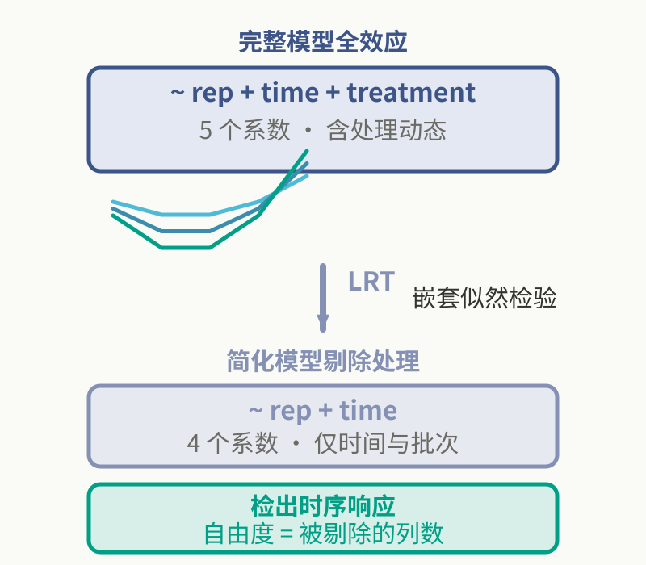

</div>
<div>

- 被剔除的是 `treatment`，自由度 `5 − 4 = 1`
- 问「时间整体」要剔除 `time` 两列，df = 2
- LRT 表的 `log2FC` 仍是最后系数的 MLE

</div>
</div>

<div class="ref">教材 §14.4.6 ｜ 讲义 ④ 4.3.4</div>


<!--
旁白：LRT 检验的就是被剔除的那一项，这句话值得反复念。看图的嵌套关系：全模型 `~ rep + time + treatment`，约化模型去掉 `treatment`，所以它回答的是「在配对时间框架下，复氮是否改变表达」。自由度等于被剔除的列数：全模型五个系数，约化模型剩四个，差一。想问「时间整体有没有效应」是另一个问题，要剔除的是 `time` 的两列，自由度是二。最容易读错的是最后一条：LRT 表里的 `log2FC` 仍然是最后一个系数的最大似然估计，跟 LRT 检验的对象不是同一件事，要分行看。换个问题，就得换一次约化模型，别拿同一张表回答两个问题。
-->

---

## `results()` 六列：先看 padj，再看方向

<div class="cols">
<div>

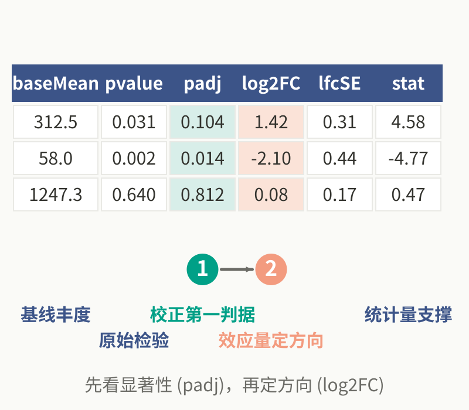

</div>
<div>

- 先看 `padj` 是否入名单，再看 `log2FC` 定方向
- `stat` 在 Wald 里与 `log2FC` 同号，可当单位标准误效应
- `baseMean` 是归一化计数均值，不是绝对表达量

</div>
</div>

<div class="ref">教材 §14.4.6 ｜ 讲义 ⑥ 6.4</div>


<!--
旁白：`results()` 出六列，读的顺序不能乱。先看 `padj`，它定这个基因进不进名单；再看 `log2FC` 的符号和大小，定方向和效应量；最后看 `lfcSE`，估这个点估计有多稳。`stat` 在 Wald 里跟 `log2FC` 同号，可以当成「单位标准误的效应」，但 LRT 里它没有方向。`baseMean` 是归一化计数的均值，不是绝对表达量，不能跨基因比大小。还有一条容易被忽略：`pvalue` 是原始 p 值，拿它代替 `padj` 筛基因，等于把多重检验校正扔了。一行口诀：`padj` 定去留，`log2FC` 定方向，`lfcSE` 定把握。
-->

---

## `padj` 为 `NA` 的三种成因

<div class="cols">
<div>

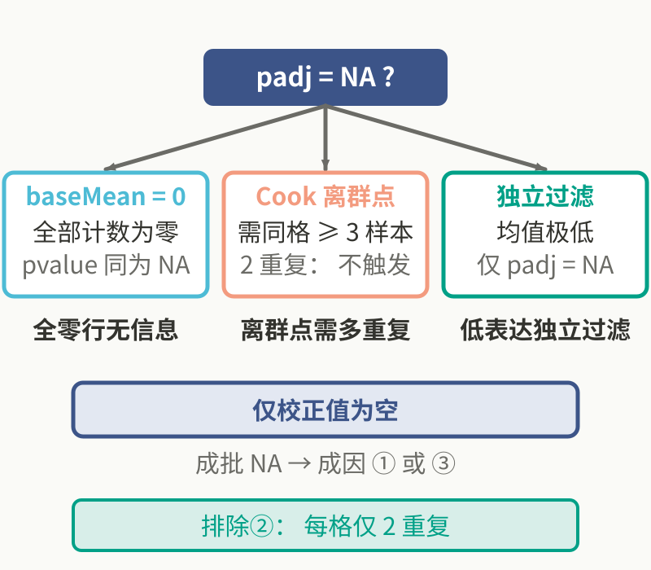

</div>
<div>

- 本数据每格 2 样本：预期只有①与③
- 成批 `pvalue` 为 NA 时先查分组与拟合
- ③ 是主动减法：用 `pvalue` 捞回等于放弃 FDR

</div>
</div>

<div class="ref">教材 §14.4.6、§14.5.4 ｜ 讲义 ④ 4.3</div>

<!--
旁白：`padj` 是 `NA`，成因有三种，对应三个不同的环节，补救动作也完全不同。看这棵决策树。全零基因：`baseMean` 为零，这个基因在十二个样本里全是零，没有任何信息。Cook's 离群：软件认为这个基因的检验不可信，`pvalue` 和 `padj` 一起置空——这条路径只在同一格有三个及以上样本时才会出现。独立过滤：`pvalue` 有值，只是 `padj` 被置空，这是软件主动做的减法。我们这份数据每格两个样本，预期只会撞上全零和独立过滤两种。见到成批 `pvalue` 为空，先查分组和拟合是不是正常。至于用原始 p 值把独立过滤的基因捞回来——那等于放弃 FDR 控制，别做。
-->

---

## 五种矩阵形态：按下游要什么来选

<div class="cols">
<div>

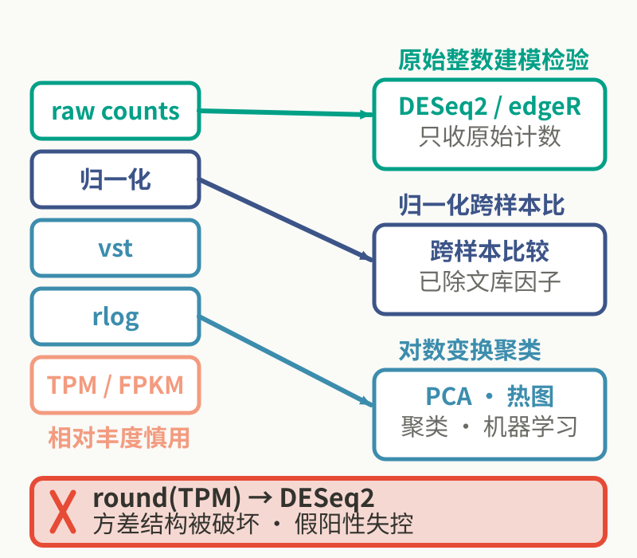

</div>
<div>

- normalized counts 只适合画单基因柱状图
- vst / rlog 都要显式写 `blind = FALSE`
- 别用 `log2(counts + 1)` 代替方差稳定化

</div>
</div>

<div class="ref">教材 §14.4.7 ｜ 讲义 ④ 4.4</div>


<!--
旁白：同一份 `dds` 能取出五种矩阵，选错不报错。看图这条去向链：原始计数进差异检验；归一化计数只配画单基因柱状图；`vst` 和 `rlog` 归到一行，PCA、聚类、热图、相关网络都从这拿；TPM 只做样本内跨基因比较。判断标准不是矩阵名字熟不熟，而是下游方法的假设：凡是用距离和相关的，都要求方差跟均值脱钩，那就得 `vst` 或 `rlog`。三个提醒：归一化计数别直接进相关分析；两个变换都要显式写 `blind = FALSE`，默认会忽略设计重新估离散度；`log2(counts + 1)` 代替不了方差稳定化。记一句就够：看下游要什么，不看名字。
-->

---

## vst 与 rlog：只写可核的口径

- 两者都能稳定方差，vst 快得多
- n ≥ 30 时 rlog 打印耗时提示，建议改 vst
- 都要显式写 `blind = FALSE`
- WGCNA 首选 vst/rlog；官方也允许统一处理的 log2(x+1)

<div class="ref">教材 §14.4.7 ｜ 讲义 ④ 4.4</div>


<!--
旁白：这一页只写能在官方文档里核实的口径，讲义里那些更细的经验说法我们不用。两者都能稳定方差，`vst` 快得多。样本数到了 30 以上，`rlog` 会打印耗时提示、建议改用 `vst`——这是现行文档的口径。两个变换都要显式写 `blind = FALSE`：默认的 `blind = TRUE` 会忽略设计重新估离散度，只适合纯质控探索。WGCNA 首选 `vst` 或 `rlog`，官方也允许用归一化计数或 RPKM 取 `log2(x+1)`，前提是所有样本同一种处理。写作时把这四条照实写进方法学，别写「效果更好」这种核不了的话——要写「更好」，就得拿出跟谁比、怎么比的出处。
-->

---

<!-- _class: master statement -->

WGCNA 建立在相关之上：计数方差随均值增长，TPM 的组成性制造负相关。

这是机理推演，不是软件判据。


<!--
旁白：先声明：这是一段机理推演，不是软件判据。WGCNA 建立在基因间的 Pearson 相关上，而相关系数对方差结构很敏感。原始计数的方差随均值增长，少数高表达基因能把整个相关矩阵带着走，最后模块里全是高表达基因。TPM 是另一个方向的问题：闭合约束人为制造负相关，低表达基因的 TPM 又极不稳定，一条读段的差别就能让它翻倍——这两条路都会把噪声塞进模块。所以要喂方差稳定化之后的矩阵。但这是推出来的理由，落地时仍要按流程检查软阈值拟合：拟合不过关，说明这个矩阵不适合这份数据，换矩阵，别硬调参数。
-->

---

## ORA 与 GSEA 的分工

<div class="cols">
<div>

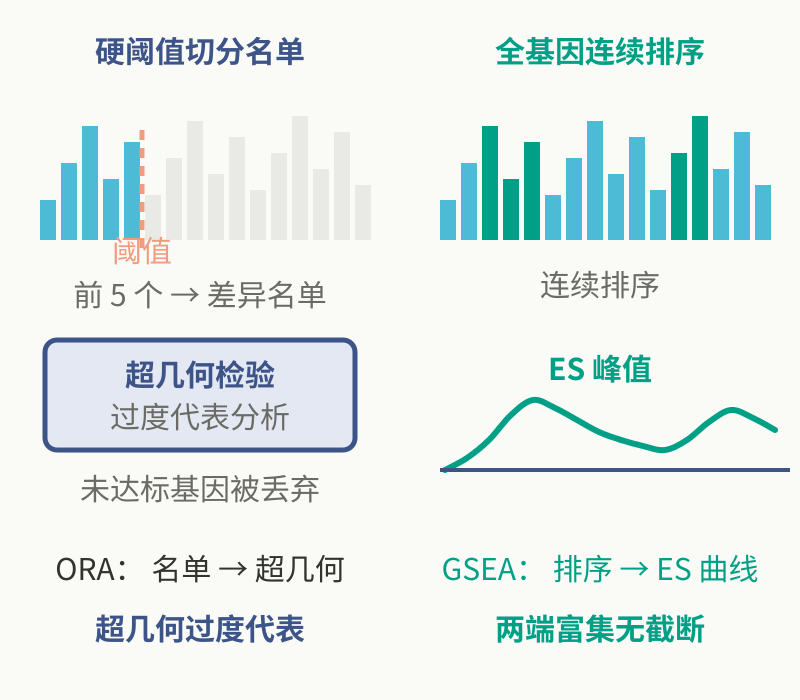

</div>
<div>

- ORA 依赖阈值，阈值一动结论就动
- GSEA 的排序向量要有方向，LRT 的 `stat` 不行
- 置换方式要写清：换标签还是换基因集

</div>
</div>

<div class="ref">教材 §14.4.8 ｜ 讲义 ④ 4.5</div>

<!--
旁白：两条富集路线分工很清楚。ORA 先拿阈值把基因卡成一份名单，再问某条通路的成员在名单里是否过量，用的是超几何检验；GSEA 不设阈值，把全部基因按一个有方向的统计量排序，看通路成员是不是聚在两端。分工的实质在这：整条通路只是轻微协同变化时，每个基因都过不了阈值，ORA 一个都富集不出来，GSEA 能抓到。三条易错点跟着来：ORA 依赖阈值，阈值一动结论就动，所以阈值要事先定；GSEA 的排序向量必须有方向，LRT 的 `stat` 是非负的，不行；置换方式——换样本标签还是换基因集——给出的零分布不同，方法学里要写清用的哪种。
-->

---

## 背景集是 ORA 最容易错的参数

<div class="cols">
<div>

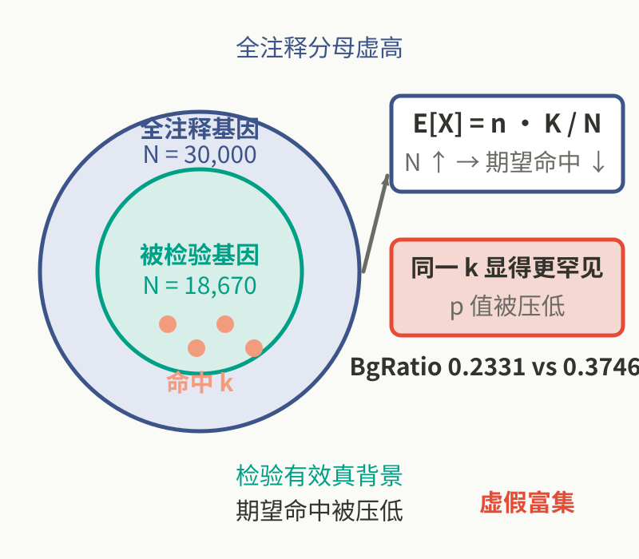

</div>
<div>

- 正确背景 = 有资格入选且 ID 映射成功的基因
- 名单按 `padj` 筛时，背景就是 `padj` 非 NA
- `rownames(res)` 含全零行与被过滤基因，别直接用
- 不传 `universe`，分母就是 OrgDb 全部注释基因

</div>
</div>

<div class="ref">教材 §14.4.8、§14.5.3 ｜ 讲义 ④ 4.5</div>


<!--
旁白：背景集是 ORA 最容易错的参数。先分清「背景」的两个量：背景集有多大，以及某条通路在背景里有多少成员，算期望命中数时两个都要用。图上四条其实是一个定义。不传 `universe`，软件就拿注释库里全部基因当背景，而你的实验根本没检测到其中一大半——分母被撑大，同样的命中数显得更极端，p 值系统性偏小。正确背景按跟名单相同的选择规则定：名单按 `padj` 筛，背景就是 `padj` 非 `NA` 且 ID 映射成功的基因。`rownames(res)` 不能直接用，里面混着全零行和被独立过滤掉的基因。也别把 `goseq` 当替代品，它管的是长度偏倚。总的原则：背景和名单必须是同一个总体，规则事先定好、写进方法学。
-->

---

## 背景用错，偏移有多大（合成算例）

<div class="cols">
<div>

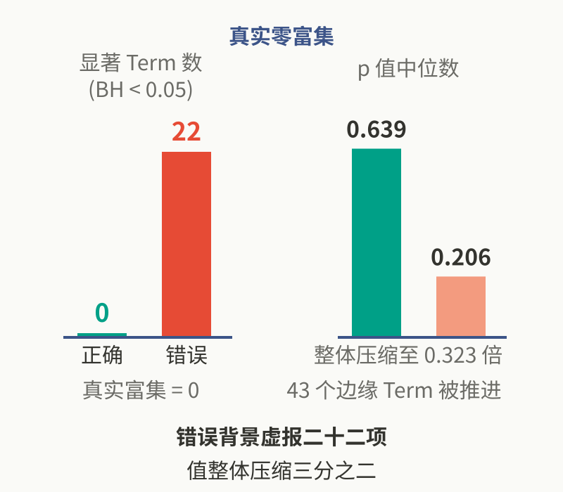

</div>
<div>

- 超几何手算（背景 10、通路 4、名单 3 个中 2 个）：`40/120 = 0.3333`
- 映射失败明显偏高：先查 keyType 与 ID 版本
- `qvalueCutoff` 默认 0.2，本书统一用 0.05

</div>
</div>

<div class="ref">教材 §14.4.8 ｜ 演示 `ch14_ora_background.py --selftest`（合成算例）</div>

<!--
旁白：偏移量有多大，拿合成算例摆出来——数字只对脚本那个生成模型成立。先看左边的超几何手算：背景 10 个基因、通路成员 4 个，名单 3 个、命中 2 个，上尾概率是 40/120，约三分之一。再看右边：背景换成 100，通路成员数和命中数都不动，分母大了，期望命中数从 1.2 掉到 0.12，同样两次命中就显得更极端，p 值掉到千分之几。「背景越大越容易显著」的算术根源就在这。注意前提：通路成员数没跟着变大，要是同步变大，方向要重算。另外两条实务：映射失败比例明显偏高，先查 `keyType` 和 ID 版本；`qvalueCutoff` 默认 0.2，本书统一收紧到 0.05。
-->

---

## `plotDispEsts()`：不看等于没做质控

<div class="cols">
<div>

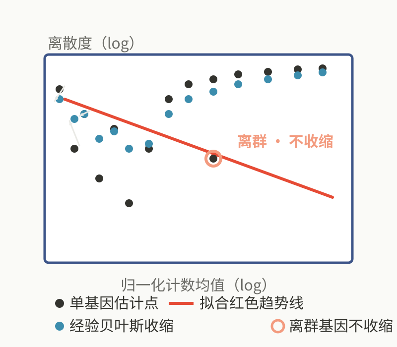

</div>
<div>

- 黑点云发散、蓝点拉成一条线：组内异质性大
- 红线水平且很高：重复间一致性差，先查实验
- 红线接近 0 且平坦：疑似技术重复当生物学重复
- `not well captured` 是提示不是错误，仍要看图

</div>
</div>

<div class="ref">教材 §14.4.9、§14.5.4 ｜ 讲义 ⑥ 6.3</div>

<!--
旁白：这张图不看，等于质控缺了一块。先认清四种元素：黑点是基因水平的离散度估计，红线是拟合出来的趋势，蓝点是收缩后的最终值，蓝圈标出的黑点是留在趋势线远上方、不参与收缩的离群基因。正常形态：红线从左上往右下再趋平，蓝点明显向红线收拢。对照表里的异常各有指向：黑点云极度发散、蓝点被拉成一条线，说明组内异质性大，收缩把真实变异盖住了；红线几乎水平又很高，说明重复之间一致性差，先回头查实验；红线贴近零还特别平，要怀疑技术重复被当成了生物学重复。末条提醒：`not well captured` 是提示不是错误，软件自动换了局部回归——但图你还是得自己看。
-->

---

<!-- _class: master statement -->

先把四张图与三行数字抄进记录，再打开结果表。

看到很长的显著清单，人会不自觉地为异常找解释。


<!--
旁白：这是一条实验纪律，不是口号：先把四张图和三行数字抄进记录，再打开结果表。顺序有讲究——看到一份很长的显著基因清单，人会不自觉地替异常找解释，再回头看离散度图时，矛盾就被「大概这批材料本身异质性大」这样的话抹平了。理性上知道该先看图，行为上常常相反，所以要靠顺序管住自己。三行数字是各样本的映射率、文库因子、`padj` 为空的计数；抄的时候顺手写上日期和软件版本，别人复现才知道你当时用的是哪个版本的默认行为。还有一层：这张图是后面「离群识别失效」的图像证据——两个重复下黑点云的上下界很宽，单个基因离红线远，可能只是抽样波动，分不开这两者，就别对单个基因下结论。
-->

---

<!-- _class: master figure -->

## 转录组测量三十年

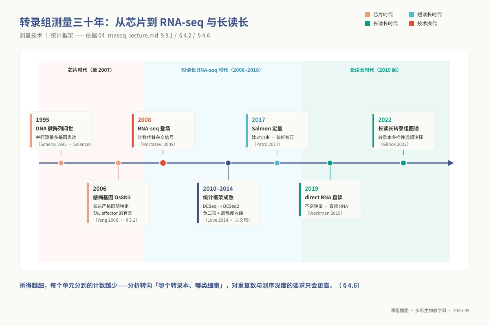

卡片等距不代表年份线性比例；2010–2014 是两篇文献跨度

<div class="ref">教材 §14.4.11 图 14-1 ｜ 讲义 ④ 4.6</div>

<!--
旁白：这张图把统计框架放回技术史。先看三条色带：芯片时代到 2007 年，短读长 RNA-seq 从 2008 年起，长读长从 2019 年起。七张卡片依次是 1995 年微阵列、2006 年感病基因的表达被证明跟随 TAL effector、2008 年 RNA-seq、2010 到 2014 年 DESeq 到 DESeq2 的统计框架成熟、2017 年 Salmon 的比对自由定量、2019 年 direct RNA 直读、2022 年人类多组织长读长图谱。读图有三个陷阱：卡片等距排列，横轴不代表年份的线性比例；「统计框架成熟」那个区间是两篇文献的跨度，不是哪个软件的发布年；底行那句——分析单元越细、每个单元分到的计数越少，对重复数与深度的要求只会更高——是后面失效条件的量感铺垫，不是修辞。
-->

---

## 技术前沿：更细的单元，更高的代价

- 长读长把转录本从推断变成直接观测
- 单核 RNA-seq 绕过解离，核内谱与胞质不同
- DTU 看转录本配比切换，基因总量不变
- 拆得越细，每个单元计数越少，重复越贵

<div class="ref">教材 §14.4.11 ｜ 讲义 ④ 4.6</div>

<!--
旁白：三个方向，共同点是分析单元更细，共同代价是更贵。长读长把转录本从推断对象变成直接观测：剪接位点成对出现，融合基因不用再靠短读长拼图；代价是 direct RNA 产量低、对 RNA 完整性要求高，眼下最务实的组合是短读长定量加长读长更新注释。单核 RNA-seq 绕过解离，冷冻样本和木质化组织也能测；代价是核内 RNA 谱跟胞质不同，跟常规定量的口径不能直接混用。DTU 问的是另一种调控：基因总量不变，转录本配比切换，用 Dirichlet-multinomial 框架检验占比。最后一句是共性账：拆得越细，每个单元分到的计数越少，重复和深度都得跟着加——恰好是最贵的两样。
-->

---

<!-- _class: master divider -->

<div class="num">V</div>

# 操作流程

流程骨架 · 三条命令 · 脚本边界

<!--
旁白：前面讲为什么，这里讲怎么做。只走一遍骨架：从 FASTQ 到候选清单分几步，每步的输入输出是什么，三条命令各管哪一段。细节留给实验指导，课上讲清顺序为什么不能颠倒。
-->

---

<!-- @section: procedure -->
## 从 FASTQ 到候选清单：顺序不能颠倒

<div class="cols">
<div>

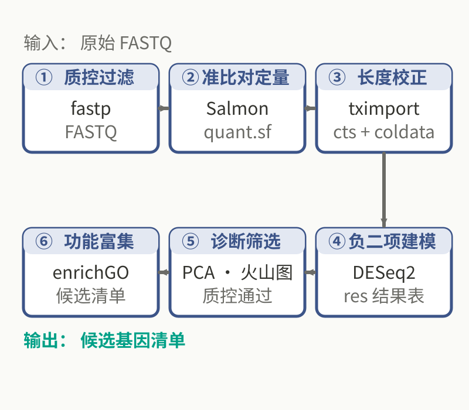

</div>
<div>

- 先做 PCA 再发现文库类型不一致，等于白跑
- 先看差异基因数再改预过滤，就是按结果调参

</div>
</div>

<div class="ref">教材 §14.6 ｜ 讲义 ⑤</div>


<!--
旁白：这张泳道图是整条流程的骨架，从左上往右下读：fastp 质控过滤，Salmon 准比对定量，tximport 汇总成基因级矩阵、带上长度信息，DESeq2 负二项建模，然后看 PCA、火山图这些诊断再定名单，最后功能富集。图下两条是顺序的代价：先做 PCA 才发现文库类型不一致，等于拿一份混了两种建库的数据讲批次，白跑；先看差异基因数再回头改预过滤阈值，就是按结果调参。顺序错了，每一步都算得对，结论却是错的。所以这页记的不是六个软件名，是六个检查点：每步跑完，知道该看哪个数、看到什么算对。
-->

---

## Salmon：先建 decoy 索引，再逐样本定量

```bash
grep '^>' genome.fa | sed 's/^>//' | cut -f1 > decoys.txt
cat transcripts.fa genome.fa > gentrome.fa
salmon index -t gentrome.fa -d decoys.txt -i salmon_idx -k 31 -p 16
salmon quant -i salmon_idx -l A -1 R1.fq.gz -2 R2.fq.gz \
             -p 8 --validateMappings --gcBias -o quant/${S}
```

- 脚本不含建索引：先按讲义 ⑤5.2 建好，用 `IDX=` 传入
- 建索引是计算活：`qsub` 提交，别在登录节点跑

<div class="ref">教材 §14.4.2、§14.6 ｜ 讲义 ⑤ 5.2</div>

<!--
旁白：代码分两段：建索引、定量。前三行建索引：从基因组 FASTA 里把序列名抓出来、去掉大于号、只留第一个字段，写进 decoys 文件；把转录本和基因组拼成 `gentrome.fa`，转录本在前、基因组在后，顺序不能反；然后 `salmon index`，`-k 31`，`-p 16` 是线程数。下面的 `salmon quant` 负责定量：`-l A` 让软件自己侦测文库类型，`--validateMappings` 是显式自证，`--gcBias` 开 GC 偏好校正，`-o` 指输出目录。两条提醒：课程脚本不含建索引，先建好、用 `IDX=` 传进去；建索引是计算活，走 `qsub`，别在登录节点跑。
-->

---

## STAR：需要坐标 BAM 时才走这条路

```bash
STAR --runMode genomeGenerate --genomeDir star_idx \
     --genomeFastaFiles genome.fa --sjdbGTFfile anno.gtf \
     --sjdbOverhang 149 --runThreadN 16
STAR --genomeDir star_idx --quantMode GeneCounts \
     --outSAMtype BAM SortedByCoordinate ...
```

- `--sjdbOverhang` 取读长减 1（150 bp 设例）
- 建索引动辄数十 GB：按 40G 申请属设例

<div class="ref">教材 §14.4.2 ｜ 讲义 ⑤ 5.3</div>

<!--
旁白：STAR 这条路，需要坐标 BAM 时才走。前半建索引：`--runMode genomeGenerate`，给基因组目录、FASTA 和注释 GTF；`--sjdbGTFfile` 把已知剪接位点预先注册进去。`--sjdbOverhang` 取读长减 1，150 bp 的读长就是 149——它定的是剪接位点两侧悬垂区段有多长，用来接住跨位点的读段：取小了跨位点的接不住，取大了白白占索引空间。后半比对：`--quantMode GeneCounts` 额外产出基因计数表，`--outSAMtype` 要坐标排序的 BAM。资源上提醒两条：建索引动辄几十 GB，作业申请 40G 是设例；内存不够时先想换 Salmon，而不是硬调参数。
-->

---

## R 管线：先把输入守住，再谈建模

<div class="cols">
<div>

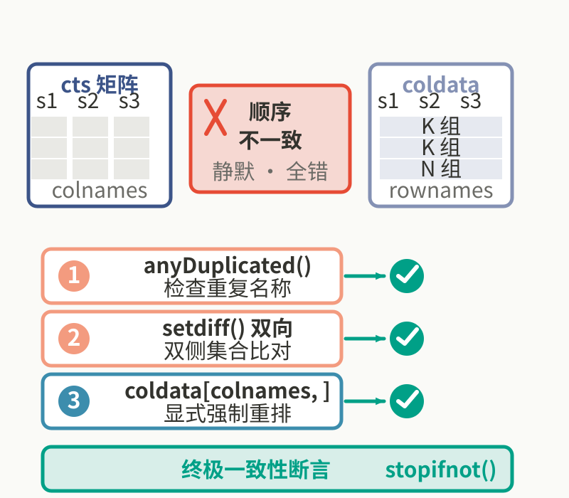

</div>
<div>

- `DESeqDataSetFromTximport()` 把长度当偏移量
- `DESeq(dds)` 默认 Wald；跑 LRT 时改用脚本副本
- `results()` 写全 `contrast`，分子分母不靠默认

</div>
</div>

<div class="ref">教材 §14.4.2、§14.4.5 ｜ 讲义 ⑤ 5.4</div>


<!--
旁白：R 侧讲三道防线，守住的是输入。头一道，用 `DESeqDataSetFromTximport()` 读入：它把转录本平均长度当偏移量留在模型里，不用你先除一遍。第二道，`DESeq()` 默认跑 Wald，时序比较要用 LRT 时改用脚本副本，别动课程脚本本身。第三道，`results()` 把 `contrast` 写全，分子分母都点名，不靠默认系数。三道的共同点：不让软件替你做隐含决定。图上还有一步没画：汇总完核对总量级，`sum(txi$counts)` 跟文库大小对得上，输入才算过关。这一步做对，后面一半的「跑通了但结果不对」都能提前拦下。
-->

---

## 预过滤：两种口径都合法，但要事先定

- 脚本用总计数口径 `rowSums(counts(dds)) >= 10`
- 讲义用逐样本口径，阈值取最小组重复数
- 本数据最小组重复数 = 2，不是 3
- 跑完再回头改阈值，就是按结果调参

<div class="ref">教材 §14.6 ｜ 讲义 ⑤ 5.4 ｜ 脚本 `04_deseq2_analysis.R`</div>


<!--
旁白：预过滤是进 `DESeq()` 之前的行筛选，跟 `results()` 里的独立过滤不是一回事，别混。两种口径都合法：脚本用总计数口径，一行总和达到 10 就留；讲义用逐样本口径，要求至少若干个样本各自达到 10，那个样本数取最小组的重复数——我们这份数据是 2，不是 3。关键是「事先定」：跑完看差异基因数再回头改阈值，就是按结果调参，写进方法学也站不住。预过滤改变的还有检验的基因总数，也就是多重校正的分母，所以选了哪种必须写进方法学。两种口径都对，不对的只有事后改。
-->

---

<!-- _class: master statement -->

脚本只做它声明的那一段。

`04_rnaseq_quant.sh` 不做质控与建索引；`04_deseq2_analysis.R` 不做 tximport 与富集。


<!--
旁白：脚本的边界在这：定量脚本不做质控与建索引，差异分析脚本不做汇总与富集，各只做它声明的那一段。为什么较这个真？出了问题，第一件事是判断故障在哪一段——脚本要是悄悄做了没声明的事，你就不知道该怪哪一步。结果不对时先问三句：这个数是谁算的；它拿到的输入是什么；它用的默认参数是哪个版本的默认。三问能解决大部分「跑通了但结果不对」，顺序也别反。页面上两行是边界清单，写报告时照这个格式写清每步由谁完成。还有一条纪律：每次跑完把命令和版本一起落盘，出了事才回得去那一段对输入。
-->

---

<!-- _class: master divider -->

<div class="num">VI</div>

# 结果解读

两个必看输出 · PCA · 结果表 · 四类失效

<!--
旁白：结果解读是理论部分的最后一节，也最实用：不教新方法，教判读顺序——两个定量输出、一张 PCA、一张离散度图，最后才是结果表。四类失效条件也在这节，每类都按现象、怎么察觉、怎么办讲。
-->

---

<!-- @section: interpretation -->
## 先看 Salmon 的两个输出

- 映射率：诊断量，先做组内比较
- 课程口径（水稻）> 80%；讲义经验 70–90%
- `expected_format` 必须全样本一致
- 某样本单独是 `IU`：建库可能不同，分析前解决

<div class="ref">教材 §14.4.9 ｜ 06_data/master/README.md（预期，未实测）</div>


<!--
旁白：Salmon 跑完，先看两样。一样是映射率：多大比例的读段被成功分到转录本上。它是诊断量，不是判据，软件文档没给「多少算正常」——课程数据对水稻的口径是 80% 以上，讲义的经验范围是 70% 到 90%，都是经验口径。看的时候先做组内比较，同一批样本应当彼此接近。另一样是文库类型：`expected_format` 必须全样本一致。某个样本单独跑出非链特异，先当成「它的建库可能跟别人不一样」的线索，结合建库记录和质控确认；确认不同就得在分析前解决，不能当小差异略过。为什么不设硬阈值？物种和建库不同，分布差别很大，硬阈值会把正常样本判成异常。它的用处是比较，不是判决。
-->

---

## 映射率低的时候先查什么

<div class="cols">
<div>

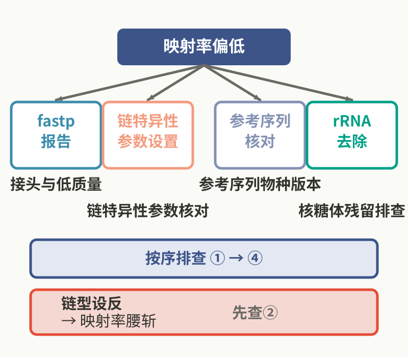

</div>
<div>

- `grep -c '^>'` 看条数量级：转录本应几万条
- 低于 30%：多半把基因组 FASTA 当转录本用
- 个别样本低：回 MultiQC 找 rRNA、gDNA、降解

</div>
</div>

<div class="ref">教材 §14.4.9 ｜ 讲义 ⑥ 6.1</div>


<!--
旁白：映射率低，先分两种情形。所有样本一起低，优先查索引：`grep -c '^>'` 看参考条数量级，转录本应该是几万条，要是只有几百上千条，多半是把基因组 FASTA 当转录本用了，映射率会低到很难看。个别样本低，回质控汇总里找：rRNA 残留、gDNA 污染、样本降解，这三种都会让那一个样本的分布跟别人不一样。为什么先做组内比较？因为样本之间的差异直接影响组间比较，比整体偏低更值得先查。还有一条：整体偏低但样本之间很齐，也可能只是参考集版本跟注释对不上，别急着换物种。排查的次序永远是先粗后细，最粗的错排掉，再查细的。
-->

---

## PCA：先回答批次还是处理主导

<div class="cols">
<div>

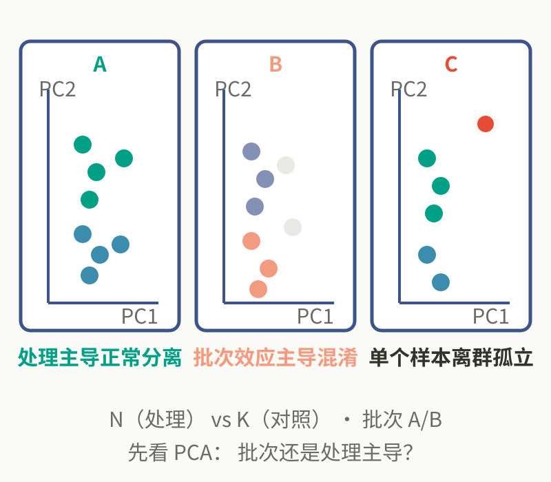

</div>
<div>

- 用 vst 矩阵做 PCA，不用 counts 或 TPM
- 分离不等于已证明：要结合载荷基因与记录
- 预期（未实测）：时间点比 A/B 分得开

</div>
</div>

<div class="ref">教材 §14.4.9、§14.6 ｜ 讲义 ⑥ 6.2</div>


<!--
旁白：PCA 用 `vst` 矩阵做，不用计数也不用 TPM。看图几种形态：第一主成分要是把两个重复分开、处理混在一起，说明批次是这批数据的主要方差来源，设计里就该有 `rep`；某个重复远离同组另一个，先查质控、文库因子和残差，要剔除，理由得独立于结论写进报告。有一条边界必须说清：分离不等于原因已被证明。它可能是批次，也可能是取材时间、环境或样本处理，要结合载荷基因和实验记录一起判断。我们这份数据的预期是时间点比 A/B 分得开——注意这是预期，没在集群上实测。所以 PCA 只回答「先查哪一项」，不回答「是什么原因」；把载荷基因和实验记录翻出来，才谈得上解释。
-->

---

## 结果表本身也有判据

<div class="cols">
<div>

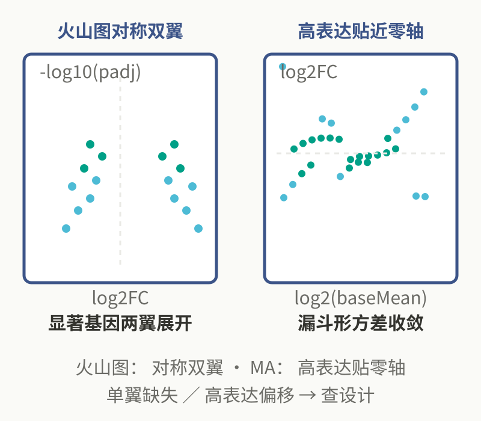

</div>
<div>

- 差异基因为 0 而 PCA 分得开：先查设计与对比方向
- `log2FC` 出现 ±20：一组几乎全 0，先看原始计数
- 「一半以上」的量级示例是设例，不是判据

</div>
</div>

<div class="ref">教材 §14.4.9 ｜ 讲义 ⑥ 6.4</div>

<!--
旁白：结果表本身也有判据。左边火山图，右边 MA 图，两张对着看。差异基因为零而 PCA 分得开：先查 `resultsNames`、`contrast` 方向和设计公式最后一项，再看列序有没有贴错。`log2FC` 出现正负二十级别的极值：一组几乎全零、另一组有表达，先回原始计数；收缩前出现属正常，收缩后还是极值才要单独核查。最有决定性的是 MA 图：正常应该围绕零线对称，系统性上下不对称，多半是归一化没做好，而不是「逆境下大规模关闭生长基因」这类好听的战略性解释。页面上「一半以上」的量级是设例，用来定先查哪一项的次序，不是判据。
-->

---

<!-- _class: master warn -->
## 结果不对时长什么样（一）：喂了取整 TPM

<div class="cols">
<div>

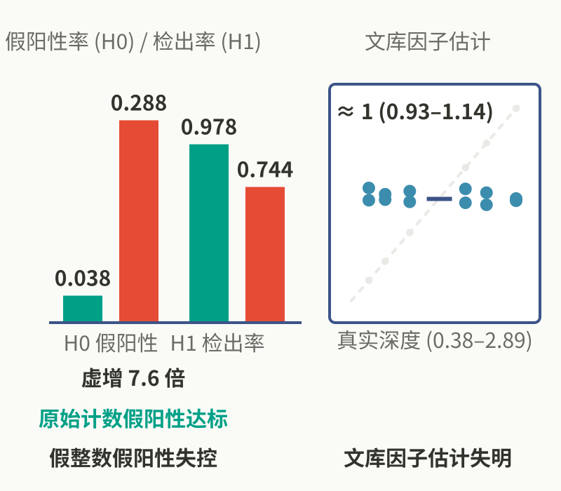

</div>
<div>

- 结果表六列齐全、`padj` 分布正常，不报错
- 怎么察觉：查输入量纲，`sum(counts)` 与文库对账
- 取整只让类型检查放行，量纲没有变

</div>
</div>

<div class="ref">教材 §14.5.1 ｜ 演示 `ch14_tpm_rounding.py --selftest` Part 1（合成算例）</div>

<!--
旁白：第一条失效：把取整后的 TPM 喂给 DESeq2。看图这条链：输入本来是按长度和深度除过的相对量，取整之后全变整数，类型检查放行，软件打印一句「转成整数模式」就继续跑。结果表六列齐全，`padj` 分布正常，什么都不报。错在哪？量纲。负二项的方差结构假设计数自带抽样方差，TPM 的数值已经不带「测到几条读段」的信息，文库大小因子跟着失明。怎么察觉？三处查：输入的来源和量纲；`sum(counts)` 的量级跟文库大小对不对得上；`sizeFactors` 是不是几乎全贴着 1。取整只让类型检查放行，量纲没变——检查放行，不等于检查通过。
-->

---

<!-- _class: master warn -->
## 结果不对时长什么样（二）：列序与行序不一致

<div class="cols">
<div>

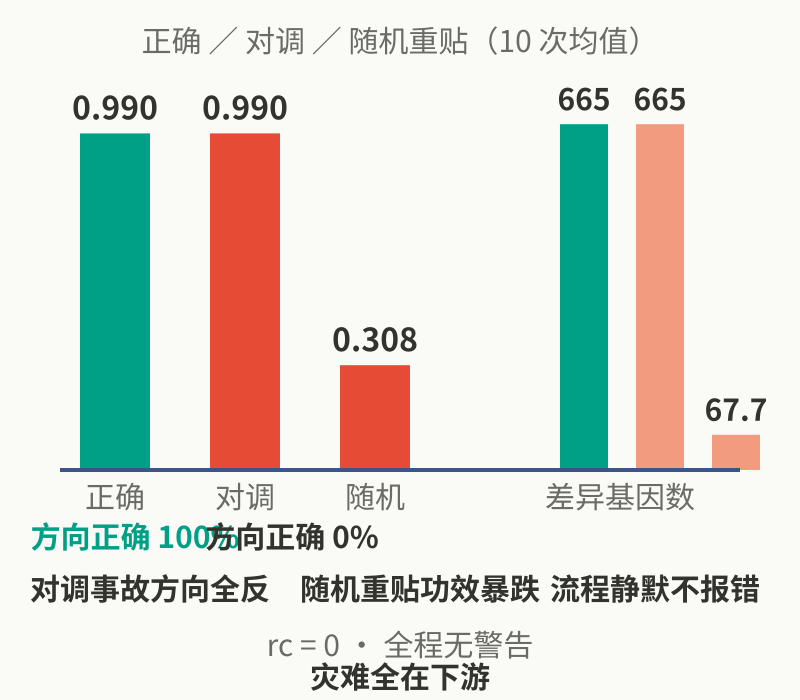

</div>
<div>

- 顺序不同会报错；集合不同先撞尺寸检查
- 无列名时按位置贴标签，零报错
- 怎么察觉：三行断言，加 `colSums` 与分组对账

</div>
</div>

<div class="ref">教材 §14.5.2 ｜ 演示 `ch14_sample_mismatch.py --selftest`（合成算例）</div>

<!--
旁白：第二条失效：计数矩阵的列序跟样本表的行序对不上。软件的行为分三档：顺序不同会报错，拦下；集合不同先撞尺寸检查；最危险的是矩阵没有列名——软件按位置把样本表行名贴上去，零报错，标签全错。这类事故几乎都出在同一个环节：元数据表是手工排的，矩阵是按文件名排序读进来的，字符串排序和数字排序不一样，`S10` 会排到 `S2` 前面，于是顺序错开、集合相同。后果是沉默的：你拿到一份几乎没有差异基因的报告，而 PCA 上两组明明分得开。察觉靠三行断言：按矩阵列序重排样本表、重排后再断言一致、没有列名直接拒绝；再加一次 `colSums` 跟分组对账。
-->

---

<!-- _class: master warn -->
## 结果不对时长什么样（三）：参照系选错

<div class="cols">
<div>

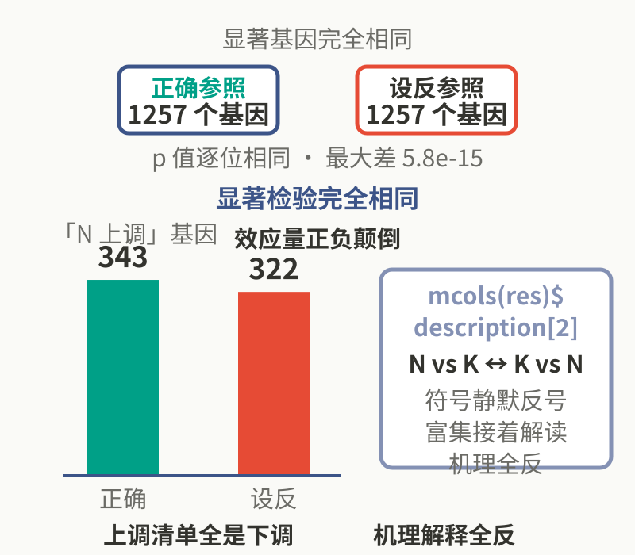

</div>
<div>

- 343 与 322 不是同一批：两条尾巴本就不等长
- 怎么察觉：方向靠三道闸，背景看 universe 大小对账

</div>
</div>

<div class="ref">教材 §14.5.3 ｜ 演示 `ch14_reversed_reflevel.py`、`ch14_ora_background.py`</div>


<!--
旁白：第三条失效：参照系选错，图上两个半幅，一个是方向，一个是分母。方向那半：因子水平默认按字母序，`results()` 默认报最后一个系数，处理名排在对照名前面时全部反号。图上两个数要读懂：设反前后显著基因数都是 1257，p 值逐位一致，变的只有符号；「上调」清单从 343 变成 322——不是同一批基因少了，是符号翻转后「大于 1」等于原来的「小于负 1」，两条尾巴本来就不一样长。分母那半：背景用错，p 值系统性偏小，前面算过账。察觉：方向靠三道闸，背景看 `universe` 大小对账。写报告时把两样都写进去：对比是谁对谁、背景集多大——这两句能挡掉大部分追问。
-->

---

<!-- _class: master warn -->
## 结果不对时长什么样（四）：只有 2 个重复

<div class="cols">
<div>

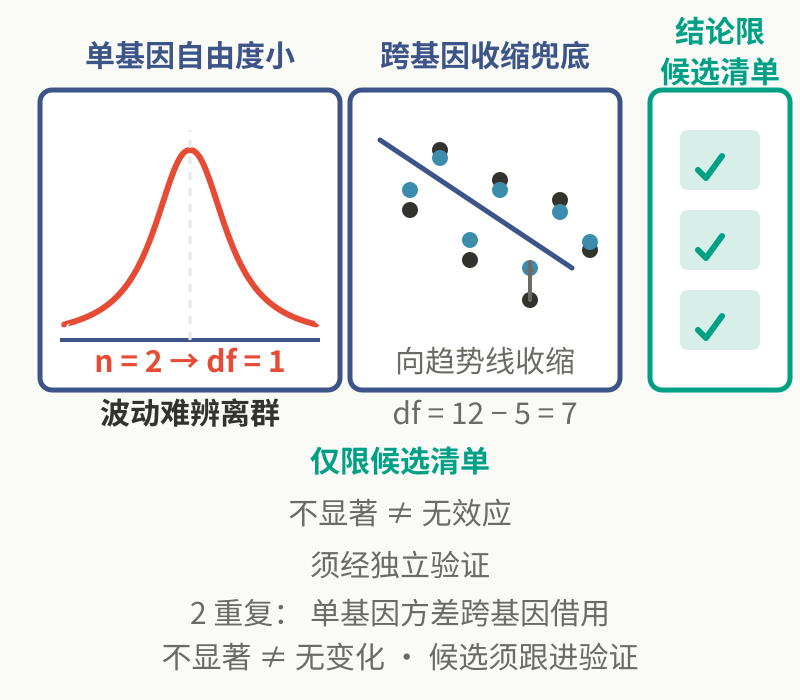

</div>
<div>

- 想用 Cook's 找离群，发现路径不可触发
- 怎么察觉：趋势线可辨、蓝点收拢、NA 构成符合预期
- 不能做的：把「不显著」读成「没有差异」

</div>
</div>

<div class="ref">教材 §14.5.4 ｜ 讲义 ⑦</div>


<!--
旁白：第四条失效：只有两个生物学重复。组内两个观测只有 1 个自由度，用它估方差，抽样波动极大，所以最终的离散度主要靠跨基因收缩撑起来。想用 Cook's 距离找离群，会发现路径根本不可触发——Cook's 只在同一格有三个及以上样本时才算，替换更是要求格内样本数达到默认的 7。所以准确的说法是门槛没达到，不是软件算不出距离。察觉看三处：趋势线是否可辨、蓝点有没有向红线收拢、`padj` 为空的构成是否符合「全零加独立过滤」的预期。有一条推断不能做：把「不显著」读成「没有差异」。能做的三件事——估趋势离散度、逐基因检验、给候选清单——也要如实写清，结论的强度就到这里。补重复之前，别拿 p 值排序代替效应量报告。
-->

---

<!-- @section: stats_plugin -->
## 离散度：借全基因组的信息，分三步

| 步 | 做什么 | `mcols(dds)` 列 |
|---|---|---|
| ① 基因水平估计 | 每基因最大似然 | `dispGeneEst` |
| ② 拟合趋势 | `α = a/μ + b` | `dispFit` |
| ③ 经验贝叶斯收缩 | 向趋势线拉 | `dispersion` |

<div class="ref">教材 §14.4.4 ｜ 讲义 ⑦-1</div>


<!--
旁白：DESeq2 借全基因组的信息给每个基因的离散度打补丁，三步，表格三行对应三个中间量。先让每个基因自己做最大似然估计，得到粗糙的基因水平估计——两三个重复下这一步极不稳。再以均值为横轴拟合一条趋势线，回答「这个表达水平的基因通常离散度多大」。最后以趋势线为先验，把每个基因的估计往线上收缩，得到最终用于检验的值。收缩的幅度跟不确定度挂钩：低表达、数据稀疏的拉得最狠，高表达的几乎不动。所以最终那个数，很大程度上是「同水平基因的平均」，不是这个基因自己的。表里那两个中间量名是核对入口：在 `mcols(dds)` 里翻一翻，收缩有没有真的发生，一眼可见。
-->

---

## 为什么要收缩：方差随均值增长

<div class="cols">
<div>

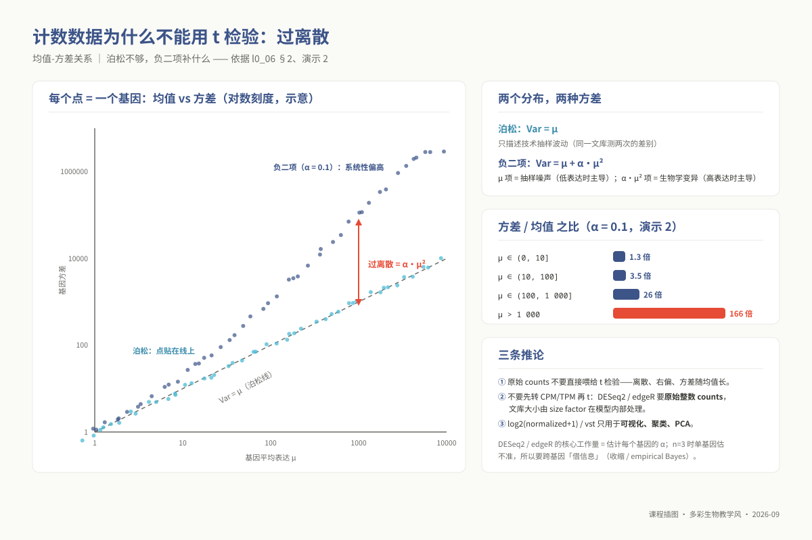

</div>
<div>

- 泊松只描述抽样噪声，真实数据过离散
- 单基因方差在 2 重复下几乎估不准
- 收缩用一点偏差换方差的大幅下降

</div>
</div>

<div class="ref">教材 §14.4.4 ｜ 图 12-2（第 12 章）｜ 讲义 ⑦-1</div>


<!--
旁白：这张图解释收缩为什么能救命。横轴均值，纵轴离散度，黑点是一个个基因。趋势很清楚：低表达端离散度高、点散；高表达端离散度低、点收。根源在模型里：泊松只描述抽样噪声，真实数据过离散，方差除均值项之外还有一项随均值平方增长。两三个重复下，单个基因的方差几乎估不准，只能用跨基因的趋势换稳定性——这条曲线汇集了上万个基因的信息，对单个基因必然有偏，但方差小得多。收缩就是在「几乎无偏但不稳」和「有偏但稳」之间按不确定度加权，用一点偏差换方差的大幅下降。看图时别盯着某个黑点离红线多远：两个重复下，单点的偏离几乎读不出信息，先看整体趋势像不像样。
-->

---

## 两个自由度，别混着用

- 组内 2 个观测：`2 − 1 = 1`，单基因方差极不稳
- 全模型残差：`12 − 5 = 7`，趋势线用它
- 7 对拟合趋势够用，对单基因仍很噪
- 最终 α 很大程度是「同水平基因的平均」

<div class="ref">教材 §14.4.4、§14.5.4 ｜ 手算</div>


<!--
旁白：两个自由度要分开记。组内的：一个实验格只有两个观测，组内方差的自由度是 2 减 1 等于 1，估出来的方差抽样波动极大。全模型的：12 个样本一起拟合，5 个系数，残差自由度 12 减 5 等于 7——DESeq2 用的是这个，它并不逐格估方差。7 对拟合一条跨基因的趋势线够用，对单个基因自己的方差仍然很噪，所以才要收缩。把这两个数分开，你就明白两件事：「每组两个重复」为什么还能跑出结果表——靠的是跨基因借信息，不是这份数据自己有多少样本；以及为什么清单里每个基因都不算被独立检验过。这决定了结论能写到什么强度。
-->

---

## 独立过滤：被过滤者只有 `padj` 是 NA

<div class="cols">
<div>

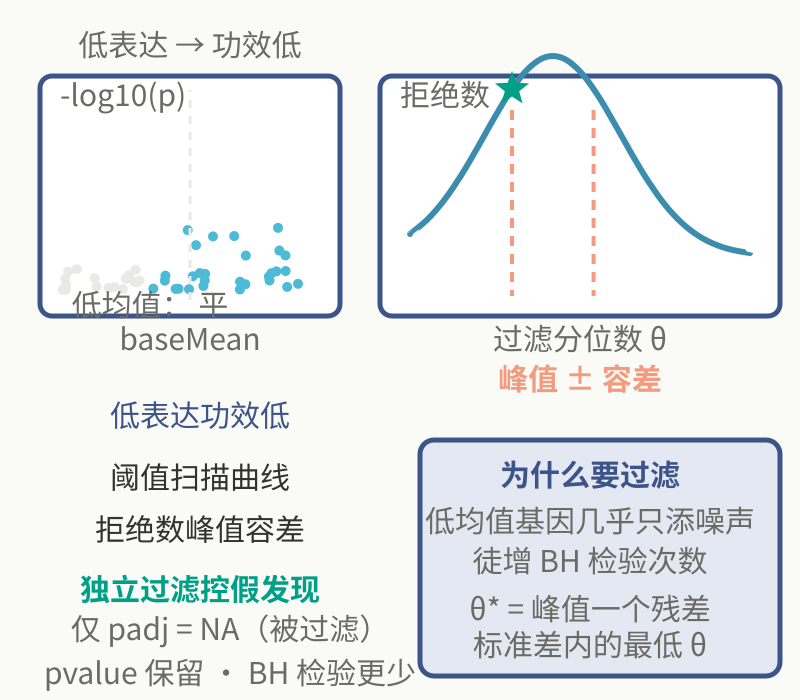

</div>
<div>

- 以 `baseMean` 为过滤统计量，与检验统计量独立
- `results(alpha=)` 要与实际筛选阈值一致
- 用 `pvalue` 捞回被过滤基因，等于放弃 FDR 控制

</div>
</div>

<div class="ref">教材 §14.4.6 ｜ 讲义 ⑦-3</div>


<!--
旁白：独立过滤这个机制单独说。它拿 `baseMean` 当过滤统计量——这个量在零假设下跟检验统计量独立，「独立过滤」的名字就是这么来的。算法扫一系列分位数阈值，选让拒绝数最多的那个。被过滤的基因，`pvalue` 有值、`padj` 被置空，所以下游只看得到 `padj` 是 `NA`。为什么说它是主动减法？检验总数少了，其余基因的检出就上去了，这是拿清单长度换功效。两条操作纪律：`results(alpha=)` 里的 alpha 要跟实际筛选阈值一致，写 0.05 就按 0.05 筛；用原始 p 值把被过滤的基因捞回来，等于放弃 FDR 控制。诊断入口是 `metadata(res)$filterThreshold`，写方法学时报出来，别人就知道你卡在哪一档。
-->

---

## 两个收缩要分开：一个改 p 值，一个不改

<div class="cols">
<div>

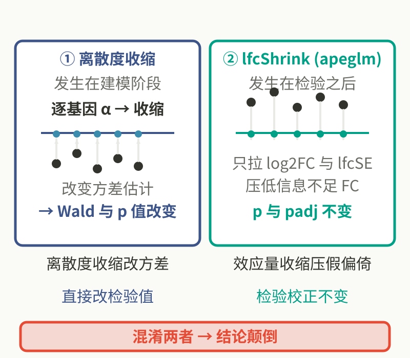

</div>
<div>

- (`1,0,2`) vs (`12,9,15`)：`log2(12/1) = 3.585`
- 收缩后 `2.686`（本机现跑，课程环境未复跑）
- 排序与热图用收缩后值，显著性仍看 `padj`

</div>
</div>

<div class="ref">教材 §14.4.6 ｜ 讲义 ⑦-4 ｜ 演示见教材旁注</div>


<!--
旁白：两个收缩要分开：图上左边是离散度收缩，右边是对数倍数变化收缩。区别在发生的位置。离散度收缩在拟合阶段，改变检验本身，所以 p 值会变；倍数变化收缩在结果阶段，只把效应量和它的标准误往 0 拉，`pvalue` 和 `padj` 原样不动。中间那组数走一遍：对照组三个计数、处理组三个计数，算术平均是 1 和 12，手算的对数倍数变化是 3.585；模型拟合的最大似然估计是 3.576，收缩后掉到 2.686——低表达、高不确定度，被拉得最多。报告口径随之定：排序、火山图、热图、GSEA 的排序向量用收缩后的值；显著性判断仍然看 `padj`。一句话：离散度收缩管「信不信」，倍数收缩管「多大」。
-->

---

## 两个阈值是两件事，报告要写三件事

<div class="cols">
<div>

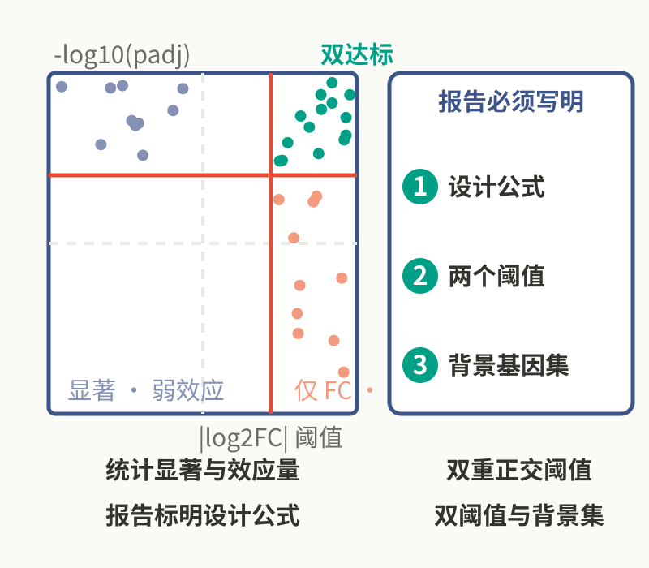

</div>
<div>

- `padj < 0.05` 是统计判据
- `|log2FC| > 1` 是效应量判据，二者独立
- 要把效应量并入检验：`lfcThreshold = 1`

</div>
</div>

<div class="ref">教材 §14.4.6、§14.5.4 ｜ 讲义 ⑦-5 ｜ 作业占 30%</div>


<!--
旁白：两个阈值是两件事。看图四个象限：横轴效应量，纵轴显著性。`padj` 小于 0.05 是统计判据，`log2FC` 绝对值大于 1 是效应量判据，两条互相独立，所以基因分四类。最常见的错误是把两个条件当回事后截取，看到基因数漂亮就收工——这时 `padj` 只说明「有没有」，不说明「大不大」。想把效应量并进检验本身，用 `lfcThreshold`，零假设变成「效应不超过这个值」，这时的 `padj` 才真正对应「倍数够大而且显著」。报告里要写三件事：设计公式与模型、两个阈值、富集背景集。两个判据都得事先声明，不能看完结果再挑一个顺手的。
-->

---

<!-- @section: troubleshooting -->
<!-- _class: master warn -->
## 常见错误一：包找不到

- `no package called 'tximport'`：新版 yml 已包含
- 集群旧环境若未重装，仍会遇到
- 登录节点 `mamba install` 补装，再回计算节点
- 环境版本写进方法学：DESeq2 1.42.0

<div class="ref">教材 §14.3 ｜ 讲义 ⑨-E0 ｜ `env_master_transcriptome.yml`</div>


<!--
旁白：常见错误第一类：包找不到。报错原文是 `no package called 'tximport'`。原因分两层：新版环境文件已经把这个包带上，但集群上的旧环境没重装，照样会撞上。解法是在登录节点用 `mamba` 补装，装完回计算节点——装包是环境操作，留在登录节点没问题。顺序别搞反：先确认环境名，再装，再回计算节点复跑一次版本检查。还有一条容易被漏：环境版本要写进方法学，比如 `DESeq2` 是 1.42.0——写清版本，别人才知道你报的默认行为是哪个版本的默认。最后一句：旧环境能跑就别乱动，动了就得记进方法学。
-->

---

<!-- _class: master warn -->
## 常见错误二：设计不可估

- 表里的 0 格只是信号：判据是查设计矩阵的秩
- 删批次项不能消除混杂，要改设计
- 1 vs 1：残差自由度 0，α 估不出来
- 补不了重复：只报倍数变化，不做显著性

<div class="ref">教材 §14.4.5 ｜ 讲义 ⑨-E4、E5</div>


<!--
旁白：常见错误第二类：设计不可估，图上四条。表里出现 0 格只是信号，不是判据，要去看设计矩阵的秩。删掉批次项消除不了混杂，只是把它藏起来，正路是改设计，让处理和批次拆得开。一比一的设计残差自由度为零，离散度估不出来，软件直接拒绝。补不了重复的，只报倍数变化，不做显著性检验——我们这份数据两个重复已经是最低限度，再少就什么都估不出来。四条里第一种最容易误判：0 格看着像一个具体证据，秩亏却是个抽象判断，人会盯着表发愣而不去算秩。停下来算一次秩，比事后解释一个跑出来的结果便宜得多。本讲唯一「报错反而是好事」的，就是它。
-->

---

<!-- _class: master warn -->
## 常见错误三：内存与索引

- `not enough memory for BAM sorting`：建索引吃内存
- 申请 40G 属设例；也可以改用 Salmon
- `Only ... fragments were mapped`：索引用了基因组
- `grep -c '^>'` 看参考条数量级

<div class="ref">教材 §14.4.2、§14.4.9 ｜ 讲义 ⑨-E8</div>


<!--
旁白：常见错误第三类：内存与索引，都出在 STAR 这条路上。报 `not enough memory for BAM sorting`，是建索引和排序吃内存；作业申请 40G 是设例，不是标准答案，只要表达量，改走 Salmon 也是正路。报 `Only ... fragments were mapped`，映射率低得反常，最常见的原因是索引用错——把基因组 FASTA 当成了转录本。察觉很简单：`grep -c '^>'` 看一眼参考的条数量级，转录本应该是几万条。提醒一句：这两条报错原文以集群日志为准，这里只是定性引用，别把某一句当成普适判据。内存报错换工具，索引报错换文件，先分清是哪一类再动手。
-->

---

<!-- @section: wrapup -->
## 实践任务卡（2 h）

| 步 | 做什么 |
|---|---|
| 1 | `qsub 04_salmon_index.job` 建 decoy 索引 |
| 2 | `qsub 04_fastp.job` 清洗，重写样本表 |
| 3 | `qsub -v …` 跑 `04_rnaseq_quant.sh` |
| 4 | `qsub 04_tximport.job` 汇总，核对 `sum(txi$counts)` |

- DESeq2：`qsub 04_deseq2.job`（作业内带四个参数与 Rscript）
- 富集：讲义 ⑤5.4 代码；水稻 OrgDb 先问助教

<div class="ref">教材 §14.6 ｜ 讲义 ⑤ 5.2–5.4 ｜ 作业 m04 权重 5%</div>


<!--
旁白：上机两小时，任务卡四步加两段。索引作业先提交——它没建好，后面全卡着。清洗排在第二，注意清洗完要重写样本表，这一步最容易被跳过。定量用 `qsub -v` 把参数传进脚本，逐样本跑 Salmon。汇总跑完第一件事：核对 `sum(txi$counts)` 的总量级。下半段是差异分析和富集：差异分析用作业脚本，作业里带四个参数和 `Rscript`；富集代码在讲义里，水稻的注释库先问助教。所有计算走 `qsub`，登录节点只做编辑和下载。索引还没建完就先做清洗，两件事不冲突——但样本表必须在定量之前定稿。
-->

---

## 思考练习：讲义 ⑩ 八题

- Q1 验证四包在环境中并给出版本号
- Q3 三行代码数出三种 `padj` 为 NA
- Q5 LRT 里 `padj` 与 `log2FC` 看起来矛盾吗
- Q8 开放题：自己课题的方案 200–250 字

<div class="ref">教材 §14.7 习题 ｜ 讲义 ⑩</div>


<!--
旁白：讲义八道题，课上只点四道。Q1 是环境核验：四个包跑一遍、记下版本号，方法学里要用。Q3 最实用：三行代码把三种 `padj` 为空的情形分别数出来——数得出来，才算真懂那棵决策树。Q5 问 LRT 表里 `padj` 与 `log2FC` 看起来矛不矛盾，考的是两者来源不同。Q8 是开放题：写自己课题的方案，两百到两百五十字，设计公式、两个阈值、背景集、功效边界四样都得进去。其余留作课后。写 Q8 时留意一点：两百多字里别出现「显著上调」这种没阈值、没方向的空话，每一句都要能被别人按你的方法学复现——这是全讲最像真实工作的一道练习。
-->

---

## 实验指导与收尾

- 上机时手边打开 `11_lab_guides/master/04_rnaseq_lab.md`
- 演示脚本在课程仓库根目录运行：`python3 textbook/demos/...`
- 文献只给指针（讲义 ⑪），本 deck 不重复列

**交出去的是一份候选清单加一张 vst 矩阵。**

<div class="ref">教材 §14.6、§14.7 ｜ 讲义 ⑩、⑪</div>


<!--
旁白：收尾交代三件事和一句话。上机时手边打开实验指导，每一步的检查点、出错信号、对应教材节号都在里面，比幻灯片细。演示脚本在课程仓库根目录运行，路径照页面这条写。文献只给指针，讲义里有清单，这份 deck 不重复列。页面最后那句是本讲交付物：交出去的是一份候选清单，加一张 `vst` 矩阵。清单只到候选这一步，要不要写成结论，取决于你有没有独立验证。给自学的同学补一句：这份 deck 每页都有旁白，课后可以照着过一遍；但真正的理解来自自己跑一遍数据、看那几个诊断数字动起来。对不上的地方，先回教材第 14 章查判据。
-->
