<!-- @section: cover -->
<!-- _class: master cover -->

# m05 ｜ 转录调控与表观组

**一张峰表格式全对，结论仍可能全错：这个峰凭什么算数，又对应哪个基因。**

<div class="meta">

- 4 学时（2 h 理论 + 2 h 实践）｜ 环境 `ngs_ms_transcriptome`
- 讲义 `02_lectures/master/topic05_regulome/05_regulome_lecture.md`
- 教材 §15.1–§15.6 ｜ 脚本 `05_peak_calling.sh`、`05_peak_annotation.R`
- 紧接 m04：ATAC 与 RNA-seq 是同批样本

</div>

<!--
旁白：这一讲接着上一讲往下走。差异基因表你手里已经有了，可它只告诉你变了多少，没说为什么变。今天就补这一段：一个峰凭什么算数，它又对应哪个基因。数据还是 m04 那批样本，环境也不用换，直接开工。
-->

---

<!-- _class: master divider -->

<div class="num">01</div>

# 学习目标

两条主线：选型与判读

<!--
旁白：先看目标。两条主线：前半场解决做哪类实验、做出来怎么读，后半场把每一步变成你能动手做的检查。现在只求个轮廓，具体做法讲到的时候，你自然知道该抓哪条。
-->

---

<!-- @section: objectives -->
## 学完你应当能够（一）：选型、对照、命令

- 用九维表判断课题该用哪类调控组技术
- 说清 input 与 IgG 各校正哪一类背景
- 为 narrow、broad、ATAC 各写出关键参数
- 解释缺对照时背景模型为什么会失效

<div class="ref">教材 §15.2、§15.4.1–§15.4.3 ｜ LO15-03、LO15-04 ｜ 讲义 ①</div>

<!--
旁白：这一组管两件事：选型和命令。先说九维表，它不是拿来背的，是课题开跑前让你逐格问自己的清单：要回答什么、要不要抗体、对照怎么配、坑在哪。再说 input 和 IgG，两个都叫对照，校正的却不是同一种背景：input 是同一批染色质不走沉淀这一步，打断偏好、拷贝数这些跟结合无关的梯度全记在里面；IgG 只回答抗体自己粘了什么。所以 IgG 顶替不了 input，这不是抠细节，它决定你缺的是哪一类校正。参数那一条，窄峰、宽峰、ATAC 每个关键参数背后都有一段物理理由，照抄别人的命令不算懂。最值钱的是最后一条：缺对照时软件一声不吭，你得能讲清背景模型是怎么塌的。四条其实是同一条链，开头选错，后面的对照和参数都白搭。
-->

---

## 学完你应当能够（二）：指标、重复、注释、联合

- 判读 FRiP、NSC/RSC、NRF/PBC 与 TSSE
- 运行 IDR，说清它优于取交集的地方
- 论证「最近基因不等于靶基因」的成因
- 用匹配背景重跑 motif，不被极小 p 值带走

<div class="ref">教材 §15.2、§15.4.4–§15.4.7 ｜ LO15-05、LO15-06</div>

<!--
旁白：第二组管结果，四个词：指标、重复、注释、联合。FRiP、NSC、RSC、NRF、TSSE 这些质控指标，每一个都带着适用域，挪到别的物种、别的深度就作废——阈值本来就是在某批数据上画出来的经验线，不是定理，这大概是本章最常见的一类误用。IDR 要会跑也要会讲：它比两个重复各砍一刀再取交集稳，稳在它不看各自的硬阈值，看两份排名能不能对上。注释那一条不是措辞讲究：最近基因可不可信，取决于真实调控距离跟基因间距的比值——比值接近一，最近基因就基本靠不住。最后是 motif，背景选错足以造出一个排第一的假 motif，所以先问背景怎么来的，再去看那个小得吓人的 p 值。前一组让你会做，这一组让你会读；会读更难，因为读的时候没有人给你报错。
-->

---

<!-- @section: prerequisites -->
## 前置检查：四个 L0 模块

| 模块 | 本讲用在哪 | 不过关的症状 |
|---|---|---|
| `l0_01_linux` | 全流程在集群、`qsub` 投递 | 在登录节点跑比对 |
| `l0_04_formats` | `-F 1804`、narrowPeak 十列 | 不知 1804 滤掉什么 |
| `l0_05_qc` | 判断重复率红灯是不是真问题 | 见 Duplication 就删数据 |
| `l0_06_stats` | 泊松、BH 校正、置换检验 | 把 q 值当 p 值读 |

- 所有计算经 `qsub`；登录节点只下载、建环境、编辑
- ATAC 富集区本来就高重复，红灯不等于删数据

<div class="ref">教材 §15.3 ｜ 讲义 ② ｜ 自测 `l0_06_stats` Q5、Q7、Q10</div>

<!--
旁白：上机之前，对着这张表花两分钟自查。Linux 那格别当成走过场：整个流程都要在集群上投作业，登录节点只用来下载、建环境、改文件；一旦顺手在登录节点跑起比对，管理员会把整个流程掐掉。格式那格，要能说出 1804 是哪五类标志位凑出来的。质控那格是本专题最容易冤枉数据的地方：ATAC 富集区本身就高重复，看到重复率红灯先别删数据，分清它是生物学上的高信号还是建库造成的技术假象。统计那格最要命，把 q 值当 p 值读，后面每个结论都会松一档。自测就挑统计模块的三道题，正好对应多重检验、重复率和置换检验。前两格管你能不能跑起来，后两格管跑出来的结果信不信；历年真正卡住人的，多半是后两格。
-->

---

## 30 秒自查：环境与版本

```bash
source /opt/miniconda3/bin/activate
conda activate ngs_ms_transcriptome
bowtie2 --version      # 2.5.1
samtools --version     # 1.17
conda list | grep -E 'macs2|deeptools|homer|chipseeker'
idr --version          # 未 pin，记实装版本
```

- MACS2 2.2.9.1、deepTools 3.5.5 由环境文件钉版
- HOMER 5.1、ChIPseeker 1.38.0 同上；IDR 未 pin
- 环境文件钉了版本，集群已建环境未必重装过
- 报告写现场实装版本，不照抄文件

<div class="ref">教材 §15.3 ｜ 讲义 ② ｜ `env_master_transcriptome.yml`</div>

<!--
旁白：开箱第一步，五行命令逐行过。头一行 source 是先把 conda 本身叫醒；第二行切进本讲环境——m04 用的就是它，别新建。第三、四行看 bowtie2 和 samtools 的版本，嘴里要对得上 2.5.1 和 1.17 这两个数。第五行用 grep 把 macs2、deeptools、homer、chipseeker 一次点齐，四个都在才算齐活。最后一行单独看 IDR：环境文件没给它钉版本，报告里写的必须是现场实装的那个，不能照抄文件。全跑完，你手里应该有四段版本号加一组包名。两种常见卡法：一是没激活就敲，报 command not found——那是没切环境，不是没装；二是只翻环境文件不跑这一遍，集群上建好的环境未必按新文件重装过。环境文件只是声明，装没装，以现场为准。
-->

---

## m04 交接：差异表要能用

| 检查项 | 要求 |
|---|---|
| 文件 | `deseq2_results.tsv` 全表，不是筛过的子集 |
| 三列 | 基因 ID、`log2FoldChange`、`padj` |
| 分隔符 | 脚本默认 `read.csv()`：先转 CSV 或改读入 |

- 只传显著行，可检测基因池会退化成差异基因集
- 读入函数不改，制表符表会被读成一整列

<div class="ref">教材 §15.6 ｜ 讲义 ⑤ 步骤 5、7 ｜ 脚本 `05_peak_annotation.R`</div>

<!--
旁白：这是从 m04 接过来的交接单，别跳过。注释脚本要吃的是第 14 章那张差异表的全表，不是筛完显著性的子集——后面的置换检验拿全集当可检测基因池，你把不显著的都筛掉，池子就缩成了差异基因集本身，再算交集当然显著，那个显著性是你自己造出来的。第二个坑在格式：脚本按逗号读文件，你递过去一张制表符表，读进来会挤成一整列，找基因列名时当场停住。这种错是显性的，反而算好事，最怕的是悄无声息地读错。两条路任选：先转成 CSV，或者把读入函数改成认制表符；转完核对三列都在——基因、倍数变化、校正 p 值。交表的时候把全表、三列、格式一次交清楚，别指望下游替你补。这件事最好在 m04 那节课就顺手办了，别拖到上机现补。
-->

---

<!-- _class: master divider -->

<div class="num">02</div>

# 科学问题

一张峰表能说明什么，不能说明什么

<!--
旁白：进入正题。这一节就问两个问题：一张峰表能说明什么，又不能说明什么。这两个答案定住了，后面所有分析才有意义。
-->

---

<!-- @section: background -->
## 三种可能，三类实验，一张像样的表

| 你想问的 | 对应技术 | 直接测到的物理量 |
|---|---|---|
| 谁结合在哪 | TF ChIP-seq / CUT&Tag | 蛋白–DNA 结合位点 |
| 哪些区域开放 | ATAC-seq | Tn5 可插入性 |
| 什么修饰状态 | 修饰 ChIP / CUT&Tag | 修饰的基因组分布 |

- RNA-seq 给差异基因表，不说明它为什么变
- 三步是一条链：真峰 → 对应哪个基因 → 与表达互证
- 顺序不能颠倒：第一步错，后两步在描述噪声

<div class="ref">教材 §15.1 ｜ 讲义 ③</div>

<!--
旁白：第 14 章那张差异表告诉你哪些基因变了，没说为什么。往上游找，至少三种可能：某个转录因子结合到了它的启动子上；那片染色质从关着变成开着；那里的组蛋白修饰换了类型。三种可能对应三类实验，测的物理量完全不同——蛋白落在哪、Tn5 能不能插进去、修饰铺在哪些区。麻烦在于产出文件长得几乎一样，都是一张区间表加一个显著性，只盯文件格式，分不出自己做的到底是哪类实验。最下面那条要当成整讲的骨架读：这不是三个并列选项，是一条链——先确认峰是真的，再问它对应哪个基因，最后拿表达那边互证。顺序一颠倒，后两步算得再漂亮，也是在精确地描述噪声。这一节读完，你应该能把差异表里的一个基因，重新问成三个更具体的问题，各交给一类实验去答。
-->

---

## 主线数据：12 个 ATAC run 与 m04 一一对应

<div class="cols">
<div>

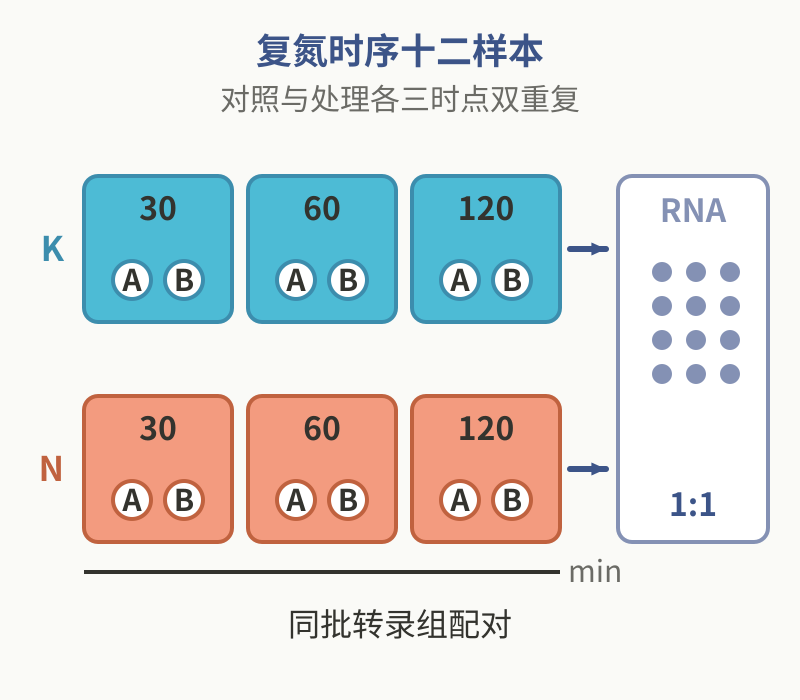

</div>
<div>

- 参考 12 条核染色体，合计 373,795,655 bp
- 每样本取前 300 万条读段（取文件头部）

</div>
</div>

<div class="ref">教材 §15.1 ｜ `06_data/master/README.md`、`06_data/accessions.tsv`</div>

<!--
旁白：先看这张设计卡。左边是十二个 run 的排布：对照和复氮各三个时间点，每个时间点两个生物学重复，一共十二个，跟 m04 的十二个 RNA 样本一一对应——这个对应关系是我们后面敢做联合解读的本钱。右边两个数：参考是十二条核染色体，合计三亿七千多万碱基；每个样本只取前 300 万条读段。看图时盯住那条一一对应的线：同一个时间点、同一个重复，开放度和表达量可以配起来看，这是同批样本送来的便利。但便利有边界：配对看很自然，配对不等于因果，这笔账留到联合解读那一节再算。顺带把样本名记牢：K 是对照，N 是复氮，不是品种名，这两个字母别读叉。
-->

---

## 主线数据的四条硬限制

- 每条件 2 个重复：结论只到候选清单
- ATAC 本来就没有 input，不算设计缺项
- 参考无细胞器序列，细胞器占比算不出
- 降采样取文件头部，不是随机抽样

<div class="ref">教材 §15.6 ｜ 讲义 ③ 案例数据</div>

<!--
旁白：主线数据有四条硬限制，每一条都会改写你能下的结论。每条件只有两个重复，够跑 IDR，但结论强度就到候选清单为止——单基因的方差估不稳，离群判断和统计功效同时受限，写的时候别把话说满。ATAC 没有 input 不是设计失误：它本来就没有抗体，硬补一个 input 反而会把真实开放区一起扣掉。最容易漏的是第三条：参考里压根没有细胞器序列，细胞器占比这个判据在我们的数据上算不出来，报告里这一栏留空，不是填零。最后，降采样取的是文件头部，不是随机抽样，方法学里必须写明。这四条不是免责声明，是写作要求：写在方法学里不占几行字，缺了哪一条，审稿人都会回来问。
-->

---

<!-- _class: master statement -->

第一步错了，后两步只是在精确地描述噪声。

核对顺序：真峰 → 对应哪个基因 → 与表达互证。

<!--
旁白：把整讲的核对顺序钉在这句话上：真峰 → 对应哪个基因 → 与表达互证，一步都不能跳。为什么说得这么重？三步是串起来的。第一道闸没过——峰本身就没高出局部背景——后面两道算得再精细，精细的也是噪声；而且这种错看起来非常专业，比明显的错误更难被发现。顺序不能颠倒，也不能跳。可以记成一句口诀：先看真假，再看含义，最后看方向。还有一层要分清：三个问题各有人回答。真假由对照、模型和重复回答；含义由注释和互作证据回答；方向由四象限和置换检验回答。分工一搞混，你就会拿一个指标去回答另一个问题。
-->

---

<!-- _class: master divider -->

<div class="num">03</div>

# 核心原理

谁决定切割位置 · 对照与重复 · 统计模型

<!--
旁白：进入核心原理。三块内容连着讲：谁决定切割位置、对照怎么配、MACS2 到底在检验什么。顺序就是逻辑：先认清技术测的是什么，才谈得上对照怎么配，最后才轮到统计模型。
-->

---

<!-- @section: principles -->
## 三者之别不在物种，而在谁决定切割位置

<div class="cols">
<div>

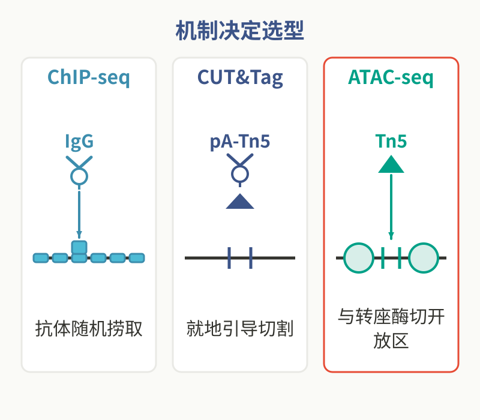

</div>
<div>

- 切割位置由抗体带路（ChIP、CUT&Tag）还是染色质状态（ATAC）
- 交联固定后随机打断，抗体只负责把复合体拉下
- `pA` 是蛋白 A：抗体牵引 Tn5，切割与加接头同步

</div>
</div>

<div class="ref">教材 §15.4.1 ｜ 讲义 ④ 4.1</div>

<!--
旁白：这张图把三种技术摆在一起，读法就一句：看是谁决定 DNA 在哪儿被切断。左边两列都是抗体带路。ChIP 先交联把蛋白和 DNA 冻在原地，随机打断，再用抗体把复合体捞下来。CUT&Tag 换了个思路：抗体不负责捞，负责把一把带接头的剪刀——图里的 pA 就是蛋白 A，牵线的那个——拽到靶蛋白旁边，就地切，切的同时把接头缝上，所以背景天然低。右边那列没有抗体，撒出去的是游离的剪刀，哪里松就在哪里切。所以 ATAC 测的从来不是哪个蛋白在这儿，而是这里有没有核小体挡路。这个区别定了后面所有判据，也解释了 ATAC 为什么能在缺好抗体的物种上挑大梁。读图别只看颜色，看箭头——箭头画的是谁把谁牵过去，那才是本质差别。
-->

---

## 九维表压成一张：能不能回答，会在哪翻车

| 维度 | ChIP-seq / CUT&Tag | ATAC-seq |
|---|---|---|
| 要回答什么 | 特定蛋白或修饰结合在哪 | 哪些区域是开放的 |
| 依赖抗体 | 依赖；抗体特异性决定成败 | 不依赖，缺抗体也能做 |
| 对照 | ChIP 要 input；CUT&Tag 用 IgG | 不设 input，清单与 IDR 兜底 |
| 主要坑 | 抗体不特异；间接结合弱 | 细胞器读段；默认模型切碎峰 |

- 没有可靠抗体时，先考虑 ATAC，再用 motif 反推
- ATAC 测的是开放度，不指定是哪个蛋白

<div class="ref">教材 §15.4.1 ｜ 讲义 ④ 4.1、4.8</div>

<!--
旁白：九维表压成四行看。最上面一行问能不能回答：ChIP 和 CUT&Tag 回答的是某个蛋白或修饰结合在哪，ATAC 只能回答哪些区域开放，指名道姓地指认某个蛋白它做不到。再看抗体那一行，这一行决定了你在没有好抗体的昆虫、真菌、非模式植物上还有没有牌可打。对照那一行：ChIP 必须配 input，CUT&Tag 用 IgG，ATAC 干脆不设 input，靠已知高信号区清单和重复一致性兜底。最后一行是各自的坑，左边的抗体不特异、间接结合抓不住，右边的细胞器读段、默认模型切碎峰，后面都会单独展开。连起来就是页面底下那句话：没有可靠抗体时，先做 ATAC，再用 motif 反推是哪个因子——记住这是反推，不是证明。这张表最实用的用法，是对着自己的课题逐行打勾，有一行对不上，就说明技术选错了。表里没有一格是凭经验填的，每格背后都有机制。
-->

---

## 深度：三种技术、三套口径，别互相套用

- ChIP 组蛋白宽峰：≥20 M 条唯一比对读段
- CUT&Tag 约 2 M ≈ CUT&RUN 8 M：酶切释放，读段更省
- 这组等效只在 K562 细胞与组蛋白修饰上成立
- ATAC 25 M 单端 / 50 M 双端，取非重复、非线粒体读段

<div class="ref">教材 §15.4.1（Landt 2012、Kaya-Okur 2019、ENCODE4）｜ `06_data/master/README.md`</div>

<!--
旁白：深度数字最容易被乱套，三行要分开记。ChIP 的组蛋白宽峰要至少两千万条唯一比对读段，这是大型基因组上的经验线。CUT&Tag 那组换算来自它的原文：约两百万条大体顶得上 CUT&RUN 的八百万、ChIP 的两千万；但注意，这个等效只在 K562 细胞和组蛋白修饰上成立，换个体系就不作数。ATAC 的现行口径是每个重复两千五百万单端、五千万双端，而且要的是非重复、非线粒体的读段。我们课程每个样本只有三百万条，所以后面用到的任何阈值，都得带着这个深度一起说，不然就是跨体系挪线。还有个口径别丢：这些数全部指唯一比对读段，不是下机时的原始读段。
-->

---

## 选型有三个常见误判

- CUT&Tag 取代不了交联能固定的间接互作
- ATAC 不是便宜的 ChIP，它测的是开放度
- 峰多不等于信号强：四因素（深度、复杂度、阈值、模型）
- 先问能不能回答，再问便宜不便宜

<div class="ref">教材 §15.4.1 ｜ 讲义 ④ 4.8</div>

<!--
旁白：选型上有三个常见误判，每个都值得停下来看一眼。最常见的是拿 CUT&Tag 全面取代 ChIP——它能取代的是细胞量、深度和信噪比，取代不了交联：间接招募来的复合物只有交联能固定住。所以两种技术报出的峰集本来就不该一样，差异本身携带信息，别拿一套去验证另一套。第二个是把 ATAC 当便宜的 ChIP。它测的是开放度：一个开放区里可能根本没有你要找的因子，一个结合位点也可能落在关着的染色质上。第三个最常溜进论文：峰多等于信号强。峰数同时被深度、文库复杂度、阈值和模型四个因素推着走，跨样本比峰数基本没有意义。选型永远先问能不能回答问题，再问便宜不便宜。这三条记住，选型题基本不会再错。
-->

---

<!-- _class: master quiz -->

## 课堂提问

一个真菌课题要问「侵染后哪些区域变开放」，但没有验证过的抗体：你选哪类技术，它又不能确定什么？

<!--
旁白：先想三十秒再答，别抢。题目是：真菌课题要问侵染后哪些区域变开放，手里没有任何验证过的抗体——选哪类技术？它又确定不了什么？答案应该是 ATAC：不用抗体，缺抗体也做得成，而且它直接测的就是可及性，跟问句严丝合缝。两种常见错法。一种是「用 ChIP 反正也能做」：没有验证过的抗体，抗体不特异这一条就足以把结论整个废掉，流程跑得再顺，测到的也是背景。另一种是技术答对了，后半问漏了：ATAC 只能告诉你哪些区域开放，说不清开放区里是哪个蛋白在起作用；要蛋白身份，得靠 motif、足迹分析，或者拿到抗体之后补 CUT&Tag。如果你答了「先做 ATAC 再反推」，记得把「反推」两个字说出口——那是推断，不是证明。
-->

---

## 对照与重复：一张背景模型的两条腿

<div class="cols">
<div>

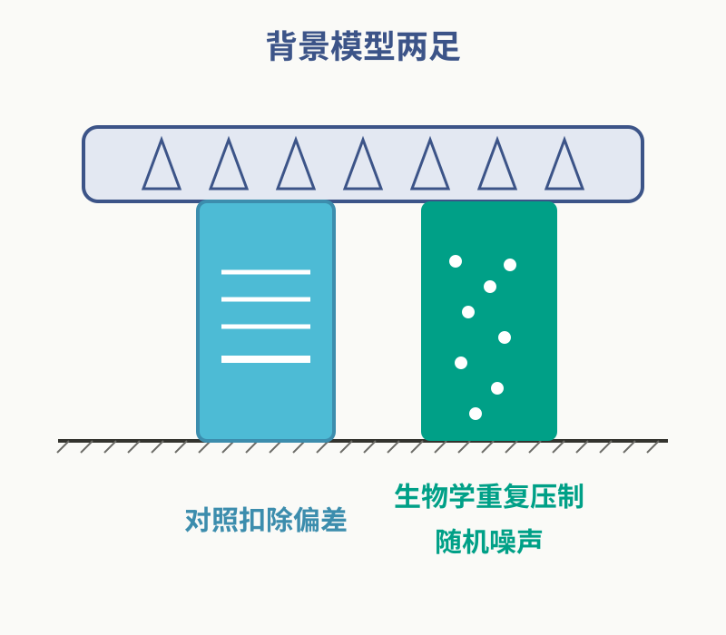

</div>
<div>

- `input`：同批染色质、同样打断，不做免疫沉淀
- `IgG` 只测抗体非特异吸附，打断与拷贝数梯度仍在
- IgG 不能替代 input；技术重复会「通过得漂亮」

</div>
</div>

<div class="ref">教材 §15.4.2 ｜ 讲义 ④ 4.2</div>

<!--
旁白：这张图画的是背景模型的两条腿。左边那条是 input：同一批染色质、同样的打断流程，只是不做免疫沉淀，所以打断偏好、拷贝数、GC 这些跟结合无关的梯度，全被它原样记了下来。右边那条是 IgG：同型抗体把整个流程走一遍，它量出的只有抗体自己粘了什么。两条腿不能互相顶替——IgG 里没有打断偏好和拷贝数的信息，缺了 input 就补不上，这笔账到「无对照」那一页还要再算一遍。页面底下还藏着半句：拿技术重复冒充生物学重复，一致性会漂亮得不得了，可它检验的只是同一管测两次稳不稳，不是两个个体之间像不像。怎么配对照，这一页讲完；配错了会长什么样，后面那张碎峰图接着讲。配对了不一定成功，配错了基本注定失败。
-->

---

## 峰型先验：先看靶标的物理分布

<div class="cols">
<div>

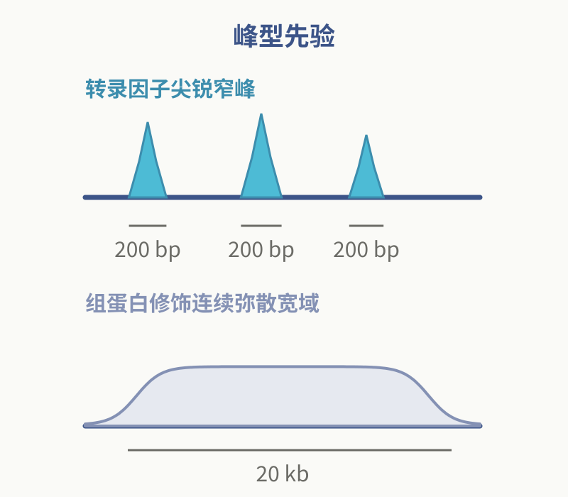

</div>
<div>

- 窄峰：TF、H3K4me3、H3K27ac 与 ATAC
- 宽峰：H3K27me3、H3K9me3、H3K36me3
- 用错：连续域被切成碎峰，或相邻位点被粘成一个

</div>
</div>

<div class="ref">教材 §15.4.2 ｜ 讲义 ④ 4.2</div>

<!--
旁白：选模型之前，先看靶标在基因组上长什么样，这张图就是那面镜子。左边窄峰：转录因子、H3K4me3、H3K27ac，加上 ATAC 的开放位点，跨度几百 bp，峰脊陡得像根针。右边宽峰：H3K27me3、H3K9me3、H3K36me3，一铺就是几个 kb 到几十 kb，没有陡脊，是一片连续的域。用错有两个方向：拿窄峰模型去切宽峰，一个连续结构域会被剁成十几个没有生物学意义的碎峰；反过来拿宽峰模型去套转录因子，相邻两个独立位点会被强行粘成一坨。还有个容易看漏的细节：宽峰那个连接阈值刻意比主阈值松，它管的是相邻位点能不能连成片，不管单个位点够不够显著。另外宽峰输出没有峰顶那一列，后面做 motif 想取窗，不能直接拿它用。
-->

---

<!-- _class: master figure -->

## 两个重复的排名一致性，就是 IDR 的全部

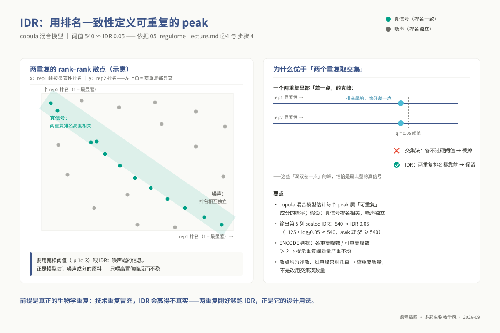

整面弥散时查哪个重复坏了，不是取交集凑数量

<div class="ref">教材 §15.4.2 图 15-1 ｜ 讲义 ⑦-4</div>

<!--
旁白：IDR 的全部道理，一句话：看两个重复的排名一致不一致。左图横轴是一个重复里的排名，纵轴是另一个重复里的排名。真信号在两份名单里都站前排，点顺着对角线走；噪声的排名互相独立，散成整整一片。要是整面全弥散，正确的动作是回头查哪个重复坏了——材料降解？沉淀效率不行？——而不是改用交集把数量凑上去。右边的例子更说明问题：一个峰在两份名单里都排得很靠前，只是各自差一口气没过硬阈值。交集法会把它扔掉，IDR 把它留下来，而这类峰常常正是典型真信号。原因在于 IDR 不碰各自的硬阈值，它用 copula 混合模型估每个峰属于可重复成分的概率，所以喂进去的名单要放宽阈值，让噪声端的排名也参与估计。
-->

---

## 第 5 列是 scaled IDR：540 是可重复的门槛

<div class="cols">
<div>

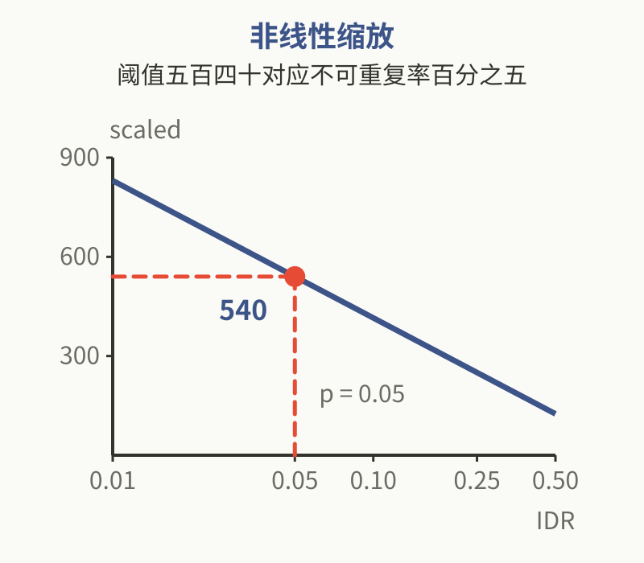

</div>
<div>

- 输出第 5 列就是 scaled IDR；筛可重复峰取 ≥ 540
- 手算 `−125 × log₂ 0.05 = 540.24`，取整 540
- 第 11、12 列是局部与全局 IDR，可对照读

</div>
</div>

<div class="ref">教材 §15.4.2 ｜ 手算；讲义 ⑤ 步骤 4</div>

<!--
旁白：IDR 输出的第五列叫 scaled IDR，这是个你能自己算出来的数。定义是取负一百二十五乘以以二为底的对数，再取整、封顶一千。把不可重复发现率 0.05 代进去，对数约等于负四点三二，乘上一百二十五得 540.24，取整就是 540——所以筛可重复峰的门槛是第五列大于等于 540。这个数不是哪本手册规定的，是从公式里换算出来的，图上那条红线画的就是它。为什么弄这么一列？它是个单调变换，排名一个不动，只是把零到一的概率压到一个读起来舒服的刻度上。另外第 11、12 列是局部和全局 IDR，读表时拿它们跟第五列对一下，三个数方向不一致，说明模型没收敛好，别急着用。
-->

---

## 重复必须是生物学重复

<div class="cols">
<div>

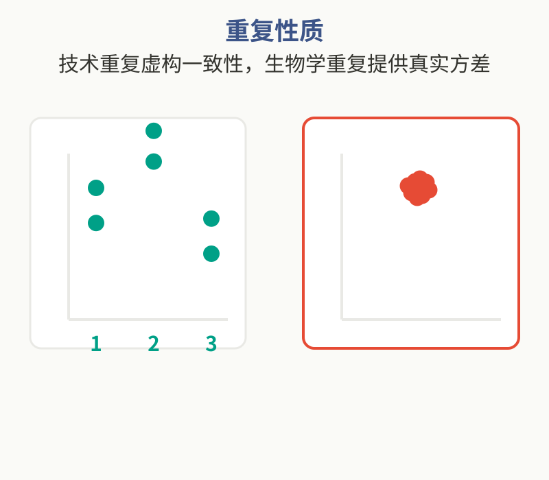

</div>
<div>

- 至少 2 个独立生物学重复，技术重复不算
- 一致性报 rescue 与 self-consistency，均 <2
- IDR 排除不了可重复的系统偏差

</div>
</div>

<div class="ref">教材 §15.4.2、§15.5.2 ｜ Landt 2012 口径</div>

<!--
旁白：重复这件事还有条边界要划清：至少两个独立的生物学重复，技术重复不算数。图左边是生物学重复，两个个体、两份独立材料，它们之间的差异既有你要的信号，也有个体噪声；右边是技术重复，同一份染色质分成两管上机。后者一致性当然好看，可它什么也证明不了——它只回答了同一管测两次稳不稳。报告里要给两个比率，rescue 和 self-consistency，都小于 2 才行。最要紧的是底下那句话：IDR 排除不了可重复的系统偏差。两次实验带着同一处偏差，两份峰表会一起错，而且错得整整齐齐，一致性检验毫无察觉。所以它只是必要条件，不是充分条件。写报告时把「几个重复、生物还是技术」交代清楚，这一句比任何比率都顶用。
-->

---

## MACS2 在检验什么：泊松窗口加 BH 校正

<div class="cols">
<div>

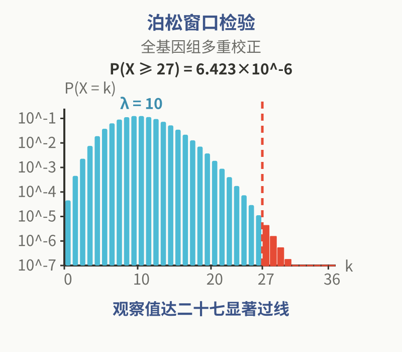

</div>
<div>

```text
P(X = x) = λ^x e^(−λ) / x!
P(X ≥ k) = 1 − Σ_{x<k} P(X = x)
λ_local = max(λ_BG, λ_1k, λ_10k)
```

- 手算 λ = 10：最小 k = 27，P = 6.423×10⁻⁶
- 几十万个窗口逐个检验，BH 校正得 q 值

</div>
</div>

<div class="ref">教材 §15.4.3 ｜ 演示 `ch15_local_lambda.py --selftest` Part 0</div>

<!--
旁白：MACS2 检验的全部家当就是这三行式子。第一行是泊松分布本身：给定背景期望，看到恰好这么多条读段的概率。第二行取尾概率：看到这个数或者更多的概率，用一减去比它小的所有项。第三行讲背景期望从哪来：全基因组平均、1 kb 局部、10 kb 局部，三者取最大。手算一遍找找量感：期望等于 10 的时候，想让尾概率压到十万分之一以下，读段数得凑到 27 条，对应概率 6.423×10⁻⁶。为什么非手算不可？因为同一个观察计数，背景取得越大越不显著——背景怎么取，正是调峰器的特异性所在。最后几十万个窗口逐个过检，再做 BH 校正得 q 值。后面讲的几种失效，源头全在这三行里，这里听懂了，后面就轻了。
-->

---

## 局部 λ 只有两个尺度，取最大值是保守设计

<div class="cols">
<div>

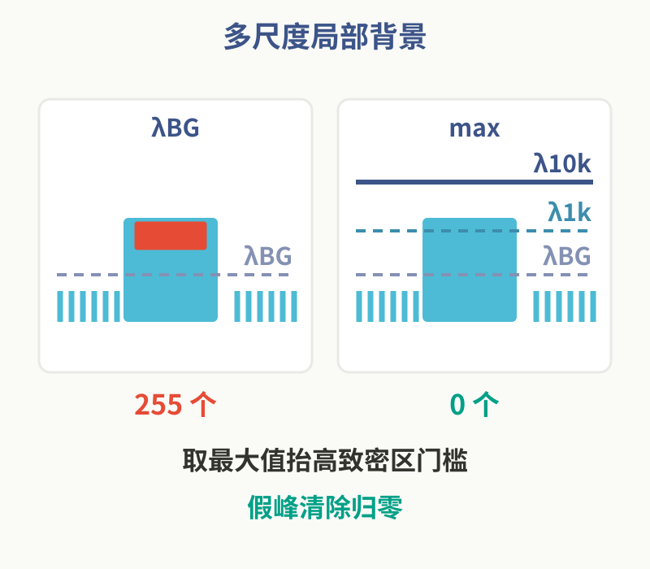

</div>
<div>

- 实现只有 `--slocal` 1 kb 与 `--llocal` 10 kb
- 多写一档 5 kb 出自 MACS 论文，程序里没有
- 取最大值是保守设计：门槛只升不降

</div>
</div>

<div class="ref">教材 §15.4.3 ｜ 演示 `ch15_local_lambda.py --selftest` Part 1</div>

<!--
旁白：先纠正一个流传很广的写法。有些资料说 MACS2 的局部背景有好几档尺度，那是 MACS 论文里的口径，实现里不存在：参数只有 `--slocal` 默认 1 kb 和 `--llocal` 默认 10 kb，多出来的那一档程序里根本没有，照着资料写参数名会直接报错。再说取最大值为什么是保守设计：周边任何一个尺度本来就密，就拿那个更高的标准来要求这个位置，只有扛过抬高的门槛还超常富集，才承认它是峰。代价是灵敏度损失一点，换来假峰变少。合成算例把这笔账算清了：一段开放强度两倍的宽结构域，只用全局背景会冒出 255 个假窗口，改成三者取最大，假阳性归零。
-->

---

## 无对照：故障不报错，但可以量出来

<div class="cols">
<div>

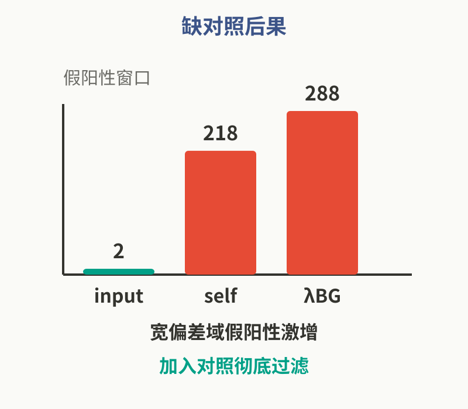

</div>
<div>

- 合成算例：单位是窗口，不是本课数据实测
- 伪 FRiP = 落峰读段 ÷ 总比对读段
- FRiP 高不等于峰集干净：假峰也吃读段

</div>
</div>

<div class="ref">教材 §15.4.3、§15.5.2 ｜ 演示 Part 2（A/B/C 三管线）</div>

<!--
旁白：全讲最该刻在脑子里的一张图来了：不给对照时，程序一声不吭，它拿处理样本自己当对照，1 kb 那一档背景直接消失。后果朝两头走。窄而尖的偏差区，在 10 kb 窗里被稀释，背景估低了，整片全过线，假阳性从个位数涨到两百多；宽而真实的富集域正好相反，10 kb 窗把它自己算进了背景，信号被自己扣掉，召回率跌到几乎为零。再看图里第三条线——关掉局部背景、只用全局值：假阳性最多，伪 FRiP 反而最高，因为假峰也吃读段。所以 FRiP 高，不等于峰集干净。提醒一句：这里的单位是窗口，不是峰，也不是我们数据的实测，它演示的是机制。三条线摆在一起看，你就明白为什么 FRiP 单独拿出来不算数。
-->

---

## 有效基因组大小：0.7–0.9 × 参考总长

```text
0.7 × 373,795,655 ≈ 2.6×10⁸
0.9 × 373,795,655 ≈ 3.4×10⁸
```

- 要的是可唯一比对碱基数，不是总长
- MACS2 内置 `dm` = 1.2×10⁸，是果蝇值
- 课程脚本用 3.0×10⁸，约 0.80 倍
- `-g` 与 `--effectiveGenomeSize` 必须填同一个数

<div class="ref">教材 §15.4.3、§15.5.5 ｜ 脚本 `05_peak_calling.sh`</div>

<!--
旁白：两行算术加一条纪律。参考总长乘 0.7 约等于 2.6×10⁸，乘 0.9 约等于 3.4×10⁸。为什么给区间？`-g` 要的不是基因组总长，是可唯一比对的碱基数：重复序列多的物种往下限取。这个数怎么来的，论文里要能交代清楚。最经典的一个错是照抄 MACS2 内置的 `dm`——那是 1.2×10⁸，果蝇的数，不是水稻，拿过来一用，背景直接抬高两倍多。课程脚本现在填 3.0×10⁸，约为总长的 0.80 倍。最后是纪律：MACS2 的 `-g` 和 deepTools 的有效基因组大小必须填同一个数，不然热图和峰显著性根本不在一个尺度上。这两行算术建议你在纸上重算一遍，轮到写论文时那个数字才说得出口。
-->

---

## 单端才谈双峰位移，双端只管定边界

<div class="cols">
<div>

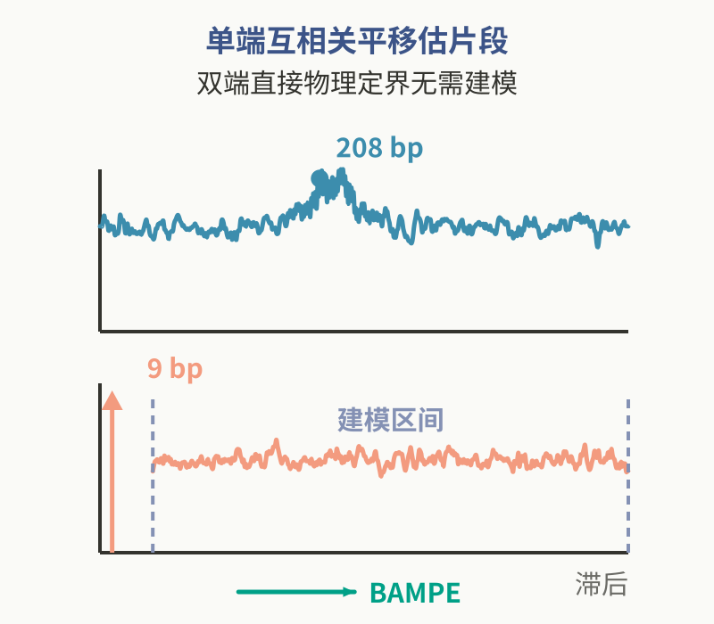

</div>
<div>

- 单端只读片段一端，结合中心在片段中间
- 互相关峰落在片段长 d，平移 d/2 对齐
- 双端 `-f BAMPE` 强制关模型，shift 不参与

</div>
</div>

<div class="ref">教材 §15.4.3 ｜ 演示 `ch15_atac_fragment_model.py` Part 2</div>

<!--
旁白：为什么单端和双端要分开写参数，这页一次说透。先看左边单端：读段只测到片段的一端，正链堆在结合位点上游，负链堆在下游，画出来是一对镜像双峰。互相关曲线的峰落在片段长度处，把正链右移半段、负链左移半段，两峰正好对齐——这就是模型在做的事。右边是 ATAC：Tn5 在两条单链上留下的切口只隔约 9 bp，压根没有双峰结构；默认模型在几十到几百 bp 范围里找成对峰，找不到，直接报错。所以双端数据加 `-f BAMPE`，软件强制关掉模型，shift 根本不参与计算；写着不报错，其实是个空操作。图上那个 9 bp 是用来解释建模为什么失败的，不是拿来算平移量的，这一点最容易被抄错。参数表里印着 shift，不代表它真在起作用。
-->

---

## 三套参数，三种物理性质

| 场景 | 关键参数 | 物理理由 |
|---|---|---|
| TF ChIP / CUT&Tag | `-c input.bam` | 有对照才有背景模型 |
| 组蛋白宽峰 | `--broad-cutoff 0.1` | 相邻弱富集连成域 |
| ATAC 双端 | `-f BAMPE`、`--keep-dup all` | 无抗体、无双峰结构 |
| ATAC 单端 | `--shift -100 --extsize 200` | 回移半窗，窗心对准切口 |

- 脚本按 `MODE=narrow|broad|atac` 分支，默认 narrow
- `--nomodel` 只是写法口径：BAMPE 下软件强制关模型

<div class="ref">教材 §15.4.3 ｜ 脚本 `05_peak_calling.sh`</div>

<!--
旁白：三套参数，每一套都能问出一个物理理由，问不出来就别填。转录因子 ChIP 和 CUT&Tag 那行，`-c` 必须给：背景模型只能从对照来。组蛋白宽峰那行，`--broad-cutoff` 放宽到 0.1：它管的是相邻的弱富集能不能连成域，不是单个位点显不显著。ATAC 双端那行，关模型加保留全部重复——没有双峰结构可建模；而且上游已经去过一次重，再按坐标删一遍会误伤真实读段。单端 ATAC 才用最后一行：回移半个窗再延伸一个窗长，让信号中心落在切口上。脚本按 `MODE` 分支，默认窄峰——跑 ATAC 忘了显式指定模式，是我见过最多的一个漏。写命令时拿最后一列分支名对一下。
-->

---

## 四项 QC：每个指标都带适用域

| 指标 | 口径 | 适用域与参考线 |
|---|---|---|
| FRiP | 峰内读段 ÷ 总比对读段 | TF ChIP >1%；ATAC >0.2 可接受 |
| NSC / RSC | 链间互相关曲线 | >1.05 / >0.8，限人 TF ChIP |
| NRF / PBC | 文库复杂度 | 点源 TF 约 10 M 时 NRF ≥0.8 |
| TSSE | TSS 相对侧翼背景 | 阈值随物种与注释版本变 |

- 跨体系挪阈值是本章最常见的一类误用
- 3 M 读段不能直接套 10 M 的参考线

<div class="ref">教材 §15.4.4 ｜ 讲义 ④ 4.4</div>

<!--
旁白：四项指标，读的时候把适用域那一列一起看，光看数字会骗人。FRiP 是落在峰里的读段除以总比对读段，转录因子的经验线在百分之一以上，ATAC 的口径是 0.2 以上可接受、0.3 以上算优。NSC 和 RSC 从链间互相关曲线来，那两条参考线是在人的转录因子 ChIP 上定的。NRF 和 PBC 量文库复杂度，注意 NRF 分读段和位置两种口径，数值不能直接比。TSSE 是转录起始位点相对侧翼的富集倍数，阈值跟着物种和注释版本漂。所以本章最常见的一类误用，就是跨体系挪阈值：我们每样本只有三百万条，一千万深度下的合格线端过来直接用，就是错的，也别拿别人的合格线当自己的判据。四个指标要合在一起读——任何一项单独出场，都能把人骗得服服帖帖。
-->

---

## TSSE：阈值跟着物种与注释走

<div class="cols">
<div>

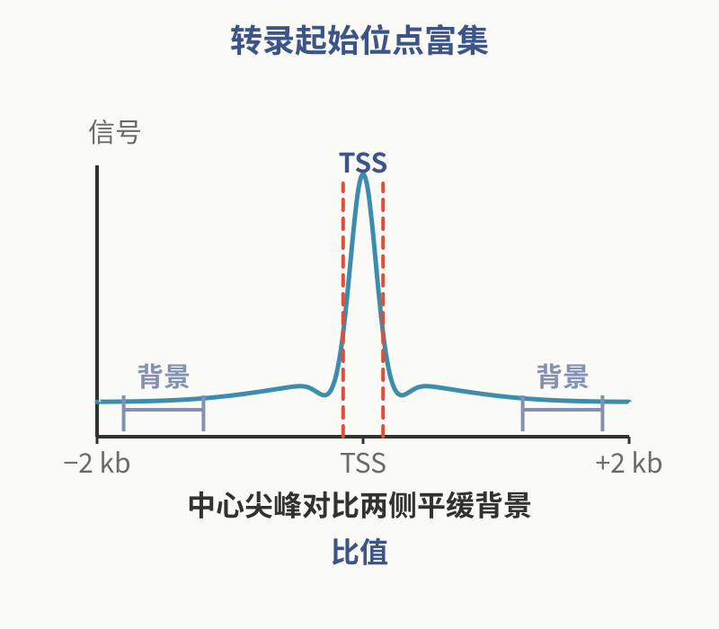

</div>
<div>

- ENCODE4 GRCh38：<5 需关注、5–7 可接受、>7 优
- mm10 是 <10、10–15、>15
- 「≥5」不是通用线；本课 README 沿用人类口径

</div>
</div>

<div class="ref">教材 §15.4.4 ｜ `06_data/master/README.md`（预期，未实测）</div>

<!--
旁白：TSSE 的图看形状，也看刻度。形状上，合格样本在转录起始位点附近拱出一个又高又窄的峰，两侧迅速塌下去。刻度上，人类的参考线是小于 5 要关注、5 到 7 可接受、大于 7 理想；小鼠那套整体抬高，小于 10、10 到 15、大于 15。为什么差这么多？注释版本不同、起点定义不同、基因密度不同，绝对值会整体平移。我们数据说明里写的那个大于 5，沿的是人类口径，只能当量级参考，不能当硬判据——报告里要写清你用的是哪一套、这个数是怎么算的。还有个坑：热图可以很漂亮而富集分很低，因为热图不归一化。判读时把它和落峰比例放在一起看，一个高一个低，才有信息量。
-->

---

## PBC：三个符号都数「位置」

<div class="cols">
<div>

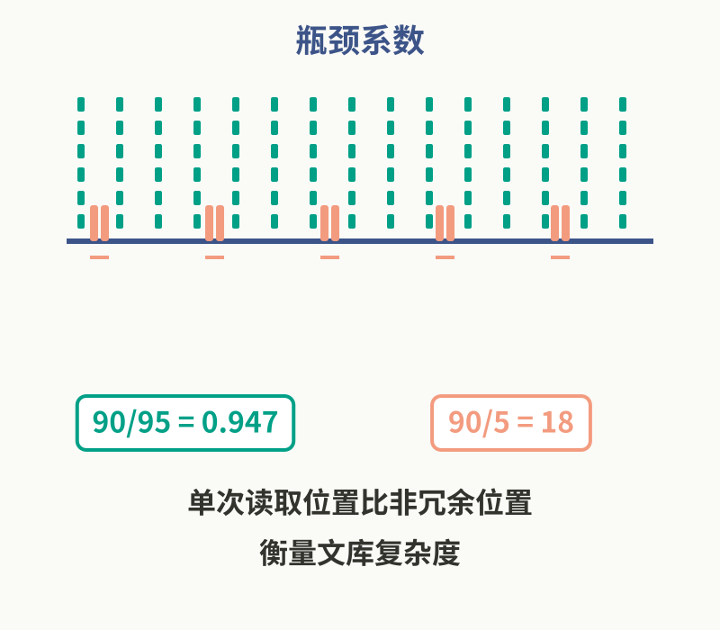

</div>
<div>

- 设例：90 个位置各 1 条、5 个各 2 条 → M1 = 90
- PBC1 必然 ≤1；PBC2 没有上界
- NRF 有读段与位置两种口径，不能混用

</div>
</div>

<div class="ref">教材 §15.4.4 ｜ 手算；讲义 ④ 4.4</div>

<!--
旁白：拿个小例子手算一遍就透了。设 90 个位置各压着一条读段，另有 5 个位置各有两条。三个数先点清楚：恰好一条读段的位置是 90 个，恰好两条的是 5 个，至少一条的是 90 加 5 共 95 个。第一个系数 90 除以 95，约 0.947，它必然不超过 1——分子本来就是分母的一块。第二个系数 90 除以 5，等于 18，没有上界；哪天看到它大得吓人，不用惊讶，那是分子小、分母更小。最后记一句：NRF 有读段口径和位置口径两种，前者数读段、后者数位置，报告里写明用的是哪种，两者不能混着比。还有，PBC 只回答位置被重复压了多少次，不回答富集好不好，别拿它越界。
-->

---

<!-- _class: master warn -->
## 细胞器读段：这条判据在本课数据上算不出来

- 参考只有 12 条核染色体，没有细胞器序列
- 细胞器占比在本课数据上算不出来
- 部分读段可能未比对，也可能错配到核
- 按染色体名过滤是空操作，脚本会打印提示

<div class="ref">教材 §15.4.4、§15.6 ｜ 脚本 `05_peak_calling.sh`</div>

<!--
旁白：有条常规判据在我们的数据上直接失效，得提前说破。常规做法是先看细胞器读段占多少，可这套参考只有 12 条核染色体，没有线粒体、没有叶绿体，这个占比根本算不出来。后果是什么？细胞器来的读段在比对环节就以未比对的身份消失了，其中一部分还可能错配到核基因组上——你在数据里既看不到它，也没法清点它。脚本里按染色体名过滤细胞器那一步，实际上是个空操作，只会打印一句提示。那怎么办？别去找线粒体那条染色体，也别填个零应付：这一栏留空，写不可计算；验收改用 FRiP、TSSE 加重复之间的 IDR。也正因为可能有读段错配回来，你不能从核读段反推细胞器占比。把这句话原样写进方法学，比硬凑一个数诚实得多。
-->

---

## ATAC 另一项体检：片段长度阶梯

<div class="cols">
<div>

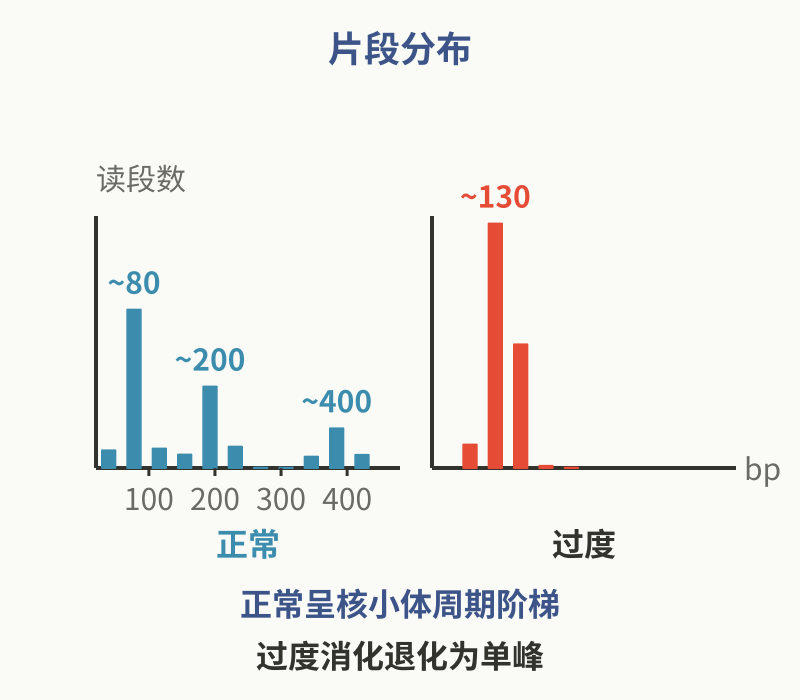

</div>
<div>

- 合成算例计数 603 / 310 / 151 条
- 只剩单峰、没有周期 = 消化过度（931 条）
- 双核小体约 400 bp，依次减弱才正常

</div>
</div>

<div class="ref">教材 §15.4.4 ｜ 演示 `ch15_atac_fragment_model.py` Part 1</div>

<!--
旁白：ATAC 还有一项专属体检：片段长度分布，合格样本应该是一级一级的阶梯。小于 100 bp 是无核小体区的大峰，约 200 bp 是单核小体，约 400 bp 是双核小体，一个台阶比一个台阶矮。合成算例的计数是 603、310、151 条，每个台阶都在往下掉，这就是健康的样子。要是只剩一个孤零零的峰、周期没了——图里那个消化过度的例子，931 条全挤在一处——说明染色质结构信息已经丢了。注意这是实验层面的问题，不是阈值问题，回去调参数救不回来。图上是合成算例，不是我们这批数据的实测；自己跑出来的阶梯以日志为准，判读看的是有没有周期，不是某个绝对高度。三条曲线摆一起，缺了哪一段，就说清实验在哪一步出了问题。
-->

---

## 最近基因不等于靶基因

<div class="cols">
<div>

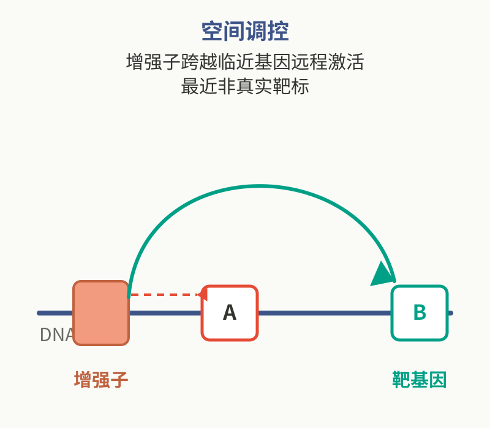

</div>
<div>

- 一个峰对多基因、一个基因受多峰
- 总错配 66.5%；间距 8 kb 的紧凑基因组升到 95.5%
- 表头写「最近基因」；靶基因要互作或功能证据

</div>
</div>

<div class="ref">教材 §15.4.5、§15.5.3 ｜ 演示 `ch15_nearest_gene_mismatch.py` Part 1–3</div>

<!--
旁白：「最近基因」这四个字背后藏着一个几何事实。注释软件做的事很朴素：把峰投到注释上，算它到最近转录起始位点的距离，然后把最近的基因当成关联基因。可增强子能隔着几十 kb 通过染色质环去够靶基因，中间还常常夹着一个无关基因。图里画的就是这种多对多：一个峰管着几个基因，一个基因也被几个峰管，而一张一对一的表硬把这种结构压平了。合成算例给出的总错配率是 66.5%；把基因间距压到 8 kb，错配率涨到 95.5%——注意方向，基因组越紧凑反而错得越狠，因为中间更容易塞进一个无关基因。所以表头老老实实写「最近基因」，靶基因要另外拿互作或功能证据来定。这不是说注释没用，而是注释的产出只能当候选清单。写报告时把这句话放在候选表抬头，读者一眼就知道这张表的分量。
-->

---

## 差异峰：并集加负二项，不是新模型

<div class="cols">
<div>

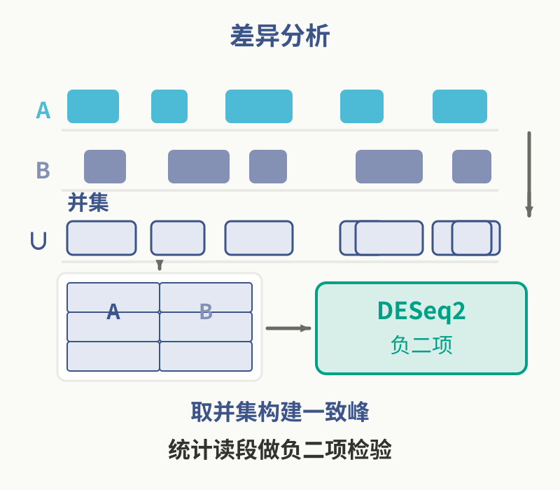

</div>
<div>

- 每个区间数各样本读段，做负二项检验
- 峰当基因、区间计数当表达量
- `DiffBind`、`csaw` 不在课程环境

</div>
</div>

<div class="ref">教材 §15.4.5 ｜ 讲义 ④ 4.5</div>

<!--
旁白：差异峰的做法，一句话：不是新模型，是老模型换了个对象。两个条件比结合强度，不能直接比峰的有无——一个条件出峰、另一个只是没过阈值，你说这是差异，其实是阈值在替你说话。主流做法分两步：先把所有样本的峰取并集，得到一致峰集；再在每一个区间上数每个样本的读段，套负二项框架做检验。可以这样类比：峰当基因用，区间计数当表达量用，深度差异交给文库大小因子去吸收——第 14 章那一套原样搬过来，只是计数单位从基因换成了区间。要留意 DiffBind 和 csaw 这两个封装不在课程环境里，本讲只讲概念，不报版本号。这一节真正要记下来的就一句：换的是计数单位，不是模型。
-->

---

## motif：背景不匹配足以造出一个 Top motif

<div class="cols">
<div>

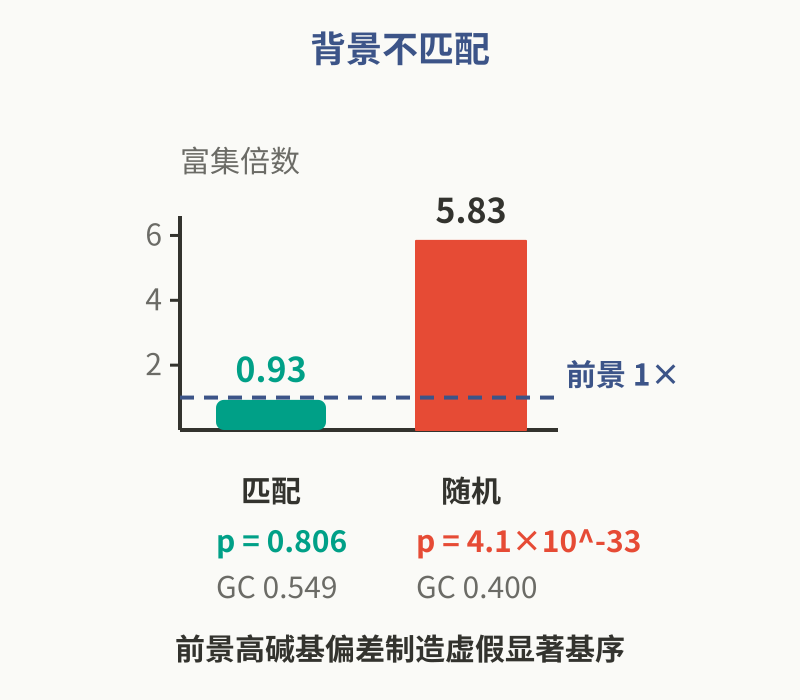

</div>
<div>

- 同一段序列：随机背景 5.83 倍，匹配背景 0.93 倍
- 前景一个字没改，只换了背景
- 该看的是背景怎么生成，不是 p 值多小

</div>
</div>

<div class="ref">教材 §15.4.6 ｜ 演示 `ch15_motif_gc_background.py` Part 1</div>

<!--
旁白：motif 分析翻车，十有八九翻在背景上。同一个前景序列、同一个检验，只把背景一换，结论整个翻面。图左边是随机背景，GC 只有 0.400：那个纯属 GC 富集的诱饵 motif 被抬到 5.83 倍，p 值小到十的负三十三次方，排第一。中间换成 GC 匹配的背景：命中数从 36 跳到 226，富集跌到 0.93 倍，p 值 0.806，直接放过——而前景一个字都没动。所以看 motif 结果，第一问永远不是 p 值多小，而是背景怎么生成的。右边那个真信号在两种背景下都显著，这说明这个算例演示的是机制，不是「凡 GC 富集必假」——这个限定别读丢，它不是口号。轮到你自己出结果，审稿人问一句背景哪来的，你得答得出来；答不出来，等于没做。
-->

---

## 超几何手算：背景决定 K/N

<div class="cols">
<div>

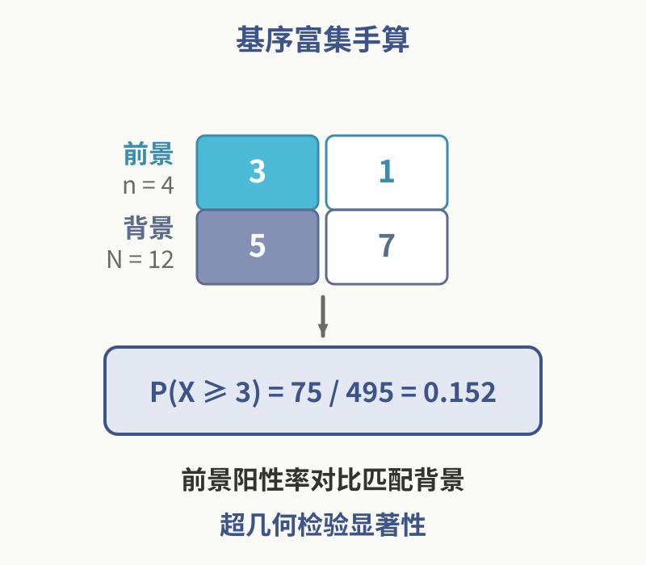

</div>
<div>

- 随机期望命中约 n × K / N
- 背景 GC 一旦偏离前景，K/N 就被错估
- HOMER 默认用二项打分，超几何是 `-h`

</div>
</div>

<div class="ref">教材 §15.4.6 ｜ 演示 `ch15_motif_gc_background.py` Part 0</div>

<!--
旁白：刚才那件事可以写成能算的式子。设背景 12 条序列、其中 5 条含这个 motif；前景 4 条、命中 3 条。超几何的尾概率，分子用组合数把「至少 3 条命中」的所有情形数出来，分母是从 12 条里抽 4 条的全部方式数，也就是 495。算下来分子是 75，概率 0.152。这个式子顺手解释了背景为什么重要：随机情形下的期望命中，约等于前景条数乘以背景出现率；背景的 GC 组成一偏离前景，这个出现率就被系统性估歪，同一个命中数对应的 p 值跟着漂。补一句口径：HOMER 默认用二项分布打分，超几何是可选模式，这里选超几何只因为组合数能手算。背景这件事说到底就一个目的：把那个出现率估准。
-->

---

## motif 富集不等于该因子直接结合

<div class="cols">
<div>

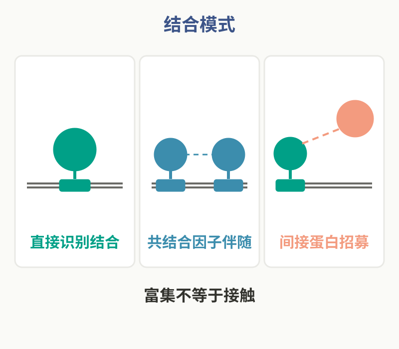

</div>
<div>

- 同家族位置权重矩阵（PWM）相似，报家族不报成员
- 可信四条：家族、峰顶、重复、匹配背景

</div>
</div>

<div class="ref">教材 §15.4.6、§15.5.4 ｜ 讲义 ④ 4.6</div>

<!--
旁白：最后一条边界：motif 富集了，不等于这个因子直接结合。图里画了三种能顶替它的解释。富集到的可能是跟靶蛋白搭伙干活的另一个因子的 motif——蛋白确实在那儿，但它认的不是这段序列；也可能是靶蛋白被别人拽过去的，自己压根没碰 DNA；最隐蔽的一种是同家族成员的位置权重矩阵长得几乎一样，程序报出来的其实是家族，不是具体哪个成员。所以可信的写法有四条：报家族不报成员、看 motif 是不是集中在峰顶、重复之间能不能重现、背景匹不匹配。四条缺一条，就只能写「候选 motif」，不能写成这个转录因子调控了这些基因。这四条恰好也是审稿人最常问的四句话。都写清楚，你的 motif 结果才算一条能被人引用的证据。
-->

---

## 联合解读：先分方向，再谈强度

<div class="cols">
<div>

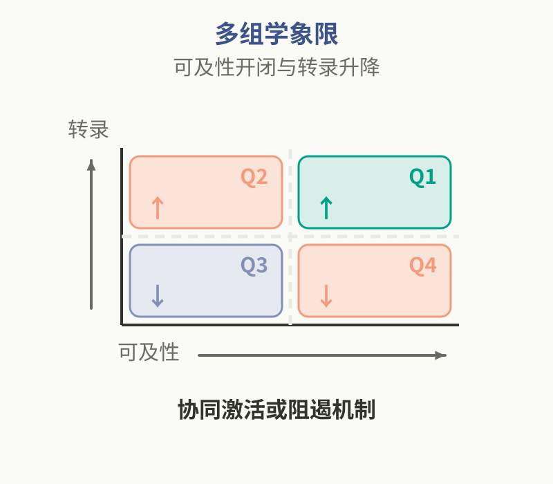

</div>
<div>

- 增强上调＝候选激活；增强下调＝候选抑制或抑制元件
- 减弱下调＝因子被撤除；增强无变化＝常见，不是失败
- 「可及性先于转录变化」读成「先于或同时于」

</div>
</div>

<div class="ref">教材 §15.4.7 ｜ 讲义 ④ 4.7</div>

<!--
旁白：联合解读的四象限图，先看方向，再看强度。方向上逐格过：可及性增强、表达上调，是候选激活；增强而表达下调，可能是抑制关系，也可能结合的是抑制元件；减弱加下调，是激活因子被撤走了。最容易被误读的是第四格——增强但表达没动。这不是失败：预结合、冗余调控、还在等第二信号，都会长这样；把这批峰当噪声删掉，会把真实位点一起删掉。强度是另一件事：交集比随机多多少，得靠置换检验来答。方向和强度要分开报告，压成一句「显著正相关」，两种不同的机制就被抹平了。还有一处措辞要改：「可及性先于转录变化」要读成「先于或同时于」。这张图最好的用法是逐峰填格——哪个峰填不进去，就说明还缺一层证据。
-->

---

## 置换检验：交集大小没有封闭零分布

<div class="cols">
<div>

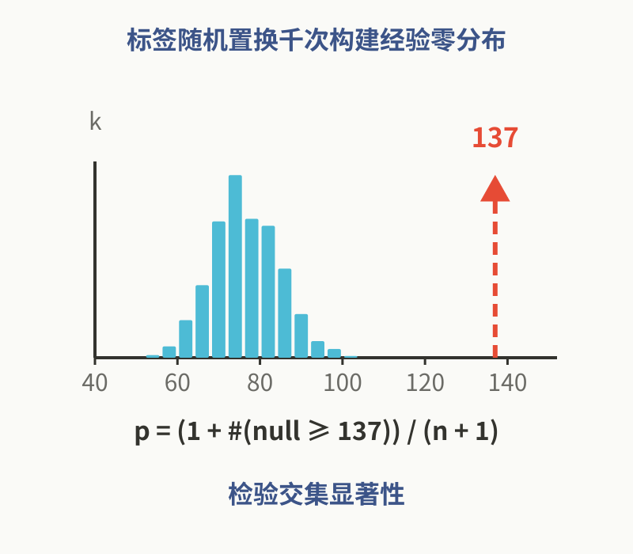

</div>
<div>

- 设例：`N = 12400`、`n = 512`、`m = 1843`
- `E = 76.10`、`SD = 7.88`；观察值偏离 `7.73` 个 SD
- 零分布中位数明显偏低，先查基因池是否取错

</div>
</div>

<div class="ref">教材 §15.4.7、§15.9 习题 7 ｜ 脚本 `05_peak_annotation.R`</div>

<!--
旁白：置换检验拿一个手算设例过一遍，四个数都要会算。可检测基因全集 12400 个，差异峰关联基因 512 个，差异基因 1843 个，观察到的交集 137 个。假如两份名单彼此独立，交集的期望就是 512 乘 1843 除以 12400，等于 76.10；标准差按超几何的式子算，是 7.88。于是 137 比期望高出 7.73 个标准差，1000 次置换里一次都没够到。所以说「重叠了 137 个」本身不是统计陈述，得跟零分布比过才有意义。最后这句很实用：要是零分布的中位数明显比理论值低，先别信输出，多半是可检测基因池取错了——比如拿了全部注释基因，而不是校正 p 值非缺失的那些行；也可能是两份列表的标签打乱方式写错了。
-->

---

## 案例：水稻抗条纹病毒（RSV）｜ ATAC ∩ RNA

<div class="cols">
<div>

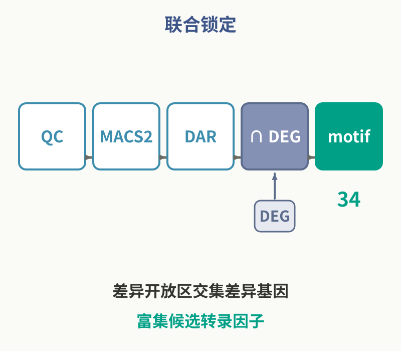

</div>
<div>

- 开放 6 462、关闭 3 587；差异基因 5 461
- ATAC 只有一个混合样本：没有重复，跑不了 IDR
- 交集显著、方向一致，仍只是相关性证据

</div>
</div>

<div class="ref">教材 §15.4.7 ｜ Li 2024（讲义 ⑪）｜ 加法手算</div>

<!--
旁白：看一个跟我们数据结构同款的已发表案例：水稻抗条纹病毒。设计是带毒和无毒的灰飞虱分别接种，取样后同时做 ATAC 和 RNA。数字在这里：可及性开放 6 462 个、关闭 3 587 个，差异基因 5 461 个，交集之后锁定 34 个候选转录因子。读这个案例要读出两层。证据分层那一层：motif 只给序列层面的关联；足迹跟蛋白占据相容，但认定不了是哪个蛋白；蛋白互作实验说的是蛋白之间有接触——这些加起来，也不等于证明某个元件调控了某个基因。设计弱点那一层：它的 ATAC 只有一个混合样本，没有重复，IDR 根本跑不了，可及性差异全靠跟 RNA 方向一致来背书。读文献要能把路线和弱点同时看在眼里，这两件事凑齐，才算把一篇文献读完了。
-->

---

<!-- _class: master figure -->

## 方法在变，判据没变

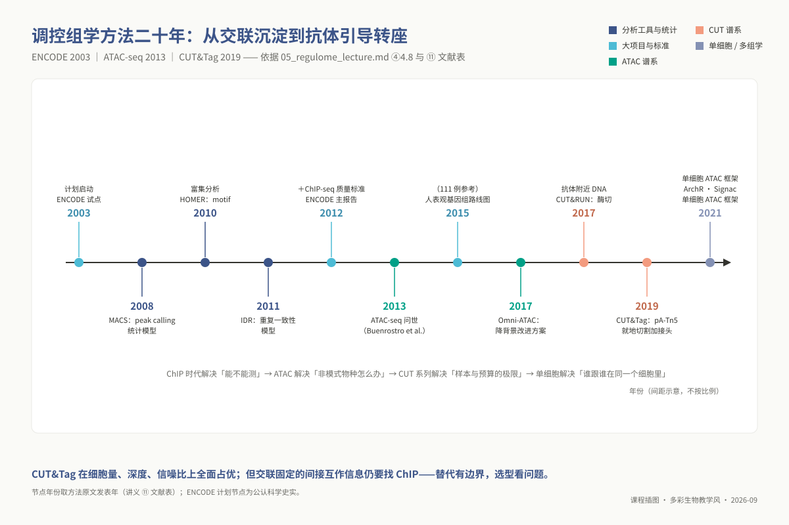

年份间距是示意；CUT&Tag 取代的是量与信噪比，不是交联信息

<div class="ref">教材 §15.4.8 图 15-2 ｜ 讲义 ④ 4.8</div>

<!--
旁白：最后一张图是方法演进的二十年，横轴年份，三条通道并行：分析工具与统计、大项目与标准、ATAC 与 CUT 谱系。注意年份间距是示意，不按比例，别拿它去数时间跨度。这张图真正要说的是边界：CUT&Tag 和 CUT&RUN 取代的是细胞量、深度和信噪比，没有取代交联能固定的间接互作——所以方法在变，判据没变。你今天用的还是那四个问题：有没有对照、重复是不是独立、深度可不可比、背景匹不匹配。工具会一茬一茬地换，这四个问题一直在。把它放在原理段的收尾，就是想让你看见：判据比工具稳定得多。要在这张图上挑一个最该记住的节点，我会挑 ATAC 的出现——它把不需要抗体的路线带进了调控组学。
-->

---

<!-- _class: master divider -->

<div class="num">04</div>

# 操作流程

八步骨架 · 脚本只到哪一步

<!--
旁白：原理讲完，进操作。八步骨架之外，更要紧的是一件事：脚本只走到哪一步，剩下哪几步得自己补。
-->

---

<!-- @section: procedure -->
## 从 FASTQ 到候选清单：八步

<div class="cols">
<div>

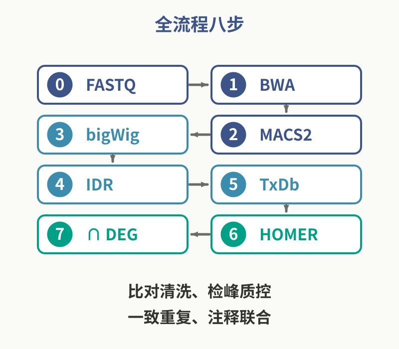

</div>
<div>

- 每步都是 `qsub` 作业，登录节点只下载与编辑
- 脚本止步于 bigwig：IDR、TSSE、HOMER 要自己补

</div>
</div>

<div class="ref">教材 §15.6 ｜ 讲义 ⑤ 步骤 1–7</div>

<!--
旁白：这就是八步骨架。左边从上往下：下载与验收、比对与清洗、调峰加算 FRiP、信号轨道与 TSS 热图、两个重复的 IDR、注释、motif、交集与置换。右边那句是本讲最该记住的：脚本止步于 bigwig——IDR、TSS 富集、motif 这三件事脚本里没有入口，得你自己补命令。纪律先立在前头：每一步都是投递作业，登录节点只干下载、建环境、改文件。这八步的顺序不是随便排的，前一步的产物就是后一步的输入，中间断一环，后面跑出来的东西全都立不住。第八步之前的那几段最容易出问题，因为输入是人手交出来的文件。所以整段你只要盯死两件事：顺序不能乱，哪几步脚本没做心里要有数。
-->

---

## 步骤 0：下载与数据验收

```bash
cd <课程仓库路径>
bash 06_data/master/download_master.sh --topic m05 \
     --subsample 3000000 --run \
     --outdir /d3/scratch/${USER}/ngs/data
```

- 12 个 run 与登记册一一对应才开工
- 300 万是取样目标，取的是文件头部
- 只有 dry-run 输出、没有 FASTQ = 没下成

<div class="ref">教材 §15.6 ｜ `06_data/master/README.md` ｜ 讲义 ③</div>

<!--
旁白：下载这两行命令，逐个参数过。第一行进到课程仓库根目录；第二行调下载脚本，指定专题、每个样本取 300 万条、真正执行、输出到 scratch。注意那个「真执行」的参数：不加它，脚本只打印计划、一个测序文件都不下——这是最常见的假成功，你以为下完了，其实什么都没有。开工前还有两个检查点。一是 12 个 run 必须跟登记册一一对应，缺一个，后面的重复就配不成对；二是记住 300 万是取样目标，取的是文件头部，不是随机抽，这句要原样写进方法学。下载脚本会校验读段数，看到只取到寥寥几条的告警就重下，别带着残缺文件往下跑。判断下载成败，读段数比文件大小可靠，先看它。下载这一步做对了，后面的重复才成立；做错了，后面每一步都在分析错的数据。
-->

---

## 步骤 1：比对与清洗

<div class="cols">
<div>

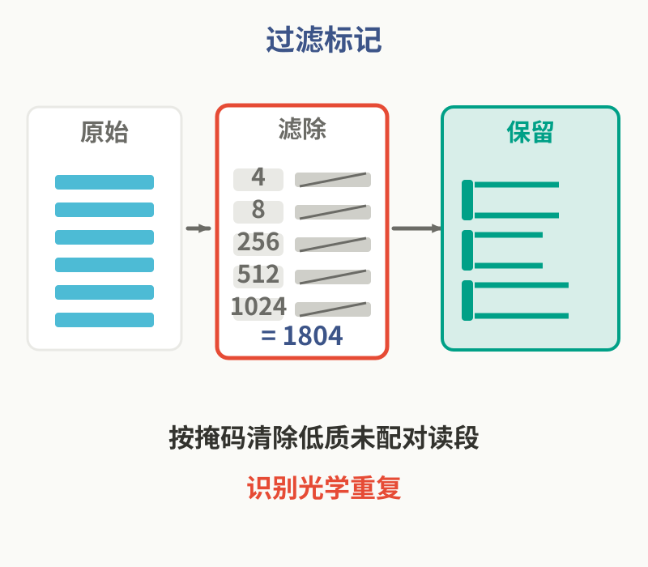

</div>
<div>

- `1804 = 4+8+256+512+1024`（五类被滤掉，手算）
- 以上命令已封在 `05_peak_calling.sh`，经 `qsub` 投递

</div>
</div>

<div class="ref">教材 §15.3、§15.4.3 ｜ 讲义 ⑤ 步骤 1</div>

<!--
旁白：步骤一，比对与清洗。图里那行 samtools 命令的过滤参数 1804 不是魔法数，是五个标志位加出来的：未比对、配对未比对、次要比对、质控失败、重复，四加八加二百五十六加五百一十二加一千零二十四。这五类读段对下游全是噪声；滤完之后还要加一道比对质量不低于 30。为什么非要你记住这个数？因为它让你清楚自己在删什么：删的是没用的、可替换的、质量差的，而不是把数据删到好看为止。图下面那句要交代清楚：这些命令已经封进脚本，走 `qsub` 投递，你不用手敲；但滤了什么必须心里有数，不然哪天峰变少了，你会误以为是生物学在说话。比对质量那条线是经验值，重复区多的物种要自己看分布再定。
-->

---

## 步骤 2：call peak 与 FRiP

<div class="cols">
<div>

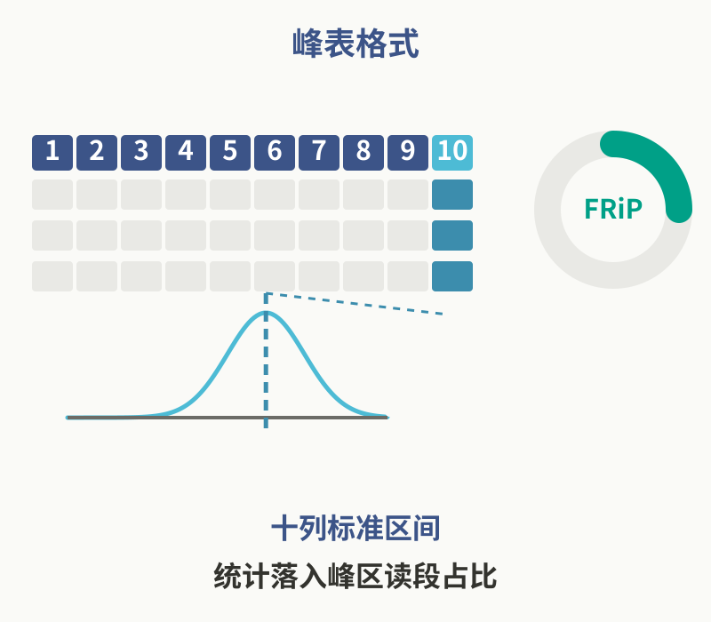

</div>
<div>

- 两条 `samtools view -c` 相除 = FRiP（脚本已写入汇总表）
- 必须显式 `MODE=atac`，脚本默认是 narrow
- narrowPeak 十列；broadPeak 九列，没有峰顶列

</div>
</div>

<div class="ref">教材 §15.4.3、§15.5.1 ｜ 讲义 ⑤ 步骤 2</div>

<!--
旁白：步骤二，调峰加算 FRiP。图里那张十列的表是 narrowPeak 格式，一列一列都得认识：染色体、起止坐标、峰名、分数、链、富集倍数、两个对数值、峰顶偏移。旁边那个 FRiP 就是落峰比例：峰内读段数除以总比对读段数，脚本用两条计数命令相除，结果已经写进汇总表。有两个地方容易栽。一是脚本默认窄峰模式，跑 ATAC 必须显式指定，忘了这一步，峰型和峰数全都会歪。二是宽峰格式只有九列、没有峰顶那一列，下游想取峰顶不能直接拿它，得回到窄峰或者自己另算。还有，峰表末尾几列是文本格式，读进 R 之后留意类型，别把科学计数法当字符串留下。这些都属于格式问题，不碰统计，但同样能让结果不可比。
-->

---

## 步骤 3：信号轨道与 TSS 热图

<div class="cols">
<div>

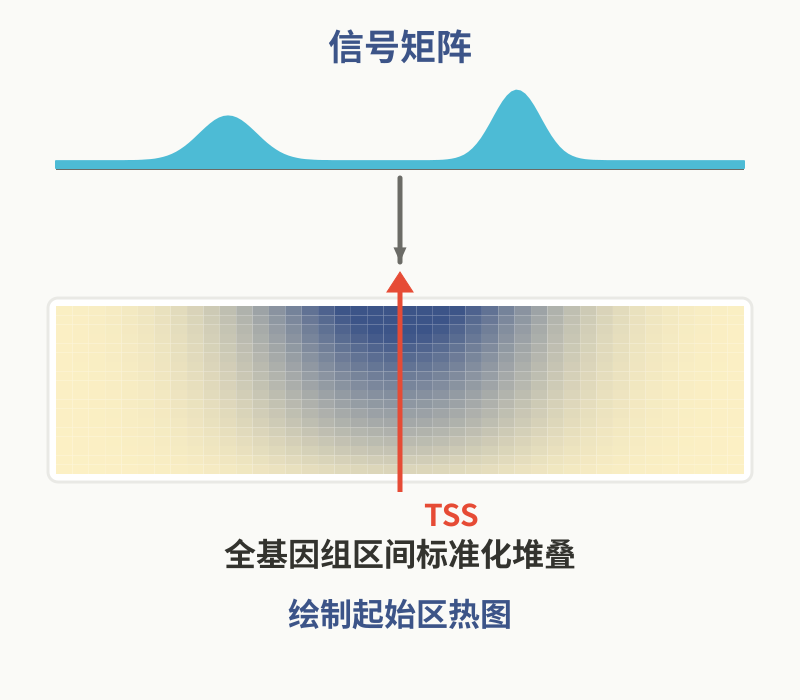

</div>
<div>

- 热图不是 TSSE：它不给数值分数
- GFF3 是 1-based 闭区间，转 BED 时 `start` 减 1

</div>
</div>

<div class="ref">教材 §15.6 ｜ 讲义 ⑤ 步骤 3</div>

<!--
旁白：步骤三，出信号轨道和 TSS 热图。图左边是覆盖度轨道，右边是转录起始位点附近的热图，一行一个基因，颜色深浅是信号强度。有个差别必须先说破：热图不是 TSSE。热图只负责好看，给不出数值分数；富集分是一个实实在在算出来的比值，两者互相顶替不了，报告里也不能拿图冒充数。图里还埋着一个小陷阱：注释文件是 1-based 闭区间，转成 BED 时起点要减一。不减，所有区间整体错开一个碱基——对调峰影响不大，对精确取窗和 motif 就有影响了。轨道和热图终究是给人看的，该给数的地方还是得给数，这一条到记录表那一页还会再提。把它记住，你的报告里就不会出现拿热图顶替富集分的写法。
-->

---

## 步骤 3 的第二件事：重复之间的秩相关

<div class="cols">
<div>

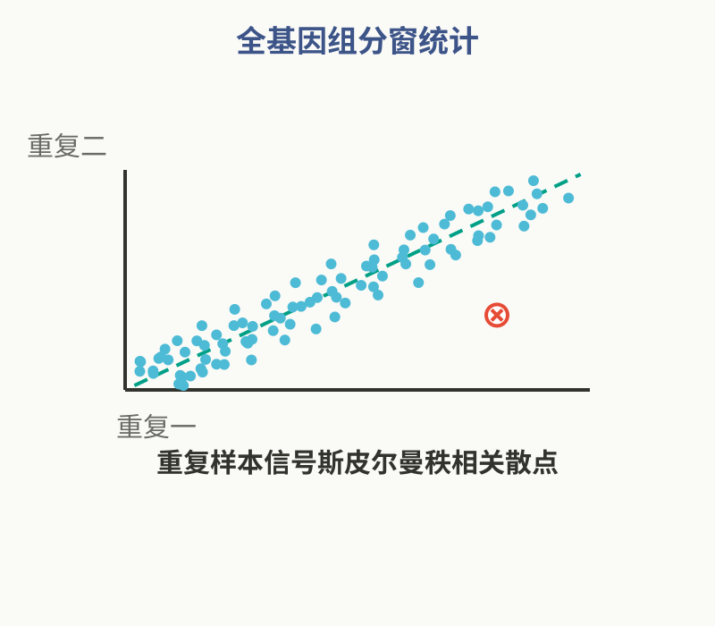

</div>
<div>

- 相关矩阵不放 `input.bw`：ATAC 本来就没有 input
- Spearman 只比相对关系，不设通用合格线
- 某 IP 与 input 的相关高于与其重复，先怀疑没富集上

</div>
</div>

<div class="ref">教材 §15.4.2、§15.6 ｜ 讲义 ⑤ 步骤 3</div>

<!--
旁白：步骤三还有第二件事：重复之间的秩相关。图是散点，横纵各一个样本，点贴着对角线走就说明两个重复像。做这件事有两个讲究。相关矩阵里别把对照样本放进去：ATAC 本来就没有 input，硬塞一列空的进去没意义。Spearman 只比相对关系，没有通用合格线，别追着问多少算过——它真正的用处是排查：如果某个处理样本跟对照的相关，比它跟自己重复的相关还高，那这个样本多半没富集上，测到的其实就是背景。这个判断比任何阈值都好使，还能顺带指出问题出在哪一步。记住它的定位：排查工具，不是验收指标，报告里别写成合格线。热图和这张相关矩阵放一起看，你就能说出这批样本里哪个最可疑、可疑在哪。
-->

---

## 步骤 4：两个重复的 IDR

<div class="cols">
<div>

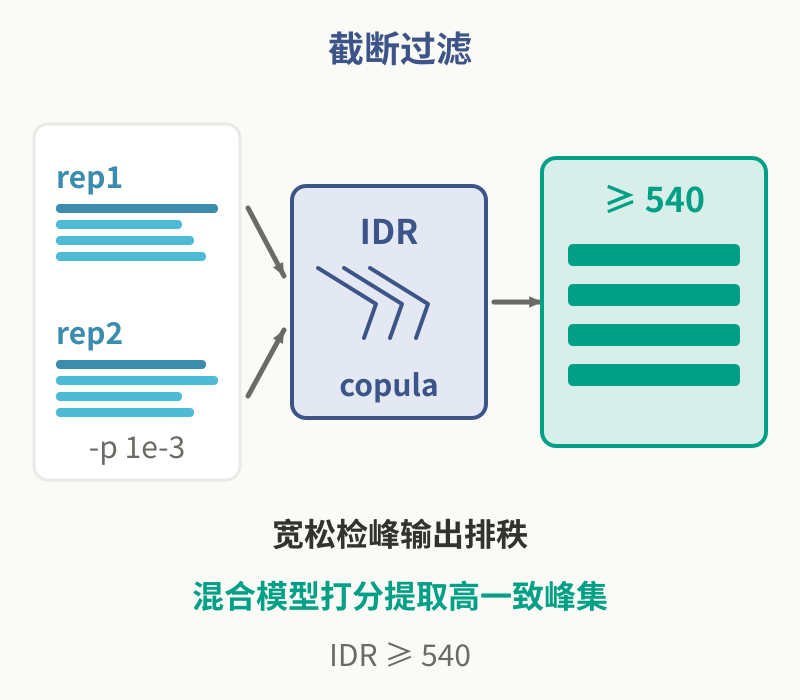

</div>
<div>

- ATAC 不写 `-c`；两个重复各跑一遍宽松阈值
- `540 = int(−125·log₂ 0.05)`，筛峰取第 5 列 ≥540
- 排序键与阈值显式给：`--rank p.value`、`--idr-threshold 0.05`

</div>
</div>

<div class="ref">教材 §15.4.2 ｜ 讲义 ⑤ 步骤 4</div>

<!--
旁白：步骤四，两个重复过 IDR。图里是截断流程：两个重复各自先用宽松阈值跑一遍，喂给 IDR，最后按第五列筛。三个细节别丢。ATAC 不写 `-c`，它没有对照。540 这个门槛不是拍脑袋，就是负一百二十五乘那个对数再取整。排序键和阈值都要显式给出来：`--rank p.value`、`--idr-threshold 0.05`——不给的话程序用默认，默认未必是你想要的。为什么要拿宽松阈值当输入？要让噪声端的排名信息参与模型估计，一上来就卡死，IDR 就没东西可算了。跑完看两个比率，rescue 和 self-consistency，都小于 2 才算数。最后注意顺序：喂进去的是两份宽松峰表，不是两个最终峰集；顺序一错，结果整体作废。
-->

---

## 步骤 5：注释，自建 TxDb

<div class="cols">
<div>

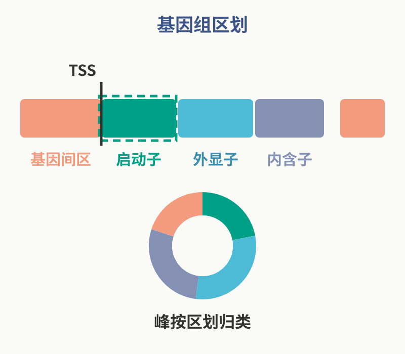

</div>
<div>

- TxDb 必须由自己的 GFF3 现场构建
- 共同染色体为 0 时，脚本直接 `stop`
- intergenic >95% 先查命名，不解释生物学

</div>
</div>

<div class="ref">教材 §15.4.5、§15.6 ｜ 讲义 ⑤ 步骤 5</div>

<!--
旁白：步骤五，注释，核心就一句：转录本数据库必须拿自己的注释文件现场构建。图里那些区带——启动子、五端非翻译区、外显子、内含子、下游、远端基因间区——判断峰落在哪一段，靠的全是坐标对得上。你若图省事用别的物种、别的版本的现成包，基因名字可能都对得上，坐标却全错位，饼图看起来还挺正常——这是最坏的一种错，因为它一声不响。两个检查点：共同染色体数为零时脚本直接停，这是好事，别去绕过它；基因间区超过 95%，先查命名和注释版本，别急着解释生物学。这一步的产物是候选表，第一列就该写明这是几何最近、不是靶基因。注释错一处，后面的 motif 和交集全跟着错，所以这里多花十分钟，绝对值。
-->

---

## 步骤 6：motif 要用可写目录

<div class="cols">
<div>

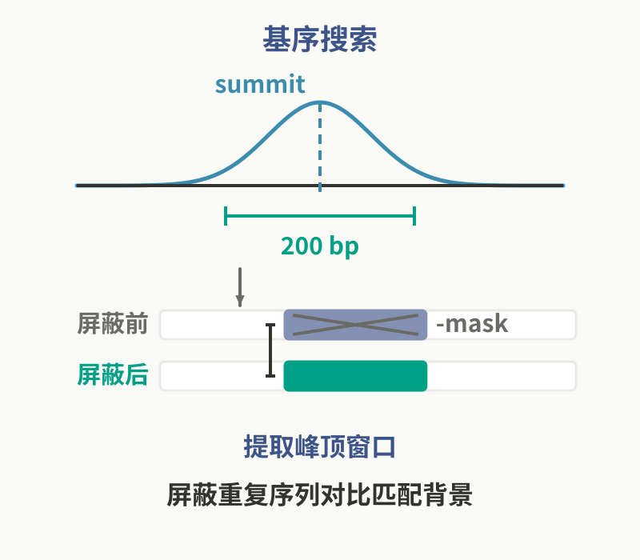

</div>
<div>

- summits 由可重复峰与 MACS2 的 summit 求交得到
- `-size 200` 即峰顶 ±100 bp；`-mask` 屏蔽重复
- 不下载预置基因组；预解析目录必须自己可写

</div>
</div>

<div class="ref">教材 §15.4.6 ｜ 讲义 ⑤ 步骤 6</div>

<!--
旁白：步骤六，motif，三件事。取窗用峰顶正负 100 bp：转录因子的结合位点就聚在峰顶附近，整段峰都框进来会稀释信号，峰越长稀释得越狠。跑的时候加 `-mask` 屏蔽重复序列，不然排第一的 motif 很可能是转座子的共有序列，你会在报告里郑重其事地写下一个跟课题毫无关系的因子。还有目录问题：预解析目录必须是你自己能写的——集群上的公共参考目录通常只读，而 conda 装的 HOMER 只带程序不带基因组。我们是非模式物种，直接把序列文件路径递给程序让它现场解析；第一次会很慢，作业时限要留足。跑之前确认输出目录可写，跑完先看目标与背景两列的比例。取窗一错，排第一的 motif 整体换人——这是我最常见的返工原因。
-->

---

## 步骤 7：交集与置换检验

<div class="cols">
<div>

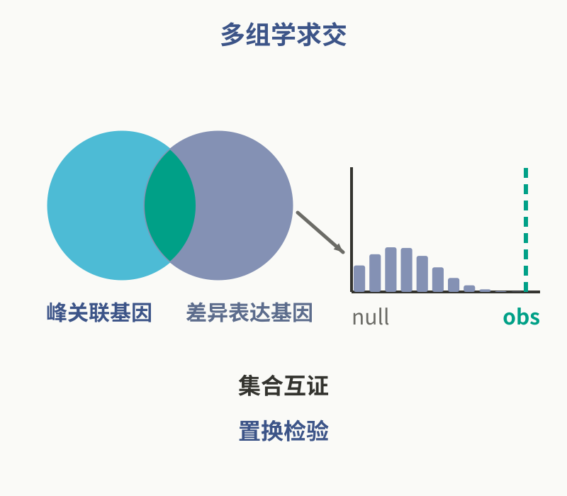

</div>
<div>

- m04 交付 `.tsv`：先转 CSV，或改 `read.delim`
- 只传显著行，可检测基因池会退化
- 输出两张表：置换摘要与交集清单，别写反

</div>
</div>

<div class="ref">教材 §15.4.7、§15.6 ｜ 讲义 ⑤ 步骤 7</div>

<!--
旁白：步骤七，交集与置换。图里那个韦恩图只是示意，真正要做的是两件事：方向表加置换检验。操作上有两个坑等着你。m04 交来的是制表符表，脚本默认按逗号读，会挤成一整列——要么先转 CSV，要么把读入函数改成认制表符。只传显著行也是坑：可检测基因池一缩水，交集当然显著，你看到的显著性是自己亲手造的。输出有两个文件，别拿反：一个是置换摘要，回答交集是不是大于随机；一个是交集基因清单，拿去跟方向表对读。拿到输出先看摘要里的经验 p 值和零分布中位数，再看清单里的方向列，顺序别颠倒。末了补一句：交集显著，只说明两套名单的重叠超过了随机，不说明这些峰真的调控了这些基因。
-->

---

<!-- _class: master warn -->
## 差异峰没有生成脚本：这一步必须说清

- 脚本只按样本 call peak，不比较两个条件
- `diff_peaks.bed` 仓库里没有生成它的步骤
- 没有差异峰表，产物只能叫「可重复峰关联基因」
- `DiffBind`、`csaw` 不在课程环境，不能改名充数

<div class="ref">教材 §15.4.5、§15.6 ｜ 讲义 ⑤ 步骤 7</div>

<!--
旁白：有一条缺口必须当着大家的面说清：脚本只按样本调峰，不做两个条件之间的比较，仓库里那个 `diff_peaks.bed` 没有上游——没有任何一步生成过它。两个后果跟着来。产物的名字只能叫「可重复峰关联基因」，不能叫「差异峰关联基因」，这一字之差决定你的结论停在哪一级。DiffBind 和 csaw 都不在课程环境里，不能改个名字充数，也不能在报告里写「用 DiffBind 做了」——要么照实写这一步没做，要么写清是在环境外用什么工具做的。报告里最值钱的一句话，往往不是「我做完了」，而是「我这一步没做」。把这一页和记录表那页合起来读，你就知道作业里哪些栏目可以留空、哪些必须写清；留空的，要附上理由。
-->

---

<!-- _class: master divider -->

<div class="num">05</div>

# 结果解读

六道闸 · 四张「不对」的样子

<!--
旁白：最后一段讲结果解读：六道闸按固定顺序过，外加四张「结果不对」的标准长相。目标很具体——异常出现在你眼前，你认得出，也知道先查哪里。
-->

---

<!-- @section: interpretation -->
## 样本能不能进下游：按固定顺序过闸

<div class="cols">
<div>

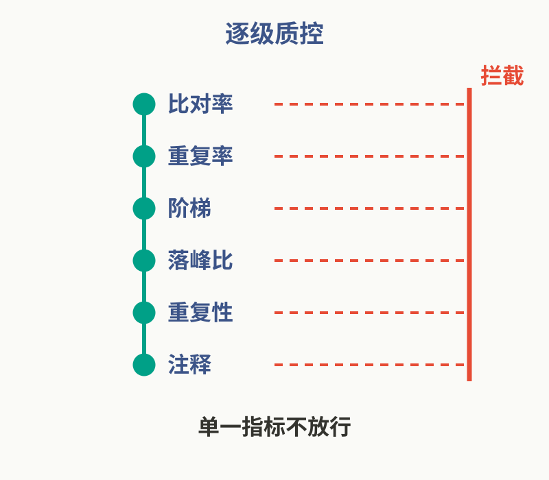

</div>
<div>

- 前五闸任一不过，不要进入联合解读
- 最后一闸不过，先查命名与注释，不解释生物学

</div>
</div>

<div class="ref">教材 §15.6 ｜ 讲义 ⑥</div>

<!--
旁白：六道闸，顺序不能换：比对率、重复率与 NRF、片段长度阶梯、FRiP 与 TSSE、IDR，最后是注释里的基因间区比例。为什么顺序是死的？前面的闸管数据坏没坏，中间的管实验做没做好，最后的管峰集可不可信；顺序一颠倒，你就会把实验失败读成生物学差异——这一讲反复出现的正是这个错。图里那句是处置规则：前五道闸任何一道不过，不要进联合解读；最后一道不过，先查命名和注释，不要急着解释生物学。这六闸跟教材那张验收流程表是同一张，写方法学照着它抄就行。每道闸对应一个产物，缺产物就是没过闸；上机时跑完一步就补一道闸的记录。六闸全过，才轮到你解释生物学——顺序反了，解释再漂亮也站不住。
-->

---

<!-- _class: master warn -->
## 结果不对时长什么样（一）：碎峰

<div class="cols">
<div>

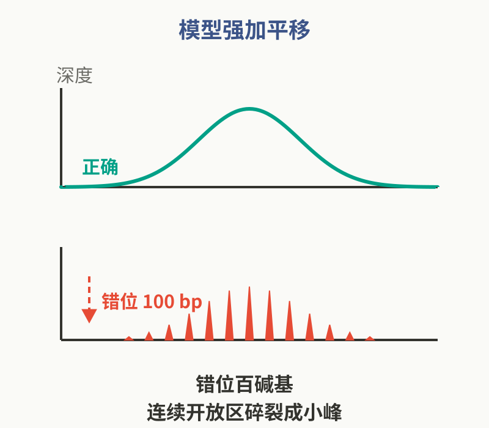

</div>
<div>

- 峰数异常多、中位宽异常小（设例：15 万个、<150 bp）
- FRiP 可能不降反升，别用它排除模型用错
- 改对模型后，峰数回落、中位宽变大

</div>
</div>

<div class="ref">教材 §15.5.1 ｜ 讲义 ⑥ 6.2、⑨ 错误 1</div>

<!--
旁白：第一张「不对」的样子：碎峰。现象是峰数异常多、中位宽异常小，设例里是十五万个峰、中位宽不到 150 bp。原因你已经知道了：ATAC 没有双峰结构，你却用了默认模型，一段连续开放区被剁成十几个小峰。最反直觉的地方在这：碎峰把峰的总覆盖面积做大了，落峰比例可能不降反升——所以 FRiP 看着正常，排除不了模型用错。怎么察觉？日志里那两句警告要留心，更要看输出：峰数、中位宽、峰宽分布；再用浏览器打开一个本该连续的区域，看它是不是被切碎了。改对模型之后，峰数回落、中位宽变大，两个数一起动，才说明真改对了。顺带一句：碎峰会让取窗整体错位，motif 结果跟着一起错。报告里把新旧峰数都写上，比较才有意义。
-->

---

<!-- _class: master warn -->
## 结果不对时长什么样（二）：缺对照

<div class="cols">
<div>

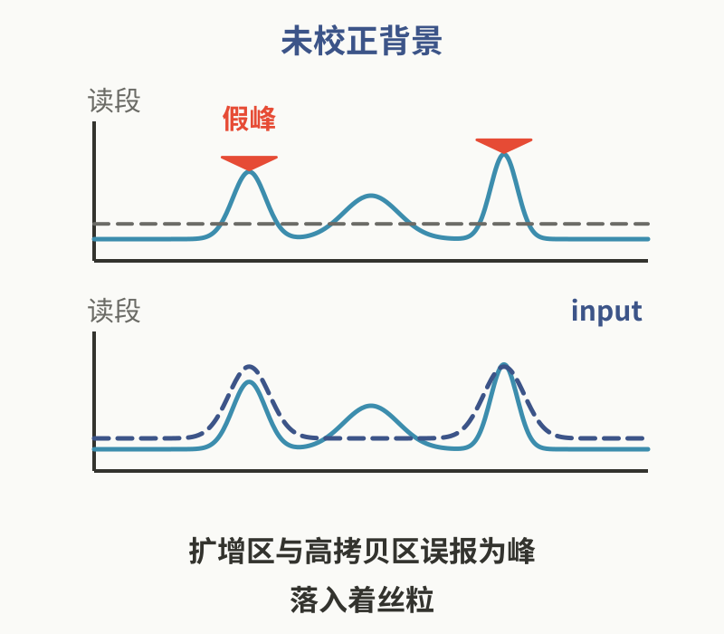

</div>
<div>

- 缺对照不报错；日志少 control 两行
- 处理样本自己当对照，1 kb 尺度消失
- FRiP 可降可升；症状成对出现先怀疑对照

</div>
</div>

<div class="ref">教材 §15.5.2 ｜ 讲义 ⑨ 错误 2</div>

<!--
旁白：第二张：缺对照。它的特征还是那句——不报错。判据藏在日志里：有对照时才打印读对照读段的那两行，没有对照，这两行整个消失。后果两头走，机制前面已经算过：窄偏差区整片过线，宽真实域被自己扣掉。这里补一个方向上的提醒：典型设例说峰数暴涨、落峰比例下降，但真实数据里，假峰补进来的读段可能盖过真峰的损失，比例甚至不降反升。所以能依靠的是机制，不是某个固定倍数。修法分平台：ChIP 补上 `-c input.bam`，IgG 顶替不了；ATAC 走三件事——伪影清单、无对照声明、IDR。判据要成对看：日志少了那两行，再加上峰数或背景异常，两件事指向同一边，才动手怀疑对照。一个症状不定罪，两个同向才定罪，这一讲反复用的就是这个思路。
-->

---

<!-- _class: master warn -->
## 结果不对时长什么样（三）：最近基因错配

<div class="cols">
<div>

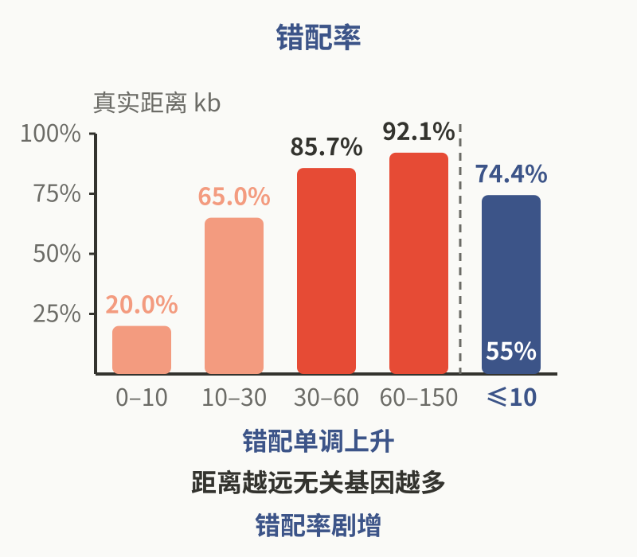

</div>
<div>

- 候选表混进几何最近、生物学无关的基因
- 下游 motif、通路与交集沿错标签继续走
- 先看距离分布，再看中间是否隔着基因

</div>
</div>

<div class="ref">教材 §15.5.3 ｜ 演示 `ch15_nearest_gene_mismatch.py` Part 3</div>

<!--
旁白：第三张：最近基因错配。它不报错，也不动任何数值，只是把标签贴错了。现象：候选表里混进一批几何上最近、生物学上无关的基因；然后下游的 motif、通路、交集全都沿着错标签往下走，越走越像真的。察觉的路子：先看距离分布，再看中间是不是隔着基因。前面那个算例给过量级：总错配 66.5%，远端那一层到 92.1%，而且随距离单调上升。修法要说清楚——不是加一个距离截断：截到 10 kb 以内，错配照样在，只是先把一半以上的远端元件扔了。真正的修法是改措辞：写「最近基因」，并标注未经互作验证。这个错不改任何数字，所以只能靠措辞和对照表抓出来。看到离得很远的峰，先别急着讲远端调控的故事。
-->

---

<!-- _class: master warn -->
## 结果不对时长什么样（四）：motif 假富集

<div class="cols">
<div>

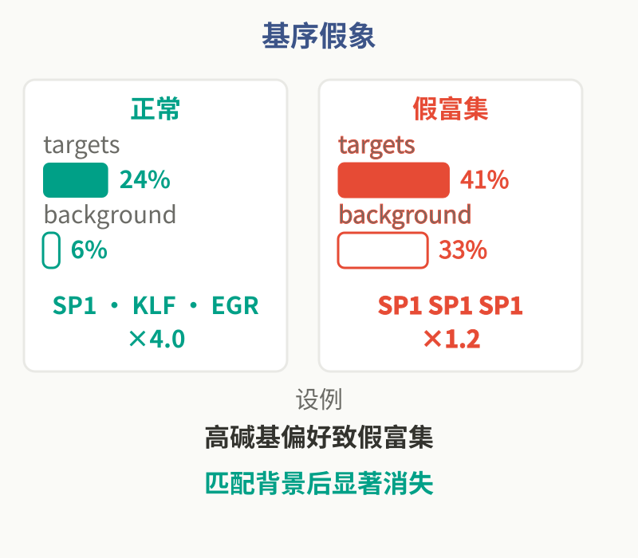

</div>
<div>

- 换成匹配背景后，显著性消失
- de novo 的极小 p 值不是证据强度
- 三问：背景怎么生成、重复是否一致、取窗在峰顶

</div>
</div>

<div class="ref">教材 §15.5.4 ｜ 演示 `ch15_motif_gc_background.py`</div>

<!--
旁白：第四张：motif 假富集。现象很干脆：换成匹配背景，显著性当场消失。这时候回头翻你原来的表，会发现目标占比跟背景占比只差一两倍，p 值却小得吓人——这里要把话说透：极小的 p 值不等于证据强度。尤其从头发现的 motif，它的 p 值没有对搜索空间做过校正，十的负一百二十次方并不比十的负二十次方强一百倍。察觉靠三问：背景怎么生成的？重复之间一致吗？取窗是不是在峰顶？三问都过了才写候选；只凭倍数大、p 值小，既不能判真也不能判假。三问的答案要写进方法学——不写就等于没做，审稿人没法替你补背景是怎么来的。写报告时把背景生成方式当成必填项；这一栏空着，你的结果就不可复现。
-->

---

## 记录表：报告里哪一栏能填、哪一栏不能

| 栏目 | 本课能不能填 | 说明 |
|---|---|---|
| 比对率 / 重复率 | 能 | 日志与 markdup 统计 |
| FRiP / 峰数 / 中位宽 | 能 | 脚本汇总表 |
| 细胞器% | 不能 | 参考无细胞器序列 |
| TSSE / NRF / PBC | 未产出 | 脚本未实现；热图不等于 TSSE |

- 每格写数值与口径，不预填「通过/不通过」

<div class="ref">教材 §15.6 ｜ 脚本边界 ｜ 讲义 ⑥ 6.3（设例表不上屏）</div>

<!--
旁白：这张记录表管的是报告里哪一栏能填、哪一栏不能，重心在中间那一列。比对率、重复率能填，日志和 markdup 统计里都有；落峰比例、峰数、中位宽能填，脚本有汇总表；细胞器百分比不能填，参考里没有细胞器序列，这一栏留空、写不可计算；TSSE、NRF、PBC 属于未产出，脚本没实现——再提醒一遍，热图顶不了 TSSE。底下那行要求最实用：每一格写数值加口径，不要预先填「通过」或「不通过」。为什么？合格线跟着物种、深度、体系走，你填表的时候还没确定用哪条线，先把结论写上就是给自己挖坑。交作业前对着这张表过一遍，空着的格子就是你要补的实验或者要写的局限。这张表填扎实了，方法学那一段基本就写完了。
-->

---

<!-- @section: stats_plugin -->
## 统计要点 1–2：几十万个窗口的多重检验

- peak calling 是几十万次泊松检验加 BH 校正
- `-q 0.05` = 这份名单里期望约 5% 假阳性
- 报告必须写阈值，并调紧一档做敏感性检查
- 核心结论随阈值翻面，就是结论不稳的证据

<div class="ref">教材 §15.4.3 ｜ 讲义 ⑦-1、⑦-2 ｜ LO15-05</div>

<!--
旁白：统计要点先讲前两条，都围着多重检验转。调峰的本质，是几十万次泊松检验再加 BH 校正；检验单位从基因换成了窗口，数量从两万上下涨到几十万——所以 q 值的含义跟差异表达那边一样，只是对象密得多。第二条把 q 值翻译成人话：阈值写 0.05，意思是这份名单里期望约 5% 是假阳性；它不是「每个峰有百分之五的概率错」这种说法。落到报告上有两个动作：必须写清你用的阈值；再调紧一档重跑一次，做敏感性检查。要是核心结论随着阈值翻面，那不是巧合，那就是结论不稳的证据。敏感性检查具体就是：阈值收紧一档重跑，比一比峰集和交集变了多少。这两条合起来，才让 q 值这个数在你的报告里真正可解释。
-->

---

## 统计要点 3–4：峰数不可比，比率要写口径

- 峰数被深度、复杂度、阈值与模型四因素驱动
- 不同深度的样本之间，比峰数没有意义
- IDR 的一致性比率：rescue 与 self-consistency
- 两个都 <2；写清用的是哪一套口径

<div class="ref">教材 §15.4.2、§15.4.4 ｜ 讲义 ⑦-3、⑦-4</div>

<!--
旁白：接着讲峰数和比率。峰数不可比，先记死：它同时被测序深度、文库复杂度、阈值和模型四个因素推着走。两个深度不同的样本比峰数，比出来的多半是深度差，何况峰数随深度远未饱和。比率那半页讲 IDR 的一致性口径：rescue 和 self-consistency，两个都小于 2，但报告里不能只写「比率小于 2」——原始论文用的是那两个比值的名字，现行流程换了另外两个名字，说的是同一件事，你用哪一套要写明。合起来还是那句话：凡是比率，都带口径和条件。真要跨样本比，就把样本降采样到同一有效深度，或者改比落峰比例和信号强度。这两条写进报告，读者才判断得了你的比较公不公平。
-->

---

## 统计要点 5–6：motif p 值与置换公式

- de novo 在巨大模式空间里挑最优解
- 它的 p 值没对搜索空间校正，量级不可互比
- 置换 p 值 `(1 + #null ≥ obs) / (nperm + 1)`
- 打乱基因标签假定先验相同；打乱坐标更严

<div class="ref">教材 §15.4.6、§15.4.7 ｜ 讲义 ⑦-5、⑦-6</div>

<!--
旁白：最后两条，都卡在 p 值的边界上。从头发现的 motif 是在巨大的模式空间里挑最优解，它的 p 值没对搜索空间做过校正，所以不同运行、不同峰集之间的量级不能互相比较，谁更小谁更强的说法不成立。置换检验的 p 值公式是：零分布里不小于观察值的次数加一，除以置换次数加一。那个加一不是为了好看——经验分布里没有真正的零，少了它 p 值会算成零，样本越小吃亏越明显。零模型的选择也要留心：打乱基因标签，等于假定每个基因被关联的先验概率相同；打乱坐标更严格，计算量却高出一到两个量级。用哪种，写进报告。这两条看着琐碎，实际决定的是别人能不能重复你的结果。
-->

---

<!-- @section: troubleshooting -->
<!-- _class: master warn -->
## 常见错误一：ATAC 用默认模型

- 警告 `Fewer paired peaks (23) than 1000!`
- 或者直接 `No enough pairs to build model`
- 措辞随版本变，以日志与产物计数为准
- 修法：`-f BAMPE`；单端才加 shift 与 extsize

<div class="ref">教材 §15.5.1 ｜ 讲义 ⑨ 错误 1</div>

<!--
旁白：第一个常见错误：ATAC 套用了默认模型。日志里会出现两种措辞，一种是成对峰太少、模型可能建不好，另一种干脆说没有足够的成对峰来建模。措辞随版本变，所以别背报错原文，看日志加产物计数：峰数、中位宽。修法就一句：双端数据加 `-f BAMPE`，软件会强制关掉模型；单端才需要另加位移和延伸那两个参数。这里再敲一次黑板：双端之下那两个参数是空操作，写着不报错，但它什么也没做，更不能在报告里写成「做了双峰建模」。排查从上往下走：先看日志有没有警告，再看峰数和中位宽，最后目检一个区域——别一上来就调阈值。模型的问题拿阈值去治，是这类错误最常见的二次伤害。
-->

---

<!-- _class: master warn -->
## 常见错误二：没给 input，不报错

- 判据在日志：有对照才有读 input 的行
- 补 `-c input.bam`；IgG 替代不了
- ATAC 走三件事：清单、声明、IDR
- 清单留空就写「未过滤」，不能默认已做

<div class="ref">教材 §15.5.2 ｜ 讲义 ⑨ 错误 2</div>

<!--
旁白：第二个常见错误：没给对照，程序照样不报错。判据还是在日志：有对照，才有读对照读段的那两行。修法从平台说起。ChIP 补上 `-c input.bam` 就完了，IgG 顶替不了——它里面没有打断偏好和拷贝数的信息。ATAC 本来就没有对照，那就把三件事做全：选一份适合这个物种的高信号伪影区间清单，并且真的执行扣除；在报告里声明无对照、峰集有较高假阳性风险；拿重复之间的 IDR 当主要证据。还有一句要记住：清单留空就老老实实写「未过滤」，不能默认已经做了——审稿人最先查的就是这一处。三件事里最容易跳过的是声明，最容易写错的是清单到底执行没有。三件写全，ATAC 无对照才算被交代过的限制，而不是被藏起来的缺陷。
-->

---

<!-- _class: master warn -->
## 常见错误三：染色体命名不匹配

- `invalid region or unknown reference. Continue anyway.`
- 之后 BAM 变空或缺染色体
- 共同染色体为 0 时，R 脚本直接 `stop`
- intergenic >95% 先查命名与物种注释

<div class="ref">教材 §15.5.6 ｜ 讲义 ⑨ 错误 4、6</div>

<!--
旁白：第三个常见错误：染色体命名不匹配。日志里那句是「参考序列未知、继续执行」——注意，它说的是继续，返回码还是零，拿脚本串流程根本不会中断。后果一路排下去：比对结果变空或者缺染色体，峰表只剩零星几条，注释全部落进基因间区。察觉靠三步：比对比对索引和 BAM 头里的染色体名，看是否逐字一致；在 R 里数共同染色体数，为零就是命名问题；看注释分布，基因间区超过 95% 先查命名和物种，别先解释生物学。修法是从头到尾统一到同一份序列文件，转录本数据库现场重建。跨物种数据里命名不匹配几乎必然出现，所以拿到数据第一步就对名字，别等注释出来才回头查。这类错误不报错，只能靠主动核对抓出来。
-->

---

<!-- @section: wrapup -->
## 实践任务卡（2 h）

| 步 | 做什么 |
|---|---|
| 1 | 下载 12 个 run，核对双端与参考 |
| 2 | `qsub` 跑 `05_peak_calling.sh`，`MODE=atac` |
| 3 | 手工补 TSS 热图、相关矩阵与 IDR |
| 4 | `qsub Rscript` 注释、交集与置换 |

- 换一个 q 阈值重跑，看 Top motif 与交集方向
- 每样本只记录实测值，不预填合格线

<div class="ref">教材 §15.6 ｜ 讲义 ⑤ ｜ 实验指导 `05_regulome_lab.md`</div>

<!--
旁白：上机两个钟头，就按这四步走。第一步下载十二个 run，顺手核对双端和参考——这步最花时间，提前起跑。第二步投作业跑主脚本，记得指定 ATAC 模式；忘了它，后面全线都歪。第三步是脚本管不着的手工活：TSS 热图、相关矩阵、IDR，三件都得自己补命令。第四步投 R 脚本做注释、交集和置换，注意差异表要先转格式。底下两条是加分项，也是本讲最想让你带走的习惯：换一个 q 阈值重跑，看排第一的 motif 和交集方向动没动；每格只记实测值，不预填合格线。四步里最容易赶不上的是下载和手工补 IDR，别拖到最后十分钟。实在记不住，就记一句：第一步和第三步最费时间，先做它们。
-->

---

## 收尾：练习、演示与指针

```bash
cd <课程仓库路径>
PYTHONDONTWRITEBYTECODE=1 python3 textbook/demos/ch15_local_lambda.py --selftest
```

- 上机手边打开实验指导；练习选讲义 ⑩ 三题
- 四个演示都是小计算，同样经 `qsub`
- 文献只给指针（讲义 ⑪），本 deck 不重复列

**交出去的是一张峰表，加一份能说清边界的记录。**

<div class="ref">教材 §15.6、§15.7 ｜ 讲义 ⑩、⑪</div>

<!--
旁白：最后是一段能直接跑的命令，外加三个指针。命令是在课程仓库根目录跑一个演示脚本，它自带自检；四个演示都是小计算，照样投作业，别在登录节点上跑大流程。三个指针：上机时实验指导放手边；练习从讲义后面的题里选，本讲做三道；文献这里只给入口，不重复列。这一讲交出去的是什么，页面最后一行已经写了：一张峰表，加一份能说清边界的记录。峰表决定你做了什么，记录决定别人能不能判断这张峰表在什么条件下成立。工具会一直更新，能说清边界的记录不会过时。所以这份作业真正要交两样：能复现的峰表，能说清边界的文字——缺一样，都不算完成。
-->
