<!-- @section: cover -->
<!-- _class: master cover -->

# 宏基因组：物种组成、组装分箱与功能

**路线先选，再拆成三个可检查的维度。**

<div class="meta">

- 硕士层 · 专题 m07 ｜ 4 学时（2 h 理论 + 2 h 实践）
- 讲义 `02_lectures/master/topic07_metagenome/07_metagenome_lecture.md`
- 教材第 19 章 ｜ 环境 `ngs_ms_microbiome`

</div>

<!--
旁白：欢迎来到宏基因组这一讲。四学时，前两小时讲原理，后两小时上机。今天只立一条主线：路线先选好，再拆成三个可以检查的维度——谁在、能不能拼回基因组、结论能有多强。这三个维度环环相扣，不是三张并列的清单，后面每一节都会绕回这条线上来。
-->

---

<!-- _class: master divider -->

<div class="num">01</div>

# 学习目标

八条能力，对应 LO19-01 到 LO19-04

<!--
旁白：先把靶子立起来。八条能力分两组：前四条管路线与去宿主，后四条管分类、分箱、判级。与其说是八个知识点，不如说是流程上必须一道道过的关卡，少过一道，后面的结论就要打折。
-->

---

<!-- @section: objectives -->
## 学完你应当能够（一）：路线与去宿主

- 为给定问题选一条路线，说清放弃了什么
- 把宿主占比的组间差距换算成通量比
- 区分 `--un-conc-gz` 与 `-f 12` 两种口径
- 判读日志里「明显偏离本批」的那个样本

<div class="ref">教材 §19.2 LO19-01–02 ｜ 讲义 ①</div>

<!--
旁白：先看前四条，都在路线和去宿主这一段。选路线，考的不是哪个方法先进，而是你敢不敢说清放弃了什么：放弃的是「库外看不见」，还是「低丰度拼不出」。宿主占比那条要当心：它是比例，比例上的差距不能直接当结论，得换算成有效非宿主读段的倍数；换算有个前提，两组原始读段总量得一样，不一样就先归一。再往下是两个容易混的口径：Bowtie2 的 --un-conc-gz 收的是「没形成一致比对」的读段对，samtools 的 -f 12 要求两端都没比对上，所以前者的集合更大。最后一条最实用：把每个样本的宿主比对率摆在一起看，明显偏离本批的那个，先查参考选择和裂解状态，别急着调参数。
-->

---

## 学完你应当能够（二）：分类、分箱与判级

- 解释原始分类计数为什么不能当丰度
- 解释分箱的两个信号：136 维组成与深度共变
- 按 MIMAG 判级，说清污染度为何能超 100%
- 论证相对丰度是组成性数据（总和恒为一）

<div class="ref">教材 §19.2 LO19-03–04 ｜ 讲义 ①</div>

<!--
旁白：后四条管的是跑通之后能不能下结论。原始分类计数为什么不能当丰度？一来大量读段停在属或科、指名不到种，二来基因组大小会带来抽样偏好。分箱为什么能成立？靠 136 维组成和跨样本深度共变这两个互相独立的信号。MIMAG 判级之外，还要能解释污染度为什么能超过 100%——它数的是多出来的副本，不是溢出的百分比。最后一条最容易被跳过：相对丰度是组成性数据，总和恒为 1，一个类群真升高，其余会成片下降，直接拿计数去做检验，假阳性会成片冒出来。这一组是整讲最值钱的部分：流程谁都会跑，边界才决定结论能不能用。接下来逐条展开，每条都配一个具体的数或者一个具体的例子。
-->

---

<!-- _class: master divider -->

<div class="num">02</div>

# 前置检查

五个 L0 模块，加一句「工具在哪」

<!--
旁白：进入正题之前先做个体检。这一讲的门槛不在宏基因组本身，而在五个先导模块——少一个，后面就会卡在莫名其妙的地方，而且卡的样子往往像软件坏了，其实是地基没打。
-->

---

<!-- @section: prerequisites -->
## 前置检查：这五个模块做了没有

| L0 模块 | 用在哪 | 不过关的后果 |
|---|---|---|
| `l0_01_linux` | `qsub`、大文件管理 | 登录节点跑组装 |
| `l0_03_conda` | 激活环境、库不进 yml | 分不清没装还是路径错 |
| `l0_05_qc` | 单端修剪参数 | 照抄双端命令 |
| `l0_04_formats` | SAM/BAM、N50 | 读不懂 `depth.txt` |

- `l0_06_stats`：相对丰度不能当计数（讲义 ⑦）

<div class="ref">教材 §19.3 ｜ 讲义 ② ｜ 自测 L0-1-Q6、L0-3-Q5、L0-3-Q6、L0-5-Q6、L0-4-Q10、L0-6-Q5</div>

<!--
旁白：五个模块对着表看，用在哪、不过关会怎样，一一对上了。Linux 那条管 qsub 和大文件，最常见的错误是在登录节点跑组装——整个集群跟着卡，作业还会被管理员杀掉。conda 那条管环境激活：数据库不进环境，所以要分得清「没装」和「路径没指对」，两种故障的样子完全不同。质控那条针对我们这批数据：单端、读长可变，照抄双端参数会把真实信号削掉。formats 那条管 SAM/BAM 和 N50，看不懂 depth.txt，分箱就没法判断。统计那条最要紧：相对丰度不能当计数。哪条心里没底，先回去补，别硬闯。建议把这张表截个图，上机卡住先对一遍。
-->

---

## 工具不在同一个环境里

<div class="cols">
<div class="card">

### 主环境 `ngs_ms_microbiome`
MEGAHIT 1.2.9、MetaBAT2 2.15、CheckM 1.2.2、eggNOG-mapper 2.1.11

</div>
<div class="card">

### 跨环境与未装
fastp 0.23.4 在 `ngs_ms_base`；Bowtie2 2.5.1 在 `ngs_ms_transcriptome`；CheckM2、Prodigal、DAS Tool、GTDB-Tk 未装

</div>
</div>

- 数据库不进 conda，集群侧部署一份，用环境变量指过去
- 主脚本调用 Bowtie2 前，先在主环境 `command -v bowtie2` 实查
- 查不到就停下报环境依赖，别把「没跑」当成「跑通」

<div class="ref">教材 §19.3 ｜ 07_envs/conda/env_master_microbiome.yml</div>

<!--
旁白：上机第一天最容易栽的坑就在这：工具不在同一个环境里。左边主环境装着组装、分箱、质量评估和注释，齐全。右边两类要当心：fastp 在基础环境，Bowtie2 在转录组环境——也就是说主脚本要调 Bowtie2 的时候，主环境里其实没有它。还有几个工具课程压根没装：CheckM2、Prodigal、DAS Tool、GTDB-Tk。动作规范就一句话：先 command -v 实查，查不到就停下报环境依赖，别把「没跑」写成「跑通了」。数据库是另一回事，它们不进 conda，集群侧部署一份、用环境变量指过去；忘了设路径，工具可能悄悄拿一个旧库跑出结果——那比报错还麻烦。
-->

---

<!-- _class: master divider -->

<div class="num">03</div>

# 科学问题

从「谁在」推进到「能干什么」

<!--
旁白：体检过了，进正题。这一节只做一件事：把「宏基因组能回答什么」拆成三个有先后顺序的问题。顺序本身就带着信息——它决定预算怎么分、算力往哪儿投。
-->

---

<!-- @section: background -->
## 三个问题，有依赖顺序

<div class="cols">
<div>

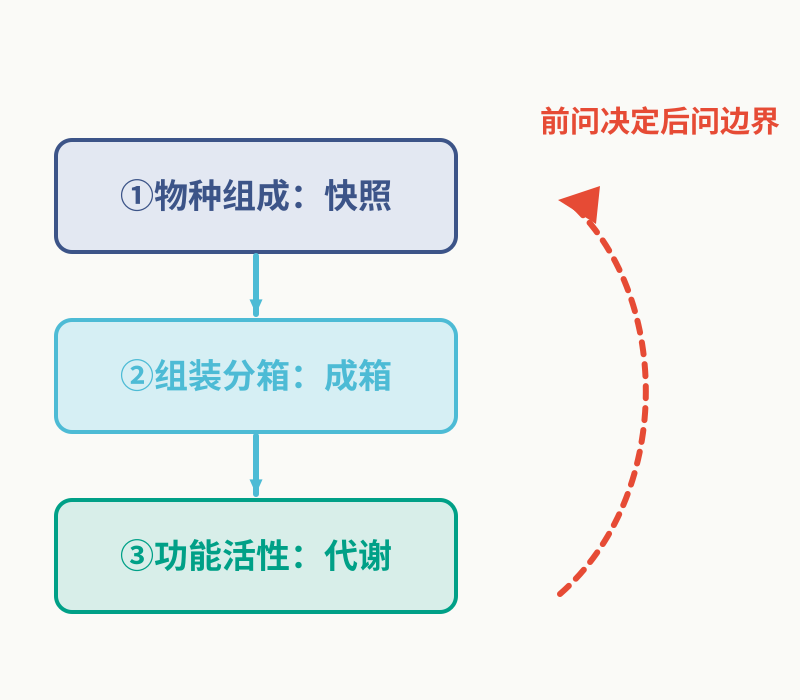

</div>
<div>

- 有哪些类群：决定预算怎么分
- 能否拼回基因组：深度与复杂度说了算
- 结论能有多强：完整度与嵌合说了算

</div>
</div>

<div class="ref">教材 §19.1</div>

<!--
旁白：先读图。这张漏斗三层，越往下越贵，结论也越强。最上层问有哪些类群，它决定预算怎么分：要做全样本的群落比较，读段比对的路线便宜、通量大。中间一层问能不能拼回基因组，可行性由上一层暴露的深度与复杂度定——低丰度的物种在浅测序里根本拼不出来。最下层问结论能有多强，被完整度和嵌合卡住。图上第三层标的是「功能活性」，这里要按教材口径读成「功能潜力」——潜力不等于活性，后面专门有一页讲。图底部那句话是整张图的钥匙：前一个问题决定后一个问题的边界，上层没做扎实，下层就没有输入。动手前先想清楚要停在哪一层，再决定投入多少；预算只够停在上层，就把上层的边界写清楚。
-->

---

## 两条路线：要名单还是要基因组

<div class="cols">
<div>

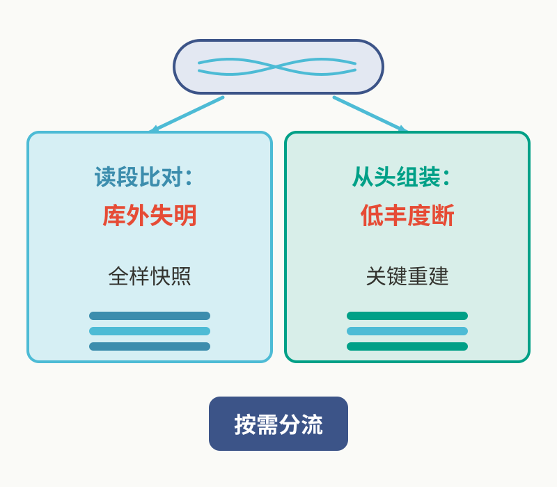

</div>
<div>

- 读段比对：全样本快照，库里没有的看不见
- 从头组装：重建基因组实体，低丰度易断
- 按需分流：全样本筛选用前者，重建用后者

<div class="muted">

MAG＝宏基因组组装基因组

</div>

</div>
</div>

<div class="ref">教材 §19.4.1 ｜ 术语见 §19.4.4</div>

<!--
旁白：两条路线摊开看。左边读段比对：读段直接打到参考库上，几个小时就有全样本的快照，代价是库里没有的类群完全看不见。右边从头组装：不依赖参考，把读段拼成重叠群再聚成基因组，拿得到实体，但吃内存、吃深度，低丰度的容易断链。实际项目里最常见的做法是中间那条按需分流：先用便宜的路线把全样本筛一遍，再挑差异最大的几个样本做组装。顺带解释一个缩写：MAG 就是「宏基因组组装基因组」，从混合群落里拼出来的基因组，不是培养出来的，也不保证完整。打个比方，读段比对像查户口本，组装像凭脚印重建一个人；户口本上查不到的人不等于不存在，脚印也可能拼错——两条路线是互补，不是二选一。
-->

---

## 主线数据：日本农田鸟枪法宏基因组

- `PRJDB12800` 全研究 45 个 run，课程取 12 个
- 水田 6、旱地 6，各两块田 × 3 重复
- 12/12 单端，读长 216–239 bp，MiSeq，2011 年
- 合计 1.326 GB，16 137 419 条读段

<div class="ref">教材 §19.1、§19.6 ｜ 06_data/accessions.tsv L98–L110（ENA 实查）</div>

<!--
旁白：接下来这套真实数据会贯穿全讲：日本农田的鸟枪法宏基因组。几个数字值得记，后面每个参数都由它们决定。全研究有 45 个 run，课程取 12 个：水田 6 个、旱地 6 个，各来自两块田的三个重复。12 个全部单端，读长 216 到 239 bp，而且是可变的，不是固定一个值；平台 MiSeq，2011 年采样，合计 1.326 GB。「子集」两个字要强调：45 取 12 是我们自己划的边界，必须写进方法学，不然读者会以为你用了全部数据。单端、可变长、深度低，这三个形态下一页就看它们的后果。体量不大，正好够在课堂上完整跑一遍。
-->

---

## 这批数据决定每一个参数的写法

- 单端：双端的质控参数不能照搬
- 可变读长：Bracken 的 `-r` 不能写死一个数
- 深度低：分不出高质量 MAG 属正常

<div class="ref">教材 §19.1、§19.6</div>

<!--
旁白：上一页说数据长什么样，这一页说这些长相怎么落到参数上。单端，第 6 章讲的双端质控参数就不能照搬：双端两条读段可以互相校正，单端只有一条，没人帮你纠错。可变读长，Bracken 的 -r 是「按多长的读段建库」，写死 150 就跟实际读长对不上，得去库里挑最接近实际读长的那一档。还有一条最容易被误判：深度低，所以「分不出高质量 MAG」是预期结果，不是流程失败——上机看到箱数很少、甚至 No bins，先别怀疑脚本。顺序永远是先看数据形态，再定参数，最后才解释结果；反过来做，就会把数据的限制写成流程的 bug。这条也要写进报告，不能只留在代码注释里。
-->

---

<!-- _class: master statement -->

本章 `PRJDB12800`（日本农田，2011，鸟枪法）与第 18 章的 `PRJDB13364`（布基纳法索铁毒稻田，2017–2019，16S）同为稻田土壤，但不是同一批采样。

跨大陆、跨年份、跨方法：丰度差异不能归因于方法。

<!--
旁白：有个提醒，方法学里最容易写错的就是它。第 18 章那套稻田数据来自布基纳法索，是 16S，2017 到 2019 年采样；我们这套是日本农田，鸟枪法，2011 年。两套都算稻田土壤，但完全不是同一批采样。为什么要专门强调？跨大陆、跨年份、跨方法，三个变量同时变了，差异就没法归给其中任何一个——所以「16S 和鸟枪法导致丰度不同」这类说法不成立，两套数据只能做概念性对照。真要比较两种方法，唯一的办法是同批、同一样点同时做两种测序，或者拿已知组成的 mock 群落单独评估方法偏差。写方法学时把这条明确写进去，答辩的时候这一条几乎必问。
-->

---

<!-- _class: master figure -->

## 同一条链路推到全球尺度

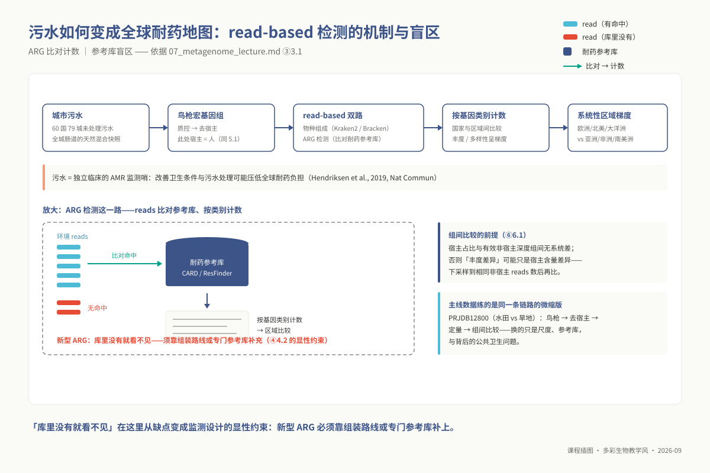

图 19-1 污水宏基因组变成全球耐药地图（60 国 79 采样点）

<div class="ref">教材 §19.1 图 19-1 ｜ 右下「组间比较前提」卡为可选敏感性分析</div>

<!--
旁白：同一条技术链路推到全球尺度是什么样，看这张图。从左往右：城市污水是全城人口肠道菌群的天然混合快照，绕开了临床个例采样；先做鸟枪法测序，再质控、去宿主——这里的宿主是人；然后分成两路，一路用 Kraken2 和 Bracken 出物种组成，另一路把读段比对到耐药参考库、按基因类别计数，最后在国家与区域之间比较。右上那条虚线是读段比对路线的盲区：新型耐药基因库里没有，就永远看不见，得靠组装路线或者专门的参考库补。右下那张卡讲组间比较的前提：两组的宿主占比和有效非宿主深度不能有系统差，否则你看到的「丰度差异」可能只是宿主含量差异。这张图就是后面主线数据的微缩版，换的只是尺度。
-->

---

<!-- _class: master divider -->

<div class="num">04</div>

# 核心原理

去宿主 · 分类 · 组装 · 分箱 · 质量 · 统计

<!--
旁白：问题定了，下面进原理。六块内容：去宿主、分类、组装、分箱、质量、统计，顺序就是数据流的顺序。前一块不牢，后一块全歪，每一步都别急着往前赶。
-->

---

<!-- @section: principles -->
## 去宿主：两条路线都得先走这步

<div class="cols">
<div>

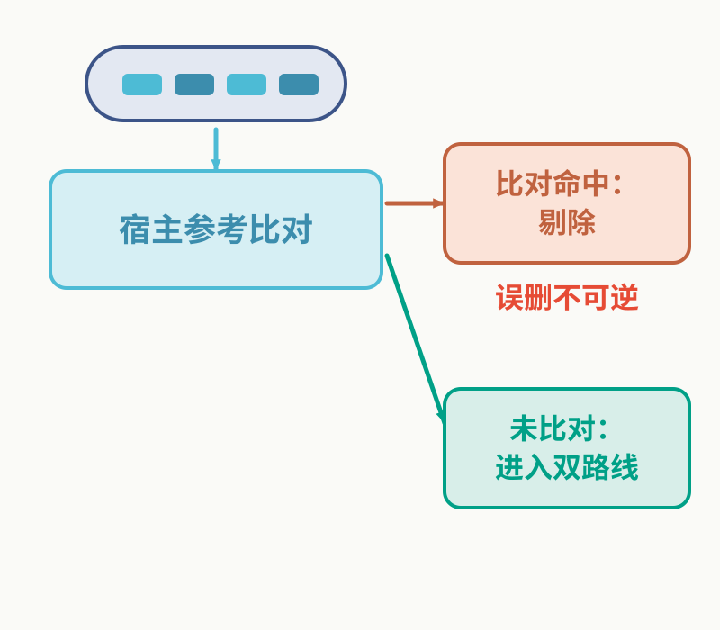

</div>
<div>

- 宿主读段白占组装内存和深度
- 宿主片段还可能聚成体量异常的假 MAG
- 质控后比对回宿主参考；土壤样本也不能省

</div>
</div>

<div class="ref">教材 §19.4.1</div>

<!--
旁白：先看去宿主，不管走哪条路线，这一步都躲不开。读图：质控后的读段比对回宿主参考，比对命中的剔除，未比对的进下游。图中间那句「误删不可逆」是整页的重点：删掉的读段不会回来，这步的代价不对称，宁可先想清楚再动手。为什么必须做？两个原因：宿主读段占组装内存、占无效深度，等于花算力处理没用的东西；更麻烦的是宿主片段可能聚成一个体量异常的假 MAG，让你以为发现了新基因组。还有一条常被忽略：土壤样本也建议做，宿主参考里常混着植物线粒体、叶绿体序列。下一页讲两个「未比对」口径的区别，那是实操里最容易混的地方。这一步的日志要逐样本留存，它是后面所有判读的入口。
-->

---

## 两种「未比对」不是同一件事

<div class="cols">
<div>

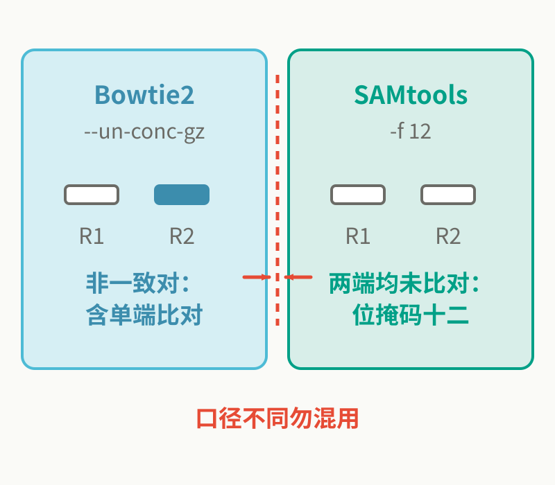

</div>
<div>

- Bowtie2 `--un-conc-gz`：未能形成一致比对的对
- SAMtools `-f 12`：两端都未比对（0x4 与 0x8）
- 课程脚本：双端 `-f 12`，单端 `-f 4`
- 灵敏度保持默认：调太严会误删共生菌

</div>
</div>

<div class="ref">教材 §19.4.1 ｜ 脚本 L31–45</div>

<!--
旁白：两个常被当成同义词的说法，在这张图上分开了。左边 Bowtie2 的 --un-conc-gz，输出的是「未能形成一致比对」的读段对——注意括号里那句话：一端比对上、另一端没比上的非一致对，也会被写进这个文件。右边 SAMtools 的 -f 12 是位掩码，要求两端都没比对，两个标志位同时置位才算数，所以它丢得更多，剩下的非宿主集合更小。课程脚本对双端用 -f 12、对单端用 -f 4；讲义示例用的是 --un-conc-gz。三种写法都在用，口径却不同，方法学必须写清你用的是哪一种，不然别人复现不出同样的保留率。最后一条是纪律：保持默认灵敏度，调太严会把跟宿主局部同源的共生菌一起删掉。
-->

---

## 误删是选择性的，不是随机丢数据

<div class="cols">
<div>

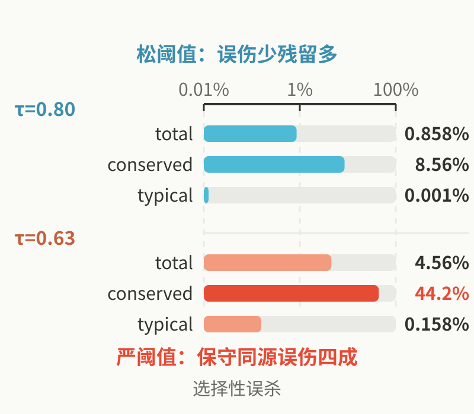

</div>
<div>

- 线粒体与叶绿体序列与细菌同源
- 严参数删掉的正是最近的共生菌
- 严档：保守同源类删 44.16%，典型类 0.158%
- 被删的微生物里约 96.9% 来自保守同源类

</div>
</div>

<div class="ref">教材 §19.4.1、§19.5.1 ｜ 演示 ch19_host_depletion_tradeoff.py --selftest</div>

<!--
旁白：「删得越干净越好」，这张图就是来推翻这句话的。横轴是比对强度阈值，从左到右越来越严。松档这边：宿主残留多，但微生物几乎不受影响。严档那边：宿主残留是降下去了，可保守同源类微生物被删掉四成多，典型类只删掉千分之一量级。右下那三个数最值得记：严档下保守同源类删 44.16%、典型类只删 0.158%；算例里保守同源类本来只占微生物的一成，按这两个删除率一算，被删的微生物里约 96.9% 来自这一类。也就是说误删不是随机丢数据，它有选择性——删掉的恰恰是跟宿主亲缘最近、生态学上最相关的类群。两个百分比各有各的分母，别混着读。一句话：删得越干净，越可能删掉你真正想找的那一类。
-->

---

## 宿主占比的组间差距要算成通量比

<div class="cols">
<div>

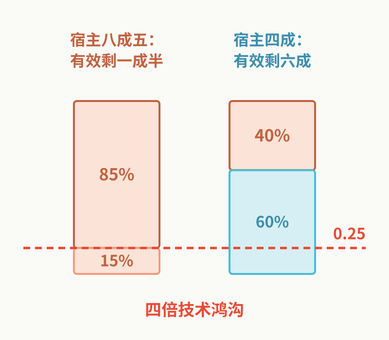

</div>
<div>

<div class="kpi">0.25</div>

- 设宿主占比 A 85%、B 40%
- `(1−0.85)/(1−0.40)`＝4 倍差距
- 前提是两组原始读段总量相同
- 先报通量；要做下采样就写成敏感性分析

</div>
</div>

<div class="ref">教材 §19.4.1、§19.5.1 ｜ 手算；演示同式断言</div>

<!--
旁白：一个容易被当成「描述性数字」的东西，这里要把它算成结论。图上两组：宿主占 85% 的那组，有效微生物读段只剩一成半；宿主占 40% 的那组，还剩六成。再看下面那个 0.25——它不是「差一点」，是有效通量只剩四分之一，倒过来就是四倍的差距。危险在哪？它不报错。你看到处理组多样性骤降，很可能是两组宿主含量本来就不同造成的假象。处置分两步：先把逐样本的原始读段数、宿主过滤率、实际非宿主读段数都报出来，让别人能自己算；然后才考虑要不要对齐通量。前提也写在页面上：两组原始读段总量必须相同，不同就先归一。
-->

---

## Kraken2 只做一件事：k-mer 查表

<div class="cols">
<div>

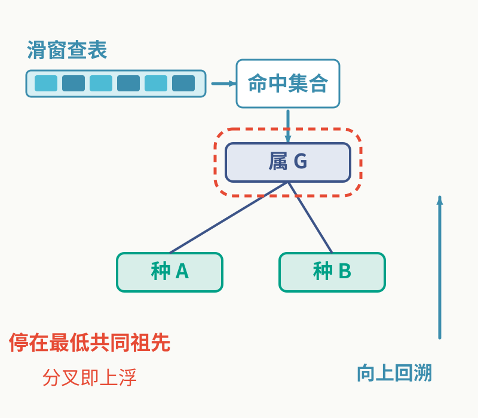

</div>
<div>

- 建库：参考基因组切成 k-mer 哈希表
- 查询：滑窗查表，命中取最近共同祖先（LCA）
- 三种结局：定到种、停在属、未分类
- 不做全局比对，快就快在这个取舍

</div>
</div>

<div class="ref">教材 §19.4.2</div>

<!--
旁白：Kraken2 做的事，说穿了只有一件：查表。建库时把参考基因组切成 k-mer，做成一张「k-mer 到分类单元」的哈希表；查询时把每条读段滑窗切成 k-mer，一个个查，再把所有命中的分类单元取最近共同祖先。图上那棵树就是这个意思：命中集合分了叉，就往上回溯，停在分叉点。结局只有三种：全部命中同一个种，定到种；命中散在属内几个种，停在属；一个都没命中，记未分类。它不做全局比对，快就快在这个取舍上。代价也从这来：库里没有的东西，表里就没有条目，读段只能落到未分类或者更高的祖先——下一页看这件事的后果。
-->

---

## 原始计数不能当丰度：两个原因

<div class="cols">
<div>

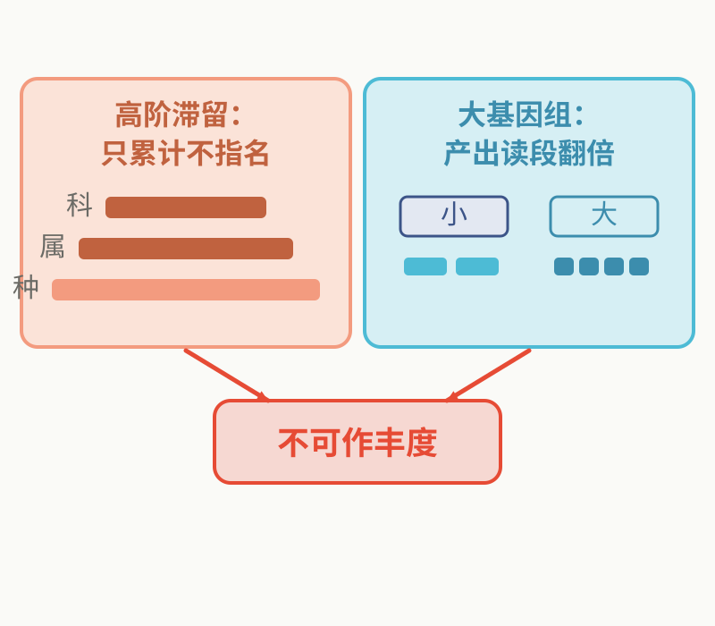

</div>
<div>

- 大量读段停在属或科：只累计，指名不到种
- 同样细胞数，大基因组产出的读段更多
- 0.58 Mb 对 8.67 Mb，差 14.9 倍
- 前者是信息损失，后者是系统偏好

</div>
</div>

<div class="ref">教材 §19.4.2 ｜ 手算 8.667/0.580</div>

<!--
旁白：原始计数为什么不能当丰度？两个原因，图上一左一右。左边是信息损失：大量读段停在属或科，只累计到高阶节点，指名不到种——你把它们按比例摊下去，那就是编。右边是系统偏好：同样多的细胞，基因组越大，产出的读段越多。页面上给了两个基因组的大小，0.58 Mb 对 8.67 Mb，差 14.9 倍——两种菌细胞数一样多，读段数能差一个数量级。所以直接把原始计数当相对丰度，等于同时接受两件事：大量读段没有指名，大基因组被系统性高估。这两件事要分开记：前者是信息损失，后者是系统偏好，补的法子也不一样。
-->

---

## 缺近缘种时的两种形态

<div class="cols">
<div>

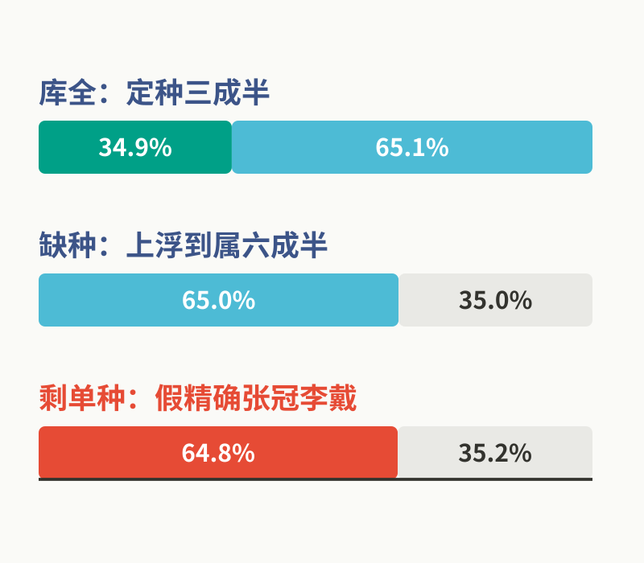

</div>
<div>

- 库全：种 34.9%，其余上浮到属
- 缺目标种：属 65.0%，未分类 35.0%
- 只剩一个姐妹种：64.8% 被误判
- 前者丢的是信息，后者是假精确

</div>
</div>

<div class="ref">教材 §19.5.2 ｜ 演示 ch19_lca_escalation.py --selftest</div>

<!--
旁白：「缺近缘种」有两种形态，后果完全不同，梯子图上分开摆着。最上面一层，库全：种水平拿到三成半，其余上浮到属——这是丢信息，方向没错。中间一层，目标种从库里删掉：种水平归零，属六成半，未分类三成半——读报告的人会以为这个种真的消失了。最危险的是底层：库里只剩一个姐妹种，保守区读段被唯一命中，种水平看起来「恢复」了，实际上大部分被误判给了姐妹种。前两种是丢信息，后一种是假精确；两种在报告里长得几乎一样，区别只在库。察觉的办法是属和种两层一起看：属层稳定而种层名单骤缩，先怀疑库，别先怀疑样本；动手前先查库的版本和构建日期。
-->

---

## 两道防线：confidence 与最小读段数

<div class="cols">
<div>

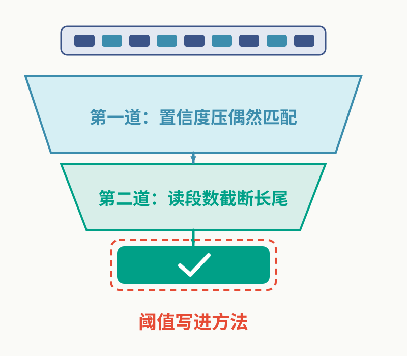

</div>
<div>

- `--confidence 0.1`：`C/Q` 低于门槛就上移
- `C`＝支持该路径的 k-mer 数，`Q`＝参与查库的 k-mer 总数
- 门槛压住偶然命中，也会制造上浮
- 最小读段数截长尾；两道都要写进方法学

</div>
</div>

<div class="ref">教材 §19.4.2</div>

<!--
旁白：两道防线，图上一左一右。头一道是 --confidence：Kraken2 给每条读段算个分数，分子是支持这条分类路径的 k-mer 数，分母是参与查库的 k-mer 总数；分数低于门槛，标签就沿着树往上移。所以它的作用不只是「丢弃」，还会制造上浮——这是上浮的第二个来源，头一个来源是库缺近缘种。另一道是报告阶段的最小读段数阈值，管截长尾。两道压的不是同一件事：一道管归属阶段的偶然命中，一道管报告阶段的低支持条目。物种数会随阈值差好几倍，所以两道都得写进方法学，不然别人复现不出你的名单。
-->

---

## Bracken 补什么、不补什么

<div class="cols">
<div>

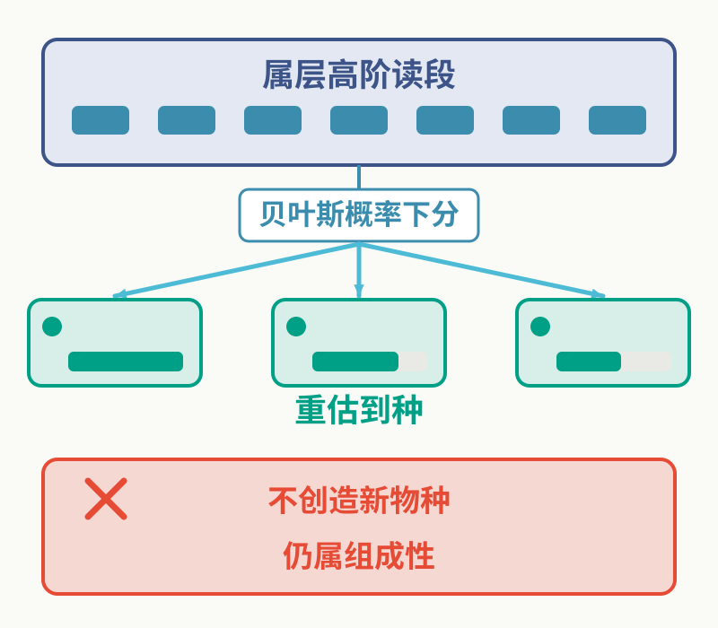

</div>
<div>

- 按建库读长的先验，把停在属/科的读段下分
- 补的是 LCA 上浮造成的分配损失
- 不补基因组大小：输出的还是读段份额
- `-r` 必须按实际读长与库内文件选

</div>
</div>

<div class="ref">教材 §19.4.2</div>

<!--
旁白：Bracken 补什么、不补什么，分开说清楚。它的做法是图上那句「属层高阶读段，贝叶斯概率下分」：建库时按一个固定读长，预先统计各物种的 k-mer 往各级祖先派发的概率；分析时按这个先验，把停在属、科的读段按概率权重往下再分配，重估到种。它补的是分类上浮造成的分配损失，不创造新物种——图右下那句要记牢。但它不校正基因组大小：输出仍然是读段份额，不是细胞份额。还有个实操点：-r 是读长参数，得按实际读长和库内文件选；我们的数据是可变长，写死 150 就跟建库假设对不上。两件事分开记：补分配是它的功劳，不校正基因组大小是它的边界。
-->

---

## 长尾物种先列候选，再决定截断

- 末尾常有成百上千个 1–3 条读段的物种
- 既可能是偶然命中，也可能是真实稀有成员
- 用 mock、加标或独立样本复核后再截断
- 报告第一行看 `unclassified`：那是库的盲区

<div class="ref">教材 §19.4.2、§19.5.2</div>

<!--
旁白：没有图的一页，说报告末尾那一大堆低支持条目。打开报告，常常看到成百上千个只有一两三条读段支持的「物种」。它们既可能是偶然命中——测序错误或者局部短序列碰巧重叠；也可能是测序很浅时真实存在的稀有成员。单看读段数，这两者分不开。所以纪律是先列候选，再决定截断。怎么复核？用已知组成的 mock 群落、加标样本，或者独立样本、独立引物这类正交证据。直接截断的代价，是把假阳性和真稀有类群一起删掉。还有一句值得记牢：报告第一行先看未分类比例——那不是流程故障，那是你的参考库盲区有多大。截断规则和阈值都要写进方法学，让别人能复算你的名单。
-->

---

## 宏基因组组装的三座山

<div class="cols">
<div>

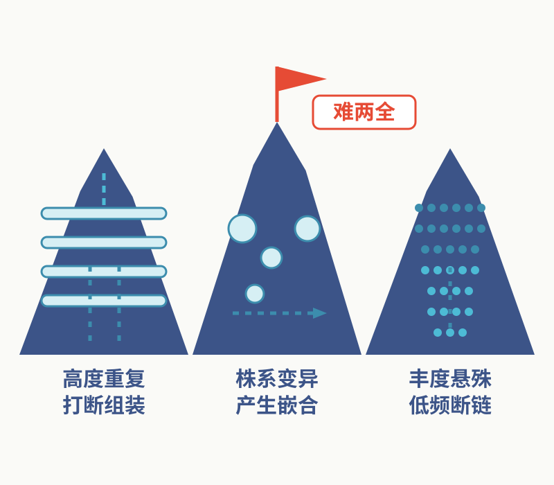

</div>
<div>

- 深度悬殊：稀有种连不成连续覆盖
- 株系微多样性：密集气泡，易出嵌合
- 图规模：全群落的图，普通节点装不下
- 三条都只作定性，倍数随群落而变

</div>
</div>

<div class="ref">教材 §19.4.3</div>

<!--
旁白：宏基因组组装为什么比单基因组难？图上三座山。头一座是丰度悬殊：优势种和稀有种的深度能差几个数量级，稀有种常常低到连不成连续覆盖——阈值调高就把它切碎，调低又让优势种的错误分支耗尽内存。第二座是株系变异：同种不同株只差少量碱基，这些差异在组装图上形成密集气泡，算法分不清哪条路径属于同一条染色体，只好截断或者交叉拼接，产出自然界不存在的嵌合。第三座是图规模：土壤群落类群数极高，全群落的图普通节点装不下。三条都只作定性，具体倍数随群落和参数变，不用背数字，记住机制就行。下一页看工具层面怎么对付这三条。
-->

---

## MEGAHIT 对着三座山做了什么

<div class="cols">
<div>

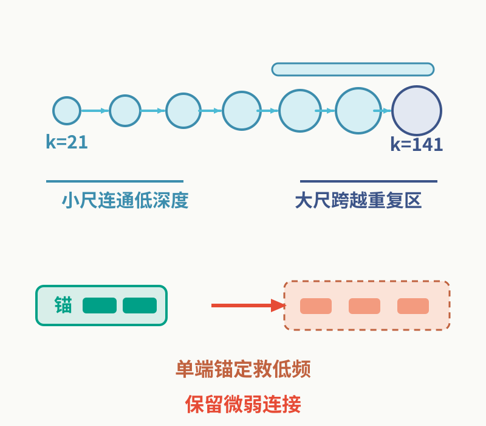

</div>
<div>

- 简洁 de Bruijn 图：每条边压到几个字节
- 迭代 k：小 k 连低丰度，大 k 解重复
- mercy k-mer：一端锚定，另一端低覆盖也保留

<div class="muted">

21、33、…、141 共 11 个 k，1.2.9 默认就是这组；新版步长改为 10，方法学要写版本与 k 列表

</div>

</div>
</div>

<div class="ref">教材 §19.4.3 ｜ 手算 (141−21)/12+1=11</div>

<!--
旁白：MEGAHIT 对着三座山做了什么？三件增量。头一件是简洁 de Bruijn 图：把每条边的内存压到几个字节量级，单机就跑得动复杂群落。第二件是迭代 k：先用小 k 把低丰度序列连起来，再逐轮增大 k 解重复、剔假分支，图上标的就是从 21 到 141 那一组。第三件是 mercy k-mer：一条读段一端已经锚定、另一端因为深度太低快被丢掉时，这部分候选会被留下来，稀有基因就不容易断。这里有个版本坑：21、33 一直到 141 共 11 个 k，是 1.2.9 的默认值，课程脚本不带 k 参数，走的就是它；新版步长改成了 10。所以方法学必须写版本和 k 列表，不然别人复现不出同样的重叠群集合。
-->

---

## 单样本还是混合：取舍，不是默认

<div class="cols">
<div>

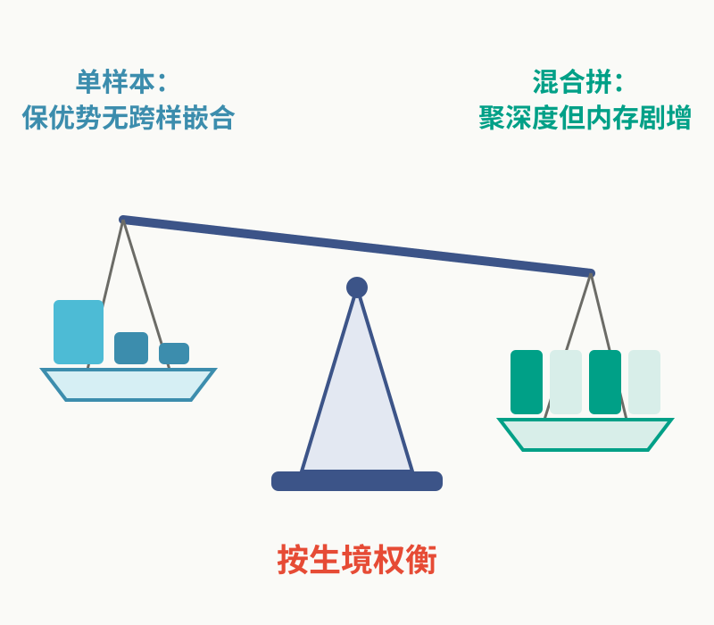

</div>
<div>

- 单样本：株系干扰少，稀有种容易丢
- 混合：深度能累积，代价是跨样本嵌合
- 按生境、批次或处理分层，不跨层混
- 混合几个样本没有通用阈值

<div class="muted">

课程脚本是单样本形态；混合组装是拓展做法

</div>

</div>
</div>

<div class="ref">教材 §19.4.3</div>

<!--
旁白：单样本还是混合组装？这是个取舍，没有默认答案。左边单样本：各算各的，株系干扰少、嵌合少，但深度不足时低丰度物种直接丢。右边混合组装：把同处理组或相近生境的多样本读段合成一个输入，累积深度挖得出稀有种，代价是跨样本株系多态性加剧气泡和嵌合，内存也跟着涨。怎么选？按生境、批次或处理分层，别跨层混——处理组和对照组混在一个组装里，处理效应对丰度的影响会被写进深度信号，分箱时那条深度向量就不再只反映基因组身份。混合几个样本没有通用阈值，按深度、异质性和预算定。课程脚本是单样本形态，混合组装属于拓展做法；真要做，方法学里要写清混了哪些样本、为什么这样分组。
-->

---

<!-- _class: master figure -->

## 短读断在重复区，长读跨过去

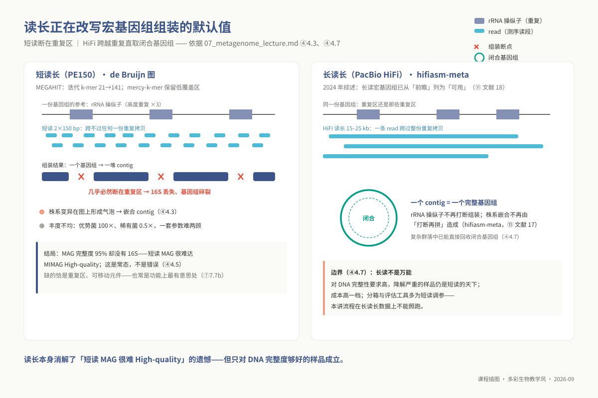

图 19-2 短读断在 rRNA 重复区，长读跨越重复直取闭合基因组

<div class="ref">教材 §19.4.3 图 19-2、§19.4.7 ｜ 图面 25 kb 按文献读作 13.5±1.2 kb；rRNA×3 为设例</div>

<!--
旁白：短读和长读两条组装路线，上下对照着看。上半是短读：中间那条 rRNA 操纵子是高度重复的，一个基因组里常有好几份拷贝，序列几乎一样；二三百 bp 的短读跨不过任何一份拷贝，组装图在这里必然断开，一个基因组被拼成一堆重叠群。所以右下那句结论是短读的常态：完整度很高，却没有 16S——这不是组装失败。下半是长读：一条 HiFi 读段就能跨过整份重复，一个重叠群就是一个完整基因组。但边界也写在图上：对 DNA 完整度要求高，降解严重的样品还是短读的天下，成本和工具链也是另一套。图面标的读长，按文献读作平均 13.5 kb 那一档，别照抄图上的 25。
-->

---

## 分箱靠两个互相独立的信号

<div class="cols">
<div class="card">

### 组成：像不像
四核苷酸频率（TNF）4⁴ = 256 种，合并反向互补后 136 维
16 种自身反向互补；其余 240 种两两并成 120 类

</div>
<div class="card">

### 深度：同涨同跌
样本 1 各 100×、样本 2 各 50×，比例不变

</div>
</div>

- 重叠群越短，抽样噪声越大：1 kb 约 1000 个观测

<div class="ref">教材 §19.4.4 ｜ 手算 120+16=136</div>

<!--
旁白：分箱的两个信号并排放着。左边是组成，管「像不像」：四核苷酸频率，四种碱基的四核苷酸有 256 种，考虑反向互补合并后是 136 维——算式就在页面上，16 种等于自己的反向互补，其余两两并成一类。同一个基因组的不同片段，在这 136 维空间里彼此靠近。右边是深度，管「同涨同跌」：同一个细胞里的片段，在各样本中一起涨一起跌，样本 1 各 100 倍、样本 2 各 50 倍，比例不变。两个信号互相独立：组成相近、但跨样本比例对不上的，就不是同一个基因组。最下面一行是组成的软肋：重叠群越短，抽样噪声越大，1 kb 只有约一千个位置观测，所以分箱器要设长度下限。
-->

---

## 单样本不是「只剩 TNF（四核苷酸频率）」

- 单样本仍有均值与方差两列深度信息
- 丢掉的是跨样本共变这个判别信号
- 后果可能是箱少、污染高，也可能正常
- `depth.txt` 总列数应为 `3+2S`，S=1 时即 5 列

<div class="ref">教材 §19.4.4、§19.5.7</div>

<!--
旁白：一个常见误读要掰正。不少同学看到「单样本」，以为分箱就只剩组成一个信号了。不是：那张深度表在单样本时仍有该样本的平均深度和方差两列，每条重叠群在这个样本里的深度水平还在。丢掉的是什么？跨样本共变这个判别信号——深度向量的维数等于样本数，只有一个分量，共变的自由度就没了。后果要说准：可能箱少、污染高，也可能正常，取决于群落和参数，不能一概断言「必然失败」。最后一行是个自查规则：总列数应该是 3 加 2S，单样本就是 5 列，这个数后面还会用到。真要做跨样本共变，得先把多个样本分别比回同一套组装，再合并深度表。
-->

---

<!-- _class: master figure -->

## 组成 × 深度：两个都对上才判同源

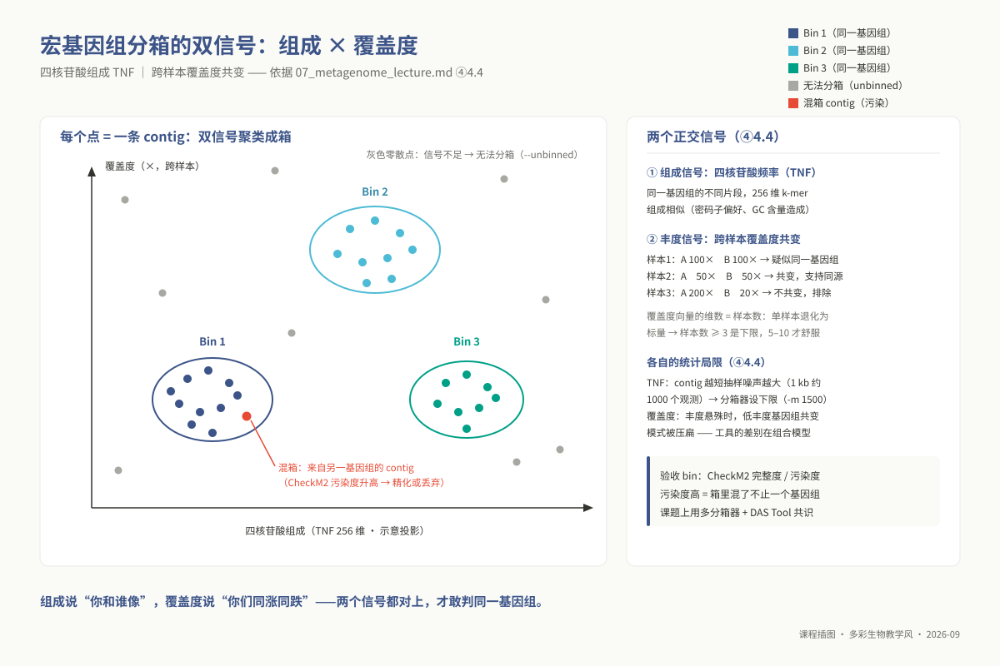

图 19-3 分箱双信号：136 维组成与跨样本深度共变（S≥2）

<div class="ref">教材 §19.4.4 图 19-3 ｜ 图内 256→136 维、覆盖度即深度；≥3 与 CheckM2 都不沿用</div>

<!--
旁白：两个信号画进一张投影，跟着读：每个点是一条重叠群，三个簇是三个基因组；灰色零散点不是垃圾，是信号不足、只能留在未分箱文件里的片段；还有几个点落在簇外面，那是混进别的基因组的片段，会让这个箱的污染度升高。右卡的三行算例跟上一页对得上：前两行同涨同跌，第三行比例从一比一变成十比一，就不是同一个细胞了。下面两张局限卡，一张讲组成信号怕短片段噪声，一张讲丰度悬殊时低丰度基因组的共变被压扁。读图还有两处口径要校准：横轴图面写 256 维，正文按合并反向互补后的 136 维；纵轴标「覆盖度」，按本章口径读成深度。
-->

---

## 先验收，再谈分箱器的取舍

- MetaBAT2 `-m` 默认 2500 bp，课程放宽到 1500 bp
- 先看深度表列数，再看箱数和箱体量
- 再用单拷贝标记基因评质量，最后做共识精化
- `--unbinned` 是信号不足的记录，不是垃圾

<div class="muted">

课程脚本未传 `--unbinned`，不产出这个文件

</div>

<div class="ref">教材 §19.4.4 ｜ 脚本 L68</div>

<!--
旁白：分完箱先别急着数箱数，验收有验收的顺序。先看深度表的列对数对不对，再看箱数和箱体量落不落在合理范围，然后才轮到单拷贝标记基因评完整度和污染度，最后用共识算法精化。两个参数细节：MetaBAT2 的长度下限默认 2500，课程有意放宽到 1500——短于 1 kb 的重叠群分箱器基本用不上。放宽能多分出箱，但短重叠群的组成噪声大，污染度会跟着升高，所以调参数必须同时看质量表；只数箱数，会把污染箱当成进展。还有那句：未分箱文件记录的是信号不足的部分，不是垃圾。这个顺序，上机时就照着走。
-->

---

## 没有参考，判据来自单拷贝标记基因

<div class="cols">
<div>

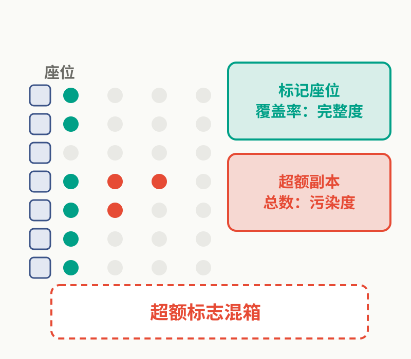

</div>
<div>

- 近乎所有原核细胞都保留、且只有一份
- 检出的座位比例 → 完整度
- 超额副本 → 污染度
- 换谱系重评数值会变，表注必须写清

<div class="muted">

环境装的是 CheckM 1.x；CheckM2 用机器学习，数值不可互换

</div>

</div>
</div>

<div class="ref">教材 §19.4.5 ｜ 07_envs/conda/env_master_microbiome.yml</div>

<!--
旁白：没有参考，凭什么判断一个箱是不是基因组？判据来自单拷贝标记基因。图左边是座位：近乎所有已知的原核细胞都保留这批基因，而且严格只有一份，多数跟核糖体、转录翻译这些核心功能有关。把箱里的基因跟这套标记比对，检出的座位比例就是完整度，超额副本的数目就是污染度；图右边那个「超额标志混箱」，正是这套方法的诊断价值所在。两点提醒：换谱系重新评估，数值会变，表注必须写清用的是哪套谱系；环境装的是 CheckM 1.x，CheckM2 走机器学习，两版数值不可互换，报告必须写版本。这两句提醒，写报告时都用得上。
-->

---

## 污染度统计的是副本，不是座位

<div class="cols">
<div>

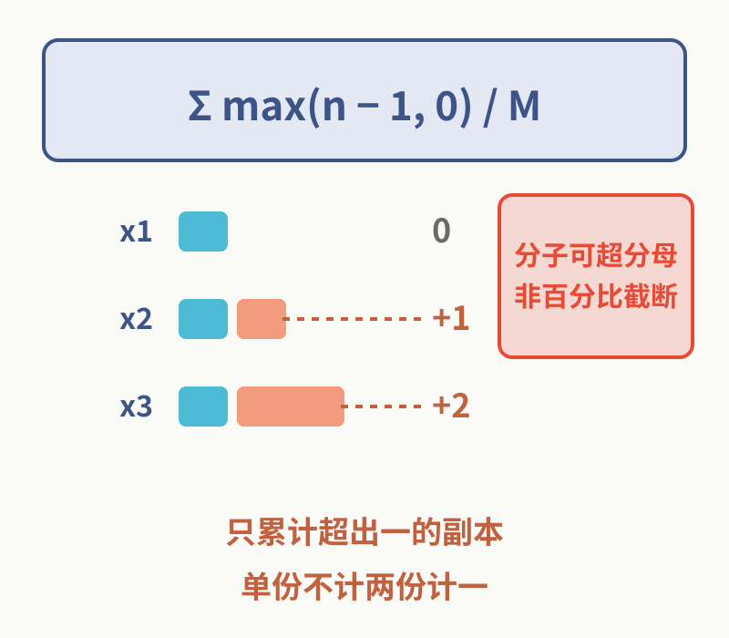

</div>
<div>

`Σ max(份数−1, 0) / M`，`M`＝该谱系单拷贝标记基因座位总数

- 它不是「出现两份以上的座位所占比例」
- k 个基因组揉一个箱，约 `(k−1)×100%`
- 所以超过 100% 是正常结果，不是溢出

</div>
</div>

<div class="ref">教材 §19.4.5、§19.5.3</div>

<!--
旁白：污染度的公式值得讲透，最常见的误读就在这。公式：每个座位超出一份的副本数，加总后除以该谱系单拷贝标记基因的座位总数。看图上的小方块：一份不计，两份记一，三份记二——只累计超出一份的部分。所以它不是「出现两份以上的座位所占的比例」，两者差一个数：按后一种写法，两个基因组和三个基因组揉一起都是 100%，封顶了；按公式写，两个约 100%，三个约 200%。几个基因组揉在一起，就有对应的份数乘 100%。这就是为什么污染度超过 100% 是结果、不是程序溢出——它数的是副本，分子本来就可以比分母大。公式就这一条，分母记住是标记基因座位数。
-->

---

## 合成算例：线性关系一眼看懂

<div class="cols">
<div>

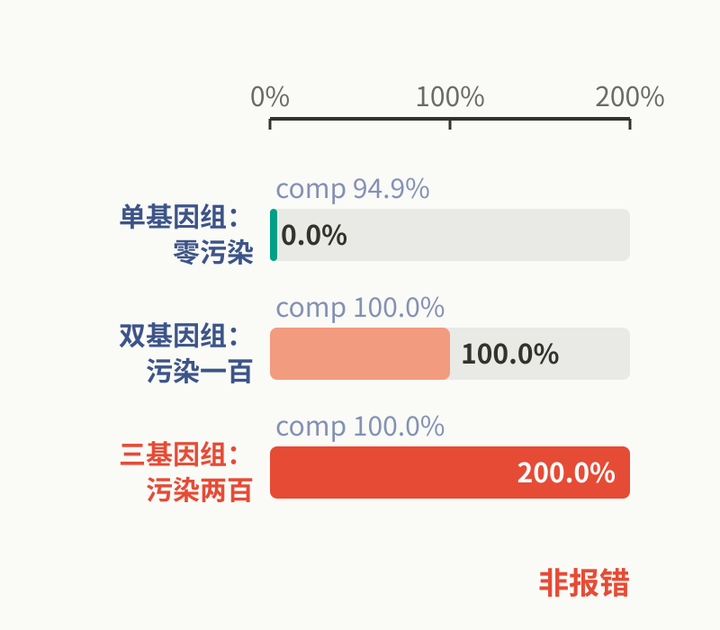

</div>
<div>

- S1 干净箱：94.9%／0.0%
- S2 两基因组：100%／100%
- S3 三个全合并：100%／200%
- S4 部分合并 99.5%／148.0%；S5 残缺箱 61.5%／13.5%

</div>
</div>

<div class="ref">教材 §19.4.5 ｜ 演示 ch19_checkm_contamination.py --selftest</div>

<!--
旁白：上一页的线性关系，这张图用五个场景画出来，从左往右走。干净箱：完整度九成多，污染度零。两个基因组全合并：完整度满，污染度 100%。三个全合并：完整度还是满，污染度 200%——纵轴故意画到 200，就是提醒你别看到超过 100 就以为程序坏了。剩下两个更有意思：部分合并，完整度 99.5%、污染度 148.0%；残缺箱，完整度 61.5%、污染度 13.5%。这些数都来自课程的合成算例，固定种子、可以复现，但只对那个生成模型成立，不是真实样本的实测。把这张图当量级感就好，别当判据。
-->

---

## S4 那一行：又缺又多怎么同时出现

<div class="cols">
<div>

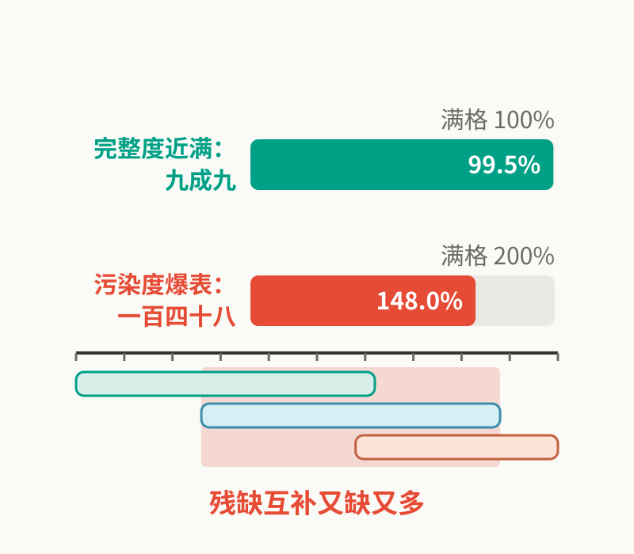

</div>
<div>

- 三个残缺基因组按 0.88、0.85、0.75 混入同箱
- 都没收进：`0.12×0.15×0.25 = 0.0045`
- 完整度约 `1−0.0045 = 99.55%`
- 同座位 `0.88+0.85+0.75 = 2.48` 份，超额 148.5%

</div>
</div>

<div class="ref">教材 §19.4.5 ｜ 手算：同座位超额 2.48−0.9955 = 1.4845 份；演示抽样均值 148.0%</div>

<!--
旁白：单独读部分合并那一行，它是「又缺又多」同时出现的典型。设定是三个残缺基因组，按 0.88、0.85、0.75 的比例被收进同一个箱——注意这三个数是混入比例，不是完整度。先算缺失：某个座位三个基因组都没被收进的概率，是三者余数相乘，0.12 乘 0.15 乘 0.25 等于 0.0045，完整度约 99.55%。再算多出：同一个座位上的副本总数是 2.48 份，超额 1.4845 份，污染度约 148.5%；抽样均值 148.0%，差的那半个百分点是抽样波动。这一行说明：完整度高、污染度也高，可以是几个残缺基因组各交出不重叠片段的结果——不是软件算错。
-->

---

## MIMAG 三条线，外加两条附加要求

<div class="cols">
<div>

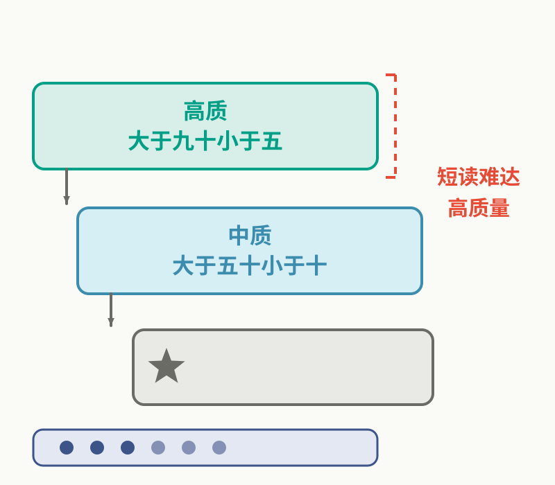

</div>
<div>

- High：>90%、<5%，还要检出 23S/16S/5S rRNA 与 ≥18 种 tRNA
- Medium：≥50%、<10%
- Low：<50%（同表另有污染 <10% 栏）
- 顺序：先两指标，再 rRNA/tRNA，再嵌合，最后写级别

</div>
</div>

<div class="ref">教材 §19.4.5 ｜ MIMAG＝宏基因组组装基因组最低信息标准，Bowers 等 2017 Table 1</div>

<!--
旁白：判级标准，图上三条线，外加两条附加要求。High 要求完整度大于 90%、污染度小于 5%，光这两条还不够，还得检出全长的 23S、16S 和 5S rRNA 基因，外加至少 18 种 tRNA。Medium 是完整度不低于 50%、污染度小于 10%；图面写「大于五十」，按标准要读成不低于 50，恰好 50% 也算 Medium。Low 是完整度小于 50%，同表另给了污染度小于 10% 的栏。为什么附加 rRNA 和 tRNA？因为只满足前两个数的短读 MAG，不能直接申报 High。判级按固定顺序走：先看两个指标落在哪档，再查 rRNA 和 tRNA 齐不齐，再用工具查嵌合，最后写级别——而且要把「为什么没到更高一级」一起写上，这句话比级别本身更有信息量。
-->

---

<!-- _class: master statement -->

完整度 95% 却没有 16S，是二代短读的常态。

rRNA 操纵子 4.5–5.2 kb、多份拷贝，短读跨不过去，分箱又常丢掉。

<!--
旁白：全章最反直觉的一条：一个箱完整度 95%、污染度很低，却没有 16S——这通常不是数据坏了。原因在物理层面：原核生物的 rRNA 操纵子全长约 5 kb，同一基因组里常有多份拷贝，序列一致性可以超过 99%；二三百 bp 的短读跨不过这份完美重复，组装图在操纵子处必然断开，分箱时这段又常被丢掉。所以缺的往往正是重复区和可移动元件——那恰恰常是功能上最有意思的位置。这句话后面会反复用到：看到「完整度超 90% 却未达 High」，你要能写出机理，而不是只报一个级别。交付报告里那句机理，就是这么来的。
-->

---

## 注释链：脚本做了什么，没做什么

<div class="cols">
<div>

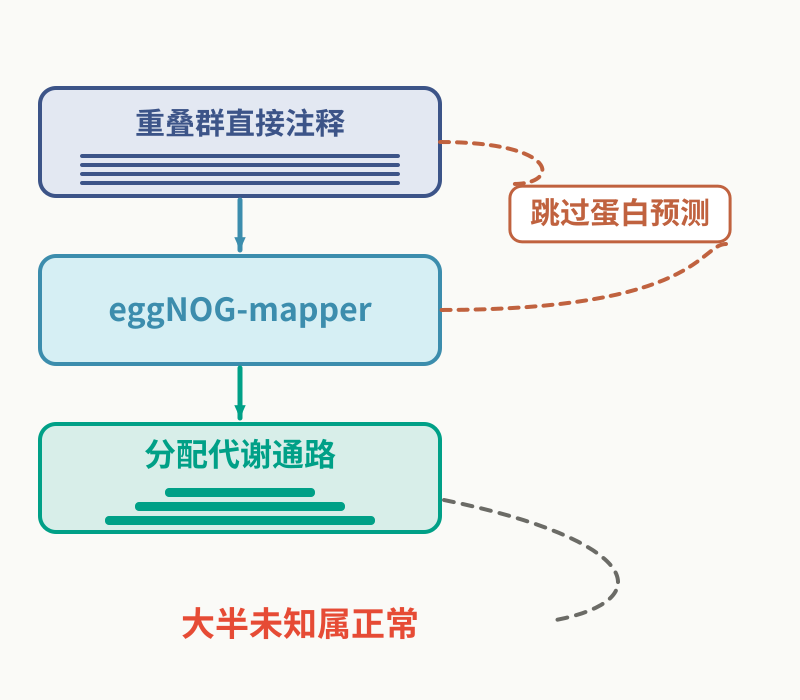

</div>
<div>

- 脚本对整份组装跑 `emapper.py --itype metagenome`
- 不先翻译单个 MAG 的蛋白：Prodigal 没装
- 环境样本大半预测蛋白注释不到，是真实状态
- 近缘样本几乎全空时，先查库路径与预测参数

</div>
</div>

<div class="ref">教材 §19.4.6</div>

<!--
旁白：注释这一步，重点是分清脚本做了什么、没做什么。图上两条路：标准做法先把 MAG 的核酸预测成蛋白，再用 eggNOG-mapper 比对直系同源基因簇库，映射到功能大类、通路号和术语；课程脚本走的是另一条，直接对整份重叠群跑注释，跳过了蛋白预测——因为 Prodigal 没装。想按标准路线走，就得自己装或者让集群部署。读结果也要有预期：环境样本里大半预测蛋白注释不到任何已知功能，这是未培养微生物的未知基因家族，是真实状态，不是流程错了。反过来，样本明明是近缘肠道菌群、注释却几乎全空，那才要查库路径和预测参数。
-->

---

## 功能只到潜力；缺失只是弱证据

<div class="cols">
<div>

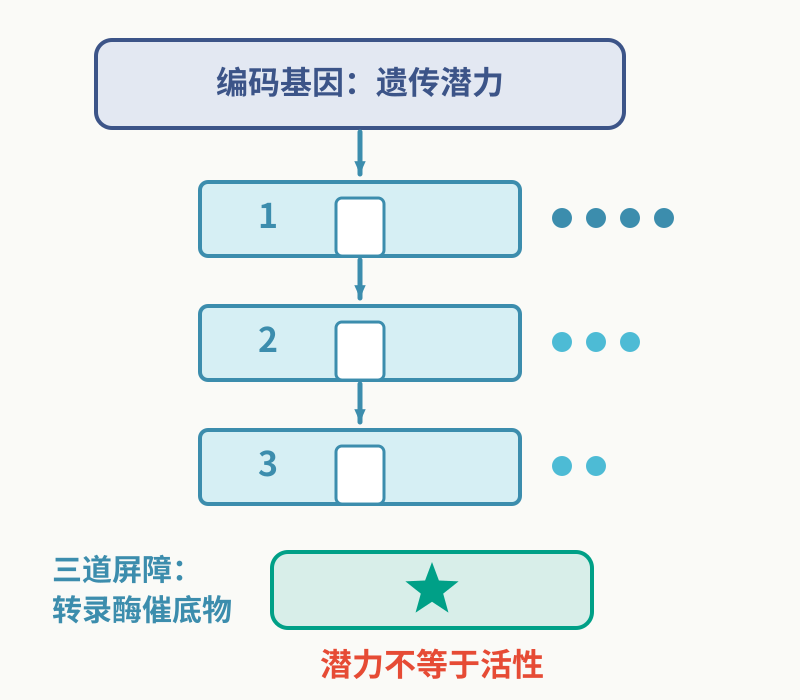

</div>
<div>

- 检出完整编码序列 ≠ 正在表达
- 三道坎：转录、酶活性、底物可及
- 缺口有位点偏好，「未检出」不等于「不具备」
- 补证据两条路：探针回比对原始读段、长读闭合

</div>
</div>

<div class="ref">教材 §19.4.6、§19.5.5</div>

<!--
旁白：整讲最重要的一条纪律：功能只到潜力。图上左边是编码基因，代表遗传潜力；右边三道屏障——转录、酶催化、底物可及。检出一个完整的编码序列，只能证明这个微生物在遗传层面具备这条途径的潜力，证明不了基因正在表达，更证明不了反应正在发生。反过来也一样：没检出，只是弱证据。组装缺口有位点偏好，断裂集中在重复区和特殊 GC 区域，某个基因恰好落在缺口里完全可能。所以合规的写法是「在当前组装中未检出」，不能写「不具备」。要补证据有两条路：把探针比对回原始读段，或者用长读长闭合染色体。这个措辞问题，答辩时最容易被追问。
-->

---

## 长读长改写上限，不改下限

- HiFi 平均 13.5±1.2 kb，插入常见 10–20 kb
- 单条读段可跨过约 5 kb 的 rRNA 操纵子
- 仍要评完整度、污染度与分类学嵌合
- 课程短读流程不能直接搬到长读数据

<div class="ref">教材 §19.4.7 ｜ Wenger 等 2019</div>

<!--
旁白：长读长改写了什么、没改写什么，分开看。改写的那一半：HiFi 平均读长约 13.5 kb，插入片段常见 10 到 20 kb，单条读段就能跨过约 5 kb 的 rRNA 操纵子——短读那个物理瓶颈被绕开了，复杂群落里已经能直接回收闭合基因组。没改的那一半：完整度和污染度仍然要用单拷贝标记基因评，分类学嵌合仍然要查，相对丰度仍然是组成性数据，绝对量仍然要另外定标。还有句实操提醒：我们这套短读流程不能直接搬到长读数据上，长读要另一套组装、纠错和分箱参数。把长读当「更准所以什么都能说」，是另一种越界——两件事分开说，别混成一句「长读更准」。
-->

---

<!-- _class: master figure -->

## 本章工具与标准的坐标

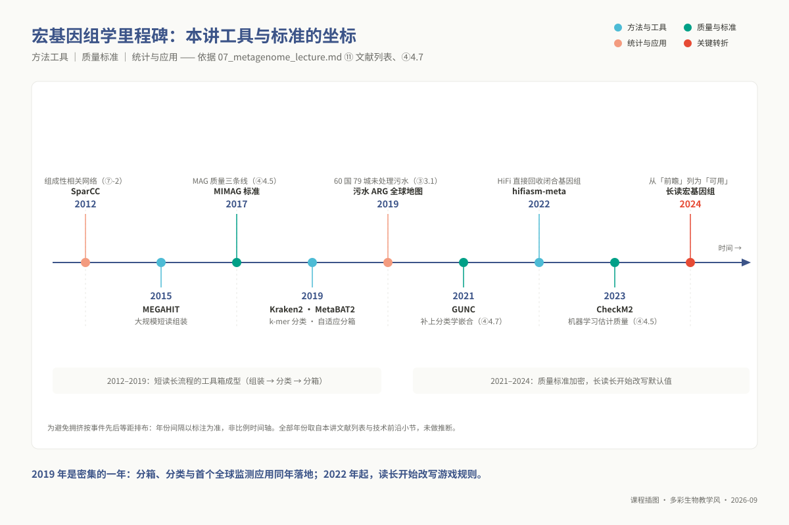

图 19-4 宏基因组学里程碑：工具与标准的演进坐标

<div class="ref">教材 §19.4.7 图 19-4、§19.8 ｜ 等距时间轴非比例，年份以图内标注为准</div>

<!--
旁白：这一讲的工具和标准，放进一条时间坐标看，三条线：方法与工具、质量与标准、统计与应用。按线读，别按年份死记。方法线上，2012 年组成性关联推断的方法出现，2015 年 MEGAHIT 让大规模短读组装在单机可跑，2019 年分类和分箱两个工具同年落地，2022 年 HiFi 组装能直接回收闭合基因组，2024 年长读从「前瞻」列为「可用」。质量线上，2017 年 MIMAG 立了三条线，2021 年补上分类学嵌合，2023 年用机器学习估质量。应用线就是前面那张全球耐药地图。图下方有说明：这是等距时间轴，不是比例时间轴，年份间隔以标注为准。
-->

---

<!-- _class: master divider -->

<div class="num">05</div>

# 操作流程

集群规矩 · 五步脚本 · 单端命令

<!--
旁白：原理讲完，进操作。三件事：集群规矩、脚本的五步、单端命令怎么写。上机时这一段开着别关——错一步，后面全白跑。
-->

---

<!-- @section: procedure -->
## 先看清脚本的边界

<div class="cols">
<div>

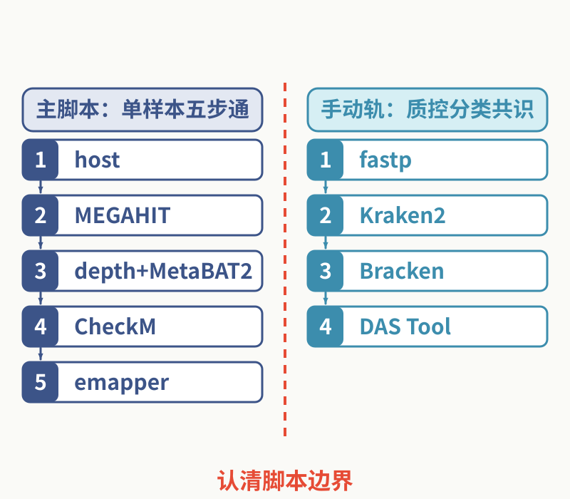

</div>
<div>

- 一切计算 `qsub`；登录节点只编辑与提交
- 脚本五步：去宿主、组装、分箱、CheckM 1.x、注释
- 不做 fastp、Kraken2、混合组装、GTDB-Tk、Prodigal
- 内存超限（OOM）先对齐 `-m` 与 `h_vmem` 两处

</div>
</div>

<div class="ref">教材 §19.3、§19.6 ｜ 脚本 07_metagenome_assembly.sh</div>

<!--
旁白：比记命令更要紧的，是先看清脚本的边界。图上两条轨：上面是主脚本的五步——去宿主、组装、比回建深度加分箱、质量评估、注释，一步接一步；下面是手动轨，质控、分类、共识精化都得自己接。所以这个脚本不是「全链路」：它不做质控，不做 Kraken2 和 Bracken，不做混合组装，不做分类学归属，也不先做蛋白预测再注释。头一条纪律写在最上面：一切计算都走 qsub，登录节点只编辑和提交，在上面跑组装会被杀。最后一行是排查顺序：作业被内存限制杀掉时，先对齐组装器的内存参数和作业的内存上限这两处，只改一处没用。
-->

---

## 提交：单端就把 `R2` 留空

```bash
qsub -v R1=clean/S1.fq.gz,R2=,SAMPLE=S1,OUTDIR=./meta/S1 \
     03_code/master/scripts/07_metagenome_assembly.sh
```

- 输入是质控后的 `clean` 读段；`R2` 留空就是单端
- 线程数用 `NSLOTS`，日志写在提交目录
- 作业头已声明 `h_vmem=10G`，换更大的数据要重估
- `HOST_IDX`、`EGGNOG_DB` 留空会静默跳过对应步

<div class="ref">教材 §19.6 ｜ 讲义 ⑤5.0 ｜ 脚本 L6–7、L16–24</div>

<!--
旁白：提交命令逐行看。头一行 qsub，-v 后面把变量传进作业：R1 是质控后的读段路径，R2 留空——我们的数据是单端，留空就是告诉脚本走单端分支；SAMPLE 是样本名，OUTDIR 指到自己的目录。第二行是脚本路径，注意是相对路径，跑之前先确认它在。下面四条要点：输入必须是质控后的 clean 读段，别拿原始数据直接喂；线程数用作业环境里的那个变量，不要写死；作业头已经声明了内存上限，换更大的数据要重新估，别照抄；最容易踩的是最后一条——宿主索引和注释库这两个变量留空，对应步骤会被静默跳过，日志里看着像跑完了，其实没做。
-->

---

## 单端分类：去掉 `--paired`，`-r` 按实长

```bash
kraken2 --db ${KRAKEN2_DB} --threads 16 --confidence 0.1 \
        --report ${S}.kreport --output ${S}.kout nohost/${S}.fq.gz
bracken -d ${KRAKEN2_DB} -i ${S}.kreport -o ${S}.bracken \
        -r <实际读长> -l S -t 10
```

- `-r` 必须与库内对应的 kmer 分布文件匹配
- `-l S`：重估到种水平（Species）
- Bracken 输出仍是组成性数据

<div class="ref">教材 §19.4.2 ｜ 讲义 ⑤5.2</div>

<!--
旁白：分类的两条命令，都是单端口径。头一行 kraken2：--db 指库，--threads 指线程，--confidence 给门槛；--report 输出六列报告，--output 输出逐条读段的归属，最后那个文件是非宿主读段——注意没有 --paired，因为我们是单端。第二行 bracken：拿同一份报告做重估，-l S 表示重估到种水平，-t 10 是默认阈值，不超过十条读段的物种不再往下分配。最要紧的是 -r：它必须跟库内对应的分布文件匹配，我们的读长是 216 到 239 的可变值，不能写死一个数。最后一句留着：Bracken 的输出仍然是组成性数据，不是绝对量。
-->

---

## 组装与深度：单端用 `-r`，默认灵敏度

```bash
megahit -r nohost/${S}.fq.gz -o megahit --min-contig-len 1000 -t 32
jgi_summarize_bam_contig_depths --outputDepth depth.txt asm.bam
metabat2 -i megahit/final.contigs.fa -a depth.txt -o bins/bin -m 1500
```

- 比回建深度表用默认参数，不加 `--very-sensitive`
- 现脚本只传一个 BAM，跨样本共变得自己补
- 加深度救不了稀有种；同样的钱先买样本和生境覆盖

<div class="ref">教材 §19.4.3、§19.5.7 ｜ 脚本 L31–68</div>

<!--
旁白：三条命令，正好对应组装、深度、分箱。头一条 megahit：-r 表示单端读段，-o 指输出目录，--min-contig-len 设成 1000——短于 1 kb 的重叠群分箱器基本用不上，早丢省内存；注意这里没传 k 参数，走的是软件默认的那组迭代 k。第二条把读段比回组装，统计每条重叠群的深度，输出那张深度表。第三条 metabat2：-i 是组装结果，-a 是深度表，-o 是箱的输出前缀，-m 设成 1500——这是课程有意放宽，软件默认是 2500。下面三条要点：比回建深度用默认灵敏度，别加更严的参数；现脚本只传一个比对文件，深度表就只有一对均值方差列；还有一句最扎心：加深度救不了稀有种，同样的预算，先买样本数和生境覆盖。
-->

---

## 质量与注释：先配库，再看表在不在

```bash
checkm data setRoot <共享库路径>
checkm lineage_wf -x fa -t 24 bins checkm_out \
       --tab_table -f checkm_summary.tsv
emapper.py -i megahit/final.contigs.fa --itype metagenome \
           -o eggnog --data_dir ${EGGNOG_DB}
```

- `lineage_wf` 失败只打 WARN 警告，脚本仍会结束
- 没有 `checkm_summary.tsv` 就是这一步没做完

<div class="ref">教材 §19.4.5、§19.4.6 ｜ 脚本 L72–90</div>

<!--
旁白：最后两步：质量评估和注释，各一条命令，但都有前提。先把 CheckM 的数据目录指过去——这步没做，后面整步会跳过。然后跑质量评估：-x 是文件后缀，-t 是线程，后面两个参数是箱目录和输出目录，最后让它输出一张可读的表。注释那条直接对整份组装跑，--itype 声明这是宏基因组数据，--data_dir 指库。两个最实用的判断：质量评估失败时脚本只打一条警告就继续，日志末尾写「完成」不等于这一步真做完了；判断标准很简单——没有那张汇总表，就是没做完。这两条判断，比背参数名有用得多。
-->

---

<!-- _class: master divider -->

<div class="num">06</div>

# 结果解读

结果不对时长什么样 · 交付怎么写

<!--
旁白：跑完不等于看懂。这一段两件事：结果不对时长什么样，交付报告怎么写。前者靠现象定位，后者靠数字说话——两样都练，报告才立得住。
-->

---

<!-- @section: interpretation -->
<!-- _class: master warn -->
## 结果不对时长什么样（一）

<div class="cols">
<div>

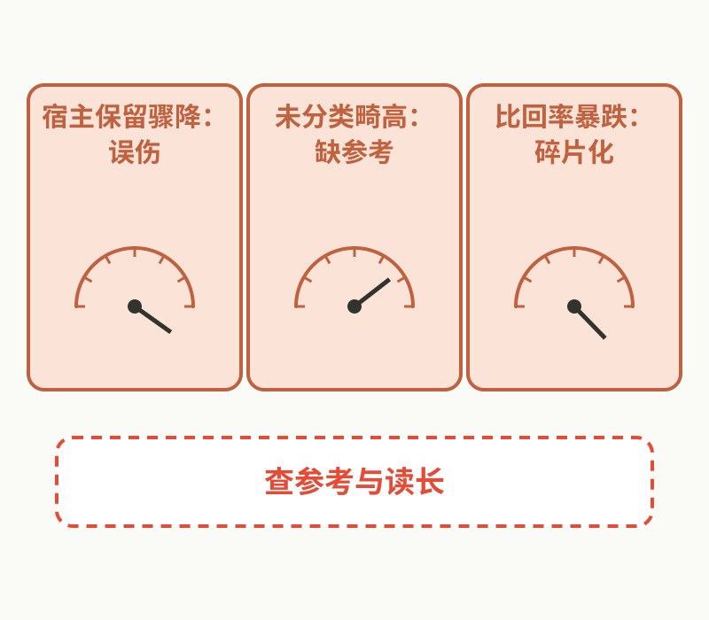

</div>
<div>

- 保留率明显偏离本批 → 宿主参考选错
- 属层稳定、种层骤降 → 库缺近缘种
- 末尾大量 1–3 条读段 → 先列候选，别一律删
- 污染度超过 100% → 箱里揉进多个基因组

</div>
</div>

<div class="ref">教材 §19.5.1–§19.5.3</div>

<!--
旁白：上游失效对照表，图上四格，按现象查病因。宿主保留率明显偏离本批其余样本——先别调参数，查宿主参考选错没有。属层稳定、种层骤降——参考库缺近缘种，别急着怀疑样本。报告末尾一大堆只有一两三条读段的物种——先列候选再决定删不删，别一律清掉。污染度超过 100%——箱里揉进了多个基因组，不是软件溢出。四个现象有个共同点：流程都正常退出、报告都齐全，错误藏在数值的形状里。所以排查要反过来做：先看形状对不对，再怀疑软件。上机之后头一个要对照的就是这份清单。
-->

---

<!-- _class: master warn -->
## 结果不对时长什么样（二）

<div class="cols">
<div>

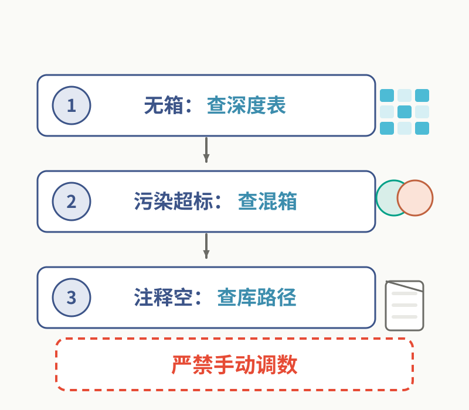

</div>
<div>

- N50 远小于单基因组 → 宏基因组常态，不算错
- `depth.txt` 只有一对均值/方差 → 只传一个 BAM
- 注释近乎全空、样本是近缘菌群 → 查库路径与预测参数
- 有 p 值但结论不可复现 → 喂的是相对丰度

</div>
</div>

<div class="ref">教材 §19.4.3、§19.5.5–§19.5.7</div>

<!--
旁白：下游失效，同样四格。N50 远小于单基因组——注意这不是错误，宏基因组里 N50 小是常态，别拿单基因组的尺子来量。深度表只有一对均值和方差列——只传了一个比对文件，跨样本共变的信号没了。注释近乎全空、而样本明明是近缘菌群——这时候才该查库路径和预测参数。有 p 值但结论不可复现——多半是喂了相对丰度。图右下那句「严禁手动调数」得刻在脑子里：看到污染度高就手动删重叠群把数字调下来，是破坏可复现性，不是解决问题。加上上一页，两页八格，就是你的排查清单，从上游到下游最常见的失效都在里面。
-->

---

## 交付怎么写：方括号里填自己的数

- 先报通量与宿主占比，再说组装量
- N50 由长度分布算，不由总长除以条数
- 「完整度超 90% 却未达 High」要写出机理
- 结论只到遗传潜力，不写「正在发生」

<div class="ref">教材 §19.6</div>

<!--
旁白：报告怎么写，四条都是评分点。先报通量和宿主占比，再说组装量——顺序反了，读者没法判断你的结论有多强的支撑。N50 必须由长度分布算：按长度从大到小累加，累计首次达到总长一半时那条的长度；总长除以条数得到的是平均长度，两者不能互换，这是最常见的算法错误。「完整度超过 90% 却没到 High」要写机理——rRNA 操纵子跨不过去——不能只报一个级别了事。结论只到遗传潜力，不写「正在发生」。页面上那些方括号不是装饰，是提醒你填自己的实测值。这四条写进报告，方法学和结果两节的骨架就有了。
-->

---

<!-- _class: master divider -->

<div class="num">07</div>

# 统计要点

组成性 · 零值 · 两法共识

<!--
旁白：最后一块是统计，三个关键词：组成性、零值、两法共识。这不是选修——这一讲的结论能不能站住，地基全在这三样上。
-->

---

<!-- @section: stats_plugin -->
## 相对丰度是组成性数据

<div class="cols">
<div>

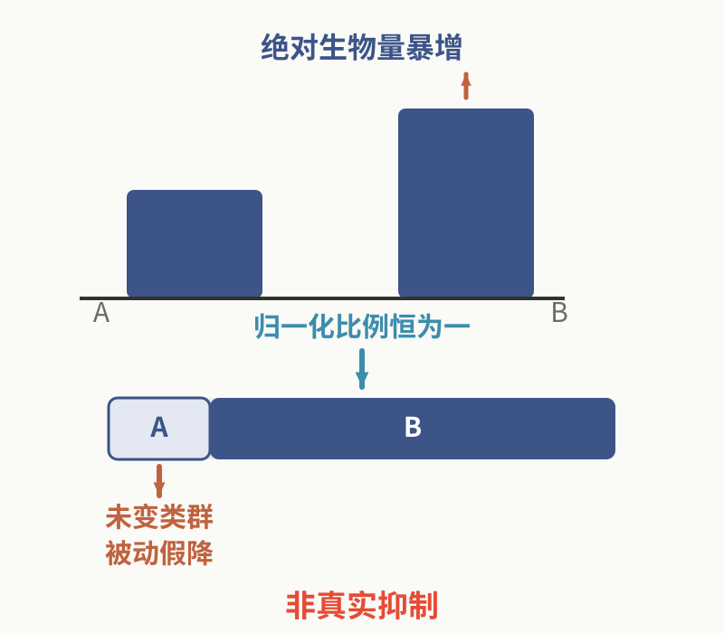

</div>
<div>

- 总量由测序通量决定，不由细胞数
- 各组分比例之和恒为 1
- 一个类群真升高，其余成片下降
- 直接检验计数会报出大量假阳性

</div>
</div>

<div class="ref">教材 §19.4.8、第 18 章</div>

<!--
旁白：先看组成性。图上画的情形：一个真实类群的绝对生物量暴增，归一化成比例之后会怎样——它自己的比例上去了，其他没变的类群被动下降，右下写得很清楚，那是「被动假降」，不是真实抑制。为什么？测序仪是固定通量的按比例采样机器，文库大小由实验决定，各组分比例之和恒为 1。总量不由细胞数决定，一个类群真升高，其余就成片下降。后果很直接：把计数或相对丰度直接喂给常规检验，假阳性会成片报出来。这个道理第 18 章推过闭合算术，这里只接结论，不重做推导。这一条不解决，后面所有差异分析都建在沙子上。
-->

---

## 直接算 Pearson 会造出负相关

<div class="cols">
<div>

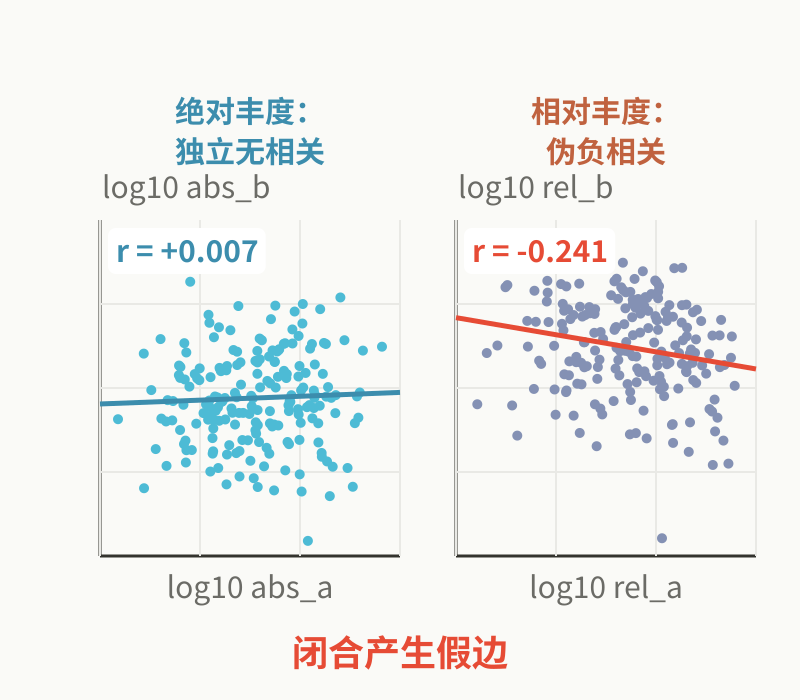

</div>
<div>

- 两组绝对丰度独立时 `r = +0.007`
- 转成相对丰度后 `r = −0.241`
- 这条负相关由「总和为 1」造出来
- 阈值 `|r| > 0.6` 加 p 值不能单独当互作证据

</div>
</div>

<div class="ref">教材 §19.4.8 ｜ 演示 07_compositional_analysis.R（seed 20260829）</div>

<!--
旁白：上一页的道理，这里是实测版，两幅散点。左图：两组绝对丰度本来就独立，算出来相关系数接近零，图上标的是正的 0.007。右图：同一批数据转成相对丰度再算，相关系数变成负的 0.241——一条完全由「总和为 1」造出来的负相关。这不是生物学互作，是数学必然。所以那句流行做法要打住：阈值加 p 值，不能单独当互作证据。这不是新发现，一百多年前就有人指出过。真要建网络，得换用对组成性有明确假设的方法，并做多重检验控制。这个演示脚本不需要任何数据，上机第一步就会跑它。以后看到负相关，先问一句：这是生物学，还是归一化造出来的？
-->

---

## CLR 消掉文库大小，不恢复绝对量

<div class="cols">
<div>

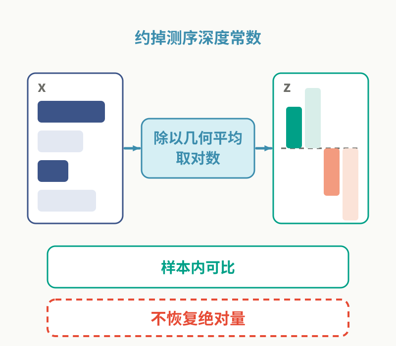

</div>
<div>

`CLR(x_i) = ln(x_i / g(x))`，`g(x)` 为样本内几何平均

- 测序深度这个乘法因子被约掉
- 绝对量仍要 qPCR、流式计数或 spike-in
- 只在样本内可比，不恢复绝对量

</div>
</div>

<div class="ref">教材 §19.4.8</div>

<!--
旁白：一个变换能消掉什么、不能消掉什么，这页说清。公式：取某个组分的丰度，除以本样本内所有组分的几何平均，再取对数。图上三格就是这个动作：先除，再取对数。为什么有用？测序深度是以同一个乘法因子作用在所有组分上的，这个因子在分子分母同时消掉，文库大小这个技术常数就被消除了。但它不恢复绝对量：变换后的值只表示这个组分相对本样本几何平均的离散程度；要知道绝对生物量，还是得靠定量 PCR、流式计数或加标。限定也要记牢：只在样本内可比，不能跨样本直接比大小。它消掉的是技术常数，不是生物学差异。
-->

---

## 零有两种来源，处置相反

<div class="cols">
<div>

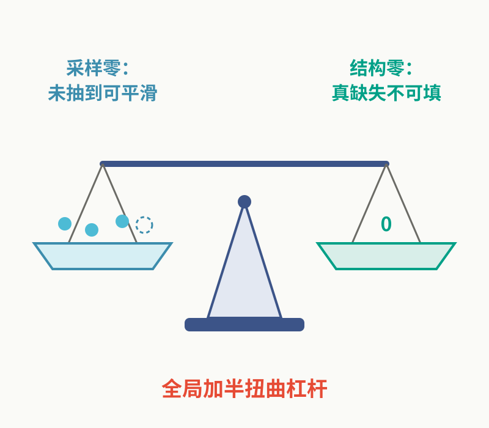

</div>
<div>

- 采样零：深度不够没抽到，可用先验平滑
- 结构零：环境里真没有，不能填补，单独建模
- 两者从单个数值分不开，要看重复与深度

</div>
</div>

<div class="ref">教材 §19.4.8</div>

<!--
旁白：零有两种来源，处置方向相反。左边采样零：类群真实存在，只是深度不够没被抽到，测序加深就会消失，可以用贝叶斯先验或者后验抽样去平滑。右边结构零：环境里真没有，在所有深度充足的重复里恒为零，这种不能填补，只能按存在缺失单独建模。难点在于从单个数值上分不开这两者，必须看重复样本和深度信息。图右下那句是实操警告：全局加一个 0.5 或者 1 的「保险」做法，对零值格子是杠杆——对数尺度上，一个伪计数会把原本的零抬到一个由总量决定的位置，足以把真实差异拉平。动手处理零值之前，先问这批零是哪一种，再选模型。
-->

---

## 负二项模型搬不过来的原因

<div class="cols">
<div>

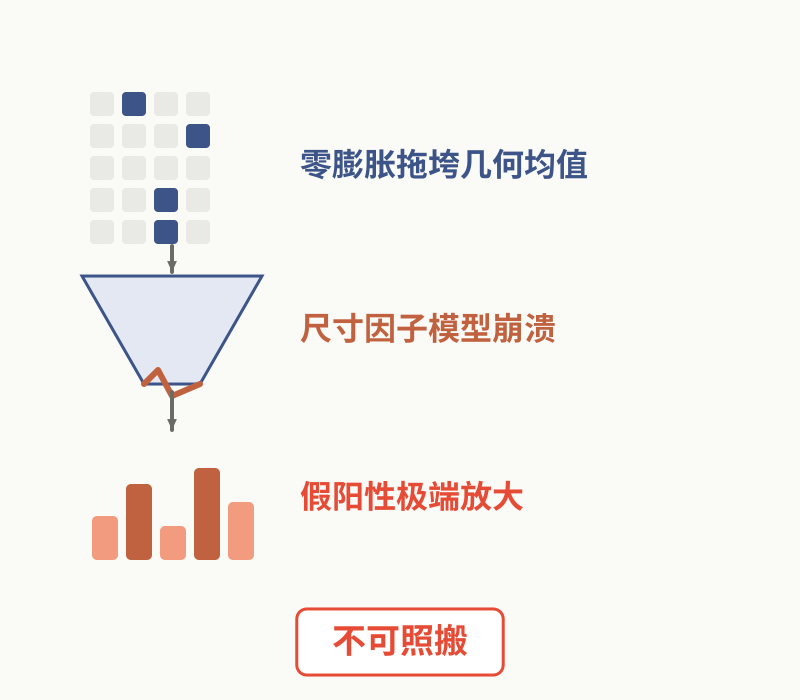

</div>
<div>

- 零的比例远超负二项按均值和离散度给的预期
- 中位数比值的几何平均被大量零拖垮
- 表现为假阳性升高、log2FC 极端化
- 要用，就得先论证模型与标准化方式

</div>
</div>

<div class="ref">教材 §19.4.8、第 14 章</div>

<!--
旁白：常用的差异表达模型为什么搬不过来？图上三个后果连成一条链：零的比例远超负二项模型由均值与离散度给出的预期；于是标准化用的中位数比值被大量零值拖垮；最后假阳性升高、效应量极端化。机理在这儿：负二项配中位数比值标准化，前提是「多数特征不变」；群落丰度表零值极多，几何均值被零拖到很低，标准化因子就失效了。所以这类工具不是不能用，而是用之前得单独论证模型和标准化方式。第 14 章讲计数模型前提时说的就是这件事，这里只是它在群落数据上的破法。
-->

---

## 两法共识：交集当主结论，其余降级

<div class="cols">
<div>

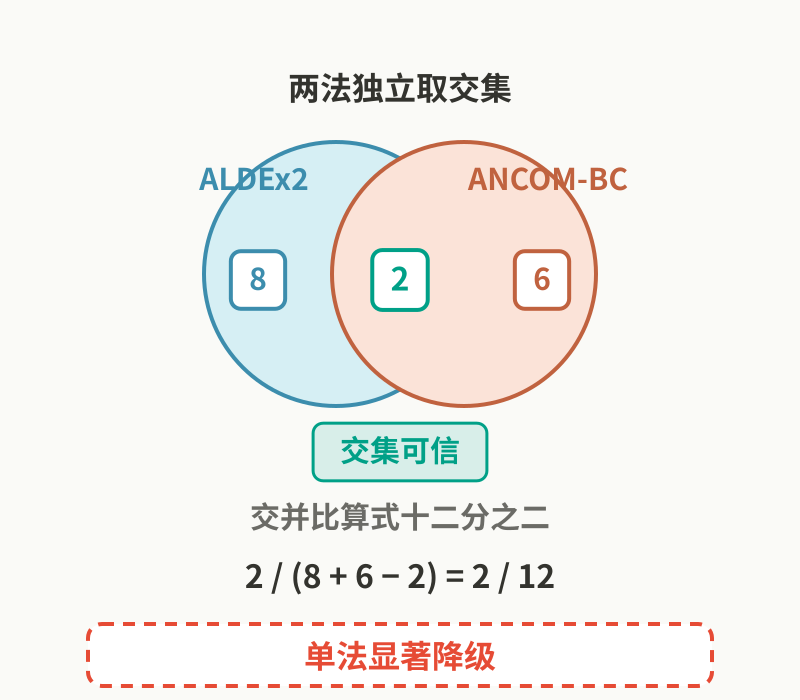

</div>
<div>

- ALDEx2 与 ANCOM-BC 各跑一次，取交集
- 单法显著的候选降级为探索性假说
- Jaccard＝`|A∩B|/|A∪B|`：8 与 6 得 `2/12`
- 报告写两法名单、交集、Jaccard 与处置

</div>
</div>

<div class="ref">教材 §19.4.8、§19.9 第 9 题 ｜ 手算</div>

<!--
旁白：课程口径叫两法共识。做法是拿同一张整数计数表，分别用 ALDEx2 和 ANCOM-BC 独立跑一次，取显著名单的交集作为主结论；只在单一方法里显著的候选，降级为探索性假说。图上还给了重叠度的算式：交集除以并集——页面上的设例是两边各报 8 个和 6 个、交集 2 个，算出来 2 除以 12。为什么这么做？同一份数据换方法，显著名单的重叠常常很低，而重叠度低本身就是结果：它说明结论对方法选择敏感，必须如实报出来。报告里写四样：两法各自的名单、交集、重叠度、单法独有候选怎么处置。重叠度低不是失败，写进讨论比藏起来强。
-->

---

## 四个工具，四种边界

| 工具 | 对组成性 | 边界 |
|---|---|---|
| ALDEx2 | 有 | 跑得慢；结论保守 |
| ANCOM-BC | 有 | 样本很小时不稳 |
| LEfSe | 无 | LDA 分数不是显著性 |
| DESeq2 / edgeR | 无 | 零膨胀下会失效 |

> Nearing 等 2022 比较 38 个 16S 数据集、14 种方法；不能外推到鸟枪法。

<div class="ref">教材 §19.4.8、§19.8</div>

<!--
旁白：四个工具放一张表里比，看两列：对组成性有没有校正，边界在哪。ALDEx2 有校正，代价是慢、结论偏保守；ANCOM-BC 有校正，样本量极小时方差估计不稳；LEfSe 没有组成性校正，而且它那个判别分析的分数不是显著性；DESeq2 和 edgeR 也没有校正，零膨胀下标准化会失效。表下那句话要读完整：有人比较了 38 个 16S 数据集、14 种方法，发现换方法后名单重叠很低，部分工具在完全随机的阴性对照上还能检出大量「显著」类群。但注意最后半句——这个结论只覆盖 16S 数据集，不能外推成「鸟枪法也已经验证过」。
-->

---

<!-- _class: master quiz -->

## 课堂提问

两种方法只有 2 个类群重叠，说明这两个一定为真吗？

<!--
旁白：课堂提问，先想三十秒：两种方法只有 2 个类群重叠，说明这两个一定为真吗？交集小说明什么？说明结论对方法选择敏感。那交集里的一定真吗？不一定——两法可能共享同一个有偏的假设，比如都受参考库限制。交集外的一定假吗？也不一定，可能只是那个方法的模型在这份数据上功效低。所以正确的回答是分层的：交集可以当主结论报，但要写明它是「两法共同支持」，不是「生物学证实」；交集外的降级为探索性假说。常见的错误答案有两个：一是「交集小说明数据质量差」，二是「交集就是真阳性」——两个都把统计共识当成了生物学证据。
-->

---

<!-- _class: master divider -->

<div class="num">08</div>

# 常见错误与课后

会静默出错的三个坑，加一张任务卡

<!--
旁白：最后一段讲三个会静默出错的坑，外加一张任务卡。所谓静默，就是流程不报错、结果看着正常，结论却是错的——这比崩溃危险得多，崩溃至少会叫。
-->

---

<!-- @section: troubleshooting -->
<!-- _class: master warn -->
## 错误一：相对丰度喂给 ALDEx2 不报错

<div class="cols">
<div>

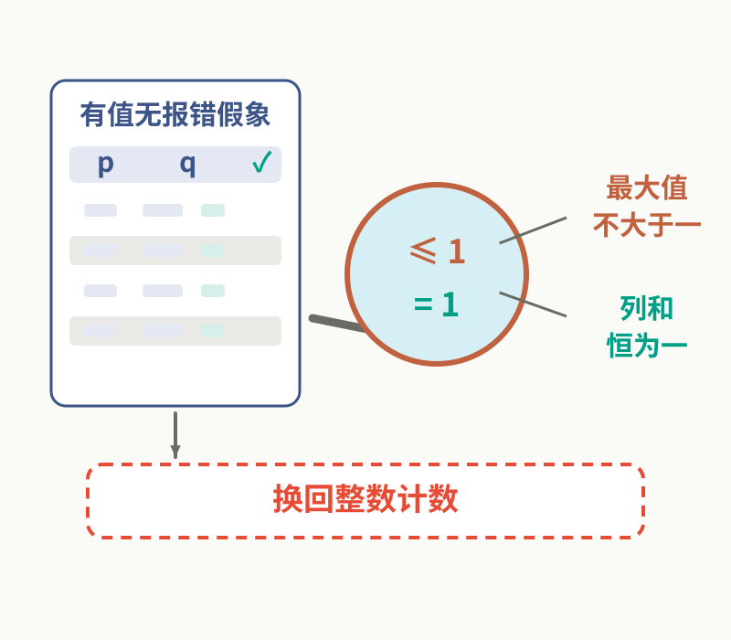

</div>
<div>

- 结果表有 p 值与效应量，看起来正常
- 全表最大值 ≤ 1、每列和接近 1，就是比例表
- 脚本只在 `max(cts) <= 1` 时发警告
- 看到警告不要忽略，换回整数计数重跑

</div>
</div>

<div class="ref">教材 §19.5.6</div>

<!--
旁白：相对丰度喂给差异丰度工具，它不报错——这就是头一个坑。图上是审计的两个入口：看全表最大值是不是不大于一，看每列之和是不是接近一。两条同时成立，基本可以断定手里是比例表。为什么危险？函数照常运行，变换照常做，结果表有 p 值有效应量，看起来完全正常，只是数值尺度已经被换掉了。课程脚本自带一道检查：最大值小于等于一时发警告。看到警告别忽略，它是在救你。再确认表的行是类群、列是样本，第一列是编号不是数值；然后换回整数计数重跑，别想着「把比例乘回去」。静默错误的特点就是没有报错，检查动作必须前置。
-->

---

<!-- _class: master warn -->
## 错误二：只分出很少的箱，或 No bins

<div class="cols">
<div>

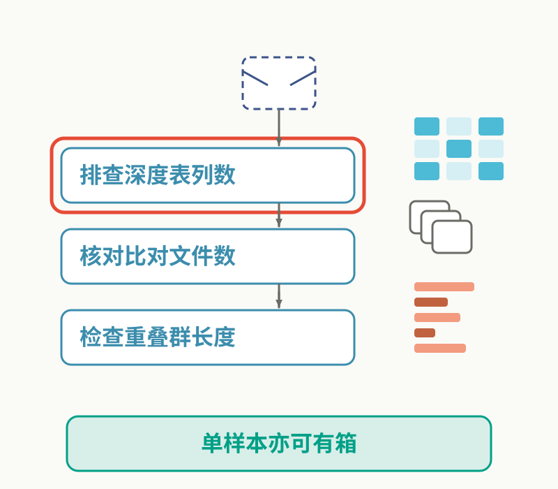

</div>
<div>

- 先看 `depth.txt` 的列数是不是 `3+2S`
- 再查 BAM 个数、重叠群下限和碎片化
- 单样本仍可能有箱，不是必然失败
- 箱数少只是排查的起点，不是结论

</div>
</div>

<div class="ref">教材 §19.5.7、§19.4.4</div>

<!--
旁白：只分出很少的箱，甚至没有箱，怎么办？图上是三步排查。头一步看深度表列数是不是 3 加 2S——这个公式前面出现过，只有一对均值方差列就是单样本。再核对传进去的比对文件个数，别只传了一个却以为是全部样本。然后检查重叠群长度下限和组装碎片化程度，下限太高会把可用片段一起丢掉。心态也要摆正：单样本仍然可能有箱，不是必然失败；箱数少只是排查的起点，不是结论。我们这批数据深度低，可能一个高质量 MAG 都分不出，这是数据的真实状态，写进报告就行，别硬凑。顺序别跳：先查最便宜的配置问题，再怀疑数据。
-->

---

<!-- _class: master warn -->
## 错误三：污染度超过 100%，被当成报错

- 它是结果：箱里揉进了多个基因组
- 先算箱体量和标记基因副本数
- 换第二个分箱器加 DAS Tool 精化（需自装），或丢弃
- 不要手动删 contig 把数字调下来

<div class="ref">教材 §19.5.3</div>

<!--
旁白：污染度超过 100% 被当成报错——机理前面讲过了，这里说处置。先定性：它是结果，说明箱里揉进了多个基因组，不是软件溢出。然后算箱体量和标记基因副本数，判断揉进了几个；再看完整度和污染度是不是同时高，「又缺又多」是部分嵌合的典型。路只有两条：换第二个分箱器、用共识算法精化，或者直接丢弃这个箱。红线只有一条：不要手动删重叠群把数字调下来。那样破坏了箱的完整性，而且不可复现，等于把错误藏起来而不是修掉。三个坑说到头都一样：靠规则防，不靠感觉防。
-->

---

<!-- @section: wrapup -->
## 实践任务卡（2 h）

- `qsub` 主脚本：记录逐样本宿主占比
- 单端跑 Kraken2 与 Bracken，先看 `unclassified`
- 按 MIMAG 判级，每个达到 Medium 的箱写一句取舍
- `07_compositional_analysis.R`：两法交集与 Jaccard

<div class="ref">教材 §19.6 ｜ 讲义 ⑤、⑩</div>

<!--
旁白：两小时实践的任务卡，四件事按顺序做。先提交主脚本，逐样本记录宿主占比——这份日志后面每一步都要用。再用单端参数跑分类，先看报告第一行的未分类比例：那是库的盲区，不是你的错。然后按 MIMAG 给每个箱判级，凡达到 Medium 以上的写一句取舍：为什么没到更高一级。最后跑组成性分析脚本，得到两法的显著名单、交集和重叠度。四件事环环相扣，前一件的产物是后一件的输入，别跳。哪一步卡住超过二十分钟，先翻实验指导里对应的出错信号，别自己乱试参数。任务卡的顺序，就是数据流的顺序。
-->

---

## 思考练习：选三题课堂讨论

- 设例：两批宿主占比 12/11/13% 与 45/12/13%，哪一批有问题
- 只传一个 BAM 时，`depth.txt` 长什么样
- MAG 未检出固氮酶关键基因 *nifH*，结论能写到什么程度
- 两法 8 与 6、交集 2，你会报哪一组

<div class="ref">教材 §19.7 习题 2、4、6、9 ｜ §19.9 答案要点</div>

<!--
旁白：四道思考题，课上选三题讨论。设例那道：两批宿主占比，一批是 12、11、13，另一批是 45、12、13，哪批有问题？判断依据是本批内部的离散，不是某个固定阈值。只传一个比对文件时，深度表长什么样？答案要能说出列数。某个 MAG 没检出固氮酶的关键基因，能写到什么程度？这题考措辞边界。两法各报 8 个和 6 个、交集 2 个，你报哪一组、怎么措辞？四题都对应教材习题，答案要点在教材里；先自己想，再对答案。这几题不用跑数据，先在纸上把思路写清，上机时才知道要验证什么。
-->

---

## 实验指导与收尾

- 上机时打开 `11_lab_guides/master/07_metagenome_lab.md`
- 演示脚本在课程仓库根目录运行 `python3 textbook/demos/…`
- 文献只给指针（讲义 ⑪），本 deck 不重复列

> 这一讲选定的路线与阈值，决定了后面所有结论的强度。

<div class="ref">教材 §19.6、§19.8 ｜ 讲义 ⑪</div>

<!--
旁白：收尾交代几件事。上机时把实验指导打开放在手边，每一步都写了看到什么算对、看到什么说明错了；卡住超过二十分钟，先查那里的出错信号，别自己乱试参数。演示脚本在课程仓库根目录运行，路径写法页面上给了，脚本都带自检开关，跑通再往下。文献这一讲不重复列，只给指针，要找出处去教材的延伸阅读。最后那句话值得留在脑子里：这一讲选定的路线与阈值，决定了后面所有结论的强度——同一批数据，路线选错，图画得再漂亮也撑不住结论。剩下的时间交给上机和作业，方法学清单在实验指导里，照着逐条填，比事后补写省力得多。
-->
