<!-- @section: cover -->
<!-- _class: phd cover -->

# p01 ｜ AI 辅助的生信工作流

**产出代码的门槛降到了接近零，判断代码对不对的门槛原样留在原处。**

<div class="meta">

- 4 学时（2 h 理论 + 2 h 实践）｜ 环境 `ngs_phd_base`
- 讲义 `02_lectures/phd/topic01_ai_workflow/01_ai_workflow_lecture.md`
- 教材 §24.1–§24.5 ｜ 脚本 `01_make_spikein_counts.R` 等四个
- 本讲不讲工具对比与 prompt 技巧，只讲拆解、验证、判读

</div>

---

<!-- _class: phd divider -->

<div class="num">I</div>

# 学习目标

四条，对应 LO24-01–LO24-04

---

<!-- @section: objectives -->
## 学完你应当能够（一）：拆解与验证

- 把一句需求拆成 5–8 个原子步骤（课程建议粒度）
- 给每一步写输入契约、输出判据、生物学前置
- 对一段你写不出的脚本执行三步验证法
- 30 分钟内定位一处缺陷（建议用时，非实测）

<div class="ref">教材 §24.4.3–§24.4.4 ｜ LO24-01、LO24-02</div>

---

## 学完你应当能够（二）：判读与核查

- 把报错归入环境、数据、逻辑三类
- 判断 AI 的建议是修复，还是把报错藏起来
- 对 AI 生成的引用走完四步核查
- 写出可复核的 AI 使用与验证记录

<div class="ref">教材 §24.4.6–§24.4.7、§24.4.9 ｜ LO24-03、LO24-04</div>

---

<!-- _class: phd divider -->

<div class="num">II</div>

# 前置检查

四个 L0 模块，一次环境自查

---

<!-- @section: prerequisites -->
## 前置检查：四个 L0 模块

| 模块 | 本讲用在哪 | 不过关的症状 |
|---|---|---|
| `l0_02_r` | 筛选、取子集、作图 | 看不出筛选列被换掉 |
| `l0_06_stats` | 五类错误、三类指纹 | 说不清假阳性为何暴涨 |
| `l0_03_conda` | 建环境、作业里激活 | 作业报命令找不到 |
| `l0_01_linux` | 登录节点与计算节点 | 在登录节点跑 R 被杀 |

<div class="ref">教材 §24.3 ｜ 讲义 ② ｜ 自测题号见下一页</div>

---

## 30 秒自查

```bash
source /opt/miniconda3/bin/activate
conda activate ngs_phd_base
R --version | head -1                  # 4.3.1（yml 已钉）
Rscript -e 'packageVersion("DESeq2")'  # 1.42.0（yml 已钉）
```

- 自测题号：L0-2 的 Q3、Q4、Q8、Q10；L0-6 的 Q4、Q5、Q9、Q10
- 另有 L0-3 的 Q9、Q10 与 L0-1 的 Q9；本讲无 L1 依赖
- `curl` 与 `python3` 来自系统，`command -v` 核验即可
- 网络自查：`curl -sI` 一个 DOI，期望 301/302/303

<div class="ref">教材 §24.3、§24.4.7 ｜ 讲义 ②</div>

---

<!-- _class: phd statement -->

工具半年一换，判据不随模型更替而失效。

五类错误与三步验证法，今天仍然成立。

---

<!-- _class: phd divider -->

<div class="num">III</div>

# 科学问题

两道门槛，一个可信度问题

---

<!-- @section: background -->
## 两道门槛，AI 只挪动了一道

<div class="cols">
<div>

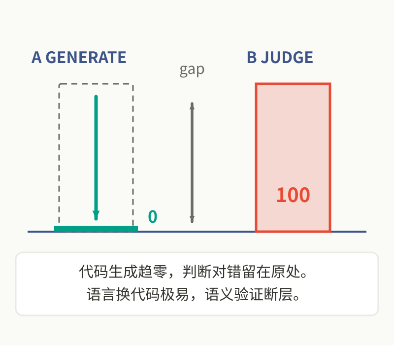

</div>
<div>

- 判断对不对：要知道矩阵的列代表什么
- `contrast` 哪头是实验组，自然语言里没有
- 有真实数据与发表压力，身边未必有人审代码

</div>
</div>

<div class="ref">教材 §24.1 ｜ 讲义 ③</div>

---

## 三条真实后果，都不报错

- 假差异列表：筛选列换成 `pvalue`，数目暴涨
- 方向反了：`contrast` 写反，全文上调实为下调
- 不存在的文献：DOI 形状合法，解析却是 404

<div class="ref">教材 §24.1、§24.2 ｜ 讲义 ③</div>

---

<!-- _class: phd figure -->

## AI 进入生信流程的五个节点（2020–2024）

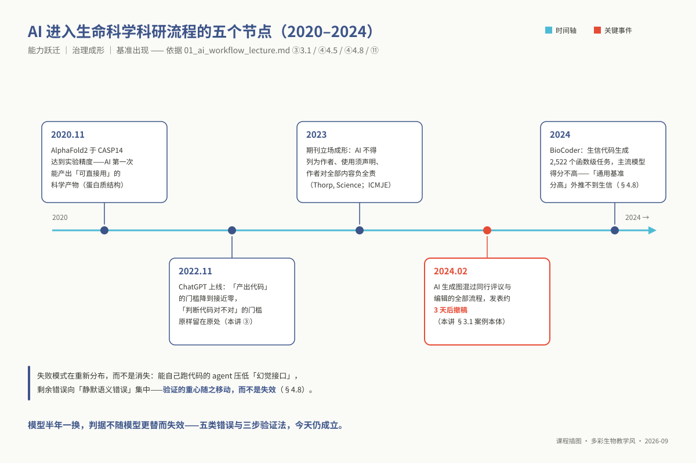

时间轴只读年份与事件，口径见下一页

<div class="ref">教材 §24.1 图 24-1、§24.4.8</div>

---

## 读图要点：时间轴只读年份与事件

- 2024.02 节点：02-13 见刊、02-15 关注声明、02-16 撤稿
- 节点横向位置只表先后，间距不是时间间隔
- BioCoder 是 2024 年函数级基准；「首个」「成立年份」不写

<div class="ref">教材 §24.1 读图说明、§24.4.8、§24.6</div>

---

## 撤稿案例：三段，不是一句「48 小时」

<div class="cols">
<div>

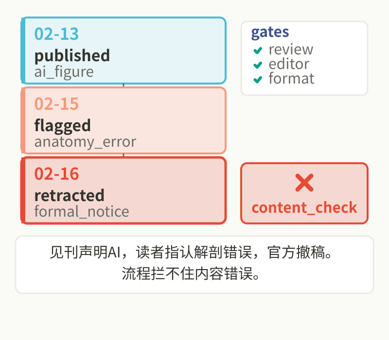

</div>
<div>

- 02-13 见刊，作者已声明 AI 作图，评议放行
- 02-15 读者逐图指认解剖错误，期刊发关注声明
- 02-16 撤稿（约 72 小时），标记 RETRACTED

</div>
</div>

<div class="ref">教材 §24.6 ｜ 讲义 ③3.1</div>

---

<!-- _class: phd statement -->

产物形态完美，不等于内容正确。

评议、编辑、格式检查全部放行；最后起作用的是验证的习惯。

---

## 案例数据：为什么必须自己造已知答案

<div class="cols">
<div>

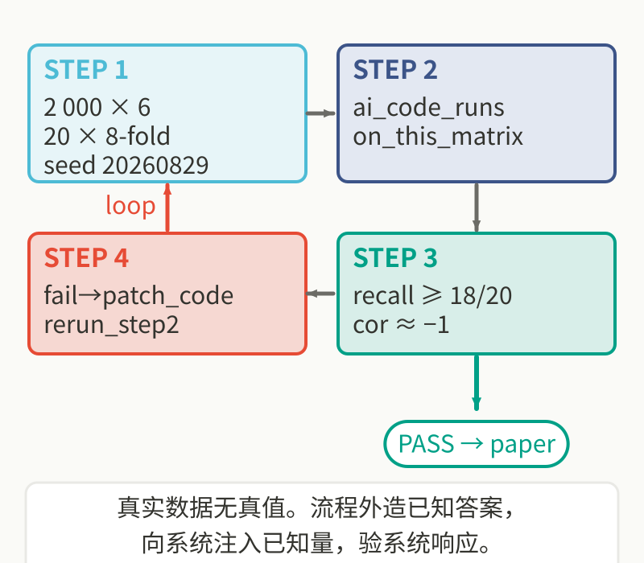

</div>
<div>

- 刻意不用真实数据：答案已知才判得了对错
- 扰动、重复数、种子都在生成脚本里
- 8 倍即 `log2FC = 3`，答案先写盘再跑

</div>
</div>

<div class="ref">教材 §24.1、§24.4.5 ｜ 参数直读 01_make_spikein_counts.R</div>

---

<!-- _class: phd statement -->

它只能证明流程的响应对不对。

离散度 0.15 是生成器的设定值，不是真实数据的量级。

---

<!-- _class: phd quiz -->

## 课堂提问

退出码 0、两张图正常、列名齐全——这能证明什么？

---

<!-- _class: phd divider -->

<div class="num">IV</div>

# 核心原理

三要素 · 五类错误 · 三步验证法

---

<!-- @section: principles -->
## 4.1 把需求写成一份可验收的契约

<div class="cols">
<div>

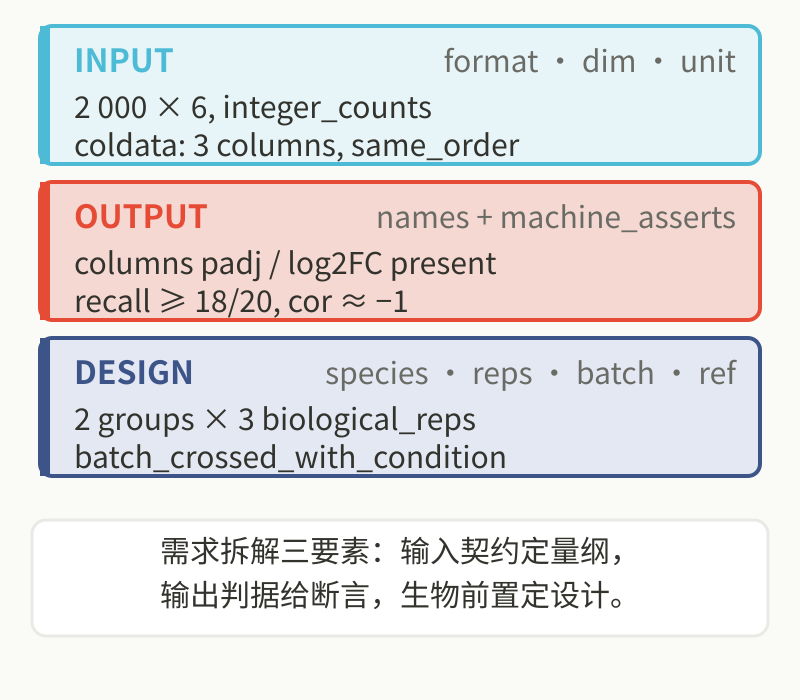

</div>
<div>

- 输入契约漏单位：把 TPM 当 counts 用
- 输出判据漏断言：只能靠「看起来合理」
- 前置漏参考水平：符号全反

</div>
</div>

<div class="ref">教材 §24.4.3 ｜ 讲义 ④4.1</div>

---

## 4.1 三条不该交给 AI 的硬边界

- 你无法独立验证其输出的任务，不交给它决定
- 未发表或受限数据不上网：默认值按别人数据填
- 事实回数据库或原文：基因功能、物种 marker

<div class="ref">教材 §24.4.3 ｜ 讲义 ④4.1</div>

---

<!-- _class: phd statement -->

「看起来合理」不是判据。

判据要能写成断言、跑出真或假，例如「召回 ≥ 18/20」。

---

## 4.2 五类静默语义错误（一）

<div class="cols">
<div>

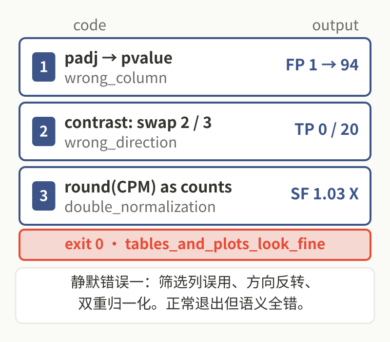

</div>
<div>

- 用 `pvalue` 代 `padj`：两列都合法，不报错
- `contrast` 对调：结果表结构完全相同
- TPM 喂 DESeq2：取整后连类型检查都过

</div>
</div>

<div class="ref">教材 §24.4.2 ｜ 讲义 ④4.2</div>

---

## 4.2 五类静默语义错误（二）：配对丢失

<div class="cols">
<div>

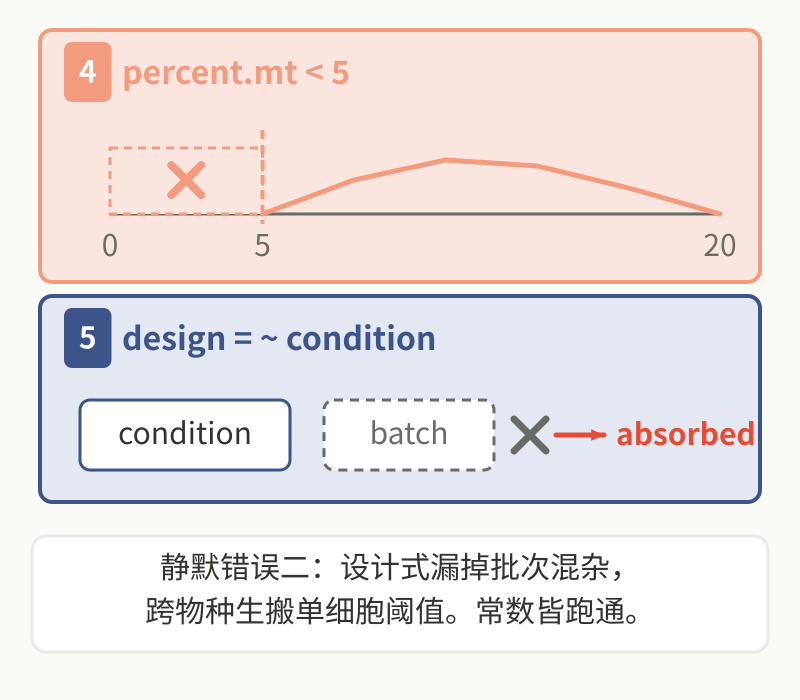

</div>
<div>

- 阈值搬运、`design` 丢 `batch`：都不报错
- 同名乱序构建时就报错，静默的是改列名对齐
- 样本错位只能靠第 ② 步的响应发现

</div>
</div>

<div class="ref">教材 §24.4.2、§24.4.4 ｜ 讲义 ④4.2</div>

---

## 4.2 幻觉从哪来：训练目标与知识边界

<div class="cols">
<div>

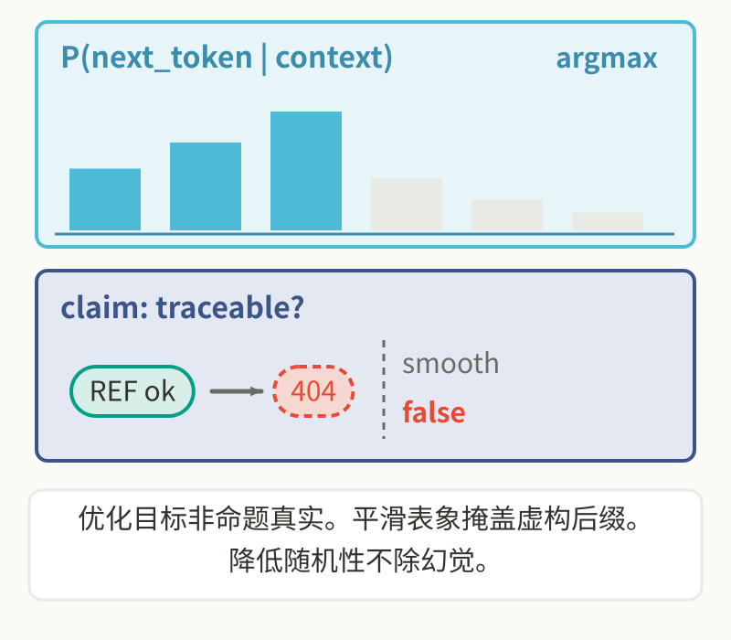

</div>
<div>

- 模型最大化的是下一个 token 的条件似然
- 边界外只能按语言形态补齐，不是按事实
- 采样温度只影响形式与频率，不消除幻觉

</div>
</div>

<div class="ref">教材 §24.4.2 ｜ 讲义 ④4.6</div>

---

<!-- _class: phd statement -->

降低随机性只改变幻觉的形式与频率。

现有来源里没有一份支持「温度设成 0 就不再编造」。

---

## 4.3 三步验证法：各拦一类错

<div class="cols">
<div>

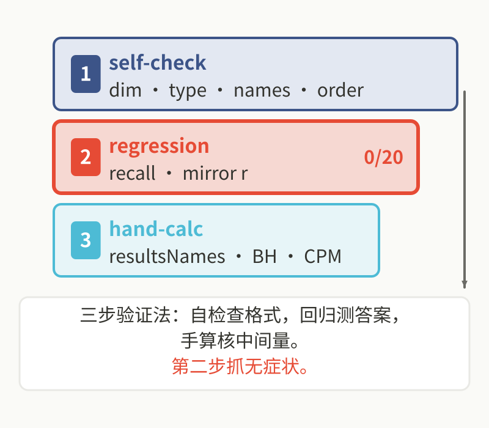

</div>
<div>

- ① 查不出方向反转与改名对齐
- ② 查不出阈值搬运与注释版本
- ③ 查不出设计式遗漏

</div>
</div>

<div class="ref">教材 §24.4.4 ｜ 讲义 ④4.3</div>

---

## 第 ① 步：查得出什么，查不出什么

- 有小数 → 不是原始 counts；名字缺多 → 样本错位
- 查不出方向反转：反转后形状与取值域全合法
- 对齐检查先 `match` 重排再比，同集合恒真
- 只拦缺名与改名；同名乱序靠构建期报错

<div class="ref">教材 §24.4.4 ｜ 讲义 ④4.3</div>

---

## 第 ① 步漏掉的单位错误：三态

<div class="cols">
<div>

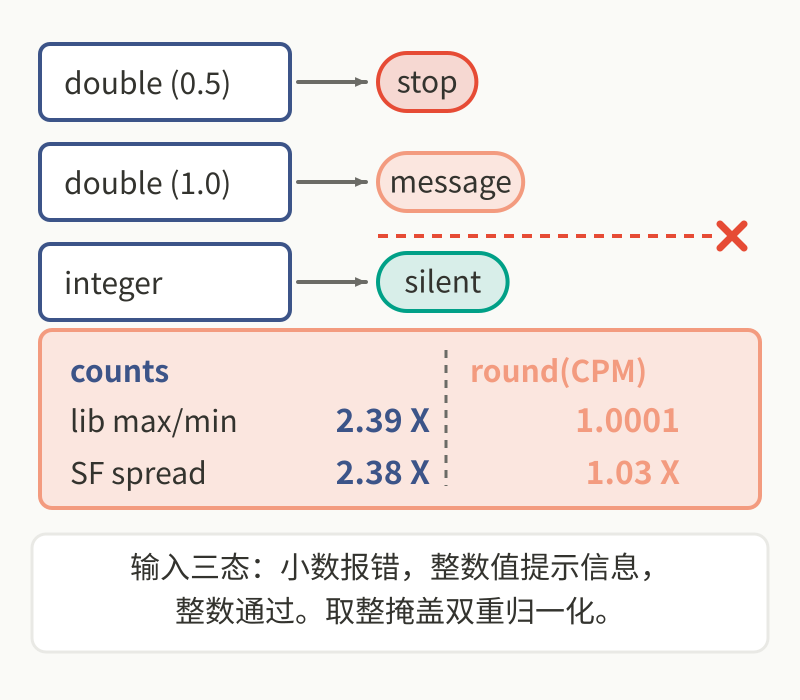

</div>
<div>

- 有小数就不是原始 counts：报错是线索
- 取整只消掉第一行，留下 message
- 静默通过不证明矩阵来源正确

</div>
</div>

<div class="ref">教材 §24.4.4 ｜ 1.42.0 与 1.50.2 实测一致</div>

---

## 三态可以自己复现，不必读源码

```r
cts <- matrix(c(10, 20, 30, 40), nrow = 2,
              dimnames = list(c("g1","g2"), c("s1","s2")))
coldata <- data.frame(condition = factor(c("ctrl","treat")),
                      row.names = c("s1","s2"))
DESeqDataSetFromMatrix(cts, coldata, ~ condition)
DESeqDataSetFromMatrix(cts + 0.5, coldata, ~ condition)
```

- 第二次调用报 `some values in assay are not integers`
- 第一次只发一句 `converting counts to integer mode`
- 第三次把 `storage.mode` 改成 `integer` 后不打印

<div class="ref">教材 §24.4.4 ｜ 讲义 ④4.2</div>

---

<!-- _class: phd statement -->

`round()` 消掉的是第一行的报错，留下的是第二行的 message。

矩阵的含义已经从原始 counts 变成 CPM。

---

## 第 ② 步是两件事，不能互相顶替

<div class="cols">
<div>

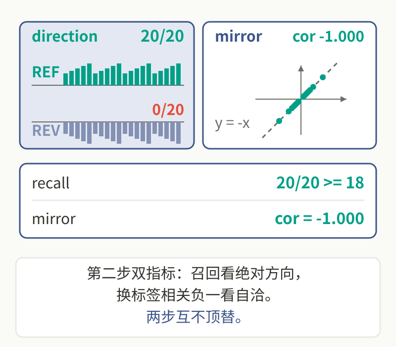

</div>
<div>

- 绝对方向：阳性落位 + 显式 `contrast`
- 实现自洽：换标签后整体变号
- 镜像相关只证明自洽，不判绝对方向

</div>
</div>

<div class="ref">教材 §24.4.4 ｜ 讲义 ④4.3</div>

---

## 两条阈值线：来源是教学设计

- 召回 ≥ 18/20：漏检预算 ⌊20 × 0.1⌋ = 2（教学约定）
- 阳性换成 n 个，按 ⌊0.1n⌋ 重算，不沿用 18/20
- 镜像 r ≤ −0.9 等价于 r² ≥ 0.81，这是算术
- 两条线都要在开工前写定，跑完再挑等于自证

<div class="ref">教材 §24.4.4 ｜ 讲义 ④4.3、⑩-3</div>

---

## 课程数据上的三个数，只引这三个

| 指标 | 值 | 入口 |
|---|---|---|
| AI 版对参考的差异基因数 | 97 对 22 | `06_data/phd/README.md` |
| spike-in 上调侧命中 | 0/20 | 同上 p01 节 |
| 与参考流程的 `log2FC` 相关 | −0.99 | 同上 p01 节 |

- 合成演示另给 20/20 与 −1.000，两口径不能混写
- 97 与 22 出自同一套数据：被检脚本 vs 参考流程
- 差在哪属待排查结论，6.2 给三类指纹

<div class="ref">教材 §24.4.4、§24.6 ｜ README p01 节实测</div>

---

## 第 ③ 步：字面相同，不代表方向相同

<div class="cols">
<div>

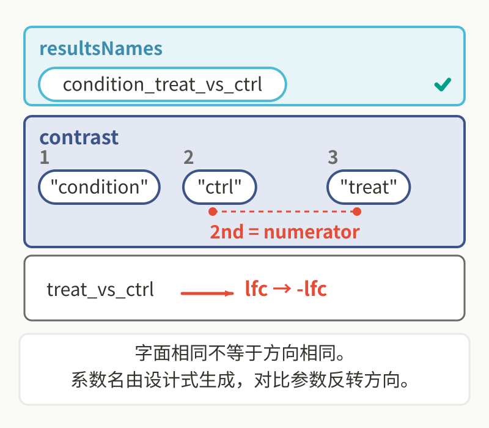

</div>
<div>

- `resultsNames()` 印着 `condition_treat_vs_ctrl`
- 系数名由设计式生成，`contrast` 是调用时另给的
- 手算 `gene1768`／C1：43 ÷ 292 540 × 10⁶ = 146.99

</div>
</div>

<div class="ref">教材 §24.4.4 ｜ 演示 ch24_double_normalization_sizefactors.py --selftest</div>

---

<!-- _class: phd quiz -->

## 课堂提问

`resultsNames()` 写着 treat_vs_ctrl，方向就一定对吗？

---

## 4.5 已知答案的三条设计规则

<div class="cols">
<div>

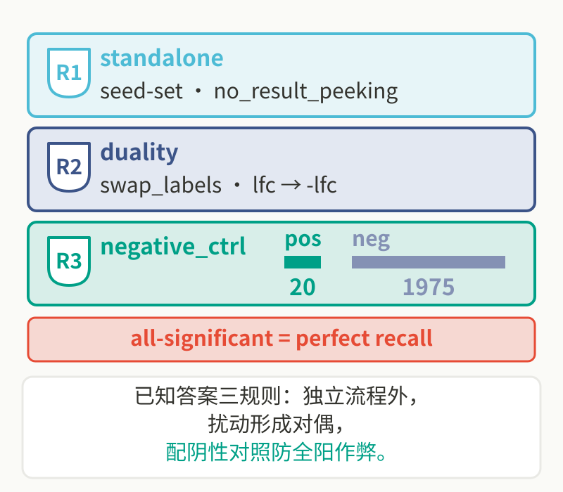

</div>
<div>

- 规则一：答案在流程之外生成，先写盘再跑
- 规则二：扰动要与想抓的错误模式对偶
- 规则三：阳性对照必须配阴性对照

</div>
</div>

<div class="ref">教材 §24.4.5 ｜ 讲义 ④4.7</div>

---

## 只报召回不够：两笔账并排看

<div class="cols">
<div>

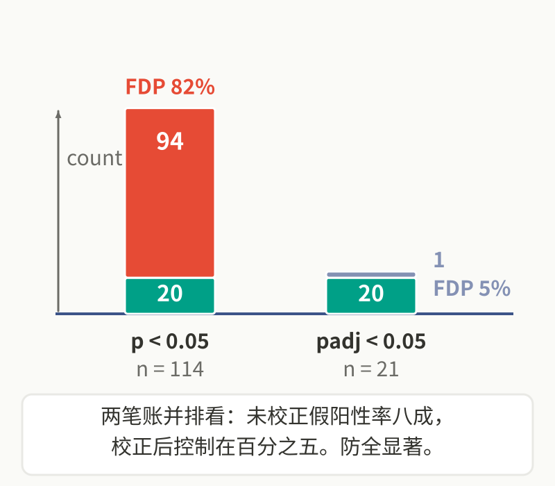

</div>
<div>

- 只报召回不够：全判显著也能拿满分
- 合成参数：m = 1 995，含 20 个真上调
- 合成口径：`demos/ch24_pvalue_vs_padj.py --selftest`

</div>
</div>

<div class="ref">教材 §24.4.5 ｜ 部分 B（合成数据，非课程数据）</div>

---

## 真实课题没有 spike-in：三种答案来源

- qPCR 或独立实验验证过的标记基因：数量少
- 生物学上应当不显著的管家基因：稳定要证据
- 已发表完成图或权威注释：只覆盖一个株系
- 三种合起来，才够一次验证有真值可用

<div class="ref">教材 §24.4.5 ｜ 讲义 ⑩-2</div>

---

<!-- _class: phd statement -->

答案要在分析之前写盘，最好带时间戳或校验和。

跑完再从结果表里挑几个显著基因当答案，是用结论证明结论。

---

## 4.4 报错三分法：先归类，再听建议

<div class="cols">
<div>

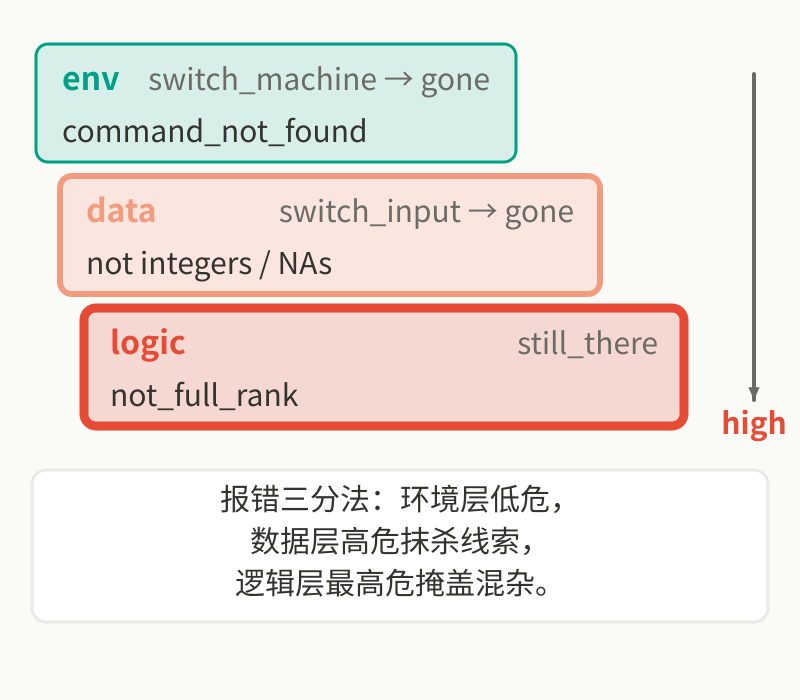

</div>
<div>

- 先归类：换机器、换输入，还是都还在
- 数据层的「修复」最常抹掉诊断线索
- 逻辑层的问题不在代码，在设计

</div>
</div>

<div class="ref">教材 §24.4.6 ｜ 讲义 ④4.4</div>

---

<!-- _class: phd warn -->
<!-- _class: phd warn -->
## 危险形态：只让报错消失的「修复」

<div class="cols">
<div>

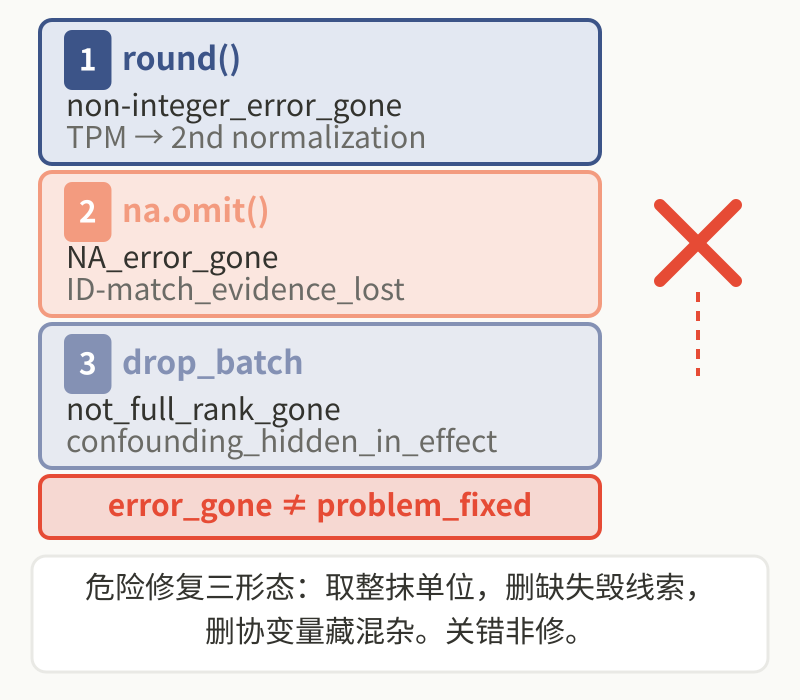

</div>
<div>

- 判据：它改变了哪个数字的含义？
- `round()` 抹掉「你喂了 TPM」这个事实
- 删 `batch` 把混杂藏进处理效应里

</div>
</div>

<div class="ref">教材 §24.4.6、§24.5.3 ｜ 讲义 ④4.4</div>

---

<!-- _class: phd statement -->

报错是流程里唯一免费的质检员。

关掉它不会让问题消失，只会让问题安静下来。

---

## 4.6 AI 编造的引用：三种形态

<div class="cols">
<div>

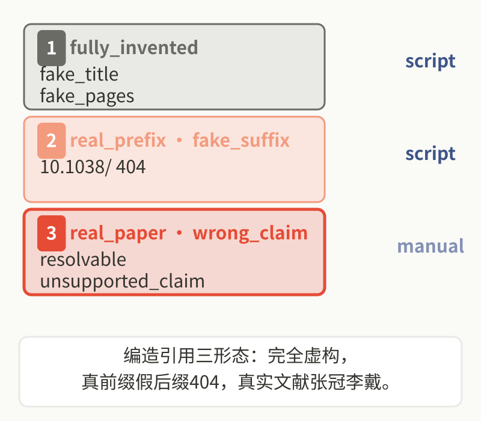

</div>
<div>

- 前两种形态 DOI 会 404，脚本能拦
- 张冠李戴题录全真，只有读摘要能抓
- 「形状合法」不是判据

</div>
</div>

<div class="ref">教材 §24.4.7 ｜ 讲义 ④4.5</div>

---

## 四步核查：前三步可脚本化

<div class="cols">
<div>

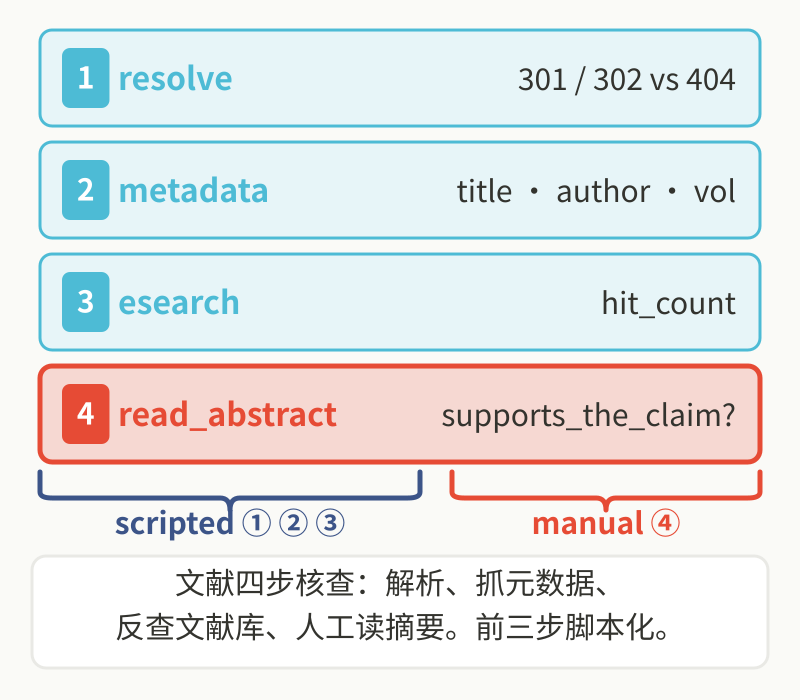

</div>
<div>

- ① DOI 解析：301/302/303 才算通
- ②③ 题录与反查能脚本化；④ 摘要语境最费时
- 每步只证明一件事，不能越级

</div>
</div>

<div class="ref">教材 §24.4.7 ｜ 讲义 ④4.5、⑤5.5</div>

---

## 三条边界，与脚本的七列输出

- Crossref 查不到不等于伪造：arXiv 走 DataCite
- PubMed 只索引 MEDLINE；非收录刊命中为 0，不是伪造
- 撤稿要靠 `RETRACTED:` 前缀与 `updated-by` 判
- 七列含 `pubmed_hits` 与 `verdict`；404 待复核

<div class="ref">教材 §24.4.7 ｜ 01_check_refs.sh 头注</div>

---

## 4.8 失败模式在重新分布，不是消失

<div class="cols">
<div>

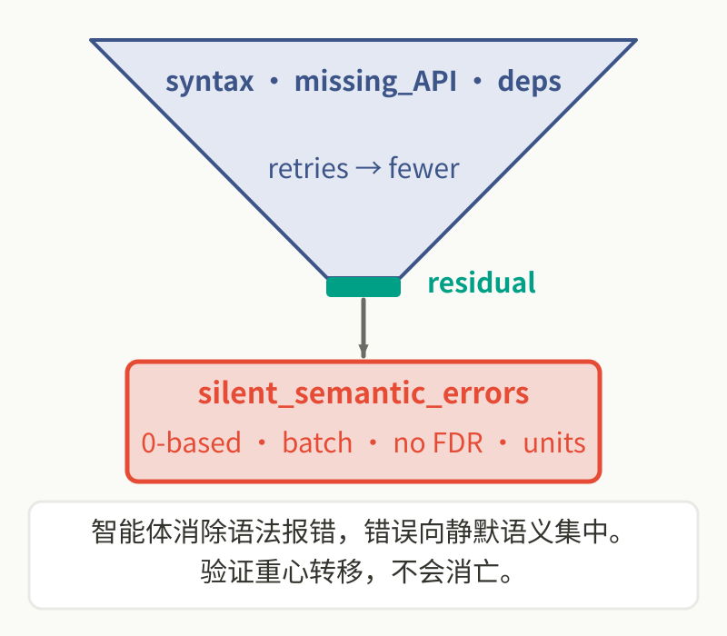

</div>
<div>

- agent 能执行、读报错、重试，接口类错误大减
- 剩下的向语义层集中：坐标系、改名不重排、单位
- 基准测「函数返回对不对」，不测实验设计

</div>
</div>

<div class="ref">教材 §24.4.8 ｜ 讲义 ④4.8</div>

---

## BioCoder：通用代码能力不能线性外推

<div class="kpi">2 522</div>

<p class="kpi-label">个函数级任务，来自 28 个 GitHub 生信仓库</p>

- 2024 年 *Bioinformatics* 40(Suppl 1):i266–i276
- 1 026 Python + 1 243 Java + 253 Rosalind
- Pass@1：单次生成即通过测试；榜单靠前也未必高
- 函数级通过率高，不等于你的分析链正确

<div class="ref">教材 §24.4.8 ｜ DOI 10.1093/bioinformatics/btae230</div>

---

<!-- _class: phd divider -->

<div class="num">V</div>

# 操作流程

六个步骤，一个不能跳的核心

---

<!-- @section: procedure -->
## 操作流程骨架（命令见实验指导 §3 与讲义 ⑤）

<div class="cols">
<div>

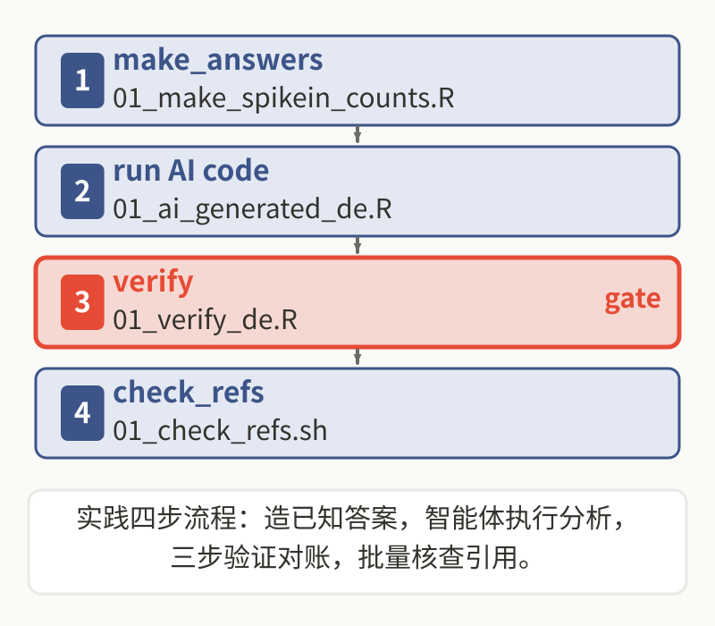

</div>
<div>

- 建环境 → 造答案 → 跑 AI 脚本
- 三步验证：一步不跳，先写下判断
- 对照问两次、文献核查、集群提交

</div>
</div>

<div class="ref">教材 §24.4.4 ｜ 讲义 ⑤ 5.0–5.6</div>

---

## 5.1–5.3 关键命令

```bash
Rscript 03_code/phd/scripts/01_make_spikein_counts.R \
        results/p01
Rscript 03_code/phd/scripts/01_ai_generated_de.R \
        results/p01/counts.tsv results/p01/coldata.tsv \
        results/p01/ai_out
Rscript 03_code/phd/scripts/01_verify_de.R \
        results/p01 results/p01/ai_out
```

- 三件产出：`counts.tsv`、`coldata.tsv`、`spikein.txt`

<div class="ref">教材 §24.4.4–§24.4.5 ｜ 讲义 ⑤ 5.1–5.3</div>

---

## 5.5 文献核查：一条命令，七列输出

```bash
bash 03_code/phd/scripts/01_check_refs.sh refs.txt
#   每行一个 DOI；输出 <list>_checked.tsv
```

| 列 | 说明 |
|---|---|
| `http_status` | 301/302/303 期望；404 待复核 |
| `pubmed_hits` | 非 MEDLINE 天然为 0 |
| `verdict` | 待复核标签，含撤稿标签 |

<div class="ref">教材 §24.4.7 ｜ 讲义 ⑤ 5.5</div>

---

## 5.6 集群提交：本机无 SGE，此步未实测

```bash
qsub 03_code/phd/scripts/01_run_ai_practice.sh
qstat -u "$USER"
```

- 作业头 `-pe smp 4`、`h_vmem=8G`；脚本内激活环境
- 日志第一行 `[host]` 必须不是登录节点
- 作业不继承登录环境，缺激活就报命令找不到

<div class="ref">教材 §24.4.6 E7 ｜ 讲义 ⑤ 5.6（集群实跑未验证）</div>

---

<!-- _class: phd divider -->

<div class="num">VI</div>

# 结果解读

三个已登记的数 · 三类指纹 · 三条隐蔽形态

---

<!-- @section: interpretation -->
## 6.1 正确的报告长什么样

| 段 | 该看到什么 |
|---|---|
| ① 自检 | 2 000 × 6；全整数；名字集合 |
| ② 回归 | 召回 ≥ 18/20；相关接近 −1 |
| ③ 手算 | `contrast` 实参与阳性落位相符 |

- ① 查的是输入文件，不证明矩阵来源对
- ① 的检查先重排再比，TRUE 不代表原序
- ② 方向看阳性落在哪侧，不看系数名字面

<div class="ref">教材 §24.4.4 ｜ 讲义 ⑥ 6.1</div>

---

<!-- _class: phd warn -->
<!-- _class: phd warn -->
## 6.2 结果不对时长什么样（一）：筛选列

<div class="cols">
<div>

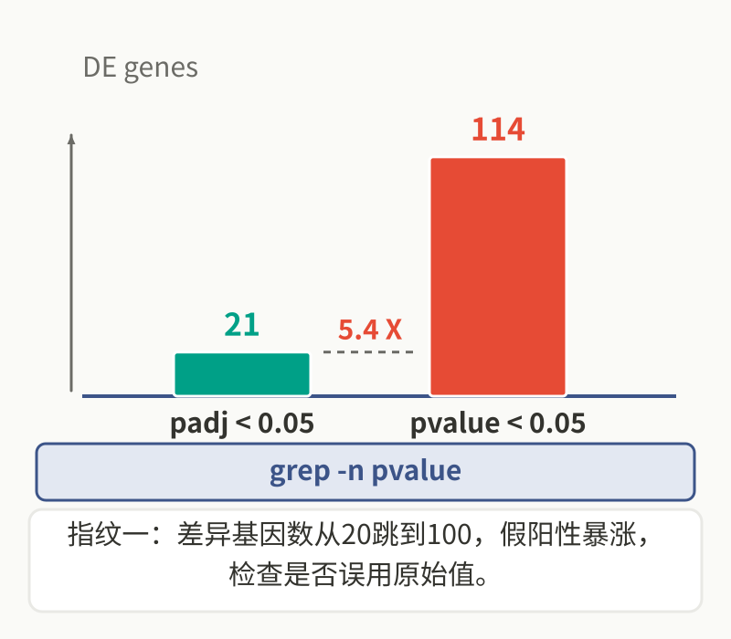

</div>
<div>

- 差异基因数 97，参考 22：先怀疑筛选列
- 与 m × 0.05 的账同量级 = 未校正收了噪声
- 一行验证：`grep -n pvalue`

</div>
</div>

<div class="ref">教材 §24.4.4 ｜ README p01 节实测（97 对 22）</div>

---

<!-- _class: phd warn -->
<!-- _class: phd warn -->
## 6.2（二）：方向反了

<div class="cols">
<div>

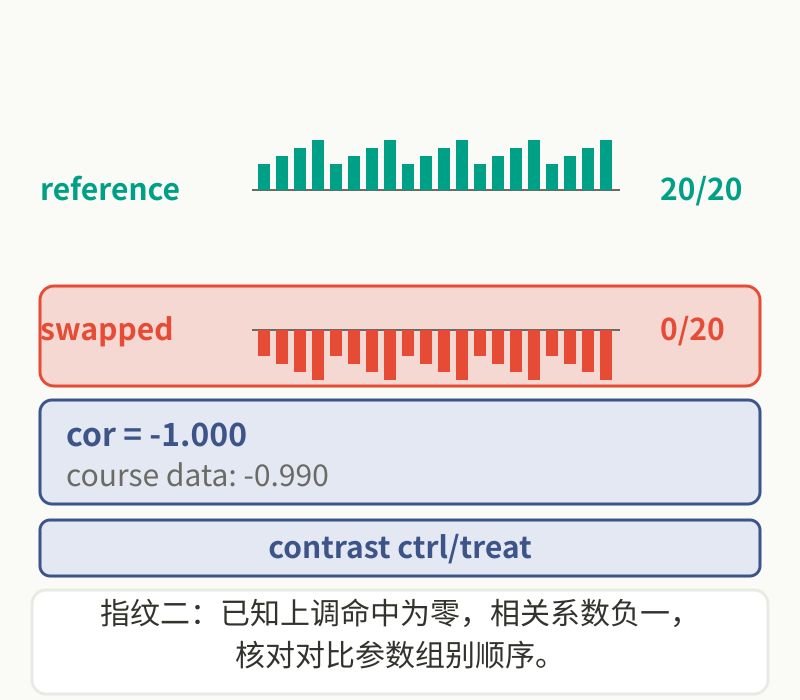

</div>
<div>

- 20 个已知上调基因全落在下调侧：0/20
- 与参考流程的 `log2FC` 相关约 −0.99
- 先查 `contrast` 两个元素与因子参考水平

</div>
</div>

<div class="ref">教材 §24.4.4 ｜ README p01 节实测（0/20、−0.99）</div>

---

<!-- _class: phd warn -->
<!-- _class: phd warn -->
## 6.2（三）：归一化做了两次（合成演示）

<div class="cols">
<div>

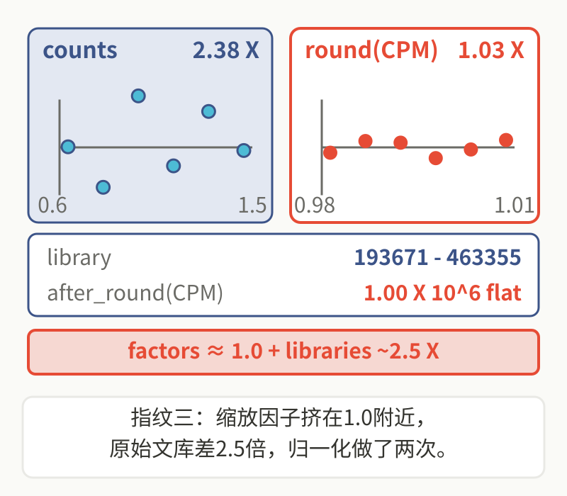

</div>
<div>

- `sizeFactors()` 挤在 1.0 附近，原始文库仍差两倍
- 只有一句 message，取整之后连报错都没有
- 课程数据实测见实验指导 §3.3，不与本页对账

</div>
</div>

<div class="ref">教材 §24.4.4 ｜ 演示 ch24_double_normalization_sizefactors.py --selftest</div>

---

## 6.2 续：三条更隐蔽的形态

- `padj` 大量 NA：`res[res$padj < 0.05, ]` 会报 NAs
- 先转 `data.frame` 再筛不报错，NA 作为一行返回
- 设计式丢了 `batch`：结果正常，PCA 才看得见
- 隐蔽形态写进清单，比背三种植入错误更值钱

<div class="ref">教材 §24.4.6 E6、§24.4.2 ｜ 讲义 ⑥ 6.2</div>

---

<!-- _class: phd divider -->

<div class="num">VII</div>

# 常见错误

课堂上一定会遇到的三条

---

<!-- @section: troubleshooting -->
<!-- _class: phd warn -->
## 常见错误一：输入不是原始 counts

```r
Error: some values in assay are not integers
```

- 输入是 TPM、CPM 或已归一化的矩阵
- **不要直接 `round()`**：回上游确认矩阵来源
- 取整后只剩 `converting counts to integer mode`
- 开工前加 `stopifnot(all(cts %% 1 == 0))` 拦截

<div class="ref">教材 §24.4.6 E1、E2 ｜ 讲义 ⑨-E1、E2</div>

---

<!-- _class: phd warn -->
<!-- _class: phd warn -->
## 常见错误二：设计矩阵不满秩

<div class="cols">
<div>

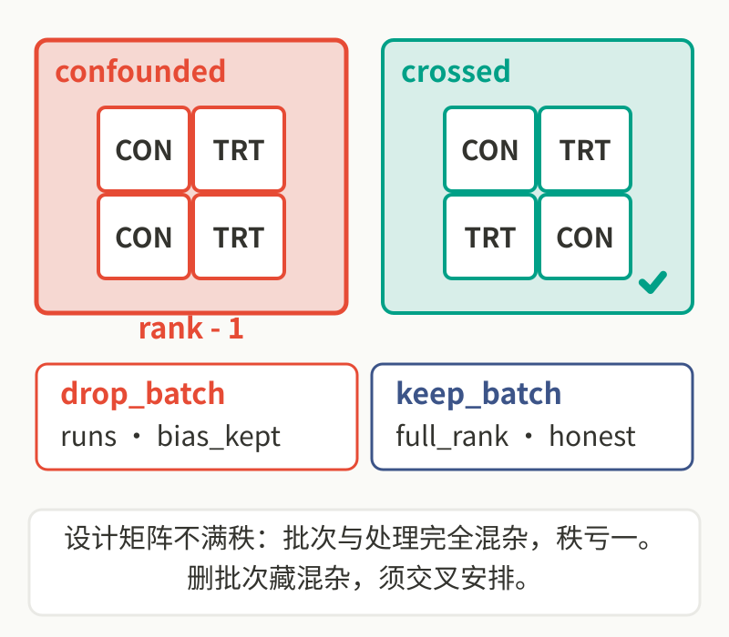

</div>
<div>

- 报错 `the model matrix is not full rank`
- 删 `batch` 能跑通，混杂只是被藏起来
- 设计问题不是代码问题：报告限制，下批交叉

</div>
</div>

<div class="ref">教材 §24.4.6 E3 ｜ 讲义 ⑨-E3</div>

---

<!-- _class: phd warn -->
## 常见错误三：拿带 NA 的 `padj` 做下标

```r
res[res$padj < 0.05, ]      # logical subscript contains NAs
res2 <- as.data.frame(res)  # 转 data.frame 后不报错
```

- `padj` 的 NA 来自独立过滤与离群值
- 先 `which(complete.cases(...))`，或按行名取
- `filter()` 自动丢 NA，但你必须知道它丢了

<div class="ref">教材 §24.4.6 E6 ｜ 讲义 ⑨-E6（报错串按实测更正）</div>

---

## 排查路标：三类各归各

| 类 | 编号 | 先查什么 |
|---|---|---|
| 数据 | E1 E2 E4 E5 E6 E9 | 输入来源、NA 数量与位置 |
| 环境 | E7 | 作业里有没有显式激活环境 |
| 逻辑 | E3 | 设计式哪两列完全共线 |

- E8 属数据（引用）：404 先复抄、换网络复测，再决定删

<div class="ref">教材 §24.4.6 E1–E9 ｜ 讲义 ⑨、⑩-4</div>

---

<!-- _class: phd divider -->

<div class="num">VIII</div>

# 课后

任务卡 · 思考练习 · 实验指导

---

<!-- @section: wrapup -->
## 实践任务卡（2 h）

| 步 | 做什么 |
|---|---|
| 1 | 造数据 → 跑 AI 脚本 → 跑三步验证 |
| 2 | 先写下判断，再对照 6.2 的三类指纹 |
| 3 | 同一段代码问两次，记指出几处、对几处 |
| 4 | 核查 5 条 DOI（课程建议值），人工做第 ④ 步 |

- 交付：验证报告、缺陷表、核查表、两份提问记录

<div class="ref">教材 §24.4.4、§24.4.7 ｜ 讲义 ⑤、⑩ ｜ 作业 p01</div>

---

## 思考练习：讲义 ⑩ 八题（推荐讨论四题）

- Q2 没有 spike-in 时，什么能当已知答案
- Q4 把 E1–E9 归三类，挑出会掩盖真问题的
- Q7 什么情况下只做第 ① 步就往下走
- Q8 开放题：为你自己的分析写验证方案

<div class="ref">教材 §24.7 习题 1–8 ｜ 讲义 ⑩</div>

---

## 实验指导与收尾

- 上机时手边打开 `11_lab_guides/phd/01_ai_workflow_lab.md`
- 演示脚本在课程仓库根目录运行：`python3 textbook/demos/...`
- 文献只给指针（讲义 ⑪），本 deck 不重复列

**交出去的是一份经三步验证背书的差异表。**

<div class="ref">教材 §24.6 ｜ 讲义 ⑩、⑪</div>
