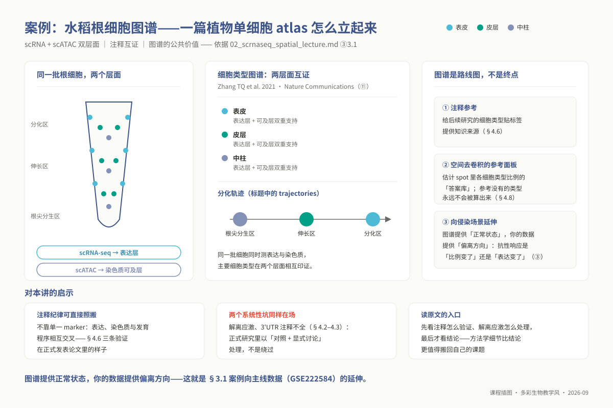
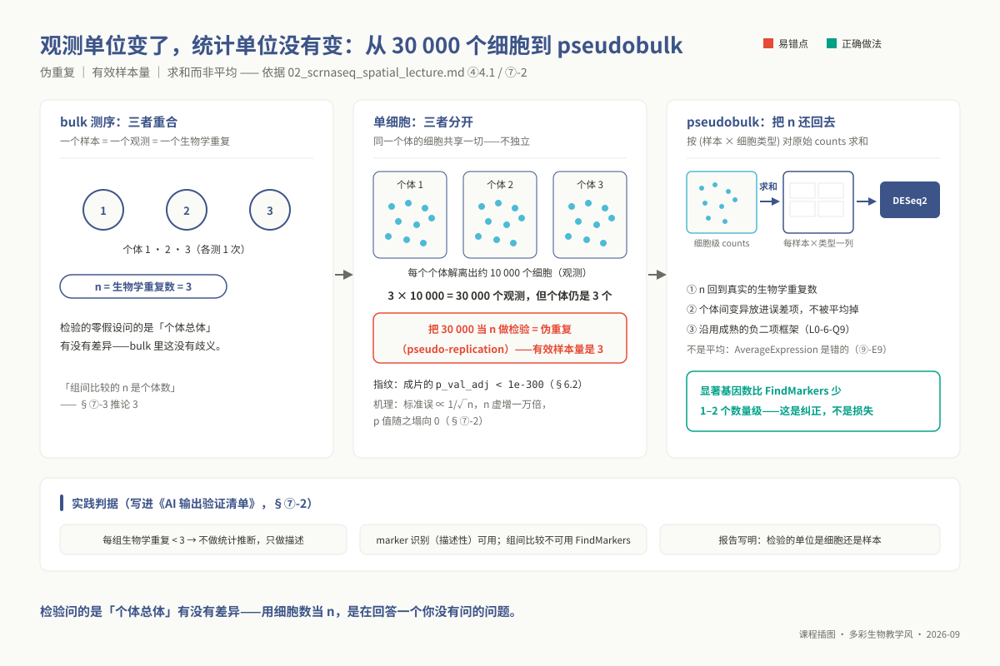
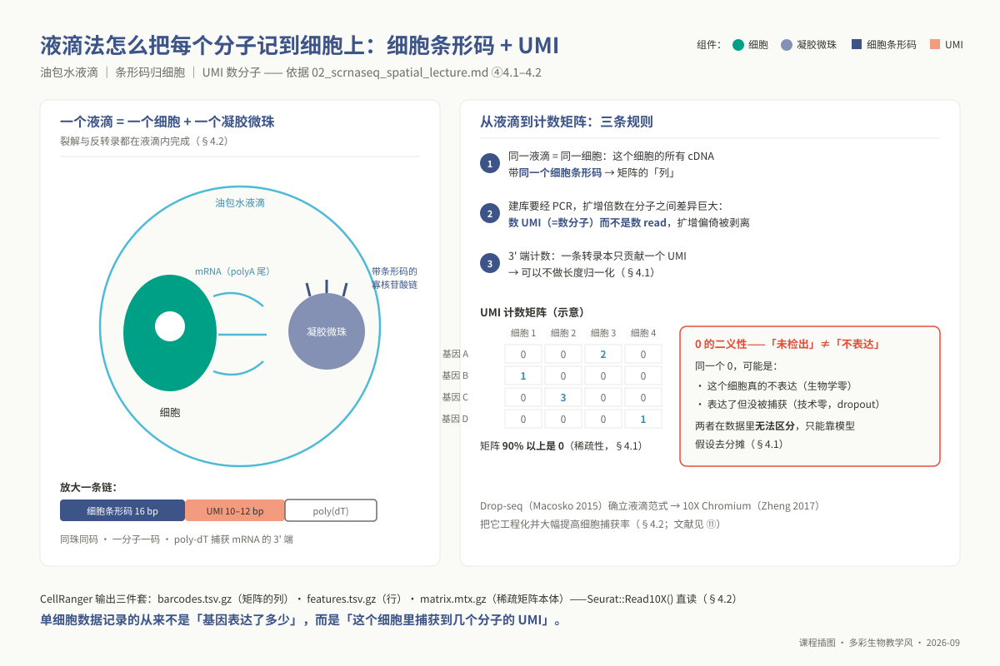
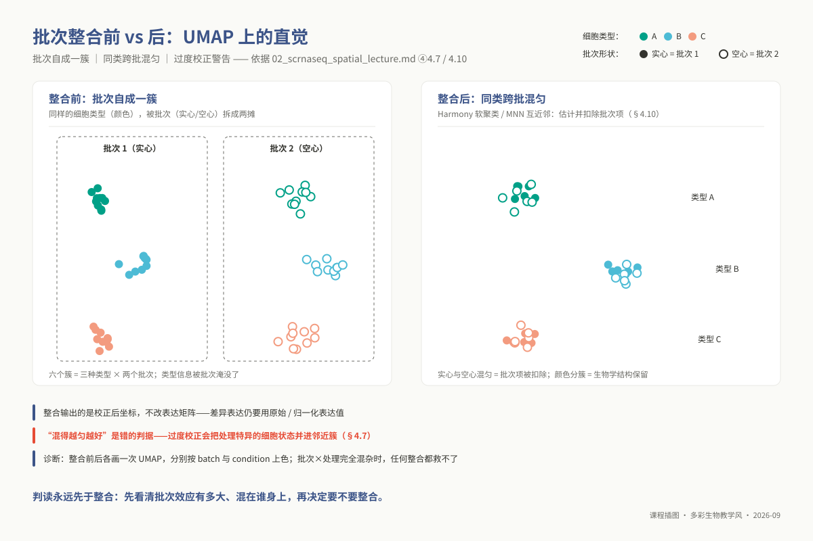
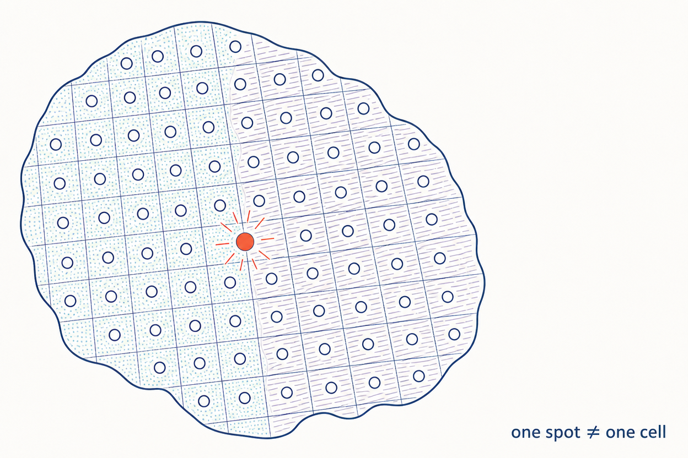

<!-- @section: cover -->
<!-- _class: phd cover -->

# p02 ｜ 单细胞与空间转录组

**观测单位缩到细胞，统计单位仍然是样本。**

<div class="meta">

- 4 学时（2 h 理论 + 2 h 实践）｜ 环境 `ngs_phd_sc`
- 教材第 17 章 ｜ 讲义 `02_lectures/phd/topic02_scrnaseq_spatial/`
- 数据 `GSE222584`（水稻 RRSV/RGSV）＋ 10X 官方 Visium 演示

</div>

---

<!-- _class: phd divider -->

<div class="num">01</div>

# 学习目标

四项博士核心 ＋ 三项选读衔接

---

<!-- @section: objectives -->
## 学完你应当能够（一）：选读衔接

- LO17-01 计数矩阵三件套与 UMI 计数口径
- LO17-01 零的二义性：未检出不等于不表达
- LO17-02 识别照搬 PBMC 质控值的静默失配
- LO17-03 用捕获算例说明期望不等于把握

<div class="ref">教材 §17.2（LO17-01–LO17-03 为硕士选读块）｜ 讲义 ①</div>

---

## 学完你应当能够（二）：博士核心

- LO17-04 论证标准误压缩，实施 pseudobulk
- LO17-05 设计数据驱动质控，论证无最优 resolution
- LO17-06 诊断过度校正与批次共线限制
- LO17-07 评审空间表述，规划细胞量预算

<div class="ref">教材 §17.2（LO17-04–LO17-07 为本层考核基准）｜ 讲义 ①</div>

---

<!-- _class: phd divider -->

<div class="num">02</div>

# 前置检查

五个 L0 模块，加一次环境自检

---

<!-- @section: prerequisites -->
## 前置检查：五个 L0 模块

| L0 模块 | 本讲用在哪 | 不过关的症状 |
|---|---|---|
| `l0_02_r` | 全部代码与图 | 分不清 `@meta.data` 与 `[[ ]]` |
| `l0_06_stats` | 统计单位与 pseudobulk | 说不清 3 个个体的自由度 |
| `l0_05_qc` | 质控阈值来源 | 以为调个数字就是质控 |
| `l0_01_linux` | `qsub` 与内存 | 在登录节点跑 `SCTransform` |

<div class="ref">教材 §17.3 ｜ 讲义 ② ｜ 自测 L0-2-Q5、L0-6-Q7、L0-5-Q2、L0-1-Q9</div>

---

## 前置检查：环境与版本快照

- `l0_03_conda` 管环境激活与快照，别混「没装」
- 本讲无 L1 依赖：不建立在硕士层代码之上
- 版本要写具体值，写「4.x 或 5.x」不算记录

```bash
source "${CONDA_ROOT:-/opt/miniconda3}/bin/activate" ngs_phd_sc
Rscript -e 'for (p in c("Seurat","harmony","SingleR",
  "DESeq2")) cat(p, as.character(packageVersion(p)), "\n")'
python -c "import scanpy, squidpy; print(scanpy.__version__,
  squidpy.__version__)"
```

<div class="ref">教材 §17.3 ｜ 讲义 ②、⑤ 5.0 ｜ 自测 L0-3-Q9（版本号照抄输出，别写 4.x）</div>

---

<!-- _class: phd divider -->

<div class="num">03</div>

# 科学问题

平均掩盖了什么，单细胞才分得开什么

---

<!-- @section: background -->
## bulk 给的是组织匀浆的平均

- 一管组织 = 所有细胞类型的平均
- 少数细胞的重编程被稀释到测不出
- 比例变化与表达变化给同一条曲线
- 单细胞才把这两种解释分开

<div class="ref">教材 §17.1 ｜ 讲义 ③</div>

---

## 三个方向，一类问题

<div class="cols3">
<div class="card">

### 植物病理
侵染点周围是广谱响应，还是少数接触细胞？

</div>
<div class="card">

### 昆虫毒理
抗性来自某类细胞比例上升，还是细胞内上调？

</div>
<div class="card">

### 微生物
原核转录本缺 poly(A) 尾，3′ 捕获失效

</div>
</div>

<div class="ref">教材 §17.1 ｜ 讲义 ③</div>

---

## 主线数据：`GSE222584`

- 水稻茎基部：Mock、RRSV、RGSV 三处理
- 9 样本 = 3 处理 × 3 时点；每组合仅 1 个
- 采样日期与 dpi 完全共线，拆不开
- 体量 332 MB；单样本条码实测 4,515

<div class="ref">教材 §17.1、§17.6 ｜ 06_data/phd/README.md 的 p02 节</div>

---

<!-- _class: phd statement -->

两种解释，bulk 永远分不开。

细胞比例变了，还是同一类细胞里的表达变了——单细胞第一次让这两句话可以分开。

---

<!-- _class: phd figure -->

## 章首案例：一篇水稻根单细胞图谱



同一批根细胞测表达与染色质，两类证据互证类型

<div class="ref">教材 §17.1 ｜ 图 17-1 ｜ 讲义 ③ 3.1</div>

---

<!-- _class: phd divider -->

<div class="num">04</div>

# 核心原理

统计单位 · 上游污染 · 质控 · 降维与聚类 · 注释 · 整合 · 空间

---

<!-- @section: principles -->
## 观测单位变了，统计单位没有变

- 3 个个体，每个解离 10,000 个细胞
- 观测 30,000 个，独立个体仍是 3 个
- 同管细胞共享基因型与解离批次
- 有效样本量是 3，不是 30,000

<div class="ref">教材 §17.4.1 ｜ 讲义 ④ 4.1</div>

---

## 把细胞当重复，标准误就被压缩

- 检验统计量 ≈ 效应量 ÷ 标准误
- 极端示意：`√(30,000/3) = 100` 倍
- 样本量凭空放大 10,000 倍
- 真实幅度取决于细胞间相关

<div class="ref">教材 §17.4.1、§17.5.1（手算，等方差极端示意）</div>

---

## 合成算例：假阳性率随细胞数上升

| 每样本细胞数 | 细胞级假阳性率 | pseudobulk |
|---|---|---|
| 250 | 0.723 | 0.068 |
| 1,000 | 0.854 | 0.068 |
| 4,000 | 0.925 | 0.068 |

- pseudobulk 在全网格都稳定在 0.068
- 样本间方差设 0 时，细胞级回落到 0.051

<div class="ref">演示 textbook/demos/ch17_pseudorep_vs_pseudobulk.py --selftest（合成算例，只对该生成模型成立）</div>

---

<!-- _class: phd statement -->

问题不在细胞多，而在细胞不独立。

把 30,000 当 n，回答的是「两堆液滴有没有抽样波动差异」，不是你要问的问题。

---

<!-- _class: phd figure -->

## 有效样本量是 3，不是 30,000



求和不是平均；检验单位回到样本；显著数下降不算判据

<div class="ref">教材 §17.4.9、§17.5.1、§17.6 ｜ 图 17-5</div>

---

## 计数矩阵：稀疏、零与 UMI

- 行是特征，列是细胞，元素是 UMI 数
- 绝大部分是 0；零有两种，无法逐个区分
- 数 UMI：捕获分子的近似计数，去扩增偏倚
- 3′ 端只贡献一个 UMI，不做长度归一化

<div class="ref">教材 §17.4.2（本节不给固定数字；UMI 长度随化学版本：v1 10 bp、v3.1 12 bp，文献见教材 §17.8）｜ 讲义 ④ 4.1–4.2</div>

---

<!-- _class: phd figure -->

## 从液滴到计数矩阵



数的是捕获到的分子；图面稀疏性数字与示意表都只作示意

<div class="ref">教材 §17.4.2 ｜ 图 17-2 ｜ 图注以正文为准，不抄图面比例</div>

---

## 上游三种污染，流程都不报错

- 环境 RNA：高丰度基因全簇低幅弥漫
- 3′ UTR 截断：每细胞基因数掉到数百
- 双联体：两类互斥 marker 同时高
- 空液滴：`raw_` 与 `filtered_` 之别

<div class="ref">教材 §17.4.3 ｜ 讲义 ④ 4.2</div>

---

<!-- _class: phd statement -->

比对看的是转录组比对率，不是基因组比对率。

`Reads Mapped Confidently to Transcriptome` 随注释版本与物种变，本章不给固定阈值。偏低时先做参考体检：3′ UTR 是否标到、外显子末端是否虚拟延伸 1–2 kb（经验做法）。

---

## 质控阈值不能跨物种照搬

- 前缀失配：整列 0，函数不报错
- 生理本底不同：保卫细胞天然偏高
- 解离应激：热激基因被认成 marker
- 拟南芥 `^ATMG`／`^ATCG` 只作示例

<div class="ref">教材 §17.4.4、§17.5.2 ｜ 讲义 ④ 4.3</div>

---

## 前缀在自己的矩阵上数一遍

```bash
zgrep -c '^<候选前缀>' features.tsv.gz
zcat features.tsv.gz | cut -f2 | grep -c '^<候选前缀>'
```

- 普通 `grep` 读 `.gz` 数的是压缩字节
- 行名可能是基因 ID，先 `head(rownames(obj))`
- 候选前缀只能从本物种 GFF 的细胞器注释取
- `^tRNA` 这类名字命中含核基因，不能当线粒体

<div class="ref">教材 §17.4.4、§17.5.2 ｜ 细胞器归属逐 ID 核对，分不清就标「不适用」</div>

---

## 阈值取本数据的分位数

- `nFeature_RNA` 取 1% 与 99% 分位
- `percent.mt` 取 95% 分位
- 前缀全 0 时加 `stopifnot(max(percent.mt) > 0)`
- 植物另画 `percent.cp`，两维分开看

<div class="ref">教材 §17.4.4 ｜ 脚本第 3 步（现读代码）</div>

---

## 同一个 5% 阈值，杀伤极不均匀

<div class="kpi">93.0% ／ 0.2%</div>

- 叶肉样类型保留 93.0%，保卫细胞样 0.2%
- 相差约 465 倍
- 虚拟类型，不是任何真实组织的保留率

<div class="ref">演示 textbook/demos/ch17_mt_threshold_sensitivity.py --selftest（合成算例）｜ 教材 §17.5.2</div>

---

## 标准化：两个选择，一条边界

- `LogNormalize`：缩放后 `log1p`，简单易解释
- `SCTransform`：负二项回归取 Pearson 残差
- 回归协变量会把生物学一起删掉
- 先问：它是处理的下游结果吗

<div class="ref">教材 §17.4.5 ｜ 讲义 ④ 4.4</div>

---

## 降维：主成分数与 UMAP 的边界

- 主成分数按拐点与目标亚群定，不给区间
- 取值与依据写进方法，不写「默认参数」
- UMAP 只保局部邻域，全局距离失真
- 簇的距离与大小都没有生物学含义

<div class="ref">教材 §17.4.5（本章不给具体数字）｜ 讲义 ④ 4.4</div>

---

## 聚类：resolution 没有客观最优

- KNN 图 + Louvain/Leiden 切分
- γ 越大，簇数近似单调增加
- 网格 0.2/0.4/0.6/0.8/1.0 再并入主值
- 默认 0.5 共 6 档；产物是簇数表

<div class="muted">clustree 是可选延伸，不是流程必需产物</div>

<div class="ref">教材 §17.4.6 ｜ 脚本第 5 步 res_grid（现读代码：unique(c(0.2,0.4,0.6,0.8,1.0,res_main))）</div>

---

## 稳定性三查，筛掉的东西不同

| 检查 | 看什么 |
|---|---|
| 多分辨率一致性 | 目标簇是否始终独立 |
| 重抽样共聚类 | 簇内配对频率是否更高 |
| 轮廓系数 | 是否接近 0 或为负 |

- 合成算例 ARI：7–12 平台区 0.69–0.73
- 抽样比例自定并写明，不套固定阈值

<div class="ref">教材 §17.4.6（区间按本数据扫描定）｜ 演示 textbook/demos/ch17_resolution_ari.py --selftest</div>

---

<!-- _class: phd statement -->

「发现 15 类细胞」不是一个可检验的陈述。

可检验的写法：在某个分辨率区间内，该亚群始终独立存在、顶级 marker 排序不变。

---

## 注释：两条路线，各自的瓶颈

- 人工比对：非模式物种没有 marker 库
- 自动注释：参考几乎全是人或小鼠
- 分数高只说明「最接近」，不说明对
- 序列同源不等于功能保守

<div class="ref">教材 §17.4.7 ｜ 讲义 ④ 4.6</div>

---

## 注释验证三条，缺一不可

- 每个注释至少 2 个独立 marker
- 类型比例与组织学数量级自洽
- 关键结论要有原位证据
- marker 是证据，不是定义

<div class="ref">教材 §17.4.7 ｜ 讲义 ④ 4.6</div>

---

## Harmony：只改坐标，不改表达矩阵

- PCA 空间软聚类 + 多样性惩罚
- 输出的是校正后的嵌入坐标
- 差异表达要回到 `RNA` assay
- 「混得越匀越好」是错的判据

<div class="ref">教材 §17.4.8 ｜ 讲义 ④ 4.7</div>

---

<!-- _class: phd figure -->

## 批次整合前后



批次混匀、类型保留，才算没伤到生物学

<div class="ref">教材 §17.4.8 ｜ 图 17-4</div>

---

## 过度校正与完全混杂

- 处理特异亚群被揉进邻近簇
- 批次全对照、全处理 = 不可辨识
- 本数据 batch 与 dpi 共线：整合能跑
- 但时间效应与批次效应不可分离

**能跑不等于能推断：时间趋势一律写进限制。**

<div class="ref">教材 §17.4.8、§17.5.3、§17.6 ｜ 讲义 ④ 4.10</div>

---

## pseudobulk：把细胞折叠回样本

- 按样本 × 类型对原始计数求和
- 求和不是平均，浮点会被 DESeq2 拒绝
- 每样本每类型至少 10 个细胞
- 报告写清 `n` 的单位

<div class="ref">教材 §17.4.9 ｜ 脚本 02_pseudobulk_de.R（现读）</div>

---

## 两套差异表不能直接比

- 显著数下降有多种解释
- 先看效应量及其区间
- 再看个体间分布与可用样本数
- 数字现读 `de_comparison_summary.tsv`

<div class="ref">教材 §17.4.9、§17.6 ｜ 讲义 ⑦-2</div>

---

## 捕获功效：期望达标 ≠ 把握达标

```r
p <- 0.01; k <- 10
1 - pbinom(k - 1, 1568, p)   # 0.9502
1 - pbinom(9, 1000, p)       # 0.5427
```

- 整数最小 1,568；脚本网格 1,570
- 丰度 0.1%（同 k=10、把握 95%）：15,702 / 15,710
- 5 × 4,000 与 2 × 10,000 同为 20,000
- 预算固定时优先多个体、每样少细胞

<div class="ref">教材 §17.4.10 ｜ 脚本 02_power_cells.R（pbinom 现跑）</div>

---

## Visium：spot 不是细胞

- spot 直径 55 µm，中心距 100 µm
- spot 之间 45 µm 空白没被采样
- 官方口径每 spot 1–10 个细胞
- 植物侧 1–3 个是估计，不是规格

```text
覆盖 = 4,992 × π × 27.5² / 6,500² ≈ 28.1%
盲区 ≈ 1 − 0.281 = 71.9%
```

<div class="ref">教材 §17.4.11（手算；六角密排 27.4%／72.6%，方格近似 23.8%／76.2%）</div>

---

<!-- _class: phd figure -->

## one spot ≠ one cell



图面是示意点阵；骑跨分界的 spot 测到混合信号

<div class="ref">教材 §17.4.11 ｜ 图 17-6 ｜ 空间演示数据为 10X 官方小鼠脑</div>

---

## 去卷积给比例，不给定位

- 参考里没有的类型永远算不出来
- 缺项时信号被摊给已知类型
- 微区富集 ≠ 某类细胞特异诱导
- 升到细胞层要原位证据

<div class="ref">教材 §17.4.11、§17.5.4 ｜ 讲义 ④ 4.8</div>

---

## 前沿不取消这两条底线

- Visium HD 2 µm 网格，常聚到 8 µm bin
- 靶向成像只测预选探针，是单细胞
- 基础模型语料几乎全是人与小鼠
- 新工具先在本物种数据上对照

**两条底线：统计单位仍是样本；注释必须正交验证。**

<div class="ref">教材 §17.4.12 ｜ 讲义 ④ 4.11</div>

---

<!-- _class: phd divider -->

<div class="num">05</div>

# 操作流程

集群规矩 · 主流程 · 下游两个脚本

---

<!-- @section: procedure -->
## 一切计算走 `qsub`

- 登录节点只下载、建环境、编辑
- `qsub` 提交，`qstat -u $USER` 看状态
- 日志尾部只有 `Killed` 就是 OOM
- `h_vmem` 是申请值，不是实测需求

<div class="ref">教材 §17.6 ｜ 讲义 ⑤ 5.3</div>

---

## 先建环境，再留快照

```bash
conda env create -f 07_envs/conda/env_phd_singlecell.yml
conda activate ngs_phd_sc
conda env export --no-builds > results/p02/env_snapshot.yml
```

- 软件迭代快，快照随结果一起交

<div class="ref">讲义 ⑤ 5.0 ｜ ngs_phd_sc 现读：r-seurat 5.3.0、scanpy 1.11.5</div>

---

## 元数据表先建，四列

- `sample`、`condition`、`batch`、`dpi`
- 缺 `batch` 列，整合步骤会被跳过
- 缺 `condition` 列，混杂检查做不了
- 跳过不报错，只是结果里少一步

<div class="ref">教材 §17.6 ｜ 讲义 ⑤ 5.0</div>

---

## 主流程：改副本里的变量再提交

```bash
cp 03_code/phd/scripts/02_run_seurat.sh ./p02_run.sh
# 改副本：INDIR、META、MT_PATTERN、CP_PATTERN
grep -nE '^(INDIR|META|MT_PATTERN|CP_PATTERN)' p02_run.sh
qsub p02_run.sh
```

- `META` 不给，整合与混杂检查都跳过
- 变量要写进作业脚本：`qsub` 不继承终端环境
- `INDIR` 指向合并后的三件套目录，不是原始样本目录

<div class="ref">讲义 ⑤ 5.0、5.3 ｜ 教材 §17.4.4、§17.6 ｜ 脚本现读（META 经 --meta 传入主流程）</div>

---

## 参数：每个都要说得出依据

| 参数 | 定值依据 |
|---|---|
| `--mt-pattern` | 本物种 GFF 实查 |
| `--npcs` | 拐点 + 目标亚群 |
| `--resolution` | 0.2–1.0 网格扫描 |
| `--singler-ref` | 默认 `none`，不给标签 |

- `--step` 取 `all` 或 `annotate` 都跑完前五步
- 取值与依据要进报告方法节，不写「默认参数」

<div class="ref">教材 §17.4.4–§17.4.6 ｜ 讲义 ⑤ 5.0 ｜ 脚本现读：--step 默认 all</div>

---

## 下游一：pseudobulk 先派生两水平列

```bash
# meta 里先加对比列 trt2（如 Mock / RRSV）
Rscript 03_code/phd/scripts/02_pseudobulk_de.R \
  --rds results/p02/integrated.rds --sample-col sample \
  --celltype-col seurat_clusters --condition-col trt2 \
  --outdir results/p02/de
```

- 主线 `condition` 是三水平，脚本只接受两水平
- 传三水平不报错：每个簇都跳过，表是空的
- `seurat_clusters` 是实际列名，`celltype` 列不存在

<div class="ref">教材 §17.4.9 ｜ 讲义 ⑤ 5.2 ｜ 脚本现读（L58 三水平即 next）</div>

---

## 下游二：功效与空间各一行

```bash
Rscript 03_code/phd/scripts/02_power_cells.R \
  --prop 0.01 --k 10 --power 0.95
Rscript 03_code/phd/scripts/02_spatial_visium.R \
  --indir <Visium 目录> --outdir results/p02/spatial
```

- 脚本给 10 细胞步长的网格值，不是整数最小值
- 空间演示数据是小鼠脑，不是植物样本

<div class="ref">教材 §17.4.10–§17.4.11 ｜ 讲义 ⑤ 5.2、⑥ 6.1 ｜ 06_data/phd/README.md p02 节</div>

---

<!-- _class: phd divider -->

<div class="num">06</div>

# 结果解读

五个产物先看 · 结果不对时长什么样

---

<!-- @section: interpretation -->
## 正常结果长什么样

| 产物 | 正常形态 |
|---|---|
| `qc_violin.png` | 单峰右偏，低值处长尾 |
| `elbow.png` | 陡降后进入平台 |
| `cluster_stability.tsv` | 簇数平滑增加 |
| `integration_before_after.png` | 批次混匀、结构保留 |

- `de_comparison_summary.tsv` 要写明单位是样本
- 真实样本的结果本环境没有复跑

<div class="ref">教材 §17.6（unverified）｜ 讲义 ⑥ 6.1</div>

---

<!-- _class: phd warn -->
## 结果不对时长什么样（一）

| 现象 | 先做什么 |
|---|---|
| `percent.mt` 整列 0 | 数前缀、打印行名 |
| 每细胞数百个基因 | 查 3′ UTR 覆盖 |
| UMAP 一条粗桥连各簇 | 查环境 RNA 与双联体 |

<div class="ref">教材 §17.4.3、§17.5.2 ｜ 讲义 ⑥ 6.2</div>

---

<!-- _class: phd warn -->
## 结果不对时长什么样（二）

| 现象 | 先做什么 |
|---|---|
| 整合后处理特异簇消失 | 三步诊断过度校正 |
| 成片极小 p 值 | 查检验单位与样本数 |
| 空间信号成规则条带 | 查配准与总 UMI |

<div class="ref">教材 §17.5.1、§17.5.3、§17.5.4 ｜ 讲义 ⑥ 6.2</div>

---

<!-- _class: phd divider -->

<div class="num">07</div>

# 统计要点

结论写在区间里 · 伪重复四处检查

---

<!-- @section: stats_plugin -->
## ⑦-1 结论写在区间里

- 跑 0.2–1.0 网格，读簇数变化
- 三项检查一起做，不能互相替代
- 结论写「区间内始终独立存在」
- 区间按本数据扫描定，不抄设例

<div class="ref">教材 §17.4.6、§17.5.3 ｜ 讲义 ⑦-1</div>

---

## ⑦-2 伪重复：四处检查

- 方法里写清检验单位是细胞还是样本
- 结果表的 `n` 与样本表对账
- 成片显著先疑统计单位与数值实现
- 同一比较再跑一遍 pseudobulk

<div class="ref">教材 §17.4.1、§17.5.1 ｜ 演示 textbook/demos/ch17_pseudorep_vs_pseudobulk.py</div>

---

<!-- _class: phd quiz -->
## 课堂提问

每组 2 个个体、12,000 个细胞、6,800 个显著基因、成片 `p_adj < 1e-200`（设例）——先问哪三件事？

---

<!-- _class: phd divider -->

<div class="num">08</div>

# AI 辅助任务

让 AI 出 marker 清单，逐条抓错

---

<!-- @section: ai_task -->
## AI 生成的 marker 清单，逐条抓错

| 核查 | 记录 |
|---|---|
| 基因 ID 真实性 | 存在／伪造／格式非法 |
| 跨物种搬运 | 有无 `CD4`、`PTPRC` |
| DOI 可解析 | 真／404／张冠李戴 |

- 提交：AI 原文含提示词、判定表、三类错误统计
- 200 字反思：哪类物种、组织上错得最多

<div class="ref">教材 §17.4.7、§17.7 ｜ 讲义 ⑧ ｜ 脚本 01_check_refs.sh</div>

---

<!-- _class: phd divider -->

<div class="num">09</div>

# 常见错误

课堂上一定会遇到的三条

---

<!-- @section: troubleshooting -->
<!-- _class: phd warn -->
## 常见错误一：`percent.mt` 整列 0

- 前缀与物种命名不匹配，函数不报错
- 质控步只 warning，接着在 `subset` 崩
- 分位数为 0 会滤掉全部细胞：`No cells found`
- 副本里加 `stopifnot(max(percent.mt) > 0)`

<div class="ref">教材 §17.4.4、§17.5.2 ｜ 讲义 ⑨ E2</div>

---

<!-- _class: phd warn -->
## 常见错误二：拿坐标做差异表达

- Harmony 只改坐标，不改表达矩阵
- 检验前 `DefaultAssay(obj) <- "RNA"`
- 聚合必须 `rowSums` 原始整数计数
- 取平均会报 `not integers`

<div class="ref">讲义 ⑨ E5、E9 ｜ 教材 §17.4.8、§17.4.9</div>

---

<!-- _class: phd warn -->
## 常见错误三：日志里只有 `Killed`

- `SCTransform` 吃内存，被杀后只剩 `Killed`
- 先在 `subset` 上抽样调通再全量
- 报错写 `exceeds the maximum allowed size`：不是内存
- 那是 R 导出上限，调 `h_vmem` 无用

<div class="muted">改 <code>options(future.globals.maxSize)</code>，别只加内存</div>

<div class="ref">讲义 ⑨ E7、E8 ｜ 教材 §17.6（h_vmem 是申请值）</div>

---

<!-- _class: phd divider -->

<div class="num">10</div>

# 课后

实践任务卡 · 思考练习 · 实验指导

---

<!-- @section: wrapup -->
## 课堂实践（2 h）

- 提交主流程，等结果时算自己的细胞数
- 读簇数表，选定 resolution 并写区间
- 两套差异表各多少，掉出的有何共性
- 空间图与组织结构对不对得上

<div class="ref">讲义 ⑤、⑩ ｜ 教材 §17.6、§17.9</div>

---

## 思考练习（讲义 ⑩，8 题，选 3 题）

- Q3 每组 2 只、12,000 细胞、6,800 基因（设例）
- Q6 两个批次一个全对照一个全处理
- Q8 你课题的单细胞方案，300 字左右
- 开放题要写重复数与每样本细胞量

<div class="ref">教材 §17.7、§17.9 ｜ 讲义 ⑩ ｜ 设例带 p_adj < 1e-200</div>

---

## 实验指导与收尾

- `11_lab_guides/phd/02_scrnaseq_spatial_lab.md`
- 上机时打开；演示脚本在课程仓库根目录运行
- 入口 `python3 textbook/demos/ch17_*.py --selftest`
- 文献只给指针（讲义 ⑪），本 deck 不重复列

**统计单位定了，结论的强度才定得下来。**

<div class="ref">教材 §17.5、§17.6 ｜ 讲义 ⑩、⑪</div>
