<!-- @section: cover -->
<!-- _class: phd cover -->

# p03 ｜ 宿主–病原互作组学

**两个物种的转录本混在同一管里，测序仪不知道哪条读段来自谁。**

<div class="meta">

- 4 学时（2 h 理论 + 2 h 实践）｜ 环境 `ngs_phd_interaction`
- 讲义 `02_lectures/phd/topic03_host_pathogen/03_host_pathogen_lecture.md`
- 教材 §16.1–§16.6 ｜ 脚本 `03_dual_rnaseq_quant.sh` 等三个
- 只讲计算筛选：候选不是鉴定，湿实验收尾

</div>

---

<!-- _class: phd divider -->

<div class="num">I</div>

# 学习目标

四项核心目标，两项硕士选读

---

<!-- @section: objectives -->
## 学完你应当能够（一）：归谁与怎么归一

- 测算交叉比对给病原侧带来的虚增比例
- 审定三条拆分路线的选择与披露口径
- 说明合并算 TPM 的两个参照系各错在哪

<div class="ref">教材 §16.2 LO16-01、LO16-02（含选读 LO16-05） ｜ §16.4.3、§16.4.4</div>

---

## 学完你应当能够（二）：建模与候选

- 构建宿主交互 LRT 与病原侧单向 LRT
- 写出缺 Mock 时必须在方法学声明的边界
- 评审候选表：三步各漏掉哪类真效应子
- 纠正用「侵染上调」筛 NLR 的交集策略

<div class="ref">教材 §16.2 LO16-03、LO16-04 ｜ §16.4.5–§16.4.7 ｜ 选读 LO16-06：§16.4.1.2</div>

---

<!-- _class: phd divider -->

<div class="num">II</div>

# 前置检查

六个 L0 模块，一个 L1 补丁

---

<!-- @section: prerequisites -->
## 前置检查：缺哪一块会卡在哪

| 模块 | 本讲用在哪 | 不过关的症状 |
|---|---|---|
| `l0_01` `l0_03` | SGE 提交、作业里激活环境 | 登录节点建索引被打爆 |
| `l0_04` `l0_05` | 比对字段、质控口径 | 以为 CIGAR 全 `M` 即全匹配 |
| `l0_02` `l0_06` | R 建模、归一化前提 | 说不清「多数基因不变」 |
| `l1_p03` | 硕士层 m04＋m02 | 不会写交互项，找不到特异基因 |

- `m04` 是转录组建模，`m02` 是直系同源群（补课见 `l1_phd.md`）

<div class="ref">教材 §16.3 ｜ 讲义 ② ｜ 自测题号见讲义的模块表</div>

---

## 30 秒自查：只查有没有，不查版本号

```bash
source "${CONDA_ROOT:-/opt/miniconda3}/bin/activate" ngs_phd_interaction
for t in seqkit samtools STAR salmon orthofinder diamond; do command -v $t; done
for t in hmmscan hmmpress; do command -v $t; done
command -v signalp6 || echo "缺 signalp6：按讲义 ⑤5.1 申请安装"
Rscript -e 'packageVersion("DESeq2")'
```

- DESeq2 与 hmmer 未 pin，方法学里不写版本号
- `l1_p03` 的 Q5、Q6；补课约 90 min

<div class="ref">教材 §16.3 ｜ 讲义 ②</div>

---

<!-- _class: phd divider -->

<div class="num">III</div>

# 科学问题

一个混合文库，三个问题

---

<!-- @section: background -->
## 一个混合文库，两个物种

<div class="cols">
<div>

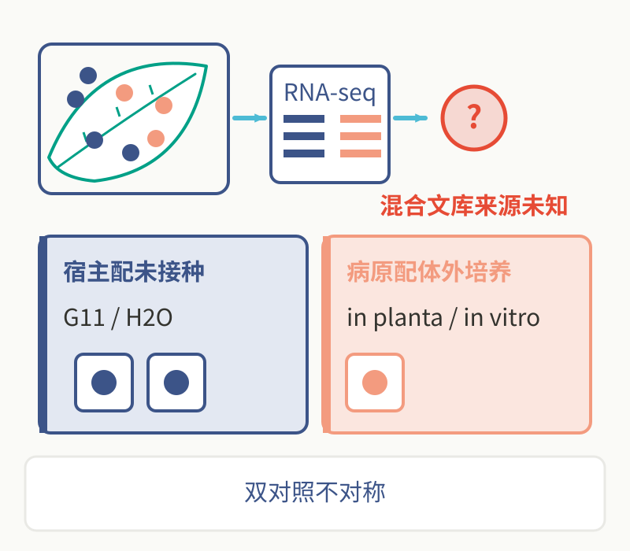

</div>
<div>

- 一片组织里两套转录本，混在一管里
- 宿主对照是同时点未接种 Mock
- 病原对照只能配体外纯培养
- 两个对照分属两套实验，却要读在同一张图上

</div>
</div>

<div class="ref">教材 §16.1、§16.4.1.3 ｜ 讲义 ③</div>

---

## 四条属性，后面每一节都要用

| 属性 | 取值 | 后果 |
|---|---|---|
| 测序形态 | 单端，每 run 一个 FASTQ | 配对端命令跑不通 |
| 文库内容 | 一片叶子里两个物种 | 归属成了第一问 |
| 病原份额 | 早期低、中晚期抬高 | 比对与分母都受影响 |
| 体量与截取 | 104 GB，默认前 200 万条 | 取头部不是随机抽样 |

<div class="ref">教材 §16.1 ｜ 06_data/phd/README.md p03 节</div>

---

## 三个问题，顺序不能颠倒

<div class="cols">
<div>

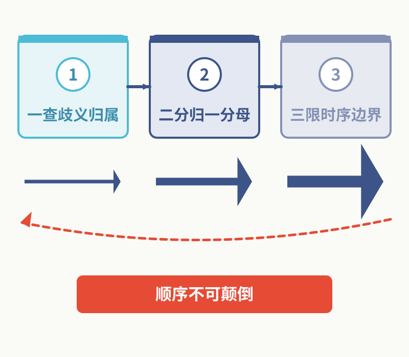

</div>
<div>

- 归谁：歧义读段算谁的，哪种错看不见
- 怎么归一：两个矩阵能不能共用一个分母
- 能问什么：时间与生物量分不开时不该写什么

</div>
</div>

<div class="ref">教材 §16.1 ｜ 讲义 ③</div>

---

<!-- _class: phd statement -->

三个问题的共同点：错了都不报错。

软件正常退出，六列表格齐全，`padj` 里有一批小于 0.05 的数。

---

## 案例：从一对基因看「候选」的边界

<div class="cols">
<div>

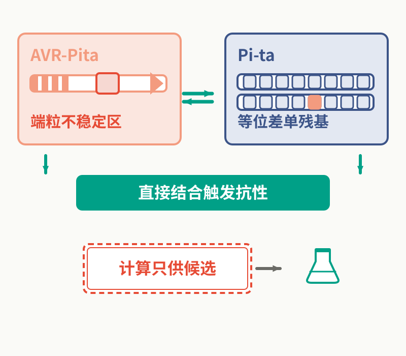

</div>
<div>

- 2000 年克隆 *AVR-Pita*，紧邻端粒
- *Pi-ta* 抗病与感病等位只差一个氨基酸
- 两蛋白直接结合，靠生化与遗传实验
- 效应子与 NLR 筛选只产出候选，不是鉴定

</div>
</div>

<div class="ref">教材 §16.1 ｜ 讲义 ③3.1</div>

---

<!-- _class: phd divider -->

<div class="num">IV</div>

# 核心原理

三个决定 · 三条路线 · 两套模型 · 两部分筛选

---

<!-- @section: principles -->
## 4.1 三个在测序之前就定下上限的决定

<div class="cols">
<div>

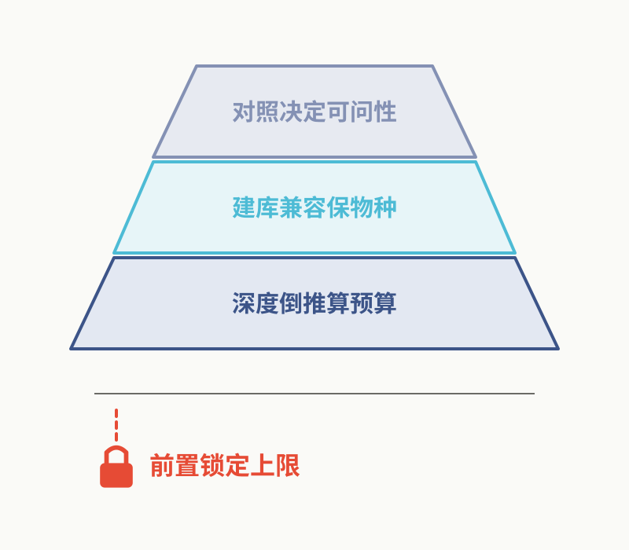

</div>
<div>

- 占比与深度：早期测不动的一笔算术
- 建库：选错就丢掉一整个物种
- 对照：缺一个，丢一类问题
- 后面所有算法都在这个上限之内工作

</div>
</div>

<div class="ref">教材 §16.4.1 ｜ 讲义 ④4.1</div>

---

## 4.1.1 早期份额低，先算一笔账

- 附着胞期约 0.1%–0.5%（经验法则，设例）
- 菌丝扩展与产孢期 10%–30%（同上）
- 病原侧要 1000 万–2000 万条计数
- 这些数只建量级感，不是普适阈值

<div class="ref">教材 §16.4.1.1 ｜ 讲义 ④4.1</div>

---

## 4.1.1 归属计数：`D_used = P / f_P`

<div class="cols">
<div>

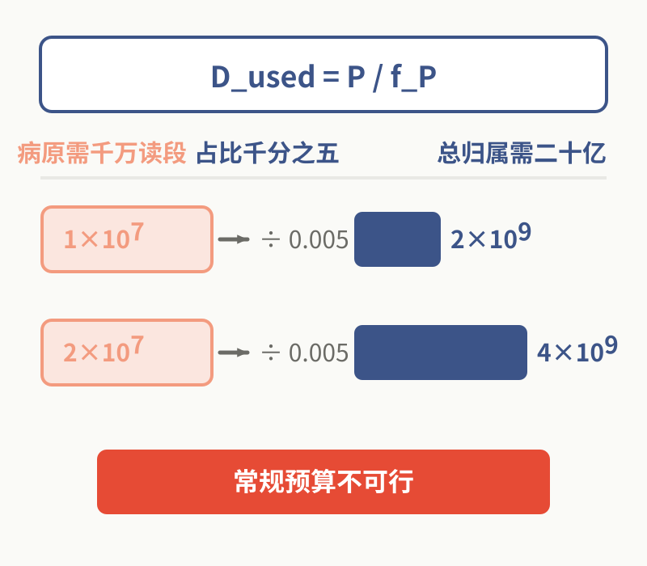

</div>
<div>

- `D_used` 是归属计数，不是总输入
- 总输入 `D = D_used / r`；分子取 `biomass.tsv`
- 分母是该样本输入读段数（STAR 日志有）
- STAR 日志的唯一比对率只是 `r` 的上界

</div>
</div>

<div class="ref">教材 §16.4.1.1 ｜ 演示 ch16_pathogen_power.py --selftest</div>

---

## 4.1.1 换算成名义深度：732× 与 1463×

<div class="cols">
<div>

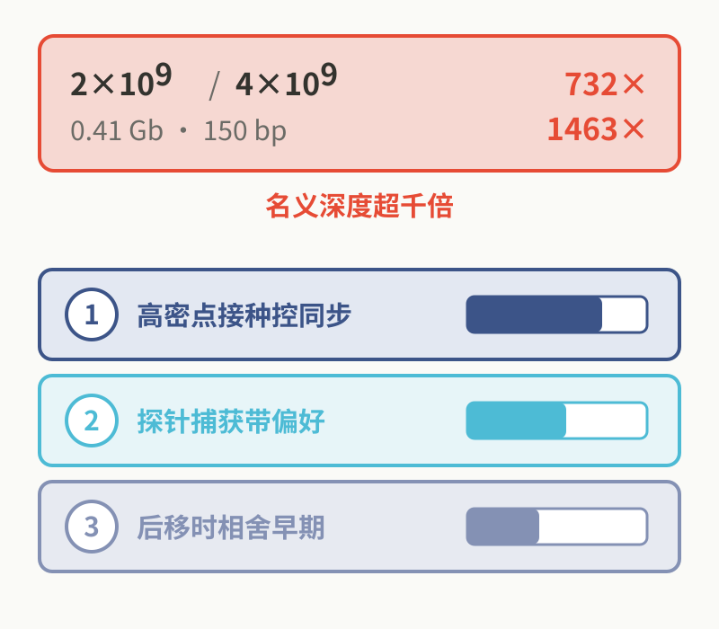

</div>
<div>

- 0.41 Gb 是复合参考量级，150 bp 为默认
- 一份样本七百到一千四百倍当量，不成立
- 三种折中：提高接种量、探针捕获、后移窗口
- 后移窗口取 2% 是经验折中值（设例）

</div>
</div>

<div class="ref">教材 §16.4.1.1 ｜ 讲义 ④4.1（读长标设例）</div>

---

## 4.1.2 建库：选错就丢掉一整个物种

<div class="cols">
<div>

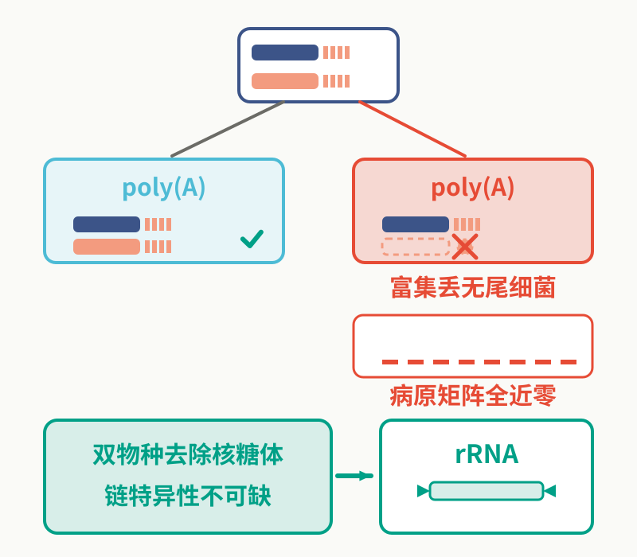

</div>
<div>

- 细菌 mRNA 缺稳定 poly(A) 尾，富集时被洗掉
- 双 rRNA 去除保留原核转录本，需更高测序量
- 链特异性本场景必需，不是可选项
- 病原侧矩阵近全零，流程不报错

</div>
</div>

<div class="ref">教材 §16.4.1.2 ｜ 讲义 ④4.1</div>

---

## 4.1.3 对照三件套，各管一类问题

<div class="cols">
<div>

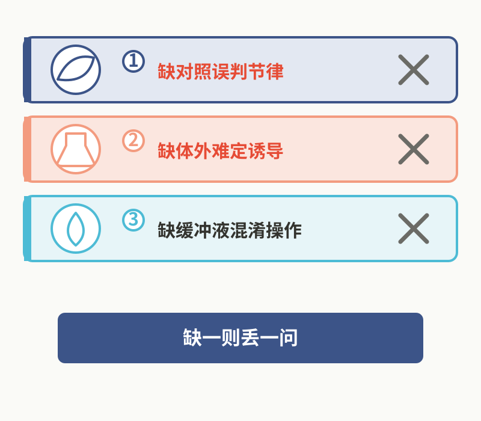

</div>
<div>

- 三件各管一类结论，缺一件就少一类
- 本数据有 Mock、没有纯培养，这条写进限制

</div>
</div>

<div class="ref">教材 §16.4.1.3、§16.6 ｜ 讲义 ④4.1</div>

---

## 4.2 一条读段的三种命运

<div class="cols">
<div>

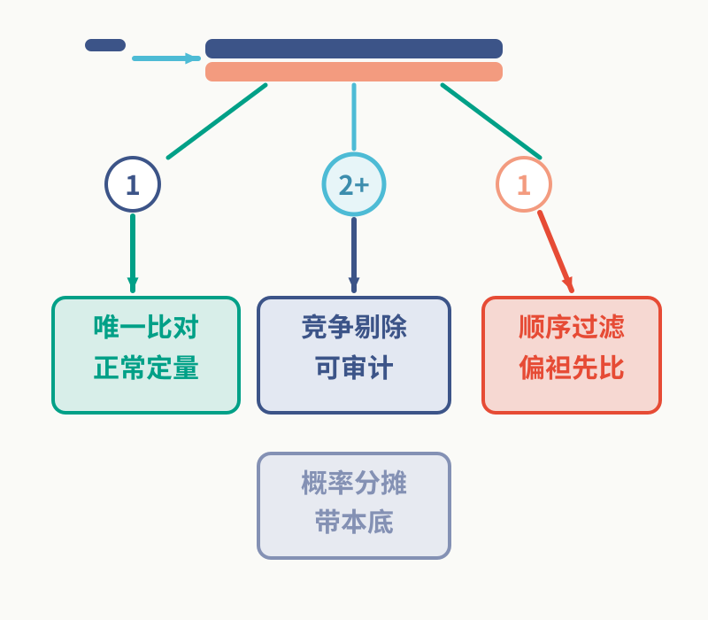

</div>
<div>

- 默认路线：合并参考竞争比对加唯一过滤
- 被剔除的比例要逐样本逐时点披露
- 分别比对后扣除也能审计，但要自己写交集
- 顺序过滤的偏倚在下游完全不可见

</div>
</div>

<div class="ref">教材 §16.4.2 ｜ 讲义 ④4.2</div>

---

## 4.2 索引内存：60 GB 是上限，不是需求

- 脚本给 `--limitGenomeGenerateRAM` 预留 60 GB
- 队列申请 `h_vmem=64G`，两个都是保护上限
- 按 ≈0.41 Gb 外推，实际在个位数 GB（量级推算）
- 集群未实测，别把它写成实测需求

<div class="ref">教材 §16.4.2 ｜ 讲义 ④4.2</div>

---

<!-- _class: phd statement -->

选路线时先问：这个「没能唯一归属」的数报不报得出来。

报不出来的那一条，偏倚在下游完全不可见。

---

## 4.3 交叉比对：一个必须自己算一遍的量级

<div class="cols">
<div>

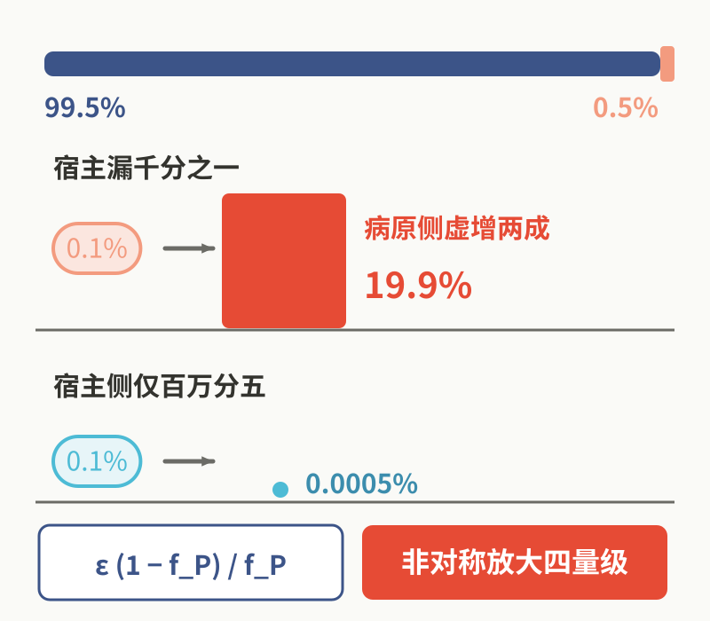

</div>
<div>

- 设例：`ε` = 0.1%，`f_P` = 0.5%
- 反方向几乎不存在：0.0005%，差四个数量级
- 真实 `ε` 未知，只能用 Mock 估上界

</div>
</div>

<div class="ref">教材 §16.4.3 ｜ 讲义 ④4.3 ｜ 演示 ch16_cross_mapping_leakage.py --selftest</div>

---

## 4.3 同一渗漏率，四档占比给出四条曲线

| `f_P` | 病原侧虚增 | 宿主侧虚增 |
|---|---|---|
| 0.5% | 19.900% | 0.0005% |
| 2.0% | 4.900% | 0.0020% |
| 10.0% | 0.900% | 0.0111% |
| 30.0% | 0.233% | 0.0429% |

<div class="ref">教材 §16.4.3 ｜ 讲义 ④4.3 ｜ 手算；同脚本 --selftest Part 0</div>

---

## 4.3 恒定的错误率，造出一条趋势线

<div class="cols">
<div>

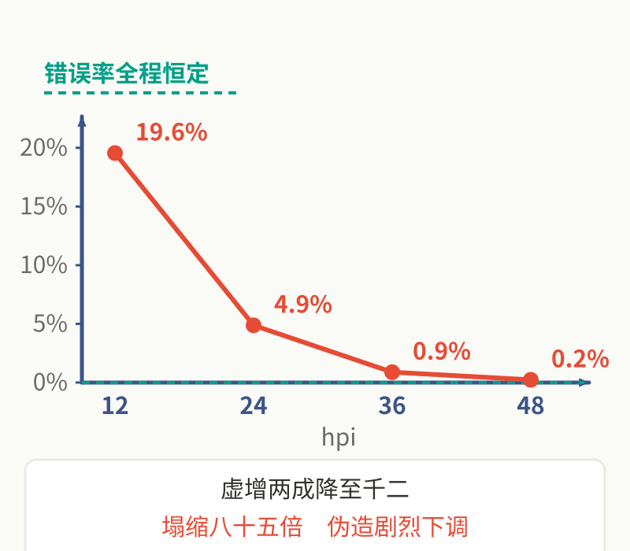

</div>
<div>

- 真实恒定的病原基因看起来「早高晚低」
- 它可能显著；错在检验之前，换检验也拦不住

</div>
</div>

<div class="ref">教材 §16.4.3 ｜ 讲义 ④4.3 ｜ 同脚本现跑（85.3）</div>

---

<!-- _class: phd quiz -->

## 课堂提问

一个恒定的技术错误率，为什么能造出一条显著的时序曲线？

---

## 4.4 合并算 TPM：两个参照系要分开说

<div class="cols">
<div>

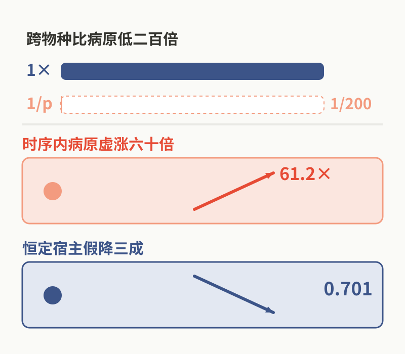

</div>
<div>

- 与各自归一化比：压低倍数就是 `1/f_P`
- 分开后同一批基因的倍数中位数是 1.023
- 两个参照系混着说，会被读成生物学差异

</div>
</div>

<div class="ref">教材 §16.4.4 ｜ 讲义 ④4.4 ｜ 演示 ch16_mixed_tpm_bias.py --selftest</div>

---

## 4.4 size factor 的方向不固定

<div class="cols">
<div>

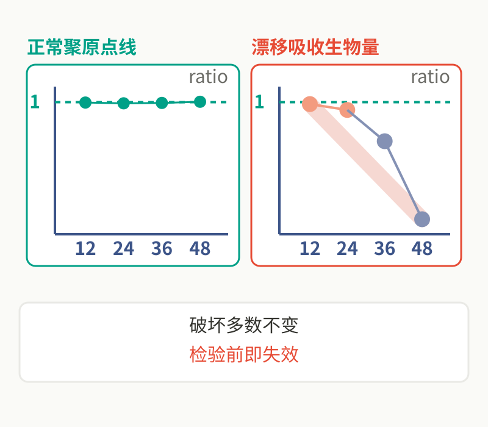

</div>
<div>

- 畸变方向取决于哪个物种占据中位数基因
- 宿主侧表面正常，病原侧被系统性放大
- 诊断：`sizeFactors` 对文库深度作散点

</div>
</div>

<div class="ref">教材 §16.4.4、§16.5.2 ｜ 讲义 ④4.4、⑥ 6.1</div>

---

## 4.4 最早那个信号，与三条降级路径

```text
every gene contains at least one zero, cannot compute log geometric means
```

- 不是 bug：早期病原侧信息量不足
- `poscounts` 只解决全零基因，不解决全局上调
- 三条降级：spike-in、RUVSeq、结论降为相对模式

<div class="ref">教材 §16.4.4 ｜ 讲义 ④4.4、⑨-E3</div>

---

## 4.5 宿主侧：必须是交互模型

<div class="cols">
<div>

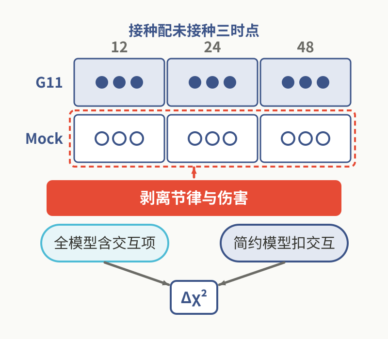

</div>
<div>

- `full` 含交互项，`reduced` 只留主效应
- 被剔除的是交互项，检验「接种改变的速率」
- 只用接种组拟合 `~ time`，节律会被读成响应
- Mock 是交互项的另一半，不是「看一眼」

</div>
</div>

<div class="ref">教材 §16.4.5 ｜ 讲义 ④4.5</div>

---

## 4.5 自由度这笔账可以自己验算

- 18 个样本、6 个系数 = 截距 1 + 处理 1 + 时间 2 + 交互 2
- 残差自由度 `18 − 6 = 12`
- 交互项占 `2 × 1 = 2` 列，`Λ` 自由度 2
- 病原侧 9 个样本、3 个系数，残差 `9 − 3 = 6`

<div class="ref">教材 §16.4.5 ｜ 手算</div>

---

## 4.5 病原侧：只有 `~ time`，结论要打折

<div class="cols">
<div>

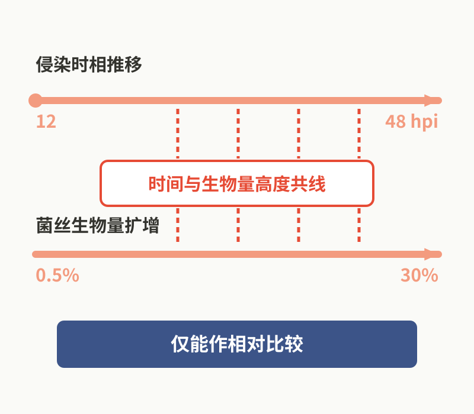

</div>
<div>

- 时间与生物量在设计上分不开
- 没有体外样本，算不出诱导倍数
- 能问的只剩时点之间的相对比较

</div>
</div>

<div class="ref">教材 §16.4.5 ｜ 讲义 ④4.5</div>

---

<!-- _class: phd warn -->
## 4.5 把 `f_P` 当协变量：两档，只有一档会喊

<div class="cols">
<div>

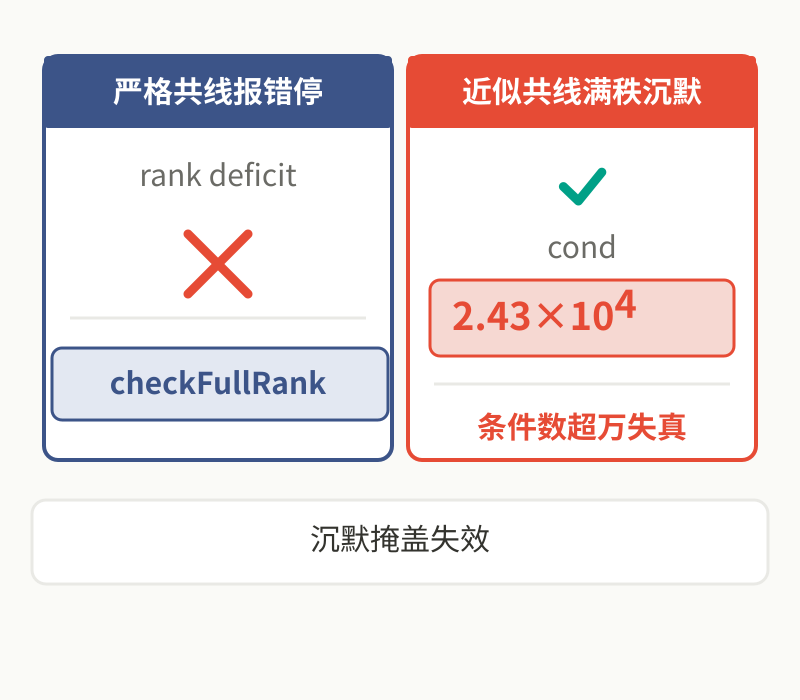

</div>
<div>

- 近似共线：系数不可辨识，标准误膨胀
- R 里用 `kappa(model.matrix(...))` 诊断
- 报告里要写「无法分离时间与生物量」

</div>
</div>

<div class="ref">教材 §16.4.5、§16.5.5 ｜ 讲义 ⑨-E4</div>

---

## 4.6 效应子三步：各漏掉哪一类真效应子

<div class="cols">
<div>

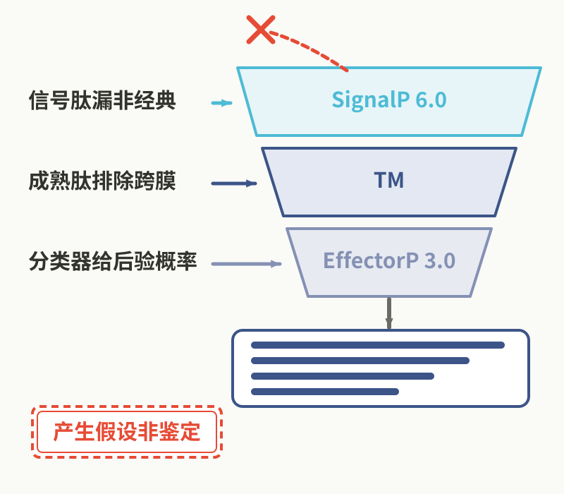

</div>
<div>

- SignalP 只认经典分泌，T3SS 全失效
- 跨膜排除在成熟肽上做，否则误杀
- EffectorP 训练集偏倚，阴性无排除力

</div>
</div>

<div class="ref">教材 §16.4.6 ｜ 讲义 ④4.7</div>

---

## 4.6 成熟肽与列序：两处一位之差

<div class="cols">
<div>

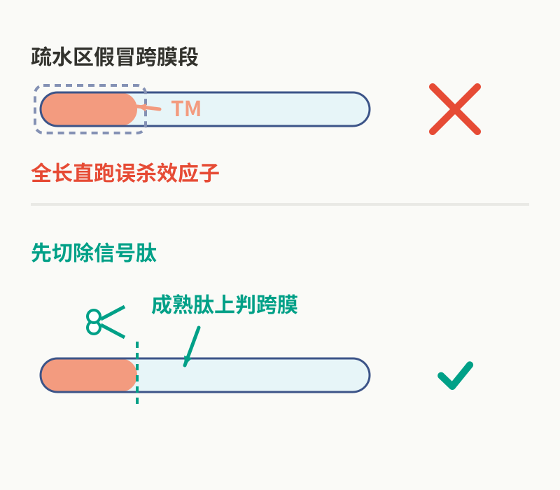

</div>
<div>

- `CS pos: 17-18` ⇒ 切掉 17 个残基
- 成熟肽首残基是第 18 位（17 + 1）
- `prediction_results.txt` 第 4 列才是信号肽概率

</div>
</div>

<div class="ref">教材 §16.4.6、§16.5.4 ｜ 讲义 ④4.7</div>

---

## 4.6 量级自检：三千与个位数都是输入错

<div class="cols">
<div>

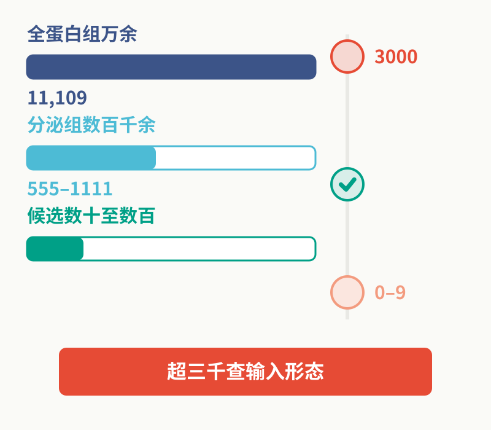

</div>
<div>

- 70-15 注释给出 11,109 个编码蛋白基因
- 三千以上查输入形态，个位数查物种界选项

</div>
</div>

<div class="ref">教材 §16.4.6 ｜ 讲义 ④4.7</div>

---

## 4.6 预测与鉴定之间隔着四层实验

- 分泌活性：转化酶类分泌筛选
- 瞬时表达：本氏烟上的表型
- 定位：荧光融合看它去了哪
- 遗传学：敲除后的致病力测定

> 在此之前只能写「预测并排序了 N 个候选效应子」。

<div class="ref">教材 §16.4.6 ｜ 讲义 ④4.7</div>

---

## 4.7 抗性基因：找到的是结构域，不是功能

<div class="cols">
<div>

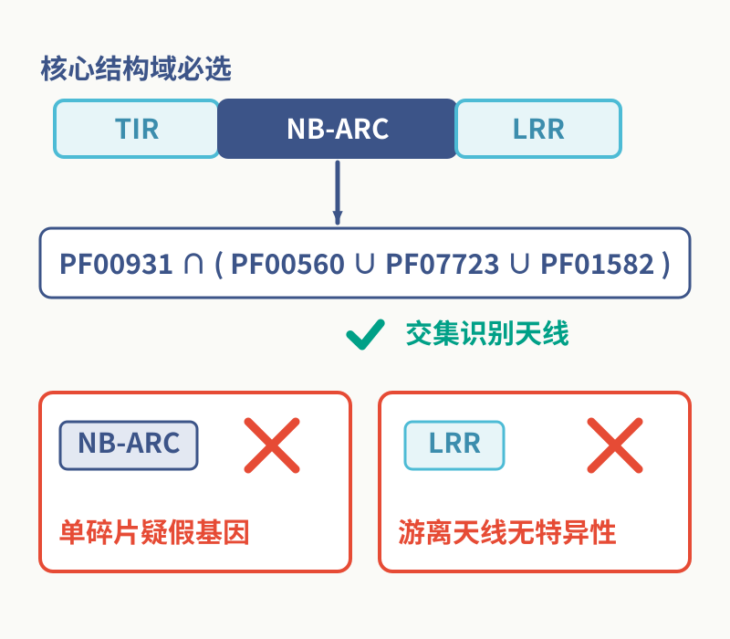

</div>
<div>

- `PF00931`＝NB-ARC，`PF00560`/`PF07723`＝LRR
- 只有 LRR 或 TIR 命中、没有 NB-ARC 不算
- 命中是结构域证据，不是功能证据

</div>
</div>

<div class="ref">教材 §16.4.7 ｜ 脚本用 comm -12 实现</div>

---

## 4.7 三条边界与这条数据的位置

- 命中不等于完整基因：要查结构域覆盖度
- 注释会漏 NLR：核酸层面回补
- 表达数据只说明在哪表达，不证明功能

> 教学子集只有感病品种日本晴，做不了抗/感等位比较。

<div class="ref">教材 §16.4.7、§16.6 ｜ 讲义 ④4.8</div>

---

## 4.7 别用「侵染后上调」筛 R 基因

<div class="cols">
<div>

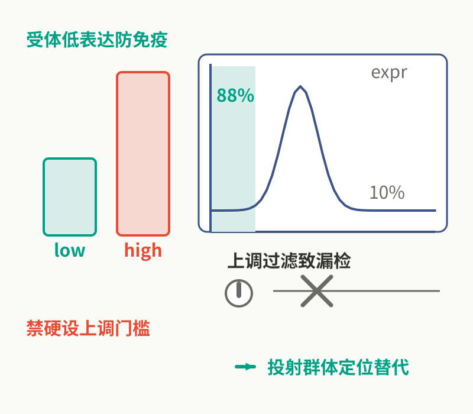

</div>
<div>

- 过表达会引发自身免疫与适合度代价
- 「侵染上调」当硬门槛会漏掉核心 NLR
- 替代交集：抗/感材料比较，或投射到 QTL/GWAS

</div>
</div>

<div class="ref">教材 §16.4.7 ｜ 讲义 ④4.8</div>

---

## 4.8 技术前沿（2023–2026）：三个方向

- 直接 RNA 测序：给异构体结构，不给丰度
- 蛋白质语言模型：换表征，不换训练集覆盖
- 株内演化：组织样本的病原只是一个平均值

<div class="ref">教材 §16.4.8 ｜ 讲义 ④4.10</div>

---

<!-- _class: phd divider -->

<div class="num">V</div>

# 操作流程

三个脚本，顺序不能颠倒

---

<!-- @section: procedure -->
## 操作流程骨架：按依赖排，不按章号排

<div class="cols">
<div>

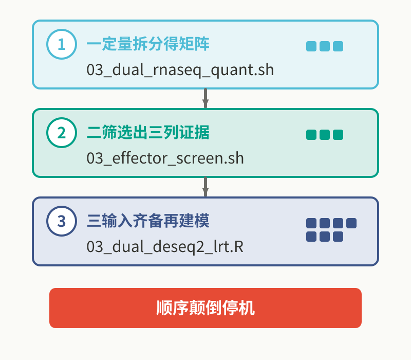

</div>
<div>

- 讲义 ⑤ 按知识点排，脚本按依赖排
- R 脚本后三个输入由筛选脚本产出，先跑会停
- 全部 `qsub`，禁止在登录节点直接跑

</div>
</div>

<div class="ref">教材 §16.6 ｜ 讲义 ⑤ 5.2–5.6 ｜ 脚本三件</div>

---

## 5.2 双参考：先加前缀，再拦两条名单

```bash
seqkit replace -p '^' -r 'HOST_' host.fa > host.pfx.fa
seqkit replace -p '^' -r 'PATH_' path.fa > path.pfx.fa
cat host.pfx.fa path.pfx.fa > dual.fa
awk 'BEGIN{OFS="\t"} !/^#/{$1="HOST_"$1} 1' host.gtf > dual.gtf
awk 'BEGIN{OFS="\t"} !/^#/{$1="PATH_"$1} 1' path.gtf >> dual.gtf
```

- 两条名单非空即 FATAL：重名、GTF 与 FASTA 不一致
- `samtools faidx` 只建索引，遇重名只警告、不替你拦
- 建完对账：`.fai` 行数应等于 FASTA 条数

<div class="ref">教材 §16.5.1 ｜ 讲义 ⑤ 5.2</div>

---

## 5.3 建索引：先看内存上限对不对

```bash
STAR --runMode genomeGenerate --genomeDir dual_idx \
     --genomeFastaFiles dual.fa --sjdbGTFfile dual.gtf \
     --sjdbOverhang 149 --runThreadN 16 \
     --limitGenomeGenerateRAM 60000000000
```

- 预留值必须小于队列申请的 `h_vmem`
- 名字是 `--limitGenomeGenerateRAM`，不是排序那一个

<div class="ref">教材 §16.5.3 ｜ 讲义 ⑤ 5.3</div>

---

## 5.3 单端比对：本数据只给一个文件

```bash
STAR --genomeDir dual_idx --readFilesIn "${R1}" \
     --readFilesCommand zcat --runThreadN "${NSLOTS:-16}" \
     --quantMode GeneCounts --outFilterMultimapNmax 1
```

- 单端只给 R1 一个文件；R2 列写 `-` 或 `NA`
- 文件名取自样本表 R1 列（截取模式带 `.sub`）
- 留空会让后面的列整体前移，报「找不到读段文件」
- 漏写 `--runThreadN` 就是单线程占着 16 核

<div class="ref">教材 §16.5.3 ｜ 讲义 ⑤ 5.3</div>

---

## 5.3 拆分与披露：这一列要逐时点报

- 按前缀拆：`ReadsPerGene` 第 1 列带 `HOST_`/`PATH_`
- 第 2/3/4 列是无链/正链/反链，选错全是噪声
- `multimap_pct` 写进 `biomass.tsv`，逐样本逐时点
- 它是混合指标，不能直接读成「跨物种歧义多严重」

<div class="ref">教材 §16.4.2、§16.5.3 ｜ 讲义 ⑤ 5.3</div>

---

## 5.4 两个容器，两套模型

```r
dds_h <- DESeqDataSetFromMatrix(cts_h, coldata,
           design = ~ treatment + time + treatment:time)
dds_p <- DESeqDataSetFromMatrix(cts_p[, inoc], cd_p, design = ~ time)
dds_h <- estimateSizeFactors(dds_h)
dds_p <- estimateSizeFactors(dds_p, type = "poscounts")
```

- `treatment` 必须 `relevel(..., ref = "mock")`
- `DESeq()` 不写 `full=` 时，全模型取 `design(dds)`
- 先看诊断图，再看任何 p 值

<div class="ref">教材 §16.4.4–§16.4.5 ｜ 讲义 ⑤ 5.4</div>

---

## 5.5 三步筛选：输入文件别拿错

```bash
orthofinder -f proteomes/ -t 16 -a 4 -S diamond -o ortho_out
signalp6 --fastafile path_prot.faa --organism eukarya \
         --format none --output_dir sp_out --mode fast
python EffectorP.py -i mature_noTM.faa -o effectorP.tsv
hmmscan --cpu 8 -E 1e-5 --domtblout nlr.domtbl Pfam-A.hmm host_prot.faa
```

- EffectorP 的输入是跨膜排除后的成熟肽
- 每株一个 `.faa`，必须同一注释流程、同一版本
- 「物种特异」是相对输入集合而言：第 11 章 §11.4.8

<div class="ref">教材 §16.4.6 ｜ 脚本 03_effector_screen.sh</div>

---

## 5.6 候选排序表：三列证据等权

- `log2(baseMean + 1)` 的秩
- SignalP 信号肽概率的秩
- 菌株特异基因的 0/1 标记
- `effectorp_prob` 与 `padj` 只作原始列输出

> 权重是主观选择，报告里必须写明用了什么权重与理由。

<div class="ref">教材 §16.4.6 ｜ 讲义 ⑤ 5.6 ｜ 脚本 03_dual_deseq2_lrt.R</div>

---

<!-- _class: phd divider -->

<div class="num">VI</div>

# 结果解读

四样核心产物 · 三类异常 · 六条限制

---

<!-- @section: interpretation -->
## 6.1 先看四样核心产物，再打开结果表

| 产物 | 正常形态 |
|---|---|
| 生物量曲线 | 接种组上升，Mock 接近 0 |
| 归一化散点 | 落在过原点直线附近 |
| 时序 LRT | 早期应激、持续防卫、晚期坏死 |
| 候选表 | 数十至数百条，含四列原始证据 |

- 第 5 样是泛基因组统计，属第 11 章

<div class="ref">教材 §16.6 ｜ 讲义 ⑥ 6.1</div>

---

<!-- _class: phd warn -->
## 6.1 结果不对（一）：生物量曲线

<div class="cols">
<div>

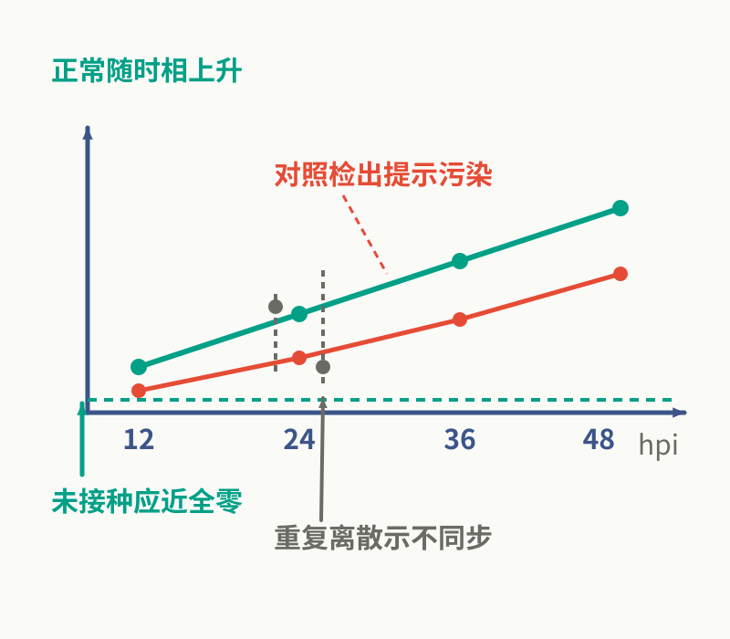

</div>
<div>

- 本课未实测具体百分比，只给定性判据
- 两侧计数和为 0 的行，占比是占位值，记缺失

</div>
</div>

<div class="ref">教材 §16.6 ｜ 06_data/phd/README.md 自查判据</div>

---

<!-- _class: phd warn -->
## 6.1 结果不对（二）：归一化诊断

- 点沿侵染时点单调漂移
- 说明 size factor 在吸收生物量
- 先回 §16.4.4 的三条降级路径
- 宿主侧「全基因组下调」先怀疑分母

<div class="ref">教材 §16.5.2 ｜ 讲义 ⑥ 6.1</div>

---

<!-- _class: phd warn -->
## 6.1 结果不对（三）：候选表

| 现象 | 先查什么 |
|---|---|
| 三千条以上 | 是不是喂了全长或核酸序列 |
| 只有个位数 | 物种界选项是否配错 |
| 排序整体反向 | 取的是第 3 列还是第 4 列 |
| 大量 NA | ID 前缀没对齐 |

<div class="ref">教材 §16.4.6、§16.5.4 ｜ 讲义 ⑨-E8</div>

---

## 已知限制：用到这些数据就要带着写

- 没有病原体外纯培养样本，算不出诱导倍数
- 子集只有日本晴，做不了抗/感等位比较
- 单端加流式截取：绝对丰度类结论不可靠
- 病原侧只有 9 个接种样本，能问的有限

> 本章没有在集群上复跑这份数据，真实样本层面的判断标 unverified。

<div class="ref">教材 §16.6 ｜ 讲义 ④4.5、⑥ 6.1</div>

---

<!-- _class: phd divider -->

<div class="num">VII</div>

# AI 辅助任务

先提问，再逐条核查

---

<!-- @section: ai_task -->
## AI 任务：原样提问，不要预先提示

> "我有植物和真菌病原同时测序的 Dual RNA-seq 侵染时序数据（4 个时相，每时相 3 个接种重复与 3 个水处理对照）。请给出用 STAR、Salmon 与 DESeq2 完成读段拆分、定量与时序差异分析的完整代码。"

- 提示词故意不提单端，也不说 Mock 该进哪个模型
- 目的不是看它会不会写命令，而是看它踩不踩坑

<div class="ref">教材 §16.4.2、§16.4.4 ｜ 讲义 ⑧</div>

---

## 四条核查：每条都要判定与证据

| # | 核查点 | 不合格的表现 |
|---|---|---|
| 1 | 有没有提交叉比对与归属 | 只说先比宿主再比病原 |
| 2 | 归一化有没有合并两物种 | 一个矩阵里算 TPM |
| 3 | 有没有意识占比随时间变 | 一视同仁估 size factor |
| 4 | 参数与实际版本是否一致 | LRT 没配 `reduced` |

- 判定要写「怎么发现的」，不能只写「有错」

<div class="ref">教材 §16.4.2、§16.4.4、§16.5.3 ｜ 讲义 ⑧</div>

---

<!-- _class: phd divider -->

<div class="num">VIII</div>

# 常见错误

报错的两类，不报错的一类

---

<!-- @section: troubleshooting -->
<!-- _class: phd warn -->
## 常见错误一：重名与 GTF 未同步

<div class="cols">
<div>

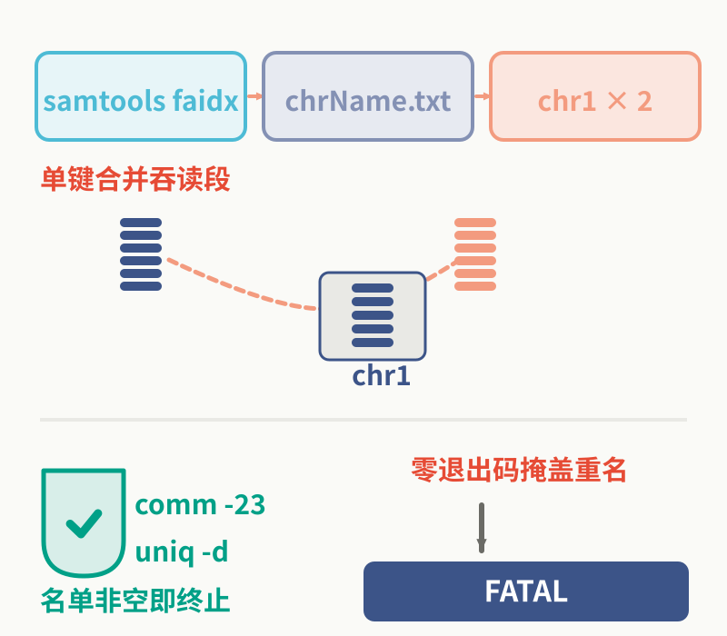

</div>
<div>

- `[W::fai_insert_index]` 只警告，退出码是 0
- 索引里只留第一条，半个基因组的读段合进一个键
- 拦住它靠两条名单，不靠 faidx 或 STAR
- 报错原文取自本机，课程 pin 下未复跑（unverified）

</div>
</div>

<div class="ref">教材 §16.5.1 ｜ 讲义 ⑨-E1</div>

---

<!-- _class: phd warn -->
## 常见错误二：病原侧 size factor 估不出来

```text
every gene contains at least one zero, cannot compute log geometric means
```

- 不是 bug：早期病原侧信息量不足
- `type = "poscounts"`，或只建模到占比达标的时点
- 不要用 `rowSums > 0` 草草了事

<div class="ref">教材 §16.5.2 ｜ 讲义 ⑨-E3</div>

---

<!-- _class: phd warn -->
## 常见错误三：把占比当协变量

```text
Error in checkFullRank(modelMatrix) : the model matrix is not full rank
```

- 报错是在救你：两个变量在数据里是同一个
- 近似共线那一档不报错，结论照样不成立
- 出路：spike-in、结论降级、或改体外为参照

<div class="ref">教材 §16.5.5 ｜ 讲义 ⑨-E4</div>

---

## 排查路标：按阶段归位

| 阶段 | 现象 | 去哪 |
|---|---|---|
| 建索引 | 重名、GTF 未命中 | §16.5.1 |
| 建模 | 全零基因、秩亏 | §16.5.2、§16.5.5 |
| 筛选 | 候选量级异常、列序反 | §16.5.4 |
| 输入 | 找不到读段文件（FASTQ） | §16.5.3 |

<div class="ref">教材 §16.5 ｜ 讲义 ⑨</div>

---

<!-- _class: phd divider -->

<div class="num">IX</div>

# 课后

任务卡 · 思考练习 · 实验指导

---

<!-- @section: wrapup -->
## 实践任务卡（2 h）：顺序不能颠倒

| 序 | 脚本 | 本步要拿到的结论 |
|---|---|---|
| 1 | `03_dual_rnaseq_quant.sh` | 两条名单为空、Mock 本底很低 |
| 2 | `03_effector_screen.sh` | 三步漏斗每一级的数量 |
| 3 | `03_dual_deseq2_lrt.R` | 先诊断图，再两套 LRT |

- R 脚本后三个输入由筛选脚本产出，先跑会停
- 交付：报告、两根计数矩阵、候选表与四列证据

<div class="ref">教材 §16.6 ｜ 讲义 ⑤ ｜ 作业 p03</div>

---

## 思考练习：讲义 ⑩ 七题，课堂讨论三题

- 习题 4：0.8% 占比、0.08% 渗漏，虚增多少（设例）
- 习题 9：用「侵染上调」筛 NLR 会漏掉哪一类
- 习题 11：600 字以内，回答五问

<div class="ref">教材 §16.7 习题 4、9、11 ｜ 讲义 ⑩</div>

---

## 实验指导与收尾

- 上机时手边打开 `11_lab_guides/phd/03_host_pathogen_lab.md`
- 演示脚本在课程仓库根目录运行：`python3 textbook/demos/...`
- 文献只给指针（讲义 ⑪ 二十条），本 deck 不重复列

**交出去的是一份带边界说明的候选表，不是机制。**

<div class="ref">教材 §16.6 ｜ 讲义 ⑩、⑪</div>
