<!-- @section: cover -->
<!-- _class: phd cover -->

# 专题 p04：群体遗传学基础与群体基因组

**命令三行就抄得到；能说出一个统计量在什么条件下会骗你，才是博士层的出口。**

<div class="meta">

- 4 学时（2 h 理论 + 2 h 实践）｜ 环境 `ngs_phd_popgen`
- 讲义 `02_lectures/phd/topic04_popgen/04_popgen_lecture.md`
- 教材 §20.1–§20.9 ｜ 主线 `PRJEB53625` 的 40 个单倍体分离株
- 脚本 `04_popgen_qc_diversity.sh` ｜ `04_popgen_structure.sh` ｜ `04_ld_decay_plot.R`

</div>

---

<!-- _class: phd divider -->

<div class="num">I</div>

# 学习目标

四项核心目标（LO20-01–LO20-04），另加一项硕士衔接选读（LO20-05）

---

<!-- @section: objectives -->
## 学完你应当能够（一）：频谱与分化

- 说明单倍体 θ = 2N<sub>e</sub>μ 与二倍体的差别
- 推导 E[π] = E[θ<sub>W</sub>]，解释 D 的符号
- 只用全基因组经验分位数判离群，不用绝对截断
- 认列名分清 `WEIGHTED_FST` 与 `MEAN_FST`

<div class="ref">教材 §20.2 LO20-01、LO20-03 ｜ §20.4.1–§20.4.2</div>

---

## 学完你应当能够（二）：结构、LD 与交付

- 说明单倍体数据上 `--hwe` 为什么没有对象
- 用 H<sub>exp</sub> − H<sub>obs</sub> = 2Var(p) 判断 Wahlund
- 由 LD 半衰倒推窗宽与标记密度下限
- 把两套产物与披露项整理成交付包

<div class="ref">教材 §20.2 LO20-02、LO20-04 ｜ §20.4.3–§20.4.7、§20.6</div>

---

<!-- _class: phd divider -->

<div class="num">II</div>

# 前置检查

五个 L0 模块，一个 L1 补丁

---

<!-- @section: prerequisites -->
## 前置检查：缺哪一块会卡在哪

| 模块 | 本讲用在哪 | 不过关的症状 |
|---|---|---|
| `l0_01_linux` `l0_03_conda` | ADMIXTURE 多 K 走 `qsub` | 登录节点跑，被清退 |
| `l0_04` `l0_02` | VCF→PLINK；LD 与 CV 曲线作图 | 画不出按分组着色的散点 |
| `l0_06_stats` | 多重检验、分层混杂 | 用 p&lt;0.05 做全基因组过滤 |
| 硕士层 m03 | 整讲输入是群体 VCF | 说不出 `1` 与 `.` 各占多少 |

- 补课入口：m03 §6.2 VCF 格式与变异过滤；自测题 Q1/Q2 见 `l1_phd`

<div class="ref">教材 §20.3 ｜ 讲义 ② ｜ 自测题号见讲义的模块表</div>

---

## 30 秒自查：只查有没有，不查版本号

```bash
source "${CONDA_ROOT:-/opt/miniconda3}/bin/activate" ngs_phd_popgen
for t in bcftools vcftools plink tabix bgzip admixture Rscript; do
  command -v $t; done
command -v treemix || echo "缺 treemix：结构脚本自己也不查它"
```

- 有 pin：plink 1.90b6.21、bcftools 1.17、bedtools 2.31.0、R 4.3.1
- 未 pin：vcftools、ADMIXTURE、TreeMix → 方法学里不写版本号

<div class="ref">教材 §20.3 ｜ 07_envs/conda/env_phd_popgen.yml ｜ 讲义 ②</div>

---

<!-- _class: phd divider -->

<div class="num">III</div>

# 主线数据与科学问题

40 个单倍体分离株，四个改口径

---

<!-- @section: background -->
## 一个物种的许多个体：问的是频率

- 单个体问「这个体跟参考差在哪」
- 群体问「这个频率为什么是这个数」
- π、θ<sub>W</sub>、D、F<sub>ST</sub>、r² 全是频率的函数
- 所以没有单一统计量能摘出选择

<div class="ref">教材 §20.1 ｜ 讲义 ③</div>

---

## 单倍体把这个讲的四个参数都改了

<div class="cols">
<div>

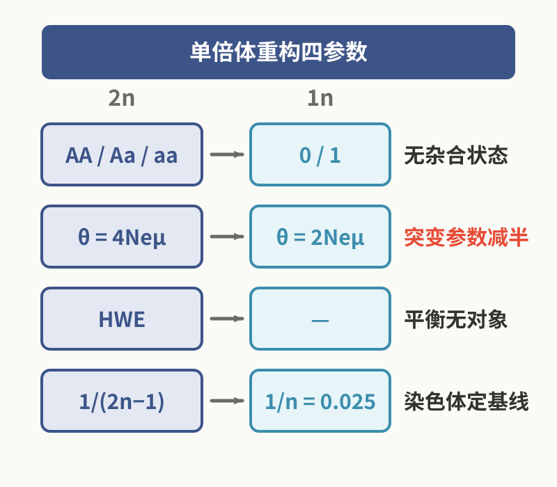

</div>
<div>

- 文献的 4N<sub>e</sub>μ 要按倍性换算
- 40 株即 40 条染色体，基线 0.025
- 四处口径要一次改完，改一处不够

</div>
</div>

<div class="ref">教材 §20.1「四处必须改口径」｜ §20.2 LO20-01、LO20-02</div>

---

## 主线数据：40 株、40 Mb、11.5×

<div class="cols">
<div>

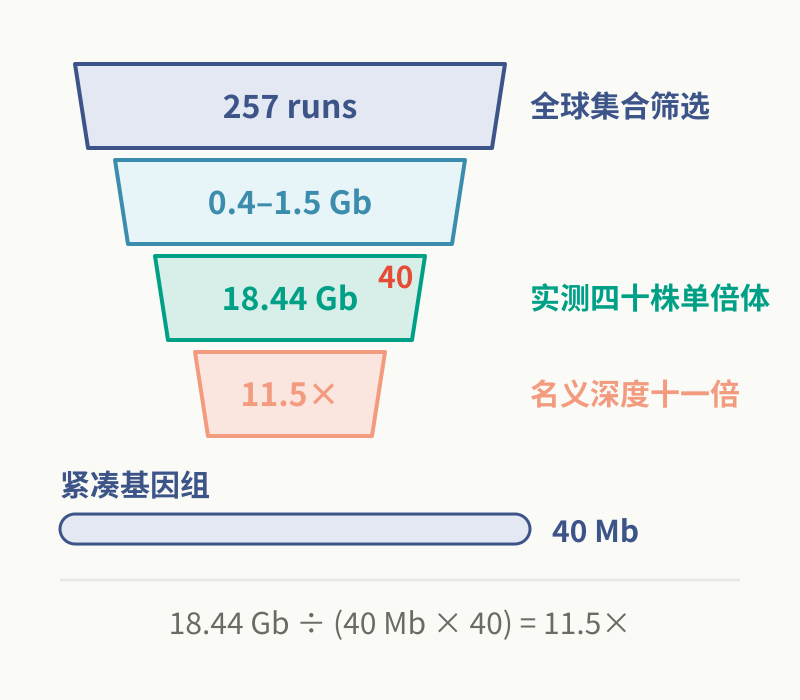

</div>
<div>

- `PRJEB53625`：全球分离株集合
- 40 行 40 唯一，按 `base_count` 筛出
- 名义深度 11.5×：总碱基 ÷（40 Mb × 40）

</div>
</div>

<div class="ref">教材 §20.1 ｜ manifest 实查 ｜ 06_data/phd/README.md p04 节</div>

---

<!-- _class: phd statement -->

能支撑「大致分几群、分化什么量级、LD 有多长」。

不能支撑某个亚群内部的精细扫描：每群只剩十几条序列。

---

<!-- _class: phd figure -->

## 同一条链路的最大版本：3010 份水稻


图面「大两个数量级」按 75.25 倍读；候选区间数正文不引用

<div class="ref">教材 §20.1 图 20-1 ｜ 讲义 ③ 3.1</div>

---

## 从 3010 份到 40 株：差的是样本量，不是链路

- 3010 / 40 = 75.25（手算，不是 100 倍）
- 组内对照是设计出来的：现代种对农家种
- 扫描产出绝大部分是候选，不是结论
- 样本量小，对统计假设违例反而更敏感

<div class="ref">教材 §20.1 图 20-1 读法 ｜ 讲义 ③ 3.1</div>

---

<!-- _class: phd divider -->

<div class="num">IV</div>

# 核心原理

频谱 · 分化 · 平衡 · 连锁 · 结构

---

<!-- @section: principles -->
## 三个读数：π 看多少，θ<sub>W</sub> 看几个，D 看形状

<div class="cols">
<div>

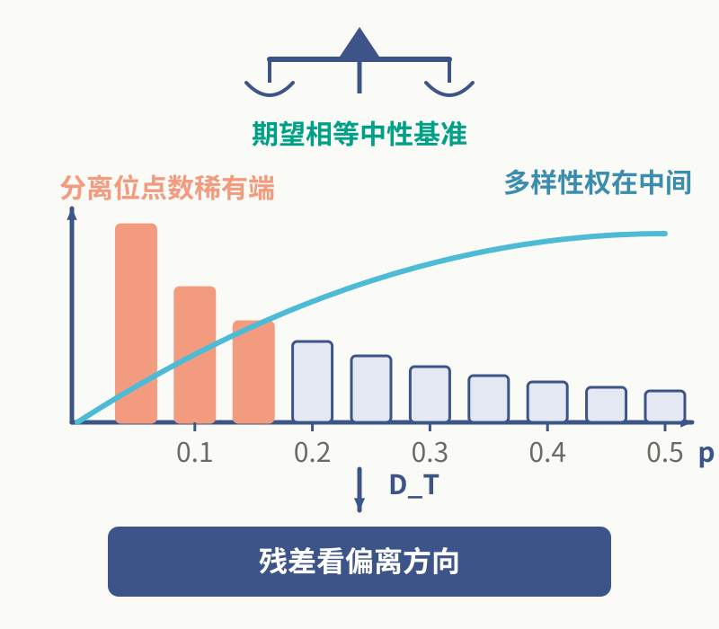

</div>
<div>

- 频谱是全章统计量共用的同一底座
- θ<sub>W</sub> 只数位点存在性，不看柱子高低
- a<sub>n</sub> = Σ<sub>i=1</sub><sup>n−1</sup> 1/i；n = 40 得 4.2535（手算）

</div>
</div>

<div class="ref">教材 §20.4.1 ｜ 讲义 ④ 4.1</div>

---

<!-- _class: phd statement -->

θ = 2N_e μ（单倍体）｜ 4N_e μ（二倍体，文献常见）

θ = 0.010、μ = 2×10⁻⁹：单倍体 0.010/(2μ) = 2.5×10⁶；二倍体 0.010/(4μ) = 1.25×10⁶。

---

## D 的符号只说频谱哪一头过了量

<div class="cols">
<div>

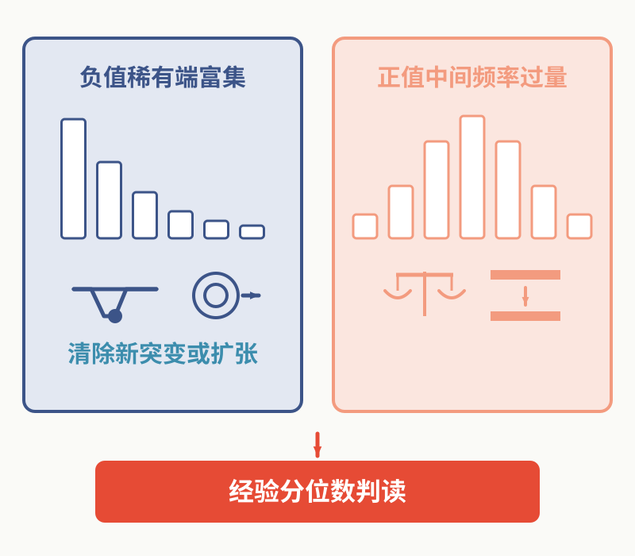

</div>
<div>

- 选择作用于局部，群体历史作用于全基因组
- 只用经验分位数：top 1%，严格时 top 0.5%

</div>
</div>

<div class="ref">教材 §20.4.1 ｜ 讲义 ④ 4.1</div>

---

## 手算一次符号：n = 4、L = 3（1/1/1 对照 1/1/2）

<div class="cols">
<div>

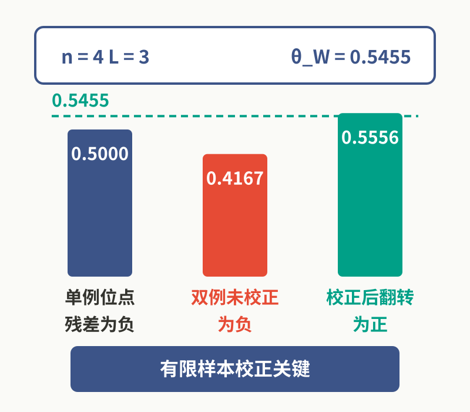

</div>
<div>

- 少写一个有限样本校正，符号就翻转
- 小样本手算最容易错在这里

</div>
</div>

<div class="ref">教材 §20.4.1 手算 ｜ 可用计算器复核</div>

---

## F<sub>ST</sub>：三个内核给三个不同的数

<div class="cols">
<div>

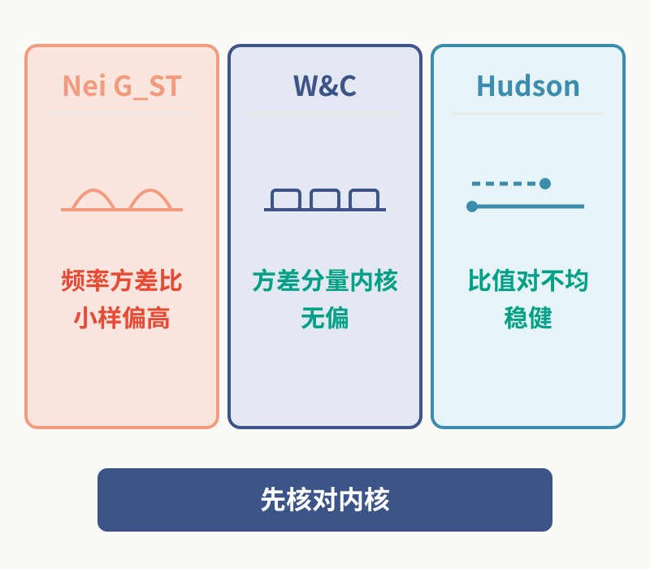

</div>
<div>

- 横向比较前：先核估计量，再核 MAF 阈值
- 主结果走 `--weir-fst-pop` 的方差分量内核

</div>
</div>

<div class="ref">教材 §20.4.2 ｜ 讲义 ④ 4.2</div>

---

## 比选内核更容易错的是求平均的次序

<div class="cols">
<div>

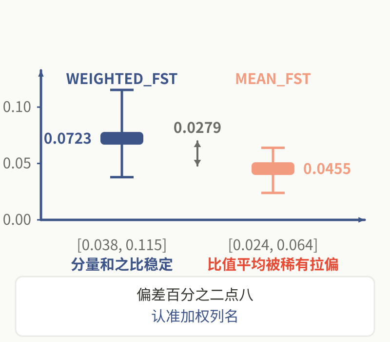

</div>
<div>

- 主结果只报 `WEIGHTED_FST` 列
- N、D 是分子分母项，不是 LD 的 D
- `MEAN_FST` 被稀有位点放大极端值
- 只看常见变异，偏差降到 0.0067

</div>
</div>

<div class="ref">教材 §20.4.2、§20.5.1 ｜ `ch20_fst_average_trap.py --selftest`</div>

---

## MAF 从两个方向改 F<sub>ST</sub>，方向相反

<div class="cols">
<div>

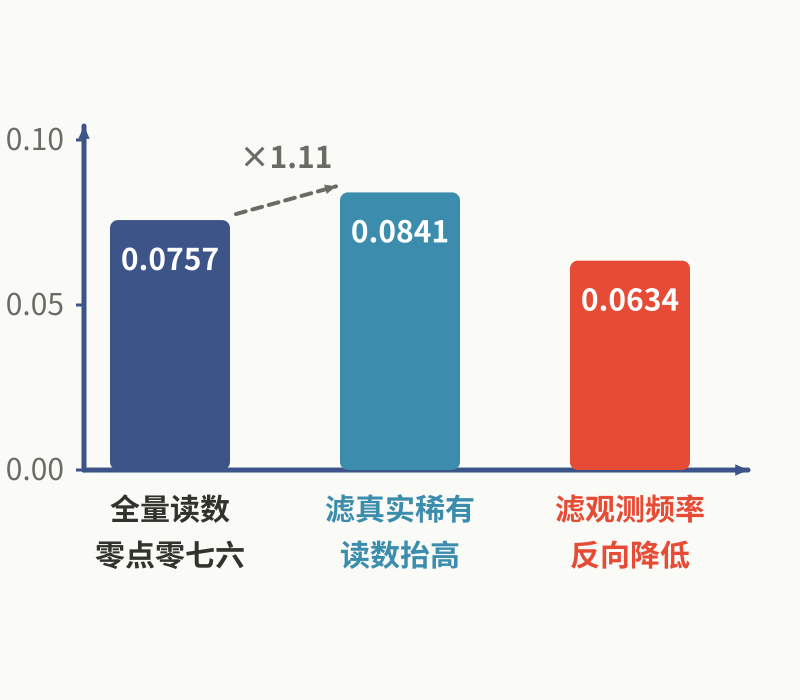

</div>
<div>

- 稀有档单独看只有 0.0022
- 方法学写清「按真实频率」还是「按观测频率」

</div>
</div>

<div class="ref">教材 §20.4.2 ｜ `ch20_fst_average_trap.py --selftest`</div>

---

## HWE 检验只检验杂合子数量

<div class="cols">
<div>

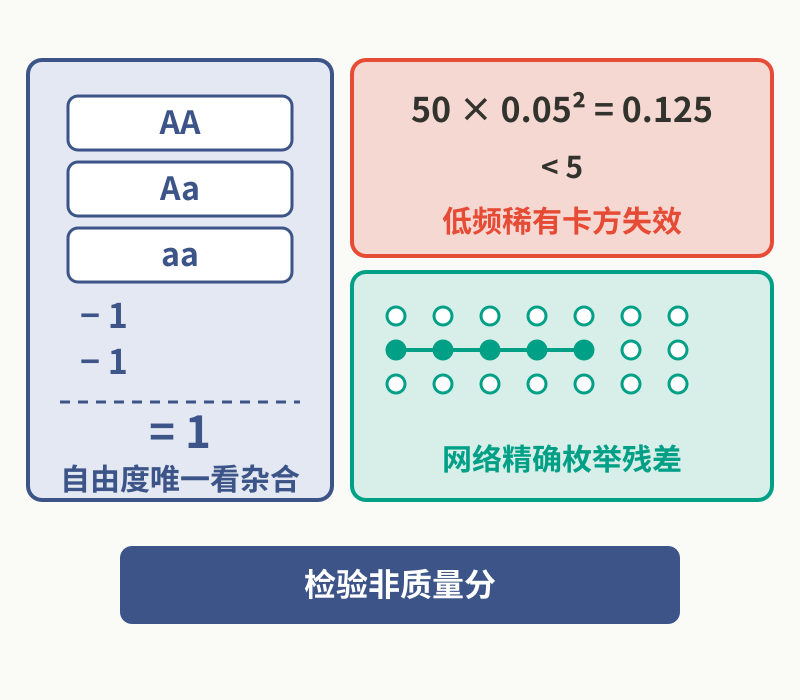

</div>
<div>

- 全基因组改用精确检验（`--hardy` 是这一类）
- 期望频数不到 5，卡方 p 值已经不算检验结果

</div>
</div>

<div class="ref">教材 §20.4.3 ｜ 讲义 ⑦ 7.1</div>

---

## 10⁻⁶ 是约定，不是常数

| 算式 | 结果 | 说明 |
|---|---|---|
| 10⁶ × 0.05 | 5 万 | 百万位点按 0.05 的假阳性数 |
| 0.05 ÷（5×10⁴） | 10⁻⁶ | 有效独立块约 5 万个 |

- 10⁻⁶ 是经验档位，不是推导出来的常数
- 报阈值时把 M<sub>eff</sub> 的口径一起写
- M<sub>eff</sub> 的粗略上界：剪枝后标记数 `NPRUNE`

<div class="ref">教材 §20.4.3 ｜ 脚本 `04_popgen_structure.sh` 交付行</div>

---

## 偏离只有两个方向，成因分两族

<div class="cols">
<div>

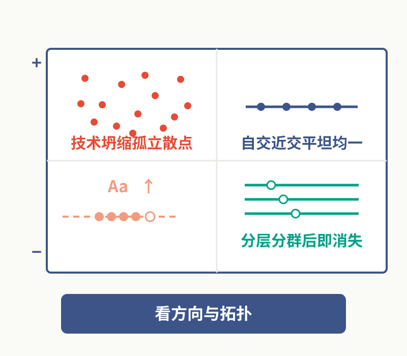

</div>
<div>

- 无性克隆：全基因组过量，均质化冗余
- 平衡选择另算：局部过量，只占少数功能位点
- 判别靠方向与拓扑，不靠单个 p 值

</div>
</div>

<div class="ref">教材 §20.4.3 判别表 ｜ 讲义 ④ 4.3</div>

---

<!-- _class: phd statement -->

H_exp − H_obs = 2Var(p)：亚群间只要有分化，合并样本必然缺杂合。

算例 p = 0.2/0.5/0.8 各三分之一，差值 0.1200。

---

## 自交体系：F = 0.905，不是 1

<div class="cols">
<div>

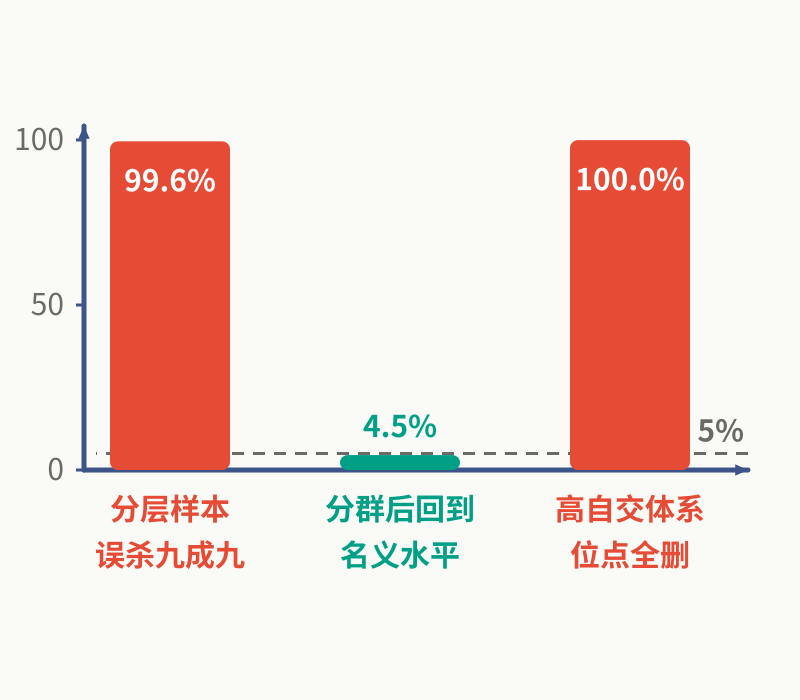

</div>
<div>

- F = s/(2−s) = 0.95/1.05 = 0.905（手算）
- 杂合度只剩期望的约 10%（H/H<sub>exp</sub> = 0.0985）
- 所以 `--hwe 1e-6` 删的是真实多态位点

</div>
</div>

<div class="ref">教材 §20.4.3 ｜ `ch20_hwe_selfing_wahlund.py --selftest`</div>

---

<!-- _class: phd statement -->

单倍体没有基因型三分，HWE 在数学上没有对象。

流程保留 `--hardy` 只为一件事：与课程脚本一致，输出不作诊断。

---

## D、D′、r² 各答一个不同的问题

<div class="cols">
<div>

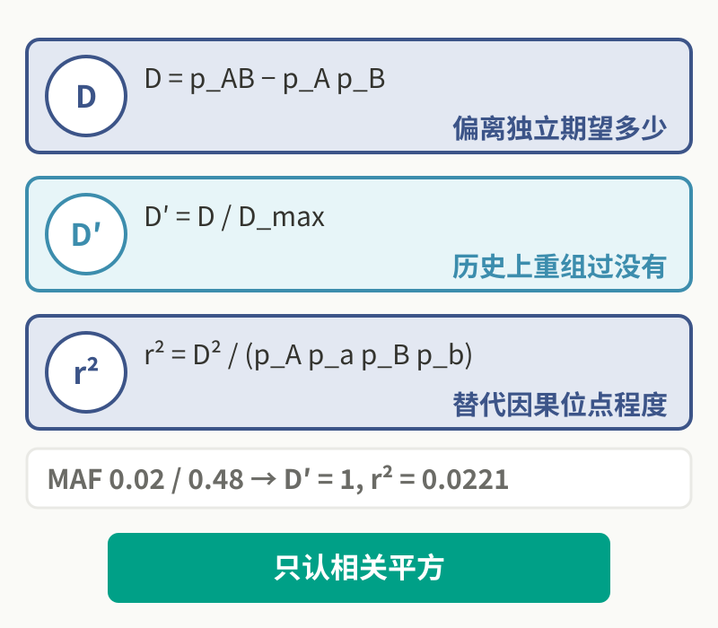

</div>
<div>

- GWAS 只认 r²：所需样本量放大 1/r² 倍
- D′ 高而 r² 小不矛盾，是低频位点的常态
- 划单倍型块看 D′，选标记算功效看 r²

</div>
</div>

<div class="ref">教材 §20.4.4 ｜ 讲义 ④ 4.4</div>

---

<!-- _class: phd figure -->

## LD 衰减曲线与它的两条死线

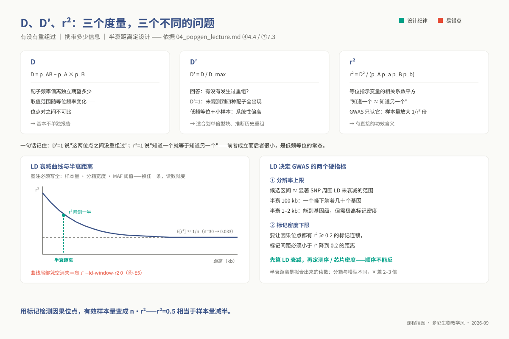

① 分辨率上限＝半衰距离（候选区间最小尺度）；② 标记密度底线＝r² 降到 0.2 的距离

图面 n = 30；主线 40 条 → 0.025；倍数与物种区间不引用

<div class="ref">教材 §20.4.4 图 20-2 ｜ 讲义 ④ 4.4</div>

---

## 无连锁时曲线也停在 1/n，n 是染色体数

<div class="cols">
<div>

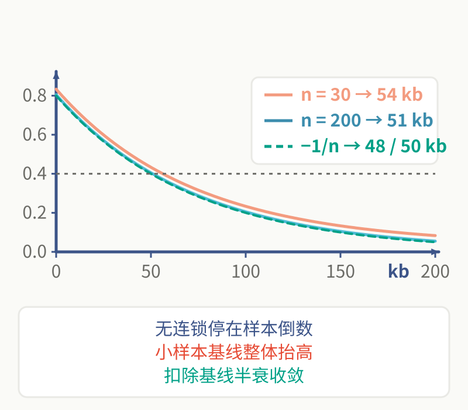

</div>
<div>

- 40 个单倍体个体 = 40 条染色体 → 0.025；n = 30 → 0.0333
- 报告四要素：n、MAF、分箱与最大距离、半衰判定
- 脚本读不到 MAF 阈值，必须手工补记；0.2 距离只一版

</div>
</div>

<div class="ref">教材 §20.4.4 ｜ `ch20_ld_r2_baseline.py --selftest` ｜ 脚本 `04_ld_decay_plot.R`</div>

---

<!-- _class: phd figure -->

## 硬清除的三联征与四类伪装者

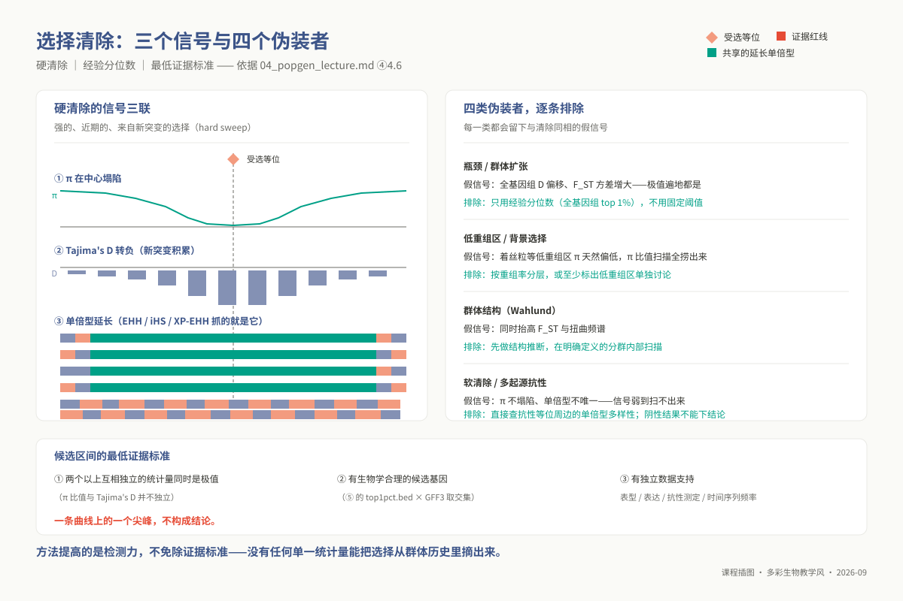

图面括注按教材改成 π 比值与 F<sub>ST</sub>；iHS/XP-EHH 不给细节；「高互阻区」读作低重组区

<div class="ref">教材 §20.4.6 图 20-3</div>

---

## 四类伪装者，各留同相假信号

<div class="cols">
<div>

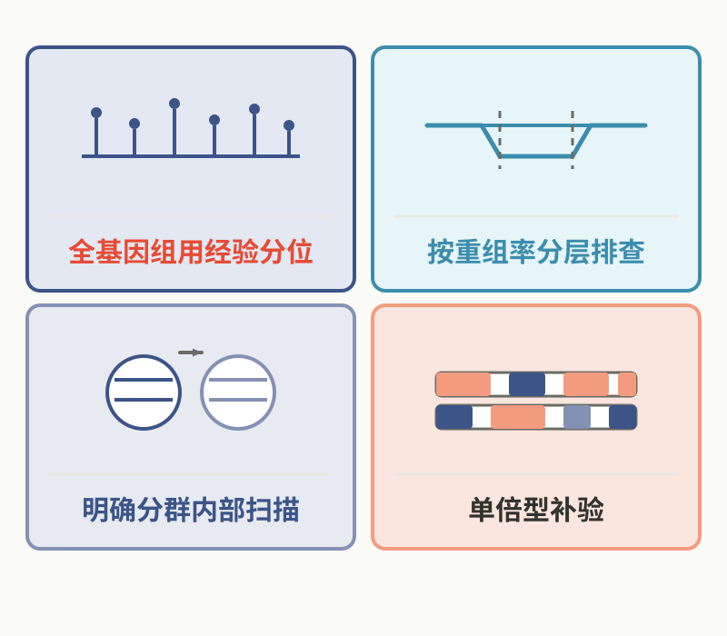

</div>
<div>

- 人口历史：全基因组 D 偏移，极值遍地
- 低重组区：π 本底偏低，整段被捞出
- 隐秘结构：F<sub>ST</sub> 抬高、频谱扭曲
- 软清除：π 不塌、单倍型不唯一

</div>
</div>

<div class="ref">教材 §20.4.6 ｜ 讲义 ④ 4.6</div>

---

<!-- _class: phd quiz -->

## 课堂提问

π 比值与 F<sub>ST</sub> 同时到顶，是两项独立证据吗？

---

<!-- _class: phd statement -->

两个以上统计量同时极值，但 π 比值与 F_ST 不是两项独立证据。

由 F_ST ≈ 1 − π̄<sub>within</sub>/d_XY，π 一塌，F_ST 就被机械抬高。

---

## 三个工具，三种解释边界

<div class="cols">
<div>

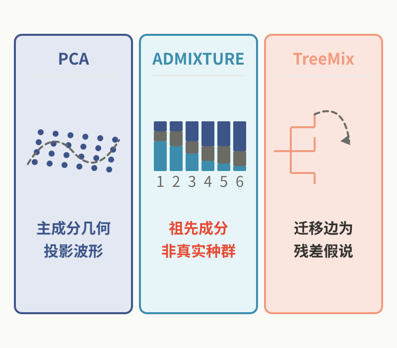

</div>
<div>

- PCA：无模型的方差分解，PC 不对应历史事件
- 未剪枝时大 LD 独占 PC
- ADMIXTURE：K 2–8、`--cv=5`、3 种子
- TreeMix：迁移边只作工作假说

</div>
</div>

<div class="ref">教材 §20.4.5 ｜ 讲义 ④ 4.5、⑦ 7.4</div>

---

<!-- _class: phd statement -->

CV 最小的 K 是模型参数，不是真实亚群数。

曲线无极小值是常态；相邻 K 之差小于重复间 sd 时，两者不可比。

---

## 两套产物，物理持久化，不能只留一套

<div class="cols">
<div>

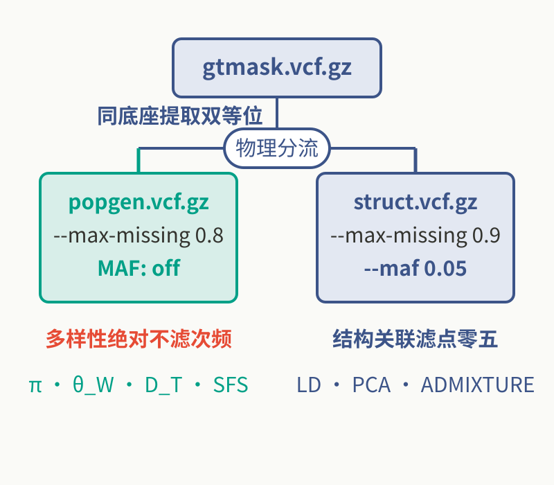

</div>
<div>

- `gtmask`：DP&lt;5 或 GQ&lt;20 置缺失，不删位点
- 位点数与缺失率要同时报
- `struct` 才滤 MAF 0.05，服务 LD 与 GWAS

</div>
</div>

<div class="ref">教材 §20.4.7 ｜ 讲义 ⑤ 5.2</div>

---

## 滤 MAF 不是中性操作：它把 D 推正

<div class="cols">
<div>

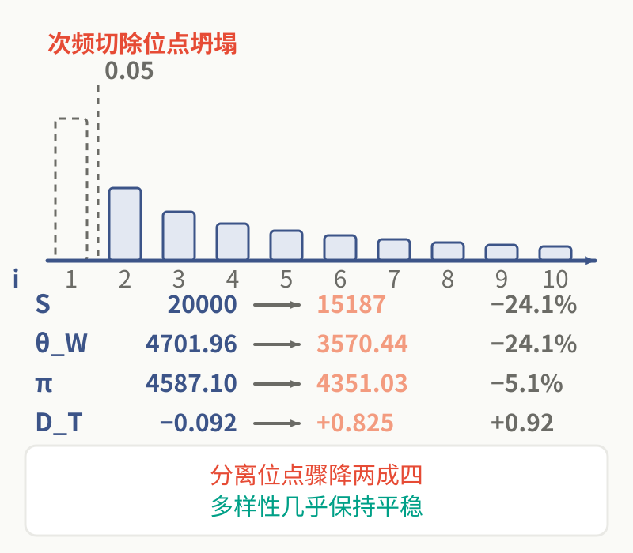

</div>
<div>

- π 几乎不动：权重集中在中间频率
- 分子 π − θ<sub>W</sub> 被动转正
- 偏差单向，多做几次只会更稳定地偏

</div>
</div>

<div class="ref">教材 §20.5.3（整段总量口径）｜ `ch20_tajima_d_maf_bias.py --selftest`</div>

---

## 深度只决定能不能可靠判基因型

- ≥ 10× 走硬基因型：直接吃 `GT`（经验分界）
- 1–3× 走似然或填补：硬 GT 会漏检、造虚假分化
- 主线 11.5× 落在可用区间，不做填补
- 填补会把参考面板的先验带进来

<div class="ref">教材 §20.4.7 ｜ 讲义 ④ 4.7</div>

---

<!-- _class: phd figure -->

## 溯祖直觉：一切扭曲都是 T 的分布变了

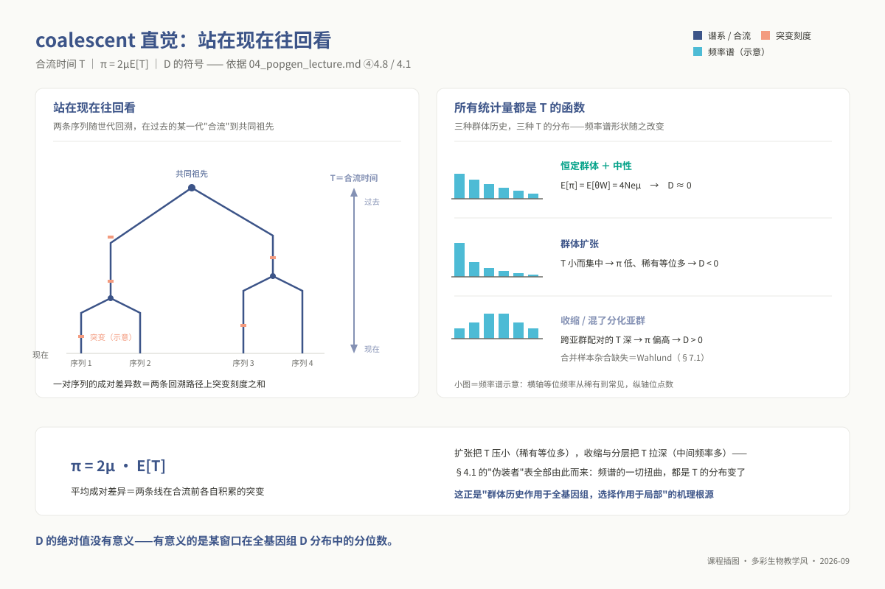

右栏基准卡是二倍体 4N<sub>e</sub>μ；本章主线按单倍体 2N<sub>e</sub>μ 换算

<div class="ref">教材 §20.4.8 图 20-4</div>

---

## F<sub>ST</sub> 高有两副面孔，先问 d<sub>XY</sub>

<div class="cols">
<div>

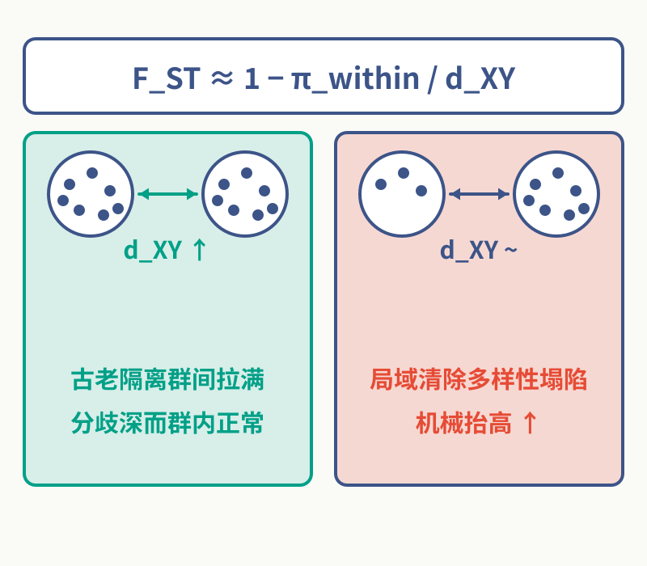

</div>
<div>

- 只报 F<sub>ST</sub>，这两种历史分不开
- 先问 d<sub>XY</sub>，才谈得上解释

</div>
</div>

<div class="ref">教材 §20.4.8 ｜ 讲义 ④ 4.8</div>

---

<!-- _class: phd divider -->

<div class="num">V</div>

# 操作流程

先底座、再两套、后回补窗口

---

<!-- @section: procedure -->
## 流程骨架：七步，最后一步要回头

<div class="cols">
<div>

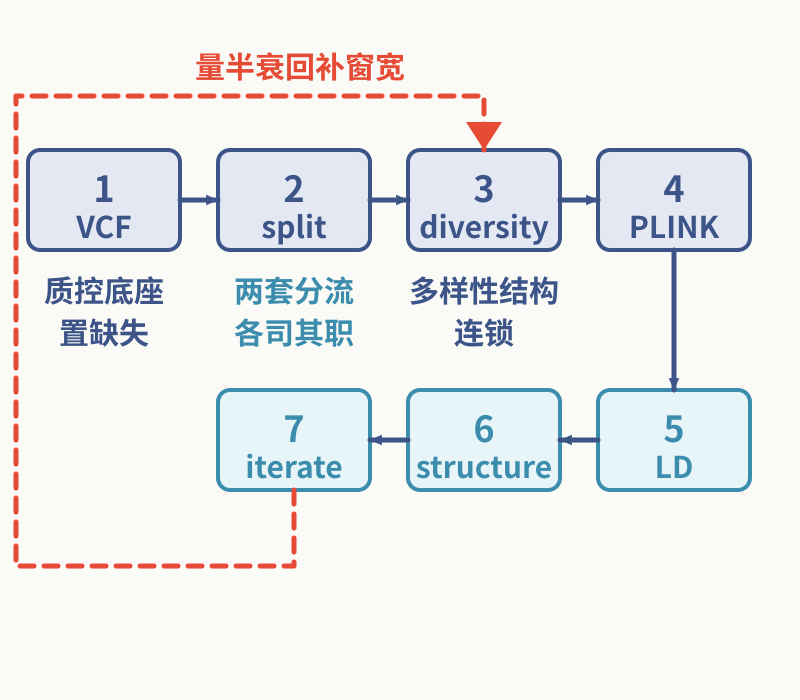

</div>
<div>

- 全部 `qsub`；脚本头 8 线程、8 或 16 GB
- ④ 转 PLINK 只算 HWE，不据此过滤
- ⑥ PCA 10｜ADMIXTURE K 2–8｜TreeMix M 0–5
- 第 ⑦ 步按半衰 2–5 倍回补窗宽，重跑 ③

</div>
</div>

<div class="ref">教材 §20.3、§20.4.7 ｜ 讲义 ⑤</div>

---

## 两套产物：同一次过滤分出两条路

```bash
# popgen：π / θ_W / D 用，绝对不滤 MAF
vcftools --gzvcf gtmask.vcf.gz --max-missing 0.8 \
  --min-alleles 2 --max-alleles 2 --recode --recode-INFO-all \
  --stdout | bgzip -c > popgen.vcf.gz
# struct：LD / PCA / GWAS 用，滤 MAF 0.05
vcftools --gzvcf gtmask.vcf.gz --max-missing 0.9 --maf 0.05 \
  --recode --recode-INFO-all --stdout | bgzip -c > struct.vcf.gz
```

- 漏 `--recode-INFO-all` 丢 INFO；漏 `tabix` 下游全失败
- `-S .` 是置缺失不删位点；`--max-missing` 是保留比例

<div class="ref">教材 §20.4.7 ｜ 脚本 `04_popgen_qc_diversity.sh`</div>

---

## 多样性与分化的三条命令

```bash
W=50000; S=10000
vcftools --gzvcf popgen.vcf.gz --window-pi ${W} --window-pi-step ${S} --out div
vcftools --gzvcf popgen.vcf.gz --TajimaD ${W} --out div
vcftools --gzvcf popgen.vcf.gz --weir-fst-pop A.txt --weir-fst-pop B.txt \
  --fst-window-size ${W} --fst-window-step ${S} --out fst
```

- `--TajimaD` 只接窗口，没有 step 参数
- 报告主结果用 `WEIGHTED_FST` 列

<div class="ref">教材 §20.4.1、§20.4.2 ｜ 脚本 `04_popgen_qc_diversity.sh`</div>

---

## LD 剪枝与衰减：参数逐个对上

```bash
plink --bfile struct --allow-extra-chr --indep-pairwise 50 10 0.2 --out prune
plink --bfile struct --allow-extra-chr --r2 \
  --ld-window 99999 --ld-window-kb 500 --ld-window-r2 0 --out ld
Rscript 04_ld_decay_plot.R ld.ld 500 1000 ld_decay ${NIND}
```

- `--r2` 用未剪枝的全标记；PCA 与 ADMIXTURE 才用剪枝集
- 剪枝 `50 10 0.2` 的单位是变异个数，不是 50 kb
- `${NIND}` 是 `.fam` 行数，单倍体下才等于染色体数

<div class="ref">教材 §20.4.4 ｜ 脚本 `04_popgen_structure.sh`</div>

---

## 结构与 ADMIXTURE：先把 `.bim` 染色体列置 0

```bash
cp struct.pruned.bim struct.pruned.bim.orig
awk 'BEGIN{OFS="\t"}{$1=0;print}' struct.pruned.bim.orig > struct.pruned.bim
admixture --cv=5 -s ${SEED} -j8 struct.pruned.bed ${K}
plink --bfile struct.pruned --allow-extra-chr --pca 10 --out pca
treemix -i pop.treemix.frq.gz -m ${M} -k 500 -root ${ROOTPOP} -o tm_m${M}
```

- ADMIXTURE 只认数字染色体名；置 0 不改任何基因型
- 保留 `.bim.orig`；K 2–8、每 K 三个种子（1001–1003）
- 迁移边只作工作假说，须由 f3/f4 或单倍型证据证实

<div class="ref">教材 §20.4.5 ｜ 脚本 `04_popgen_structure.sh`</div>

---

<!-- _class: phd statement -->

先跑结构脚本量出 LD 半衰，再把窗宽设成半衰的 2–5 倍重跑。

脚本只提醒，不会自己迭代：默认 50 kb 只是试算值。

---

<!-- _class: phd warn -->
## 两处输入课程里没有生成步骤

- `pop.treemix.frq.gz`：需自己从 `plink --freq` 转格式
- `top1pct.bed`：需自己按分位数落盘
- 缺文件时 TreeMix 段只告警跳过，脚本照样「完成」
- `raw.pop.vcf.gz`：fastq→VCF 不在本讲，见第 10 章

<div class="ref">教材 §20.3、§20.6 ｜ 讲义 ⑤ 5.5–5.6</div>

---

<!-- _class: phd divider -->

<div class="num">VI</div>

# 结果解读

正常形态 · 失效条件 · 交付清单

---

<!-- @section: interpretation -->
## 正常形态：三张图加一份清单

- LD 曲线：近距离高，平滑落到 1/n 平台
- 碎石图：前 2–4 个 PC 陡降，之后平缓
- CV 曲线：有极小值是运气，长平台是常态
- 交付清单：逐行对得上脚本产物

<div class="ref">教材 §20.6 ｜ 讲义 ⑥ 6.1</div>

---

<!-- _class: phd warn -->
## 结果不对时长什么样（一）：图先说话

<div class="cols">
<div>

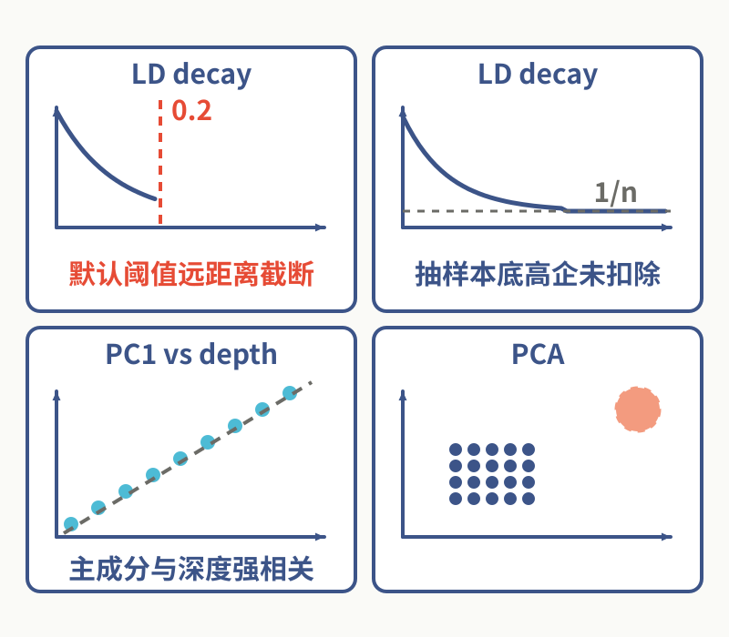

</div>
<div>

- 0.2 处截断 → 漏了 `--ld-window-r2 0`，重跑 `--r2`
- 平台仍高 → 扣 1/n 基线再读
- PC1 与深度相关 → 先查样本质量
- 少数样本甩远 → 回查深度与比对

</div>
</div>

<div class="ref">教材 §20.6 判据表 ｜ 讲义 ⑥ 6.1</div>

---

<!-- _class: phd warn -->
## 结果不对时长什么样（二）：口径与过滤

| 失效 | 现象 | 怎样察觉 |
|---|---|---|
| F<sub>ST</sub> 口径混用 | 同一报告两处数值差一截 | 先认列名与 MAF 阈值 |
| HWE 当过滤器 | 位点「还剩几千」，以为质量差 | 先问倍性，再看方向 |
| 误滤 MAF | 全基因组 D 中位数明显偏正 | 用同缺失阈值的对照产物 |
| manifest 同名覆盖 | 40 行只落 37 个，退出码仍 0 | 产物计数对 manifest 行数 |

<div class="ref">教材 §20.5.1–§20.5.4 ｜ 讲义 ⑨、⑥ 6.1</div>

---

## 交给 p05 的是口径与文件，不是数值

| 交付物 | 下游拿它做什么 |
|---|---|
| `struct.{bed,bim,fam}` | GWAS 基因型矩阵 |
| `pca.eigenvec` | 连续 Q 协变量 |
| `relatedness.genome` | 样本对表，不是现成矩阵 K |
| `ld_decay.txt` | 候选区间宽度、有效独立标记数 |

- `popgen.vcf.gz` 只作回溯佐证，不进关联模型

<div class="ref">教材 §20.6 ｜ 讲义 ⑥ 6.2</div>

---

<!-- _class: phd divider -->

<div class="num">VII</div>

# 统计要点

HWE · 多重检验 · LD 读数 · 结构边界

---

<!-- @section: stats_plugin -->
## 统计要点（一）：阈值是约定，M<sub>eff</sub> 要自己算

- 不寻常不等于错误：一半成因是真实生物学
- 百万位点按 0.05 判，会有 5 万个假显著
- 10⁻⁶ ≈ 对 5×10⁴ 个独立块做 Bonferroni
- M<sub>eff</sub> 的粗略上界：剪枝后标记数 `NPRUNE`

<div class="ref">教材 §20.4.3、§20.6 ｜ 讲义 ⑦ 7.1 ｜ 脚本交付行 `n_eff_upper_bound`</div>

---

## 统计要点（二）：半衰读数有四个自由度

- 样本染色体数：1/n 基线整体抬高曲线
- 分箱宽度与最大距离
- 拟合模型：Hill–Weir 为主，退回指数式
- 判定标准：峰值减半，还是扣基线再减半

<div class="ref">教材 §20.4.4 ｜ 讲义 ⑦ 7.3</div>

---

## 统计要点（三）：描述性结果不能当参数

- PCA 是几何投影，特征向量不做假设检验
- CV error 只度量掩码基因型的预测精度
- 迁移边要由 f3/f4 或单倍型证据独立证实
- 方差解释比例不等于结构造成的比例

<div class="ref">教材 §20.4.5 ｜ 讲义 ⑦ 7.4</div>

---

<!-- _class: phd divider -->

<div class="num">VIII</div>

# AI 辅助任务

让它读曲线，抓它的越界结论

---

<!-- @section: ai_task -->
## AI 任务：两条曲线，一个陷阱

> 这是我课题的 LD 衰减曲线（每 1 kb 分箱的 r² 均值）与 CV error 表。
> 请评估：LD 衰减距离是多少？最优 K 取几？并给出生物学解释。

- 第一轮故意不说样本量、繁育方式、MAF、分箱
- 看它会不会自己来问这四项
- 越界通常在「衰减距离」「最优 K」「血统比例」三处
- 提交物：AI 原文、越界标注、你的判读与依据

<div class="ref">教材 §20.4.4、§20.4.5 ｜ 讲义 ⑧ 步骤 1</div>

---

## AI 越界核查：五问压成四条

| 越界表现 | 正确表述 |
|---|---|
| 说「存在 K 个真实亚群」 | K 是模型参数，CV 只是预测 |
| 不问样本量、繁育方式、MAF | 三项都直接改读数 |
| 目测一个整数，不说半衰定义 | 峰值减半／0.2／基线要说明 |
| 把 Q 比例说成杂交事件 | 渐变、抽样、共享祖先同样能产生 |

- 第五项：曲线单调下降仍指定「最优 K」

<div class="ref">讲义 ⑧ 核查矩阵 ｜ 教材 §20.4.5</div>

---

<!-- _class: phd divider -->

<div class="num">IX</div>

# 常见错误

报错会响；静默的那些退出码是 0

---

<!-- @section: troubleshooting -->
<!-- _class: phd warn -->
## 常见错误一：四条最常见的报错

- `Invalid chromosome code` → 加 `--allow-extra-chr`
- `Duplicate ID '.'` → 加 `--set-missing-var-ids '@:#'`
- F<sub>ST</sub> 全 `-nan` → 群体清单与 VCF 表头失配
- ADMIXTURE 读 `.bim` 退出 → 第一列置 0，不改数据

<div class="ref">教材 §20.6 ｜ 讲义 ⑨ E1–E3、E8</div>

---

<!-- _class: phd warn -->
## 常见错误二：两个不报错的参数陷阱

- `--ld-window-r2` 默认 0.2：曲线在 0.2 处凭空截断
- 显式 `--ld-window-r2 0` + `--ld-window-kb 500`，并对齐过滤前后位点数
- `--max-missing 0.1`：只要求一成个体非缺失，允许九成缺失
- `--geno 0.1` 相反：只留缺失 ≤10% 的位点

<div class="ref">教材 §20.4.4、§20.6 ｜ 讲义 ⑨ E5、E7</div>

---

<!-- _class: phd warn -->
## 常见错误三：样本悄悄变少，退出码仍是 0

- 按样本名落盘，同名 run 互相覆盖
- 40 行 manifest 只落 37 个文件
- LD 基线从 1/40 = 0.025 变成 1/37 = 0.027
- 开工前 `cut -f2 | sort | uniq -d` 应为空

<div class="ref">教材 §20.5.4 后半（本课真实案例）｜ 讲义 ⑨</div>

---

<!-- _class: phd divider -->

<div class="num">X</div>

# 课后

实践任务卡 · 思考练习 · 实验指导

---

<!-- @section: wrapup -->
## 实践任务卡（2 h）：按脚本顺序

| 序 | 脚本 | 这一步要拿到的结论 |
|---|---|---|
| 1 | `04_popgen_qc_diversity.sh` | 两套位点数、D 中位数、`WEIGHTED_FST` |
| 2 | `04_popgen_structure.sh` | 半衰、PC1 对缺失率、CV 均值±sd |
| 3 | 整理交付清单 | 逐行对得上脚本产物 |

- 上机时手边打开 `11_lab_guides/phd/04_popgen_lab.md`

<div class="ref">教材 §20.6 ｜ 讲义 ⑤、⑥ 6.2 ｜ 作业 p04</div>

---

## 思考练习：教材 §20.7 十三题，课堂选三题

- 第 3 题：D′ = 1.0 而 r² = 0.0221，报告写 0.03（设例）
- 第 8 题：π 比值与 F<sub>ST</sub> 双极值，三种非选择成因
- 第 12 题：θ = 0.010、μ = 2×10⁻⁹，按单倍体反解 N<sub>e</sub>
- 第 13 题：5 kb 与 50 kb 窗，两份候选名单几乎不重叠

<div class="ref">教材 §20.7、§20.9 ｜ 讲义 ⑩</div>

---

## 实验指导与收尾

- 上机时手边打开 `11_lab_guides/phd/04_popgen_lab.md`
- 演示脚本在课程仓库根目录运行 `python3 textbook/demos/…`
- 四个演示脚本都带 `--selftest`，数字只对各自的生成模型成立
- 文献只给指针（教材 §20.8），本 deck 不重复列

**交出去的是一份带口径与边界说明的群体资产，不是一个 K 值。**

<div class="ref">教材 §20.6、§20.8 ｜ 讲义 ⑩、⑪</div>
