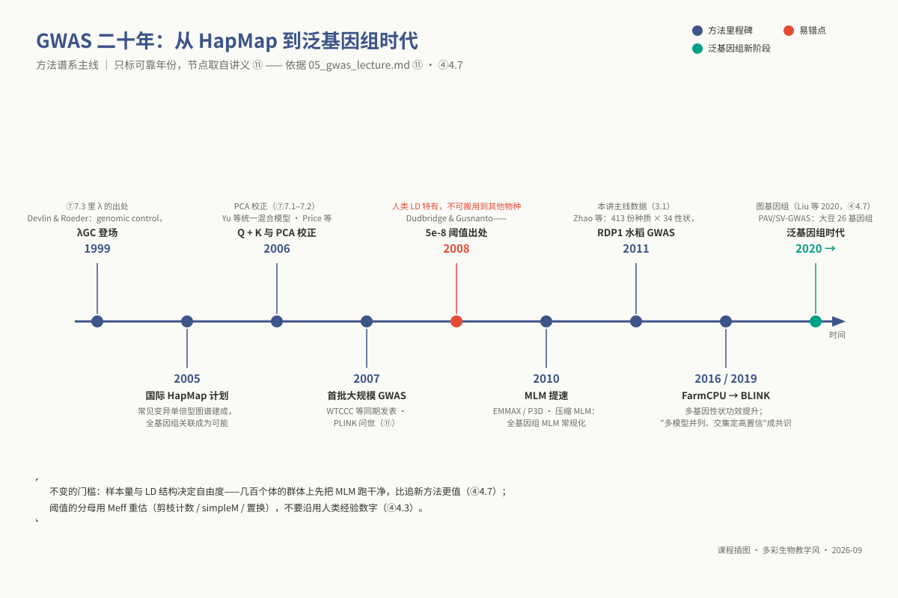
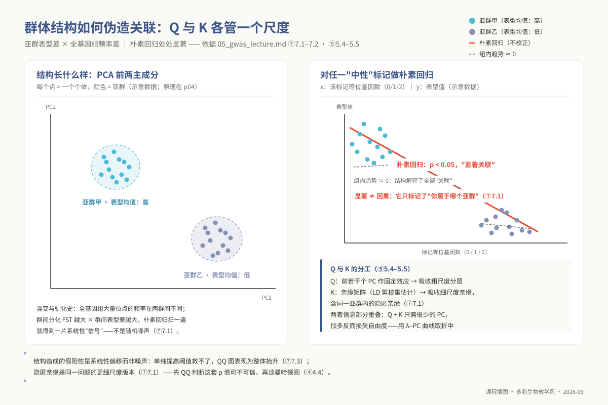
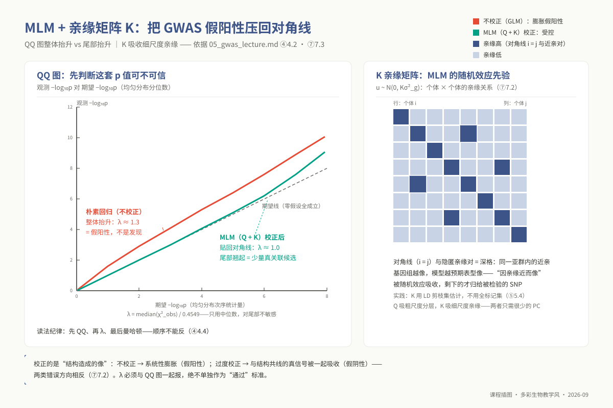
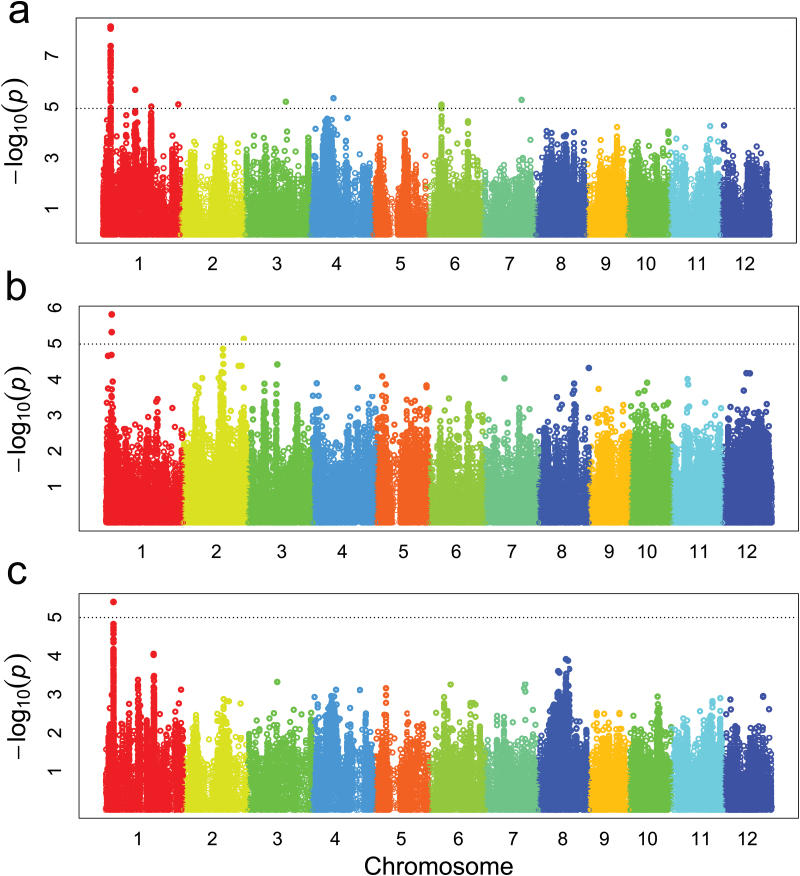
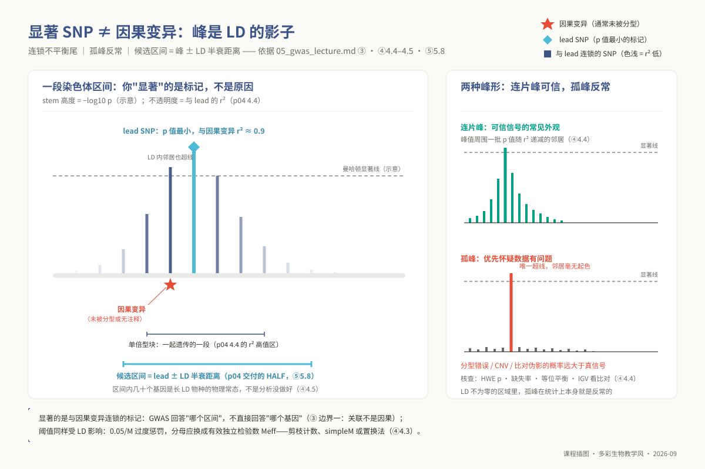
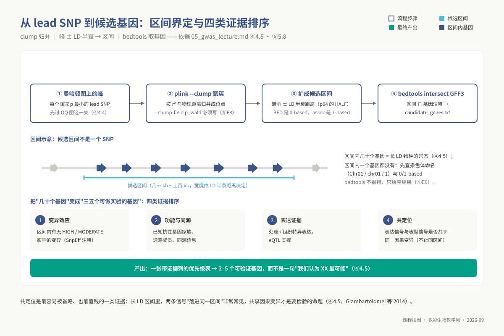
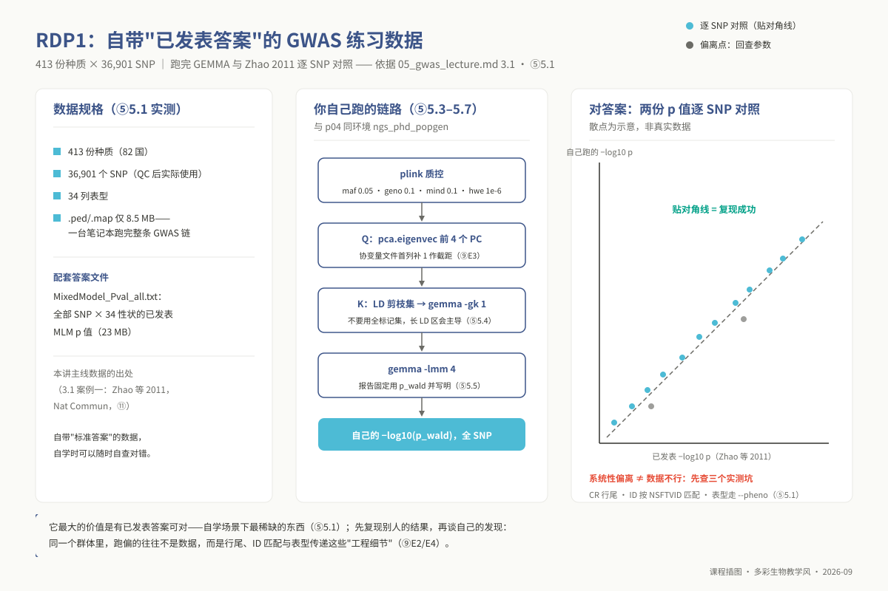

<!-- @section: cover -->
<!-- _class: phd cover -->

# 专题 p05：GWAS 关联分析与后 GWAS 挖掘

**跑出曼哈顿图不难，能在看图之前先判断这张图可不可信才是出口。**

<div class="meta">

- 课堂 4 学时（2 h 理论 + 2 h 实践）；上机作业另计
- 教材 §21.1–§21.9 ｜ 讲义 `02_lectures/phd/topic05_gwas/…`
- 输入 RDP1：413 份、36,901 SNP；结构资产须重算
- 环境 `ngs_phd_popgen` ｜ 脚本 `05_gwas_gemma.sh` 等三件

</div>

---

<!-- _class: phd divider -->

<div class="num">I</div>

# 学习目标

四条博士层目标，对应 LO21-01–LO21-04

---

<!-- @section: objectives -->
## 学完你应当能够（一）：结构与表型

- 用遗漏变量偏差解释结构造成的系统性假阳性
- 判读 QQ：整体抬升与尾部离群不是一回事
- 说明 λ 只测整体抬升，且随样本量自发上升
- 按表型状态选 RINT 与 BLUE/BLUP 并写出代价

<div class="ref">教材 §21.2 LO21-01、LO21-02 ｜ §21.4.2–§21.4.5</div>

---

## 学完你应当能够（二）：阈值与区间

- 用严格界、近似口径、线索线三类说清阈值
- 由剪枝行数、simpleM 或置换估 M<sub>eff</sub>
- 把曼哈顿峰转成候选区间并排四类证据
- 写出含假阳性与假阴性风险的方法学

<div class="ref">教材 §21.2 LO21-03、LO21-04 ｜ §21.4.4–§21.4.6</div>

---

<!-- _class: phd divider -->

<div class="num">II</div>

# 前置检查

五个 L0 模块，一个 L1 补丁

---

<!-- @section: prerequisites -->
## 前置检查：缺哪一块会卡在哪

| 模块 | 本讲用在哪 | 不过关的症状 |
|---|---|---|
| `l0_01_linux` `l0_03_conda` | 全基因组扫描走 `qsub` | 登录节点跑，被清退 |
| `l0_02_r` `l0_04_formats` | QQ 与曼哈顿；BED 与 GFF | intersect 错一位不报错 |
| `l0_06_stats` | 多重检验、混杂、回归 | 把 p<0.05 当显著位点 |
| `l1_p05` | 质控四阈值与 HWE 口径 | 说不清 `--geno` 与 `--mind` |

- 自测：L0-1-Q5/Q9、L0-3-Q9/Q10、L0-2-Q8/Q9
- 自测：L0-4-Q6/Q7、L0-6-Q4–Q6、L1-Q3/Q4

<div class="ref">教材 §21.3（先修：第 20 章 LD 与 PCA）｜ 讲义 ②</div>

---

## 30 秒自查：只查有没有，不查版本号

```bash
source "${CONDA_ROOT:-/opt/miniconda3}/bin/activate" ngs_phd_popgen
plink --version && gemma -h | head -3 && bedtools --version
Rscript -e 'library(qqman); packageVersion("qqman")'
```

- 有输出即进入正题；缺一条先回 `l0_03_conda`
- 有 pin：plink 1.90b6.21、gemma 0.98.3、bedtools 2.31.0
- GAPIT 不在 conda 里（多位点模型属可选，默认不做）

<div class="ref">教材 §21.3 ｜ env_phd_popgen.yml ｜ 讲义 ②</div>

---

<!-- _class: phd divider -->

<div class="num">III</div>

# 主线数据与科学问题

RDP1：一份自带答案的练习数据

---

<!-- @section: background -->
## GWAS 问的是协变，不是因果

- 问的是位点等位基因剂量与表型的协变
- 答：这个群体、这个环境下哪些区间有关
- 不答：哪个基因因果、稀有变异、G×E 机制
- 显著位点常只是与因果变异连锁的标签

<div class="ref">教材 §21.4.1 ｜ 讲义 ③</div>

---

## 三条路线是三角，不是替代关系

| 手段 | 分辨率 | 代价 |
|---|---|---|
| 连锁 / QTL | 受重组次数限死，兆碱基 | 建群周期长 |
| 混池分组（BSA） | 粗，只对少数主效位点 | 难给效应量 |
| GWAS | 由 LD 决定，几十千碱基 | 样本量与多重检验 |

- 串起来用：关联初筛 → 分离群体或编辑验证

<div class="ref">教材 §21.4.1 ｜ 讲义 ③</div>

---

<!-- _class: phd statement -->

p 值最小的标记叫先导 SNP（lead SNP），它是区间的锚点，不是答案。

因果变异常常根本没被分型：芯片只测了 44,100 个位点。

---

## 主线数据：413 份种质，36,901 个 SNP

| 项 | 实测值 |
|---|---|
| 种质 | 413 份，来自 82 国 |
| 位点 | 芯片 44,100；作者发布 36,901 |
| 表型 | 文件 36 列＝34 项性状＋2 派生 |
| 体积 | 基因型 8.5 MB；答案矩阵 23 MB |

- 36,901 是原作者质控后的发布数
- 课程质控与 GEMMA 内建过滤还会再减
- 方法学报日志里的 analyzed SNPs

<div class="ref">教材 §21.1 ｜ 06_data/phd/README.md p05 节实测</div>

---

<!-- _class: phd figure -->

## GWAS 二十年：方法在换，两条门槛没变



图面节点取自讲义；HapMap 与首批 GWAS 属历史节点，正文不另列条目

<div class="ref">教材 §21.1 图 21-1 ｜ 图内「④4.7」读作 §21.4.7</div>

---

<!-- _class: phd warn -->
## 先把数据链的缺口说清

- p04 主线是 PRJEB53625：40 株单倍体稻瘟菌
- 那套结构文件描述的不是这 413 份水稻
- RDP1 的 struct、剪枝集、PCA、半衰须重算
- 课程仓库没有这条准备链的脚本（未实跑）

<div class="muted">缺资产时按实验指导 §3.1 对账；对不上就写假定链</div>

<div class="ref">教材 §21.1、§21.5.6 ｜ 讲义 ⑤ 5.1</div>

---

<!-- _class: phd divider -->

<div class="num">IV</div>

# 核心原理

表型 · 结构 · 阈值 · 诊断 · 区间

---

<!-- @section: principles -->
## 表型：成败在第一条命令之前

- 偏态、零膨胀、天花板：引发假阳性与功效损失
- RINT 让 QQ 变好看，代价是离群信息与单位
- 整株未测只能剔除，小区缺失由模型补
- 有效样本量按 GEMMA 日志的个体数报

<div class="ref">教材 §21.4.2 ｜ 讲义 ④ 4.1</div>

---

## BLUE 还是 BLUP：差别在收缩

<div class="cols">
<div class="card">

### BLUE：基因型当固定效应
不收缩、保留原单位；重复少时噪声大

</div>
<div class="card">

### BLUP：基因型当随机效应
向均值收缩、抗噪；方差被压缩，功效略降

</div>
</div>

- 重复不均衡、缺失多 → BLUP
- 要报物理效应量、重复整齐 → BLUE
- 选择必须写进方法学

<div class="ref">教材 §21.4.2 ｜ 讲义 ④ 4.1、⑤ 5.2</div>

---

## 遗传力闸门：先算一遍再决定跑不跑

- 阈值 0.05/25000 = 2×10⁻⁶（手算）
- χ²₁ 临界值 22.60（`chi2.ppf` 可复核）
- 非中心参数 N·h²/M<sub>eff</sub> = 400×0.2/25000 = 3.2×10⁻³
- 单点检出概率 2.08×10⁻⁶，与名义水平同阶

<div class="ref">教材 §21.4.2 ｜ scipy.stats.chi2.ppf(1-2e-6, 1)</div>

---

<!-- _class: phd statement -->

功效不足不等于绝无可能：全基因组至少一次超阈约 5.1%。

该做的是回查表型质量、加环境重复或扩样本，不是放宽阈值。

---

## 结构如何把中性标记变成显著

- 系统性斜率 → Δ·δ<sub>j</sub>·w<sub>A</sub>w<sub>B</sub> / Var(x<sub>j</sub>)
- 合成算例：假阳性率 0.573、λ = 12.149
- 加一个亚群协变量后回到 0.051、1.005
- 这是整体平移，提高阈值切不掉

<div class="muted">Δ：亚群表型均值差；δ<sub>j</sub>：位点频率差；w：亚群权重</div>

<div class="ref">教材 §21.4.3 ｜ ch21_structure_confounding_ols.py --selftest</div>

---

<!-- _class: phd figure -->

## 结构混杂：两条路径画在一张图上



亚群表型差 × 频率差 → 全基因组系统性假阳性

<div class="ref">教材 §21.4.3 图 21-2 ｜ 图面 FST 是概括表述，代数见正文</div>

---

## Q 与 K：各吸收一个尺度

<div class="cols">
<div class="card">

### Q：主成分作固定效应
吸收粗尺度谱系分化

</div>
<div class="card">

### K：亲缘矩阵作随机效应
吸收细尺度亲缘，含隐匿亲缘

</div>
</div>

- 两者信息重叠，Q+K 只需很少的 PC
- 校正过头会把共线真信号一起洗掉
- K 用 LD 剪枝集估，不用全量标记

<div class="ref">教材 §21.4.3 ｜ 讲义 ④ 4.2、⑤ 5.4–5.5</div>

---

## 质控：四个阈值，一个关掉的过滤器

| 参数 | 作用对象 | 依据 |
|---|---|---|
| `--maf 0.05` | 位点 | 低频功效低、易受分型误差 |
| `--geno 0.1` | 位点缺失率 | 缺失模式常与结构相关 |
| `--mind 0.1` | 个体缺失率 | 与 `--geno` 对象不同 |
| `--hwe` 默认关 | 位点 | 自交群体偏离是真实属性 |

- 只有确认随机交配才开 HWE 并声明

<div class="ref">教材 §21.4.3、§21.4.4 ｜ 脚本 05_gwas_gemma.sh</div>

---

## Q 的工程细节：三件事一起做

```bash
awk 'NR==FNR{pc[$2]=$3"\t"$4"\t"$5"\t"$6; next}
     {print "1\t" pc[$2]}' pca.eigenvec gwas.fam > covar_pc4.txt
wc -l covar_pc4.txt gwas.fam   # 两个数必须相等
```

- 首列自己补 1：GEMMA 不加截距
- 按 IID 键匹配，不按行号对齐
- 上面按 fam 行序输出；脚本相反，按 eigenvec 行序
- 两种写法都要求两文件个体排序一致

<div class="ref">教材 §21.4.3 ｜ 脚本 05_gwas_gemma.sh 第 5 步</div>

---

## 模型谱系：按「吸收什么」来记

| 模型 | 吸收什么 | 代价 |
|---|---|---|
| 朴素回归 | 什么都不吸收 | 系统性假阳性 |
| GLM + Q | 粗尺度分层 | 管不了亚群内近亲 |
| MLM（Q+K） | 粗与细两个尺度 | 共线真信号被吸收 |
| FarmCPU / BLINK | 多位点，功效更高 | 对输入顺序与种子敏感 |

- 压缩 MLM / P3D（参数预先估定）方差组分只估一次

<div class="ref">教材 §21.4.3 ｜ 讲义 ④ 4.2</div>

---

<!-- _class: phd statement -->

多模型不一致是常态：交集是高置信集，差集是要解释的对象。

只报检出最多的那一个，是审稿高危。

---

## 阈值：先分清严格界与估计量

- 0.05/M 不需要依赖假设，代价是保守
- 0.05/M<sub>eff</sub> 依赖估得准，偏小则 FWER 升高
- 并集界不要求检验独立，相关时更保守
- 报告写清估计方法、前提与校准证据

<div class="ref">教材 §21.4.4 ｜ 讲义 ④ 4.3</div>

---

## M<sub>eff</sub> 的三条估计路线

- 剪枝集行数：可复现，但不是严格上界
- simpleM：相关矩阵特征值的累积贡献
- 置换：重排表型，取最小 p 的 5% 分位
- 前两条给近似，置换要另起独立重复校准

<div class="ref">教材 §21.4.4 ｜ ch21_thresholds_fwer_fdr.py --selftest</div>

---

## 阈值阶梯：同一个分母，四种性质

| 口径 | 阈值 | 性质 |
|---|---|---|
| 0.05 / 500,000 | 1×10⁻⁷ | 严格界，保守 |
| 0.05 / 25,000 | 2×10⁻⁶ | 近似口径 |
| 1 / 25,000 | 4×10⁻⁵ | 线索线 |
| 人类 5×10⁻⁸ | = 0.05/10⁶ | 人类 LD 的产物 |

- RDP1 按发布位点算：0.05/36,901 = 1.35×10⁻⁶

<div class="ref">教材 §21.4.4 ｜ ch21_thresholds_fwer_fdr.py --selftest 部分 A</div>

---

## 照搬人类阈值的代价是可以算的

- 比 M<sub>eff</sub> 口径严 40 倍（设例：剪枝 2.5 万）
- 比朴素 0.05/M 严 2 倍，只依赖两个分母
- 80% 功效所需样本量多约 27%
- RDP1 规模：80% 功效只到 7.6% 方差的位点

<div class="ref">教材 §21.4.4 ｜ 同脚本部分 B（40 倍是设例比较）</div>

---

## 发现单位是区域，不是单个 SNP

<div class="cols">
<div class="card">

### 路线一：预定义区域
看过结果前划块，组内校准区域 p 值

</div>
<div class="card">

### 路线二：数据驱动 clumping
只给去冗余清单，位点 p 值须另校准

</div>
</div>

- 单 SNP 空间 BH 只回答 SNP 层假阳性比例
- 区域跨染色体（弱相关）时，较易满足 BH 的正相关依赖

<div class="ref">教材 §21.4.4 ｜ 讲义 ④ 4.3</div>

---

<!-- _class: phd statement -->

单 SNP 空间 BH 报出 25 个显著 SNP，按连锁块归并只有 1 个位点。

把 SNP 数当位点数，是把一个位点数了 25 遍。

---

## 诊断顺序不能反：QQ → λ → 曼哈顿

- QQ 判断这套 p 值整体可不可信
- λ 只量化整体抬升，对尾部不敏感
- 曼哈顿把可信的 p 值按坐标铺开
- 先看曼哈顿会把系统性膨胀当成发现

<div class="ref">教材 §21.4.5 ｜ 讲义 ④ 4.4</div>

---

## λ 的四态判读：档位是经验口径

| QQ 形态 | λ 读数 | 处置 |
|---|---|---|
| 从最小 p 处整体抬升 | ≥1.20 | 不看曼哈顿，加 PC、查 K |
| 仅尾部翘起 | 1.00±0.05 | 模型可用，进入峰判读 |
| 整体沉陷在对角线下方 | ≤0.90 | 减 PC，画 λ–PC 曲线 |
| 全程贴合、尾部无翘起 | ≈1.00 | 回查遗传力与样本量 |

- 必须与标度律、QQ 形态一起读，不当红线
- 跨研究先标准化：λ<sub>1000</sub> 按 1000/N 换算

<div class="ref">教材 §21.4.5 ｜ 讲义 ⑥ 6.1</div>

---

<!-- _class: phd figure -->

## 校正前后：QQ 图先定可信度



图面 λ≈1.3 是教学示意；校正后只剩尾部翘起

<div class="ref">教材 §21.4.5 图 21-3 ｜ 图面 Var(u)=Kσ² 按软件约定读作 2Kσ²</div>

---

<!-- _class: phd figure -->

## 真实曼哈顿图：过 QQ 关之后才看



Lou 2015｜237 份品种｜单性状深根比：三面板（全群/籼/粳）峰形迥异，1 号短臂为连片峰

<div class="ref">教材 §21.4.5 图 21-4 ｜ 本图与 RDP1、与「多性状」无关；CC BY 3.0 Lou 等 2015</div>

---

<!-- _class: phd figure -->

## 显著的是标记，不是原因



先导 SNP 只是标签；候选区间 = 先导 SNP ± 半衰距离

<div class="ref">教材 §21.4.5 图 21-5 ｜ 图面 r²≈0.9 与茎高为教学示意</div>

---

## 从峰到候选基因：四步

- ① 取先导 SNP，前提是已过 QQ 关
- ② `--clump` 按 r² 与距离归并成位点
- ③ 簇心两侧各外延一个半衰距离
- ④ 取区间内基因，按四类证据排序

<div class="ref">教材 §21.4.6 ｜ 讲义 ④ 4.5、⑤ 5.8</div>

---

## 区间换算手算：1-based → 0-based

- ps 12,345,678，HALF 150,000
- 左端 12,195,678，BED 起点减 1 → 12,195,677
- 右端 12,495,678，长度 300,001 bp（2×HALF+1，含中心位点）
- 起点为负时先钳位到 1，再减 1

<div class="ref">教材 §21.4.6 ｜ 脚本 05_postgwas_interval.sh</div>

---

<!-- _class: phd figure -->

## 区间与证据：从峰到候选表



取先导 SNP → clump 归并 → 半衰外延 → 取基因

<div class="ref">教材 §21.4.6 图 21-6 ｜ 图面标记与基因数为示意，区间宽度以半衰距离为准</div>

---

## 四类证据：至少两列独立指向同一基因

| 证据 | 问什么 |
|---|---|
| 变异后果 | 有无 HIGH / MODERATE 影响 |
| 表达证据 | 目标组织特异表达、eQTL |
| 同源功能 | 基因家族、通路、同源基因 |
| 统计共定位 | 是否共享同一个因果变异 |

- 共定位给的是共享因果的后验，不是同区间

<div class="ref">教材 §21.4.6 ｜ 讲义 ④ 4.5</div>

---

## 边界与近几年的方向

- 稀有变异：功效随 MAF 急降，改聚合检验
- 结构变异：SNP 集看不到，图泛基因组在补
- 上位与 G×E：标准模型是单位点加性
- 判据：你的 LD 结构与样本量支撑自由度吗

<div class="ref">教材 §21.4.7 ｜ 讲义 ④ 4.6</div>

---

<!-- _class: phd divider -->

<div class="num">V</div>

# 操作流程

三条脚本，六步命令，全部走 `qsub`

---

<!-- @section: procedure -->
## 流程骨架：六步

```text
① 表型治理   RINT / BLUE-BLUP / 遗传力闸门
② 基因型质控 maf 0.05 · geno 0.1 · mind 0.1（HWE 关）
③ Q 与 K      pca.eigenvec 补截距；剪枝集 -gk 1
④ 关联        GLM 对照 + MLM；PC 扫描 0 2 4 6 10
⑤ 诊断        QQ → λ → 曼哈顿；λ–PC 双轴
⑥ 后 GWAS     clump → 半衰外延 → intersect 基因
```

- 重计算一律 `qsub`；脚本内重新激活环境
- 资产须先在 `sativas413` 上重算（前页）

<div class="ref">教材 §21.4 ｜ 讲义 ⑤</div>

---

## K 与关联：剪枝集、GLM 对照、MLM

```bash
plink --bfile struct.pruned --pheno gwas.pheno --make-bed --out kin_in
gemma -bfile kin_in -gk 1 -o kin
gemma -bfile gwas -lm 4 -o glm_raw
gemma -bfile gwas -k output/kin.cXX.txt \
      -c covar_pc4.txt -lmm 4 -o mlm_pc4   # 三种 p 值同给
```

- K 与关联要同一批个体：先按表型过滤
- `-gk 1` 中心化；`-gk 2` 标准化，须写明
- PC 档联读 λ、位点数、QQ；只按 λ 最小会过度校正
- 再对照群体结构与效应稳定性；单看 λ 不足以定档

<div class="ref">教材 §21.4.3 ｜ 讲义 ⑤ 5.4</div>

---

## 后 GWAS：clump 与区间

```bash
plink --bfile gwas --allow-extra-chr \
      --clump output/mlm_pc4.assoc.txt \
      --clump-field p_wald --clump-snp-field rs \
      --clump-p1 1e-5 --clump-p2 1e-3 \
      --clump-r2 0.2 --clump-kb 500 --out clump
```

- 四参数不是 PLINK 默认，报告要写出来
- 空 clump 时脚本告警后仍退出 0，要看日志

<div class="ref">教材 §21.4.6 ｜ 讲义 ⑤ 5.8</div>

---

## 取基因：先做 genes.bed 再相交

```bash
awk 'BEGIN{OFS="\t"} !/^#/ && $3=="gene" \
     {print $1,$4-1,$5,$9}' annotation.gff3 > genes.bed
bedtools intersect -a peaks.bed -b genes.bed -wa -wb
```

- type 在第 3 列；直接对 GFF 用 `$6` 几乎恒假
- 染色体命名不同时，intersect 只给空结果
- 候选表的 `strand` 列本书不引用

<div class="ref">教材 §21.4.6 ｜ 讲义 ⑤ 5.8</div>

---

<!-- _class: phd divider -->

<div class="num">VI</div>

# 结果解读

正常形态 · 四种失效 · 对答案

---

<!-- @section: interpretation -->
## 正常形态：四件事同时成立

- QQ 前 90%–99% 贴合，只有尾部翘起
- λ 在经验档位内，且与样本量一起报
- λ–PC 曲线：λ 收敛而位点数没归零
- 显著位点表带 β、SE 与 p 值列名

<div class="ref">教材 §21.4.5、§21.6 ｜ 讲义 ⑥ 6.1</div>

---

<!-- _class: phd warn -->
## 结果不对时长什么样（一）：图先说话

| 现象 | 更可能的解释 | 先做什么 |
|---|---|---|
| 整体抬升，满屏信号 | 结构或批次未吸收 | 不看曼哈顿，加 PC |
| 整体沉陷 | 过度校正 | 减 PC，画 λ–PC 曲线 |
| 孤峰，侧翼无信号 | 分型错配、CNV、伪影 | 查 HWE p、缺失率 |
| 峰全挤在一段 | 大效应，或倒位与大 LD 块 | 局部 LD 热图 |

<div class="ref">教材 §21.5.1、§21.5.2 ｜ 讲义 ⑥ 6.2</div>

---

<!-- _class: phd warn -->
## 结果不对时长什么样（二）：口径与单位

| 现象 | 说明什么 | 怎样察觉 |
|---|---|---|
| 报「发现 25 个位点」 | 阈值来自 SNP 层 BH | 按块归并数一遍 |
| 先有曼哈顿，后补 QQ | 诊断顺序反了 | 报告里查审阅顺序 |
| 单 SNP 解释 >40% 方差 | 疑录入或标签颠倒 | 按基因型分箱画箱线图 |
| λ<1 且位点数归零 | 过度校正 | 看 λ–PC 双轴 |

<div class="ref">教材 §21.5.2（40% 为经验规则）｜ 讲义 ⑥ 6.2</div>

---

<!-- _class: phd warn -->
## 失效：样本 ID 按错列，或表型带旧 Mac 回车

- 表型第 2 列才是 IID：交集 413/413
- 按第 1 列匹配，交集为 0（正常读数）
- `wc -l` 返回 0：整份文件只有一个「行」
- 按行拼接不报错，表型却换了主人

<div class="ref">教材 §21.5.3 ｜ 06_data/phd/README.md p05 节实测</div>

---

<!-- _class: phd warn -->
## 失效：在自交群体上照搬 HWE 过滤

- 自交率 0.95 时 100% 位点 p<10⁻⁶
- 三等份亚群合并（Wahlund）时 99.6%
- 位点塌掉先看繁育系统，不要先疑数据
- 课程脚本 `HWE=0`，开启时打印警告

<div class="ref">教材 §21.5.5 ｜ ch20_hwe_selfing_wahlund.py --selftest</div>

---

<!-- _class: phd warn -->
## 失效：要求与黄金答案逐位点相等

- 已发表结果是 EMMA，课程用 GEMMA 复跑
- 协变量、K 的构造、优化器都不同
- 判据：整体秩相关高 + 主要峰同一区间
- 秩相关低先查 ID 列、行尾、`--pheno`、性状列

<div class="ref">教材 §21.5.7、§21.6 ｜ 讲义 ⑥ 6.2</div>

---

<!-- _class: phd figure -->

## RDP1 对答案：自带已发表 p 值



413 份｜36,901 SNP｜34 项性状｜对答案看秩相关与峰区间；散点为示意

<div class="ref">教材 §21.6 图 21-7 ｜ 图面 --hwe 1e-6 是旧教学命令；脚本默认关（§21.5.5）</div>

---

<!-- _class: phd divider -->

<div class="num">VII</div>

# 统计要点

结构 · λ · 阈值

---

<!-- @section: stats_plugin -->
## 统计要点（一）：MLM 拆的是两层相关

- 模型：y = Xβ + Sα + u + ε
- `Var(u) = 2Kσ²`：系数 2 与软件约定有关
- Q 管粗尺度分层，K 管细尺度亲缘
- K 必须与进入关联的个体集一致

<div class="small">X：待测 SNP 基因型，β：位点效应；S：主成分，α：协变量效应</div>

<div class="ref">教材 §21.4.3 ｜ 讲义 ⑦ 7.1–7.2</div>

---

## 统计要点（二）：λ 只测整体抬升

- λ = 中位卡方 ÷ 0.4549；只测整体抬升
- λ ≈ 1 + N·h²/M<sub>eff</sub>：大样本会自发上升
- 注入 5 个强信号：λ 1.0679 → 1.0679
- 最小 p 1.71×10⁻⁵ → 2.50×10⁻¹²

<div class="ref">教材 §21.4.5 ｜ ch21_lambda_gc_scaling.py --selftest</div>

---

## 统计要点（三）：阈值要交代五件事

- 阈值；性质（严格界／近似口径／线索线）
- 分母或零分布从哪来；估计方法
- 校准证据；检验列名 `p_wald`
- 置换依赖交换性，0.050 是构造内结果

<div class="ref">教材 §21.4.4 ｜ 讲义 ⑦ 7.3–7.4</div>

---

<!-- _class: phd divider -->

<div class="num">VIII</div>

# AI 辅助任务

让它读 QQ 图，抓它的越界结论

---

<!-- @section: ai_task -->
## AI 任务：第一轮不说模型与样本量

> 这是我 GWAS 的 QQ 图，λ = 1.18：结果合格吗？要不要调协变量重跑？

- 第一轮故意不给模型、PC 数、样本量、遗传力
- 看它会不会自己来问这四项
- 提交原始日志、逐条标注与重跑对照图

<div class="ref">教材 §21.4.5 ｜ 讲义 ⑧</div>

---

## AI 越界核查：五条清单

| 核查点 | 越界表现 |
|---|---|
| 区分整体抬升与尾部 | 笼统说「偏离说明有关联」 |
| 追问模型、PC 数与样本量 | 把 λ 当孤立常数 |
| 提示过度校正风险 | 一味「多加几个 PC」 |
| 建议可重跑 | 只说「没问题，继续」 |

- 第五项（诊断顺序）：膨胀时该拦曼哈顿；挑位点即越界

<div class="ref">讲义 ⑧ 核查矩阵 ｜ 教材 §21.4.5</div>

---

<!-- _class: phd divider -->

<div class="num">IX</div>

# 常见错误

报错会响；静默的那些退出码是 0

---

<!-- @section: troubleshooting -->
<!-- _class: phd warn -->
## 常见错误一：四条会响的报错

- `Invalid chromosome code` → 加 `--allow-extra-chr`
- `fewer tokens` → 表型三列 FID IID value
- `CHR column should be numeric` → 先整数化
- `No significant --clump results` → 写两个字段名

<div class="ref">教材 §21.5.3 ｜ 讲义 ⑨ E1、E2、E7、E8</div>

---

<!-- _class: phd warn -->
## 常见错误二：四个不响的错误

- `analyzed individuals = 0`：`-9` 或行序错位
- 找不到输出：GEMMA 固定写 `./output/`
- `intersect` 0 行：染色体命名或坐标系
- `pve = 1` 或 `se = nan`：样本太小

<div class="ref">教材 §21.6 ｜ 讲义 ⑨ E4、E5、E9、E10</div>

---

<!-- _class: phd divider -->

<div class="num">X</div>

# 课后

任务卡 · 思考练习 · 实验指导

---

<!-- @section: wrapup -->
## 实践任务卡（2 h）：按脚本顺序

| 序 | 脚本 | 这一步要拿到的结论 |
|---|---|---|
| 1 | `05_gwas_gemma.sh` | 质控后位点数、GLM 与 MLM 的 λ |
| 2 | `05_gwas_diagnostics.R` | λ–PC 曲线，定 PC 数并写理由 |
| 3 | `05_postgwas_interval.sh` | clump 位点、区间宽度、候选表 |

- 上机时手边打开 `11_lab_guides/phd/05_gwas_lab.md`

<div class="ref">教材 §21.6 ｜ 讲义 ⑤、⑥ 6.2 ｜ 作业 p05</div>

---

## 思考练习：教材 §21.7 十一题，课堂选四题

- 第 2 题：三套 QQ 与 λ，哪一套不能看曼哈顿
- 第 8 题：加 PC 与 K 后峰消失，两种解释
- 第 10 题：MLM 1 个、BLINK 14 个，150 字怎么写
- 第 11 题：350 字课题方案，含五要素

<div class="ref">教材 §21.7、§21.9 ｜ 讲义 ⑩</div>

---

## 实验指导与收尾

- 上机时手边打开 `11_lab_guides/phd/05_gwas_lab.md`
- 演示脚本在课程仓库根目录跑 `python3 textbook/demos/…`
- 三个演示脚本都带 `--selftest`，数字属生成模型
- 文献只给指针（教材 §21.8），本 deck 不重复列

**交出去的是一张带证据列与风险说明的候选表。**

<div class="ref">教材 §21.6、§21.8 ｜ 讲义 ⑩、⑪</div>
