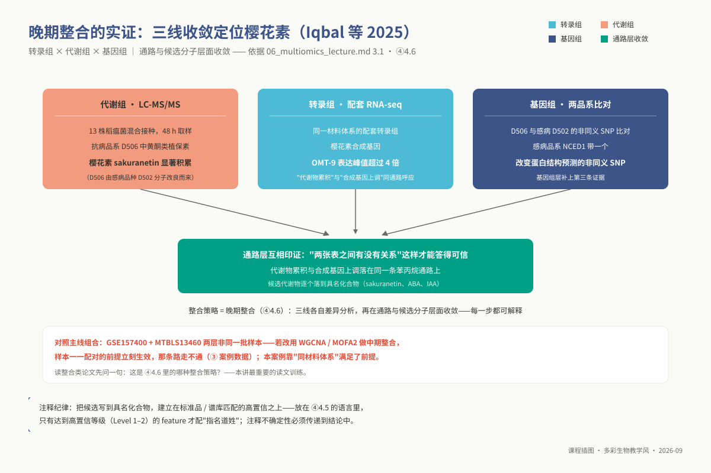
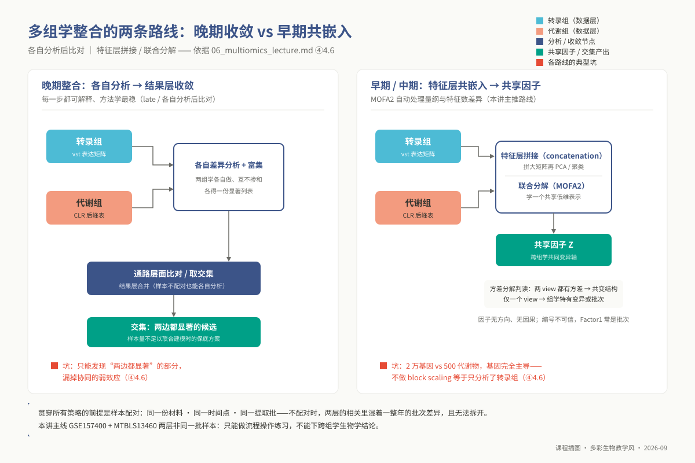
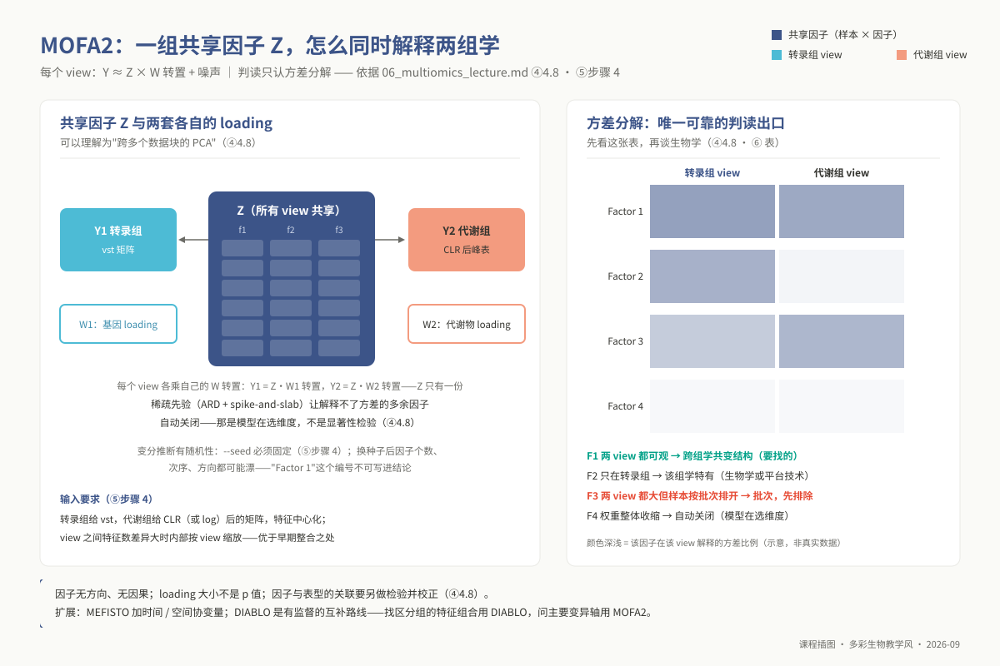
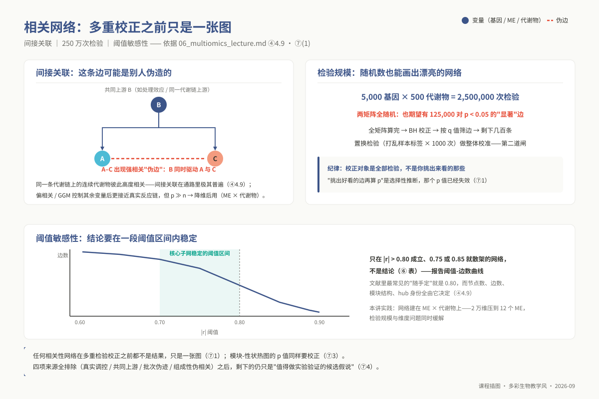

<!-- @section: cover -->
<!-- _class: phd cover -->

# 专题 p06：多组学整合分析

**任何相关性网络在做多重检验校正之前都不是结果，只是一张图。**

<div class="meta">

- 4 学时（2 h 理论 + 2 h 实践）｜ 环境 `ngs_phd_multiomics`
- 核心工具：WGCNA · MOFA2 · Cytoscape（`igraph` 为脚本化替代路径）
- **内嵌模块 ⚠**：理论 2 h 中划出 **1 h** 讲「非测序组学数据入门」（§4.1–4.5）——代谢组不是测序数据，是质谱峰表
- 脚本：`06_metabolome_preprocess.R` ｜ `06_wgcna_analysis.R` ｜ `06_mofa2_integration.R` ｜ `06_correlation_network.R`

</div>

---

<!-- @section: objectives -->
## 学习目标：学完你应当能够

1. **区分**质谱峰表与表达矩阵在数据生成、尺度、缺失结构、行标识四方面的差异，**判断** DESeq2 能不能用在峰表上
2. **解释** pooled QC 样本的三种用途，**判断**没有 QC 的数据能得出什么、不能得出什么
3. **诊断**缺失以 MNAR 还是 MAR 为主，**说出**用错分别制造假阴性还是假阳性
4. **解释**组成性约束为什么使 Pearson 产生伪相关，**说明** CLR 与填补的先后顺序为什么不能颠倒
5. **说出** MSI 注释置信等级，**把注释不确定性写进结论**
6. **运行** WGCNA，**解释**无标度拓扑拟合为什么不是显著性检验
7. **运行** MOFA2，**判断**某个因子是真实共变结构还是批次
8. **估算** 5000 × 500 全相关矩阵的检验规模，**执行** BH 与置换检验
9. **设计**迁移到自己课题的整合方案，写清"哪一步的结论只能算候选假说"

---

<!-- @section: prerequisites -->
## 前置检查：这几题做了没有？

| 模块 | 本讲用在哪 | 没过关的症状 | 自测题 |
|---|---|---|---|
| `l0_02_r` | ⑤ 全部脚本；⑥ 全部图 | 拿到峰表不会按行算 RSD；转置后行列名对不上 | L0-2-Q3、Q4、Q8、Q10 |
| `l0_03_conda` | 环境；⑨ E1 | 分不清"包没装"与"环境没激活" | L0-3-Q9、Q10 |
| `l0_06_stats` | ④ 4.3；⑦ 整节 | 说不出 250 万次检验为什么必须校正；把"BH 后 0 条边"当分析失败 | L0-6-Q1、Q5、Q6、Q10 |
| **`l1_p06`** | 转录组侧输入 | 把 counts / TPM 喂给 WGCNA，软阈值怎么调都上不去 0.8 | L1 **Q7、Q8** |

> **`l1_p06` 是本讲最硬的前置**：指向硕士 m04 §4.4「表达矩阵与 DESeq2 输出」——**WGCNA 的输入必须是 `vst()` / `rlog()` 矩阵**。最短补课约 40 min：只读 m04 §4.4 与 §4.2。

```bash
conda activate ngs_phd_multiomics
Rscript -e 'packageVersion("WGCNA")'    # 1.72
Rscript -e 'packageVersion("MOFA2")'    # >= 1.10；报错见 ⑨ E5
Rscript -e 'packageVersion("igraph")'
```

---

<!-- @section: background -->
## 科学问题：两张表之间有没有关系

单一组学只能回答"什么变了"，回答不了"变化怎么串起来"。转录组 300 个基因上调、代谢组 40 个代谢物累积——**这两张表之间有没有关系，是本专题唯一要回答的问题。**

| 专业 | 为什么需要配对 |
|---|---|
| 农药 | 只有转录组时"P450 上调"是一堆候选，配上实际检出的代谢产物候选才收敛 |
| 微生物 | 次级代谢簇：转录激活与产物累积必须同时观测，否则分不清"没转录"与"转录了但没产物" |
| 植物病理 | 防御代谢物比转录本更接近抗性表型本身 |
| 昆虫 | 代谢池变化与转录的时序错配本身就是信息 |

**三个追问**：① 两张表能不能放在一起（§4.1–4.5）② 用什么连起来：WGCNA / MOFA2 / 逐对相关（§4.6–4.9）③ 连起来的结论有多可信：250 万次检验里有多少是噪声（§⑦）

**数据需求**（主线待定）：**同一批样本**的配对多组学——配对性是硬要求，没有技术手段能补救 ｜ 样本 ≥ 15（不够就**放弃 WGCNA**）｜ 代谢组必须带 pooled QC + 进样顺序 + 批次 ｜ ≥ 1 个连续型性状 ｜ 注释表含 MSI 等级

---

## 应用案例：三线收敛

代谢组 × 转录组 × 基因组指向同一通路。



---

<!-- @section: principles -->
## 核心原理 · 内嵌模块「非测序组学数据入门」（1 h 计时表）

| 小节 | 内容 | 时长 | 出口检查（一句话能答上来才算过） |
|---|---|---|---|
| 4.1 | 峰表 vs 表达矩阵 | 12 min | 峰表的一行是什么？为什么不能用 DESeq2？ |
| 4.2 | QC 样本与批次漂移 | 13 min | 没有 QC 样本的数据，能不能说"本研究无批次效应"？ |
| 4.3 | 缺失值 MNAR vs MAR | 15 min | 对 MNAR 用均值填补，制造的是假阳性还是假阴性？ |
| 4.4 | 组成性数据与 CLR | 12 min | CLR 和填补谁先谁后？为什么不能反？ |
| 4.5 | 特征注释的不确定性 | 8 min | 一个 Level 3 注释的 hub 代谢物，结论只能写到什么颗粒度？ |

> 本课程三个层次从头到尾讲的都是 FASTQ / BAM / counts。学生若把峰表当成"另一个表达矩阵"直接做相关，**网络会很好看，结论一条都站不住**。

---

## 4.1 峰表长什么样：它不是"另一个表达矩阵"

| | RNA-seq counts | 质谱峰表 |
|---|---|---|
| **一行是什么** | 一个基因，ID 唯一 | 一个 **feature =（m/z, 保留时间）**，身份未知 |
| **一个值是什么** | read 数，**非负整数、可加** | 峰面积，**正实数、任意单位**，动态范围 4–6 个数量级 |
| **有没有"深度"** | 有，文库大小 | **没有**。TIC 不是深度 |
| **零 / 缺失** | 0 是真实的"没测到" | NA 大多是**低于检测限**，不是真的 0 |
| **行数与实体数** | 一行一基因 | **一个化合物常产生 3–10 个 feature**（加合物、同位素、碎片） |

**三条不能做的事**：① 不能用 DESeq2 / edgeR（负二项要计数与文库大小）→ log 后 `limma` 或非参 ② 不能说"某代谢物表达量"——跨特征比较强度几乎无意义 ③ 不能把冗余特征当独立证据——m/z 相差 21.98（Na−H）或 1.003（¹³C）的簇是同一个东西

**两个建库维度**：靶向 vs 非靶向 ｜ 蛋白组标记定量（TMT，ratio compression）vs LFQ（更依赖 QC）+ 蛋白推断问题

---

## 4.2 QC 样本与批次漂移：进样顺序是一个协变量

质谱响应**随进样顺序漂移**（离子源污染、色谱柱老化）：一批 100 针，最后几针信号可能只有开头的 60%。**按处理组顺序上机 → 漂移与处理完全混杂** → `L0-6-Q6` 那张 2×2 表的质谱版本。

**pooled QC**：所有样本等体积混合，每 5–10 针插一次，首尾都要有

| 用途 | 怎么做 | 判据 |
|---|---|---|
| 监测漂移 | 每特征画 QC 强度 ~ 进样顺序 | 应无趋势地在水平线附近抖动 |
| 过滤特征 | QC 上 **RSD = SD/mean** | LC-MS ≤ 20%、GC-MS ≤ 30% |
| 校正漂移 | **QC-RLSC**：QC 点上 LOESS 拟合，用拟合值除回全部样本 | 校正后 QC 在 PCA 上收缩成中心一小团 |

**三条硬规矩**：① 上机顺序必须**随机化**并记录 ② QC 必须**贯穿全序列** ③ **没有 QC ≠ 没有批次效应，而是"不可评估"**——正确回答是"跨批次比较作为探索性结果报告"，不是"我们的数据没有批次效应"

---

## 4.3 缺失值机制：MNAR 与 MAR 用错填补会制造假信号

| 机制 | 定义 | 质谱典型来源 |
|---|---|---|
| MCAR | 与任何变量无关 | 整针进样失败 |
| MAR | 依赖**已观测**的其他变量 | 某批次某类化合物提取效率低 |
| **MNAR** | 依赖**缺失值自身大小** | **低于检测限的真实低丰度记为 NA——质谱缺失的主体** |

**怎么判断**（`06_metabolome_preprocess.R`）：① 缺失率 ~ 检出强度散点，明显负相关 = **左截断证据，MNAR 主导** ② 缺失的组间分布：处理组全缺、对照组全有 → 可能是真实有/无差异，**单列为二值特征另行分析**

| 机制 | 推荐 | 用错的后果 |
|---|---|---|
| MNAR | **左截断**：min/5、QRILC、GSimp | 用均值/kNN → 低于检测限的值被抬到组均值 → **假阴性** |
| MAR/MCAR | kNN、missForest、SVD | 一律 min/5 → 人为造出低值簇 → 相关被"填/未填"二值模式主导 → **假阳性边** |

**三条规矩**：缺失率 > 50% **直接删不填** ｜ 按机制分组**混合策略** ｜ 填补方法**写进 Methods 并做敏感性分析**

---

## 4.4 组成性数据：为什么不能直接算 Pearson

LC-MS 原始峰强度并非天然闭合；变成组成性数据有两个来源：① 你做的**归一化**（TIC、中位数、PQN）把总量固定 ② **离子抑制**让化合物在电离阶段真实竞争

**闭合的三个后果**（Aitchison 1982）
1. 协方差矩阵**奇异**
2. 任意两组分相关系数**期望为负**——你看到的负相关可能纯属结构性
3. 不满足 **subcompositional coherence**：从 500 个里挑 50 个重算，同一对的相关会变 → **相关系数不是这对特征的性质，而是"你选了哪些特征"的性质**

**对策 CLR**：`clr(x)_i = log(x_i / g(x))`，g(x) 为该样本全部特征的几何均值

**顺序不能颠倒**：CLR 对 0 与 NA 无定义 → **过滤 → 判断机制 → 填补 → CLR**。先 CLR 再填补得到 `-Inf`/`NaN`（E7），或更糟——每个样本用不同特征集算几何均值，横向不可比

**残余局限**：CLR 后行和恒为 0 仍有线性约束；要发表偏相关网络应考虑 ILR、比例性度量（`propr`）或稀疏 GGM

---

## 4.5 特征注释的不确定性：一个峰可能是好几个东西

**MSI 置信分级**（Sumner 2007）

| Level | 依据 | 能写什么 |
|---|---|---|
| **1** | 标准品同平台 RT + MS/MS | 指名道姓 |
| **2** | 仅谱库 MS/MS 匹配 | "putatively annotated" + 标注等级 |
| **3** | 只能定到化合物类别 | "某黄酮" |
| **4** | 未知 | `M285T412` |

不确定性来源：5 ppm 容差下常匹配几十个分子式 ｜ **同分异构体**质量完全相同 ｜ 加合物与碎片未归并

**对本课受众尤其要紧**：农药代谢产物与植物/微生物次级代谢产物**大量不在公共谱库**，非模式物种 Level 1–2 占比常不到 20% → 网络里连接度最高的"hub 代谢物"很可能是个 Level 3

> **规矩**：结果表必须有一列 `annotation_confidence`，一路传到图注与正文。把 Level 2/3 悄悄写成确定的化合物名，是这个领域最常见的"数据在传递中变干净"现象。

---

## 4.6 整合策略：早期 / 中期 / 晚期

| 策略 | 做法 | 致命点 | 什么时候用 |
|---|---|---|---|
| **早期**（concatenation） | 两矩阵拼成大矩阵再 PCA/聚类 | 20000 基因 vs 500 代谢物，**基因完全主导** | 特征数量级相近且已分别标准化 |
| **中期**（潜变量） | MOFA2、DIABLO、joint NMF | 因子无方向无因果；**Factor1 常常是批次** | **本讲主推**；小样本也可用 |
| **晚期**（各自分析后比对） | 各自差异/富集再取交集 | 只能发现"两边都显著"的部分 | 样本量不足以联合建模时的保底 |

> **贯穿所有策略的前提是样本配对性**：同一份材料、同一时间点、同一提取批。"转录组去年测的，代谢组今年补的同一处理"不是配对数据——两组学之间的相关里混着一整年的批次差异，且无法拆开。

---

## 晚期收敛 vs 早期共嵌入

各有典型坑；样本配对是一切策略的前提。



---

## 4.7 WGCNA：加权共表达网络，以及它到底检验了什么

**流程**：相关矩阵（输入 **vst/rlog**）→ 软阈值加权 a<sub>ij</sub> = |cor|<sup>β</sup> → 选 β（`SFT.R.sq` 首次 ≥ 0.8 的最小 β）→ TOM 拓扑重叠（抗噪主要来源）→ 动态剪切树 → ME（模块第一主成分）→ 模块-性状关联 → hub（kME 高）

**⚠ 批判点一：软阈值不是显著性检验**
- `SFT.R.sq` 是"连接度分布像不像幂律"的**经验拟合优度**，不控制任何错误率；0.8 是启发式约定，不是 α
- "生物网络是无标度的"这一前提本身在网络科学界**存在争论**
- 正确表述："按 WGCNA 常规准则选了 β = 6"，不是"网络显著符合无标度拓扑"

**⚠ 批判点二：hub ≠ 驱动者**——管家基因、被处理强烈影响的下游基因都容易成为 hub

**⚠ 批判点三：模块可重复性要单独检验**——`modulePreservation()` 在独立数据集上（Z-summary > 10 强保守，< 2 不保守）

**样本量**：n ≥ 15（≥ 20 更稳）。n = 10 时 r 的 95% CI 宽度可超过 0.6——相关矩阵本身就是随机的。**n < 15 时正确做法是不做 WGCNA**

---

## 4.8 MOFA2：跨组学的共享潜因子

`Y_m ≈ Z W_m^T + ε_m`：**Z** 所有组学共享的样本 × 因子矩阵；**W<sub>m</sub>** 该组学的 loading；稀疏先验让多余因子自动关闭——"跨多个数据块的 PCA"

**最有用的输出是方差分解**——每个因子在每个 view 上解释多少方差
- **两个 view 都解释可观方差** → 跨组学共变结构，这正是你要找的
- 只在**一个 view** → 该组学特有（可能是生物学的，也可能是平台技术变异）
- Factor1 两个 view 都大但样本按**批次/进样日期**排开 → **这是批次，不是生物学**

**输入**：转录组 **vst**，代谢组 **CLR（或 log）**；别把原始 counts 或原始峰强度丢进去
**局限**：因子**无方向无因果**；编号不含生物学优先级；**MOFA 本身不做显著性检验**——loading 不是 p 值

**扩展**：MEFISTO（带时间/空间协变量，适合侵染时序）｜ DIABLO（**有监督**，找"区分处理组的跨组学特征组合"）

---

## MOFA2 因子直觉

共享因子同时解释两组学；Factor1 也可能只是批次。



---

## 4.9 相关网络 vs 偏相关网络，以及阈值的决定性作用

**相关网络的结构性缺陷：间接关联**——B 同时驱动 A 与 C，A–C 间就出现强相关边；代谢通路里连续代谢物彼此高度相关，极其普遍

**偏相关 / GGM**：控制其余全部变量后再算相关，更接近真实反应链（Krumsiek 2011）；代价是需要 n > p 或稀疏估计，而组学几乎总是 p ≫ n → 通常只在**降维之后**可行

→ 本讲实践把网络建在 **ME × 代谢物** 而非 **基因 × 代谢物** 上：20000 维压到 12 个 ME，检验规模与维度问题同时缓解

**阈值决定一切**：`|r| > 0.8` 是文献里最常见的"随手定"，而节点数、边数、模块结构、hub 身份全由它决定
- 先 FDR 校正按 **q 值**筛边
- 再画一条**阈值-边数曲线**：只在 0.80 成立、在 0.75 或 0.85 就散架的网络不是结论

---

<!-- @section: procedure -->
## 操作流程骨架（完整命令与参数见讲义 ⑤）

```text
步骤 0  环境；Cytoscape 两条路：A 桌面版（出版配图）/ B igraph 脚本化（可重复，进版本库）
步骤 1  转录组：counts → vst(blind=FALSE) → 按方差取 top 5000 → t()   ← 三个坑各一个
步骤 2  代谢组：06_metabolome_preprocess.R  过滤 → 判断机制 → 填补 → CLR
步骤 3  WGCNA：06_wgcna_analysis.R（SFT.R.sq 达不到 0.8 会直接停下报错而不是硬跑）
步骤 4  MOFA2：06_mofa2_integration.R --num-factors 10 --seed 20260829
步骤 5  网络：06_correlation_network.R  ME × 代谢物，全矩阵 → BH → 置换 → edges/nodes.tsv
```

```r
dds <- dds[rowSums(counts(dds)) >= 10, ]
vsd <- vst(dds, blind = FALSE)                # 保留 design 信息估离散度
mat <- assay(vsd)
mat <- mat[order(matrixStats::rowVars(mat), decreasing = TRUE)[1:5000], ]  # 按方差，不是均值
datExpr <- t(mat)                             # WGCNA 要 样本 × 基因
```

- **按方差取子集**：WGCNA 找的是共变，恒定的高表达基因没有信息
- 忘了 `t()`，报错会发生在很后面（E4）

---

## 步骤 2–5 关键参数

```bash
Rscript 06_metabolome_preprocess.R metabolome_peaks.tsv sample_meta.tsv results/p06/metab \
    --qc-rsd 20 --max-missing 0.5 --mnar-quantile 0.2
Rscript 06_wgcna_analysis.R results/p06/vst_top5000.tsv traits.tsv results/p06/wgcna \
    --min-module-size 30 --merge-cut-height 0.25 --deep-split 2
Rscript 06_mofa2_integration.R results/p06/vst_top5000.tsv results/p06/metab/metab_clr.tsv \
    sample_meta.tsv results/p06/mofa --num-factors 10 --seed 20260829
Rscript 06_correlation_network.R results/p06/wgcna/module_eigengenes.tsv results/p06/metab/metab_clr.tsv \
    results/p06/network --fdr 0.05 --n-perm 1000 --method spearman
```

| 参数 | 为什么 |
|---|---|
| `--qc-rsd 20` / `--max-missing 0.5` | QC RSD > 20% 剔除（GC-MS 放宽到 30）；缺失 > 50% 直接删不填 |
| `--mnar-quantile 0.2` | MNAR 特征用 20% 分位数 / 5 左截断；MAR 走行中位数；同时输出朴素版供敏感性分析 |
| `--merge-cut-height 0.25` | ME 相关 > 0.75 合并——"模块数过多"最直接的旋钮 |
| `--seed` | 变分推断有随机性，不固定不可复现 |
| `--fdr 0.05` / `--n-perm 1000` | **全矩阵算完再 BH**，不是先挑边再算 p；置换估整体假发现水平 |

---

<!-- @section: interpretation -->
## 结果解读：正常长什么样

| 图/表 | 正常 |
|---|---|
| `qc_drift_pca.png` | QC 点聚成中心一小团，实验样本围绕它按分组散开 |
| `missingness_vs_intensity.png` | 点云呈明显负相关（缺失多的特征强度低） |
| `soft_threshold.png` | `SFT.R.sq` 随 β 上升、越过 0.8 后走平，平均连接度降到几十 |
| 模块树状图 | 若干颜色带，grey 占比 < 30% |
| 模块-性状热图 | 少数模块与性状显著相关，多数不显著 |
| MOFA 方差分解 | Factor1–3 在两个 view 上都有可观方差 |
| `edges.tsv` | BH 后边数从数十万降到几百 |
| `threshold_sensitivity.png` | 边数随阈值平滑下降，核心子网在一段区间内稳定 |

---

## 结果不对时长什么样

| 图/表 | 不对 → 说明什么 |
|---|---|
| `qc_drift_pca` | QC 沿 PC1 拉成一条线顺着进样顺序 → 漂移未校正；**QC 比样本还散** → 这批数据可用性存疑 |
| `missingness_vs_intensity` | 无趋势散点 → 不是 MNAR 主导，别一律左截断；高强度高缺失簇 → 峰对齐失败 |
| `soft_threshold` | **R² 在 0.3–0.6 徘徊，β 加到 30 也上不去** → 输入错了（counts/TPM）或样本太小。把 β 硬调到 24 交差，模块是噪声 |
| 模块树状图 | grey 吞掉 60%+ → 网络没有结构；只有 2–3 个巨大模块 → `mergeCutHeight` 太高或 β 过小 |
| 模块-性状热图 | **几乎每个模块对每个性状都显著** → 被批次/时间整体驱动；**校正后一个都不显著** → 诚实结果，别换回原始 p |
| MOFA | Factor1 只在代谢组解释 60% 且按进样批次排开 → 批次因子 |
| `edges.tsv` | 校正前后边数几乎不变 → 漏了校正；**校正后 0 条边** → 报告"无边通过 FDR"，给 top 相关对作候选 |
| `threshold_sensitivity` | 阈值挪 0.05 网络就散架 → 不能报告该网络拓扑 |

---

<!-- @section: stats_plugin -->
## 统计要点 ⑦(1)：250 万次检验——相关网络的假发现规模

5000 基因 × 500 代谢物 = **2 500 000 次相关检验**。两个矩阵全是随机数，`p < 0.05` 下期望 **125 000 对"显著相关"**——足够画出一张任何布局算法都能画得很漂亮的网络。把 L0 那 985 个假阳性放大 127 倍，就是本讲的起点。

**三条操作规则**
- **校正对象是全部检验，不是你挑出来看的那些**：先算完整矩阵 → BH → 按 q 值筛边。"从网络里挑出好看的边再算 p" 是**选择性推断**，p 值已失效
- **Bonferroni 还是 BH**：250 万次下 Bonferroni 阈值 2×10⁻⁸ 通常什么都剩不下；网络构建的目标是**产出候选假说**，用 BH-FDR 并报 q
- **置换检验做整体校准**：打乱样本标签 1000 次，统计每次通过阈值的边数。真实边数落在置换分布内部 → "通过 FDR 的边"整体仍可能是噪声——BH 之外的第二道闸

---

## 250 万次检验下的网络

不校正时，随机相关也足够画出漂亮的网络。



---

## ⑦(2)–(3)：软阈值不是检验；模块-性状 p 值同样要校正

**(2) `pickSoftThreshold()` 的 `SFT.R.sq`**
- **不控制第一类错误**：0.8 不是 α，与 p 值没有任何对应
- **不判断任何一条边真假**：衡量的是整个网络的宏观拓扑形状
- **前提本身可争议**：幂律与对数正态等重尾分布在有限样本下常难以区分
- 正确写法："按 WGCNA 常规准则选择使 SFT.R.sq 首次 ≥ 0.8 的最小 β（本研究 β = 6）"
- 错误写法："网络显著符合无标度拓扑（R² = 0.85）"——把拟合优度冒充成了检验

**(3) 模块 × 性状热图**
- 12 模块 × 5 性状 = 60 次检验；WGCNA 官方教程那张热图默认显示**未校正的 p 值**，直接照抄进论文是常见错误
- **隐性检验**：你调 `deepSplit`/`mergeCutHeight` 试了几次才得到这套模块，每次都在看性状关联——这本身就是多重比较 → **模块划分参数应在看性状之前定下来**

---

## ⑦(4)：相关不等于因果——四个来源与各自的排除手段

一条"基因 X 与代谢物 M 显著相关"的边可能来自：

| 来源 | 怎么排除 |
|---|---|
| ① 真实的调控/代谢关系 | 排除下面三项之后剩下的**候选** |
| ② 共同的上游驱动（处理效应让两者同向变化） | 控制处理因子，或在处理组内部分别算相关看是否还在 |
| ③ 共同的批次 / 归一化伪迹 | 需要 QC 与进样顺序；批次作协变量回归掉后重算 |
| ④ 组成性数据的结构性伪相关 | CLR；代谢组内部的边额外用偏相关/GGM 复核 |

**四项全排除之后，剩下的仍然只是"值得做实验验证的候选假说"**——共表达模块、MOFA 因子、hub 基因全部属于这一类。

要往因果上走：独立样本重复出这条边（`modulePreservation` / 独立队列）+ 一个正交实验（过表达/敲除后测该代谢物、体外酶活、同位素示踪）

> **本讲能给出的最强结论是"候选"，作业与论文里都必须这样写。**

---

<!-- @section: ai_task -->
## AI 辅助任务：让 AI 写"转录组 × 代谢组"相关脚本，抓它在数据性质上犯的四类错

**第一步**（原样使用）：
> "我有配对的转录组表达矩阵和代谢组强度矩阵，共 18 个样本。帮我写一个 R 脚本做整合分析，找出与代谢物显著相关的关键基因，并画出相关性网络。"

| 错误类别 | 在 AI 脚本里长什么样 | 对应 |
|---|---|---|
| **① 对组成性数据直接算 Pearson** | `cor(t(rna), t(metab), method="pearson")` 直接上，最多 `scale()` | §4.4 |
| **② 把 MNAR 当 MCAR 填补** | `metab[is.na(metab)] <- 0`、`na.rm=TRUE`、`impute.knn()` 一律填；**完全不提机制** | §4.3 |
| **③ 无多重检验校正** | `which(abs(cormat) > 0.8)` 或 `p < 0.05`，没有 `p.adjust()`；或先挑边再算 p | §⑦(1) |
| **④ 把质谱强度当表达量** | 写"代谢物表达量"；对代谢组用 DESeq2；算 TPM；`log2(x+1)` 不提检测限 | §4.1 |

**追加观察**：有没有主动问样本是否配对？提到 QC 吗？18 个样本时会不会照样推荐 WGCNA？

**提交物五件套**：AI 脚本原文（含提示词、模型版本、日期）｜ 四类错的具体行号（**没犯也要写明"未犯，因为它做了 X"**）｜ **发现路径**——是"知道该查所以去查"还是"跑完发现 8 万条边才觉得不对"｜ 修正版 + 两版差异（边数、hub 重合、结论是否改变）｜ 100 字方法学说明

---

<!-- @section: troubleshooting -->
## 常见错误：课堂上一定会遇到的三条

**E2 软阈值曲线不收敛（本讲头号坑）** `No power reached the desired scale-free topology fit index. Returning NA.`
- **90% 是这一条**：喂的不是 vst/rlog，而是 raw counts 或 TPM（机理见 m04 §4.4）
- 回步骤 1：`assay(vst(dds, blind=FALSE))`，按**方差**取 top 5000，再 `t()`
- **绝对不要把 β 硬调到 24/30 交差**；排除输入后再查：样本量（E3）、批次结构、混了不同组织/时间点

**E3 样本数不足** `Some correlation estimates are based on fewer than 10 observations.`（更隐蔽：无报错，但模块数每改一点参数就完全不同）
- 不够就**不做 WGCNA**，改 MOFA2 或晚期整合；必须做则降到 2000–3000 基因并**明确报告为探索性**；无论如何跑 `modulePreservation()`

**E7 CLR 之后出现 `-Inf` / `NaN`** `In log(x) : NaNs produced`
- 顺序反了：**先过滤先填补再 CLR**；填补后仍有 0 加明确伪计数（最小非零值的一半）并**写进方法**

---

## 排查路标（讲义 ⑨ E1–E8）

```text
环境：PackagesNotFoundError: cytoscape → E1（桌面 Java 应用；走 igraph 脚本化路径）
      ModuleNotFoundError: mofapy2 → E5（同一环境装 mofapy2；reticulate::use_condaenv）
      unused arguments (weights.x = ...) → E6（cor 被 tidyverse 遮蔽；cor <- WGCNA::cor）
输入：SFT.R.sq 上不去 0.8 → E2（counts/TPM 当 vst）
      Too many missing values / nSamples=5000 → E4（矩阵方向反了，忘了 t()）
      fewer than 10 observations → E3
变换：log(x): NaNs produced → E7（CLR 与填补顺序）
调参：模块 50+ / 只有 2–3 个 / grey 60%+ → E8（deepSplit、minModuleSize、mergeCutHeight——
      三个旋钮都不能"调到结果好看为止"，参数应在看模块-性状之前定下来）
```

---

<!-- @section: wrapup -->
## 实践任务卡（2 h）与课后

**课堂实践（按脚本顺序）**
1. `06_metabolome_preprocess.R`：先看 `qc_drift_pca.png` 与 `missingness_vs_intensity.png`，**写下 MNAR/MAR 判断**再填补
2. 转录组 vst → `06_wgcna_analysis.R`：软阈值曲线过不过 0.8？grey 占多少？**模块参数在看性状之前定死**
3. `06_mofa2_integration.R`：方差分解——Factor1 是生物学还是批次？
4. `06_correlation_network.R`：BH 前后边数、置换分布、阈值敏感性；边表拖进 Cytoscape 或用 igraph 出图

**思考练习**（讲义 ⑩，6 题）——课堂讨论选 3 题
- Q1 "网络显著符合无标度拓扑（R² = 0.85, β = 6）"——两处错，改写
- Q3 8000 基因 × 350 代谢物：检验数、随机期望"显著"数、BH 允许的假边、先挑边再 BH 错在哪
- Q4 hub 是一个 P450：三条从"网络中心"推向"功能驱动者"的验证路径，各排除 ⑦(4) 的哪几个来源

**必做开放题 Q6**：一页多组学整合方案——生物学问题与为什么单组学答不了 ｜ 组学种类、样本量下限、配对性、QC 插几针 ｜ 缺失机制与敏感性分析 ｜ WGCNA / MOFA2 / 晚期整合的理由 ｜ **哪一步只能算候选假说、用什么实验验证** ｜ 样本量只有 10 时方案怎么改

**参考资料**：讲义 ⑪（18 篇原始文献 DOI 已核验 + 官方文档），本 deck 不重复列
