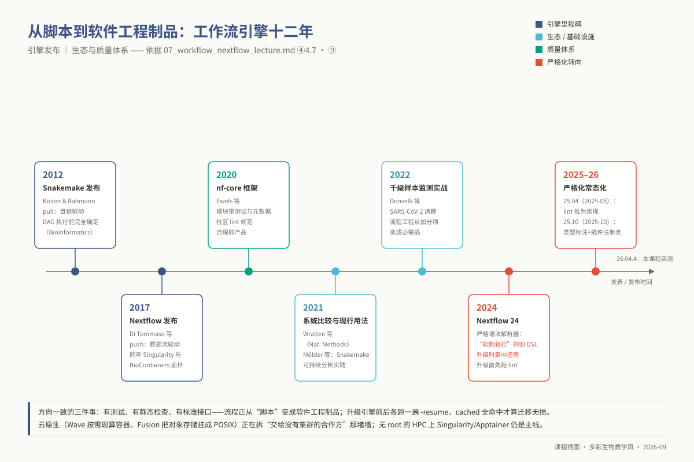
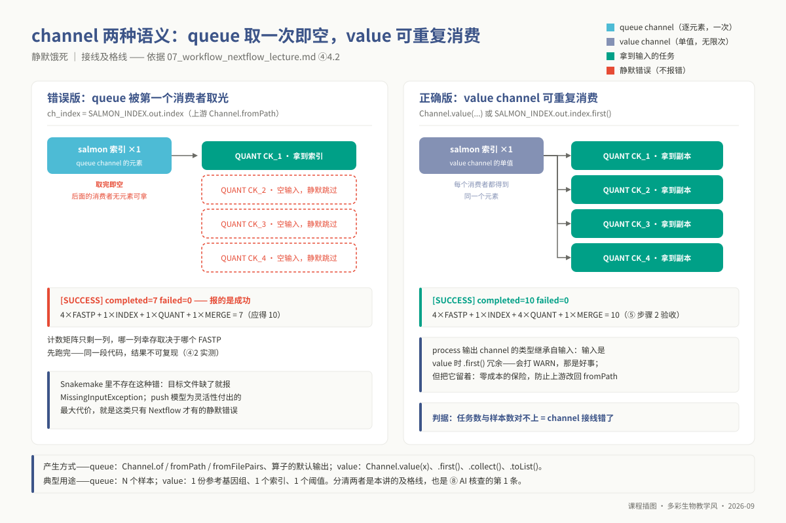
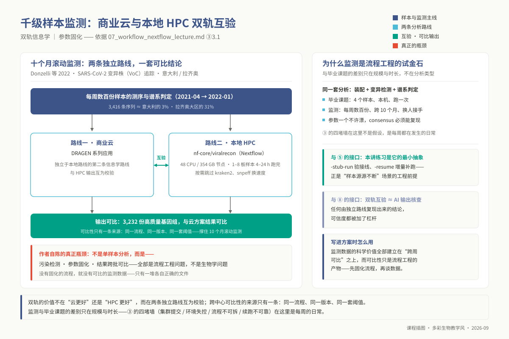
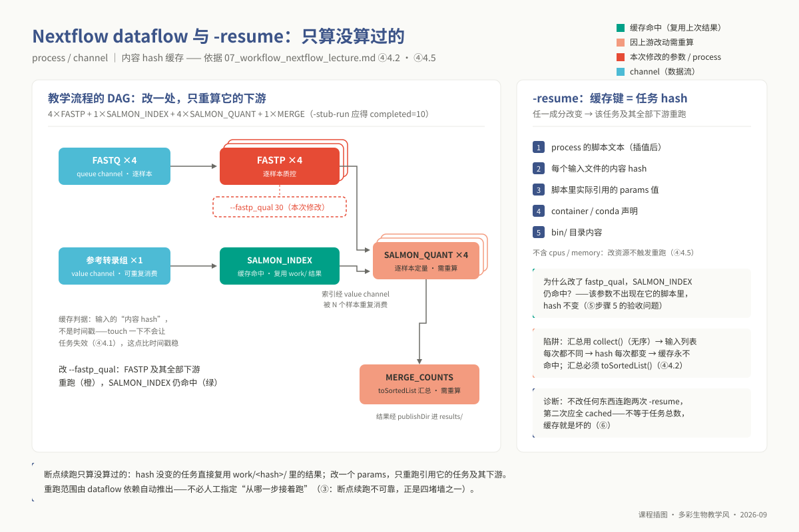

<!-- @section: cover -->
<!-- _class: phd cover -->

# 专题 p07：Nextflow / Snakemake 工作流开发

**当流程要给别人用、要在几百个样本上跑、要在没有 root 的集群上跑、要在两年后被审稿人重跑时——Snakemake 的哪些设计开始变成阻力，Nextflow 用什么换掉了它，代价是什么。**

<div class="meta">

- 4 学时（2 h 理论 + 2 h 实践）｜ 环境 `ngs_phd_workflow`（Docker / Singularity **不在**其中）
- 配套流程：`03_code/phd/workflows/`（`main.nf` / `nextflow.config` / `conf/` / `modules/local/` / `subworkflows/local/` / `bin/`）
- 对照物：`03_code/master/pipelines/`（硕士 m08 的 Snakemake 版，功能完全等价）
- **本讲的起点不是零**：m08 已教过 rule / wildcards / `expand` / `--use-conda`；本讲不再讲"为什么要用工作流引擎"
- **你要自带的东西**：一个你自己跑通过的 Snakefile（本讲拿它当转换素材）

</div>

---

<!-- @section: objectives -->
## 学习目标：学完你应当能够

1. **说明** pull（目标驱动）与 push（数据流驱动）在 DAG 构建时机、样本枚举来源、中间文件归属三处的差异
2. **判断**一条 channel 是 queue 还是 value，**预测**它被两个 process 消费时的行为
3. **编写**带 `input` / `output` / `script` / `stub` 的 process，拆进 `modules/`，用 `include` 接线
4. **把**路径、阈值、线程数、队列名全部移出 `.nf`，**说明**四层配置的优先级
5. **区分** `conda` 与 `container` 指令各改变了什么（PATH vs 整个用户态），为什么无 root 集群只能用 Singularity/Apptainer
6. **配置** SLURM / SGE executor，用 `withLabel` 声明资源、`errorStrategy` + `task.attempt` 做重试与动态提资
7. **解释** `-resume` 缓存键由哪些成分构成，**诊断**"本该命中却没命中"的原因
8. **读懂** nf-core 流程目录结构，**判断**一条 Snakemake 流程该不该迁移

---

<!-- @section: prerequisites -->
## 前置检查：这几题做了没有？

| 模块 | 本讲用在哪 | 没过关的后果 | 自测题 |
|---|---|---|---|
| **`l1_p07`** | 全讲起点：范式对照的 Snakemake 侧、转换素材、AI 任务核查对象 | 读不懂对照表左半列；AI 转换对不对无从判断 | L1 **Q9**（读一条 rule）、**Q10**（写最小可跑 Snakefile——**产出就是本讲转换素材**） |
| `l0_01_linux` | 集群提交；读 `work/` 与 `.command.*` | 找不到 `work/<hash>/` 下的现场 | L0-1-Q3、Q5、Q9、Q10 |
| `l0_03_conda` | 容器 vs conda；`-profile conda` | 分不清"包没装"与"环境没激活" | L0-3-Q9、Q10 |

**本讲不重复**：Snakemake 入门（m08）、conda 创建与导出（`l0_03_conda`）、Docker 镜像构建（m08）

```bash
conda activate ngs_phd_workflow
nextflow -version          # 记下版本号，它决定语法严格程度（⑨-1 / ⑨-2）
```

---

<!-- _class: phd -->

# ⚠ 实测硬约束：Nextflow 24+ 在含非 ASCII 字符的路径下无法工作

```text
Error main.nf:22:1: Invalid include source: '/path/to/subworkflows/local/quantify.nf'
```

- 本课程仓库路径含中文（`.../课程/研究生/...`）→ **所有 `include` 一律被判为 Invalid include source，流程根本编译不过**
- 实测 Nextflow 26.04 在此路径下**必然**报此错；拷到纯英文路径立刻正常
- 报错信息极具误导性——看起来像文件路径写错，实际是路径编码问题

**第一条命令就要做的事**

```bash
cp -r 03_code/phd/workflows ~/p07_nf && cd ~/p07_nf      # 或 /d3/scratch/${USER}/nf/
```

> 契约 `delivery.nextflow_ascii_path_required: true`。把流程交给合作方时也必须说明这一点。同一条报错的另一个原因：`include` 省略了 `.nf` 后缀（24+ 要求写全）。

---

<!-- @section: background -->
## 科学问题：一次分析在什么条件下才算"被记录下来了"

**一个真实的分岔口**：m08 里 4 个样本本机跑得很顺；半年后 180 个样本、三个批次、要交给合作实验室，对方集群是 SLURM、没有 root、conda 装不上你那个版本的 STAR——

| 墙 | 现象 | 本讲的答案 |
|---|---|---|
| 集群提交 | `--cluster "qsub ..."` 越写越长，换集群整条重写 | executor 抽象 + profile |
| 环境不可控 | `GLIBC_2.29 not found`，conda 救不了（系统库） | `container` + Singularity |
| 流程不可拆 | 想复用定量部分只能整个拷过去改 | `modules/` + `include` + 子工作流 |
| 断点续跑不可靠 | 改了参数，`snakemake -n` 说 `Nothing to be done` | 基于内容 hash 的 `-resume` |

m08 的答案是"同数据 + 同代码 → 同结果"。本讲推进一步：**代码本身也会变**。真正要固定的是**从输入到结论的整条依赖关系与全部参数**——一个**能被第三方独立执行的对象**，不是一份说明文档。

**边界**：本讲不产生任何新的生物学结论；只改变你的分析能不能被别人（和三年后的你）原样跑出来。

---

## 工作流引擎时间线

2012 Snakemake → 2017 Nextflow → 2020 nf-core。



---

<!-- @section: principles -->
## 核心原理 4.1：pull 与 push——本讲最重要的概念

**Snakemake 是 pull**：从 `rule all` 想要的文件倒推，匹配 `output` 模式反解 wildcards，递归到底。**DAG 在第一个任务执行前就完整确定** → `snakemake -n` 能打印整张计划

**Nextflow 是 push**：`Channel.fromPath(...).splitCsv(...)` 把样本清单变成数据流，接到 process 输入端。**每来一个元素派生一个任务**。DAG 不是算出来的，是**跑出来的**

| | Snakemake（pull） | Nextflow（push） |
|---|---|---|
| 谁决定跑几个任务 | 目标文件名反解的 wildcards | channel 里有几个元素 |
| 样本清单从哪进来 | `expand()` 进 `rule all` | `splitCsv` 进 channel 源头 |
| DAG 何时确定 | 执行前完全确定 | 运行中展开，`-preview` 只给静态近似 |
| 中间文件在哪 | `output:` 写的路径 | `work/<hash>/`，只有 `publishDir` 声明的才出现在结果目录 |
| 缓存判据 | 时间戳 + `.snakemake/` | 输入的**内容 hash** |
| "一个样本一个任务" | 默认；合成一个任务要 `expand` | 默认；合成一个任务要 `collect()` |

---

## 4.1 续：三条批判

**批判一：pull 的代价是"一切必须先能写成文件名"**
- 组装事先不知道出多少 contig、demultiplex 不知道分出多少样本 → Snakemake 的 `checkpoint` 是补丁，**承认了 pull 模型在这里失效**；Nextflow 天然没有这个问题

**批判二：push 的代价是"DAG 不可预先审阅"，以及一类只在 Nextflow 里存在的静默错误**——queue channel 被消费一次即空（本讲实测，Nextflow 26.04）：

```text
# 正确版：ch_index = SALMON_INDEX.out.index.first()
[SUCCESS] completed=10 failed=0 cached=0        # 4 FASTP + 1 INDEX + 4 QUANT + 1 MERGE
# 错误版：ch_index = SALMON_INDEX.out.index     （且上游用 Channel.fromPath）
[SUCCESS] completed=7 failed=0 cached=0         # 只有 1 个样本被定量
```

**它报的是 SUCCESS。** 计数矩阵只剩一列，哪一列取决于哪个 FASTP 先跑完——**不可复现**。Snakemake 里目标文件缺了就报 `MissingInputException`。

**批判三：什么时候不该迁移**（迁移通常 1–2 周）——① 流程已跑通且样本量不会再涨 ② 只在自己一台机器上跑 ③ 大量 `checkpoint` 式动态分支 ④ 合作方都只会 Snakemake → **不要迁**。要交给别人常态化使用 / 多种调度器 / 容器锁死环境 / 复用 nf-core 模块 → **值得迁**

---

## 4.2 DSL2 三件套：process

```groovy
process SALMON_QUANT {
    tag   "${meta.id}"                 // 日志里的任务标识
    label 'process_medium'             // 资源等级，具体数值在 conf/base.config
    conda     "bioconda::salmon=1.10.3"
    container "quay.io/biocontainers/salmon:1.10.3--haf24da9_3"
    input:
    tuple val(meta), path(reads)       // meta 是 map，可带 condition/batch
    path index                         // 来自 value channel，可被 N 个样本重复消费
    output:
    tuple val(meta), path("${meta.id}.quant.sf"), emit: quant
    script:
    """
    salmon quant -i ${index} -l ${params.salmon_libtype} -1 ${reads[0]} -2 ${reads[1]} -p ${task.cpus} -o ${meta.id}
    cp ${meta.id}/quant.sf ${meta.id}.quant.sf
    """
    stub:  """  printf 'Name\\t...\\tNumReads\\n' > ${meta.id}.quant.sf  """
}
```

---

## 4.2 续：process 的三个值得记的细节

- process 是**纯函数式**的：只认 `input` 声明的东西，在独立 `work/` 子目录执行；内部**不要**写绝对路径、不要 `cd`
- **`meta` map 是 nf-core 核心惯例**——样本身份随数据流动，比只能是字符串的 wildcards 表达力强
- **`stub:` 让流程在没装任何生信软件的机器上也能验证接线**——Snakemake 的 `-n` 不建文件，发现不了 glob 写错
- salmon 输出恒名 `quant.sf`，N 个同名文件汇到一处会被自动改名 → **先带上样本名再往下传**

---

## 4.2 续：channel 有且只有两种——分清它们是本讲的及格线

| | queue channel | value channel |
|---|---|---|
| 怎么产生 | `Channel.of/fromPath/fromFilePairs`、算子默认输出 | `Channel.value(x)`、`.first()`、`.collect()`、`.toList()` |
| 能被消费几次 | **一次**，取完即空 | **无限次** |
| 典型用途 | N 个样本 | 1 份参考、1 个索引、1 个阈值 |

- **process 输出 channel 的类型继承自输入**：上游是 value，输出也是 value，此时 `.first()` 冗余，Nextflow 打印 `The operator 'first' is useless when applied to a value channel`——**看到这条 WARN 是好事**。但把 `.first()` 留着：零成本的保险

---

## queue 与 value channel

queue 取一次即空；value 可无限次消费。



---

## 4.2 续：算子与汇总的坑

- 常用算子按用途记：**变形** `map`/`flatten` ｜ **筛选** `filter`/`unique` ｜ **收拢** `collect`（无序）/ `toSortedList`（有序）/ `groupTuple` ｜ **配对** `combine`（笛卡尔积）/ `join`（按 key）/ `mix`

> **一条实用的坑**：汇总步骤必须用**有序**收集。`collect()` 的顺序取决于谁先跑完 → 每次输入列表不同 → hash 不同 → **`-resume` 永远不命中**。配套流程用 `toSortedList { a, b -> a.name <=> b.name }`。

**workflow** 块只做编排——`main.nf` 里不该出现任何 shell 命令。

---

## 4.3 模块化与配置分离

- `include { FASTP } from './modules/local/fastp.nf'` 引进 process；常一起用的封成**子工作流**（`subworkflows/local/quantify.nf`）
- Snakemake 的 `include:` 是**文本拼接**，所有 rule 同一命名空间；DSL2 的 include 有**作用域**，同一 process 可带不同别名多次引入（`include { FASTP as FASTP_RAW }`）

**配置四层，后者覆盖前者**

```text
.nf 文件里的默认值  <  nextflow.config 的 params  <  -params-file params.yaml  <  命令行 --xxx
```

> **判断标准**：只要一个值在换数据集、换集群、换服务器时可能变，它就不许出现在 `.nf` 里。

配套 `conf/` 拆四份：`base.config`（资源等级与重试）、`slurm.config`、`sge.config`、`test.config`；profile 可叠加 `-profile test,singularity,slurm`

---

## 4.4 容器集成：环境是换 PATH，容器是换整个文件系统

```groovy
conda     "bioconda::fastp=0.23.4"                          // 只改 PATH，宿主的 glibc 还是宿主的
container "quay.io/biocontainers/fastp:0.23.4--h5f740d0_0"  // 换整个用户态，镜像自带系统库
```

- 两条指令**同时写在一个 process 里**，由 profile 决定启用哪个：本机 `-profile conda`、集群 `-profile singularity`，**不用改一行**——这正是 Nextflow 优于 Snakemake 之处
- `GLIBC_2.29' not found` 这类报错，conda 无能为力，容器能救

**⚠ Docker 与 Singularity/Apptainer 都不在 `ngs_phd_workflow` 环境里**（契约 `env_exempt_tools`：系统级容器运行时）
- Docker 需要 root 守护进程，HPC 几乎不提供
- 集群给你的是 Singularity/Apptainer——无守护进程、以你自己身份运行、可直接拉 Docker 镜像
- **镜像 tag 必须写死**（`0.23.4--h5f740d0_0`，不是 `latest`），否则等于没锁版本

---

## 双轨互验案例

同一流程，商业云与本地 HPC 各跑一遍。



---

## 4.5 集群部署与 `-resume` 的缓存机制

```groovy
process {
    errorStrategy = { task.exitStatus in ((130..145) + 104) ? 'retry' : 'finish' }
    maxRetries    = 2
    withLabel: process_medium { cpus = 4; memory = { 8.GB * task.attempt }; time = { 2.h * task.attempt } }
}
```

- executor 是抽象层：`process.executor = 'slurm'` 后 Nextflow 自己生成 `sbatch`、轮询、收尸；换集群 = 换 profile
- **`task.attempt` 是本讲最实用的一招**：第 1 次 8 GB，OOM（137）后第 2 次 16 GB，第 3 次 24 GB
- 只对"重试有意义"的退出码重试：130–145 是被信号杀死（137 = OOM、143 = 超时）

**`-resume` 缓存键由五样东西决定**：① `script` 文本（插值后）② 每个输入文件的**内容 hash**（不是时间戳——`touch` 不会让它失效）③ 脚本里引用到的 `params` ④ `container` / `conda` 声明 ⑤ `bin/` 内容
- 任一改变 → 该任务及其全部下游重跑
- **不包含 `cpus` / `memory`**——改资源不触发重跑

---

## 断点续跑只算没算过的

内容 hash 未变的任务直接复用 work/ 下的结果。



---

## 4.6 nf-core：怎么读，怎么改

**读法套路**：`nextflow_schema.json`（全部参数的权威清单）→ `conf/modules.config`（**每个 process 的 `ext.args` 都在这里**）→ `workflows/*.nf`（主逻辑）→ `subworkflows/` 与 `modules/nf-core/`（带测试的模块）

**改法优先级**
1. 能用 `-params-file` 解决的不写 config
2. 能用 `conf/` 加一条 `withName` 覆盖的不改 `modules/`
3. 实在要改模块：把你的版本放进 `modules/local/` 并换 include

> **不要直接编辑 `modules/nf-core/`**——该目录由 `nf-core modules update` 管理，改动会被覆盖。

---

<!-- @section: procedure -->
## 操作流程骨架（完整命令见讲义 ⑤）

```text
步骤 0  conda activate ngs_phd_workflow；nextflow -version；拷到纯英文路径
步骤 1  造演示数据   make_demo_data.py --outdir demo --reads-per-sample 3000（固定种子，离线）
步骤 2  空跑        nextflow run . -stub-run -profile test        → 期望 completed=10  ★ 验收标准
步骤 3  读 DAG      -with-dag dag.html，对照 subworkflows/local/quantify.nf 看接线
步骤 4  真跑        nextflow run . -profile test,conda（首次联网建环境）
步骤 5  中断与恢复  删一个中间结果 → -resume 看 cached=；改 --fastp_qual 30 看哪些重跑
步骤 6  集群提交    -profile test,singularity,slurm|sge --queue <队列> -resume
步骤 7  转换自己的 Snakefile：单个 process 跑通 → 接成 workflow → 拆进 modules/ → 参数进 config
```

- 步骤 2 的 `completed=10` = 4×FASTP + 1×INDEX + 4×QUANT + 1×MERGE。**出现 7 或 4 就是 channel 接错了**，回 4.2 找原因
- 步骤 5 **必须记录**三次运行的 `cached=` 与 `completed=` 并解释：第三次为什么 `SALMON_INDEX` 仍命中？（`fastp_qual` 不出现在它的脚本里）
- 步骤 7 **顺序不要颠倒**——一上来就模块化，出了问题分不清是接线错还是命令错

---

## 步骤 5 · 缓存验证的三次运行

```bash
nextflow run . -profile test,conda                          # ① 完整跑一遍
rm -rf results_test/quant/CK_1*                             # 删一个中间结果
nextflow run . -profile test,conda -resume                  # ② 观察 cached=N
nextflow run . -profile test,conda -resume --fastp_qual 30  # ③ 改阈值，观察哪些重跑
```

```text
[SUCCESS] completed=0 failed=0 cached=10     # 全部命中：什么都没改
[SUCCESS] completed=6 failed=0 cached=4      # 改了 fastp 参数：FASTP 及全部下游重跑，索引仍命中
```

```bash
nextflow run . -profile test,singularity,slurm --queue <你的队列> -resume     # SLURM
nextflow run . -profile test,singularity,sge   --queue <你的队列> -resume     # SGE
squeue -u $USER    # 或 qstat -u $USER：观察 Nextflow 自己在提交、排队、回收
```

---

<!-- @section: interpretation -->
## 结果解读：`work/` 是排错的唯一现场，`trace.txt` 是申请资源的唯一依据

| 文件 | 看它干什么 |
|---|---|
| `.command.sh` | **插值后的真实命令**——你以为传进去的和实际传进去的，差别常在这里 |
| `.command.err` / `.out` / `.log` | stderr / stdout / 合并 |
| `.exitcode` | 137 = OOM，143 = 超时 |
| `.command.run` | 引擎包装脚本（容器挂载、资源声明），排查"容器里看不到文件"时看它 |

> 报错里的 `Work dir:` 就是入口。**第一动作：`cd` 进去 `cat .command.sh`，而不是回头改代码。**

**`trace.txt` 关键列**：`status`（COMPLETED / CACHED / FAILED）、`exit`、`realtime`、**`peak_rss`**（实际物理内存峰值，按 1.5–2 倍申请）、`%cpu`（远低于 `cpus × 100%` 说明多给的核没用上，白占队列）。`report.html` 是可视化版，`timeline.html` 看并发是否真的打开。

---

## 结果不对时长什么样——三种，前两种不报错，最危险

**1. `completed=7` 而不是 10，状态却是 SUCCESS**
- 计数矩阵少了几列。queue channel 被第一个任务消费光，其余样本静默饿死
- **判据：任务数与样本数对不上，就是 channel 接线错了。不要去日志里找报错——不会有报错**

**2. 每次 `-resume` 都全量重跑**
- 汇总步骤用了 `collect()` 而非 `toSortedList()`，或脚本里插值了时间戳/随机数
- **判据：连续两次不改任何东西跑 `-resume`，`cached` 不等于任务总数，缓存就是坏的**

**3. `publishDir` 里有结果，但内容是上一次的**
- `mode: 'symlink'`（默认）指向 `work/`，`work/` 被清理后就是断链；跨文件系统尤其容易踩
- **教学与交付一律用 `mode: 'copy'`**

---

<!-- @section: ai_task -->
## AI 辅助任务：让 AI 把你的 Snakefile 转成 DSL2，逐条核对语义是否等价

**提示**：贴上完整 Snakefile（含 `config.yaml` 与 `samples.tsv`），要求模块化到 `modules/`、参数全部走 `params`、每个 process 带 `stub`。**把你的 Nextflow 版本号告诉它**——24+ 严格语法与旧写法差别很大。

| # | 核查什么 | 怎么查 | AI 的典型错法 |
|---|---|---|---|
| 1 | **channel 消费语义** | "1 份参考 / 1 个索引"的输入是否来自 value channel 或经 `.first()`/`.collect()` | 直接把 `SALMON_INDEX.out` 接给逐样本 process——Snakemake 里索引可被 N 条 rule 反复引用，**queue channel 不能** |
| 2 | **并发行为** | 数 `-stub-run` 的 `completed=`，与"样本数 × 步骤数 + 汇总"对比 | 该逐样本的写成 `collect()`，或该汇总的没 `collect()` |
| 3 | **`-resume` 缓存** | 连跑两次，第二次必须全 `cached` | 汇总用 `collect()` 导致输入无序 |
| 4 | **资源声明** | 比对 `threads:` 与 `label`/`cpus`；shell 里用 `${task.cpus}` | 资源声明丢失，或翻译成写死的 `-p 8` |
| 5 | **结果一致** | 同一份小数据两版都跑，`md5sum` 逐文件比对 | 输出结构变了、`publishDir` 漏了某类产物 |

---

## AI 辅助任务 · 提交物与设计意图

**提交物**：原 Snakefile + AI 原始输出 + 修正版 + 五条核查结论表 + 两版 `diff` / `md5sum`

> 第 1 条是 AI 几乎必错且**错了不报错**的地方。你能不能靠 `completed=` 这个数字把它抓出来，比你会不会写 DSL2 更重要。若 AI 恰好写对了，也要写清你**验证过**它对。

---

<!-- @section: troubleshooting -->
## 常见错误：课堂上一定会遇到的三条

**⑨-3 `include` 找不到源文件** `Invalid include source: '/path/to/subworkflows/local/quantify.nf'`
- 两个独立原因给出同一条报错：① 省略了 `.nf` 后缀 ② **路径里有非 ASCII 字符**（本仓库路径含中文，实测必然报错）
- include 一律写全 `.nf`；工作目录用纯英文路径；**交给合作方时尤其要说明**

**⑨-4 输出 glob 与实际文件名对不上** `Missing output file(s) \`*.clean.fq.gz\` expected by process \`QUANTIFY:FASTP (CK_1)\``
- 报错里**已经把真实命令打出来了**——`cleaned` 与 `clean` 一字之差
- `cd` 进 `Work dir:`，`ls -la` 看实际产出；`-stub-run` 会真建文件，能提前抓出 glob 写错
- **连带现象**：上游全挂后 `toSortedList()` 发一个**空列表**，汇总步骤报一个风马牛不相及的错——**永远从第一个报错查起**

---

## 常见错误 · 续

**⑨-6 集群上 `command not found`，本机却好好的** `.command.sh: line 3: salmon: command not found`
- SLURM / SGE 作业**不继承**登录 shell 的环境（配套 `slurm.config` 特意写了 `--export=NONE`）
- 不要靠"提交前先 activate"，靠 `-profile conda` / `-profile singularity` 让每个 process 自带环境；SGE 还要 `clusterOptions` 里写 `-S /bin/bash`

---

## 排查路标（讲义 ⑨ 1–8）

```text
语法（24+ 严格解析器）：
  Variable declarations cannot be mixed with config statements → ⑨-1（config 里写了 def；去掉时间戳）
  Statements cannot be mixed with script declarations → ⑨-2（顶层 workflow.onComplete；跨版本最稳是不写）
  Invalid include source → ⑨-3（.nf 后缀 + 非 ASCII 路径）
运行：
  Missing output file(s) → ⑨-4（glob 与实际文件名；cd 进 Work dir）
  exit status (137) → ⑨-5（OOM；看 trace.txt 的 peak_rss 按 1.5–2 倍申请；143 = 超时）
  command not found（仅集群）→ ⑨-6（作业不继承环境；-profile conda/singularity）
  -resume 完全不命中 → ⑨-7（collect() 无序 / 时间戳随机数 / 换了 work 目录 / 输入重新生成 / 改了容器声明；
                              nextflow log <run> -f hash,name,status 逐行对比找断点）
  k-mer length is longer than the shortest reference → ⑨-8（test.config 已降到 21；改 params 后索引自动重建）
```

---

<!-- @section: wrapup -->
## 实践任务卡（2 h）与课后

**课堂实践（步骤 0–7）**
1. 拷到纯英文路径 → `-stub-run` 拿到 `completed=10`（**拿不到就停下来找 channel**）
2. `-profile test,conda` 真跑 → 三次 `-resume` 实验，**记录并解释每个 `cached=` 数字**
3. 集群提交一次，观察 `squeue` / `qstat`；读 `trace.txt` 的 `peak_rss` 与 `%cpu`
4. 把自己的 Snakefile 按"单 process → workflow → modules → config"顺序转过来——**这是本讲产出，也是 ⑧ 的输入**

---

## 课后：思考练习与必做开放题

**思考练习**（讲义 ⑩，7 题）——课堂讨论选 3 题
- Q2 删掉 `.first()`、把 `Channel.value` 换成 `Channel.fromPath`：预测 `completed=`，**连跑三次看幸存的是不是同一个样本**
- Q3 `realtime=6.2h`、`peak_rss=3.1 GB`、`%cpu=105%` 而声明 `cpus = 16`——两个问题、两条改法
- Q6 师兄跑了两年已发表的 Snakemake 流程，师妹要扩到 300 样本换新集群：迁还是不迁

**必做开放题 Q7**：对毕业课题最核心的分析链——画 DAG（哪些逐样本、哪些汇总）｜ 有没有"输出数量运行时才知道"的步骤 ｜ 审稿人一定会问的参数写成 `params` 块 ｜ 几台机器几种调度器 → Snakemake 还是 Nextflow（**允许结论是"继续用 Snakemake"，但必须说清依据**）｜ 三年后复现第 X 章需要交出哪几个文件，是不是都在 git 里

**参考资料**：讲义 ⑪（7 篇文献 + 官方文档 + `-resume` 缓存专章 + 配套流程 `README.md`），本 deck 不重复列
