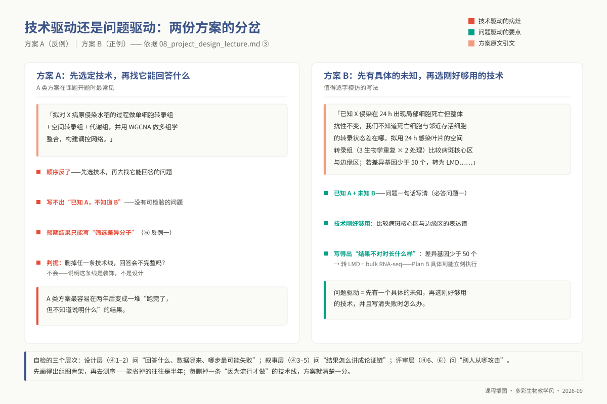
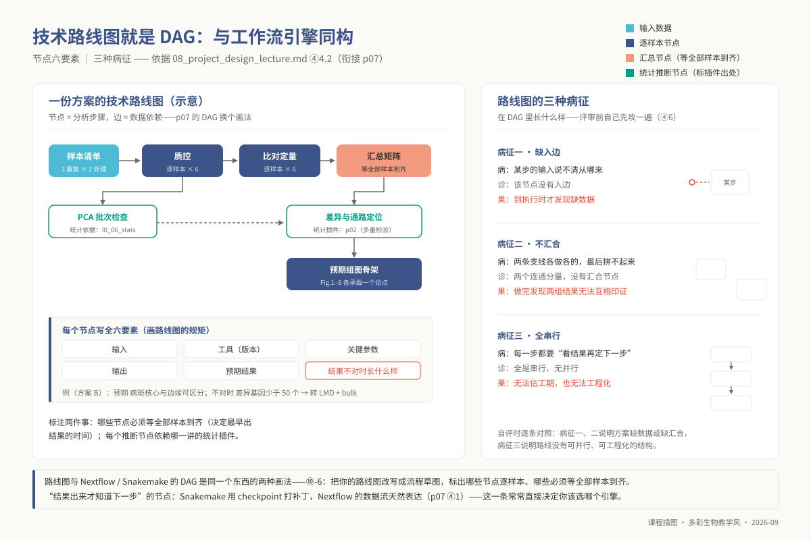
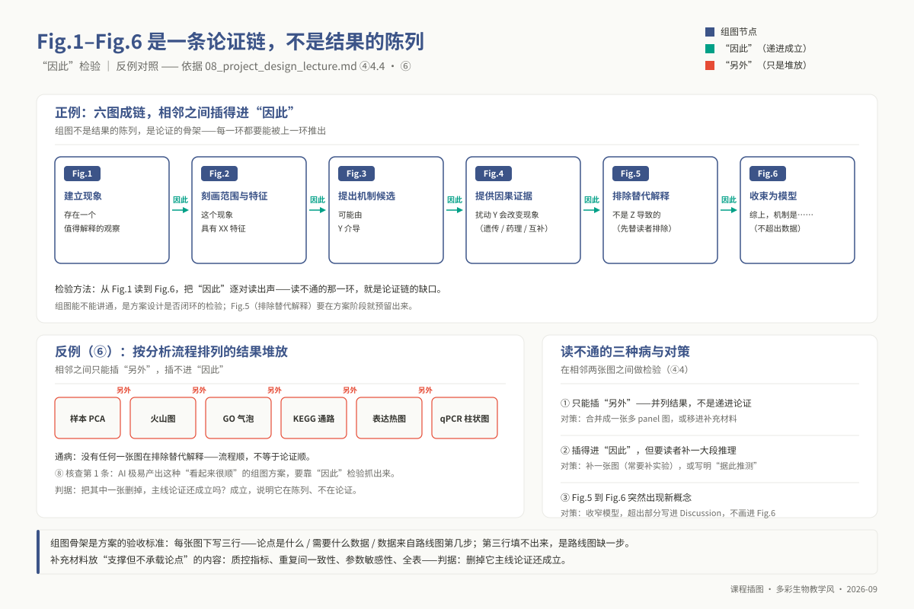
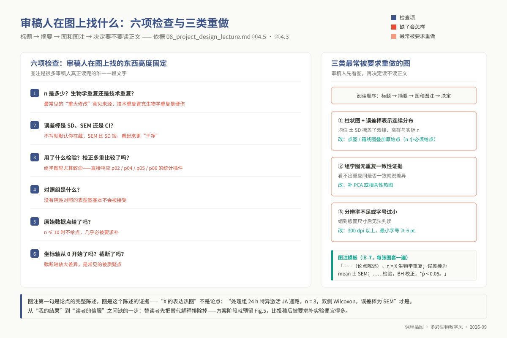

<!-- @section: cover -->
<!-- _class: phd cover -->

# 专题 p08：课题设计与汇报

**先画得出组图骨架，再去测序——能省掉的往往是半年。**

<div class="meta">

- 4 学时（2 h 理论 + 2 h 汇报与讨论）｜ 无专用环境，作图沿用 `ngs_phd_base` 的 R 绘图栈
- **本讲的对象是你自己的课题**——不发主线数据，不跑新流程
- 并入原「高级可视化」专题的**叙事部分**：作图技法（配色、拼图、Circos、Inkscape、导出参数）已下沉 `09_resources/cheatsheets/`，课堂只讲**图表怎么承载论点**
- **这一讲是全课程的收口**：p01 验证 AI、p02–p06 各一套方法与统计边界、p07 固化成流程——本讲要求把它们全部用进一份你真的打算执行的方案里

</div>

---

<!-- @section: objectives -->
## 学习目标：学完你应当能够

1. **区分**问题驱动与技术驱动的方案，**指出**一份方案里哪些步骤是"因为要回答问题"、哪些是"因为这个技术流行"
2. **写出**自己课题的技术路线图：依赖关系、每步工具与参数、预期结果、"结果不对时长什么样"
3. **评估**技术可行性：样本、深度、算力、时间、Plan B
4. **为每个统计推断步骤指明**它依赖哪一讲的统计插件（p02 / p04 / p05 / p06）与假阳性风险来源
5. **设计**一张 Figure 使其承载**一个**论点，写出含样本量、统计方法、误差棒定义的完整图注
6. **搭出** Fig.1–Fig.6 组图骨架，**逐对检验**相邻两图之间的"因此"关系
7. **判断**一张图会不会被审稿人要求重做
8. **在 8 分钟内讲清**方案，在 4 分钟问答中区分"现场回答"与"会后补做"
9. **按评审要点审阅同学的方案**，给出至少一条具体到可执行的改进意见

---

<!-- @section: prerequisites -->
## 前置检查：这几题做了没有？

| 模块 | 本讲用在哪 | 没过关的后果 | 自测题 |
|---|---|---|---|
| `l0_06_stats` | 样本量与重复；审稿人在图上找什么；每个推断步骤标注统计依据 | 写"每组 3 个重复"却答不出为什么是 3 不是 6 | L0-6-Q1、Q5、Q6、Q7 |
| `l0_02_r` | 单图设计；组图骨架占位图 | 组图骨架只能手绘，改一版重画一版 | L0-2-Q5、Q7、Q9、Q10 |
| `l0_01_linux` | 数据清单与目录规划 | 方案里写不清数据放在哪、谁在维护 | L0-1-Q10 |

> **本讲不依赖硕士层任何特定章节**（L1 映射表里没有 p08 条目——不是漏写）。

**你要自带的东西（缺一不可，课前准备）**
① 一句话写清的科学问题 ② 已有数据清单（类型、样本数、分组、深度、产出时间）③ 还需要但没有的数据 ④ 课题组已发表或在投的 2–3 篇同方向论文（用来对照组图逻辑）

---

<!-- @section: background -->
## 科学问题：先看两份方案的差别

> **方案 A**：拟对 X 病原侵染水稻的过程做单细胞转录组 + 空间转录组 + 代谢组，并用 WGCNA 做多组学整合，构建调控网络。

> **方案 B**：已知 X 侵染在 24 h 出现局部细胞死亡但整体抗性不变，我们不知道死亡细胞与邻近存活细胞的转录状态差在哪。拟用 24 h 感染叶片的空间转录组（3 生物学重复 × 2 处理），比较病斑核心区与边缘区的表达谱；若边缘区差异基因少于 50 个，转为 laser microdissection + bulk RNA-seq 提高深度。

- A 是**技术驱动**：先选定技术，再找它能回答什么——开题时最常见，两年后最容易变成一堆跑完了但不知道说明什么的结果
- B 是**问题驱动**：先有具体的未知，选**刚好够用**的技术，写清失败时怎么办

---

## 技术驱动 vs 问题驱动

方案 A/B 对照：四种病，对号入座。



---

## 本讲的三个层次

| 层次 | 要回答的问题 | 对应节 |
|---|---|---|
| **设计层** | 我要回答什么？为什么必须用组学？哪一步最可能失败？ | 4.1、4.2 |
| **叙事层** | 结果出来后，怎么讲成一条别人信服的论证链？ | 4.3、4.4、4.5 |
| **评审层** | 别人会从哪里攻击？我能不能先自己攻一遍？ | 4.6、⑥ |

**为什么叙事层不能等到写论文时再想**：组图骨架是方案的**验收标准**——现在画不出 Fig.1–Fig.6 的逻辑链，不是"图还没画"，是"论点还不存在"。

---

<!-- @section: principles -->
## 核心原理 4.1：问题驱动的方案设计——四个必答问题

**问题一：你要回答的未知，能被一句话写清吗？**
- 写成"已知 A，但不知道 B"。写不出 A 说明文献没读够；写不出 B 说明还停留在"想做某个方向"

**问题二：为什么必须用组学，而不是别的手段？**
- 组学的比较优势只有一个：**在没有先验假设时做无偏的全局筛查**。已经知道要看哪 20 个基因 → qPCR 更快更便宜更准
- 方案里必须有一句话回答"为什么不是 qPCR / 表型观察 / 已发表数据重分析"

**问题三：数据从哪来，够不够？**
- 自测（可控但贵慢）｜ 公共数据（免费快，但设计不是为你定制）｜ 合作（权属与作者顺序先谈清）
- **优先判断"能不能先用公共数据把假设验一遍"**——一周的重分析常能改掉一个错误的测序方案

**问题四：最可能在哪一步失败，失败了怎么办？**
- 至少**两个** Plan B，且**具体到能立刻执行**：不是"换一种方法"，而是"若边缘区差异基因少于 50 个，转为 LMD + bulk RNA-seq"

---

## 4.2 技术路线图：它就是工作流的 DAG

**技术路线图和 Nextflow / Snakemake 的 DAG 是同一个东西的两种画法**——节点是分析步骤，边是数据依赖。这不是比喻：

| 路线图的问题 | 在 DAG 里长什么样 | 后果 |
|---|---|---|
| 某步的输入说不清从哪来 | 该节点没有入边 | 到了执行时才发现缺数据 |
| 两条支线各做各的，最后拼不起来 | 两个连通分量，没有汇合节点 | 做完发现两组结果无法互相印证 |
| 每一步都要"看结果再定下一步" | 全是串行、无并行 | 无法估工期，也无法工程化 |

**画路线图的规矩**
1. 每个节点写清 **输入 → 工具（版本）→ 关键参数 → 输出**
2. 每个节点写一句**预期结果**和一句**"结果不对时长什么样"**
3. 标出哪些节点**必须等全部样本到齐**（决定最早出结果的时间）
4. 标出每个涉及统计推断的节点**依赖哪一讲的统计插件**

---

## 路线图即 DAG

节点六要素与三种病征，和工作流同构。



---

## 4.3 图表叙事 · 单图层面：一张 Figure 承载一个论点

> **核心命题：图注是论点的完整陈述，图是这个陈述的证据。**

检验方法：把图注第一句读出来——"X 的表达热图" → 还没有论点；"处理组在 24 h 特异激活了 JA 通路，n=3，双侧 Wilcoxon，误差棒为 SEM" → 有

**三条设计规则**
1. **图的类型由论点决定，不由数据类型决定**：论点是"两组整体可分"画 PCA；"某通路被特异激活"画基因集打分箱线图；"响应随时间推移"画时序折线。**"我有表达矩阵所以画热图"是典型的技术驱动作图**
2. **删掉不服务于该论点的一切元素**：指着图里任一元素问"它支持我的论点吗"，答不上来就删
3. **一张图只承载一个论点**：承载两个的拆成两张或 a/b 两个 panel

> **本课程作图硬规矩：所有图中不出现中文字符**。图题、轴标签、图例、注释一律英文；中文解释写在正文（⑨-3 有真实报错）。

---

## 4.3 续：四个必须能识别的反模式

| 反模式 | 为什么是问题 | 换成什么 |
|---|---|---|
| **柱状图 + 误差棒**表示连续数据分布 | 均值 ± SD 掩盖了双峰、离群与实际 n；不同的原始分布能画出同一根柱子 | 点图 / 箱线图叠加原始点（n 小时**必须**显示每个点） |
| **双 Y 轴** | 两条轴的缩放是任选的，"趋势一致"可以被人为制造 | 拆成上下两个共享 X 轴的 panel |
| **热图不给聚类依据** | 距离度量、聚类方法、是否按行标准化都会改变图案 | 图注写清 scale、距离、聚类方法 |
| **只有 p 值没有效应量** | p<0.05 不等于差异重要；样本量够大时任何微小差异都显著 | 同时给效应量（log2FC、Cohen's d）与置信区间 |

---

## 4.4 图表叙事 · 组图层面：Fig.1–Fig.6 是一条论证链

```text
Fig.1  建立现象      →  "存在一个值得解释的观察"
Fig.2  刻画范围/特征  →  "因此，这个现象具有 XX 特征"
Fig.3  提出机制候选  →  "因此，可能由 Y 介导"
Fig.4  提供因果证据  →  "因此，扰动 Y 会改变现象"（遗传/药理/互补）
Fig.5  排除替代解释  →  "因此，不是 Z 导致的"
Fig.6  收束为模型    →  "综上，机制是 …"
```

> **检验组图是否成链的唯一方法：在相邻两张图之间插入"因此"，读出来看是否通顺。**

| 症状 | 诊断 | 对策 |
|---|---|---|
| 插不进"因此"，只能插"另外" | 两张图是并列结果，不是递进论证 | 合并成多 panel 图，或移进补充材料 |
| 能插"因此"但要读者补一大段推理 | 中间缺一张图 | 补做实验，或明确写成"我们据此推测" |
| Fig.5 → Fig.6 突然出现新概念 | 模型超出了数据支持的范围 | 收窄模型，超出部分写进 Discussion |

**补充材料放什么**：把这张图删掉，主线论证还成立吗？成立就进补充材料。
**方案阶段画组图骨架**，每张图下写三行：论点是什么 / 需要什么数据 / 数据从路线图哪一步来——**第三行填不出来，说明路线图缺一步**

---

## 组图成链：相邻两图插“因此”

正例的“因此”链 vs 反例的“另外”堆放。



---

## 4.5 审稿人怎么看图：什么样的图会被要求重做

**审稿人的阅读顺序：标题 → 摘要 → 图和图注 → 决定要不要读正文。** 图注是很多审稿人真正读完的唯一一段文字。

| 找什么 | 缺了会怎样 |
|---|---|
| **n 是多少，生物学重复还是技术重复** | 最常见的"重大修改"来源；技术重复冒充生物学重复是硬伤 |
| **误差棒是 SD、SEM 还是 CI** | 不写就默认你在藏；SEM 比 SD 短，看起来更"干净" |
| **用了什么检验，是否校正多重比较** | 组学图里尤其致命，直接呼应 p02/p04/p05/p06 的统计插件 |
| **对照组是什么** | 没有阴性对照的表型图基本不会被接受 |
| **原始数据点** | n ≤ 10 时不给点，几乎必被要求补 |
| **坐标轴是否从 0 开始、是否截断** | 截断轴放大差异 |

**最常被要求重做的三类图**：① 柱状图 + 误差棒 ② 无重复一致性证据的组学图（补 PCA 或相关性热图）③ 分辨率不足或字号过小（300 dpi 以上、最小字号 ≥ 6 pt）

> 从"我的结果"到"读者的信服"之间缺的那一步：**替读者把可能的替代解释先排除掉**。方案阶段就把 Fig.5 预留出来，比投稿后被要求补实验便宜得多。

---

## 审稿人的六项检查

n、误差棒、检验、对照、原始点、坐标轴。



---

## 4.6 方案评审要点：先自己攻一遍

| 维度 | 问题 | 判据（能答"是"才算过） |
|---|---|---|
| **科学问题** | 清晰吗？有价值吗？ | 能写成"已知 A，不知道 B"；能说清 B 被回答后谁会在意 |
| **方法** | 合理吗？可行吗？ | 每一步有工具与参数；每个推断步骤指明统计依据与假阳性风险 |
| **数据** | 充分吗？ | 样本量有功效依据；重复是生物学重复；批次与协变量已识别 |
| **验证** | 可行吗？ | 有独立于组学的正交验证；关键结论有 Plan B |

**最常见的三个致命伤**
1. 科学问题实际是"我想用这个技术"
2. 样本量按经费而非功效决定，且方案里对此只字不提
3. 没有验证策略——组学结果自己验证自己

---

<!-- @section: procedure -->
## 操作流程：本讲的"操作"不是敲命令，是产出两份文档

```text
步骤 1  把科学问题压缩成两句话（15 min，先做这个，不要先想技术）
        "已知 ___，但不知道 ___" + "如果 ___ 被回答，谁会因此改变做法"
步骤 2  列数据清单（表格）：类型 / 样本数 / 分组与重复 / 时间点 / 深度及其依据 / 已有还是待产出 / 批次 / 存放位置
        "深度依据"不许写"参考文献常用"
步骤 3  画技术路线图（DAG，Mermaid / draw.io / PPT 均可，但必须能改）
步骤 4  给每个推断节点标注统计依据：检验/模型 → 为什么 → 阈值 → 假阳性风险 → 对应哪一讲
        ★ 这一栏空着的方案不予评审
步骤 5  搭组图骨架（本讲核心产出）：六个 panel 位，每格四行；做"因此"检验
        建议直接用 R 画带假数据的占位图——比手绘更容易暴露"这个论点其实画不出来"
步骤 6  自评审：4.6 四维判据逐条打勾，写下自己找到的最大弱点
步骤 7  汇报：每人 8 min + 4 min 问答，会后修改交终稿
```

---

## 步骤 7 · 汇报内容（8–11 页）与 8 分钟怎么分配

| # | 内容 | 页数 | 要点 |
|---|---|---|---|
| 1 | 研究背景 | 1–2 | 科学问题；为什么需要组学而不是别的手段 |
| 2 | 数据描述 | 1 | 样本设计；测序类型与深度及其依据；已有 vs 计划 |
| 3 | 分析技术路线 | 2–3 | 详细步骤；每步工具与参数；预期结果示意 |
| 4 | **预期组图骨架** | 1–2 | Fig.1–Fig.6 各承载什么论点；图型与关键元素；图与图的衔接 |
| 5 | 验证策略 | 1 | 如何验证分析结果；功能实验计划 |
| 6 | 风险与备选方案 | 1 | 主路线可能在哪一步失败；替代方案 |
| 7 | 时间规划 | 1 | 分析进度安排 |

**8 分钟分配**（时间控制本身是评分项）：背景 1.5 → 数据 1 → 路线 2.5 → **组图骨架 2** → 风险与验证 1。**组图骨架必须讲**，它是本讲区别于一般开题的地方。

**问答三类**：① 知道答案 → 直接答 ② 没想过但能当场判断 → 说清判断依据，承认是现场推断 ③ 需要查证或补做 → **明确说"这个我需要回去核实"并记下来**。第三类如实说不扣分，硬编答案扣分。

---

<!-- @section: interpretation -->
## 结果解读：你的方案会被怎么评

| 评分维度 | 权重 | 评分要点 |
|---|---|---|
| 问题清晰度 | 18% | 科学问题是否明确、有价值 |
| **方法合理性** | **27%** | 分析方法选择是否恰当、可行；统计推断步骤是否有依据 |
| 技术细节 | 23% | 工具参数、代码框架是否完整；风险与备选是否具体 |
| 创新性 | 13% | 是否有创新的分析思路 |
| 汇报表达 | 9% | PPT 质量（含组图骨架的逻辑链）、时间控制、问答表现 |
| **AI 使用与验证记录** | 10% | ⑧ 的四条核查动作，每条写出结论 |

> 课题方案设计占博士层总成绩 **47%**。**权重最高的是"方法合理性"，不是"创新性"**——博士层考核的是设计与判断。任务书见 `08_assessment/phd/proposal/phd_proposal.md`。

**自评清单（交稿前逐条打勾）**：科学问题能写成"已知 A，不知道 B" ｜ 每个技术选择能回答"为什么不是更便宜的手段" ｜ 数据清单每行有深度依据与批次 ｜ 每个推断步骤标注了统计依据与假阳性风险 ｜ 相邻两图都能插"因此" ｜ 每张图注含 n、统计方法、误差棒 ｜ 至少两个可执行的 Plan B ｜ 图中没有中文

---

## 方案不对时长什么样：评审现场最常见的三种失败形态

**反例一 · 技术堆叠型**
- 路线图上有单细胞、空间、代谢组、蛋白组四条线，每条线的"预期结果"都写着"筛选差异分子"
- **判据：把任意一条技术线删掉，科学问题的回答会变得不完整吗？** 不会，说明这条线是装饰

**反例二 · 组图不成链型**
- Fig.1 PCA → Fig.2 火山图 → Fig.3 GO 气泡图 → Fig.4 KEGG → Fig.5 候选基因热图 → Fig.6 qPCR 柱状图
- **看起来完整，实际是一条标准分析流程的输出顺序，不是论证链**——相邻两图只能插"另外"。通病：**没有任何一张图在排除替代解释**

**反例三 · 无失败预案型**
- 通篇是主路线，"风险与备选"写着"如遇问题及时与导师沟通"
- **判据：指着路线图上耗时最长的那一步问"它失败了你怎么办"**，答不出具体动作即不合格

---

<!-- @section: ai_task -->
## AI 辅助任务：让 AI 草拟 Fig.1–Fig.6 组图骨架与图注，逐条核查它引用的"同类研究"是否真实存在

**提示**：给出科学问题、数据设计与已知背景，要求输出 ① 六张图的组图方案（论点、图型、关键元素）② 每张图的完整图注 ③ **"同类研究通常怎么呈现"的文献依据，逐条给出作者、年份、期刊与 DOI**

| # | 核查什么 | 怎么查 | 典型问题 |
|---|---|---|---|
| 1 | **组图是否成链** | 相邻两图间插"因此" | AI 极易产出"PCA→火山图→GO→KEGG→热图→qPCR"——**读起来很顺，但那是流程顺，不是论证顺** |
| 2 | **每张图的论点你的数据支持得了吗** | 逐图回到路线图找数据来自哪一步 | AI 会自信地安排你根本没有的数据（只有 bulk 却排了单细胞图） |
| 3 | **引用的每篇"同类研究"逐条 DOI 核实** | `curl -sIL -o /dev/null -w "%{http_code}"` → Crossref 元数据 → PubMed 标题反查 | 作者对、期刊对、年份对，但**这篇文章不存在**；或 DOI 指向另一篇 |
| 4 | **图注是否含 n、统计方法、误差棒** | 逐条对照 4.5 的表 | AI 图注写得漂亮但缺 n 和检验——因为它不知道你的 n |

---

## AI 辅助任务 · 判据与提交物

**三档判据**：DOI 解析成功**且**标题作者年份期刊全对 = **真** ｜ 解析失败或指向另一篇 = **假** ｜ 期刊/年份对不上或只在预印本平台 = **存疑**（必须继续查到能定性）

**提交物**：AI 原始组图方案与图注 + 修改版及每处理由 + **文献真伪核查表**（引用 / DOI / 解析结果 / 判定 / 核查方式）。若 AI 恰好没编造文献，也要提交完整核查表——**"没发现问题"和"没查"在提交物上必须可区分**

---

<!-- @section: troubleshooting -->
## 常见错误：做图与核查时会真实遇到的三条

**⑨-1 DOI 核查时 Crossref 返回 404** `Resource not found.`
- **AI 编造文献最典型的表现**——DOI 形状完全合法（`10.1038/` 是真前缀），后缀是编出来的
- 不要止步于"可能是网络问题"：用标题去 PubMed 反查，搜不到判**假**
- **反向陷阱**：有些 DOI 能解析，但落地的是另一篇——必须比对标题作者，不能只看状态码

**⑨-3 图里出现方块 / 缺字** `conversion failure on '处理组' in 'mbcsToSbcs': dot substituted for <e5>`
- Linux 上 R / matplotlib 默认字体不含中文字形；**屏幕预览可能看起来正常**，投稿前一刻才发现
- 本课程规矩：图中一律不用中文——期刊也要求图内文字为英文

**⑨-2 ggplot2 aesthetics 长度不匹配** `Aesthetics must be either length 1 or the same as the data (24): fill`
- 画占位图时手工拼的分组向量与数据行数不一致
- **把分组放进数据框**（`aes(fill = group)`），不要在 `aes()` 外传裸向量

---

## 排查路标：报错 + 评审现场的真实原话（讲义 ⑨ 1–7）

```text
报错：
  Crossref 404 → ⑨-1（AI 编造 DOI；标题反查；DOI 能解析也要比对标题）
  Aesthetics must be length 1 or same as data → ⑨-2（分组进数据框）
  conversion failure ... mbcsToSbcs → ⑨-3（图中不用中文）
  Cannot find directory 'figures' → ⑨-4（dir.create(..., recursive=TRUE)；路径不许写死，与 p07 同一原则）
评审原话：
  「这张图想说什么？」→ ⑨-5（图注只描述画的是什么，没有论点；改成可被证伪的陈述句）
  「Fig.3 和 Fig.4 之间是怎么过渡的？」→ ⑨-6（论证链断了；插"因此"读一遍）
  「n 是多少？误差棒是什么？」→ ⑨-7（最容易避免也最常被扣分；做一个图注模板每张套一遍）
```

**图注模板**：*"…（论点陈述）。n = X 生物学重复；误差棒为 mean ± SEM；两组比较用 …，多重检验用 BH 校正，\*p < 0.05。"*

---

<!-- @section: wrapup -->
## 汇报与讨论（2 h）与课后

**课堂（2 h 汇报与讨论）**
1. 每人 8 min 汇报 + 4 min 问答，按 4.6 四维判据互评
2. 每人对同学方案给出**一条具体到可执行**的改进意见——"建议增加样本量"不算，"建议把 24 h 单时间点改为 12/24/48 h 三点，否则无法区分是响应延迟还是无响应"才算（⑩ Q5）
3. 会后按意见修改，交终稿

---

## 课后：思考练习与必做开放题

**思考练习**（讲义 ⑩，7 题）——课堂讨论选 3 题
- Q1 把方案 A 改写成问题驱动版本，删掉至少一条技术线并说明为什么不影响回答问题
- Q2 柱状图 2.1 倍、误差棒不重叠、\*\*p < 0.01、图注只写"均值 ± SEM"——四个必须追问的问题
- Q4 取本方向一篇近三年论文，逐对检验 Fig.1–Fig.N 能否插"因此"，找出最弱一环

**必做开放题 Q7（全课程的收口）**：针对真实毕业课题——"已知 A，不知道 B"及谁会改变做法 ｜ 数据清单与缺口 ｜ 路线图 + 每个推断节点的统计依据与假阳性风险 ｜ Fig.1–Fig.6 骨架 + "因此"检验 + **目前最没把握的是哪一张** ｜ 两个可执行 Plan B ｜ **如果全部做完但结果全是阴性，这篇论文还能写吗？写什么？**——答不上来说明方案的价值全押在一个未知的结果上，这是设计缺陷，不是运气问题

**参考资料**：讲义 ⑪（11 篇文献 + DOI/Crossref/PubMed 核查入口 + 作图技法速查表指针），本 deck 不重复列
