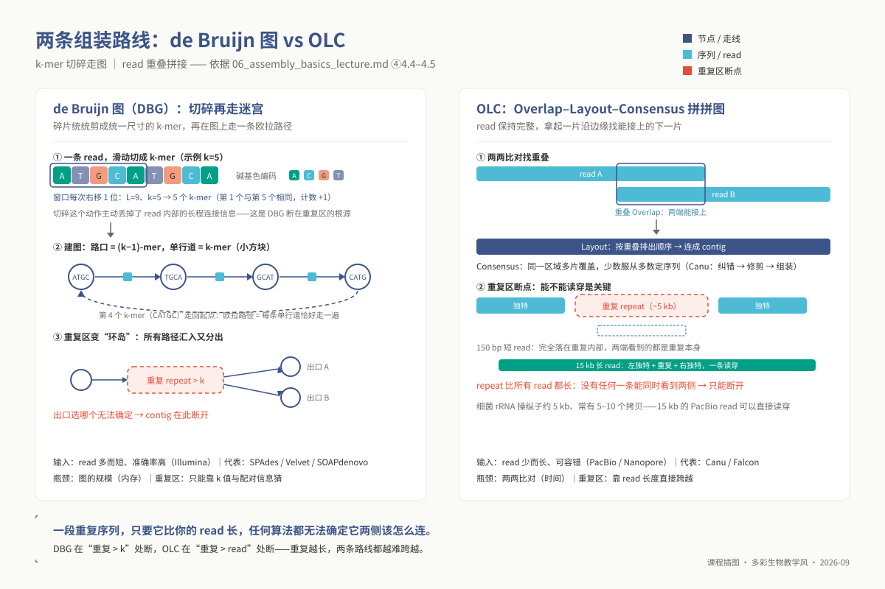

<!-- _class: undergraduate cover -->

# 基因组组装原理与质量评估

**组装器很少承认失败。**

<div class="meta">

- 本科层 u06 ｜ 课堂 2 h ｜ 教材第 8 章
- 环境 `ngs_ug_assembly`

</div>

---

<!-- _class: undergraduate divider -->

<div class="num">01</div>

# k-mer 扫描

先估基因组有多大，再决定怎么拼

---

## k 太小会怎样

- 4¹¹ ≈ 420 万种 11-mer
- 与细菌基因组同一量级
- 不同位点的 k-mer **大量碰撞**

<div class="ref">教材 §8.4.4</div>

---

<!-- _class: undergraduate statement -->

k = 21 是课程起点，**不是理论最优**。

三档 k 各跑一次，是敏感性检查。

---

## GenomeScope 四步读法

<div class="cols">
<div class="card">

### ① 确认输入
哪个实现、哪个 k、读长参数

</div>
<div class="card">

### ② 看拟合曲线
是否贴住主峰、残差有无形状

</div>
</div>

<div class="ref">教材 §8.4.4</div>

---

## 运行 k-mer 计数

```bash
qsub 06_kmer_survey.sh
# 产出 reads.histo
head -15 reads.histo
```

> 计算一律 `qsub`；登录节点只做下载和准备。

---

## 两种组装器

| | Canu | Flye |
|---|---|---|
| 思路 | 先纠错再拼 | 先拼重复图 |
| 环状标记 | 需另查 | `circ.` 列 |

---

<!-- _class: undergraduate warn -->

## 结果不对时长什么样

- 总长与勘测估计**明显偏离**
- 回贴深度在某处**成倍升高**
- 半深度峰：原因待定，先做四项检查

---

<!-- _class: undergraduate quiz -->

## 课堂提问

N50 更高的组装，一定更好吗？

---

<!-- _class: undergraduate figure -->

## de Bruijn 图中的重复



重复长于 k−1 时，路径在此分叉
