<!-- @section: cover -->
<!-- _class: undergraduate cover -->

# u01 ｜ Linux 命令行与 Conda 环境

**两条命脉：别在登录节点跑计算；环境起不来，后面七个单元全停。**

<div class="meta">

- 线上先导自学 4 学时 ｜ 课堂 Day 0 就绪检查 2 h
- 讲义 `unit01_linux_conda/01_linux_conda_lecture.md`
- 教材 §1.1–§1.5、§2.1–§2.5 ｜ 环境 `ngs_ug_base` 等 4 个

</div>

---

<!-- _class: undergraduate divider -->

<div class="num">I</div>

# 学习目标

八条，对应 LO01-01–04 与 LO02-01–04

---

<!-- @section: objectives -->
## 学完你应当能够（一）：命令与文本流

- 说清登录节点与计算节点的分工
- 用绝对与相对路径定位文件，解释四个符号
- 组合通配符、管道与重定向做序列统计
- 检查产物，而不只看退出状态

<div class="ref">教材 §1.2 LO01-01–LO01-02 ｜ 讲义 ①</div>

---

## 学完你应当能够（二）：链接、权限与作业

- 比较复制与符号链接的空间与断链风险
- 判读三位权限与常见的 `Permission denied`
- 写出最小的 SGE 作业并从日志判断成败
- 区分已提交、已运行与已完成

<div class="ref">教材 §1.2 LO01-03–LO01-04 ｜ 讲义 ①</div>

---

## 学完你应当能够（三）：环境

- 区分环境名、文件名、包名与命令名
- 用三步定位加一次真跑验收环境
- 读 yml 三段，说明渠道顺序为什么这样写
- 判断「一跑就炸」属于哪一层失败

<div class="ref">教材 §2.2 LO02-01–LO02-04 ｜ 讲义 ①</div>

---

<!-- _class: undergraduate divider -->

<div class="num">II</div>

# 前置检查

两个 L0 模块，本讲是全课程第一站

---

<!-- @section: prerequisites -->
## 前置检查：两个 L0 模块

| L0 模块 | 本讲覆盖 | 自测 |
|---|---|---|
| `l0_01_linux` | 原理 + 步骤 0–4、6 | L0-1 第 1–6 题 |
| `l0_03_conda` | 步骤 5 | L0-3 第 1–4 题 |

- 本讲无前置模块，零 Linux 经验也可以开始
- 开工备齐：终端、账号、校园网或 VPN
- 不要借同学账号：路径与配额都按账号区分
- 自查口令：`ssh 用户名@10.7.254.22` 能进提示符

<div class="ref">教材 §1.3、§2.3 ｜ 讲义 ②</div>

---

<!-- _class: undergraduate statement -->

谁依赖本讲：u02 的 R、u04–u07 的每个工具、u08 六个模块的 `qsub`。

本讲不产生生物学结论，交付的是可复核的运行现场。

---

<!-- _class: undergraduate divider -->

<div class="num">III</div>

# 科学问题

三个工程瓶颈，一份能复核的基座

---

<!-- @section: background -->
## 三个瓶颈，不是三个知识点

<div class="cols3">
<div class="card">

### 数据不在本机

公共数据只读，复制会撞个人配额

</div>
<div class="card">

### 全班共用登录节点

登录节点只办轻量事，计算要排队

</div>
<div class="card">

### 同名工具版本各异

换台机器，结果可能不同

</div>
</div>

<div class="ref">教材 §1.1 ｜ 讲义 ③</div>

---

## 一份数据，三个动作

<div class="cols">
<div>

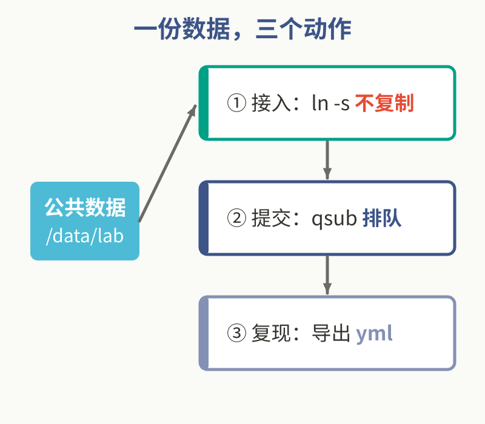

</div>
<div>

- 链接只写路径字符串，原数据保持只读
- `#$` 作业头决定启动目录与日志名
- 导出的 yml 记装了什么，不证跑通

</div>
</div>

<div class="ref">教材 §1.1、§1.4.8、§2.4.7 ｜ 讲义 ③</div>

---

## 这一讲要交出四件东西

- 目录骨架：六个分析模块与五个辅助项
- 数据接入：`fq/` 下指向公共数据的链接
- 冒烟作业：一个能跑通的 SGE 脚本与日志
- 文本汇总表：样本名与读段数，并入 §4 记录表

<div class="ref">教材 §1.6、§2.6 ｜ 讲义 ③ 3.4 ｜ 实验指导 §4、§7</div>

---

<!-- _class: undergraduate divider -->

<div class="num">IV</div>

# 核心原理

路径 · 三条流 · 链接 · 依赖求解

---

<!-- @section: principles -->
## 一条命令的四个问题

<div class="cols">
<div>

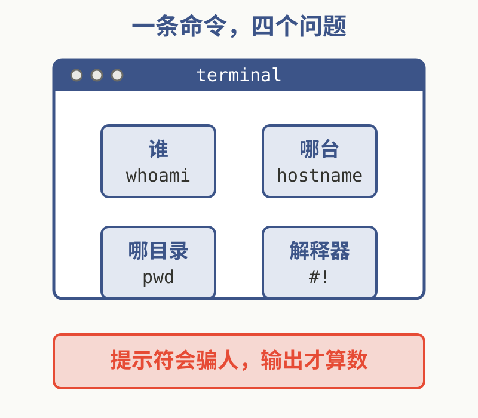

</div>
<div>

- 四个问题都能当场用命令回答，不必猜
- 提示符可自定义，有效证据是命令输出

</div>
</div>

<div class="ref">教材 §1.4.1</div>

---

<!-- _class: undergraduate figure -->

## 文件系统是一棵倒挂的树

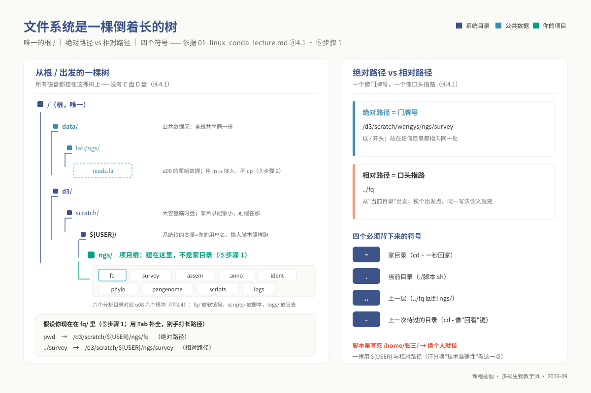

公共数据只读、项目放 `/d3/scratch`、家目录只放脚本

<div class="ref">教材 §1.4.2 ｜ 讲义 ④ 4.1 ｜ 图内示例用户名只作形态示意，命令一律写 `${USER}`</div>

---

## 绝对路径是门牌号，相对路径是口头指路

```bash
cd /d3/scratch/${USER}/ngs/scripts   # 设当前在 scripts/
pwd                                   # 相对路径的解析原点
ls /d3/scratch/${USER}/ngs/fq/reads.fa  # 绝对：站在哪都指向同一处
head -n 2 ../fq/reads.fa              # 相对：换起点就换目标
```

- 写死用户名，换账号就指向别人的目录
- 报「找不到」先查 `pwd`，再查拼写

<div class="ref">教材 §1.4.2 ｜ 讲义 ④ 4.1</div>

---

## 四个符号，处理它们的不都是 Shell

| 符号 | 含义 | 由谁处理 |
|---|---|---|
| `~` | 家目录 | Shell 展开 |
| `.` `..` | 当前、上一层 | 路径解析 |
| `-` | 上一次所在目录 | 只有 `cd` 认识 |

- 文件系统区分大小写，`/D3` 与 `/d3` 是两个目录
- Tab 补全省掉大半手误，也省掉大小写错误

<div class="ref">教材 §1.4.2 ｜ 讲义 ④ 4.1</div>

---

<!-- _class: undergraduate statement -->

同一个字符串，换个起点就指向别处。

换账号、换目录、换机器后报「找不到」，先怀疑原点变了。

---

<!-- _class: undergraduate figure -->

## 一切皆文本流，管道是流水线

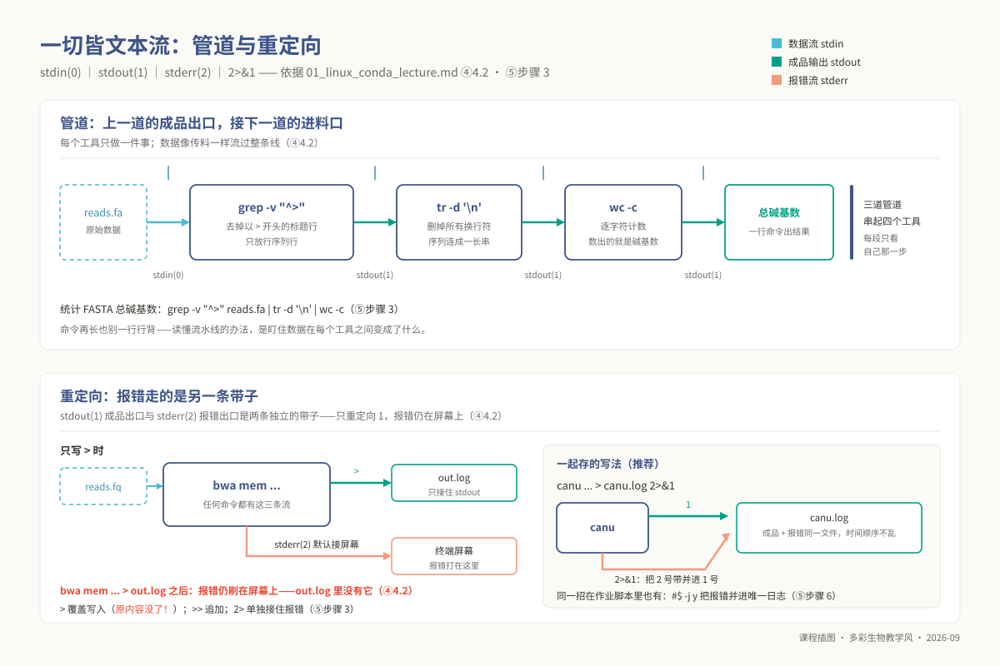

报错走 stderr：只写 `>` 时，它不进日志

<div class="ref">教材 §1.4.4 ｜ 讲义 ④ 4.2</div>

---

## 重定向的顺序决定效果

<div class="cols">
<div>

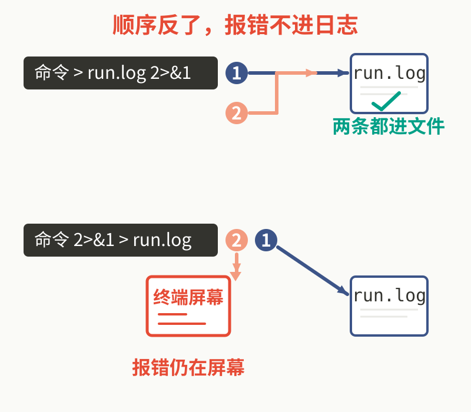

</div>
<div>

- `>` 在执行前就清空文件，失败也找不回
- 要留历史用 `>>`；作业脚本里用 `#$ -j y`

</div>
</div>

<div class="ref">教材 §1.4.4 ｜ 讲义 ④ 4.2</div>

---

## 管道只传字节，不懂记录边界

- 管道不知道一条 FASTQ 记录该占四行
- 「行数除以四」的前提是记录完整
- 上游失败时，默认状态只看最后一段
- 最终判据是产物自洽，不是退出状态

<div class="ref">教材 §1.4.5 ｜ 讲义 ⑤ 步骤 3</div>

---

## 一次能手算的统计

<div class="cols">
<div>

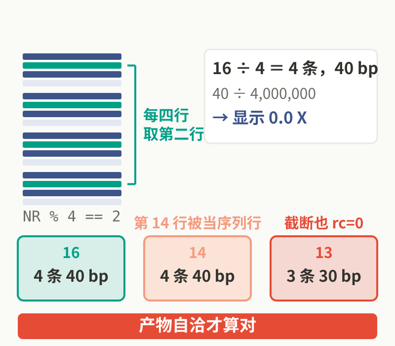

</div>
<div>

- 前提取决于输入确实四行一条记录
- 显示 `0.0 X` 不是零，是舍入到一位小数
- 判据是产物自洽，不是退出状态

</div>
</div>

<div class="ref">教材 §1.4.5 ｜ 脚本判据 `NR % 4 == 2`</div>

---

<!-- _class: undergraduate statement -->

跑完不等于做对。

截到 13 行得 3 条 30 bp，脚本照样不报错。

---

## 软链接是传送门，不是副本

<div class="cols">
<div>

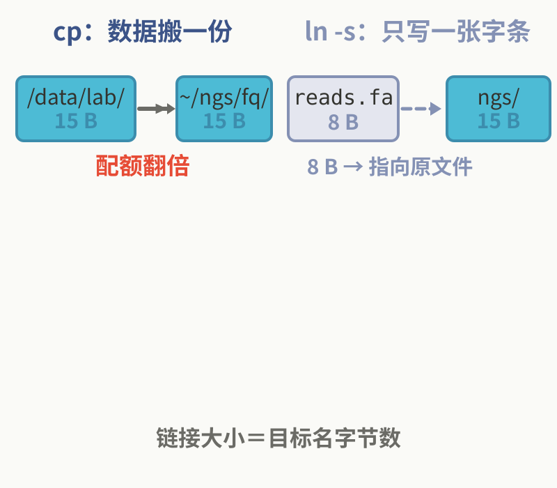

</div>
<div>

- `ln -s 目标 名字`，只写一个路径字符串
- 链接大小＝目标名字节数，不是磁盘占用
- 真实占用看 `du` 与配额记录

</div>
</div>

<div class="ref">教材 §1.4.6 ｜ 演示 `ch01_symlink_checks.py --selftest`</div>

---

## 断链：`ls` 看得见，读不了

<div class="cols">
<div>

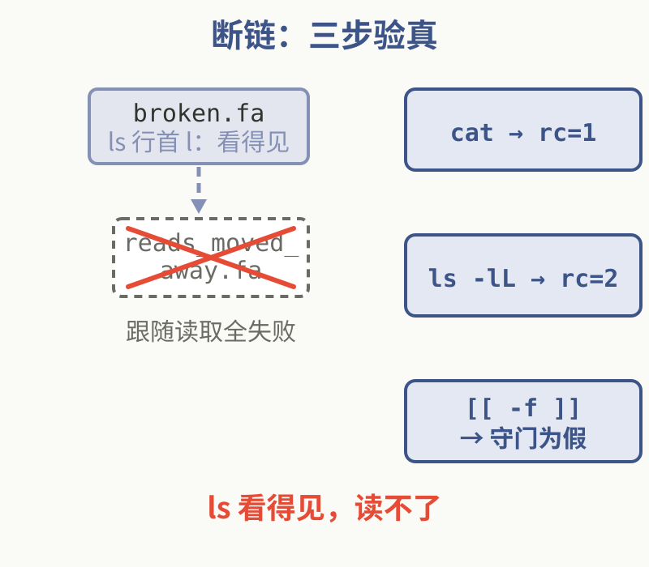

</div>
<div>

- 修复是回数据源重建链接
- 不要用 `cp` 绕过：代价留给下一次

</div>
</div>

<div class="ref">教材 §1.4.6、§1.5.4 ｜ 讲义 ⑥ 6.2</div>

---

## 权限：读、写、执行，三位一组

<div class="cols">
<div>

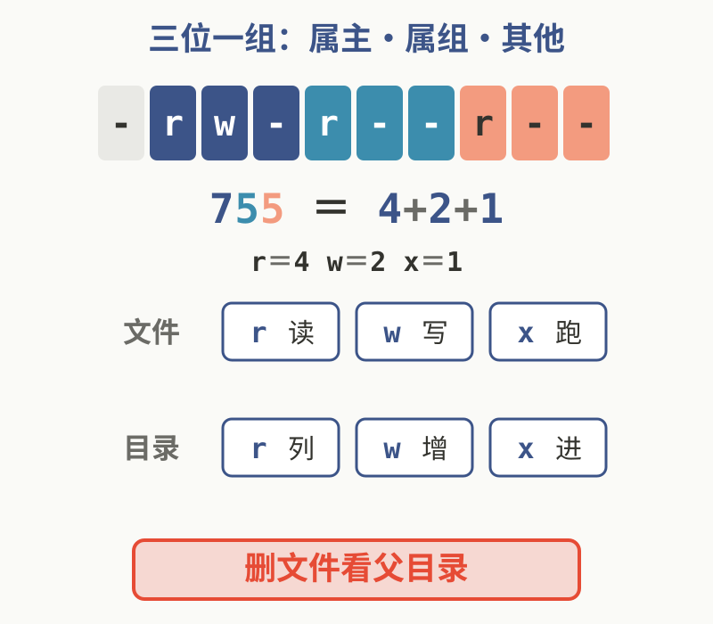

</div>
<div>

- 十位里第一位是类型：`-` 文件、`d` 目录、`l` 链接
- 三位按 4、2、1 相加得八进制数
- `444` 也能删：改的是父目录的目录项

</div>
</div>

<div class="ref">教材 §1.4.7 ｜ 讲义 ⑨ 9.2</div>

---

<!-- _class: undergraduate statement -->

复制看似能跑通，代价留给下一次。

配额写满时 `Disk quota exceeded`，后面步骤连锁失败。

---

## `command not found`：PATH 是一串依次去问的房间

<div class="cols">
<div>

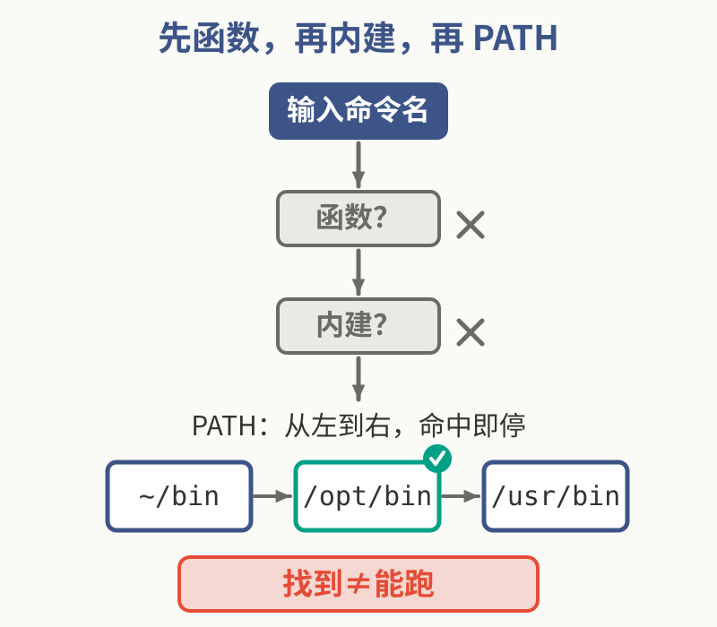

</div>
<div>

- 激活的一项作用：把环境 `bin/` 插到最前
- `command -v` 认函数与别名；`which` 只作线索

</div>
</div>

<div class="ref">教材 §1.4.3、§2.4.3 ｜ 讲义 ④ 4.4</div>

---

<!-- _class: undergraduate quiz -->

## 课堂提问

提示符已显示 `(ngs_ug_base)`，`command -v samtools` 仍指向 `/usr/bin`，先查什么？

---

<!-- _class: undergraduate figure -->

## 一个任务一个工具箱

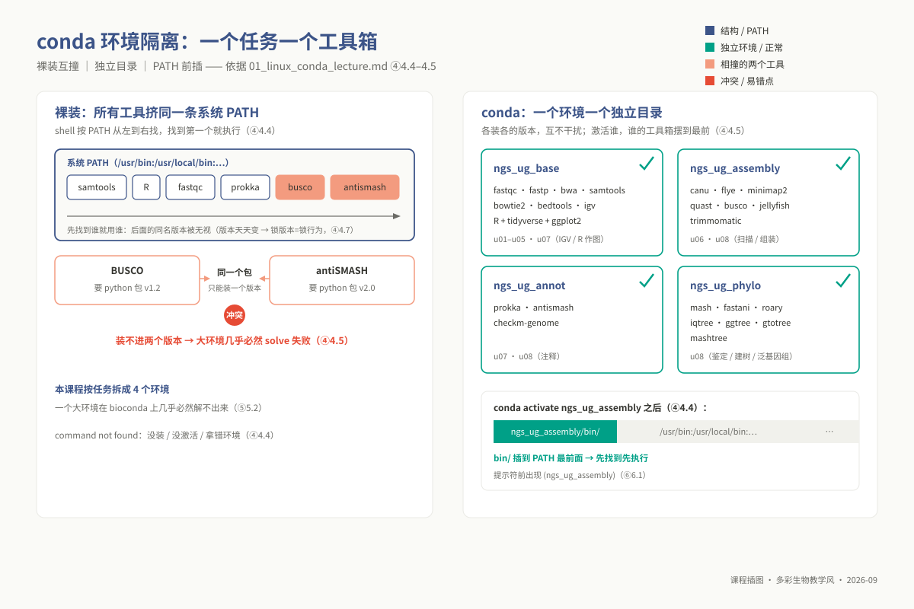

图内冲突是设例：互斥的版本解不出来；只是慢，先试 pin

<div class="ref">教材 §2.4.6 ｜ 讲义 ④ 4.5</div>

---

## 四种名字，不要混用

<div class="cols">
<div>

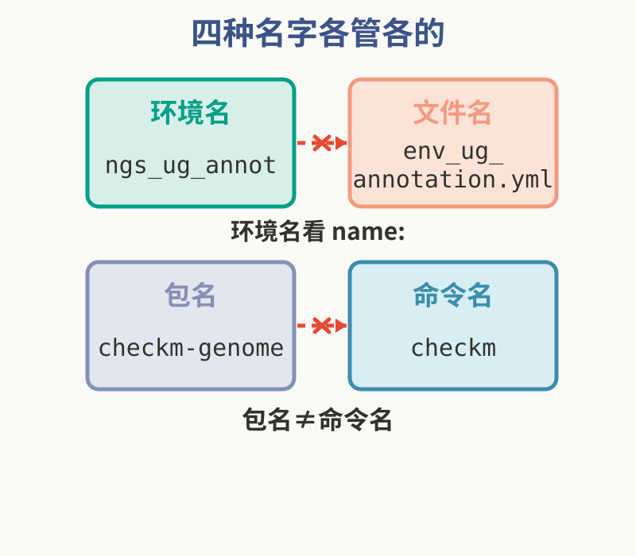

</div>
<div>

- 激活用 `name:` 决定的环境名，不是文件名
- 课程 16 份 yml 里，名字与文件名对不上的有 2 处

</div>
</div>

<div class="ref">教材 §2.4.1–§2.4.2 ｜ 演示 `ch02_env_yml_audit.py --selftest`</div>

---

## 激活做三件事

<div class="cols">
<div>

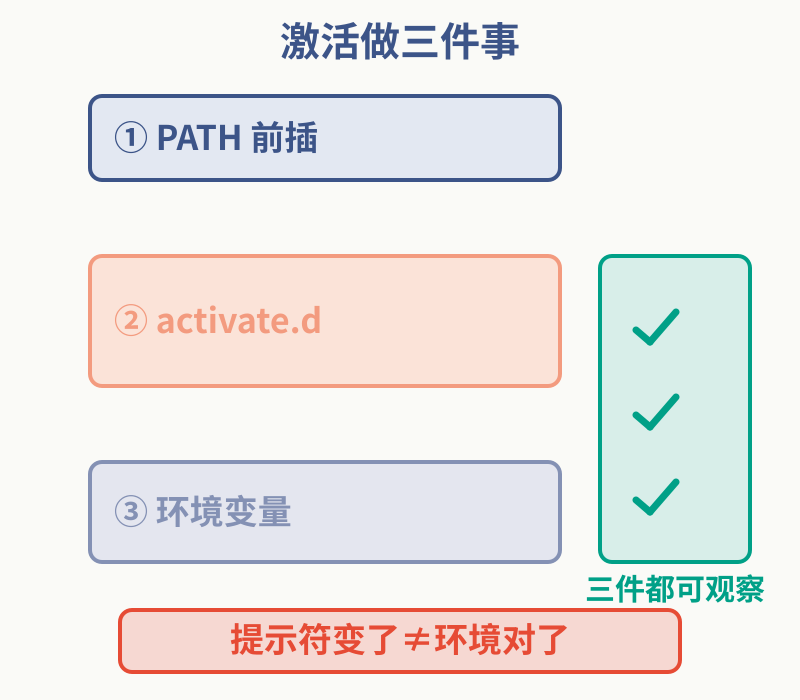

</div>
<div>

- 三件都可观察：`PATH`、`activate.d/`、变量
- 提示符里的环境名是拼出来的字符串，不是判据

</div>
</div>

<div class="ref">教材 §2.4.3 ｜ 讲义 ⑤ 5.2</div>

---

## 验收四步，缺一步都不算通过

<div class="cols">
<div>

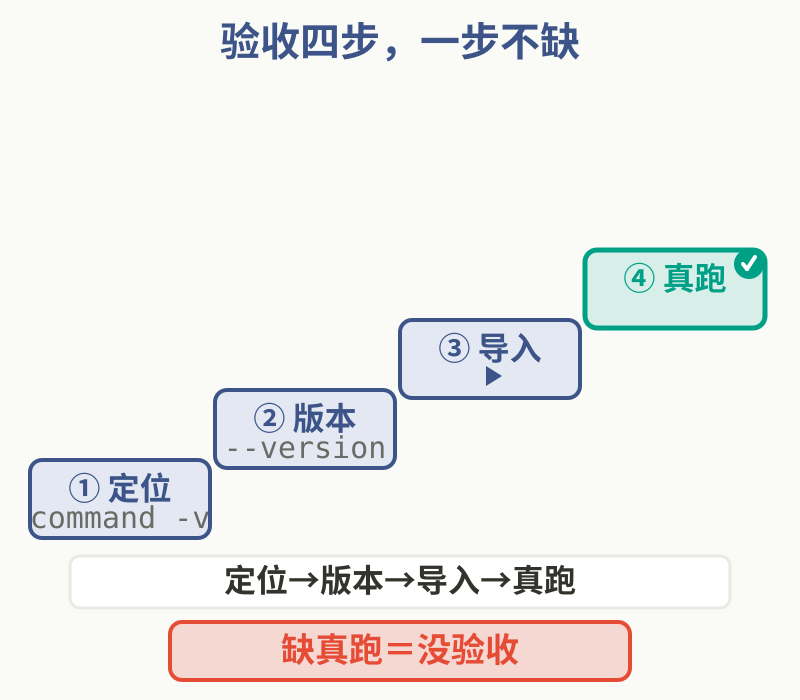

</div>
<div>

- 定位：路径以目标环境前缀开头
- 版本：`fastqc --version` 打印 0.12.1
- 真跑：最小真实命令加产物校验

</div>
</div>

<div class="ref">教材 §2.4.3、§2.4.8、§2.5.3</div>

---

<!-- _class: undergraduate figure -->

## 售票大厅不是列车

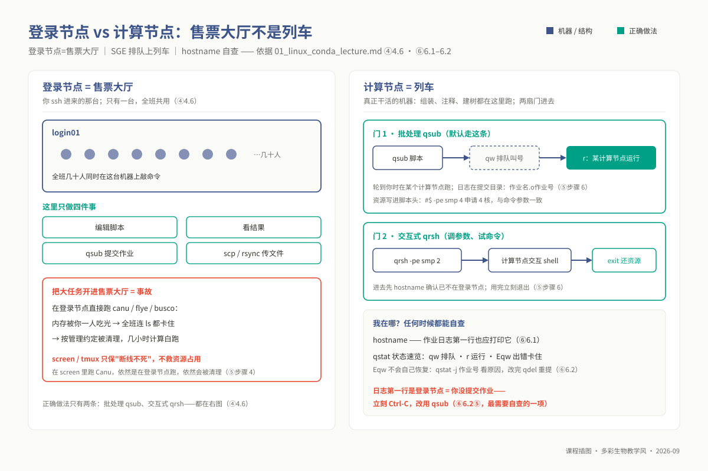

可能被管理员按约定终止；`screen` 不改变运行节点

<div class="ref">教材 §1.4.8 ｜ 讲义 ④ 4.6 ｜ 图内「日志第一行」读作「标着运行节点的那一行」</div>

---

<!-- _class: undergraduate statement -->

`screen` 与 `tmux` 只保会话不断线，不换机器。

在保活会话里跑高耗时计算，跑的还是登录节点。

---

<!-- _class: undergraduate divider -->

<div class="num">V</div>

# 操作流程

六个步骤，全部落到仓库脚本

---

<!-- @section: procedure -->
## 集群规矩：先读这段

> 登录节点只做编辑、看结果、提交作业、传文件；计算走 `qsub`，调参用 `qrsh`。

- `qsub 脚本`，`qstat -u ${USER}` 看队列
- 日志 `<作业名>.o<作业号>` 落在提交目录
- 在登录节点跑大任务，全班终端一起卡
- 命令里的 `<课程仓库路径>` 指仓库根目录

<div class="ref">教材 §1.4.8 ｜ 讲义 ⑤ 步骤 0</div>

---

## 步骤 0：登录与免密

```bash
ssh 用户名@10.7.254.22          # 校园网或 VPN 内
ssh -X 用户名@10.7.254.22       # 需要图形界面时
ssh-keygen -t ed25519           # 在本地生成密钥
ssh-copy-id 用户名@10.7.254.22  # 只输一次密码
```

- 输密码时屏幕不回显，属正常现象

<div class="ref">教材 §1.8 ｜ 讲义 ⑤ 步骤 0</div>

---

## 步骤 1：目录树一次建好

```bash
cd <课程仓库路径>                  # 课程仓库根目录
mkdir -p /d3/scratch/${USER}/ngs/{survey,assem,anno,ident,phylo,pangenome}
mkdir -p /d3/scratch/${USER}/ngs/{fq,scripts,logs,results/figures,results/tables}
bash 03_code/undergraduate/scripts/01_setup_project_dirs.sh
```

- 六个分析模块，五个辅助目录项
- `-p` 幂等，重复执行不报错

<div class="ref">教材 §1.4.8、§1.6 ｜ 讲义 ⑤ 步骤 1</div>

---

## 步骤 2：数据只链接，不复制

```bash
cd /d3/scratch/${USER}/ngs/fq
ln -s /data/lab/ngs/reads* ./
ls -lh reads*        # 行首是 l
head -n 2 reads.fa   # 能读出来 = 没断链
```

- 末尾「新建软链接 N 个」，N=0 且 `fq/` 空要查数据源
- 行首是 `-` 说明你复制了，不是链接

<div class="ref">教材 §1.4.6 ｜ 讲义 ⑤ 步骤 2</div>

---

## 步骤 3：一行命令统计序列

```bash
# 以下为小规模探查；主线大文件统计投 qsub
grep -c "^>" reads.fa
grep -v "^>" reads.fa | tr -d '\n' | wc -c
zcat sample.fq.gz | awk 'NR % 4 == 2' | wc -l
bash <课程仓库路径>/03_code/undergraduate/scripts/01_seq_stats.sh reads.fa
```

- `-g` 默认 4,000,000 bp，给错深度就差量级
- 脚本不算 N50，N50 到 u06 由 QUAST 给出
- 真实文件统计走 `qsub`，`head` 类查看可登录节点

<div class="ref">教材 §1.4.5 ｜ 讲义 ⑤ 步骤 3</div>

---

## 步骤 4：传输与会话

<div class="cols">
<div>

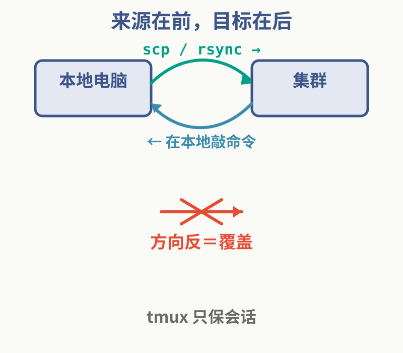

</div>
<div>

- `scp 来源 目标`：先本地后集群，反了就覆盖
- `rsync -avP`：同语法，带进度，可续传
- `tmux` 只保会话；断线用 `attach` 接回

</div>
</div>

<div class="ref">教材 §1.4.11 ｜ 讲义 ⑤ 步骤 4</div>

---

## 步骤 5：先把渠道顺序配好

```bash
source /opt/miniconda3/bin/activate
conda config --add channels defaults
conda config --add channels bioconda
conda config --add channels conda-forge  # --add 插最前，故倒着加
conda config --set channel_priority strict
```

- 课程统一三段顺序，`defaults` 是历史配置保留
- 官方当前推荐已不含 `defaults`，照文件写、不自行删

<div class="ref">教材 §2.4.4 ｜ 讲义 ⑤ 5.1</div>

---

## 四个环境各管一段

| 环境 | 代表工具 | 何时用 |
|---|---|---|
| `ngs_ug_base` | fastqc、multiqc、samtools、R | u01–u05、u07 |
| `ngs_ug_assembly` | jellyfish、canu、flye、quast | u06、u08 |
| `ngs_ug_annot` | prokka、antismash、checkm-genome | u07、u08 |
| `ngs_ug_phylo` | mash、iqtree、roary、ggtree | u08 |

- 拿错箱子就会「激活了也找不到」：先 `conda list` 查
- `checkm-genome` 是包名，命令名是 `checkm`

<div class="ref">教材 §2.4.1、§2.4.6 ｜ 讲义 ⑤ 5.2</div>

---

## 导出交给老师的那一份

```bash
conda activate ngs_ug_base        # 集群已实装，不要重复建
conda env export --no-builds > environment.yml
# 仅校外无环境自学时，才在个人电脑执行：
# conda env create -f <课程仓库路径>/07_envs/conda/env_ug_base.yml
```

- `--no-builds` 去掉构建号、保留版本
- 条目数等于环境里实装的包数，含传递依赖
- 导出只说明装了什么，不证明跑通过
- 建环境要联网，只在登录节点做

<div class="ref">教材 §2.4.7、§2.4.9 ｜ 讲义 ⑤ 5.3</div>

---

## 步骤 6：作业头六行

```bash
#!/bin/bash
#$ -S /bin/bash
#$ -N qsub_hello
#$ -cwd
#$ -j y
#$ -pe smp 1
```

- `-cwd` 决定作业在哪个目录启动
- `-pe` 申请的是槽位，不是内存

<div class="ref">教材 §1.4.8 ｜ 讲义 ⑤ 步骤 6</div>

---

## 作业脚本里必须重建环境

```bash
source /opt/miniconda3/bin/activate
conda activate ngs_ug_base
command -v samtools   # 路径应以环境前缀开头
fastqc --version      # 再真跑一次
```

- 作业不继承终端的激活状态
- 一个作业只激活一个环境，跨环境拆两个脚本

<div class="ref">教材 §1.4.8、§2.4.3 ｜ 讲义 ⑤ 步骤 6</div>

---

## 提交之后看三个地方

| 看哪里 | 正常 | 异常 |
|---|---|---|
| 终端回执 | 返回作业号 | 直接报错 |
| `qstat` | qw → r → 消失 | `Eqw` |
| 作业日志 | 运行节点 + 结束时间 | 只有一行报错 |

- `Eqw` 不会自己好：`qstat -j` 看原因，改完重提

<div class="ref">教材 §1.4.8 ｜ 讲义 ⑥ 6.1</div>

---

<!-- _class: undergraduate statement -->

已提交、已运行、已完成，是三件事。

终端说提交成功，只证明调度器收下了脚本。

---

<!-- _class: undergraduate divider -->

<div class="num">VI</div>

# 结果解读

正常态 · 四条证据 · 四条失效

---

<!-- @section: interpretation -->
<!-- _class: undergraduate warn -->
## 结果不对时长什么样（一）

<div class="cols">
<div>

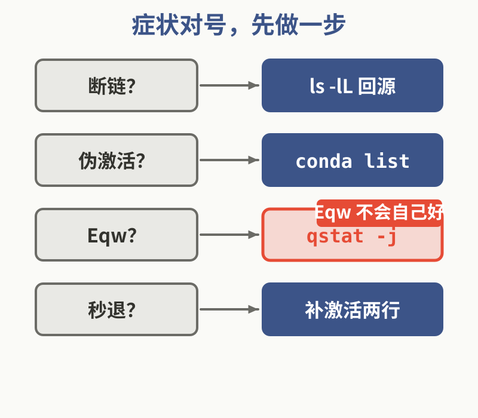

</div>
<div>

| 现象 | 说明什么 |
|---|---|
| 看得到读不了 | 断链 |
| 提示符对了仍指系统 | 伪激活／PATH 被盖 |
| 状态 `Eqw` | 提交即出错 |
| 日志只一行报错 | 脚本没激活 |

</div>
</div>

<div class="ref">教材 §1.5.1、§1.5.2 ｜ 讲义 ⑥ 6.2</div>

---

<!-- _class: undergraduate warn -->
## 结果不对时长什么样（二）

| 现象 | 说明什么 | 先做什么 |
|---|---|---|
| 「运行节点」是登录节点名 | 你用 `bash` 直跑了 | 改 `qsub` 提交 |
| 日志没有结束时间行 | 进程没走到脚本末尾 | 查空间、内存与记录 |
| 只有一行 `Killed` | 被不可捕获信号终止 | 核对内存与数据规模 |
| 条数对得上但内容可疑 | 记录被截断 | 加一条独立证据 |

<div class="ref">教材 §1.4.8、§1.5.5</div>

---

## 正常态长什么样

| 动作 | 正确的样子 |
|---|---|
| `ssh` 登录 | 提示符带登录节点名 |
| `ls -lh` 看链接 | 行首 `l`，末尾 `->` |
| 作业日志 | 「运行节点」那行是计算节点 |
| `conda env export` | `name:` 与激活环境同名 |

<div class="ref">教材 §1.4.8、§2.4.7 ｜ 讲义 ⑥ 6.1</div>

---

## 四条证据，缺一条都不能算做成

<div class="cols">
<div>

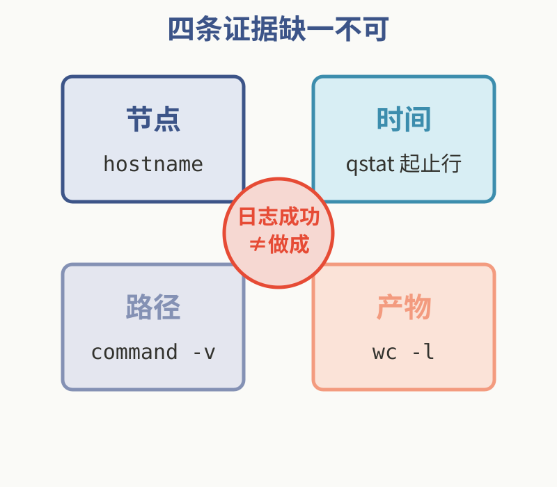

</div>
<div>

- 日志写「成功」而产物是空的，并不矛盾
- 缺结束时间行：只说明没走到脚本末尾

</div>
</div>

<div class="ref">教材 §1.4.8、§1.4.11 ｜ 讲义 ⑥</div>

---

<!-- _class: undergraduate warn -->
## 失效一：在登录节点跑计算

- 全班 ssh 与编辑一起变卡
- 任务可能被管理员按约定终止
- 日志可能停在半途，数小时白跑
- 察觉：运行节点名、无结束行、`qstat` 记录

<div class="ref">教材 §1.5.1</div>

---

<!-- _class: undergraduate warn -->
## 失效二：作业里找不到命令

<div class="cols">
<div>

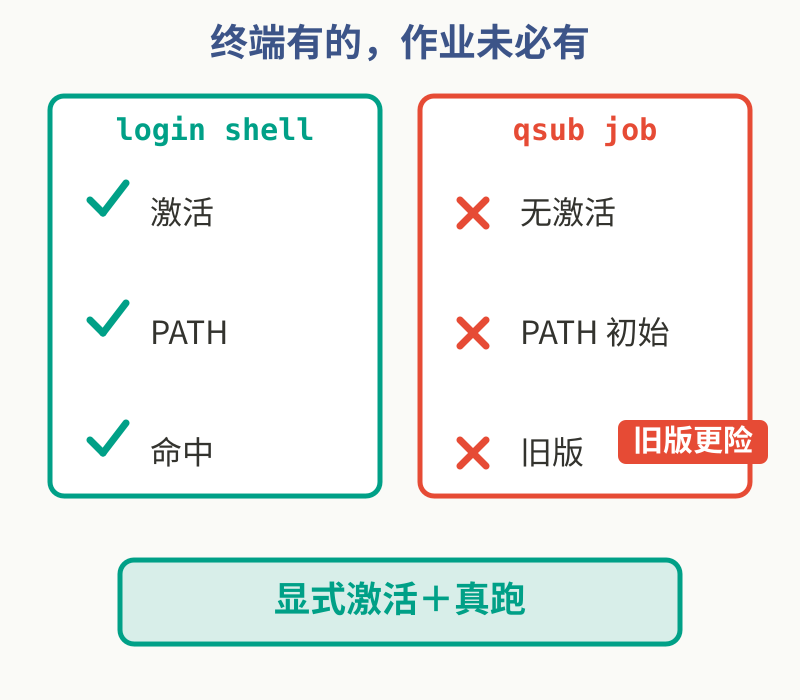

</div>
<div>

- 现象：作业秒退，日志只有一行报错
- 更险：命中系统旧版，能看但不对
- 修复：脚本内显式激活，再真跑一次

</div>
</div>

<div class="ref">教材 §1.5.2</div>

---

<!-- _class: undergraduate warn -->
## 失效三：复制代替链接、源被移动

- 复制先撞配额，后续步骤连锁失败
- 断链：`cat` 报不存在，`ls` 还看得见
- 最隐蔽：链接指向另一个版本，读得通但错
- 察觉：`df`/`du`、`ls -lL`、`[[ -f ]]`

<div class="ref">教材 §1.5.4</div>

---

<!-- _class: undergraduate warn -->
## 失效四：装上了，一跑就炸

- `command -v` 通过，启动就退出
- `PERL5LIB` 指向一个无权读取的目录
- 新版 setuptools 删了 `pkg_resources`
- 察觉：版本、导入、最小真实命令四步

<div class="ref">教材 §2.5.3、§2.4.8</div>

---

<!-- _class: undergraduate quiz -->

## 课堂提问

作业日志只剩一行 `Killed`，你的第一动作是什么？

---

<!-- _class: undergraduate divider -->

<div class="num">VII</div>

# 常见错误

课堂上一定会遇到的三条，再加两条

---

<!-- @section: troubleshooting -->
<!-- _class: undergraduate warn -->
## 错误一：`$'\r': command not found`

- 脚本在 Windows 编辑过，行尾是 CRLF
- `dos2unix 脚本` 或 `sed -i 's/\r$//'`
- 根治：编辑器右下角把 CRLF 改成 LF
- 同一个字节也会让作业卡在 `Eqw`

<div class="ref">教材 §1.1、§1.4.8 ｜ 讲义 ⑨ 9.2</div>

---

<!-- _class: undergraduate warn -->
## 错误二：`bash: conda: command not found`

- 新终端或作业里找不到 `conda`
- 这个 shell 还没初始化环境管理器
- `source /opt/miniconda3/bin/activate`
- 作业脚本里必须写这一行

<div class="ref">教材 §2.4.3 ｜ 讲义 ⑨ 9.3</div>

---

<!-- _class: undergraduate warn -->
## 错误三：`Solving environment` 长时间无进展

<div class="cols">
<div>

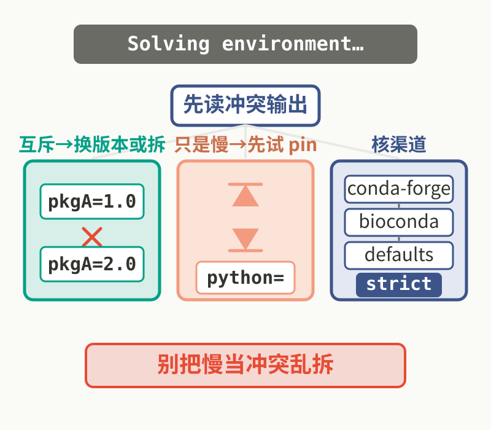

</div>
<div>

- 先读冲突输出：有没有包名与版本对
- 有冲突对：换可共存版本或按任务拆
- 只是慢：先试一个有依据的 pin（如 `python=`）
- 再核渠道顺序与 `strict` 是否打开

</div>
</div>

<div class="ref">教材 §2.4.6、§2.5.4</div>

---

<!-- _class: undergraduate warn -->
## 只有一行 `Killed`：先别加核数

<div class="cols">
<div>

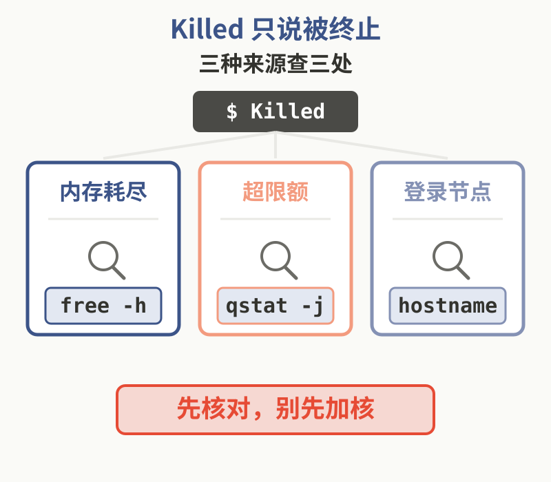

</div>
<div>

- `Killed` 只说明被不可捕获的信号终止
- 槽位不等于内存，加核不解决内存
- 先核对申请、数据规模与运行节点

</div>
</div>

<div class="ref">教材 §1.5.5</div>

---

<!-- _class: undergraduate warn -->
## `EnvironmentNameNotFound`：名称对不上

- 拿文件名去激活，就会报这个错
- `env_ug_annotation.yml` 的环境名是 `ngs_ug_annot`
- `conda env list` 看真名，再激活
- 课程里有 2 处这样的不一致

<div class="ref">教材 §2.5.1 ｜ 讲义 ⑨ 9.3</div>

---

<!-- _class: undergraduate divider -->

<div class="num">VIII</div>

# 课后

就绪检查 · 思考练习 · 实验指导

---

<!-- @section: wrapup -->
## Day 0 就绪检查（课堂 2 h）

- `qsub 01_qsub_hello.sh`，日志正常
- 目录 10 项；`results/` 下 2 个子目录
- `fq/` 不是空的，行首是 `l`
- `ngs_ug_base` 验收四步全过，材料留档

<div class="ref">教材 §1.6、§2.6 ｜ 实验指导 §4、§7</div>

---

## 思考练习（实验指导 §6，六题）

- Q1 两种相对路径、一种绝对路径
- Q2 16 行 FASTQ 的条数、总碱基与深度
- Q3 链接大小由什么决定，断链三证据
- Q4–Q6 `Eqw`、环境真名、伪激活排查

<div class="ref">实验指导 §6 ｜ 教材 §1.7、§2.7</div>

---

## 实验指导与收尾

- `11_lab_guides/undergraduate/01_linux_conda_lab.md`
- 上机时手边打开，按步骤 1–4 逐步实操
- 演示脚本在课程仓库根目录运行
- 文献只给指针（讲义 ⑪），本 deck 不重复列

<div class="ref">教材 §1.8、§2.8 ｜ 讲义 ⑪</div>
