<!-- @section: cover -->
<!-- _class: undergraduate cover -->

# u02 ｜ R 与数据可视化

**两份代码都没报错，画出来的图却不一样：差别在类型、顺序与缺失值里。**

<div class="meta">

- 线上先导自学 4 学时 ｜ 课堂 Day 0 串讲
- 教材 §3.1–§3.6 ｜ 环境 `ngs_ug_base`
- 树图另需 `ngs_ug_phylo` ｜ 讲义 `unit02_r_visualization/`

</div>

---

<!-- _class: undergraduate divider -->

<div class="num">01</div>

# 学习目标

四条能力，对应 LO03-01 至 LO03-04

---

<!-- @section: objectives -->
## 学完你应当能够（一）：容器与读表

- 区分向量、矩阵、数据框、列表与因子
- 用 `dim()` / `names()` / `glimpse()` 查输入
- 认出整列被转成字符的类型转换
- 说明 `N50 (bp)` 为什么按原名取不到

<div class="ref">教材 §3.4.2 ｜ LO03-01、LO03-02 ｜ 讲义 ④ 4.1</div>

---

## 学完你应当能够（二）：建图、诊断与交付

- 用五个 dplyr 动词与 `pivot_longer()`
- 按数据、映射、几何、标度、分面建图
- 说出常量写进 `aes()` 之后发生了什么
- 诊断因子顺序、缺失值、字形与尺寸

<div class="ref">教材 §3.4.3–§3.4.7、§3.5 ｜ LO03-02–LO03-04</div>

---

<!-- _class: undergraduate divider -->

<div class="num">02</div>

# 前置检查

三个 L0 模块，加自测题

---

<!-- @section: prerequisites -->
## 前置检查：三个 L0 模块

| L0 模块 | 本讲用到 | 不过关的后果 |
|---|---|---|
| `l0_02_r` | 本讲即其本科系统版 | 从零补起，跟不上 |
| `l0_01_linux` | 绝对路径、找结果文件 | 找不到输入表 |
| `l0_03_conda` | 激活环境、查版本 | 分不清环境还是没装 |

- 自测：L0-2 第 1–10 题；上机题第 8–10 题
- 上机考核材料待发布，先按自测题练手

<div class="ref">教材 §3.3 ｜ 讲义 ② ｜ 自测题路径 02_lectures/prerequisites/l0_02_r/ ｜ 环境 env_ug_base.yml</div>

---

## 开工前 30 秒自检

```bash
source /opt/miniconda3/bin/activate
conda activate ngs_ug_base
R --version | head -n 1
Rscript -e 'packageVersion("ggplot2")'
```

- 预期：R 4.3.1 与 ggplot2 3.4.2（课程 pin）
- 报 `command not found` 先回 u01 查环境

<div class="ref">教材 §3.3 ｜ 讲义 ② ｜ 本机核验版本 4.5.2 / 4.0.3 不作课程 pin</div>

---

<!-- _class: undergraduate statement -->

装了不等于加载了：`install` 一次就够，`library()` 每个新会话都要重来。

`could not find function "%>%"` 里的 `%>%` 是 tidyverse（magrittr）的旧管道符，多半就是没 `library()`；R 原生管道写作 `|>`。

---

<!-- _class: undergraduate divider -->

<div class="num">03</div>

# 科学问题

一张表，两张图，两种读法

---

<!-- @section: background -->
## 同一张表，两张不一样的图

<div class="cols">
<div>

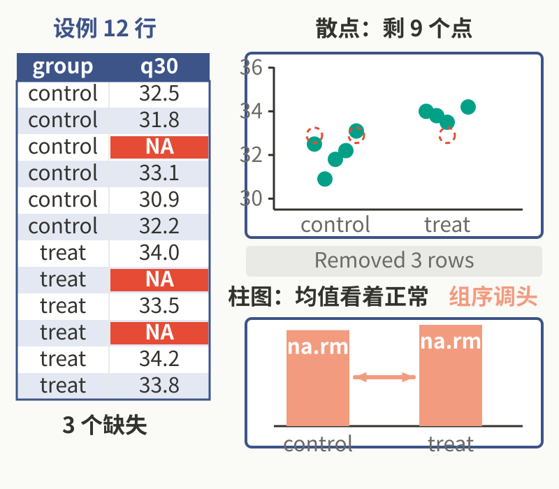

</div>
<div>

- 同一张表，差别在缺失与组序
- 柱图看着正常，不等于数据完整
- 组序来自 `levels`，不是数据顺序

</div>
</div>

<div class="ref">教材 §3.1（设例：输入与运算步骤全文列出）</div>

---

## 三个问题，一个共同点

<div class="cols">
<div>

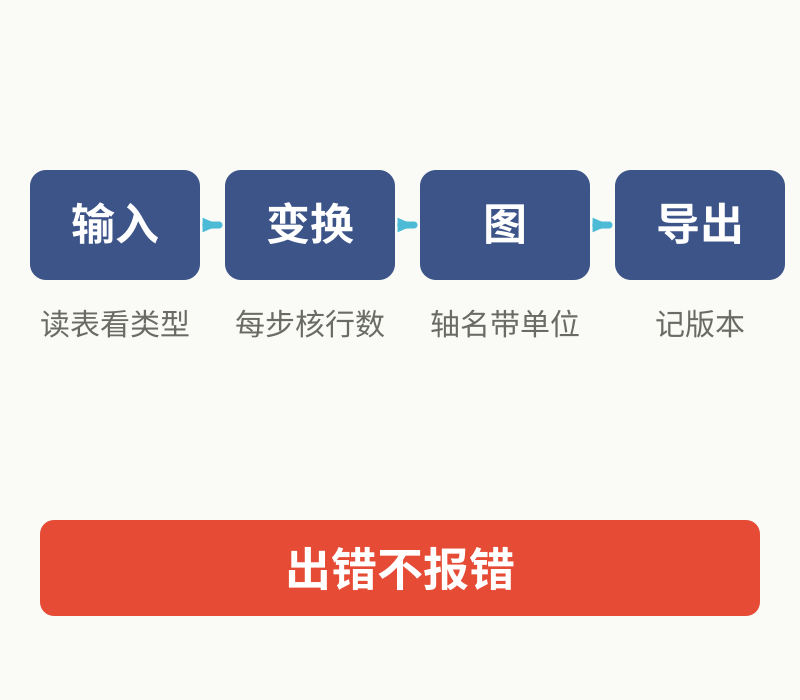

</div>
<div>

- 三个问题：读表的类型、层的牵连、能否重画
- 每一段都留检查点，链才可审计
- 图与输入对不上时不报错，只能靠核对

</div>
</div>

<div class="ref">教材 §3.1 ｜ 讲义 ③</div>

---

<!-- _class: undergraduate figure -->

## 一张错位的图，挡下最贵的结论

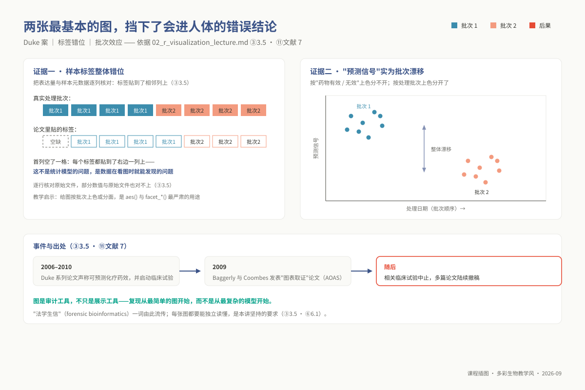

图内画成样本列右移一列；教材据原论文核实，错位的是基因/探针行

行与列不同，按批次上色、按索引对齐的审计作用相同

<div class="ref">教材 §3.1 图 3-1 ｜ 图内事件年份与撤稿数不引用 ｜ 图内 ③、⑪ 是讲义编号，不是本书节号</div>

---

<!-- _class: undergraduate statement -->

图能暴露问题，前提是映射写对了。

起作用的是「按什么上色、按什么对齐」，与工具复杂度无关。

---

## 在综合实践项目里的位置

- k-mer 谱、组装指标对比
- BUSCO 堆叠、树与泛基因组组成
- 手册 §4.1–§4.6；模板 §2.2/§3.1/§6/§7
- 本章只交付图，不交付生物学结论

<div class="ref">教材 §3.1、§3.6 ｜ 讲义 ③ 3.4 ｜ 《学生实验操作手册》</div>

---

## 三种证据状态，图注必须写明其一

| 状态 | 含义 | 本章例子 |
|---|---|---|
| 设例 | 为跑通代码构造的数 | `demo_quast()` 的指标 |
| 实测 | 特定数据与版本跑出来 | 两个 demos 的打印 |
| 预期区间 | 判断结果是否离谱 | contig 1–5 条 |

<div class="ref">教材 §3.4.1 ｜ 预期值见 06_data/undergraduate/README.md §四</div>

---

<!-- _class: undergraduate statement -->

设例只证明代码路径通不通，不能拿来比两个组装器谁更好。

实测只对当次的数据与版本成立；预期区间只能判断「这个数是不是离得很远」。

---

<!-- _class: undergraduate divider -->

<div class="num">04</div>

# 核心原理

容器 · 表形 · 图层 · 作用域

---

<!-- @section: principles -->
<!-- _class: undergraduate figure -->

## 四种容器，四种易错点

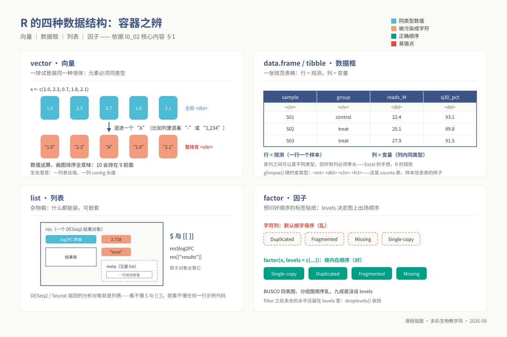

混进字符串整列变字符型；裸缺失值不改类型

<div class="ref">教材 §3.4.2 图 3-2 ｜ 图内向量示例为设例</div>

---

## 矩阵不是另一种数据框

- 向量：一排同类型元素，`42` 也是长度 1
- 矩阵：向量加 `dim`，整块同类型
- 数据框：等长向量组成的列表，列内同质
- 列表取子：`l[[1]]` 才是里面那个对象

<div class="ref">教材 §3.4.2 术语卡 ｜ 讲义 ④ 4.1</div>

---

## 读一份外部表格，先问四件事

| 问题 | 检查动作 | 常见错法 |
|---|---|---|
| 分隔符是什么 | 看文件头几行原始字节 | 逗号读制表符，整行一列 |
| 有没有表头 | 第一行是数据还是列名 | 指标名被当成数据 |
| 缺失值怎么表示 | 显式约定 `na` 并检查 | `N/A`、`-`、空串混用 |
| 类型猜得对不对 | `glimpse()` 看类型标记 | 千分位逗号让整列变字符 |

<div class="ref">教材 §3.4.2 ｜ 第五问「有没有解析失败的行」用 `problems()` 查</div>

---

## 类型检查要落到输出上

- `dim()` 给行列数，`names()` 给列名
- `read.csv()` 把 `N50 (bp)` 改成 `N50..bp.`
- 非语法名＝含空格或括号的列名，readr 保留原名
- 解析失败会有警告，用 `problems()` 看细节

<div class="ref">教材 §3.4.2 ｜ 两行代码可现场复核</div>

---

## 因子的内部是整数码

<div class="cols">
<div>

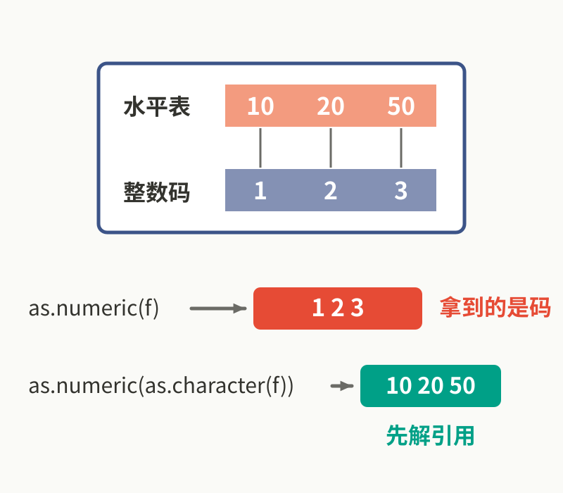

</div>
<div>

- `as.numeric(f)` 拿到的是内部码
- 先 `as.character()` 再转，才得原值
- 水平表决定码与标签的对应

</div>
</div>

<div class="ref">教材 §3.4.2 ｜ 可现场复核</div>

---

## 整洁数据不等于长表

- 每个变量一列、每次观测一行、每个值一格
- 宽表也可以整洁，只要一行是一个观测
- 多指标共享同一通道时，长表更省事
- 单个 x-y 图直接用宽表完全可以

<div class="ref">教材 §3.4.3 ｜ 讲义 ④ 4.3</div>

---

## 宽转长：行数 = 原行数 × 折叠列数

<div class="cols">
<div>

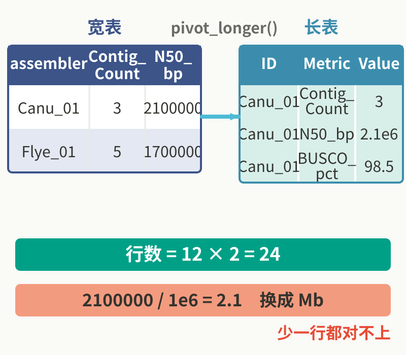

</div>
<div>

```r
long <- quast |>
  pivot_longer(
    cols = -assembler,
    names_to = "metric",
    values_to = "value")
```

- 折叠的列用负号排除标识列
- 折叠后排错一行，后面的图全跟着错

</div>
</div>

<div class="ref">教材 §3.4.3（设例与手算步骤全文列出）｜ 讲义 ⑤ 步骤 2</div>

---

## 五个 dplyr 动词各管一件事

<div class="cols">
<div>

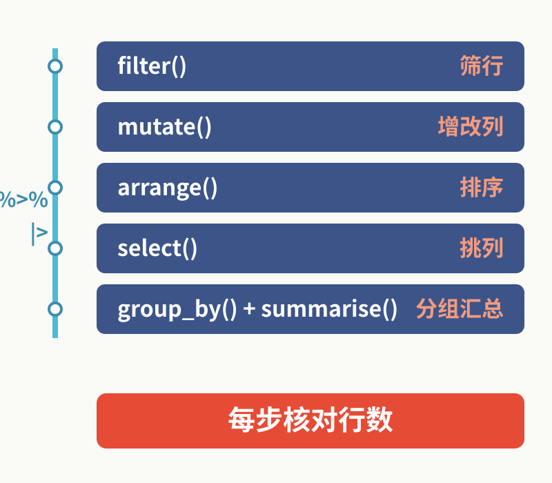

</div>
<div>

- R 的管道是 `|>`，shell 的 `|` 不是一回事
- 下一步不再需要分组，就写 `.groups = "drop"`
- 每一步核对行数：筛后看 `nrow()`

</div>
</div>

<div class="ref">教材 §3.4.3 ｜ 讲义 ⑤ 步骤 2</div>

---

<!-- _class: undergraduate statement -->

每一步核对行数：筛选后看 `nrow()`，汇总后看是否等于组数。

一张 12 行 4 列的设例表折两个指标，行数应当是 `12 × 2 = 24`。

---

## 因子：整数码加一张水平表

- 不设水平时，由唯一值排序生成
- 默认排序受区域设置影响，不是 ASCII 定律
- 图序的上游是水平顺序，不是数据顺序
- BUSCO 四类默认排成 D → F → M → S

<div class="ref">教材 §3.4.4 ｜ 讲义 ④ 4.2</div>

---

<!-- _class: undergraduate figure -->

## 数据框解剖与因子出场顺序

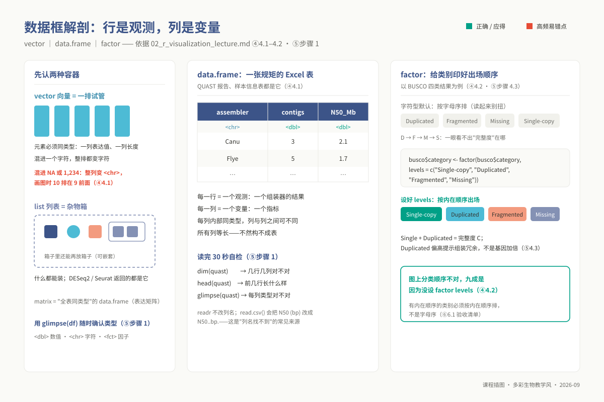

图例顺序乱常见是没设 levels；图内「D 偏高」只作候选，诊断在第 8 章

<div class="ref">教材 §3.4.2 图 3-3 ｜ 图内三处按正文口径：矩阵不是数据框、混进字符串才转字符</div>

---

## 有内在顺序的类别必须显式绑定

```r
factor(x, levels = c("Single-copy", "Duplicated",
                     "Fragmented", "Missing"))
```

- 默认排序里 Single-copy 在第 4 位，绑定后回到第 1
- 四档设例 97.2 / 0.8 / 0.6 / 1.4，合计 100.0
- 按位置改名 `levels(f) <-`：柱子还在原位，组换了人

<div class="ref">教材 §3.4.4、§3.5.1 ｜ `Rscript textbook/demos/ch03_factor_levels.R --selftest` 算例 A、C</div>

---

## 筛选之后水平表不会自动收缩

<div class="cols">
<div>

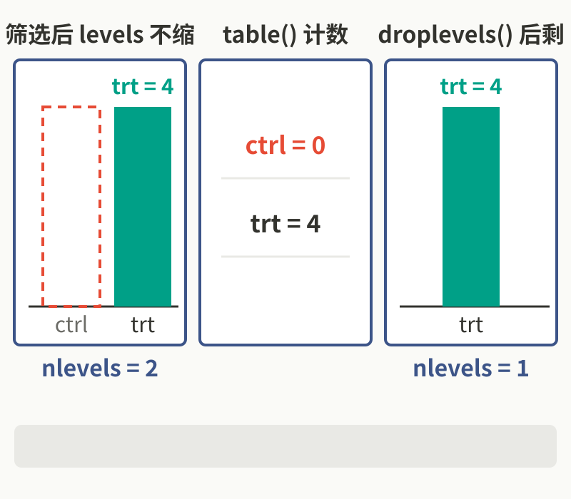

</div>
<div>

- 水平表留在对象里，`table()` 照样列它
- 图上留不留空位，由离散标度 `drop` 决定

</div>
</div>

<div class="ref">教材 §3.4.4、§3.4.6 ｜ 现跑 `Rscript textbook/demos/ch03_factor_levels.R --selftest`（算例 D）</div>

---

## 缺失值不是 0，也不是 FALSE

- `NA > 13` 得 `NA`，`NA == "control"` 也是
- `NA & FALSE` 是 `FALSE`，`NA | TRUE` 是 `TRUE`
- 含缺失条件的汇总常被拖成 `NA`
- `na.rm = TRUE` 只让这一次调用跳过

<div class="ref">教材 §3.4.4 ｜ 三值逻辑</div>

---

<!-- _class: undergraduate statement -->

更危险的筛选完全安静：`filter()` 丢行不报警，绘图丢行才打印一句提示。

所以出图前自己核对 `nrow(df)` 与 `sum(complete.cases(df))`，不能等警告来提醒。

---

<!-- _class: undergraduate figure -->

## 缺失值的三条静默路径

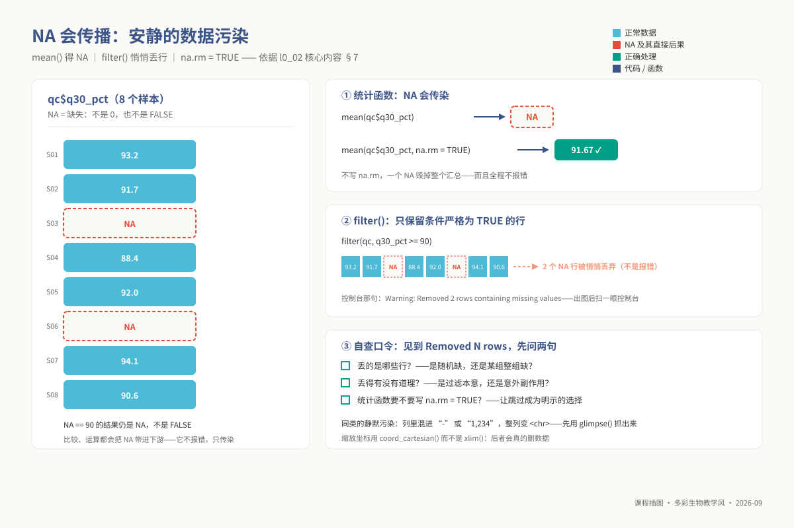

注：图内 Warning 标在 `filter()` 下是示意错位；`filter()` 不报警

<div class="ref">教材 §3.5.3 图 3-6 ｜ 手算 `550.0 / 6 = 91.67`；筛选丢 3 行与绘图丢 2 行分两笔账</div>

---

<!-- _class: undergraduate figure -->

## 图形语法五要素，叠成同一张图

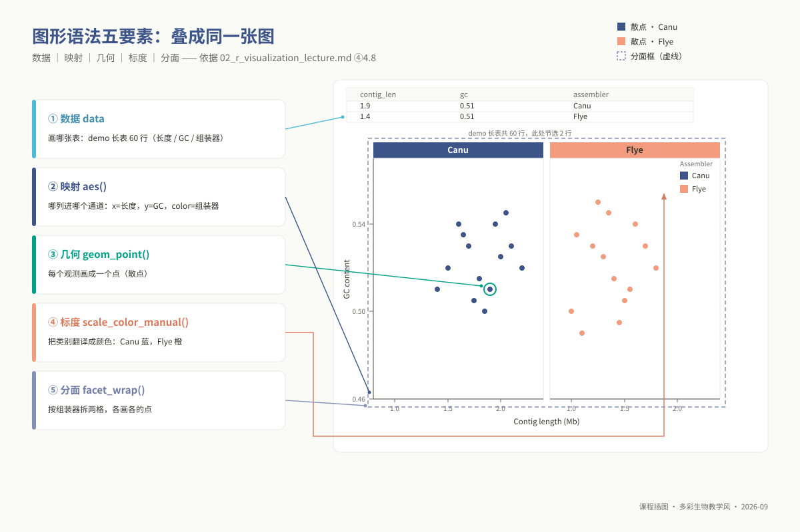

数据 → 映射 → 几何 → 标度 → 分面；轴名带单位

<div class="ref">教材 §3.4.5 图 3-4 ｜ 图内数值与行数是图自设示意，正文不引用</div>

---

## 五要素各管一件事

<div class="cols">
<div class="card">

### 数据与映射
画哪张表；哪一列进哪个通道

</div>
<div class="card">

### 几何与标度
每个观测画成什么；数值怎样变成颜色

</div>
</div>

- 换几何对象时，映射与标度往往要一起调

<div class="ref">教材 §3.4.5 ｜ 讲义 ④ 4.8</div>

---

## `aes()` 里外的判据只有一条

- 取决于数据列取值的外观写在 `aes()` 内
- 全局统一的外观写在 `aes()` 外
- 常量写进 `aes()` 会训练出单水平标度
- 结果：所有点变默认第一色，图例多一条假条目

<div class="ref">教材 §3.4.5、§3.5.2 ｜ 讲义 ④ 4.5</div>

---

<!-- _class: undergraduate figure -->

## 三种写法，只有一种进了映射

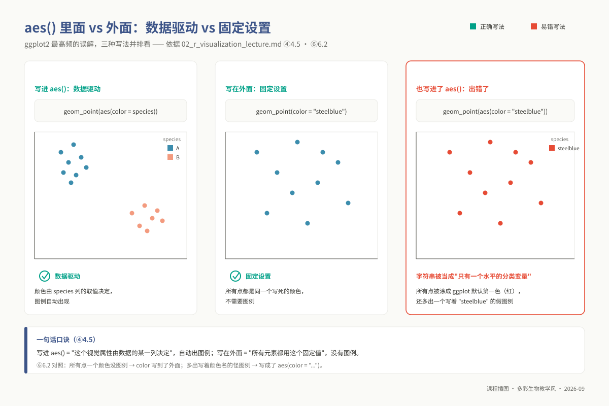

写进 `aes()` 自动出图例；写在外面没有图例；常量进 `aes()` 出假图例

<div class="ref">教材 §3.4.5 图 3-5 ｜ 假图例标题以本机实测为准（美学名 colour）；色值随版本变化</div>

---

## `geom_bar()` 会替你数行数

<div class="cols">
<div>

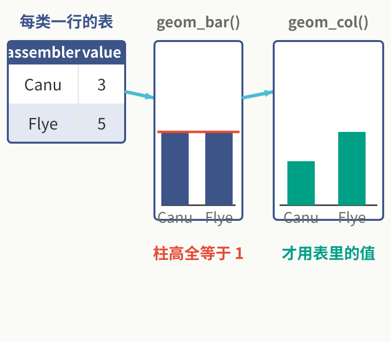

</div>
<div>

- 默认 `stat = "count"`，数的是行数
- 表里已经有指标值时用 `geom_col()`
- 图看着像数据异常，其实是统计变换

</div>
</div>

<div class="ref">教材 §3.4.6 ｜ 讲义 ⑥ 6.2②</div>

---

## 标度截断与坐标缩放不是一回事

<div class="cols">
<div>

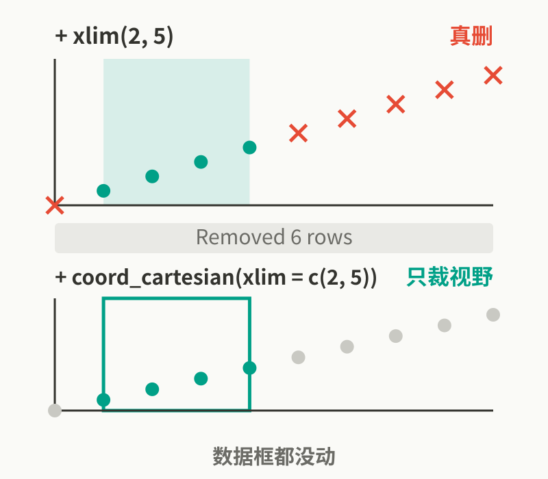

</div>
<div>

- 范围写进标度，界外观测被真的移除
- `coord_cartesian()` 只裁视野，不动数据
- 控制台出现 `Removed`，先想是不是硬截断

</div>
</div>

<div class="ref">教材 §3.4.6（本机 ggplot2 4.0.3 核验，非课程 pin）</div>

---

## 离散标度：`drop` 与 `limits`

<div class="cols">
<div>

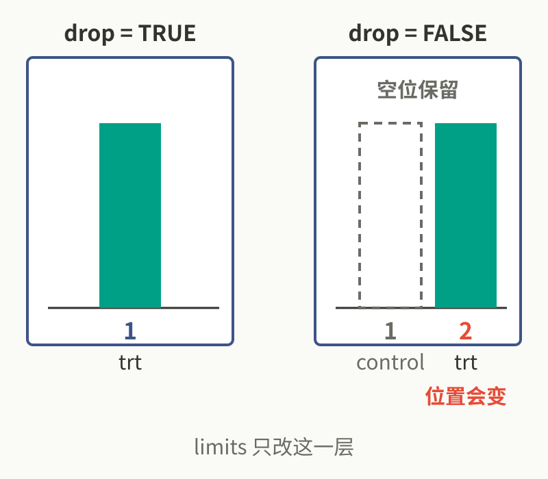

</div>
<div>

- `drop` 默认 `TRUE`，无数据的水平不画
- 设 `FALSE` 才出现空位，位置随之改变
- 只有这一个标度变，数据与因子对象不动

</div>
</div>

<div class="ref">教材 §3.4.6（本机核验：两个水平，数据只落第二个；非课程 pin）</div>

---

## 分面是因为单位不同，不是量级不同

<div class="cols">
<div>

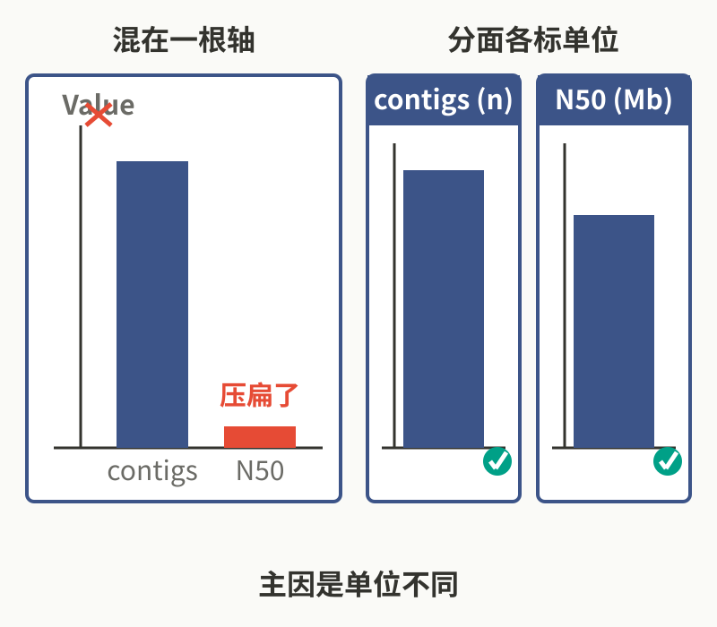

</div>
<div>

- 换算成 Mb 后，四个指标彼此不到 3 倍
- 每面各用各的纵轴，单位写进分面标题
- 笼统写 `Value` 会把量纲藏起来

</div>
</div>

<div class="ref">教材 §3.4.6、§3.4.7 ｜ 讲义 ⑤ 步骤 4.2</div>

---

<!-- _class: undergraduate quiz -->

## 课堂提问

图例里多出一条写着 `#0072B2` 的条目，说明你把它写进了哪里？

---

<!-- _class: undergraduate divider -->

<div class="num">05</div>

# 操作流程

输入表 · 三个脚本 · 关键参数

---

<!-- @section: procedure -->
## 图从哪里来：五个上游表

| 输入 | 产出工具 | 本章看什么 |
|---|---|---|
| `survey/reads.histo` | Jellyfish | 两列都要当数值读 |
| `quast_out/report.tsv` | QUAST | 正则取指标、换单位 |
| `busco_*/short_summary.txt` | BUSCO | 四档顺序与库名 |
| `pangenome/gene_presence_absence.csv` | Roary | 分母来自表结构 |

- 树文件 `ident/core_gene_alignment.treefile` 只在 `ngs_ug_phylo` 可读

<div class="ref">教材 §3.4.7 ｜ 这些表在第 6–8 章与第 11 章生成</div>

---

## 步骤骨架（完整代码见讲义 ⑤）

```text
0  在哪跑：集群 R（交互试）/ Rscript（脚本出图）
1  read_tsv / read_csv / read_table(col_names=)
2  dim / head / glimpse；dplyr 五动词 + pivot_longer
3  三种基本图：geom_col / geom_point / geom_boxplot
4  三个脚本、五个 PDF：k-mer / QUAST+BUSCO / 树+泛基因组
5  labs(轴名带单位) + scale_*_manual + theme_bw
6  dir.create → ggsave(plot=, width=, height=)
7  #!/usr/bin/env Rscript + commandArgs()
```

- 集群没有图形界面；RStudio 只在个人电脑可选（调试用）
- 登录节点只准备，出图一律 `qsub`

<div class="ref">教材 §3.4.11 ｜ 讲义 ⑤ 步骤 0–7</div>

---

## 三个脚本各出什么图

<div class="cols">
<div>

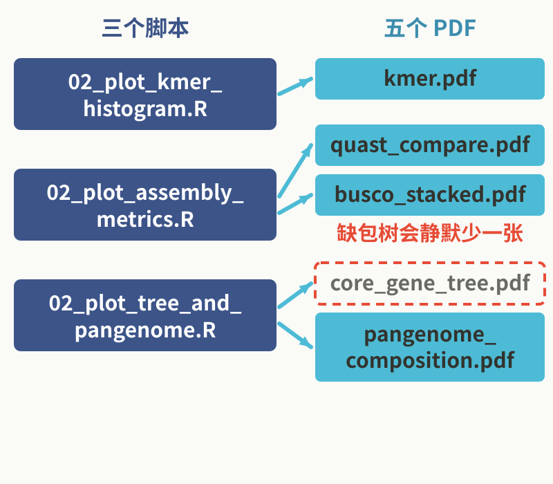

</div>
<div>

- k-mer 7 × 4.5；QUAST 9 × 3.6、BUSCO 5.5 × 4
- 树 6.5 × 5、泛基因组 6 × 4，全部只存 PDF
- 三份脚本都只 `ggsave()`，另存 PNG 才写 `dpi`

</div>
</div>

<div class="ref">教材 §3.4.7、§3.4.9 ｜ 讲义 ⑤ 步骤 4.1–4.4（脚本未在课程环境整跑）</div>

---

## k-mer 谱：两个关键动作

```r
ggplot(kmer, aes(depth, n_kmers)) +
  geom_line(color = "#0072B2") +
  coord_cartesian(xlim = c(0, 150)) + scale_y_log10() +
  labs(x = "k-mer depth", y = "Distinct k-mers (log10)")
```

- 线性纵轴会把主峰压成贴轴的一条线
- 截断用 `coord_cartesian()`，不用 `xlim()`
- 150 与 5 是脚本现行配置，不是通用判据

<div class="ref">教材 §3.4.7 ｜ 讲义 ⑤ 步骤 4.1 ｜ 设例峰位见教材，本页不列</div>

---

<!-- _class: undergraduate figure -->

## k-mer 频谱怎么读

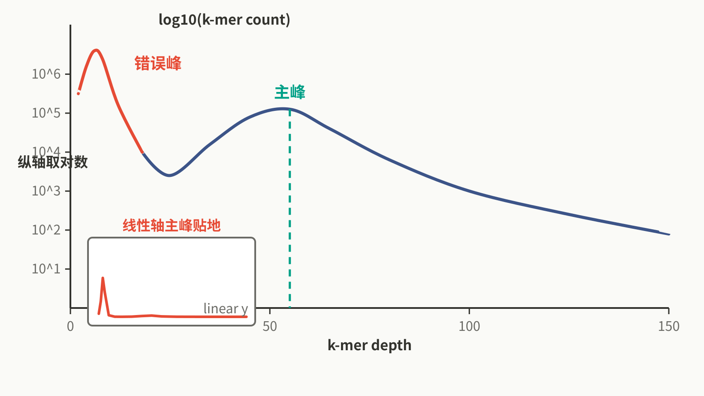

先取对数，再读峰；实线曲线看形状，不追单点

<div class="ref">教材 §3.4.7 ｜ 讲义 ⑤ 步骤 4.1 ｜ 图内曲线为示意，不标峰位数字</div>

---

## QUAST 对比：分面加逐面单位

```r
long$metric <- factor(long$metric,
  levels = c("contigs", "N50", "largest"),
  labels = c("contigs（条）", "N50（Mb）", "largest（Mb）"))
ggplot(long, aes(assembler, value, fill = assembler)) +
  geom_col(width = 0.6) +
  facet_wrap(~ metric, scales = "free_y") + labs(y = NULL)
```

- 分面是因为单位不同，不是量级不同
- 单位写进分面标题，一轴条、一轴 Mb
- 课程脚本用四指标，本页是简化演示

<div class="ref">教材 §3.4.6、§3.4.7 ｜ `demo_quast()` 设例，数值见正文</div>

---

## 泛基因组：分母要从表结构来

<div class="cols">
<div>

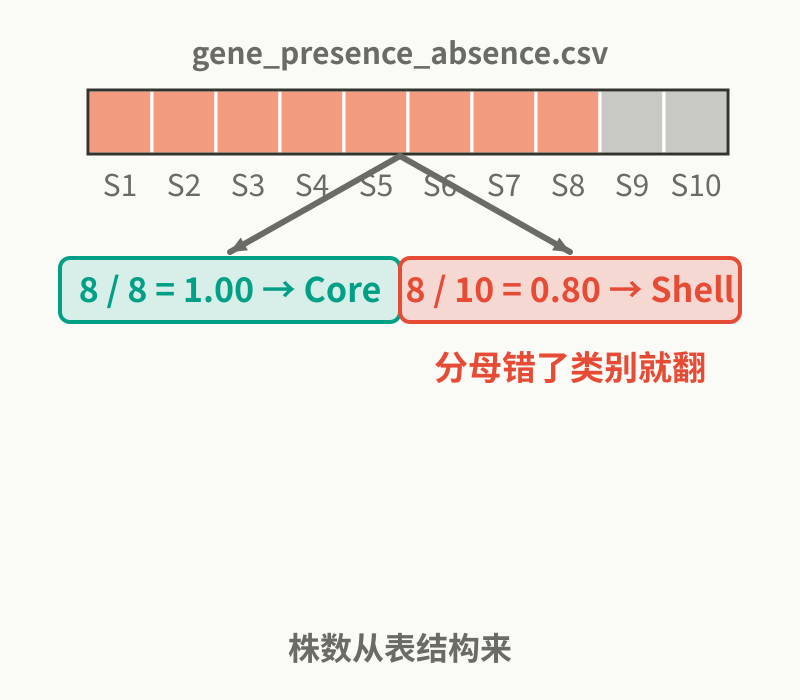

</div>
<div>

- 前 14 列是注释，第 15 列起每株一列
- 图上看不出异常，要回上游核株数清单

</div>
</div>

<div class="ref">教材 §3.4.7 ｜ 四类计数为 `demo_pan()` 设例，正文不列；`8 / 8`、`8 / 10` 可手算</div>

---

## 树图：环境不对会静默缺一张

<div class="cols">
<div>

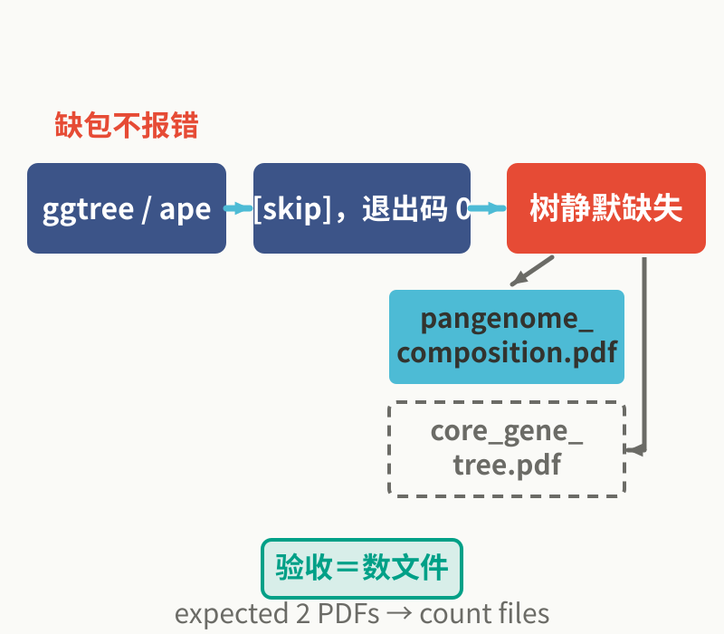

</div>
<div>

- `ggtree` 与 `ape` 只在 `ngs_ug_phylo`
- 验收记录写明预期产物 = 2 个 PDF

</div>
</div>

<div class="ref">教材 §3.4.7、§3.4.11 ｜ 讲义 ⑨ 9.1</div>

---

## 脚本要收参数，导出要显式

```r
#!/usr/bin/env Rscript
args <- commandArgs(trailingOnly = TRUE)
if (length(args) < 2)
  stop("用法：Rscript x.R <out.pdf> <k>:<histo> [...]")
ggsave(out_file, plot = p, width = 7.0, height = 4.5)
```

- 输出文件是第 1 个参数，与课程三个脚本一致
- 不写 `plot =` 时，存的是「最后画的那张图」
- 目标目录要先 `dir.create(recursive = TRUE)`

<div class="ref">教材 §3.4.9、§3.4.11 ｜ 讲义 ⑤ 步骤 6–7</div>

---

<!-- _class: undergraduate statement -->

计算一律走 `qsub`；登录节点只做下载、建环境与编辑。

图表的小计算也一样：出图与汇总都提交到计算节点，登录节点只用来准备和检查。

---

<!-- _class: undergraduate divider -->

<div class="num">06</div>

# 结果解读

验收清单 · 结果不对时长什么样 · 判读界线

---

<!-- @section: interpretation -->
## 一张图「对了」的验收清单

| 检查项 | 合格标准 |
|---|---|
| 轴与图例 | 两轴有名字且带单位 |
| 分类顺序 | 按内在顺序，不按字母序 |
| 数值与文字 | 关键数标出；全英文无方块 |
| 尺寸与独立性 | 版面下字清楚；不看正文能读懂 |

<div class="ref">教材 §3.4.11 ｜ 讲义 ⑥ 6.1</div>

---

<!-- _class: undergraduate warn -->
## 结果不对时长什么样（一）

| 现象 | 真正的原因 | 先做什么 |
|---|---|---|
| 图整幅空白 | `filter()` 全滤掉或映射列全 NA | `nrow()`、`summary()` |
| 柱子全一样高 | `geom_bar()` 在数行数 | 改 `geom_col()` |
| 点同色且无图例 | `color=` 写在了 `aes()` 外 | 映射放回 `aes()` |
| 多出常量名的图例 | `aes(color = "#0072B2")` | 常量移出 `aes()` |

<div class="ref">教材 §3.5.2 ｜ 失效条件 3.5.2、3.5.3 ｜ 讲义 ⑥ 6.2</div>

---

<!-- _class: undergraduate warn -->
## 结果不对时长什么样（二）

| 现象 | 真正的原因 | 先做什么 |
|---|---|---|
| x 轴是字母序 | 字符列没设 factor levels | `factor(x, levels=)` |
| 文字全是方块 | 设备找不到中文字形 | 图内改英文（环境约定） |
| k-mer 图贴地一条线 | 没取 log，或截断方式不对 | `scale_y_log10` + `coord` |
| 导出的字特别小 | 画布大于目标版面 | 先判画布，再调字号 |

<div class="ref">教材 §3.5.1、§3.5.4、§3.4.7 ｜ 讲义 ⑥ 6.2 ｜ 图内英文是环境约定，不是技术定律（§3.3）</div>

---

<!-- _class: undergraduate warn -->
## 结果不对时长什么样（三）：`Removed N rows`

- 是提示不是报错，图照样出
- 丢的可能是映射列 NA，也可能是 `xlim()` 硬截断
- 每次出图扫一眼控制台移除行数
- 先问：丢的是哪几行、丢得有没有道理

<div class="ref">教材 §3.4.6、§3.5.3 ｜ 讲义 ⑥ 6.2⑥</div>

---

## 判读的界线：本章不下生物学结论

- N50 更高不等于更好：裁决在第 8 章
- D 档偏高要三步诊断：也在第 8 章
- 泛基因组阈值与核心基因在第 11 章
- 本章只交付图与验收记录

<div class="ref">教材 §3.4.7、§3.6 ｜ 讲义 ⑥</div>

---

## 图注六项，够不够一眼看出

| 项目 | 写法 |
|---|---|
| 输入 | 文件名与生成工具 |
| 处理与参数 | 筛选条件、单位换算、截断值 |
| 样本量 | `n` 与 `n_used`，或每组 n |
| 环境与证据状态 | 版本、环境名；设例或实测 |

<div class="ref">教材 §3.4.11 ｜ `sessionInfo()` 打印版本，不必手抄</div>

---

<!-- _class: undergraduate statement -->

脱离正文也能读懂，才叫图注；换一个人照记录能重画出同一批图，才叫验收记录。

三件交付物是同一件事的三面：图、汇总小表、验收记录。

---

<!-- _class: undergraduate divider -->

<div class="num">07</div>

# 常见错误

课堂上一定会遇到的三条

---

<!-- @section: troubleshooting -->
<!-- _class: undergraduate warn -->
## 常见错误一：找不到包

<div class="cols">
<div>

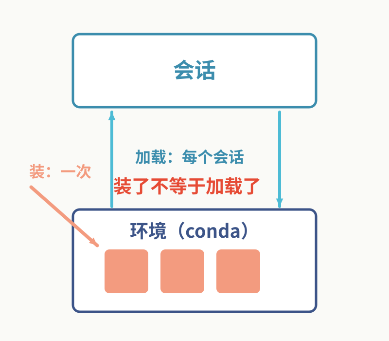

</div>
<div>

- 报 `there is no package called 'tidyverse'`
- 没激活 `ngs_ug_base`，或用了系统 R
- `could not find function "%>%"` 是没 `library()`
- `.libPaths()` 确认库路径

</div>
</div>

<div class="ref">教材 §3.3、§3.4.6 ｜ 讲义 ⑨ 9.1</div>

---

<!-- _class: undergraduate warn -->
## 常见错误二：相对路径找不到文件

- 相对路径是相对 `getwd()`，不是脚本所在目录
- 先 `getwd()` 再 `list.files()` 核对
- 脚本里用 `commandArgs()` 传路径
- `Cannot find directory` 用 `dir.create()` 先建

<div class="ref">教材 §3.4.9、§3.4.11 ｜ 讲义 ⑨ 9.2、9.4</div>

---

<!-- _class: undergraduate warn -->
## 常见错误三：`object 'contig' not found`

- 拼错或大小写不一致
- `read.csv()` 把 `N50 (bp)` 改成 `N50..bp.`
- `names(df)` 逐字比对列名
- 本课统一用 `read_tsv()` 读表

<div class="ref">教材 §3.4.2 ｜ 讲义 ⑨ 9.3 ｜ 其余报错见讲义 ⑨</div>

---

<!-- _class: undergraduate divider -->

<div class="num">08</div>

# 课后

交付清单 · 思考练习 · 实验指导

---

<!-- @section: wrapup -->
## 交付：三件东西

| 交付物 | 判据 |
|---|---|
| 五个 PDF `results/figures/*.pdf` | 脱离正文可读，轴名带单位 |
| 汇总小表（标准输出） | 每个数能追到输入表一行 |
| 验收记录 | 脚本、参数、版本、图数 |

- 四类图、五个文件：k-mer、QUAST、BUSCO、树、泛基因组
- 要 PNG 就另加一次导出并显式写 `dpi`

<div class="ref">教材 §3.6 ｜ 讲义 ⑩ ｜ 实验指导 §7 提交物</div>

---

## 思考练习（教材 §3.7 习题 1–5）

- 习题 1 读表三条检查与 `N50 (bp)` 为何取不到
- 习题 2 宽转长行数、单位不统一怎么办
- 习题 3 BUSCO 默认顺序与绑定依据
- 习题 4 Q30 四个数；习题 5 `iris` 三写法

<div class="ref">教材 §3.7 ｜ 讲义 ⑩（含拓展题 Q6 完整版）｜ 实验指导 §6 同一组</div>

---

## 实验指导与收尾

- `11_lab_guides/undergraduate/02_r_visualization_lab.md`
- 上机时手边打开：每步有检查点与出错信号
- 文献只给指针（讲义 ⑪），本 deck 不重复列

**图的可信度，不在代码偶然跑通，而在每一处顺序、颜色与坐标都能溯源。**

<div class="ref">教材 §3.6、§3.7 ｜ 讲义 ⑩、⑪</div>
