<!-- @section: cover -->
<!-- _class: undergraduate cover -->

# u03 ｜ 测序原理与数据格式

**仪器只给一个概率，不给真值：同一个碱基，一个字母，也是一个判错概率。**

<div class="meta">

- 线上先导自学 4 学时 ｜ 课堂 Day 0 串讲
- 讲义 `02_lectures/undergraduate/unit03_seq_principles_formats/`
- 对应教材 §4.1–§4.6、§5.1–§5.7 ｜ 环境 `ngs_ug_base`

</div>

---

<!-- _class: undergraduate divider -->

<div class="num">I</div>

# 学习目标

八条：从信号、读段到四行与坐标

---

<!-- @section: objectives -->
## 学完你应当能够（一）：信号与误差

- 复述 Illumina 掺入、成像、切除三步循环
- 解释 3′ 端质量下降来自簇内失同步
- 说明 ZMW 与多圈共识如何得到 HiFi
- 说出同聚物为什么以插入缺失为主

<div class="ref">教材 §4.4.1–§4.4.5 ｜ 学习目标 LO04-01–LO04-02</div>

---

## 学完你应当能够（二）：数据与格式

- 分清名义深度与覆盖度，各带单位
- 手工解码质量字符，算判错概率
- 拆解 FLAG 与 CIGAR 的查询/参考跨度
- 换算 BED 与 GFF3 的同一段区间

<div class="ref">教材 §4.4.6、§5.4–§5.5 ｜ 学习目标 LO04-03、LO05-01–LO05-04</div>

---

<!-- _class: undergraduate divider -->

<div class="num">II</div>

# 前置检查

两个前置模块，加上本讲的 `l0_04`

---

<!-- @section: prerequisites -->
## 前置检查：三个 L0 模块

| L0 模块 | 本讲用到 | 不过关的后果 |
|---|---|---|
| `l0_01_linux` | 管道、`head`、`awk` | 第一条命令就卡住 |
| `l0_03_conda` | 激活 `ngs_ug_base` | 分不清环境还是没装 |
| `l0_04_formats` | 本讲即它本科载体 | 自测做不完 |

- 通过 L0-4 第 1–10 题即视为完成
- 题目在 `08_assessment/prerequisites/l0_04_formats_selftest.md`

<div class="ref">讲义 ② ｜ 自测 Q8 解码质量字符、Q9 拆 FLAG、Q10 判格式</div>

---

## 跟不上的三个症状

| 症状 | 回查 |
|---|---|
| 不认 `zcat x.fq.gz \| head -8` | `l0_01_linux` 管道 |
| `conda activate` 报错 | `l0_03_conda` 激活 |
| 不熟 `awk` 的 `$0`、`NR` | `l0_01_linux` 三剑客 |

<div class="ref">讲义 ②</div>

---

<!-- _class: undergraduate divider -->

<div class="num">III</div>

# 科学问题

三个问题，一个自带答案的装置

---

<!-- @section: background -->
## 敲第一条命令前的三个问题

| 问题 | 为什么必须先答 |
|---|---|
| 手上这堆文件是什么 | 判错，第一条命令就报错 |
| 这份数据够不够 | 报告 §2.3 要四个度量 |
| 为什么要长读长 | 150 bp 跨不过 5 kb 重复（设例） |

<div class="ref">教材 §4.1、§4.6 ｜ 讲义 ③</div>

---

## 内建标准答案：同一株三份数据

<div class="cols">
<div class="card">

### 题目
ONT `ERR15732384`：38,078 条 / 302,672,631 bp，名义 63.5×

</div>
<div class="card">

### 答案
完成图 `GCA_987216485`，全长 4,768,212 bp

</div>
</div>

- 短读长 `ERR15732342`：1,579,368 条 / 228,911,011 bp
- 名义 48.0×，供 k-mer 勘测与质控；跨重复靠长读长
- 校内 `reads.fa` 按 PacBio 流程跑；主线这条是 ONT
- 两条对答案路径的实操在第 8 章

<div class="ref">教材 §4.1、§4.6 ｜ 登录号见 <code>06_data/accessions.tsv</code></div>

---

<!-- _class: undergraduate figure -->

## 同一株，三份数据互为答案

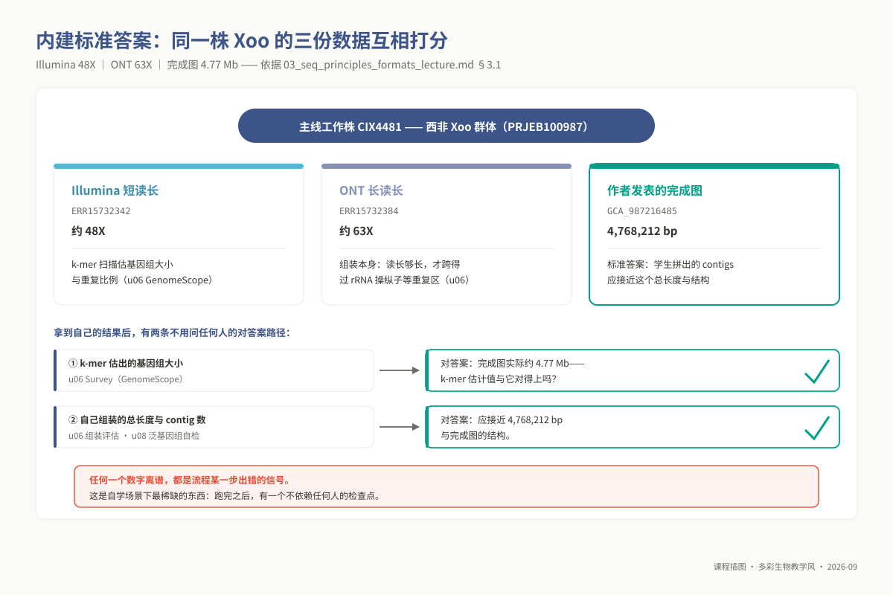

图内 `u06`、`u08` 是讲义单元号；约 63× 是 ENA 原始 Run 口径

<div class="ref">教材 §4.1 图 4-1 ｜ 课堂降采样到 40× 见 §4.6</div>

---

<!-- _class: undergraduate statement -->

数字对不上时，先排除参考版本与数据子集。

再排除生物学差异，最后才谈流程出错：这是提醒，不是判决。

---

<!-- _class: undergraduate divider -->

<div class="num">IV</div>

# 核心原理

三条信号路线 · 两类误差 · 一个几何条件

---

<!-- @section: principles -->
## 三种测序，三个类比

<div class="cols3">
<div class="card">

### Illumina
几亿人同时听写，一轮一个碱基

</div>
<div class="card">

### PacBio
盯住一个分子，绕环反复读

</div>
<div class="card">

### Nanopore
让 DNA 穿孔，读电流

</div>
</div>

<div class="ref">教材 §4.4.1–§4.4.4 ｜ 讲义 ④</div>

---

## 三条路线各自最容易错在哪

| 路线 | 信号 | 最易错处 |
|---|---|---|
| Illumina | 成簇荧光，逐轮成像 | 簇内失同步，末端变差 |
| PacBio | 单分子荧光脉冲 | 单次错误率高，要反复读 |
| Nanopore | 穿孔电流 | 同聚物区长度判错 |

<div class="ref">教材 §4.4.1 表 4-2 ｜ 平台参数不作通用规格</div>

---

<!-- _class: undergraduate statement -->

没有「最好」的平台，只有配得上问题的平台。

读长、准确率、通量随化学与 basecaller（碱基识别软件）版本变，引用要连版本一起写。

---

## Illumina：掺入、成像、切除

<div class="cols">
<div>


</div>
<div>

- 3′ 封闭保证一轮只接一个碱基
- 成像记下颜色，切除恢复游离端
- 150 个循环约 150 bp（设例，非机型规格）

</div>
</div>

<div class="ref">教材 §4.4.2</div>

---

<!-- _class: undergraduate figure -->

## 3′ 端为什么普遍变差

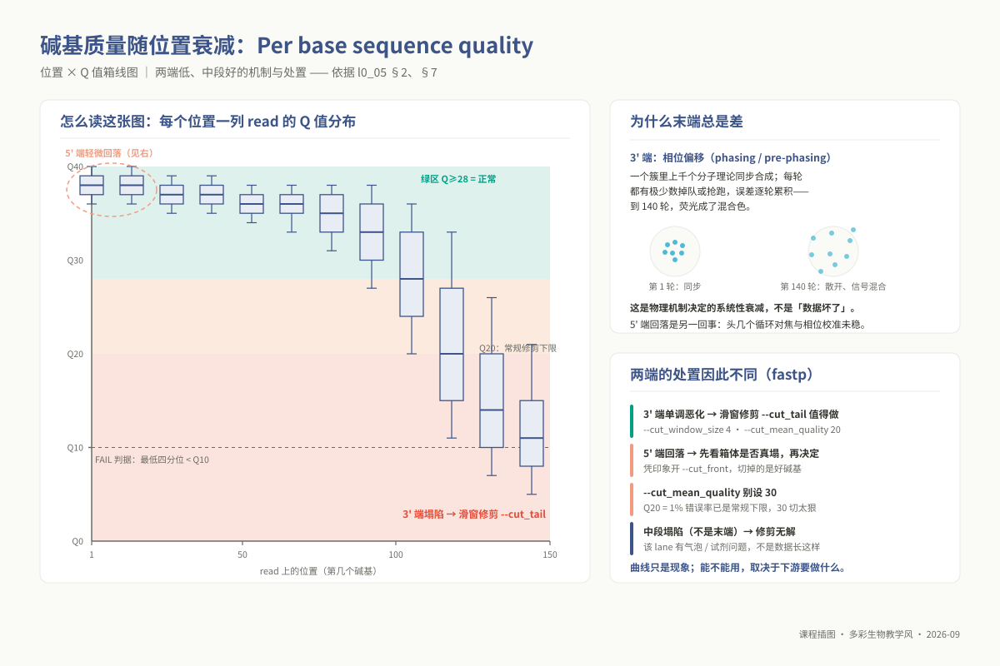

左半阈值与修剪属第 6 章；图内「第 140 轮」是示意轮次

<div class="ref">教材 §4.4.2 图 4-3、§4.5.1</div>

---

## 簇内失同步：一个簇里上千个拷贝

- 掺入失败或切除不净，分子落后一轮
- 封闭基团提前脱落，分子抢先一轮
- 失同步一旦发生就保留，不会自纠
- 百余轮后混色：质量沿读段下降

<div class="ref">教材 §4.4.2（相位滞后与相位超前）</div>

---

<!-- _class: undergraduate statement -->

3′ 端质量下降，是化学的累积趋势。

普遍下降属预期；中段塌陷或单条 lane 偏低，更像运行或试剂问题。

---

## PacBio：ZMW 与多圈共识

<div class="cols">
<div>

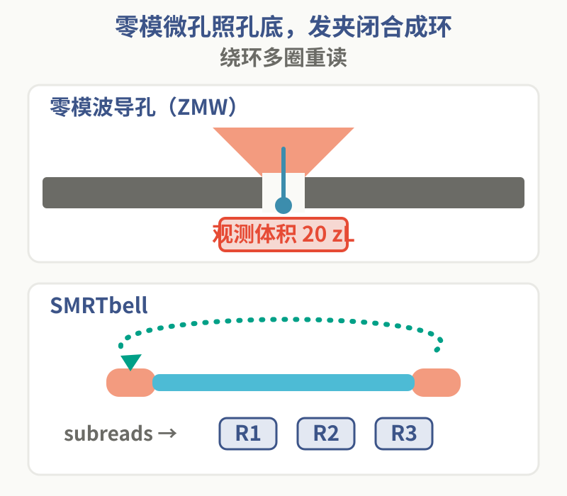

</div>
<div>

- 观测体积只有 20 zL = 2 × 10⁻²⁰ L
- 微孔小于光波长，发夹接头闭合成环
- 单次判读约 85–87%，多圈共识得 HiFi

</div>
</div>

<div class="ref">教材 §4.4.3 ｜ 85–87% 绑定该份 Sequel v2 数据</div>

---

## 共识错误率随通过次数急剧下降（合成算例）

<div class="cols">
<div>

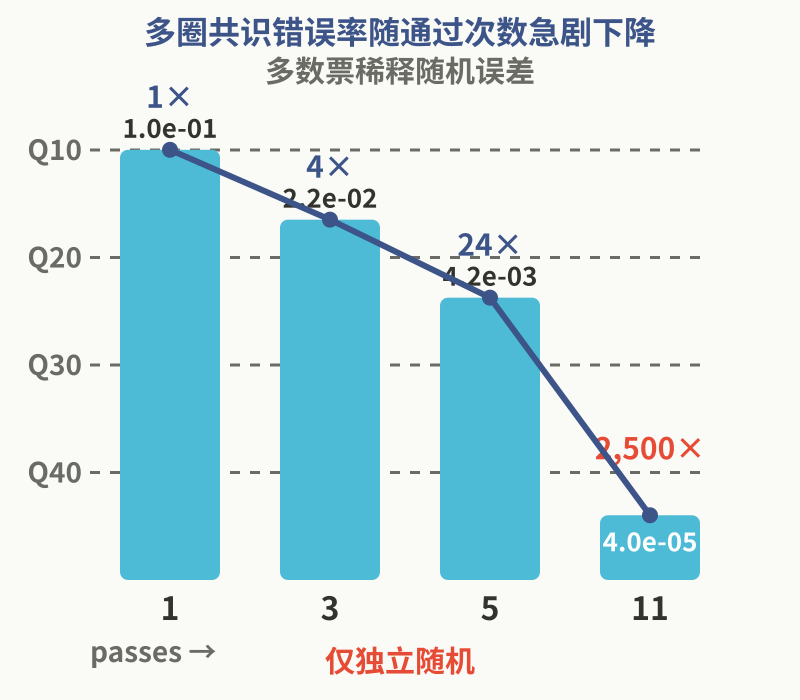

</div>
<div>

- 单条读段错误率设为 0.10，只含替换
- 圈数越多，残留错误率越低，Q 值升高
- 仅对独立随机误差成立；系统偏差不降

</div>
</div>

<div class="ref">演示 <code>demos/ch04_ccs_vote.py --selftest</code> ｜ 教材 §4.4.3</div>

---

<!-- _class: undergraduate statement -->

多数票只压随机成分。

同向的系统偏差，会被投票投成共识。

---

## Nanopore：电流由一小段碱基决定

<div class="cols">
<div>

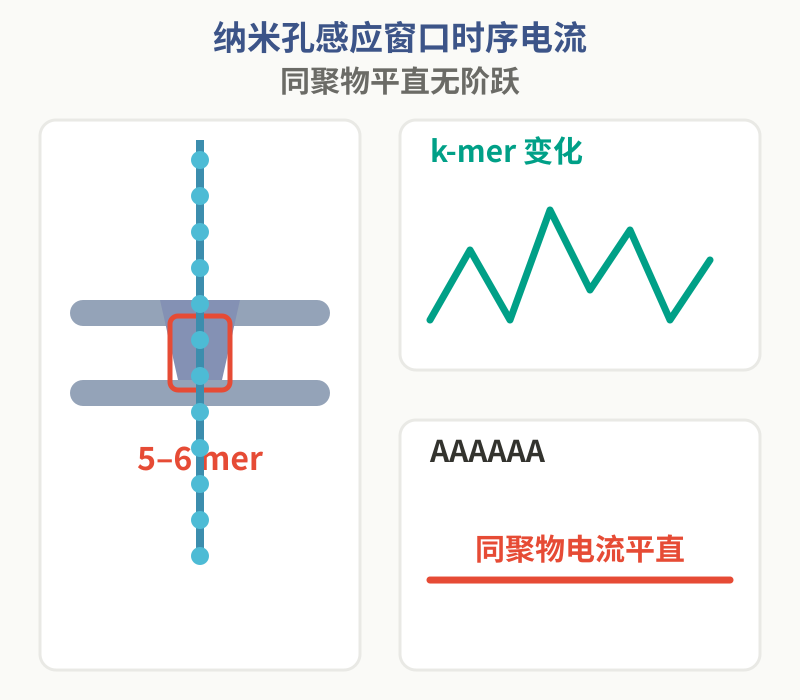

</div>
<div>

- 电流由窗口内 5–6 个碱基共同决定
- 窗口滑动，模型把电流时序解成序列
- 同聚物电流平直，只能靠停留时间猜个数

</div>
</div>

<div class="ref">教材 §4.4.4 ｜ 窗口长度随孔版本变，不是固定常数</div>

---

## 投票修不掉的那一类错误（合成模型）

<div class="cols">
<div>

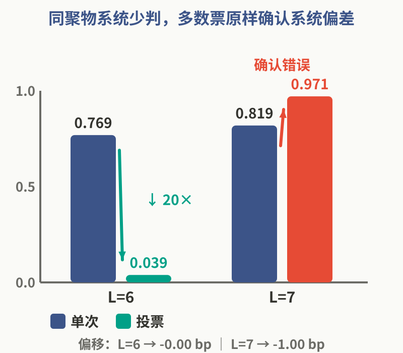

</div>
<div>

- 少判一个＝缺失，多判一个＝插入
- `L=6` 只有随机噪声，投票降约 20 倍
- `L` 到 7 起同向少判；`L=12` 也不改善

</div>
</div>

<div class="ref">演示 <code>demos/ch04_homopolymer_indel.py --selftest</code> ｜ 教材 §4.5.2</div>

---

<!-- _class: undergraduate -->

## 掌上测序仪：USB 直连笔记本

<div class="cols">
<div>

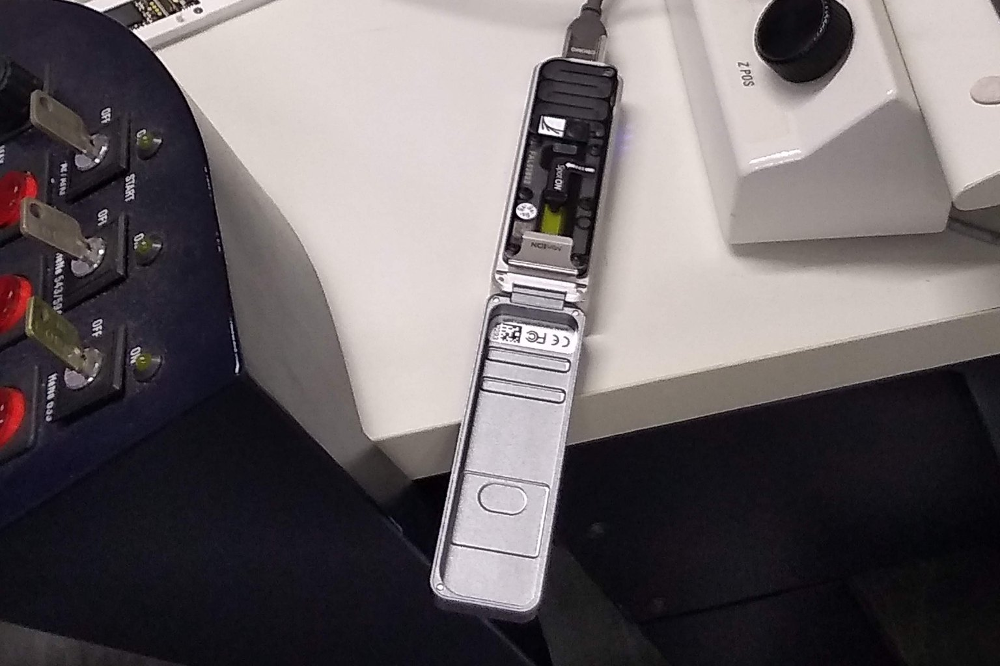

</div>
<div>

- 设备门槛低，现场测序成为可能
- 读长仍取决于提取的 DNA 完整度

</div>
</div>

<div class="ref">教材 §4.4.4 图 4-4 ｜ 照片：Cirosantilli2，CC BY-SA 4.0，Wikimedia Commons</div>

---

## 三类平台的错误谱，每条带条件

| 平台 | 错误谱 | 条件 |
|---|---|---|
| Illumina | 3′ 端衰减，替换为主 | 随化学与机型 |
| PacBio CLR | 插入缺失为主 | 特定 Sequel v2 数据 |
| HiFi | 残余 92.0% 同聚物 indel | 该份 HG002 数据 |
| Nanopore | 同聚物 indel 为主 | 随孔与模型版本 |

- CLR＝连续长读，单次原始读段，未经多圈共识
- HiFi 是同一分子多圈共识，不是另一台仪器

<div class="ref">教材 §4.4.5 ｜ 每条以文献为入口，不外推为平台规格</div>

---

## 短读长与长读长，各买什么

- 短读长：单碱基错误率低，适合找变异
- 长读长：用跨度换连接证据，适合完成图
- 长读长的读长，取决于提取的 DNA 完整度
- 两类并用：数量靠短读，跨度靠长读

<div class="ref">教材 §4.4.2、§4.4.4、§4.4.6 ｜ 学习目标 LO04-04</div>

---

## 深度与覆盖度不是一回事

<div class="cols">
<div>

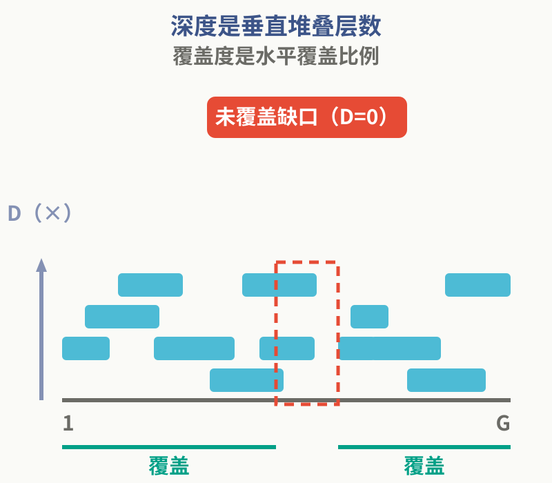

</div>
<div>

- 深度 `D = 碱基总量 / G`，单位 ×
- 覆盖度：被读段盖住的碱基比例，单位 %
- `302,672,631 / 4,768,212 = 63.5×`；过滤后更低

</div>
</div>

<div class="ref">教材 §4.4.1、§4.6 ｜ 口径见术语表 §2</div>

---

## 长读长解决的是哪一种不可分辨

<div class="cols">
<div>

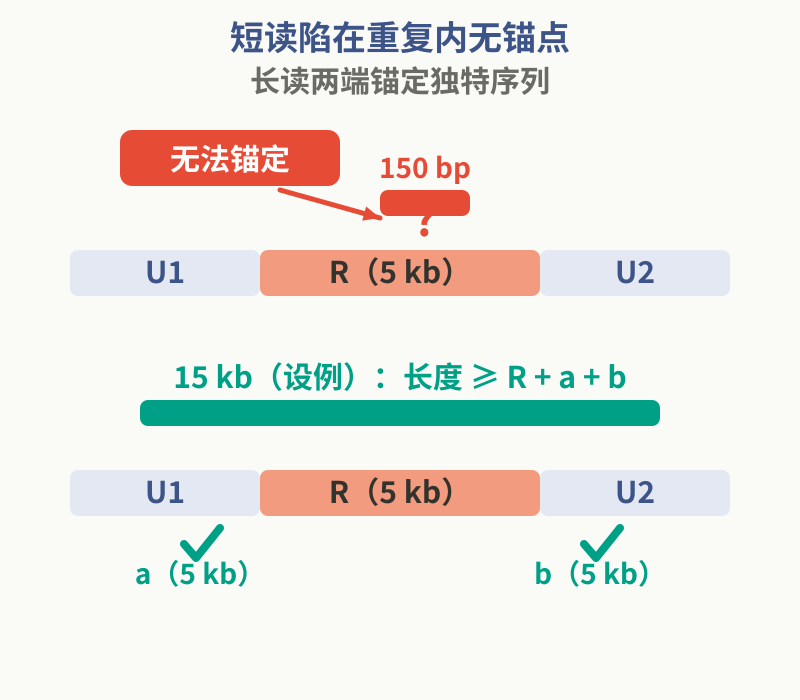

</div>
<div>

- rRNA 操纵子约 5 kb、5–10 个拷贝（设例）
- 150 bp 整条落进重复，两端都没有锚点
- 跨越要 `R + a + b`，本设例才是 15 kb

</div>
</div>

<div class="ref">教材 §4.4.6（设例，不用于推断本株拷贝数）</div>

---

<!-- _class: undergraduate statement -->

深度问的是「同一段被看了几遍」。

读长问的是「一次能看多远」。两者在预算表上都是钱，在信息上不能互换。

---

<!-- _class: undergraduate quiz -->

## 课堂提问

一条 150 bp 读段，测到 100× 能跨过 5 kb 的重复吗？

<div class="ref">教材 §4.4.6（设例）</div>

---

<!-- _class: undergraduate divider -->

<div class="num">V</div>

# 数据格式与坐标

四行 · 十一列 · 两套编号

---

## 格式家族：两条线，各走到哪里

<div class="cols">
<div>

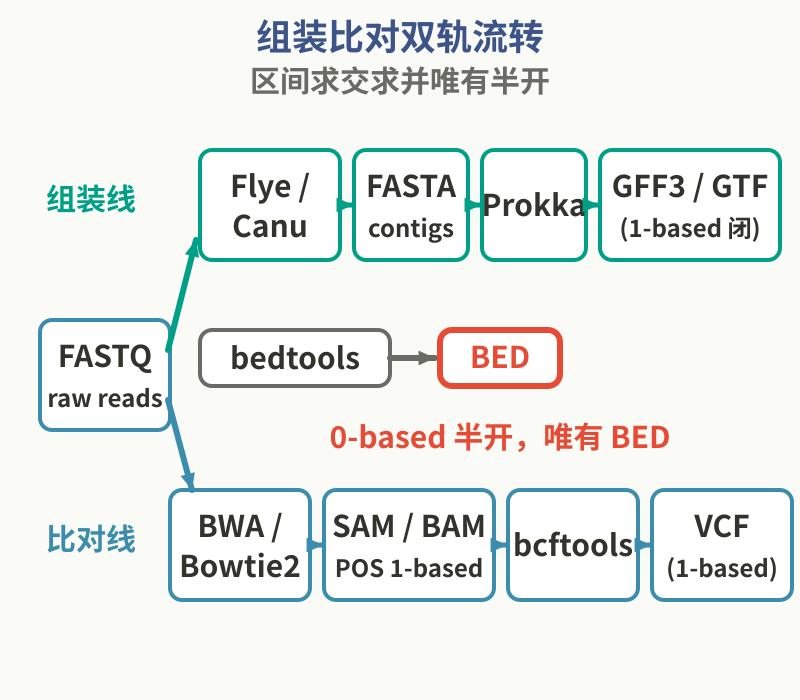

</div>
<div>

- 组装线到注释，比对线到变异检测
- 每条线自带坐标系，写数就写坐标系
- 唯有 BED 是 0-based 半开

</div>
</div>

<div class="ref">教材 §5.1 图 5-1 ｜ 具体工具留给第 7–9 章</div>

---

## FASTQ：常见四行，序列与质量等长

```text
@READ_0001 1:N:0:ATCACG
GATCGGAAGAGCACACGTCTGAACTCCAGTCAC
+
FFFFFF:FFFFFFFFF,FFFF#FFFFFFFFFFF
@READ_0002 1:N:0:ATCACG
TTGACCATGCGCATTAGGCCTAAGCTTGACCAT
+
@IIIIIIIIIIIIIIIIIIIIIIIIII?55555
```

- 8 行 2 条：`8 ÷ 4 = 2`（演示算例 1）
- 第 2 条的质量行就以 `@` 开头，是合法字符

<div class="ref">教材 §5.4.2 ｜ 演示 <code>demos/ch05_phred_fastq.py --selftest</code></div>

---

<!-- _class: undergraduate figure -->

## 四行结构与 Phred 解码表

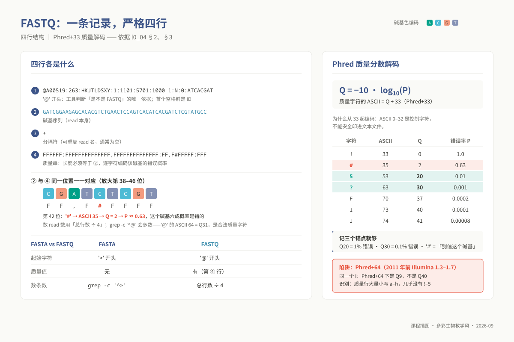

`@` 只是记录头起始字符；ASCII 0–31 控制、32 空格

<div class="ref">教材 §5.4.2–§5.4.3 图 5-2</div>

---

## Phred+33：字符怎么变成概率

<div class="cols">
<div>

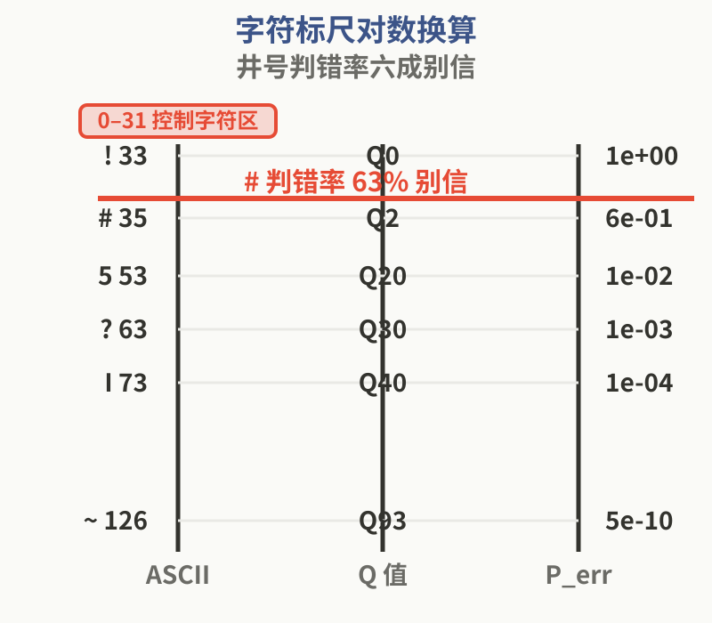

</div>
<div>

- `Q = −10 log₁₀ P_err`；`ASCII = Q + 33`
- ASCII 0–31 控制、32 空格，不能作质量字符
- 不少平台停在 `J` = Q41；格式上限 `~` = Q93

</div>
</div>

<div class="ref">教材 §5.4.3 ｜ 演示 <code>demos/ch05_phred_fastq.py --selftest</code> 算例 1–2</div>

---

<!-- _class: undergraduate statement -->

Q20 = 1%、Q30 = 0.1% 是换算结果。

换算值不是合格线：多高算够用，取决于下游能容忍多少错。

---

## 质量值高，不等于这条读段全对

<div class="cols">
<div>

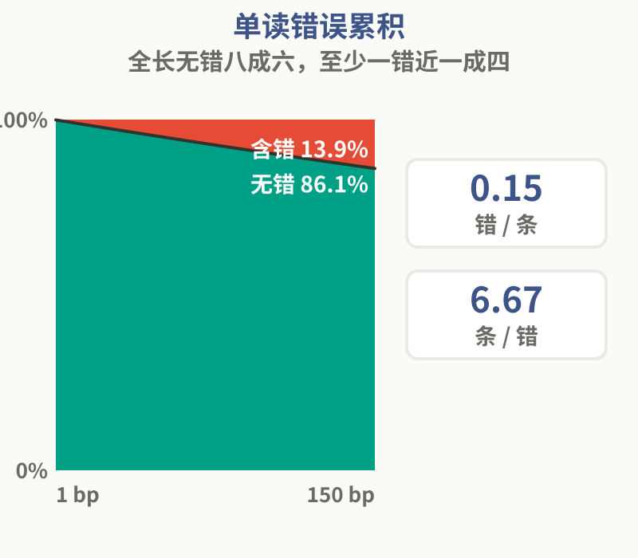

</div>
<div>

- 150 bp 全 Q30：`150 × 0.001 = 0.15` 个错误
- 整条无错 `(1 − 0.001)^150 = 0.8606…`
- 至少错一个约 13.9%，依赖独立假设

</div>
</div>

<div class="ref">教材 §5.4.3 反直觉块（手算，可复核）</div>

---

## FASTA：没有质量值的那一半

- `>` 开头，序列可折行，无逐碱基质量
- `reads.fa` 是原始读段，不是基因组
- 条数与长度分布只是线索，不是定论
- 判身份还要看内容、来源与元数据

<div class="ref">教材 §5.4.1–§5.4.2 ｜ 讲义 ⑤5.3</div>

---

## 三道只读排查：类型、魔数与首字符

<div class="cols">
<div>

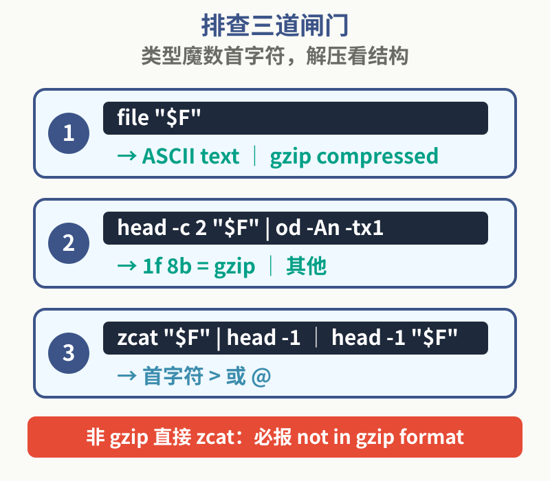

</div>
<div>

- 头两字节 `1f 8b`＝gzip，否则还要再识别
- 解压后首字符 `>`/`@` 只是线索
- 四行结构与等长，才是格式的判据

</div>
</div>

<div class="ref">教材 §5.4.1 ｜ 讲义 ⑤5.4</div>

---

<!-- _class: undergraduate statement -->

「行数 ÷ 4」只在不折行时成立。

折行只会把商抬高或除不尽；要偏小，得另有截断一类的损伤。

---

## SAM：11 个强制列，第 12 列起是标签

<div class="cols">
<div>

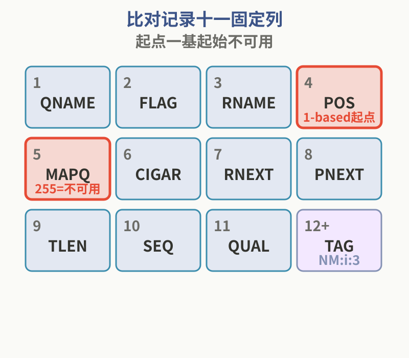

</div>
<div>

- `FLAG` 是位掩码，不是普通编号
- `MAPQ` 不是碱基质量；`255` 不可用
- `TLEN` 是观测模板长度，非插入片段

</div>
</div>

<div class="ref">教材 §5.4.5 ｜ MAPQ 的完整解释在第 7 章</div>

---

## FLAG 163 拆开来看

<div class="cols">
<div>

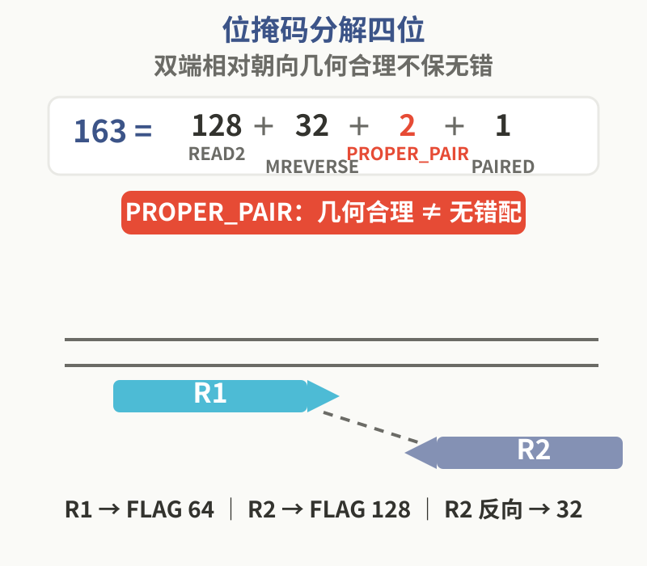

</div>
<div>

- `1` 双端；`64`/`128` 分别是 R1 与 R2
- `32` 配对端负链；`16` 未置位＝自身正链
- `2` 只说明几何合乎文库，不保证无错配

</div>
</div>

<div class="ref">教材 §5.4.5 ｜ 演示 <code>demos/ch05_flag_cigar.py --selftest</code> 算例 1</div>

---

## CIGAR：查询消耗与参考跨度

<div class="cols">
<div>

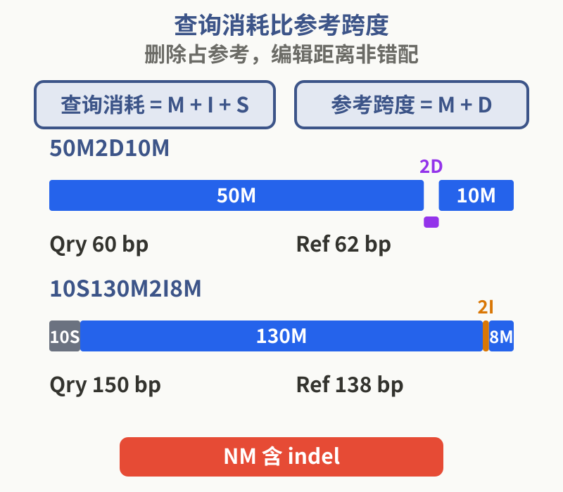

</div>
<div>

- `M` 只表示比对，不保证完全匹配
- `I` 占查询不占参考，`D` 反过来
- `S` 只占查询；`N` 也占参考跨度

</div>
</div>

<div class="ref">教材 §5.4.6 ｜ 演示 <code>demos/ch05_flag_cigar.py --selftest</code> 算例 2</div>

---

<!-- _class: undergraduate statement -->

`NM` 是错配、插入、缺失碱基的总和。

`50M2D10M` 加 `NM:i:3`：`3 − 2 = 1`，1 个错配、2 个缺失。

---

## 四种区间格式：先记用途与坐标

| 格式 | 用来做什么 | 坐标系 |
|---|---|---|
| BED | 区间求交、求并、计数 | 0-based 半开 |
| GFF3 | 基因结构等层级注释 | 1-based 闭 |
| GTF | 转录本与外显子计数 | 1-based 闭 |
| VCF | 记录变异 | 1-based |

<div class="ref">教材 §5.4.7 ｜ 术语表 §2：每次出现区间都写坐标系</div>

---

## 同一段 TGC，两种都对

<div class="cols">
<div>

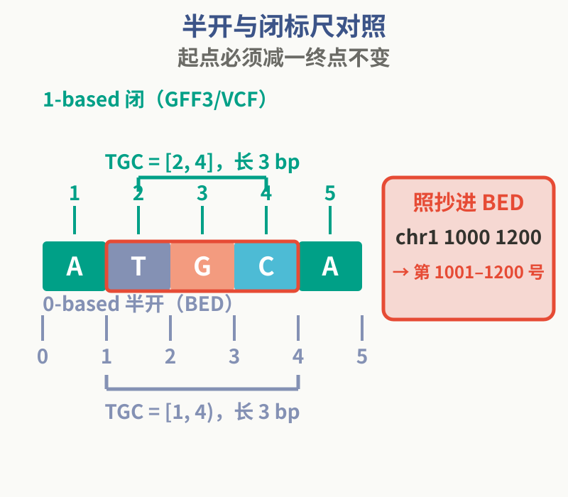

</div>
<div>

- `bed_start = gff_start − 1`，终点不变
- 照抄 `chr1 1000 1200` 进 BED：仍得 200 bp
- 丢的是第 1000 号碱基，长度少 1

</div>
</div>

<div class="ref">教材 §5.4.4 ｜ 演示 <code>demos/ch05_bed_gff_coords.py --selftest</code> 算例 1–2</div>

---

<!-- _class: undergraduate statement -->

坐标错不乱报错，只让区间差一位。

检查三件事：起点减一、终点不变、长度相等。

---

<!-- _class: undergraduate divider -->

<div class="num">VI</div>

# 操作流程

登录节点只编辑，计算一律 `qsub`

---

<!-- @section: procedure -->
## 集群规矩：先读这一段

- 登录节点只编辑、提交、看结果
- `ls`、`file`、`head`、`od` 这类查看可以留在这里
- 任何计算走 `qsub 脚本`，不留在登录节点
- 日志 `<作业名>.o<JOB_ID>`，出问题先 `cat`

<div class="ref">讲义 ⑤ ｜ 课程集群约定（SGE：<code>qsub</code> / <code>qstat</code>）</div>

---

<!-- _class: undergraduate figure -->

## 登录节点 vs 计算节点


先 `hostname` 看自己在哪；计算只去计算节点

<div class="ref">教材 §1.4.8 ｜ 概念见第 1 章</div>

---

## 主统计脚本：三个参数

<div class="cols">
<div>

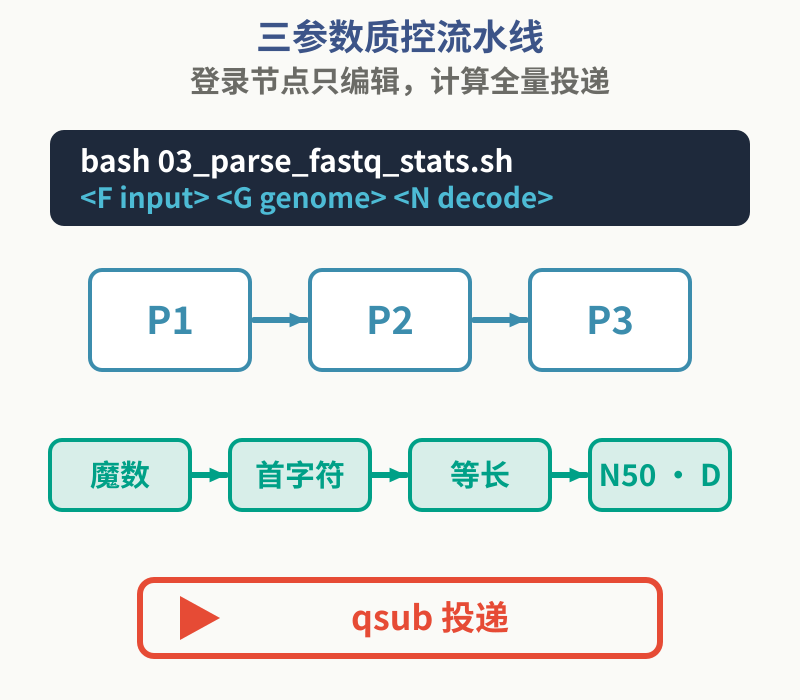

</div>
<div>

- 参数 1 输入文件；参数 2 是深度分母 `4m`
- 参数 3 解码条数；FASTA 写 `0` 跳过
- 批量统计投 `qsub`，登录节点只编辑

</div>
</div>

<div class="ref">讲义 ⑤5.6 ｜ 脚本 <code>03_code/undergraduate/scripts/03_parse_fastq_stats.sh</code></div>

---

## 校外自学：公开主线这条路

```bash
bash 06_data/undergraduate/download_ug.sh --run
```

- 主线 `ERR15732384` 是 ONT，原始 Run 名义 63.5×
- 本讲不降采样；降到 40× 是第 8 章的事
- 不要降到 30× 以下（经验建议，预期口径）
- 写不进仓库目录时加 `--outdir`，输入路径跟着改

<div class="ref">教材 §4.6 ｜ <code>06_data/undergraduate/README.md</code> §2.1、§三</div>

---

<!-- _class: undergraduate quiz -->

## 课堂提问

主线数据算深度时，分母填 `4m` 还是 `4768212`？

<div class="ref">教材 §4.1、§4.6（分母用完成图全长）</div>

---

<!-- _class: undergraduate divider -->

<div class="num">VII</div>

# 结果解读

输出长什么样，不对又长什么样

---

<!-- @section: interpretation -->
## 正确的输出长什么样（示意设例）

```text
推断格式        : FASTA
序列条数        : 58432
碱基总量        : 412663901 bp (412.66 Mb)
N50             : 11840 bp
估算测序深度    : 103.2 X
```

- 这是讲义示意设例，四个数字以自己实测为准
- 深度是名义深度：碱基总量 ÷ `G`

<div class="ref">讲义 ⑥6.1（示意设例）｜ 教材 §4.4.1 名义深度口径</div>

---

<!-- _class: undergraduate warn -->
## 结果不对时长什么样（一）：平台与误差

<div class="cols">
<div>

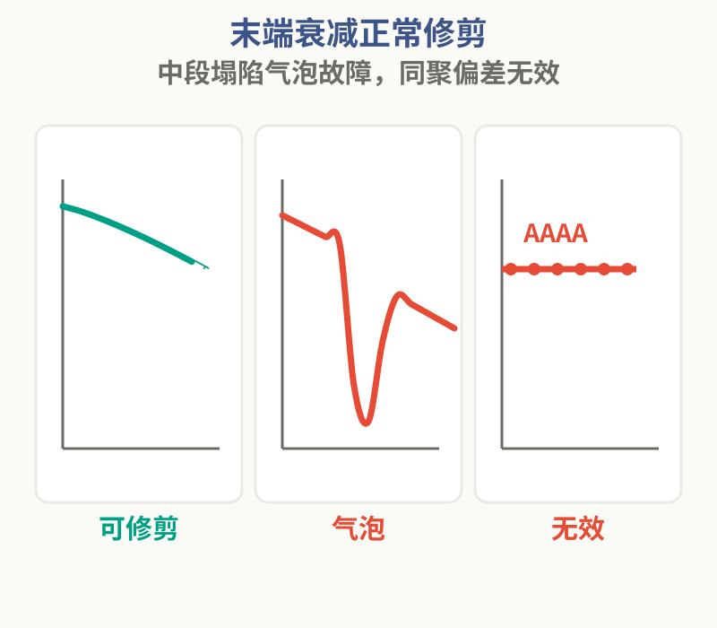

</div>
<div>

- 3′ 端单调下降：预期，按 R1/R2、lane 分比
- 中段塌陷或单 lane 偏低：查成簇与试剂
- 同聚区高深度照样错：按同聚物长度分层

</div>
</div>

<div class="ref">教材 §4.5.1、§4.5.2 ｜ 现象 → 怎样察觉</div>

---

<!-- _class: undergraduate warn -->
## 结果不对时长什么样（二）：格式与计数

| 现象 | 说明什么 | 先做什么 |
|---|---|---|
| 区间大体对、边界差一点 | 坐标少减一，全程无报错 | 起点、终点、长度三查 |
| 条数偏高 | 质量行首 `@` 被当记录头 | 换「行数 ÷ 4」对账 |
| 条数对、总量少 | 折行 FASTA 被按单行读 | 逐块校验结构 |
| 脚本打印「完成」 | 只表示统计跑完 | md5 与条数对账 |

<div class="ref">教材 §5.5.1、§5.5.2、§5.5.4</div>

---

## 自查基准：对账，而不是感觉

- 主线原始 Run：38,078 条 / 302,672,631 bp
- 名义 63.5×；短读长那批 48.0×
- 40× 子集需 190,728,480 bp，占该 Run 63.01%
- 分母一律用完成图全长 4,768,212 bp

<div class="ref">教材 §4.1、§4.6 ｜ <code>06_data/undergraduate/README.md</code> §2.1</div>

---

<!-- _class: undergraduate divider -->

<div class="num">VIII</div>

# 常见错误

课堂上一定遇到的三条

---

<!-- @section: troubleshooting -->
<!-- _class: undergraduate warn -->
## 常见错误一：把 FASTA 喂给 FastQC

- FastQC 按内容判输入，不看扩展名
- FASTA 没有逐碱基质量，质量模块没有对象
- 版本与构建不同：报错或出 N/A 都可能
- 本讲要的四项度量，改用统计脚本

<div class="ref">教材 §5.4.1、§5.5.4 ｜ 行为随版本与输入，运行前先实测</div>

---

<!-- _class: undergraduate warn -->
## 常见错误二：对非 gzip 文件用 `zcat`

- 报 `not in gzip format`，文件没解出内容
- 文件名带 `.gz` 而内容没压缩，报错一样
- `zcat` 看魔数，不看扩展名
- 先 `file` 确认，再决定 `zcat` 还是 `cat`

<div class="ref">教材 §5.4.1 ｜ 讲义 ⑨9.1</div>

---

<!-- _class: undergraduate warn -->
## 常见错误三：截断与中部缺行

<div class="cols">
<div>

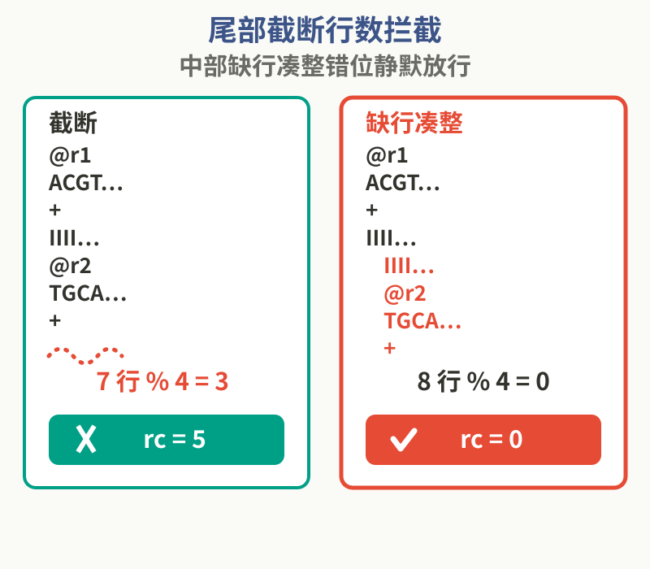

</div>
<div>

- 尾部截断：行数不是 4 的倍数，被拦住
- 中部缺行凑整：行数合法，内容错位
- 打印「完成」不等于完好：md5 加结构对账

</div>
</div>

<div class="ref">教材 §5.5.4 ｜ 演示 <code>demos/ch05_phred_fastq.py --selftest</code> 算例 3</div>

---

<!-- _class: undergraduate divider -->

<div class="num">IX</div>

# 课后

交付清单 · 思考练习 · 实验指导

---

<!-- @section: wrapup -->
## 交付：报告里的两栏

| 报告栏目 | 写什么 |
|---|---|
| §2.1 | 格式判断与 `file`/`od`/`head` 证据 |
| §2.3 | 条数、碱基总量、N50、深度 |

- 四个数字用自己实测的，不抄示例
- 分母写清是哪个 `G`，标明是名义深度

<div class="ref">《学生实验操作手册》报告模板 §2.3 ｜ 教材 §5.6</div>

---

## 思考练习：四题（讲义 ⑩）

- Q1 解码 `#` 的 `Q` 与 `P`，认出开头的接头
- Q2 拆 FLAG 83，说明它为何与 163 成对
- Q3 `10S130M2I8M` 的查询与参考跨度
- Q6 自选课题：选平台、画格式流转、砍一半经费

<div class="ref">讲义 ⑩ ｜ 教材 §4.7、§5.7（Q6 为开放题）</div>

---

## 实验指导与收尾

- `11_lab_guides/undergraduate/03_seq_principles_formats_lab.md`
- 上机时手边打开；计算一律 `qsub`
- 文献只给指针（讲义 ⑪），本 deck 不重复列

**这一步判定的格式，决定后面所有命令怎么写。**

<div class="ref">教材 §5.6、§5.7 ｜ 讲义 ⑩、⑪</div>
