<!-- @section: cover -->
<!-- _class: undergraduate cover -->

# u04 ｜ 质量控制与数据预处理

**质控的目标不是让 FastQC 全绿，而是让数据适合下游任务。**

<div class="meta">

- 线上先导自学 4 学时 ｜ 课堂 Day 0 串讲
- 讲义 `02_lectures/undergraduate/unit04_qc_preprocessing/04_qc_preprocessing_lecture.md`
- 对应教材 §6.1–§6.6 ｜ 环境 `ngs_ug_base`

</div>

---

<!-- _class: undergraduate divider -->

<div class="num">01</div>

# 学习目标

四条，对应 LO06-01–LO06-04

---

<!-- @section: objectives -->
## 学完你应当能够（一）：判读报告

- 判读质量、组成、长度、重复与接头模块
- 区分启发式警报与统计检验
- 举出两个「红灯不必直接修剪」的例子
- 说明 100,000 个不同序列的登记边界

<div class="ref">教材 §6.2、§6.4.1–§6.4.3 ｜ 学习目标 LO06-01 ｜ 讲义 ①</div>

---

## 学完你应当能够（二）：修剪与验收

- 算出简单读穿长度，选出有依据的参数
- 比较清洗前后的产出、质量、长度与接头
- 诊断过度修剪、缺失输出与陈旧报告
- 区分短读长、长读长与 FASTA 的判据

<div class="ref">教材 §6.2、§6.4.4–§6.4.7 ｜ 学习目标 LO06-02–LO06-04</div>

---

<!-- _class: undergraduate divider -->

<div class="num">02</div>

# 前置检查

三个 L0 模块，一套自测

---

<!-- @section: prerequisites -->
## 前置检查：三个 L0 模块

| L0 模块 | 本讲用到 | 不过关的后果 |
|---|---|---|
| `l0_01_linux` | 通配符、`mkdir -p` | 目录建不全 |
| `l0_03_conda` | 激活 `ngs_ug_base` | 分不清环境还是没装 |
| `l0_04_formats` | Phred+33、FASTQ 四行 | 读不懂纵轴 Q 值 |

- 本讲即 `l0_05_qc` 的本科载体
- 自测 L0-5 第 1–10 题；第 8–10 题对应三步上机
- 题目在 `08_assessment/prerequisites/l0_05_qc_selftest.md`

<div class="ref">教材 §6.3 ｜ 讲义 ②</div>

---

<!-- _class: undergraduate divider -->

<div class="num">03</div>

# 科学问题

质控到底在问什么

---

<!-- @section: background -->
## 报告里有三层东西，必须分开看

<div class="cols3">
<div class="card">

### ① 报告形态
模块亮什么颜色、曲线长什么样

</div>
<div class="card">

### ② 数据事实
接头多少、末端掉到哪、长度什么形状

</div>
<div class="card">

### ③ 处置决定
剪不剪、丢不丢、是否重测

</div>
</div>

- 红灯只说明第一层
- 第三层还要看下游任务，不只看颜色

<div class="ref">教材 §6.4.1 ｜ 讲义 ③</div>

---

## 同一株，两套数据，两条判据

<div class="cols">
<div>

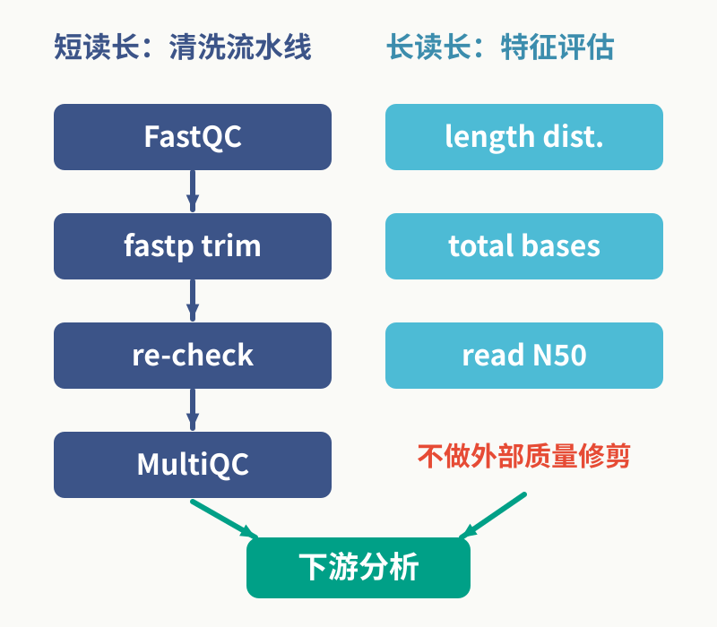

</div>
<div>

- `ERR15732342` 短读，走清洗线
- `ERR15732384` 长读，只算特征
- 平台不是重复；完成图只当分母

</div>
</div>

<div class="ref">教材 §6.1、§6.6 ｜ 数据登记见 06_data/undergraduate/README.md §2.1</div>

---

## 「垃圾进垃圾出」可以量化

<div class="cols">
<div>

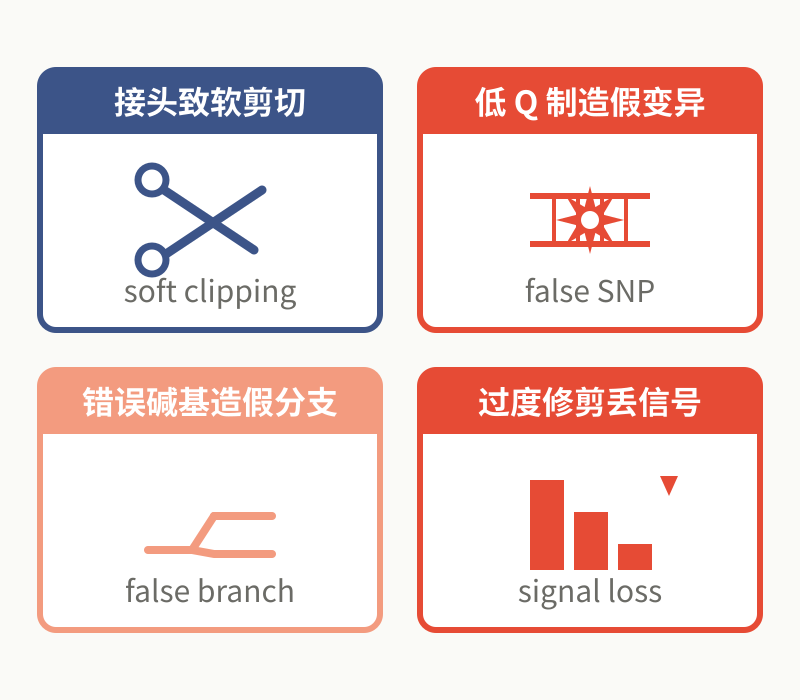

</div>
<div>

- 软剪切只表示没参与比对，序列还在
- 该处理的不处理，与过度清洗都算错
- 假变异与假分支的机理在后续章节

</div>
</div>

<div class="ref">教材 §6.4.4、§6.4.6 ｜ 软剪切定义见 §5.4.6 ｜ 讲义 ③</div>

---

<!-- _class: undergraduate statement -->

「全绿」只说明没越过默认界线，不说明适合你的任务。

反过来，低于阈值也不等于没问题：接头占比小时，曲线一直不报红。

---

<!-- _class: undergraduate divider -->

<div class="num">04</div>

# 核心原理

FastQC 在量什么 · 修剪的三把尺 · 长读长换一组指标

---

<!-- @section: principles -->
## FastQC 不需要参考，按它在量什么分组

- 质量：每条读段均值、每个位置的质量分布
- 组成：每位置的碱基比例、每条读段的 GC 与 N
- 重复：序列重复水平与过表达序列
- 接头累计比例、读长分布、按 tile 的偏差

<div class="ref">教材 §6.4.2 ｜ 讲义 ④4.2</div>

---

## PASS / WARN / FAIL 是经验规则

- 阈值按均一打断、组成随机的 WGS 文库标定
- 它不是统计检验：没有零假设、不给概率
- 换一种文库，同一阈值可能落在正常范围
- 模块集合随版本、配置与输入而变

<div class="ref">教材 §6.4.1、§6.4.2 ｜ 术语卡「启发式质控阈值」</div>

---

## 质量模块按「碱基组」判，不按单个位置

<div class="cols">
<div>

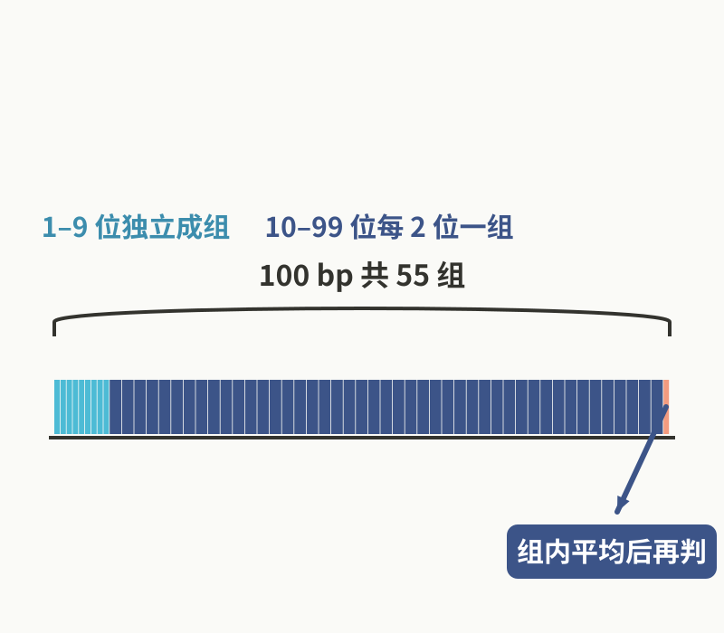

</div>
<div>

- 组数压在 75 以下，超了就加宽
- 150 bp 读长分 38 组（每 5 bp 一档）
- 按覆盖的位置区间叫组，不按序号

</div>
</div>

<div class="ref">教材 §6.4.2 ｜ 演示 demos/ch06_perbase_quality.py 的 base_groups</div>

---

## 两档阈值：WARN 与 ERROR

<div class="cols">
<div>

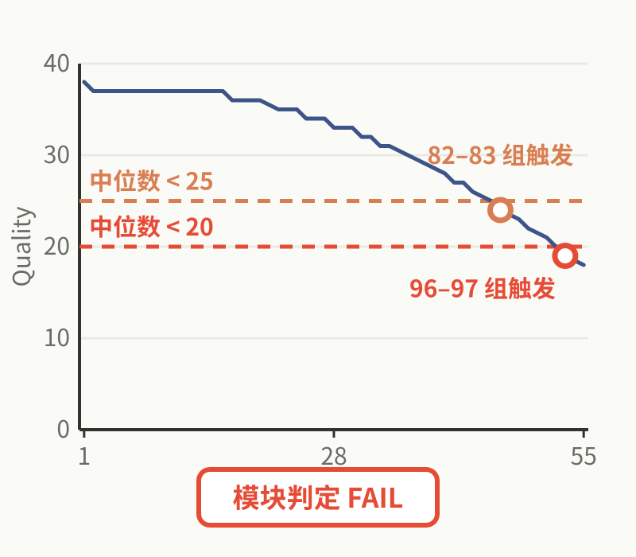

</div>
<div>

- 越过 ERROR 的组让模块判 FAIL
- 低四分位的两条线是 10 与 5
- 本例只触发了中位数那一条

</div>
</div>

<div class="ref">教材 §6.4.2 ｜ 同一演示 Part A / Part C</div>

---

<!-- _class: undergraduate statement -->

WARN 与 ERROR 是两层；把 WARN 当 FAIL，黄灯就被读成红灯。

阈值只决定软件给什么颜色，不决定要不要动手。

---

## 组成模块的阈值也成对

<div class="cols">
<div>

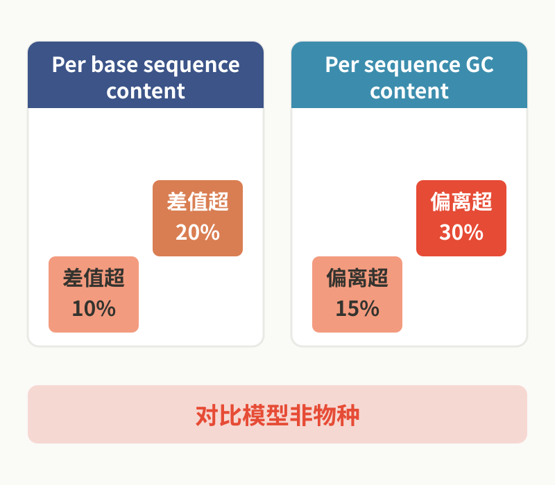

</div>
<div>

- 每碱基序列含量看 A/T 与 G/C 的差
- GC 曲线比的是模型，不用参考
- 和物种均值差多少，不是 FAIL 线

</div>
</div>

<div class="ref">教材 §6.4.2 ｜ 讲义 ⑤ 步骤 3</div>

---

## 重复与过表达：登记上限，不是抽样条数

<div class="cols">
<div>

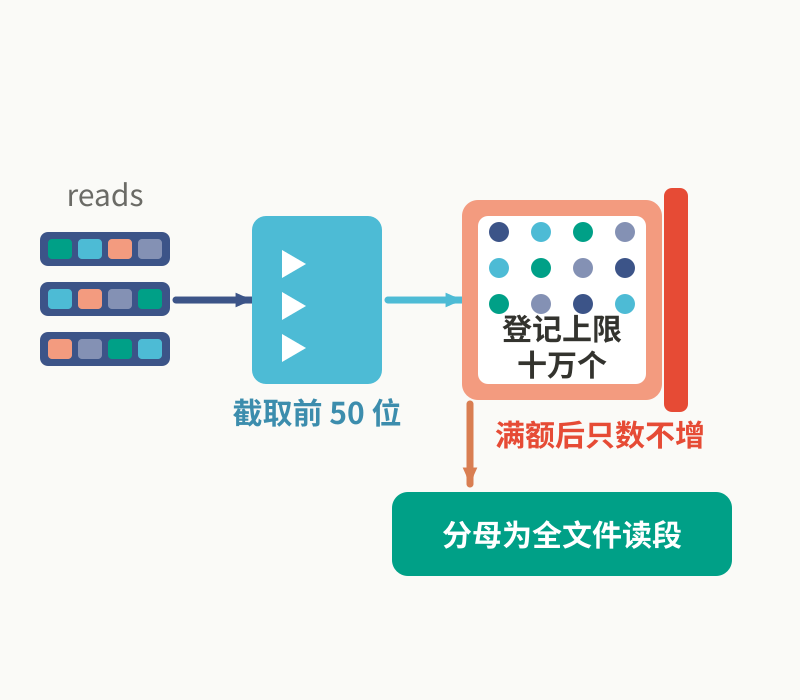

</div>
<div>

- 高复杂度文库很快把名额用满
- 低复杂度文库可能一直用不满
- 名额满没满，决定这颗红灯怎么读

</div>
</div>

<div class="ref">教材 §6.4.2 ｜ 演示 demos/ch06_amplicon_redlight.py --selftest</div>

---

## 扩增子对照：名额用不满，红灯照报

<div class="cols">
<div>

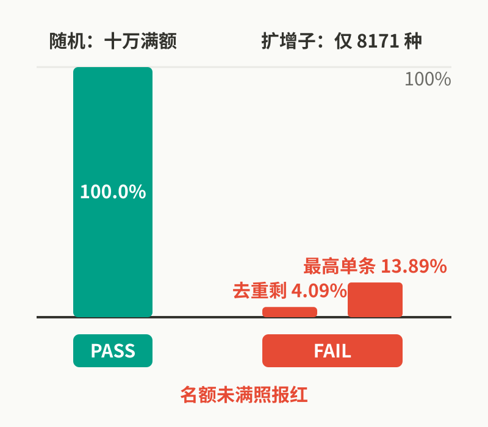

</div>
<div>

- 40 个单倍型、20 万条读段（合成）
- 随机文库 100% 是按重复水平外推
- 两个文库同一脚本，差别只在复杂度

</div>
</div>

<div class="ref">教材 §6.4.3 ｜ 合成算例，demos/ch06_amplicon_redlight.py --selftest（固定种子）</div>

---

<!-- _class: undergraduate statement -->

软件只报告「偏离」，不判断是否异常，更不判断该不该处理。

接头、rRNA 还是污染，要靠下一步检索去定性。

---

## 接头模块画的是累计比例

<div class="cols">
<div>

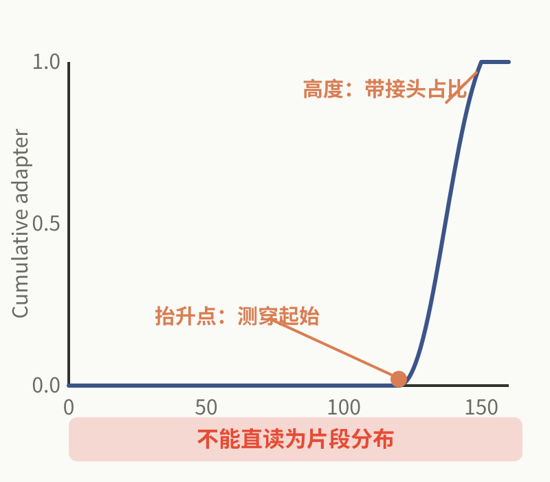

</div>
<div>

- 检测序列与允许错配都会改变曲线
- 占比很小时，曲线可能一直不报红
- 定性要配双端重叠或实际片段分布

</div>
</div>

<div class="ref">教材 §6.4.2、§6.4.4 ｜ 讲义 ④4.1</div>

---

## 四个「红灯不必动手」

<div class="cols">
<div>

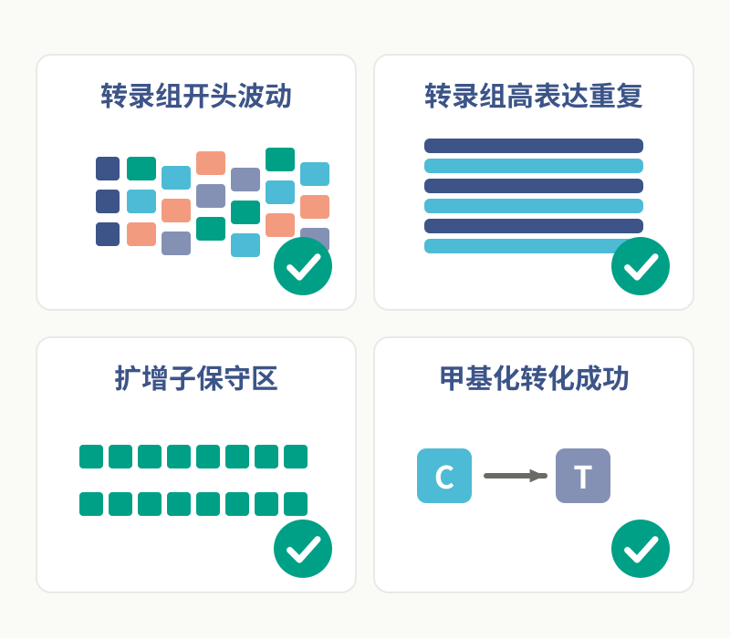

</div>
<div>

- 判据是文库类型，不是颜色深浅
- 每类都要说清机制与不能排除什么
- 第五类红灯是自己修剪造出来的

</div>
</div>

<div class="ref">教材 §6.4.3 ｜ 讲义 ③3.1</div>

---

## 每个红灯都要回答三件事

<div class="cols">
<div>

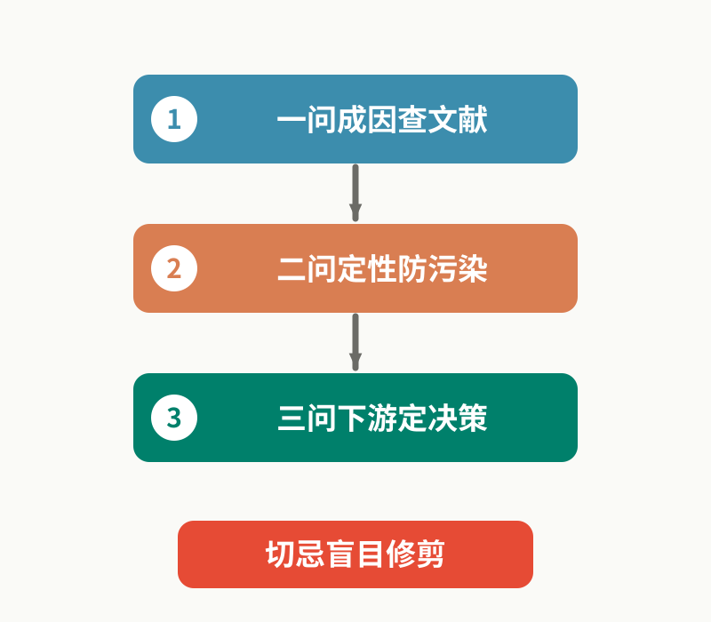

</div>
<div>

- 报红不证明扩增成功或转化彻底
- 三问答不上来，就先别动数据
- 定性靠检索与对照，不靠颜色深浅

</div>
</div>

<div class="ref">教材 §6.4.3、§6.5.1 ｜ 失效条件 6.5.1</div>

---

<!-- _class: undergraduate figure -->

## 单峰是物种自己的组成，双峰必须定性

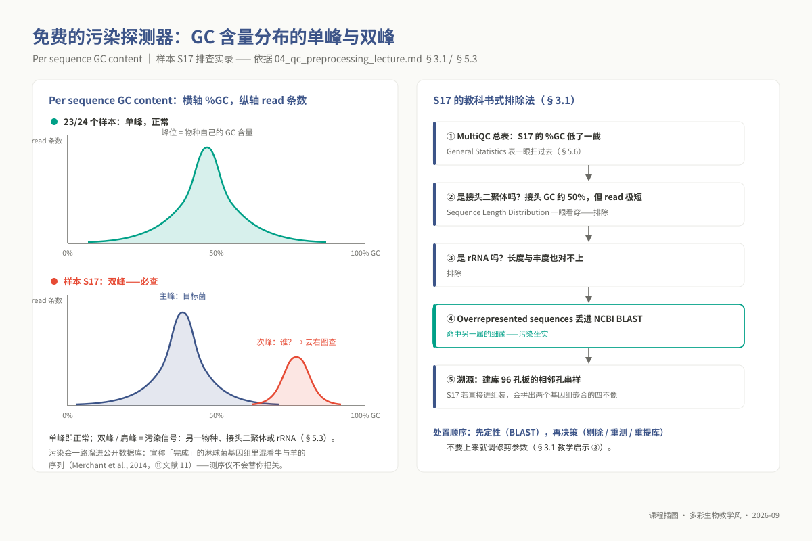

教学示意：样本编号与数字不是实录；双峰只是必查信号

<div class="ref">教材 §6.4.3 图 6-2 ｜ 讲义 ③3.1</div>

---

## 双峰先定性，再决定剔不剔

- 先用总表看这个样本的 GC 是否整批离群
- 排除接头二聚体：整条读进接头，去接头后极短
- 排除 rRNA 残留：长度与丰度对不上
- 过表达序列送同源检索，再回查加样记录

<div class="ref">教材 §6.4.3 ｜ 讲义 ③3.1</div>

---

## 接头为什么会在读段里：读穿

- 插入片段短于读长，测序仪继续读进对侧接头
- 150 bp 读长、120 bp 插入：末尾 30 bp 是接头
- 插入 110 bp 时多读 40 bp（150 − 110）
- 双端两端各读各的，R2 也读进 R1 一侧

<div class="ref">教材 §6.4.4 ｜ 讲义 ④4.1</div>

---

<!-- _class: undergraduate figure -->

## 接头从哪来：文库片段比读长短

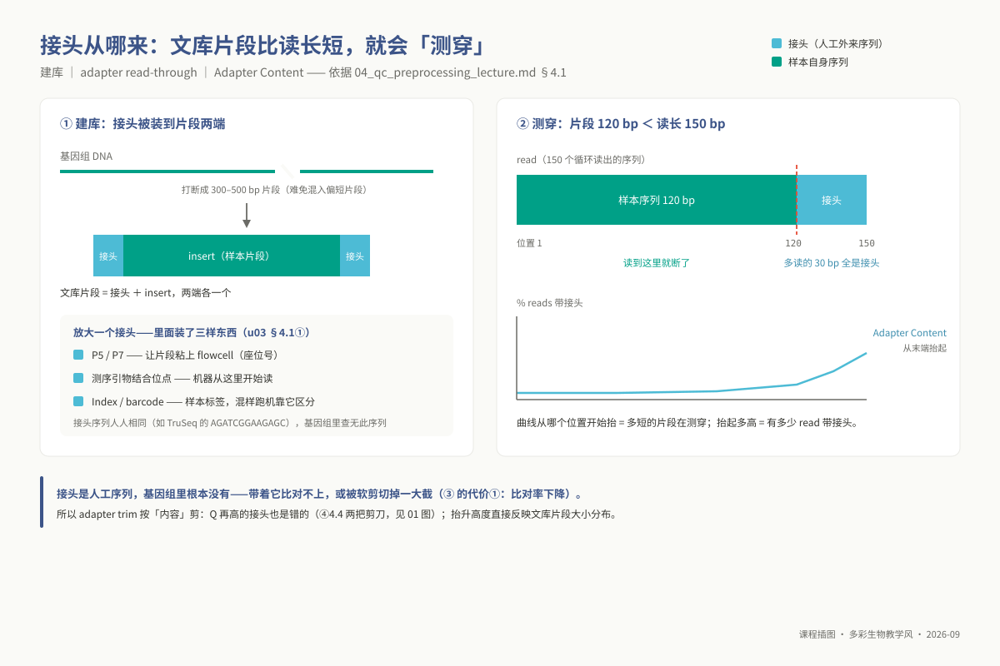

设例统一 120/150/30；抬升高度只说明带接头读段的比例，不是片段分布

<div class="ref">教材 §6.4.4 图 6-3</div>

---

<!-- _class: undergraduate figure -->

## 修剪的两把剪刀

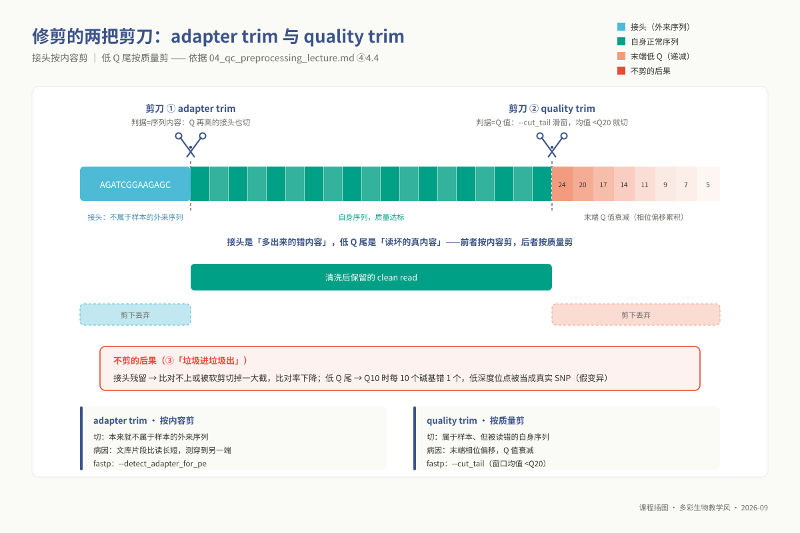

接头是「多出来的错内容」，低质量末端是「读坏的真内容」

<div class="ref">教材 §6.4.4 图 6-4</div>

---

## 三种判据不能互相替代

| 判据 | 按什么 | 对读段做什么 |
|---|---|---|
| 接头修剪 | 序列内容 | 剪掉外来序列 |
| 质量修剪 | 滑窗均值 | 剪掉低质量末端 |
| 长度过滤 | 修剪后长度 | 整条丢弃或保留 |

- 三者可联动，但不能互相替代
- 太短的读段容易多重比对

<div class="ref">教材 §6.4.4</div>

---

## fastp 参数按角色记，不按数字背

<div class="cols">
<div>

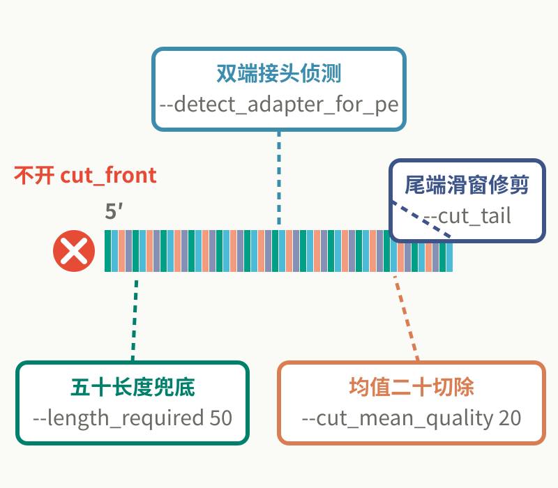

</div>
<div>

- 默认 15；课程设 50 配 100–150 bp
- 窗口 4 不是黄金点，看曲线形状
- 合格线与不合格比例另有两条参数

</div>
</div>

<div class="ref">教材 §6.4.4 ｜ fastp 1.0.1 --help</div>

---

<!-- _class: undergraduate statement -->

该剪的接头质量可能很高；该剪的低质量段可能是真序列。

判据是这段序列属于谁，不是看起来好不好。

---

## 双端接头有三条通道

<div class="cols">
<div>

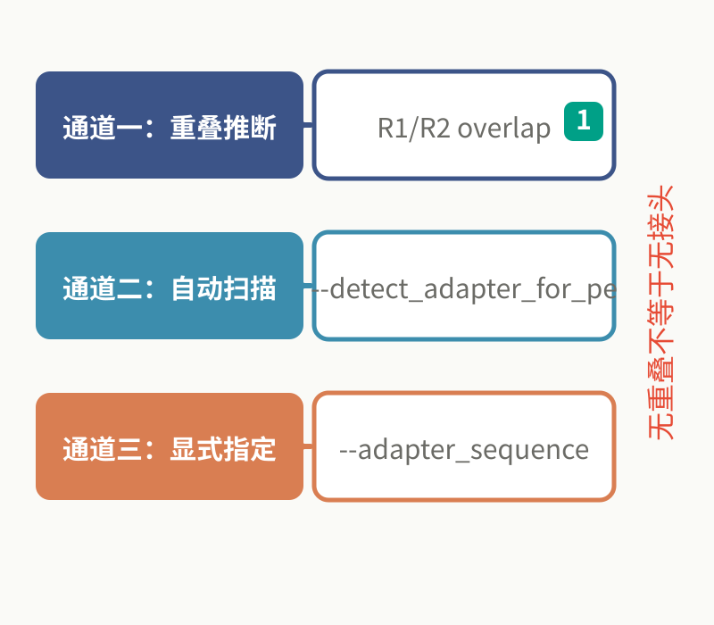

</div>
<div>

- 默认通道不用开关，读对重叠就剪
- 自动检测补上重叠比对失败的读段
- 已知试剂盒时显式给接头作回退

</div>
</div>

<div class="ref">教材 §6.4.4 ｜ 讲义 ⑤ 步骤 5</div>

---

## Q 值只作参数尺，不再推导

<div class="cols">
<div>

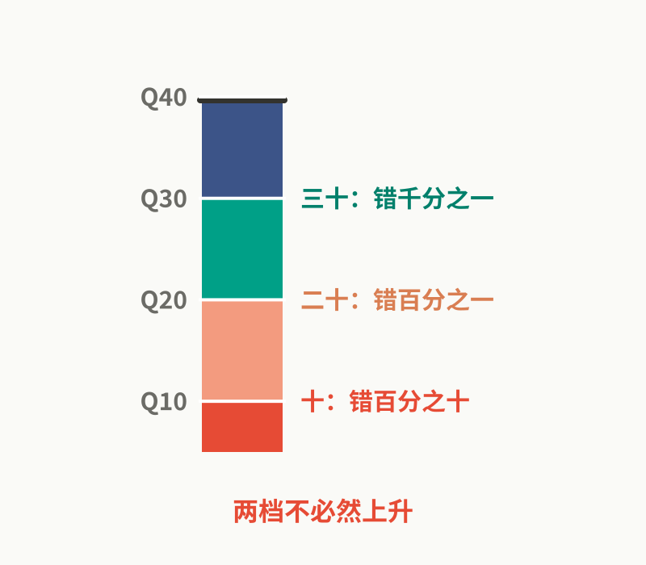

</div>
<div>

- Q20 是课程滑窗起点，不是通用下限
- Q30 是报告口径，不是行业标准线
- Q 只描述单个碱基被判错的概率

</div>
</div>

<div class="ref">教材 §6.4.4 ｜ Q 的定义见第 5 章</div>

---

## 长读长：指标换一组

<div class="cols">
<div>

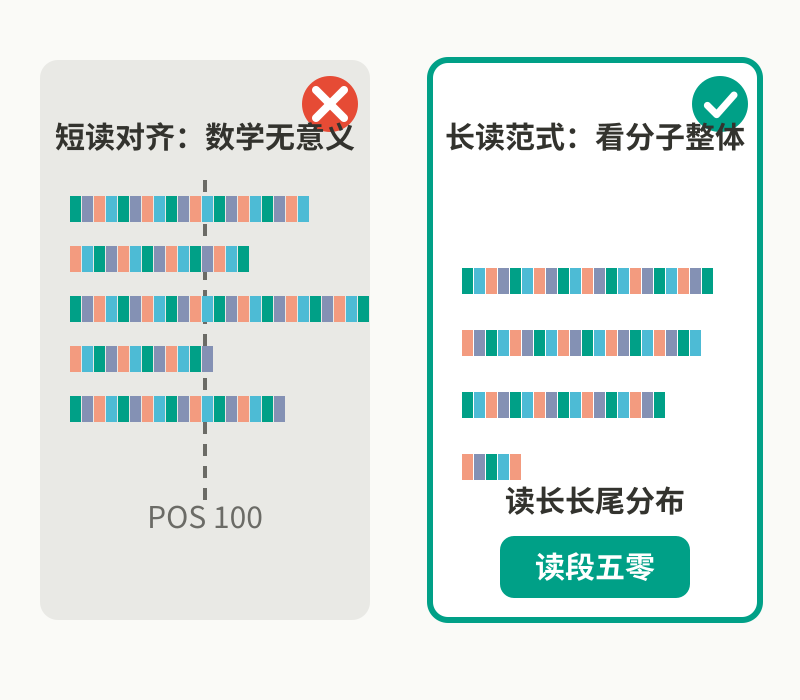

</div>
<div>

- 读长分布看形状，常右偏
- 质量要与读长联合看，不能只看均值
- 系统偏差不随深度消失

</div>
</div>

<div class="ref">教材 §6.4.7 ｜ 讲义 ④4.3</div>

---

## 读段 N50 要能自己算

<div class="cols">
<div>

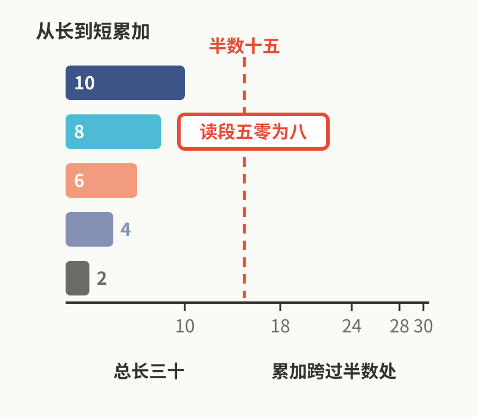

</div>
<div>

- 是分布上的一个位置，不是平均值
- 少数超长读段就能把它拉高
- 与 contig N50 分开：后者按组装算

</div>
</div>

<div class="ref">教材 §6.4.7 ｜ 术语「读段 N50」，与 contig N50 分开</div>

---

## 名义深度拿贯穿数据算一遍

- `ERR15732384`：38,078 条、302,672,631 bp
- 完成图 `GCA_987216485` 长 4,768,212 bp
- `302,672,631 ÷ 4,768,212 ≈ 63.5×`
- 40× 是下载脚本的课堂降采样设计

<div class="ref">教材 §6.4.7、§6.6 ｜ 06_data/undergraduate/README.md §2.1、§三</div>

---

<!-- _class: undergraduate statement -->

深度高不修复系统偏差，N50 大不保证重复有读段跨过。

闭合与错接看组装后的评估，属于第 8 章。

---

<!-- _class: undergraduate quiz -->

## 课堂提问

per-base 质量曲线变好看了，能说明数据更适合下游吗？

---

<!-- _class: undergraduate divider -->

<div class="num">05</div>

# 操作流程

四步流水线 · 一个脚本 · 两条轨道

---

<!-- @section: procedure -->
## 四步流水线：每一步都要留下可对账的产物

<div class="cols">
<div>

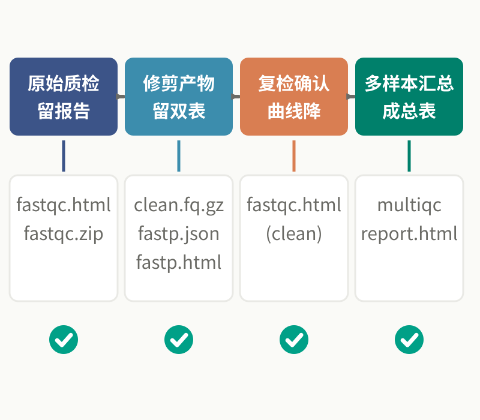

</div>
<div>

- 每步都有文件产出，不是「跑过了」
- 短读长四步；长读长只做统计
- 完整命令与参数见讲义 ⑤

</div>
</div>

<div class="ref">教材 §6.4.6 ｜ 讲义 ⑤</div>

---

## 步骤 1–2：建目录，再跑 raw FastQC

```bash
FQ=/d3/scratch/$USER/ngs/u04/fq      # 个人工作目录
mkdir -p qc/{fastqc_raw,fastqc_clean,clean,fastp_reports}
fastqc -t 4 -o qc/fastqc_raw "$FQ"/*.fq.gz
for z in qc/fastqc_raw/*_fastqc.zip; do
  unzip -p "$z" "*/summary.txt"; done | less
```

- 两个工具都不自动建目录
- `-t 4` 是同时处理 4 个文件
- 摘要要逐个解压：通配符一次给两个会报错

<div class="ref">教材 §6.4.6 ｜ 讲义 ⑤ 步骤 1–2</div>

---

## 步骤 3：逐模块判读，不背固定清单

- 先确认文库类型与下游任务，再读模块
- 每个红灯答三件事：为什么、不能排除、查什么
- 模块集合随版本与输入而变
- 完整模块说明见讲义 ⑤ 步骤 3 的表

<div class="ref">教材 §6.4.2、§6.4.3 ｜ 讲义 ⑤</div>

---

## 步骤 4：fastp 核心参数与脚本一致

```bash
fastp -i R1.fq.gz -I R2.fq.gz -o c_R1.fq.gz -O c_R2.fq.gz \
  --detect_adapter_for_pe --cut_tail \
  --cut_window_size 4 --cut_mean_quality 20 \
  --qualified_quality_phred 15 \
  --unqualified_percent_limit 40 --length_required 50 \
  --thread 4 --html qc/fastp_reports/s.html \
  --json qc/fastp_reports/s.json
```

- `s.json` 是 MultiQC 的输入源
- 双端按 R1/R2 配对；单端要显式给接头序列

<div class="ref">教材 §6.4.4 ｜ 脚本 04_run_fastqc.sh（文件名缩写，参数名逐字对应）</div>

---

## 命令里没有 `--cut_front`

- 课程只开 `--cut_tail`：3′ 端滑窗修剪
- `--cut_front` 会从 5′ 端做同样的事，默认不开
- 修剪位置按质量曲线的形状定，不按印象开
- 开了就要复检保留率、长度分布与下游

<div class="ref">教材 §6.4.4 ｜ 脚本 04_run_fastqc.sh（注释说明不开）</div>

---

## 步骤 5：复检 clean，再让 MultiQC 汇总

```bash
fastqc -t 4 -o qc/fastqc_clean qc/clean/*.clean.fq.gz
multiqc --force -o qc -n multiqc_report.html \
  qc/fastqc_raw qc/fastqc_clean qc/fastp_reports
```

- `--force`：不加会另存 `multiqc_report_1.html`
- 只喂本次产物，不喂整个目录
- 复检要允许非目标指标「变差」

<div class="ref">教材 §6.4.6 ｜ 讲义 ⑤ 步骤 6</div>

---

## 一键脚本一行，但要看住输入目录

```bash
# FQ=/d3/scratch/$USER/ngs/u04/fq（同上一页）
# 写进作业脚本后 qsub 投递，勿在登录节点直跑
bash 03_code/undergraduate/scripts/04_run_fastqc.sh \
  "$FQ" qc 4
```

- 脚本认 `*.fq`、`*.fastq`（可 `.gz`），不认 FASTA
- 一个输入目录只放一种平台，旧文件先清
- exit 3：目录里没有可识别的测序文件
- exit 4：只查本次该产出的文件，不扫旧文件

<div class="ref">教材 §6.4.6 ｜ 脚本 04_run_fastqc.sh</div>

---

## 校外轨道：公开数据怎么跑

```bash
# 公开数据下到个人数据目录，命令写进作业脚本再 qsub
D=/d3/scratch/$USER/ngs/u04/data
bash 03_code/undergraduate/scripts/04_run_fastqc.sh \
  --long $D/reads/ERR15732384_ont.fastq.gz qc_long 4768212
```

- 校内 `/data/lab/ngs/reads.fa` 是等价替代，不跑 FastQC
- `gsize` 缺省 4 m：302,672,631 ÷ 4,000,000 ≈ 75.7×
- 给 4768212：302,672,631 ÷ 4,768,212 ≈ 63.5×
- 下载后按 README §四 自查（≈38,078 条 / 302 Mb）

<div class="ref">教材 §6.4.7、§6.6 ｜ 06_data/undergraduate/README.md</div>

---

<!-- _class: undergraduate statement -->

退出码只区分「显式失败」与「没有被判为失败」。

它不证明「做成了」。

---

<!-- _class: undergraduate divider -->

<div class="num">06</div>

# 结果解读

四档算例 · 验收四组 · 长读长怎么写

---

<!-- @section: interpretation -->
## 同一个算例，四档阈值

<div class="cols">
<div>

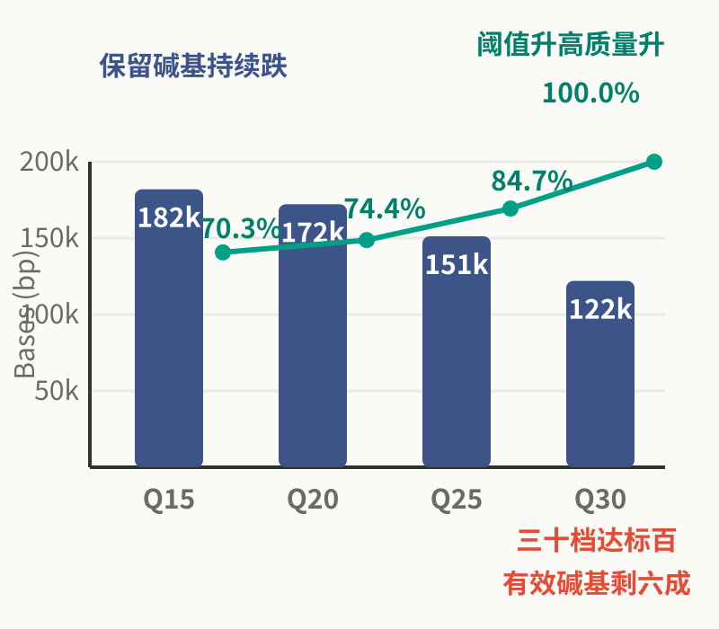

</div>
<div>

- 四档用同一份合成读段，只改阈值
- 阈值越严，Q30 越好看，碱基越少
- 收益与代价要一起报，缺一不可

</div>
</div>

<div class="ref">教材 §6.4.5 ｜ 合成数据 demos/ch06_trim_threshold.py --selftest</div>

---

## 两个保留率必须一起报

- 输入 2000 条、200000 bp、Q20 95.00%、Q30 64.00%
- 四档的读段级保留率都是 100%
- 碱基级保留率从 90.99% 降到 60.99%
- `121980 ÷ 200000 = 61.0%`：相对原始只剩六成

<div class="ref">教材 §6.4.5、§6.5.3 ｜ 同一演示</div>

---

<!-- _class: undergraduate statement -->

Q30 到 100%，保住的碱基却只剩六成。

只报 Q30，就会把「剪多了」读成「洗得干净」。

---

## 验收按四组数字对账

- 产出：读段数、碱基数、三行失败原因（低质量 / N 过多 / 过短）
- 质量：Q20 / Q30 的前后对比
- 长度：平均读长与分布形状
- 接头：修剪条数，以及复检曲线是否下降

<div class="ref">教材 §6.4.5、§6.4.6 ｜ 讲义 ⑥6.1</div>

---

## 接头 608 与设计 600 要分开

- 30% 短片段 × 2000 条 = 600（设计值）
- 工具报 608：多出的来自偶然部分匹配
- 阈值升到 30 时只剩 4 条：顺序效应
- 先质量修剪，接头扫描就无从发现

<div class="ref">教材 §6.4.5 ｜ 同一演示</div>

---

## 退出码表：显式失败才给非零

<div class="cols">
<div>

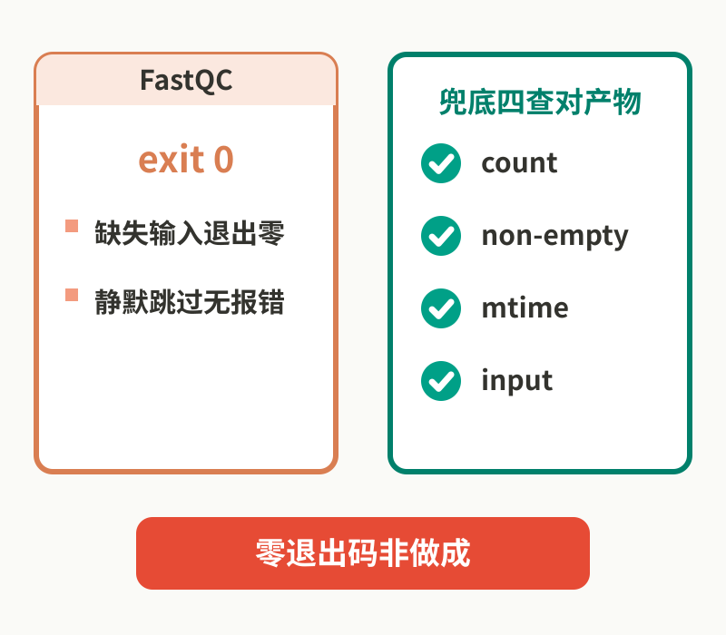

</div>
<div>

- FASTA 输入 rc=1；输出目录缺 rc=2
- fastp 输出目录缺：1.0.1 实测 255
- 版本行为不外推，先实测再写脚本

</div>
</div>

<div class="ref">教材 §6.4.6（FastQC 0.12.1 / fastp 1.0.1 实测）</div>

---

## 产物验收写成固定清单

- 先列输入：几个样本、几个文件、叫什么
- 再列预期产物：每个输入一份网页与压缩包
- 四查：数量、非空、时间戳、报告记录的输入
- 任何一项不符就先停下，别往下游跑

<div class="ref">教材 §6.4.6、§6.5.2 ｜ 失效条件 6.5.2</div>

---

<!-- _class: undergraduate warn -->
## 结果不对时长什么样（一）

| 现象 | 可能原因（不止一条） | 先查什么 |
|---|---|---|
| Q30 升、碱基大减 | 阈值过严；或短插入文库 | 三行原因、长度分布 |
| 目录空或少样本 | 输入被跳过或目录没清 | stderr、产物数 |
| `adapter trimmed: 0` | 单端没给；双端没读穿 | 接头曲线、重叠 |
| 输出 0 字节 | 目录缺；或没有写权限 | `mkdir -p`、权限 |

- 现象只列线索，定性要看版本与复检证据

<div class="ref">教材 §6.5.2、§6.5.3 ｜ 讲义 ⑥6.2</div>

---

<!-- _class: undergraduate warn -->
## 结果不对时长什么样（二）

- 长读长 per-base 曲线：横轴不再对应化学循环
- FASTA 喂 FastQC：`ID line didn't start with '@'`（rc=1）
- 把 FASTA 转成 FASTQ 绕过：伪造出质量值
- 用深度与 N50 承诺「能闭合」：把输入当结论

<div class="ref">教材 §6.5.4 ｜ 失效条件 6.5.4</div>

---

<!-- _class: undergraduate divider -->

<div class="num">07</div>

# 常见错误

课堂上一定会遇到的三条

---

<!-- @section: troubleshooting -->
<!-- _class: undergraduate warn -->
## 常见错误一：FastQC 静默跳过

- 输入路径写错，只打印一行 `Skipping`
- 退出码仍是 0，`set -e` 拦不住
- 作业一路绿灯，质控目录却是空的
- 先写输入清单再写预期产物清单，跑完对账

<div class="ref">教材 §6.4.6、§6.5.2 ｜ 讲义 ⑨</div>

---

<!-- _class: undergraduate warn -->
## 常见错误二：fastp 输出 0 字节

- 输出目录不存在时，部分版本不报错
- fastp 1.0.1 报写入失败、退出码 255
- 课程环境钉 fastp 1.3.6，该路径行为未在册
- 统一动作：先 `mkdir -p`，跑完 `ls -lh`

<div class="ref">教材 §6.4.6 ｜ 07_envs/conda/env_ug_base.yml</div>

---

<!-- _class: undergraduate warn -->
## 常见错误三：打开的其实是旧报告

- 目标目录已有同名报告，MultiQC 存 `_1` 副本
- `Existing reports found, adding suffix` 是提示
- 加 `--force`，并只喂本次产物
- `which multiqc` 先确认没跑到 `~/.local` 那份

<div class="ref">教材 §6.4.6 ｜ 讲义 ⑨9.3</div>

---

<!-- _class: undergraduate divider -->

<div class="num">08</div>

# 课后

报告交付 · 思考练习 · 实验指导

---

<!-- @section: wrapup -->
## 课后与报告交付

- 报告 §2.3 数据量和质量评估、§2.4 数据预处理方法
- 句式：数据 → 数字 → 判据 → 结论 → 预处理决定
- 每条结论后面带数字与复现入口
- 模板出自《学生实验操作手册》附报告模板

<div class="ref">教材 §6.6 ｜ 讲义 ⑥6.3</div>

---

## 思考练习（教材 §6.7 ｜ 讲义 ⑩）

- 题 1：四个红灯，哪些是这类数据本来的样子
- 题 2：插入 120 bp、读长 150 bp，末端多读多少
- 题 4：阈值 20 抬到 30，哪一项最易误读
- 题 5：样本数少于输入，先查哪三件事

<div class="ref">教材 §6.7 习题 1、2、4、5 ｜ 讲义 ⑩ ｜ 上机任务见实验指导 §3</div>

---

## 实验指导与收尾

- `11_lab_guides/undergraduate/04_qc_preprocessing_lab.md`
- 上机时手边打开：每步有检查点与出错信号
- 演示脚本在课程仓库根目录运行
- 文献只给指针（讲义 ⑪），本 deck 不重复列

**清洗后的读段是第 7 章比对的输入。**

<div class="ref">教材 §6.6、§6.7 ｜ 讲义 ⑩、⑪</div>
