<!-- @section: cover -->
<!-- _class: undergraduate cover -->

# u05 ｜ 序列比对与 BAM 处理

**比对是给没有坐标的读段装上坐标系；产出的 BAM 是下游一切分析的通用货币。**

<div class="meta">

- 线上先导自学 4 学时 ｜ 课堂 Day 0 串讲
- 讲义 `02_lectures/undergraduate/unit05_alignment_bam/`
- 对应教材 §7.1–§7.9 ｜ 环境 `ngs_ug_base`

</div>

---

<!-- _class: undergraduate divider -->

<div class="num">I</div>

# 学习目标

八个目标，落在三条主线上

---

<!-- @section: objectives -->
## 学完你应当能够（一）：索引与种子

- 解释索引、精确种子与延伸各解决什么
- 说清 O(m + z) 的代价边界，z 是命中次数
- 复算 BWT 玩具例与 CIGAR 的碱基消耗
- 运行 `bwa mem` 并逐条解释 `-t -M -K -R -k`

<div class="ref">教材 §7.2 LO07-01 ｜ §7.4.2–§7.4.3 ｜ 讲义 ①</div>

---

## 学完你应当能够（二）：BAM 与判读

- 完成 SAM → BAM → 排序 → 索引，按区间取子集
- 解码 FLAG 与 CIGAR，说清 `100M` 的含义
- 区分 BaseQ 与 MAPQ 的测量对象
- 用退出码、日志、记录数与 `@SQ` 一起验收

<div class="ref">教材 §7.2 LO07-02–LO07-04 ｜ 讲义 ①</div>

---

<!-- _class: undergraduate divider -->

<div class="num">II</div>

# 前置检查

三个 L0 模块，一把环境钥匙

---

<!-- @section: prerequisites -->
## 前置检查：三个 L0 模块

| L0 模块 | 本讲用到 | 不过关的症状 |
|---|---|---|
| `l0_01_linux` | 管道、`awk`、`qsub` | 看不懂管道结尾的 `-` |
| `l0_04_formats` | SAM 11 列、FLAG、CIGAR | 说不出第 2、6 列是什么 |
| `l0_05_qc` | 输入必须是 clean 读段 | 拿 raw 数据直接比对 |

- 自测：L0-1 Q03/Q07/Q10、L0-4 Q04/Q09、L0-5 Q05/Q06/Q10
- 本讲不依赖 `l0_06_stats`

<div class="ref">教材 §7.3 ｜ 讲义 ②</div>

---

## 环境自检：三条命令

```bash
conda activate ngs_ug_base
bwa 2>&1 | head -3
bowtie2 --version | head -1
samtools --version | head -1
```

- 期望 bwa 0.7.17、bowtie2 2.5.1、samtools 1.17
- 版本以 `env_ug_base.yml` 的 pin 为准
- `command not found` 是环境没激活，不是没装

<div class="ref">教材 §7.3 ｜ 讲义 ② ｜ 07_envs/conda/env_ug_base.yml</div>

---

<!-- _class: undergraduate divider -->

<div class="num">III</div>

# 科学问题

三个互相拉扯的要求，一条流水线

---

<!-- @section: background -->
## 三个互相拉扯的要求

| 要求 | 天真做法为什么不行 |
|---|---|
| 快：上百万条读段 | 逐条扫描全参考，代价随规模一起长 |
| 容错：读段有错、样本有真变异 | 找不到精确种子，整条丢失 |
| 诚实：参考里有重复 | 硬指派一个坐标等于凭空造变异 |

**比对器必须能说出「这个位置我不确定」——这就是 MAPQ。**

<div class="ref">教材 §7.1 ｜ 讲义 ③ 3.2</div>

---

## 比对输出三样东西，必须分开看

<div class="cols">
<div>

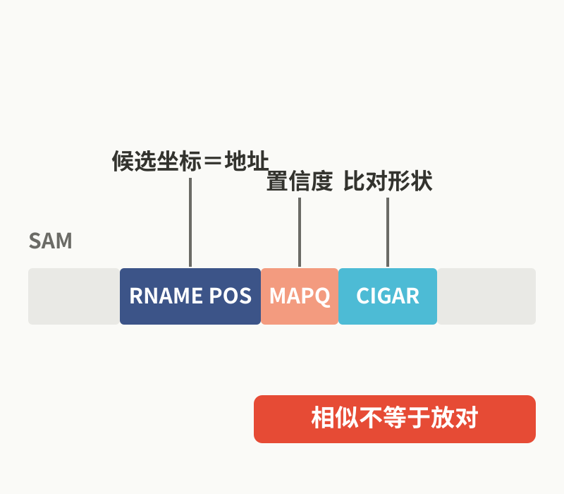

</div>
<div>

- 三层不等价：相似、坐标、来源
- 相似是序列证据，来源是物理事实
- 三样分开记，才谈得上定位对不对

</div>
</div>

<div class="ref">教材 §7.1、§7.4.1 ｜ 讲义 ③ 3.1</div>

---

<!-- _class: undergraduate statement -->

「贴上参考」不等于「定位正确」。

相似只说明序列像；真实来源要看有没有等价候选位置。

---

## 两套载体，数字不互搬

| 载体 | 数据 | 参考 |
|---|---|---|
| 主线 | `ERR15732342`，1,579,368 条读段 | 同株或近缘 Xoo |
| 练习 | `SRR2584863` 小规模演示数据 | `GCF_000005845.2` |

- 主线名义深度 `228,911,011 ÷ 4,768,212 = 48.0×`
- 练习参考：1 条序列、4,641,652 bp
- 参考长度、读段数与 MAPQ 分布一律不互搬

<div class="ref">教材 §7.1、§7.6 ｜ 第 4 章 §4.1 ｜ 06_data/undergraduate/README.md §2.1</div>

---

## 本讲在综合项目里的位置

- u08 主线是长读长从头组装，不是比对到参考
- 回贴自拼基因组用 minimap2：PacBio 设 `-x map-pb`
- 校外 ONT 数据用同一工具：`-x map-ont`
- 排序 + 索引的 BAM 是 IGV 能加载的硬前提

<div class="ref">教材 §7.6 ｜ 讲义 ③ 3.3 ｜ 06_data/undergraduate/README.md §2.1</div>

---

<!-- _class: undergraduate divider -->

<div class="num">IV</div>

# 核心原理

一次算术 · 一张索引 · 三段比对 · 两把尺

---

<!-- @section: principles -->
## 不做索引，代价是多少

```text
N = 3 × 10⁹ bp      参考长度
m = 150 bp          读长
r = 3 × 10⁷ 条      读段数
N × m × r = 1.35 × 10¹⁹ 次基本操作
```

- 说明的是量级，不是某台机器的耗时
- 真实耗时取决于实现、硬件与优化

<div class="ref">教材 §7.4.2（正文算术，可用计算器复核）</div>

---

<!-- _class: undergraduate statement -->

精确候选搜索的代价，随模式长度与命中次数增长。

O(m + z)：m 是读长、z 是命中次数；完整比对还要链化与延伸。

---

## BWT：把参考重排成好查的样子

```text
$BANANA
A$BANAN
ANA$BAN
ANANA$B
BANANA$
NA$BANA
NANA$BA
```

- 七个轮转按字典序排序，取最后一列
- 末列连起来是 `ANNB$AA`，可无损还原

<div class="ref">教材 §7.4.2 ｜ 演示 textbook/demos/ch07_seed_extend.py --selftest Part A</div>

---

## 后向搜索：每加一个字符收一次区间

- 从右往左加：`A` → `NA` → `ANA`
- 命中 2 行，对应原文起点 `{1, 3}`（0-based）
- 每加一字符查上下界各一次，共 6 次
- 命中行换回坐标，还要再付出现次数 z 的代价

<div class="ref">教材 §7.4.2、§7.9 习题 2 ｜ 同演示 Part A</div>

---

<!-- _class: undergraduate figure -->

## 比对算法五十年

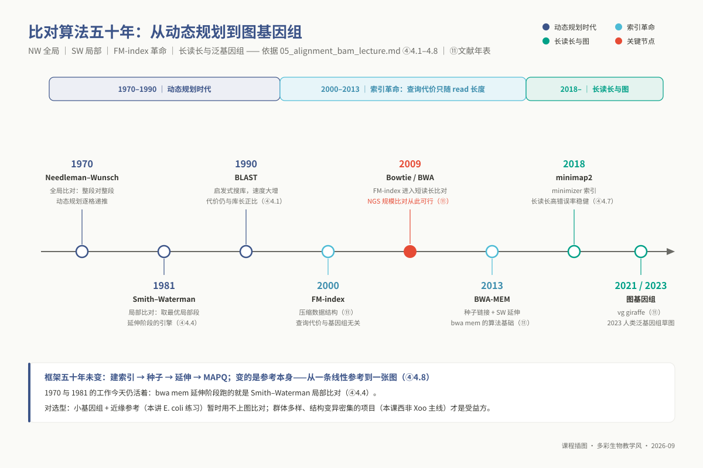

图内「查询只随读长」只对精确搜索成立；三者并存，不是替代

<div class="ref">教材 §7.8 图 7-6 ｜ 图内编号是讲义节号</div>

---

<!-- _class: undergraduate figure -->

## FM-index 上的种子—延伸

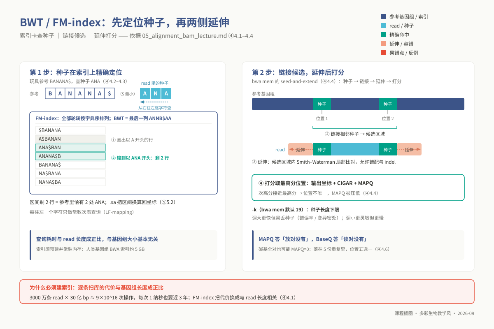

BWT 把相同上下文排到一起，Occ 表让区间定位只需常数次查表。

图内底栏的代价漏乘读长；按本页上方的算术读。

<div class="ref">教材 §7.4.2 图 7-1 ｜ 讲义 ④ 4.1–4.4 ｜ 图内编号是讲义节号</div>

---

## 种子—链化—延伸：三段各管一件事

<div class="cols">
<div class="card">

### 种子
找与参考完全一致的短片段

</div>
<div class="card">

### 链化
把共线、间距合理的种子连成候选

</div>
</div>

<div class="cols">
<div class="card">

### 延伸
只在候选区做容错动态规划

</div>
<div class="card">

### 打分
最高分与次高分接近 → MAPQ 压低

</div>
</div>

<div class="ref">教材 §7.4.3 ｜ 讲义 ④ 4.4</div>

---

## `-k` 是灵敏度与计算量的杠杆

<div class="cols">
<div>

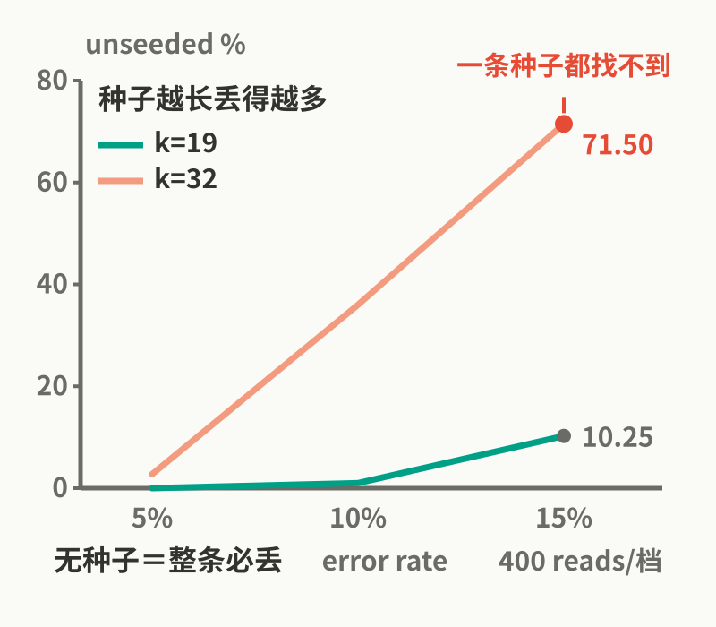

</div>
<div>

| 种子长度 | 5% | 10% | 15% |
|---|---|---|---|
| `k = 19` | 0.00% | 1.00% | 10.25% |
| `k = 32` | 2.75% | 36.00% | 71.50% |

- 表中是「一条种子都找不到」的比例
- `-k` 默认 19（bwa 0.7.17）
- 调大 `-k` 换灵敏度，计算量同时上升

</div>
</div>

<div class="ref">教材 §7.4.3 表 ｜ 演示 textbook/demos/ch07_seed_extend.py --selftest（seed 20261103）</div>

---

<!-- _class: undergraduate statement -->

把种子调大，不等于更快。

合成数据：1% 错误率下，k=19 延伸窗口 36882 个 DP 单元，k=32 是 112622 个。

<div class="ref">演示 textbook/demos/ch07_seed_extend.py --selftest（seed 20261103）</div>

---

## 局部还是端到端：代价记在不同地方

<div class="cols">
<div>

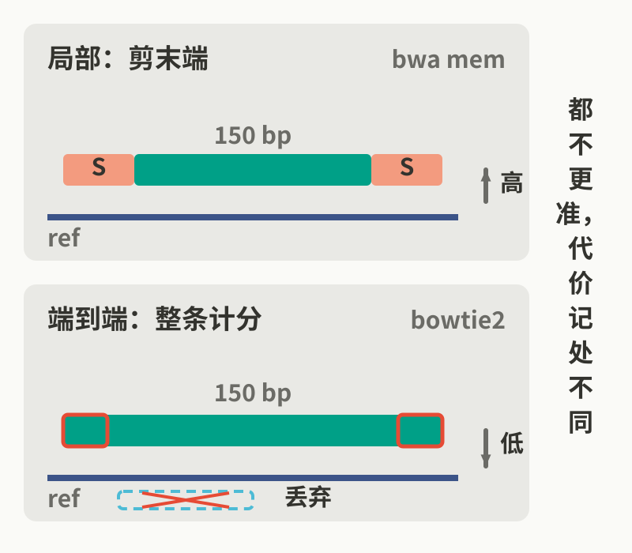

</div>
<div>

- `bwa mem` 局部：剪掉贴不上的末端
- `bowtie2` 端到端：`--local` 才剪
- 锚点 60 对 42／44，详见锚点表
- 换范式，比对率与软剪切率都会变

</div>
</div>

<div class="ref">教材 §7.4.3（范式）、§7.4.5（MAPQ 锚点）</div>

---

## 软剪切多，不能直接推出结构变异

<div class="cols">
<div>

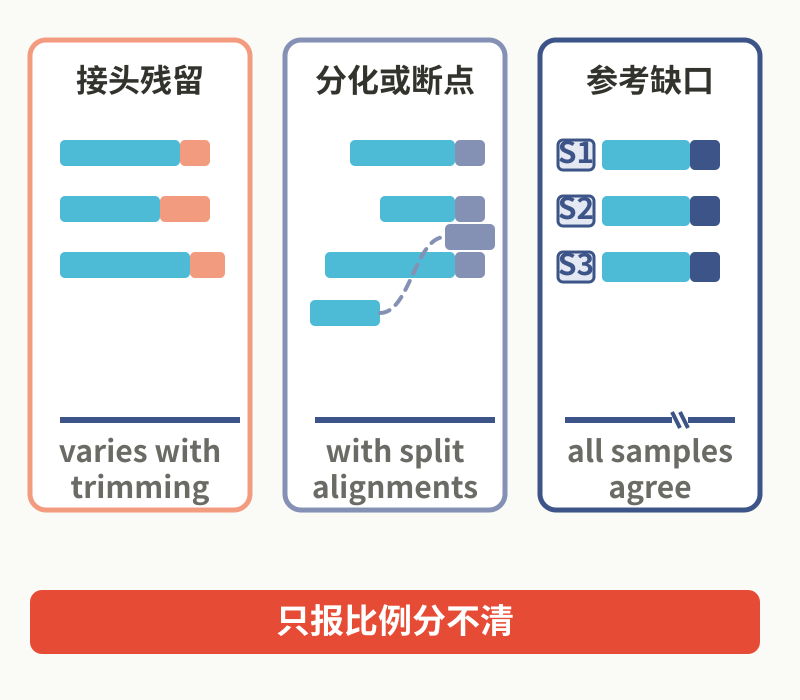

</div>
<div>

- 接头残留：集中一端，随修剪参数变
- 真实分化或断点：伴分裂比对
- 参考本身有问题：全样本一致
- 只报比例无法区分，要再补一层证据

</div>
</div>

<div class="ref">教材 §7.4.3 ｜ 讲义 ⑥ 6.6</div>

---

## CIGAR 要对账：`M` 不等于完全匹配

<div class="cols">
<div>

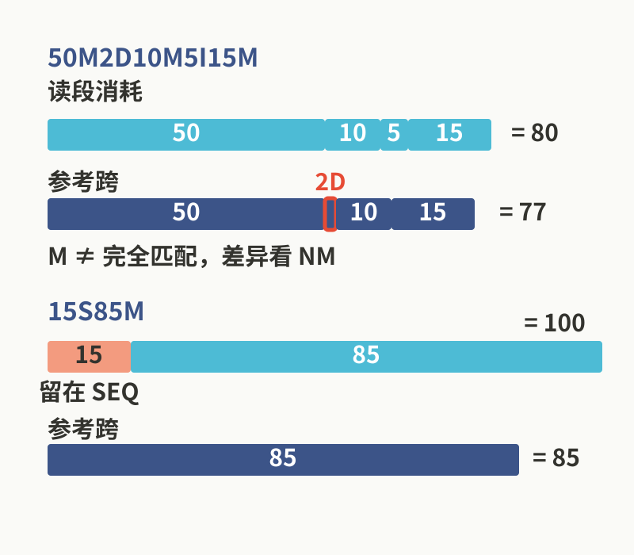

</div>
<div>

- 设例 `50M2D10M`：读段 60 bp，参考跨 62 bp
- `D` 只消耗参考，不消耗读段
- `M` 只表示这一段比对上了，里面还有错配

</div>
</div>

<div class="ref">教材 §7.4.3、§7.4.4 ｜ 正文算术 ｜ 习题 4</div>

---

## 排序与索引：区域操作的前提

- 比对器写出的 BAM 没有「按坐标排好」这个性质
- 坐标排序才能建索引，区间查询才不必从头扫
- `.bai` 是分箱加线性索引，不是二叉树
- 未排序建索引会显式报错——这种失败好发现

<div class="ref">教材 §7.4.4 ｜ 讲义 ⑤ 5.5</div>

---

## 三套契约，差一位也不报错

<div class="cols">
<div>

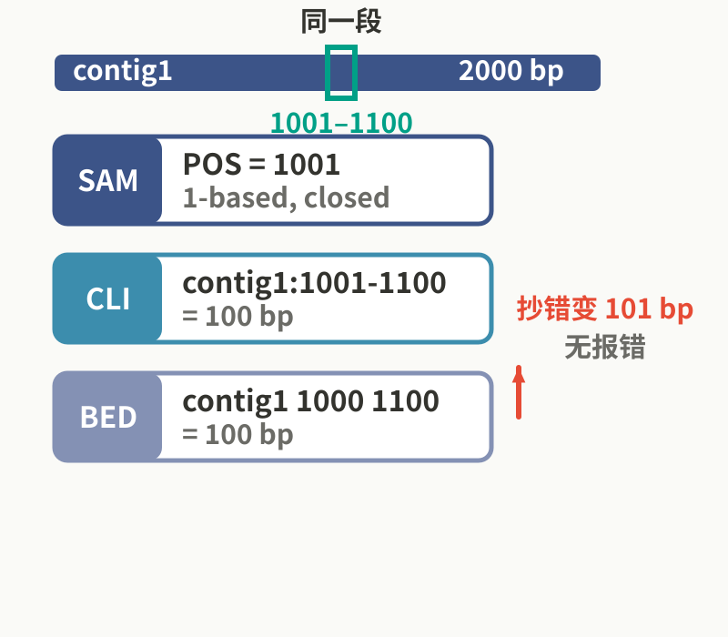

</div>
<div>

- contig 名：与头行空格前逐字一致
- SAM 与命令行区间：1-based 闭区间
- BED：0-based 半开区间
- 抄错只多左端一格，右端未动，不报错

</div>
</div>

<div class="ref">教材 §7.4.4（与第 5 章 §5.4.4 同源）</div>

---

<!-- _class: undergraduate statement -->

名字写错、坐标差一位，工具都不报错。

它们只会交给你一个空结果，或一段多出一格的区间。

---

<!-- _class: undergraduate figure -->

## 两道闸门：BaseQ 管读对，MAPQ 管放对

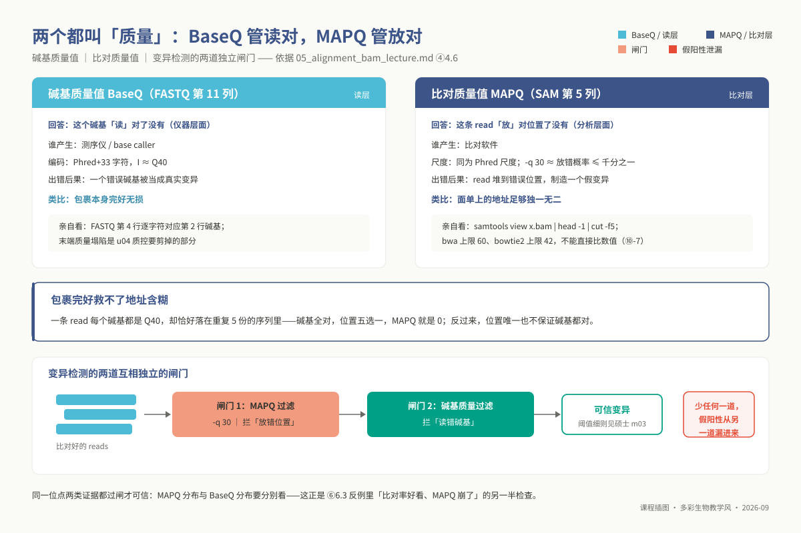

左栏「FASTQ 第 11 列」是笔误：BaseQ 在 FASTQ 第 4 行、SAM 第 11 列。

MAPQ 看 SAM 第 5 列；右栏 42 是端到端，44 需 `--local`

<div class="ref">教材 §7.4.5 图 7-3 ｜ 讲义 ④ 4.6 ｜ 图内编号是讲义节号</div>

---

## 两个质量值：能分别审，但不是独立

- 测量对象不同：一个管读对，一个管放对
- 但比对打分本身要用碱基质量（错配罚分随它变）
- MAPQ 又由候选之间的打分差算出
- 所以「BaseQ 高」推不出「MAPQ 高」

<div class="ref">教材 §7.4.5 术语卡 ｜ 讲义 ④ 4.6</div>

---

## MAPQ 的锚点：两套标度不可横比

| 情形 | BWA 0.7.17 | Bowtie2 2.5.1 |
|---|---|---|
| 完美唯一 | 60（封顶） | 42（端到端）；44（`--local`） |
| 完美平局 | 0 | 1 |
| 只知一个次优 | 由分差算出（设例 22） | 查表（设例 31） |
| 未穷举候选 | 未定义 | 255 表示未知 |

- 255 是「不可用」，`-q 30` 也拦不住，要单独处理

<div class="ref">教材 §7.4.5 表 ｜ 演示 textbook/demos/ch07_mapq_multimapping.py --selftest Part 1</div>

---

<!-- _class: undergraduate figure -->

## MAPQ：位置有多唯一

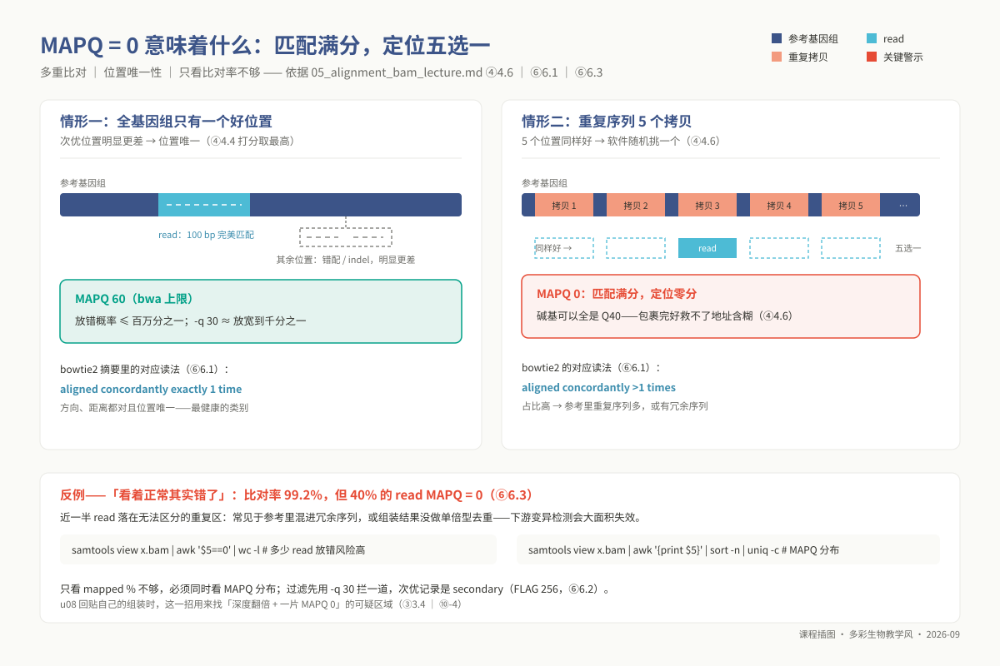

图底 99.2% 对 40% 没有对应输入，按设例读；可复跑版本见下页（33.3%）

<div class="ref">教材 §7.4.5 图 7-4 ｜ 讲义 ④ 4.6 ｜ 图内「随机挑一个」实为确定性伪随机</div>

---

## 合成批：三类读段的 MAPQ

<div class="cols">
<div>

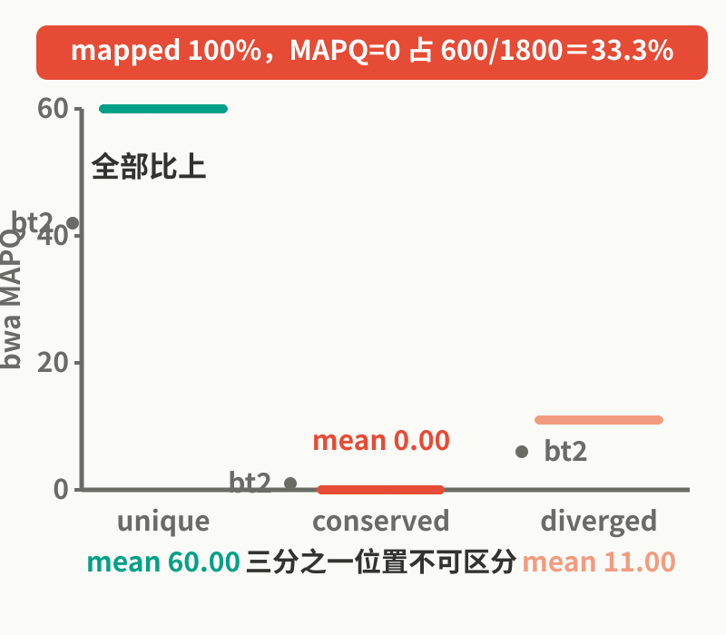

</div>
<div>

| 读段类别 | BWA 均值 | Bowtie2 均值 |
|---|---|---|
| 独特区完美 | 60.00 | 42.00 |
| 重复区保守窗 | 0.00 | 1.00 |
| 重复区分化窗 | 11.00 | 6.00 |

- 均值只在表内读，两套标度不可横比

</div>
</div>

<div class="ref">教材 §7.4.5 ｜ 演示 textbook/demos/ch07_mapq_multimapping.py --selftest Part 2（各 600 条）</div>

---

<!-- _class: undergraduate statement -->

高比对率可以是假象。

三类读段全都报上了，但三分之一的位置根本不可区分。

---

<!-- _class: undergraduate quiz -->

## 课堂提问

一条读段每个碱基都是 Q40，MAPQ 却可能是 0。为什么？

---

<!-- _class: undergraduate divider -->

<div class="num">V</div>

# 操作流程

集群规矩 · 建索引 · 一条管道 · 四步标记

---

<!-- @section: procedure -->
## 集群规矩：先读这段

> 登录节点只做下载、解压、编辑与投递。比对与排序一律 `qsub`。

- `qsub 脚本` 投递；`qstat -u ${USER}` 看排队
- 核数写进作业脚本的 `#$ -pe smp`
- 日志 `<作业名>.o<JOB_ID>` 在提交目录
- 登录节点跑比对会吃满内存，只剩一行 `Killed`

<div class="ref">教材 §7.5.2 ｜ 讲义 ⑤ 5.0</div>

---

## 参考自检：三项都得对上

```bash
gunzip -c GCF_000005845.2_ASM584v2_genomic.fna.gz > ecoli.fa
grep -c '^>' ecoli.fa                       # 条目数：1
grep -v '^>' ecoli.fa | tr -d '\n' | wc -c  # 总长：4,641,652
grep '^>' ecoli.fa                          # 记下空格前的名字
```

- 下载地址见讲义 ⑤ 5.1（NCBI FTP，`GCF_000005845.2`）
- 条目数或长度对不上，就是下载不完整
- 头行空格前那个名字，后面每处都要逐字照抄

<div class="ref">教材 §7.6 第 1 步、§7.1 ｜ 讲义 ⑤ 5.1</div>

---

## 建索引：5 件与 6 件

| 命令 | 产物 |
|---|---|
| `bwa index ecoli.fa` | `.amb .ann .bwt .pac .sa` 共 5 件 |
| `bowtie2-build ecoli.fa ecoli_bt2` | 6 个 `.bt2` |

- `bwa mem` 传 FASTA 文件名；`bowtie2 -x` 传索引前缀
- 缺任何一件，比对启动即报找不到索引文件
- 换参考必须重建索引，不能沿用旧的

<div class="ref">教材 §7.6 第 2 步 ｜ 讲义 ⑤ 5.2 ｜ 脚本 05_align_and_sort.sh</div>

---

<!-- _class: undergraduate figure -->

## 管道里每一环交什么

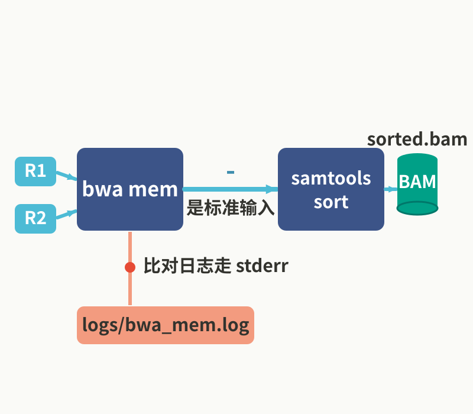

主流走标准输入 `-`，比对日志走 stderr：两路都要留住

<div class="ref">教材 §7.4.2（统计走 stderr）、§7.6 第 3 步 ｜ 讲义 ⑤ 5.3</div>

---

## 比对与排序：一条管道

```bash
R1=clean/sample01_R1.clean.fq.gz
R2=clean/sample01_R2.clean.fq.gz
rg='@RG\tID:s01\tSM:s01\tPL:ILLUMINA'
bwa mem -t 8 -M -K 10000000 -R "$rg" ref/ecoli.fa $R1 $R2 \
  2> logs/bwa_mem.log | samtools sort -@ 8 -m 2G \
  -T bam/tmp_sample01 -o bam/sample01.sorted.bam -
```

- 前三个变量先设好；整条命令由作业脚本封装
- 两段同时跑，申请核数按峰值算

<div class="ref">教材 §7.4.2、§7.6 第 3 步 ｜ 讲义 ⑤ 5.3</div>

---

## 每个参数都要能说出为什么

| 参数 | 作用 |
|---|---|
| `-t 8` | 比对段线程数；核数按峰值申请 |
| `-M` | 分裂比对标成次要（256），兼容旧工具 |
| `-K 10000000` | 固定分批，有助同版本同参数复现 |
| `-R "$rg"` | 写入读组头；`\t` 要原样交给 bwa |

- `-M` 是标记口径的开关，不是质量开关

<div class="ref">教材 §7.4.3、§7.4.7 ｜ 讲义 ⑤ 5.3</div>

---

## `-R` 的纪律：传对，再核对

- 引号的作用只是把 `\t` 原样交给 bwa
- 单双引号都保留字面 `\t`；课程脚本用双引号变量
- 完全不加引号，反斜杠才会被 shell 去掉
- 跑完核对：`samtools view -H bam/sample01.sorted.bam | grep '^@RG'`

<div class="ref">教材 §7.4.7、§7.5.4 ｜ 讲义 ⑤ 5.3、⑨ E4</div>

---

## 排序内存：`-m` 是近似配额

- `-m` 是**每线程**的近似内存配额
- `-@ 4 -m 2G` 的名义合计是 8 GB
- 实际峰值还含其它开销，不能写成精确值
- 要报峰值就实测；申请内存留余量

<div class="ref">教材 §7.4.7 ｜ 讲义 ⑨ E5</div>

---

## 统计四件：各看各的分母

```bash
BAM=bam/sample01.sorted.bam
samtools flagstat $BAM > logs/flagstat.txt
samtools idxstats $BAM > logs/idxstats.txt
samtools coverage $BAM > logs/coverage.txt
samtools depth -a $BAM | awk '{s+=$3} END {print s/NR}'
```

- `in total` 含次要与补充，不等于模板数
- `coverage` 给覆盖度、平均深度与 `meanmapq`
- 结论要由四件合成，不是一行摘要

<div class="ref">教材 §7.4.6 ｜ 讲义 ⑤ 5.6</div>

---

## 深度口径：`-a` 还不够

<div class="cols">
<div>

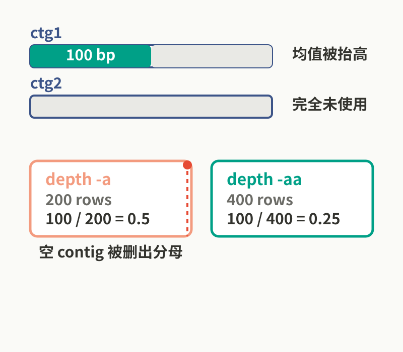

</div>
<div>

| 口径 | 均值（两 contig 例） |
|---|---|
| `depth -a` | 100 / 200 = 0.5 |
| `depth -aa` | 100 / 400 = 0.25 |

- `-a` 与 `-aa` 差的正好是空 contig
- 全参考口径要显式给全长

</div>
</div>

<div class="ref">教材 §7.4.6（本机实测，非课程 pin）｜ 讲义 ⑤ 5.6</div>

---

## 覆盖度不是均匀性

<div class="cols">
<div>

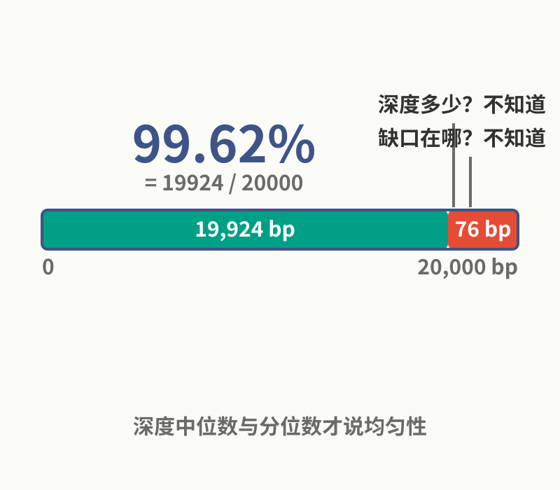

</div>
<div>

- 覆盖度只说有没有，不说多少、哪里
- 一条读段也能让一个位点算「被覆盖」
- 均匀性看中位数与零深度区段

</div>
</div>

<div class="ref">教材 §7.4.6（正文算术，设例）</div>

---

<!-- _class: undergraduate figure -->

## 四步各补什么

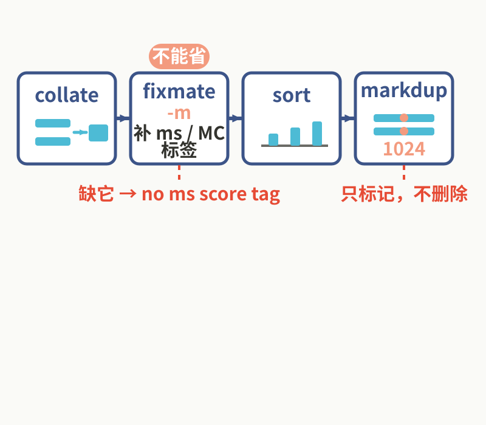

缺 `fixmate -m` 就报 `no ms score tag`；`markdup` 只标记不删除

<div class="ref">教材 §7.6 第 6 步 ｜ 讲义 ⑤ 5.8</div>

---

## 重复标记：四步顺序不能乱

```bash
BAM=bam/sample01.sorted.bam
samtools collate -o bam/collate.bam $BAM bam/tmp_col
samtools fixmate -m bam/collate.bam bam/fixmate.bam
samtools sort -m 2G -o bam/pos.bam bam/fixmate.bam
samtools markdup -s bam/pos.bam bam/md.bam 2> logs/markdup.stats
```

- 判据是两端 5' 未剪切起点与朝向完全一致

<div class="ref">教材 §7.6 第 6 步 ｜ 讲义 ⑤ 5.8 ｜ 脚本 05_align_and_sort.sh 的 markdup 段</div>

---

<!-- _class: undergraduate statement -->

只标记，不删除。

`-F 1024` 让下游自己决定要不要踢掉这些记录。

---

<!-- _class: undergraduate divider -->

<div class="num">VI</div>

# 结果解读

三层分母 · 两个方向 · 四件验收

---

<!-- @section: interpretation -->
<!-- _class: undergraduate warn -->
## 结果不对时长什么样（一）

| 现象 | 先查什么 |
|---|---|
| mapped 明显偏低 | R1/R2 是否同步、参考是否选对 |
| 区间查询 0 条却不报错 | `@SQ` 名字与参考头逐字比对 |
| 软剪切比例高 | 接头、真实分化、参考缺口三者要分 |
| 深度在某区归零 | 该区读段是否集中在低 MAPQ |

<div class="ref">教材 §7.5.1–§7.5.3 ｜ 本科不设比对率通用阈值</div>

---

<!-- _class: undergraduate warn -->
## 结果不对时长什么样（二）：看着正常

- 合成批 mapped 100%，MAPQ = 0 却占 33.3%
- 只看比对率，重复区的问题完全看不见
- 先数一遍：`samtools view bam/sample01.sorted.bam | awk '$5==0' | wc -l`
- `-q 30` 后重复区归零，也不等于「这里没有序列」

<div class="ref">教材 §7.4.5、§7.5.1 ｜ 演示 textbook/demos/ch07_mapq_multimapping.py --selftest</div>

---

<!-- _class: undergraduate warn -->
## 结果不对时长什么样（三）：两个方向都骗人

| 参考形态 | 表象 |
|---|---|
| 扩展参考（多拷贝都在） | 读段分散落位，MAPQ 近 0，过滤后归零 |
| 塌缩参考（只留一个拷贝） | 多来源叠到同一坐标，高深度加高 MAPQ |

- 塌缩例：背景 10.0× 对代表拷贝 55.0×（比值 5.50）
- 选哪个位置由实现决定，是确定性伪随机
- 两个方向都不报错，要四样一起看

<div class="ref">教材 §7.5.1 ｜ 演示 textbook/demos/ch07_mapq_multimapping.py --selftest Part 2、Part 3</div>

---

## `flagstat` 逐行：先看分母再谈比例

- `in total` 含次要与补充，**不等于**读段数
- `mapped (%)` 是记录级，分母就是 `in total`
- 「至少一端贴上」要按读段名归成模板另数
- `properly paired` 低：插入片段分布、文库方向、修剪过短

<div class="ref">教材 §7.4.6 ｜ 讲义 ⑥ 6.2</div>

---

## 验收要四件一起做

<div class="cols">
<div>

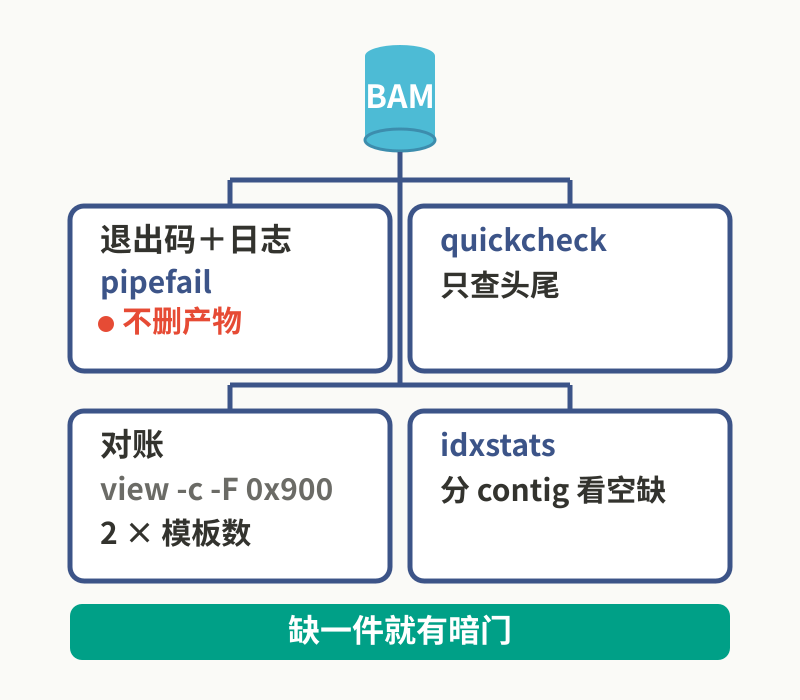

</div>
<div>

- 退出码通过，不代表记录完整
- `quickcheck` 只查头尾，不读中间
- 记录数按读段总数对，不看摘要
- `idxstats` 分 contig，空缺一眼看出

</div>
</div>

<div class="ref">教材 §7.4.6（0x900 = 2048 + 256）、§7.5.2 ｜ 脚本 verify_bam 已内置</div>

---

## 三类比对信号：都只是待解释的观测

<div class="cols">
<div>

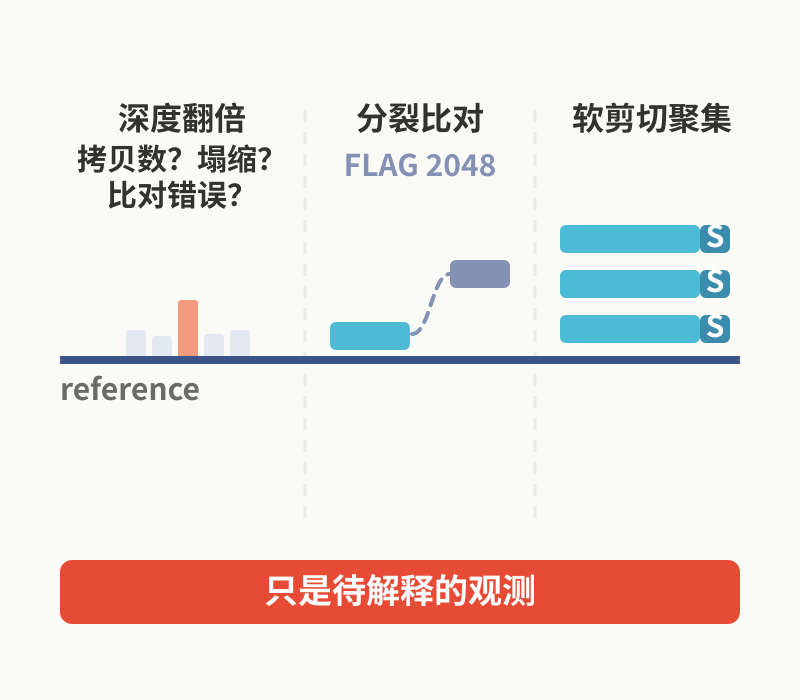

</div>
<div>

- 局部深度异常：扩张、塌缩、污染
- 分裂比对：真实嵌合，或参数过松
- 软剪切聚集：分化、接头、参考缺口
- 定性要补证据：逐条看、长读长跨越

</div>
</div>

<div class="ref">教材 §7.6 ｜ 交接第 8、9 章</div>

---

<!-- _class: undergraduate quiz -->

## 课堂提问

`quickcheck` 过了、`flagstat` 有数字，BAM 就完整吗？

---

<!-- _class: undergraduate divider -->

<div class="num">VII</div>

# 常见错误

三条一定会遇到的报错

---

<!-- @section: troubleshooting -->
<!-- _class: undergraduate warn -->
## 常见错误一：管道成功，BAM 是空的

<div class="cols">
<div>

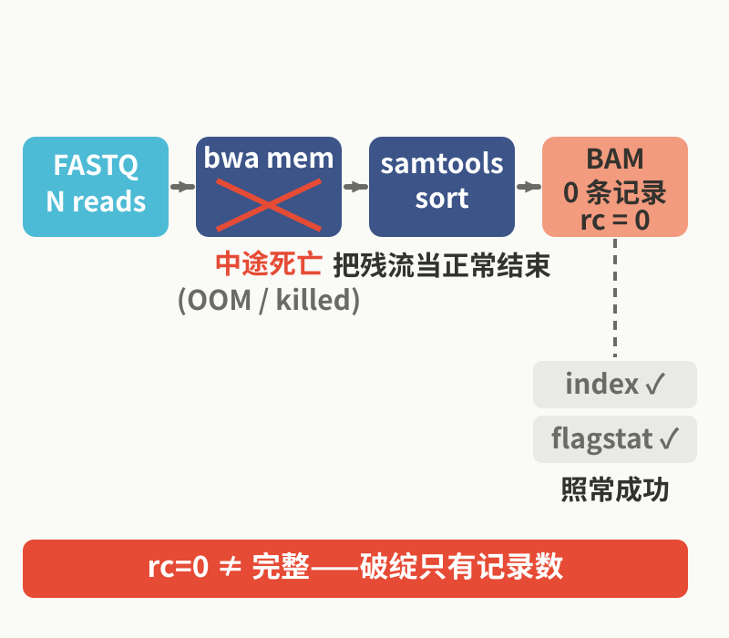

</div>
<div>

- 上游中途死掉，`sort` 当成正常结束
- `pipefail` 传播状态，但不删产物
- 防线：`quickcheck`、记录数对账、`idxstats`

</div>
</div>

<div class="ref">教材 §7.5.2（本机实测，非课程 pin）｜ 讲义 ⑨ E3</div>

---

<!-- _class: undergraduate warn -->
## 常见错误二：排序时内存耗尽

- 日志只有一行 `Killed`，没有别的报错
- `-m` 是每线程配额，`-@ 4 -m 2G` 名义 8 GB
- 集群申请的内存要留余量，峰值以实测为准
- 先降 `-m` 与核数重投，再回看日志

<div class="ref">教材 §7.4.7、§7.5.2 ｜ 讲义 ⑨ E5</div>

---

<!-- _class: undergraduate warn -->
## 常见错误三：区间查询空结果，退出码 0

<div class="cols">
<div>

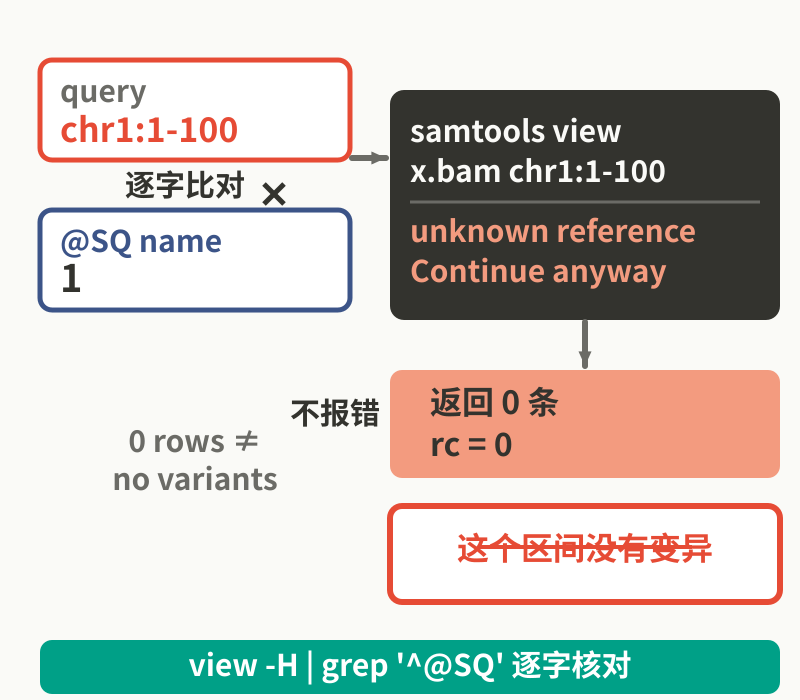

</div>
<div>

- 判据：`@SQ` 与参考头行逐字一致
- 空结果先当工具问题，别当生物学结论
- 换过参考，`.fai`、`.dict` 与 `@SQ` 一起更新

</div>
</div>

<div class="ref">教材 §7.5.3（本机实测，非课程 pin）｜ 讲义 ⑨ E8</div>

---

<!-- _class: undergraduate divider -->

<div class="num">VIII</div>

# 课后

思考练习 · 交付 · 实验指导

---

<!-- @section: wrapup -->
## 思考练习（讲义 ⑩）

- Q1 重复计数与 `markdup.stats` 对账；恒等式不算独立证据
- Q3 全基因组 5' 端都出现 `10S`，你先怀疑什么
- Q5 一条读段完美比对到多个拷贝，MAPQ 为什么是 0
- Q7 `bwa mem` 与 `bowtie2` 的平均 MAPQ 能直接比吗

<div class="ref">讲义 ⑩ Q1/Q3/Q5/Q7 ｜ 教材 §7.4.3、§7.4.5、§7.6、§7.9 答案要点</div>

---

## 交付、实验指导与指针

- 交付：`bam/*.bam`、`.bai` 与 `logs/` 审计链
- 实验指导 `11_lab_guides/undergraduate/05_alignment_bam_lab.md`
- 上机时手边打开；演示脚本在课程仓库根目录运行
- 文献只给指针（讲义 ⑪），本 deck 不重复列

**参考里有重复时，「我不确定」才是正确答案。**

<div class="ref">教材 §7.6 ｜ 讲义 ⑩、⑪</div>
