<!-- @section: cover -->
<!-- _class: undergraduate cover -->

# u06 ｜ 基因组组装原理与质量评估

**组装器很少承认失败：只要作业跑完，它就会交回一个 FASTA，退出码是 0，日志里也没有红字。**

<div class="meta">

- 线上先导自学 4 学时 ｜ 课堂 Day 0 串讲 2 h
- 讲义 `02_lectures/undergraduate/unit06_assembly_basics/06_assembly_basics_lecture.md`
- 对应教材 §8.1–§8.6 ｜ 环境 `ngs_ug_assembly`

</div>

---

<!-- _class: undergraduate divider -->

<div class="num">I</div>

# 学习目标

七条，对应 LO08-01–LO08-04

---

<!-- @section: objectives -->
## 学完你应当能够（一）：勘测与频谱

- 解释四个成分的来源，并说明它们只是证据
- 说明 k 取 17 / 21 / 25 是敏感性检查
- 运行 `jellyfish count` + `histo`，产出 `.histo`
- 按四步读 GenomeScope 摘要

<div class="ref">教材 §8.2、§8.4.3–§8.4.4 ｜ 讲义 ①</div>

---

## 学完你应当能够（二）：组装与裁决

- 比较 OLC 与 de Bruijn 的节点、边与长程信息
- 用读长与 `k−1` 解释断点或塌缩
- 计算并解释 N50 / L50，举出「N50 更高但更差」
- 判读 BUSCO 的 C / S / D / F / M，按证据链选

<div class="ref">教材 §8.2、§8.4.7–§8.4.9 ｜ 学习目标 LO08-01–LO08-04</div>

---

<!-- _class: undergraduate divider -->

<div class="num">II</div>

# 前置检查

三个 L0 模块，加同层前置

---

<!-- @section: prerequisites -->
## 前置检查：三个 L0 模块

| L0 模块 | 本讲用到 | 不过关的后果 |
|---|---|---|
| `l0_01_linux` | 绝对路径、`qsub`、看日志 | 作业交不上去 |
| `l0_03_conda` | 激活环境、`command not found` | 分不清环境还是没装 |
| `l0_04_formats` | 扫描用 `*.fq.gz`、组装用 `reads.fa` | 把两份数据用反 |

- 统计读法依赖 `l0_06_stats`（讲义 ⑦）
- 同层前置：u01、u03、u04，扫描前数据必须已清洗

<div class="ref">教材 §8.3 ｜ 讲义 ② ｜ 自测 L0-1-Q6、L0-3-Q2、L0-4-Q1</div>

---

<!-- _class: undergraduate divider -->

<div class="num">III</div>

# 科学问题

三个问题，一个原则

---

<!-- @section: background -->
## 三个问题，一个原则

<div class="cols">
<div>

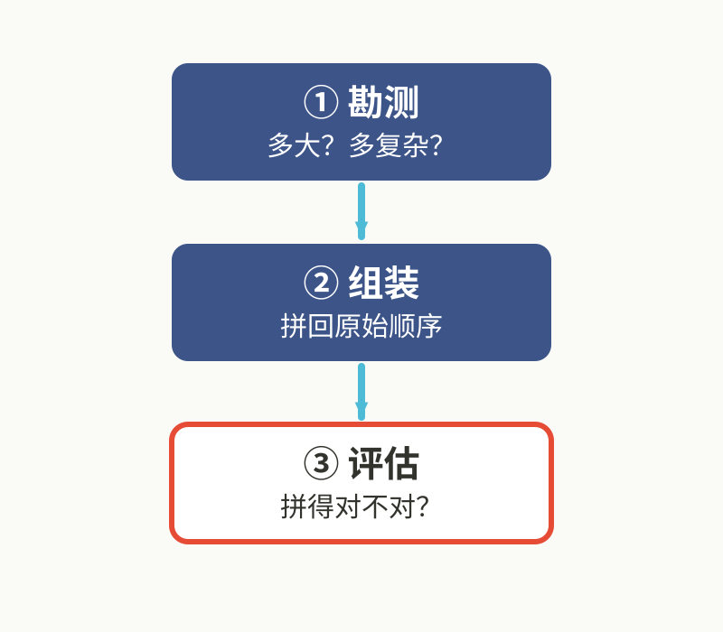

</div>
<div>

- 勘测：深度不足就拼不完整
- 组装：碎片怎么回到原顺序
- 评估：这一步最容易跳过

</div>
</div>

<div class="ref">教材 §8.1、§8.6 ｜ 讲义 ③</div>

---

## 读段是题目，完成图是答案

<div class="cols">
<div class="card">

### 题目
ONT `ERR15732384`，原始约 63×，课程降采样到约 40×

自拼 contig 与答案对齐，差异是排错线索

</div>
<div class="card">

### 答案
同株已发表完成图 `GCA_987216485`

**4,768,212 bp**；总长相近、成段对不上都各有判读

</div>
</div>

- 两套算法都跑：看哪里一致、哪里分歧
- 图内 FastANI 与 ANI 本章不使用

<div class="ref">教材 §8.1、§8.6 ｜ 数据登记值见 06_data/undergraduate/README.md §2.1、§三</div>

---

<!-- _class: undergraduate figure -->

## 自带标准答案的组装练习

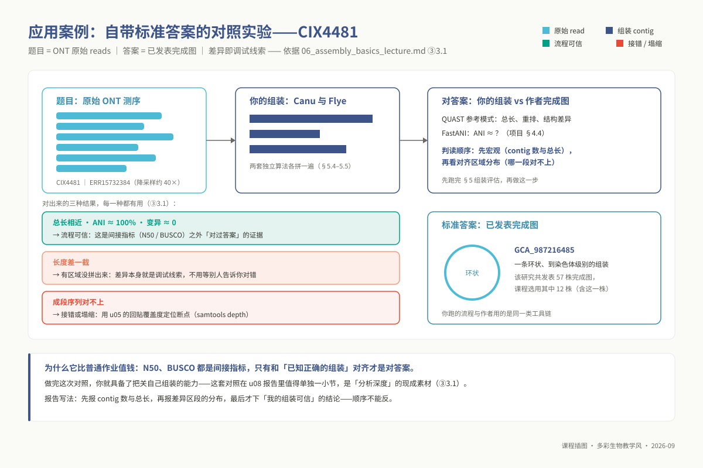

本章不用 FastANI／ANI；「回贴覆盖度」读作回贴深度（×）

<div class="ref">教材 §8.1 ｜ 图内 §/项目编号是讲义编号</div>

---

<!-- _class: undergraduate statement -->

两套独立算法各拼一遍，看一致与分歧。

两套都错得一样的情形也存在：交叉互证不能替代标准答案。

---

<!-- _class: undergraduate divider -->

<div class="num">IV</div>

# 核心原理

k-mer 频谱 · 两条组装路线 · 三把评估尺

---

<!-- @section: principles -->
## k-mer：把基因组切成等长小段来数

<div class="cols">
<div>

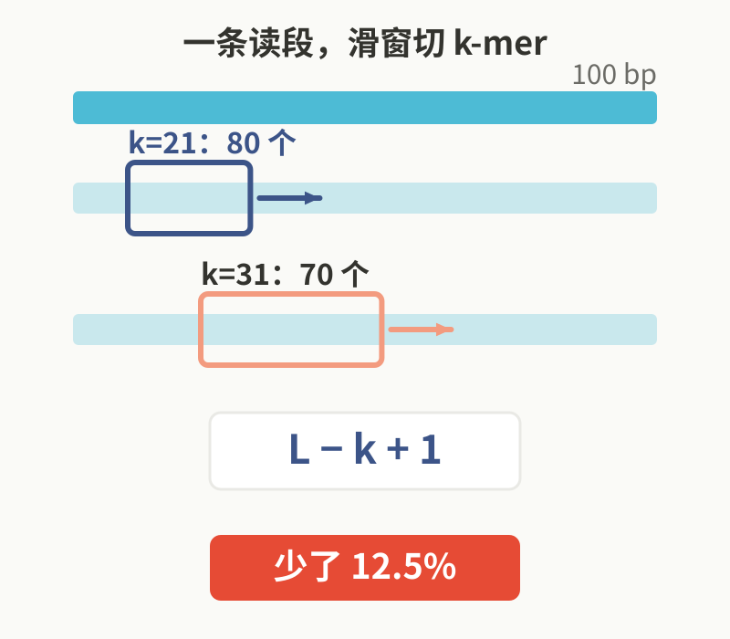

</div>
<div>

- k-mer 是长度为 k 的连续子串
- 长 L 的读段产生 `L − k + 1` 个
- k 大的一头代价：切出的 k-mer 变少

</div>
</div>

<div class="ref">教材 §8.4.3 ｜ 讲义 ④ 4.1</div>

---

<!-- _class: undergraduate statement -->

一本书撕碎抄了 30 遍，每句平均被抄 30 次。

共抄 N 次时，位置数 ≈ N ÷ 30；这就是面积除以主峰。

---

## 主峰横坐标是 k-mer 深度，不是测序深度

<div class="cols">
<div>

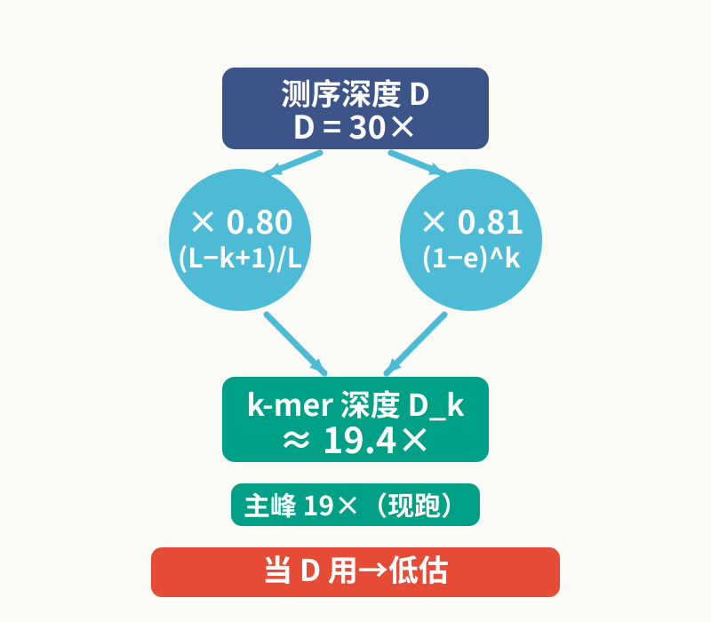

</div>
<div>

- `D_k ≈ D × (L−k+1)/L × (1−e)^k`
- 场景一参数：30×、L=100、k=21、e=0.01

</div>
</div>

<div class="ref">教材 §8.4.3 ｜ 演示 `ch08_kmer_spectrum.py --selftest`</div>

---

## 频谱的四个成分，各由什么造成

| 成分 | 来自哪里 |
|---|---|
| 低频尾（最左） | 测序错误：一个错碱基造 k 个错 k-mer |
| 主峰 | 单拷贝序列；横坐标 = `D_k` |
| 主峰右侧 2×、3× 的鼓包 | 重复序列 |
| 主峰左侧约一半处的峰 | 杂合或混入另一套序列 |

<div class="ref">教材 §8.4.3 图 8-2</div>

---

<!-- _class: undergraduate figure -->

## 组装前的体检图

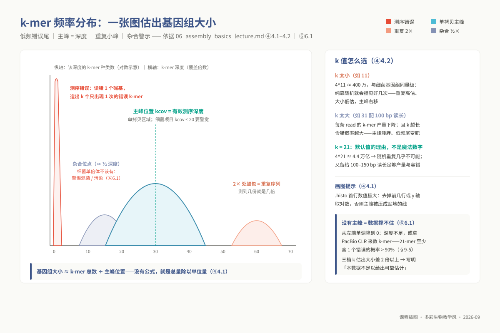

图内 kcov 即 `D_k`；含错按 89.1% 读，不读 >90%；三档 k 差异无通用阈值

<div class="ref">教材 §8.4.3、§8.4.4 ｜ 讲义 ④ 4.1</div>

---

## 基因组大小：面积除以主峰深度

<div class="cols">
<div>

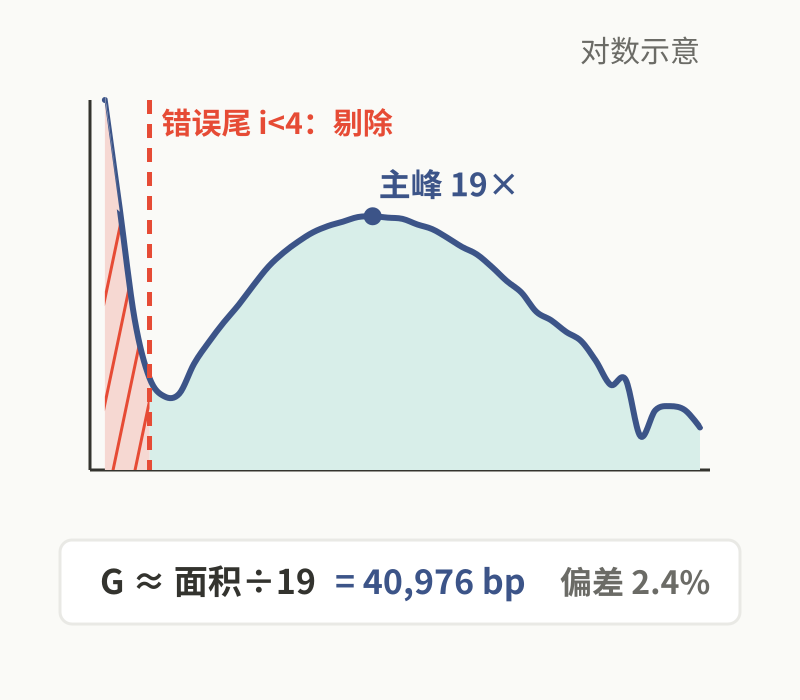

</div>
<div>

- `G ≈ Σ(i·N_i) / D_k`，`i ≥ i_min`
- `N_i` 是恰好出现 `i` 次的 k-mer 种类数
- `i_min` 剔除错误尾；场景一尾占种类数 81.5%

</div>
</div>

<div class="ref">教材 §8.4.3 ｜ 演示 `ch08_kmer_spectrum.py --selftest`</div>

---

## k 太小：碰撞把独立拷贝混在一起

- k=11 只有 4¹¹ = 4,194,304 种
- 与几 Mb 的细菌基因组同一量级
- 不同位点的 11-mer 大量碰撞
- 由此造成的偏移方向并不固定

<div class="ref">教材 §8.4.4 ｜ 讲义 ⑤ 5.3</div>

---

## k 太大：信息与容错两头亏

<div class="cols">
<div>

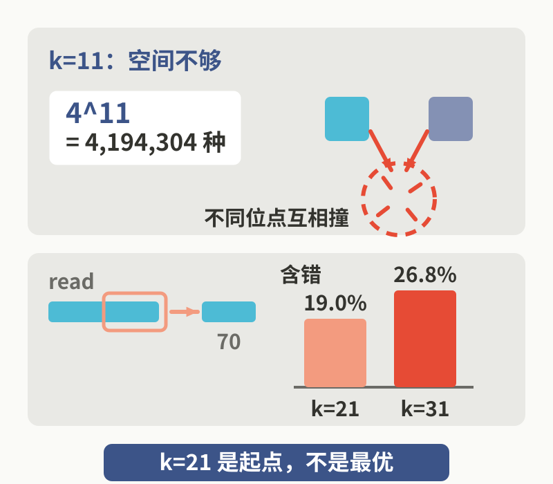

</div>
<div>

- 两端各有代价，在碰撞与错误之间取平衡
- k=21 是课程起点、项目惯例，不是最优

</div>
</div>

<div class="ref">教材 §8.4.4 ｜ 讲义 ④ 4.2</div>

---

<!-- _class: undergraduate quiz -->

## 课堂提问

主峰左边一半处出现峰，可以直接写「确诊混菌」吗？

---

<!-- _class: undergraduate statement -->

三档 k 各跑一次，是敏感性检查。

差多少算合格没有通用阈值：报告三档，说明哪一档频谱最清楚。

---

## GenomeScope 四步读法

<div class="cols">
<div class="card">

### ① 确认输入
实现、k、读长参数是否与数据一致

</div>
<div class="card">

### ② 看拟合曲线
贴不贴主峰、残差有没有系统形状

</div>
</div>

<div class="cols">
<div class="card">

### ③ 读三个估计
单倍体长度、杂合度、重复比例与区间

</div>
<div class="card">

### ④ 外部对账
与近缘参考或已知长度比量级

</div>
</div>

<div class="ref">教材 §8.4.4 ｜ 讲义 ⑤ 5.3</div>

---

<!-- _class: undergraduate statement -->

拟合优度是诊断量，没有跨数据集的合格线。

`Failed to converge` 是有效的出错信号；其余数字降级使用，不是全部作废。

---

## GenomeScope 不走 conda，用外置脚本

```bash
wget https://raw.githubusercontent.com/schatzlab/genomescope/\
master/genomescope.R
Rscript genomescope.R reads.histo 21 100 gs_k21 1000
```

- 5 个位置参数：histo / k / 读长 / 输出目录 / 截断深度
- 契约 `env_exempt_tools`：登录节点下载，计算节点运行

<div class="ref">教材 §8.4.4 ｜ 讲义 ⑤ 5.3</div>

---

## 两条路线：拼拼图与走迷宫

<div class="cols">
<div class="card">

### OLC：拼拼图
读段是节点；找重叠、排布局、取共识

</div>
<div class="card">

### DBG：走迷宫
`(k−1)`-mer 是节点、`k`-mer 是边

</div>
</div>

- 读段保持完整，越长越好找，代价是两两比对
- DBG 不必两两比对，但主动丢掉超过 k 的连接

<div class="ref">教材 §8.4.2、§8.4.5 ｜ 讲义 ④ 4.4</div>

---

## 两条路线的差别

| 比较项 | OLC | DBG |
|---|---|---|
| 节点 / 边 | 读段 / 重叠 | `(k−1)`-mer / `k`-mer |
| 路径问题 | 哈密顿（NP 完全） | 欧拉（线性遍历） |
| 断点尺度 | 重复不短于读长 | 重复长于 k（节点从 `k−1`） |
| 代表实现 | Canu | SPAdes、Velvet |

<div class="ref">教材 §8.4.5</div>

---

## 边界不能简化成「重复比 k 长才断」

<div class="cols">
<div>

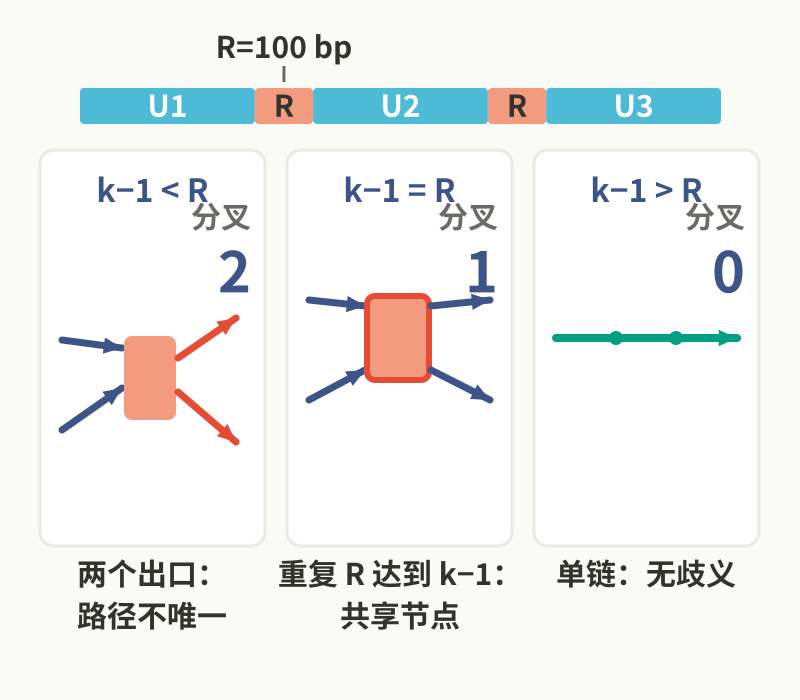

</div>
<div>

- 重复恰为 `k−1`：没有共享 k-mer
- 但整体仍是 2 进 2 出的节点
- 保守的组装器仍在此截断

</div>
</div>

<div class="ref">教材 §8.4.2、§8.4.5 ｜ 演示 `ch08_debruijn_repeat.py --selftest`</div>

---

<!-- _class: undergraduate figure -->

## 断在哪里：两条路线殊途同归

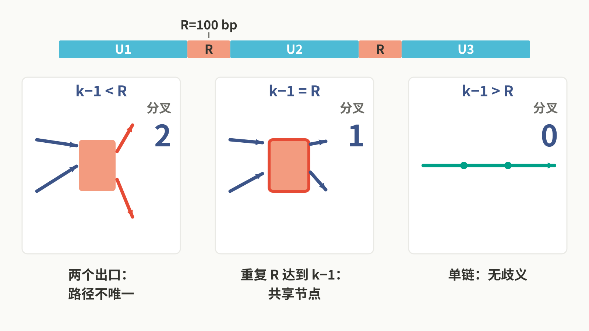

k−1 与 R 决定分叉：2 / 1 / 0；OLC 侧断点尺度见前页表（合成算例）

<div class="ref">教材 §8.4.2、§8.4.5</div>

---

## 长读长：信息条件变了

- rRNA 操纵子约 5 kb、常 5–10 个拷贝
- 量级示例，不是物种常数
- 150 bp 读段完全落在内部 → 在重复处断开
- 15 kb 读段读穿过去 → 一条环状 contig

<div class="ref">教材 §8.4.6 ｜ 讲义 ④ 4.5</div>

---

<!-- _class: undergraduate statement -->

重复不短于读段，任何算法都确定不了两侧怎么连。

跨越只是必要条件：还要读段够多、两侧锚点确实独特。

---

## Flye 的重复图与 Canu 的经典 OLC

<div class="cols">
<div>

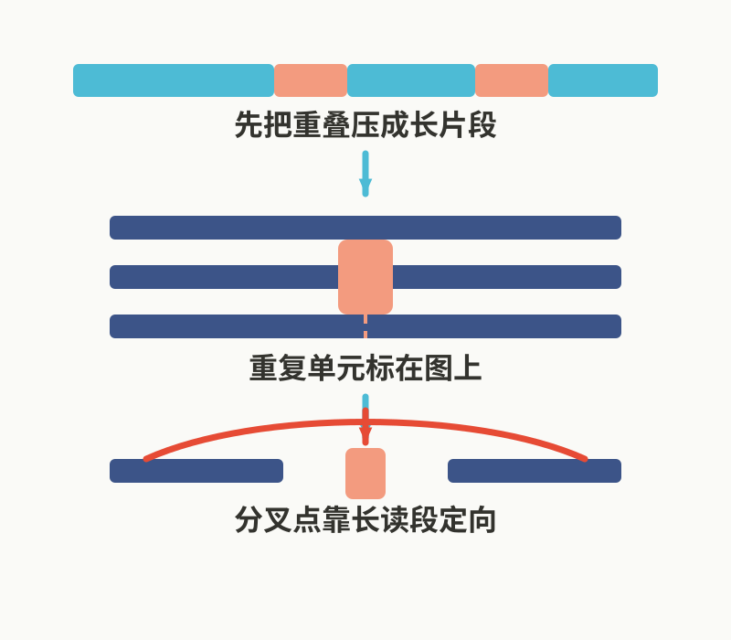

</div>
<div>

- `assembly_info.txt` 的 `circ.` 列：首尾能否闭合
- Canu：先纠错、再修剪、再布局

</div>
</div>

<div class="ref">教材 §8.4.5、§8.4.6 ｜ 讲义 ④ 4.6</div>

---

## N50：累计过半时那条的长度

<div class="cols">
<div>

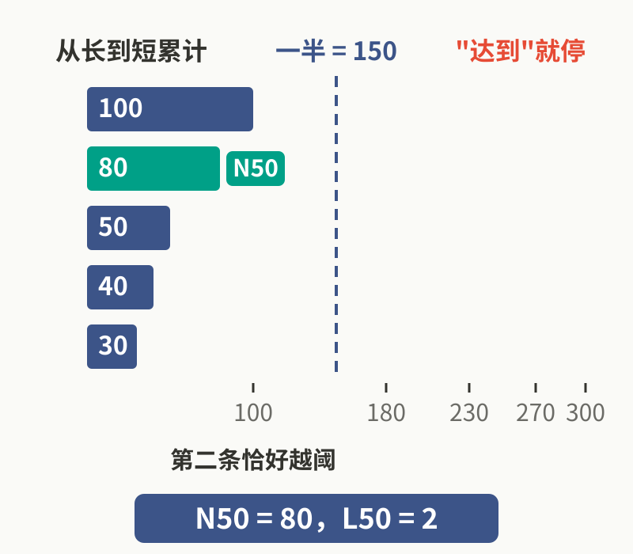

</div>
<div>

- contig 从长到短排，累计达到或超过总长一半
- 到一半就停：不是找最长的那条
- 后文同一手算例，那里看怎么被骗

</div>
</div>

<div class="ref">教材 §8.4.7 ｜ 演示 `ch08_n50_vs_completeness.py --example 1`</div>

---

<!-- _class: undergraduate statement -->

N50 只衡量连续性，完全不衡量正确性。

两条各 2.0 Mb 的染色体缝成一条 4.0 Mb：N50 翻倍，但错了。

---

## 回贴：断点与塌缩方向相反

<div class="cols">
<div>

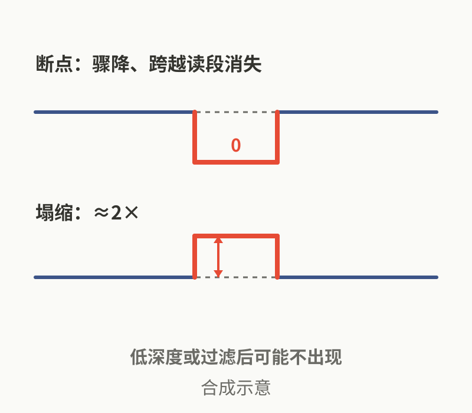

</div>
<div>

- 塌缩处深度约为拷贝数倍
- 信号不出现，不等于拼对了

</div>
</div>

<div class="ref">教材 §8.4.7、§8.4.8 ｜ 失效条件 8.5.1</div>

---

## 两条轨道分开说

<div class="cols">
<div>

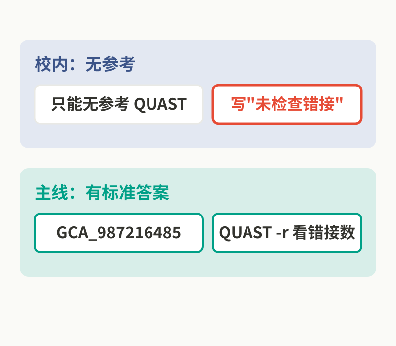

</div>
<div>

- 主线数据有标准答案 `GCA_987216485`
- 不能写「正确性通过」，只能写「未检查错接」
- 有 `-r` 才有错接数与覆盖比例

</div>
</div>

<div class="ref">教材 §8.4.8、§8.6</div>

---

## BUSCO：五个数一起读

<div class="cols">
<div>

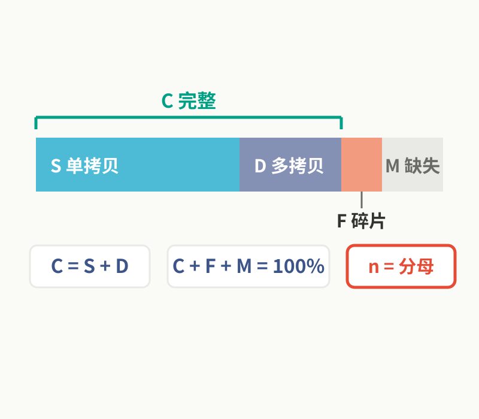

</div>
<div>

- 同一谱系库、同一口径才可比
- n 变了，百分数就不能直接比
- 设例演算见下页

</div>
</div>

<div class="ref">教材 §8.4.8 ｜ 讲义 ⑤ 5.7</div>

---

## 先做加法自检，再看分母

`C:99.2%[S:52.4%,D:46.8%],F:0.0%,M:0.8%,n:124`　——教材设例

- 整数计数 123 / 65 / 58 / 0 / 1
- n=124 → 一个基因 0.81 个百分点
- C 相差不到 1%，可能只是一个基因

<div class="ref">教材 §8.4.8 ｜ 演示 `ch08_n50_vs_completeness.py --example 4`</div>

---

<!-- _class: undergraduate quiz -->

## 课堂提问

同样高的 C，可能来自哪两种完全不同的组装？

---

## D 偏高：三类原因，处理方式相反

<div class="cols">
<div>

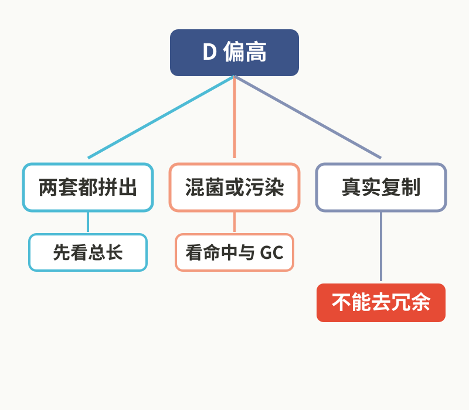

</div>
<div>

- 三种原因，处理方式相反
- 只报 C 没有意义：C 高可能几乎全来自 S
- 查清原因再动手，别先去冗余

</div>
</div>

<div class="ref">教材 §8.4.8</div>

---

## 从指标并列到证据链

<div class="cols">
<div>

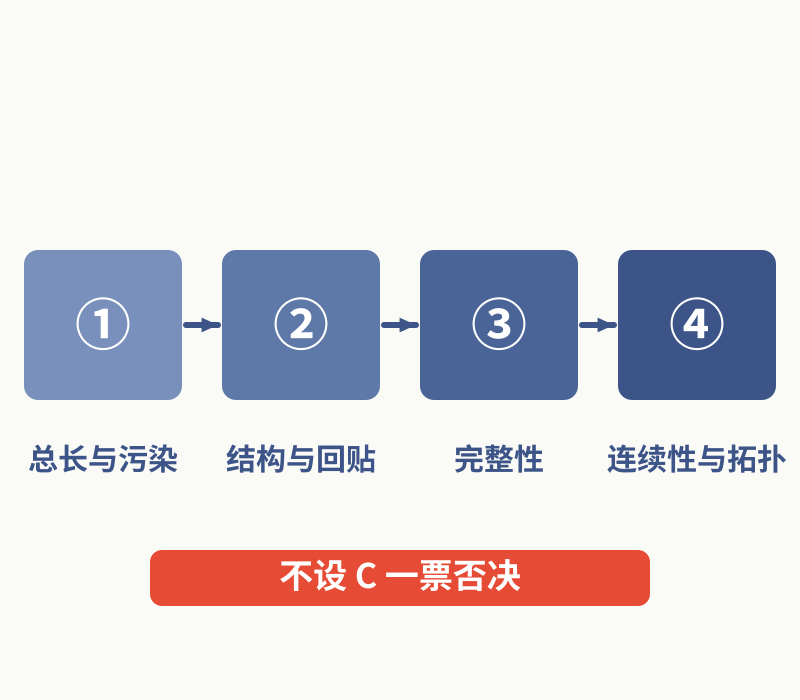

</div>
<div>

- 顺序固定，不要从完整性开始
- 不设「C 差 2% 一票否决」
- 一个基因就是 0.81 个百分点

</div>
</div>

<div class="ref">教材 §8.4.9 ｜ 讲义 ⑥</div>

---

## `circ.` = Y 是阳性信号，不是完成证明

- 不证明染色体完整
- 不证明没有错接（嵌合后也能闭合）
- 不证明重复没有塌缩
- 不证明质粒齐全

<div class="ref">教材 §8.4.6、§8.4.9</div>

---

## 结论要与不确定一起写

- 总长一致只说明没有大段增减
- BUSCO 高只说明保守基因在
- 回贴深度只在断点与成倍变化处给线索
- 两套一致 ≠ 稳健

<div class="ref">教材 §8.4.9、§8.6</div>

---

<!-- _class: undergraduate divider -->

<div class="num">V</div>

# 操作流程

集群规矩 · 三个脚本 · 关键参数

---

<!-- @section: procedure -->
## 集群规矩：先读这段

> 登录节点只用来编辑文件、提交作业、查看结果。任何计算都必须 `qsub` 提交，或先 `qrsh` 申请到计算节点。

- `qsub 脚本` ｜ `qstat -u ${USER}`：qw 排队、r 运行、Eqw 出错
- `qrsh -pe smp 4` 先申请交互节点再跑
- 日志 `<作业名>.o<JOB_ID>` 在提交目录，出问题先 `cat`
- 在登录节点跑 canu 会吃满内存，只剩一行 `Killed`

<div class="ref">教材 §8.5.3、§8.5.4 ｜ 讲义 ⑤ 5.0</div>

---

<!-- _class: undergraduate figure -->

## 登录节点 vs 计算节点


计算只去计算节点；先 `hostname` 看自己在哪

<div class="ref">教材 §8.5.3 ｜ 概念见第 1 章</div>

---

## 作业头：三个脚本不一样

```bash
#!/bin/bash
#$ -S /bin/bash        # 默认 shell 不认 <(...)
#$ -N u06_eval         # 勘测 u06_kmer，组装 u06_assem
#$ -cwd                # 否则相对路径全错
#$ -pe smp 4           # 必须与脚本里的 -t 4 一致
#$ -hold_jid u06_assem # 等组装结束再开始
```

<div class="ref">讲义 ⑤ 5.0</div>

---

## 三个脚本的作业头差异

| 脚本 | 差异（别拼错） |
|---|---|
| `06_kmer_survey.sh` | `-N u06_kmer`，没有 `h_vmem` |
| `06_assemble_compare.sh` | `-N u06_assem`，有 `h_vmem=8G` |
| `06_assembly_eval.sh` | `-N u06_eval`，有 `hold_jid` |

<div class="ref">讲义 ⑤ 5.0</div>

---

## 步骤一、二：k-mer 计数与 GenomeScope

```bash
cd /d3/scratch/${USER}/ngs/survey
jellyfish count -C -m 21 -s 1000000000 -t 4 \
  -o reads.k21.jf <(zcat ../fq/*.fq.gz)
jellyfish histo -t 4 reads.k21.jf > reads.k21.histo
cp reads.k21.histo reads.histo
```

- 脚本把它套进循环，跑 17 / 21 / 25 三档
- 产物是 `.jf` 与 `.histo` 各三份

<div class="ref">教材 §8.4.3 ｜ 讲义 ⑤ 5.2</div>

---

## 参数写错的后果

| 参数 | 写错会怎样 |
|---|---|
| `-C` canonical | 不写则频谱与大小估计改变 |
| `-s` 哈希槽数 | 太小变慢；太大 `std::bad_alloc` |
| `<(zcat ...)` | 默认 `sh` 不认，加 `-S /bin/bash` |
| GenomeScope 位置参数 | 5 个，顺序不能颠倒 |

<div class="ref">教材 §8.4.3 ｜ 讲义 ⑤ 5.2–5.3</div>

---

<!-- _class: undergraduate statement -->

勘测用短读长，组装用长读段：别用反。

同一批原始 ONT 读段拿来数 k-mer，主峰会被错误尾吞掉。

---

## 步骤三、四：Canu 与 Flye

```bash
canu -p test -d test-pacbio genomeSize=4m useGrid=false \
     maxThreads=4 maxMemory=28g -pacbio /data/lab/ngs/reads.fa
flye --pacbio-raw /data/lab/ngs/reads.fa --out-dir out_pacbio \
     --genome-size 4m --threads 4
```

- `genomeSize=4m` 必填，Canu 用它换算覆盖度
- `useGrid=false` 让它在当前作业里老实跑

<div class="ref">教材 §8.5.3 ｜ 讲义 ⑤ 5.4–5.7</div>

---

## 步骤五、六：QUAST 与 BUSCO

```bash
quast.py canu/test-pacbio/test.contigs.fasta \
     flye/out_pacbio/assembly.fasta -o quast_results -t 4 \
     -l "Canu,Flye"
busco -i canu/test-pacbio/test.contigs.fasta -o busco_canu \
      -m genome -l bacteria_odb10 -c 4 --offline \
      --download_path /path/to/lineages
```

- 计算节点无外网：`--offline` 加预下载的库
- 两套 FASTA 一次传入，QUAST 自动横向对照

<div class="ref">教材 §8.5.4 ｜ 讲义 ⑤ 5.4–5.7</div>

---

## 三个必须核对的参数

- Flye 的读长类型：用错就按错误误差模型工作
- 一定要看 `assembly_info.txt` 的 `circ.` 列
- 谱系库是另一把尺：脚本用 `bacteria_odb10`
- 数据自查预期按 `xanthomonadales_odb10`，不可比

<div class="ref">教材 §8.4.8、§8.5.4 ｜ 失效条件 8.5.4</div>

---

<!-- _class: undergraduate statement -->

谱系库选错不会报错，只会让分数不可比。

两库的 n 与基因集合不同，比较前先对齐库名与版本。

---

## 校外自学：公开数据这条路

```bash
bash 06_data/undergraduate/download_ug.sh --run --subsample --depth 40
```

- Xoo CIX4481：ONT 长读长组装
- Canu 用 `-nanopore`、Flye 用 `--nano-raw`
- `genomeSize` 改 `4.7m`

<div class="ref">教材 §8.6 ｜ 06_data/undergraduate/README.md</div>

---

<!-- _class: undergraduate divider -->

<div class="num">VI</div>

# 结果解读

结果不对时长什么样 · 四项检查 · 自查基准

---

<!-- @section: interpretation -->
<!-- _class: undergraduate warn -->
## 结果不对时长什么样（一）

| 现象 | 说明什么 | 先做什么 |
|---|---|---|
| 没有主峰，单调滑落 | 深度不足或用原始长读长 | 换低错误率短读长重跑 |
| 主峰左侧一半有峰 | 混菌、污染、杂合都可能 | 先做四项基本检查 |
| 三档 k 对不上 | 只说明估计不稳定 | 报告三档并说明选哪档 |
| `len` 与近缘参考或总长偏离 | 塌缩、丢段、冗余或污染 | 先查输入与 k，再回贴 |

<div class="ref">教材 §8.4.3、§8.4.4 ｜ 失效条件 8.5.3</div>

---

## 半深度峰：四条基本检查

<div class="cols">
<div>

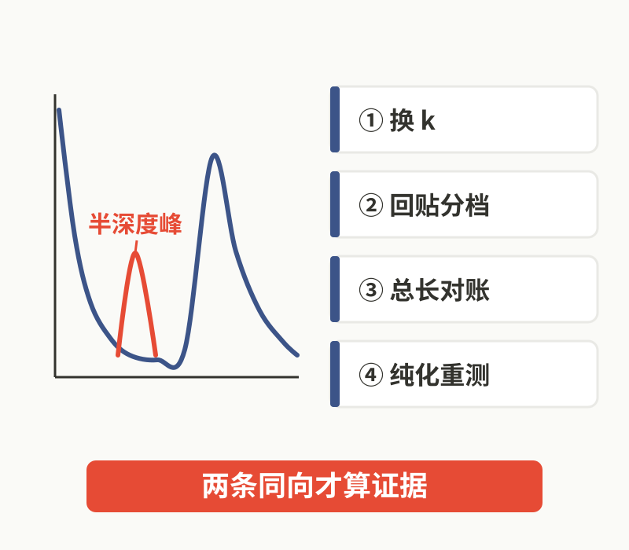

</div>
<div>

- ① 混菌峰稳定，伪影会移动或消失
- ② 混菌深度分成相差约一倍的两档
- ③ 有已知长度才做，不要凑数
- ④ 纯化后混菌信号应消失

</div>
</div>

<div class="ref">教材 §8.4.3</div>

---

<!-- _class: undergraduate figure -->

## N50 怎么算、怎么被骗

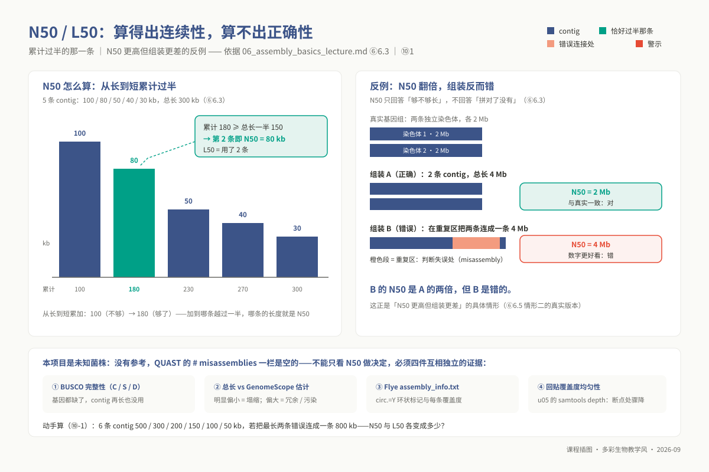

图右下「回贴覆盖度」读作回贴深度（×）

<div class="ref">教材 §8.4.7 图 8-4</div>

---

## 自查基准与 GenomeScope 自检

- contig 1–5 条；总长 4.6–4.9 Mb
- 与标准答案总长差异小于 1%
- 「理想口径 1–3 条」是另一套说法，自查用 1–5
- GenomeScope 自检仍是那四步：输入、拟合、估计、对账

<div class="ref">教材 §8.6 ｜ 06_data/undergraduate/README.md §四（预期，未实测）</div>

---

<!-- _class: undergraduate divider -->

<div class="num">VII</div>

# 常见错误

课堂上一定会遇到的三条

---

<!-- @section: troubleshooting -->
<!-- _class: undergraduate warn -->
## 常见错误一：Canu 在登录节点跑，进程消失

- 只有一行 `Killed`，没有别的报错
- 登录节点吃满内存会被内核按 OOM 杀掉
- 必须 `qsub`，或 `qrsh -pe smp 4` 后再跑
- `hostname` 确认你在哪个节点

<div class="ref">教材 §8.5.3 ｜ 讲义 ⑨ E1</div>

---

<!-- _class: undergraduate warn -->
## 常见错误二：genomeSize 量级写错

<div class="cols">
<div>

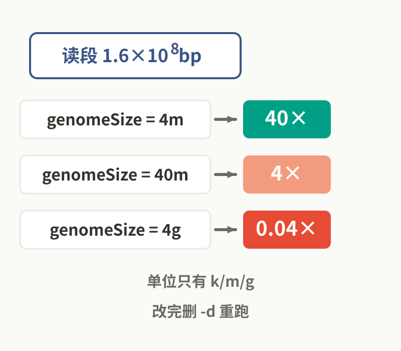

</div>
<div>

- 日志出现 `Found … (1.28 times coverage)` 这类深度
- 多半写成 `4g`：按 1× 规划、纠错子集大减
- 写 `4k` 则深度估计放大一千倍

</div>
</div>

<div class="ref">教材 §8.5.3 ｜ 讲义 ⑨ E3（设例）</div>

---

<!-- _class: undergraduate warn -->
## 常见错误三：k-mer 分布没有主峰，一路下滑

<div class="cols">
<div>

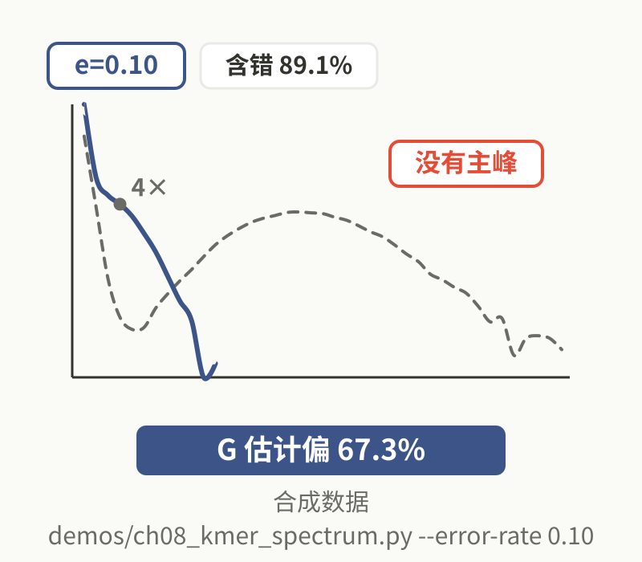

</div>
<div>

- 拿原始 ONT / PacBio CLR 做了 k-mer 扫描
- e=0.15 时 96.7%
- 勘测用短读长，组装用长读段，别用反

</div>
</div>

<div class="ref">教材 §8.5.3 ｜ 讲义 ⑨ E5 ｜ 合成数据 `demos/ch08_kmer_spectrum.py --error-rate 0.10`</div>

---

<!-- _class: undergraduate divider -->

<div class="num">VIII</div>

# 课后

交付清单 · 思考练习 · 实验指导

---

<!-- @section: wrapup -->
## 课后与项目交付

| 报告栏目 | 内容 |
|---|---|
| 连续性 | contig 数、总长、N50、最长 contig |
| 完整性 | BUSCO 的 C 与 S / D / F / M |
| 拓扑 | 是否环状 |
| 选型 | 我选了哪套、为什么 |

- Canu 与 Flye 各一列，每条结论指到证据
- 评分：技术准确性 30%、分析深度 20%

<div class="ref">《学生实验操作手册》§5.1 ｜ 教材 §8.6、§8.7 ｜ 讲义 ⑩</div>

---

## 思考练习：六题（讲义 ⑩）

- Q1 六条 contig 500→50 kb 求 N50 / L50，错接 800 kb 后怎么变
- Q2 BUSCO 设例配总长 8.3 Mb、估计 4.2 Mb，给两种解释
- Q4 Canu 1 条、C=91.1% 对 Flye 5 条、C=98.4%，你选哪套
- Q6 自选物种：测序组合、峰数、谱系库与 D 的判断

<div class="ref">教材 §8.7 ｜ 讲义 ⑩（Q4、Q6 为设例）</div>

---

## 实验指导与收尾

- `11_lab_guides/undergraduate/06_assembly_basics_lab.md`
- 上机时手边打开；演示脚本在课程仓库根目录运行
- 文献只给指针（讲义 ⑪），本 deck 不重复列

**这一步选定的 FASTA 是后续全部模块的输入。**

<div class="ref">教材 §8.6、§8.7 ｜ 讲义 ⑩、⑪</div>
