<!-- @section: cover -->
<!-- _class: undergraduate cover -->

# u07 ｜ 基因组注释与 IGV 可视化

**注释是预测，不是实测：名字像样、数字漂亮，也可能全错，而且不报错。**

<div class="meta">

- 线上先导自学 4 学时 ｜ 课堂 Day 0 串讲 1.5 h
- 教材 §9.1–§9.6 ｜ 对应手册 §4.3
- 环境 `ngs_ug_annot`（IGV 在 `ngs_ug_base`）

</div>

---

<!-- _class: undergraduate divider -->

<div class="num">01</div>

# 学习目标

四条主线：分清两类注释 · 会算三个指标 · 会看三层轨道

---

<!-- @section: objectives -->
## 学完你应当能够（一）：分清两类注释

- 区分结构注释、功能注释与实验验证
- 说明 Prodigal 与 Prokka 各自负责什么
- 辨认主要输出文件与两种 GFF 的用途
- 说明假定蛋白是命名状态，不是分数

<div class="ref">教材 §9.2、§9.4.1–§9.4.4 ｜ 目标 LO09-01、LO09-02</div>

---

## 学完你应当能够（二）：会算、会看

- 计算 CDS 长度、编码比例与假定占比
- 解释这些汇总指标为何只生成检查线索
- 核查 FASTA、GFF、BAM 的标识与索引
- 记录链偏、末端聚集、MAPQ 三项证据

<div class="ref">教材 §9.4.5–§9.4.7 ｜ 目标 LO09-03、LO09-04</div>

---

## 本讲不做什么（边界先划清）

- 不裁决变异真伪：那要第 10 章的统计
- 不给编码比例、假定蛋白的通用合格线
- 不写「发现新抗生素」，只写遗传潜力
- 基因簇的机制细节留给硕士层

<div class="ref">教材 §9.1、§9.4.5、§9.5.4</div>

---

<!-- _class: undergraduate divider -->

<div class="num">02</div>

# 前置检查

三个 L0 模块，加一句同层前置

---

<!-- @section: prerequisites -->
## 前置检查：三个 L0 模块

| L0 模块 | 本讲用到 | 不过关的后果 |
|---|---|---|
| `l0_01_linux` | `qsub`、`awk` 取列、软链接 | 作业交不上去 |
| `l0_03_conda` | 注释环境与 IGV 环境分开 | 分不清没装还是没激活 |
| `l0_04_formats` | FASTA 头行、GFF 九列、BAM 索引 | 注释空白或轨道错位 |

- 自测 L0-01 Q3/Q7/Q9、L0-03 Q2/Q8、L0-04 Q4/Q5/Q10
- 本讲不依赖 `l0_06_stats`

<div class="ref">教材 §9.3 ｜ 讲义 ②</div>

---

## 同层前置：重叠群（contig）与 BAM 都要对得上

- BAM 不是 u05 那份：读段要比对到本讲 FASTA
- 用 minimap2：校内 PacBio 轨 `-ax map-pb`
- 校外 ONT 主线（`ERR15732384`）改 `-ax map-ont`
- 脚本比对 `@SQ` 名字与长度，不一致退出

<div class="ref">教材 §9.4.6 ｜ 讲义 ⑤ 5.5（真实 BAM 流程未在集群现跑）</div>

---

<!-- _class: undergraduate divider -->

<div class="num">03</div>

# 科学问题

两个问题，一份自带答案的数据

---

<!-- @section: background -->
## 注释是数据总线，不是流程终点

<div class="cols">
<div>

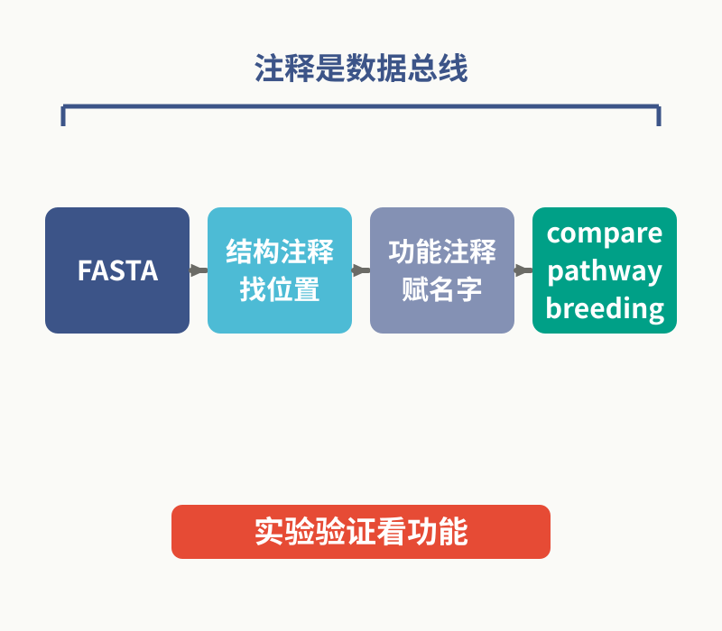

</div>
<div>

- 本讲覆盖预测、统计与看图核查
- 实验验证要另做实验，本讲不涉及
- 下游照算不重判，注释错了照样出图

</div>
</div>

<div class="ref">教材 §9.4.1 ｜ 讲义 ③ 3.1</div>

---

## 一株菌，两个身份

<div class="cols">
<div class="card">

### 题目
u06 评估后选定的 CIX4481 组装 FASTA

本讲唯一的输入

</div>
<div class="card">

### 答案
同株作者完成图 `GCA_987216485`

**4,768,212 bp**

</div>
</div>

- 课程预期 4,000–4,600 个 CDS（约 4.7 Mb，未实测）
- 区间只作自查范围，不作结论

<div class="ref">教材 §9.1、§9.6 ｜ 06_data/undergraduate/README.md §2.1、§四</div>

---

<!-- _class: undergraduate figure -->

## 致病链上每一环都是注释问题

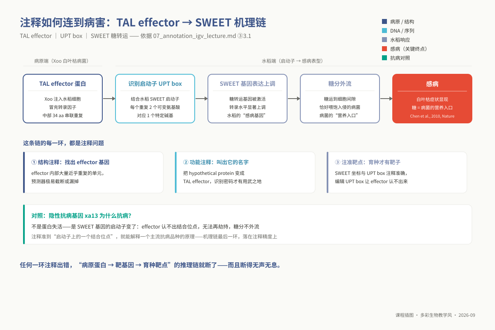

一个重复对 1 个碱基是简化；实际是简并识别偏好

<div class="ref">教材 §9.1 ｜ 图内 ③3.1 是讲义编号</div>

---

<!-- _class: undergraduate statement -->

注释给的是名字，不是事实。

名字来自同源与结构域证据；要确认功能，得补实验。

---

<!-- _class: undergraduate divider -->

<div class="num">04</div>

# 核心原理

ORF 模型 · 两种 GFF · 统计指标 · 三层轨道

---

<!-- @section: principles -->
## 三个概念不能互换

<div class="cols">
<div>

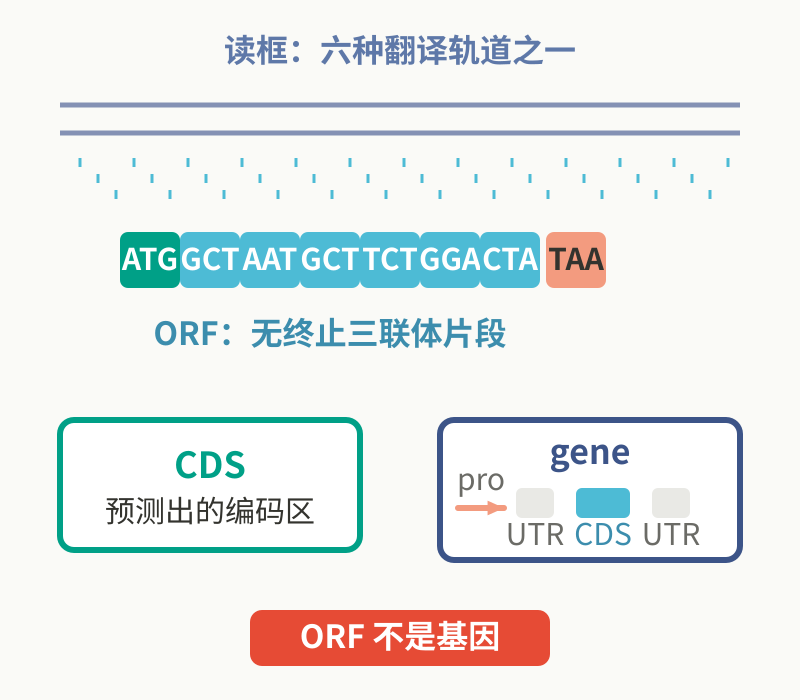

</div>
<div>

- CDS 是预测结果，不是观察结果
- 基因还含调控序列与表达语境
- 长 ORF 只是候选
- 长度不是基因的定义

</div>
</div>

<div class="ref">教材 §9.4.2</div>

---

## 随机模型：平均 21 个密码子撞上终止

<div class="cols">
<div>

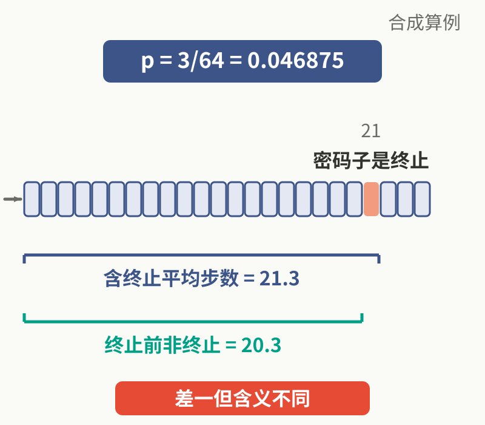

</div>
<div>

- 前提：碱基等概率、密码子独立、标准密码表
- 报告里写明用哪个数：步数还是个数

</div>
</div>

<div class="ref">教材 §9.4.2 ｜ 在课程仓库根运行 `python3 textbook/demos/ch09_orf_length.py --selftest`</div>

---

## 300 个密码子无终止：5.56×10⁻⁷

<div class="cols">
<div>

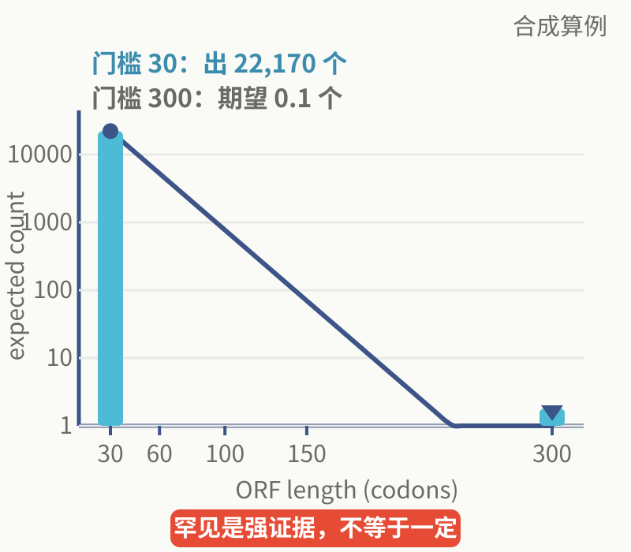

</div>
<div>

- `(1−p)^300 = 5.56×10⁻⁷`
- 300 密码子约 900 bp，无终止
- 门槛一抬，随机序列交不出候选
- 长度是证据强度的一个维度

</div>
</div>

<div class="ref">教材 §9.4.2 ｜ 同上演示 `--selftest`（固定种子 20261104）</div>

---

<!-- _class: undergraduate statement -->

长度这把尺子，在两个方向上都可能失灵。

小基因会被同一条硬线误伤；重复区里的长基因，长度不说明边界对。

---

## Prodigal 用哪些线索，不用「长度阈值」

<div class="cols">
<div>

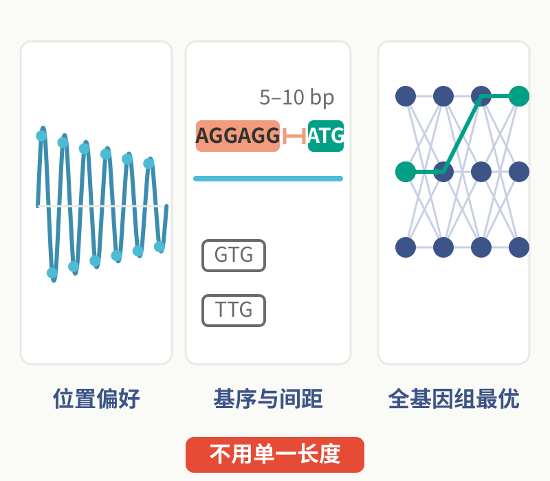

</div>
<div>

- 六聚体在不同阅读框里的编码统计
- 评分在候选读框之间全局比较
- RBS 有无与间距因基因而异，不是硬规则

</div>
</div>

<div class="ref">教材 §9.4.2</div>

---

## Prokka 是调度器，不是预测器

- Prodigal 找 CDS；Aragorn 找 tRNA 与 tmRNA
- Barrnap 找 rRNA；MinCED、Infernal 找 CRISPR 与 ncRNA
- 合并、去重、统一编号，最后赋功能名
- 清单不是固定五步：看 `--listdb` 与本次日志

<div class="ref">教材 §9.4.3 ｜ 讲义 ④ 4.2</div>

---

## 功能赋值：四类来源，先严后宽

<div class="cols">
<div>

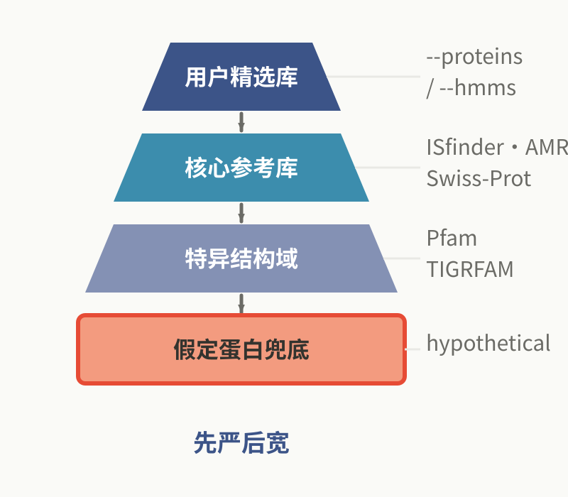

</div>
<div>

- ② 属级库要 `--usegenus`
- 前提是先建好同属的库
- `--kingdom` 不等于启用本属专用库
- 近缘库错命名，第一层就继承

</div>
</div>

<div class="ref">教材 §9.4.3 ｜ 讲义 ④ 4.2</div>

---

<!-- _class: undergraduate statement -->

假定蛋白是命名状态，不是质量分数。

里面既有未表征的真基因，也有过度预测的假 ORF；偏离要审查，不是打分。

---

## 一个名字来自哪一层？三样分开读

- `product` 只是最终的功能名
- 默认 `.tsv` 表头没有命名证据列
- GFF 属性列可能有 `inference`，记来源类别
- 它不写库版本、路径、相似度与覆盖度

<div class="ref">教材 §9.4.3 ｜ 命名证据的细目见该节深入块</div>

---

## GFF3 九列：哪里、哪条链、是什么

- 第 1 列 seqid 必须与 FASTA 头行逐字一致
- 第 4、5 列是 1-based、含两端：`2340−1042+1 = 1299 bp`
- 第 6 列 `.` 无分数；第 8 列 phase 为 0/1/2
- 第 9 列 `ID` 是 locus tag，与重叠群名分开数

<div class="ref">教材 §9.4.4（设例）｜ 坐标换算见第 5 章 §5.4.4、§5.4.7</div>

---

## 两种派生方向：给人看，给机器算

<div class="cols">
<div>

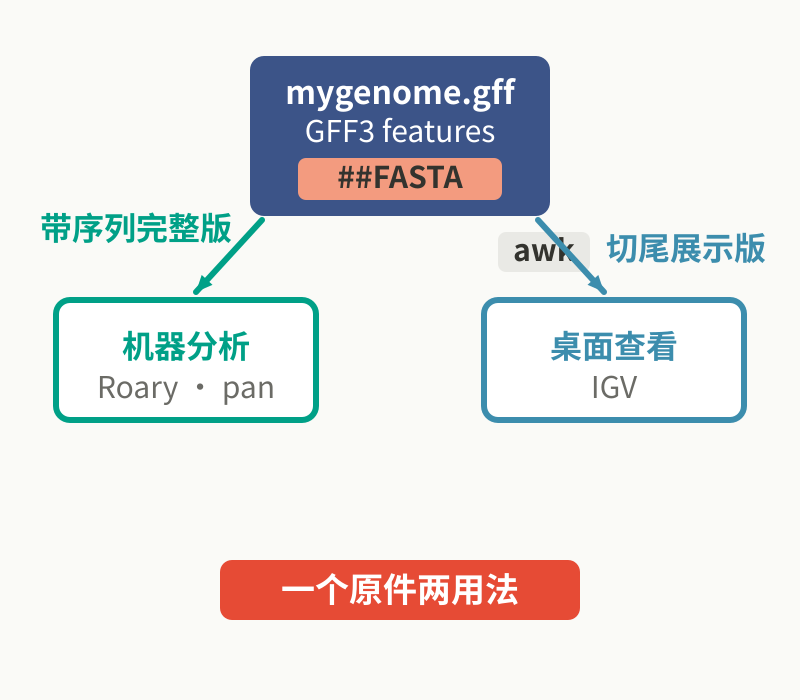

</div>
<div>

- 显示方向另需 `.fai` 与排序索引的 BAM
- 喂错了：可能报错，也可能跑完但结果无效
- 两个方向共用同一份注释，不能互相替代

</div>
</div>

<div class="ref">教材 §9.4.4</div>

---

<!-- _class: undergraduate figure -->

## 一条记录对应基因组上的什么

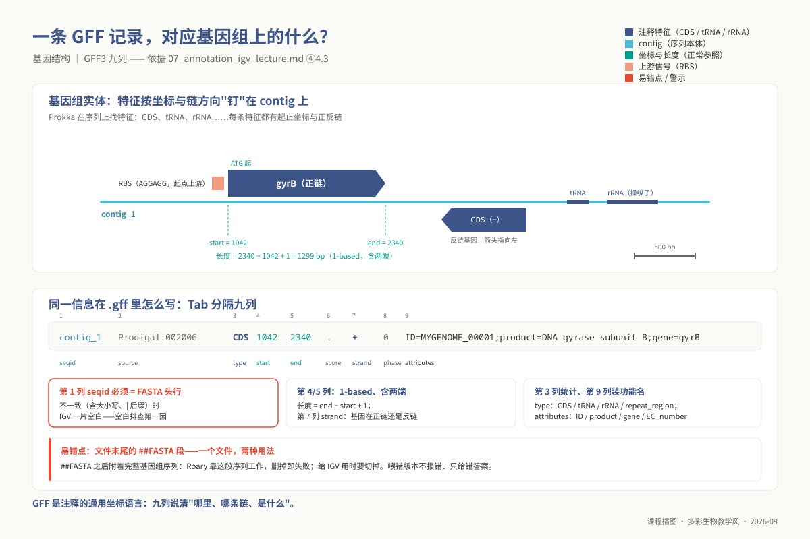

坐标为设例；原件给机器、切尾版给 IGV；「删掉即失败」偏强

<div class="ref">教材 §9.4.4 ｜ 图内 ④4.3 是讲义编号</div>

---

## 统计指标：每个都要写分子分母

- CDS 数：预测出多少编码区，没说是否真实
- CDS 密度：`n_CDS ÷ 基因组长度（Mb）`
- 编码比例：`C_CDS ÷ G`，`C_CDS` 是各 CDS 长度之和
- `G` 是基因组总长；平均 CDS 长不等于基因长

<div class="ref">教材 §9.4.5</div>

---

## 求和还是并集：同份注释差 5 个百分点

<div class="cols">
<div>

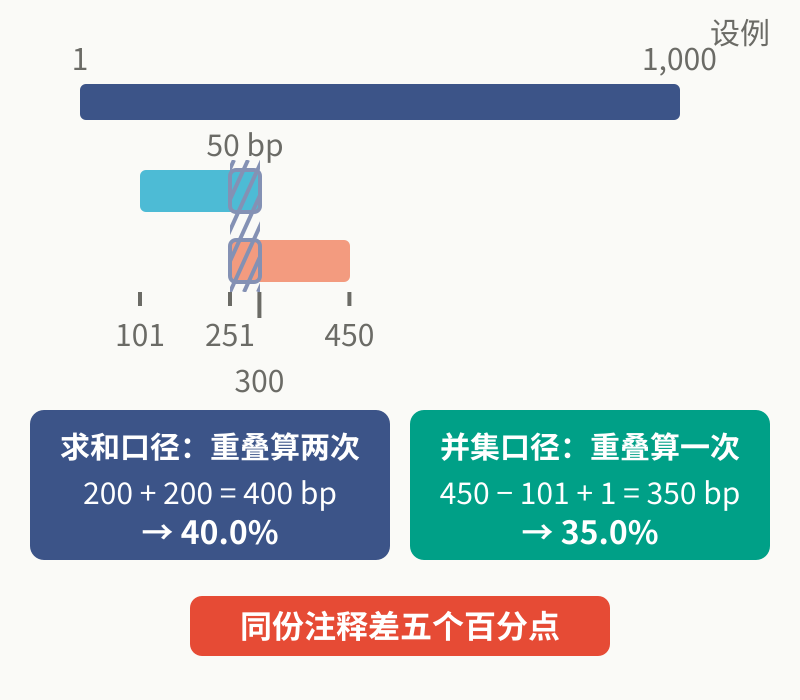

</div>
<div>

- 报告里必须写明用哪种口径
- 口径不同，两个数就不该直接比
- 编码比例默认按求和口径

</div>
</div>

<div class="ref">教材 §9.4.5（设例，算术可复核）</div>

---

## 4.2 Mb 设例走一遍算式

- `3,980 ÷ 4.2 = 947.6 个/Mb`
- `0.882 × 4,200,000 = 3,704,400 bp`
- 平均 CDS 长度 `3,704,400 ÷ 3,980 = 930.8 bp`
- 假定蛋白 `0.285 × 3,980 = 1,134`（28.5%）

<div class="ref">教材 §9.4.5（设例；算术）｜ 习题 4</div>

---

<!-- _class: undergraduate statement -->

课程没有写通用「健康区间」，也不补造。

编码比例、假定蛋白比例、rRNA 数都只作检查线索。

---

## 一个数字，至少三四种解释

<div class="cols">
<div>

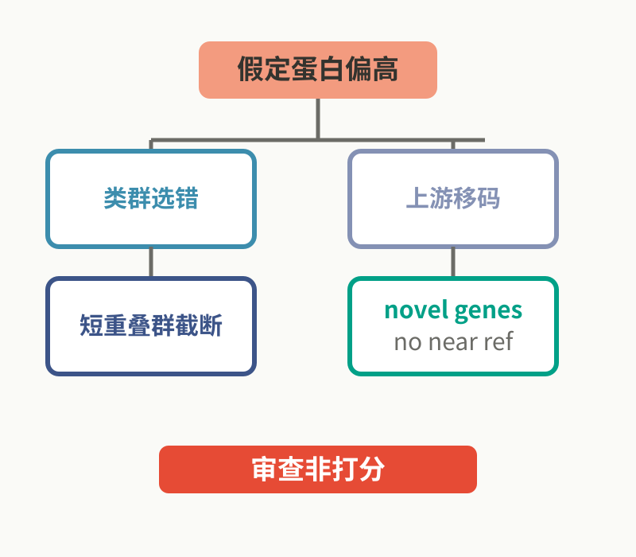

</div>
<div>

- 偏离先列竞争解释，再谈结论
- CDS 偏多与偏少，原因方向相反
- 塌缩把拷贝压成一份，计数偏低
- 写结论至少要两条同向证据

</div>
</div>

<div class="ref">教材 §9.4.5、§9.6</div>

---

## IGV 对齐的是三类信息

- 参考序列层、覆盖度轨道、比对轨道
- 注释轨道可以叠在任意位置
- 柱高是测序深度（×），不是覆盖比例（%）
- 三层同看：注释说有基因，读段支持吗

<div class="ref">教材 §9.4.6</div>

---

## 看图前先确认四件事

- `genome.fasta` 有 `.fai`，否则不能随机访问
- BAM 已按坐标排序，`.bai` 同名同批生成
- BAM 的 `@SQ` 名字与长度和这份 FASTA 一致
- GFF 的 seqid 与 FASTA 头行逐字一致

> 四条里最容易被跳过的是第三条：IGV 不一定为它报错。

<div class="ref">教材 §9.4.6</div>

---

## 覆盖统计与显示不是一回事

- 降采样只减少比对轨道画出的横条
- 覆盖统计仍按全部合格读段汇总
- 低质量碱基被画淡，不等于被删除
- 要可比的数，回 BAM 按明确条件重数

<div class="ref">教材 §9.4.6</div>

---

<!-- _class: undergraduate figure -->

## IGV 窗口：三层怎么对齐

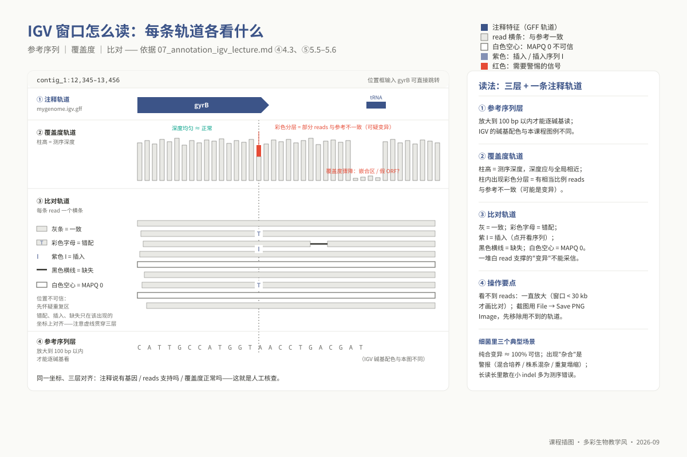

层序以正文为准；坐标为设例；配色以软件图例为准；红字是提问

<div class="ref">教材 §9.4.6 ｜ 图内 ④4.3、⑤5.5–5.6 是讲义编号</div>

---

## 三类线索，先把量定义清楚

<div class="cols">
<div>

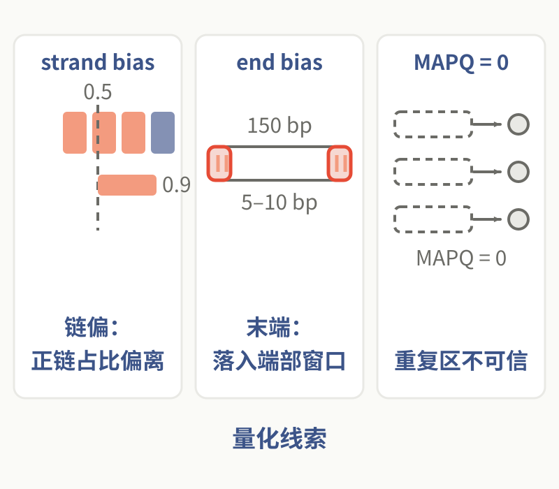

</div>
<div>

- 支持 alt 的读段数记作 `A`，报告写这个数
- 窗口是观察参数，不是生物学常数
- MAPQ=0 只说明位置不唯一

</div>
</div>

<div class="ref">教材 §9.4.7</div>

---

## 合成算例：45 条读段覆盖、15 条 alt

<div class="cols">
<div>

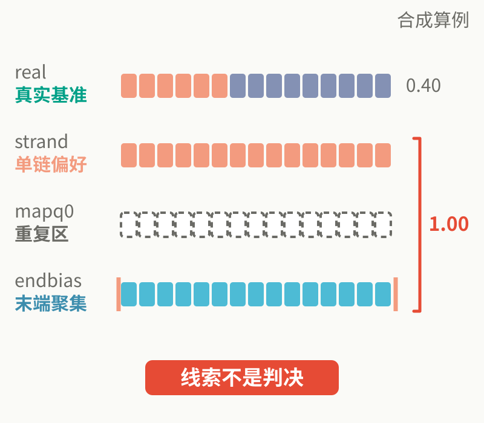

</div>
<div>

- real 是三道计数闸都不触发的对照
- 另三场景各触发一条，各到 1.00
- 0.2–0.8 与 >0.5 是脚本规则，不是外部判据

</div>
</div>

<div class="ref">教材 §9.4.7 ｜ 在课程仓库根运行 `python3 textbook/demos/ch09_igv_false_signals.py --selftest`（150 bp、窗口 10 bp）</div>

---

<!-- _class: undergraduate statement -->

线索不是判决。

命中线索先降低信任、补充证据；真伪裁决是第 10 章的事。

---

<!-- _class: undergraduate figure -->

## 真变异与三类假信号的形态

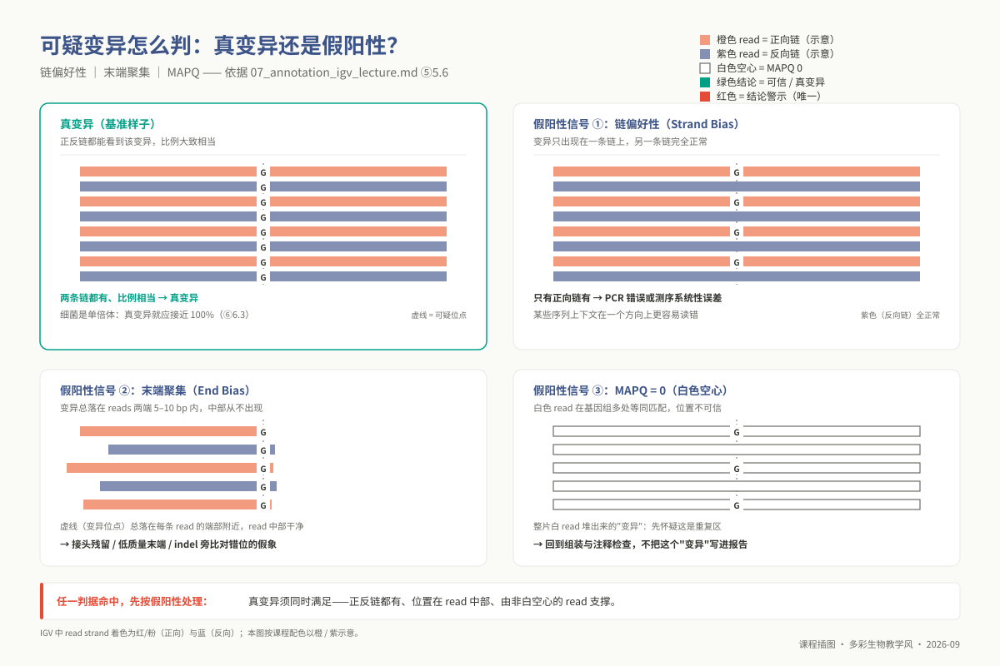

线索降信任、不判决；真伪归第 10 章；橙紫对应 IGV 红蓝；5–10 bp 是示例窗口

<div class="ref">教材 §9.4.7 ｜ 图内「先按假阳性」是讲义强口径；依据行是讲义编号</div>

---

## 每条线索都有竞争解释

<div class="cols">
<div>

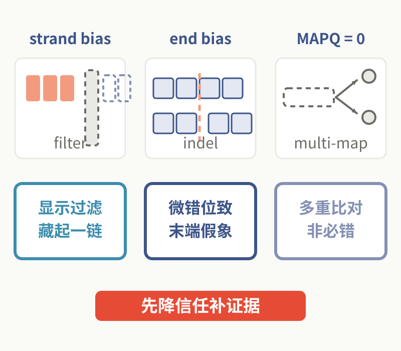

</div>
<div>

- 真变异也可能只在一侧链被看到
- 技术原因先排除，再谈生物学
- 每条线索只改变解释强弱，不是判决

</div>
</div>

<div class="ref">教材 §9.4.7</div>

---

## 复查动作成本不同，结论不同

- 按原始 BAM 分别数两条链的 alt 数与总数
- 换文库或加深测序，看反链是否出现 alt
- 换比对器或局部重排，看信号是否消失
- 检查唯一比对区，并核对拷贝数证据

<div class="ref">教材 §9.4.7 ｜ 每一种只改变解释强弱</div>

---

## 记录要写全，否则只能写「待查」

- 覆盖深度、alt 读段数与比例
- alt 的正反链条数、MAPQ 与碱基质量分布
- 位点在读段内的位置、附近软剪切或 indel
- 当前降采样与过滤设置

<div class="ref">教材 §9.4.7 ｜ 习题 5、8</div>

---

<!-- _class: undergraduate quiz -->

## 课堂提问

某位点 45× 覆盖、15 条 alt 全在正链，能写「已排除」吗？

---

## 同一个位点，两种交接写法

<div class="cols">
<div class="card good">

### 可以写
证据质疑该变异：alt 全在正链，下一步按原始 BAM 重数两链

</div>
<div class="card bad">

### 不要写
已确认假阳性，或已确认真变异

</div>
</div>

- 定案要第 10 章的模型、过滤与多重检验

<div class="ref">教材 §9.4.7、§9.5.3</div>

---

<!-- _class: undergraduate divider -->

<div class="num">05</div>

# 操作流程

集群规矩 · 从软链接一路走到 IGV

---

<!-- @section: procedure -->
## 集群规矩：先读这段

- 登录节点只做三件事：下载、建环境、编辑文件
- 一切计算走 `qsub`；交互用 `qrsh -pe smp 4`
- 日志在提交目录，出问题先 `cat` 日志
- 计算节点不通外网，数据库必须先在登录节点下

<div class="ref">教材 §9.4.3、§9.5.5 ｜ 讲义 ⑤ 5.0</div>

---

## 步 0：软链接 u06 的组装，再做两项自检

```bash
cd /d3/scratch/${USER}/ngs/anno
ASSEM=/d3/scratch/${USER}/ngs/assem
ln -sf ${ASSEM}/canu/test-pacbio/test.contigs.fasta ./genome.fasta
test -s genome.fasta || echo "[ERROR] 软链接目标不存在"
qrsh -pe smp 4      # 以下两项是计算：进交互作业再跑
grep -c "^>" genome.fasta
awk '/^>/{next}{n+=length($0)}END{print n}' genome.fasta
```

- `test` 是 `canu -p` 的前缀，不是测试数据
- 用 Flye 就换成 `out_pacbio/assembly.fasta`
- 总长要能与 u06 的评估报告对上

<div class="ref">教材 §9.6 ｜ 讲义 ⑤ 5.0</div>

---

## 步 1：投递 Prokka 作业

```bash
export REPO_DIR=<课程仓库路径>
qsub ${REPO_DIR}/03_code/undergraduate/scripts/07_run_prokka.sh \
     genome.fasta mygenome prokka_out
```

- 位置参数依次是输入、前缀、输出目录，都有默认值
- 脚本内置 contig 名长度预检与版本记录
- 输出目录必须不存在，否则拒绝运行
- 校外自学把 `REPO_DIR` 换成自己的 clone 路径

<div class="ref">教材 §9.6 ｜ 讲义 ⑤ 5.1</div>

---

## 步 2：先看摘要，再看文件

```bash
cat prokka_out/mygenome.txt
grep -v "^#" prokka_out/mygenome.gff | head -5
grep -c "^>" prokka_out/mygenome.faa
```

- 全程在 `anno/` 下敲，别 `cd` 进输出目录
- `.txt` 是第一眼质检；`.log`、`.err` 出问题先看
- `grep -c` 的蛋白条数应与 CDS 数一致
- 输出目录必须是本次新建的那一个

<div class="ref">教材 §9.4.3、§9.6 ｜ 讲义 ⑤ 5.2</div>

---

## 步 3：一键统计注释指标

```bash
cd /d3/scratch/${USER}/ngs/anno
qrsh -pe smp 4     # 统计也是计算：在节点上跑
bash ${REPO_DIR}/03_code/undergraduate/scripts/07_annotation_stats.sh \
     prokka_out mygenome
```

- 输出：CDS 数与密度、编码比例、tRNA/rRNA、假定占比
- 编码比例是求和口径，报告里要写明
- rRNA 特征条数不等于完整操纵子套数
- 脚本打印的「参考范围」列不作判据

<div class="ref">教材 §9.4.5 ｜ 讲义 ⑤ 5.3</div>

---

## 步 4：antiSMASH 用 `.gbk` 起跑

```bash
source /opt/miniconda3/bin/activate && conda activate ngs_ug_annot
download-antismash-databases || antismash --prepare-data
qsub ${REPO_DIR}/03_code/undergraduate/scripts/07_run_antismash.sh \
     prokka_out/mygenome.gbk antismash_out
```

- 备库在登录节点做一次；计算节点不通外网
- `.gbk` 已带基因边界，不必再找基因
- 只有裸 FASTA 才加 `--genefinding-tool prodigal`
- 脚本先跑 `--check-prereqs`，版本不同写法不同

<div class="ref">教材 §9.4.8、§9.5.5 ｜ 讲义 ⑤ 5.4、⑨ E3</div>

---

## 步 5：先有 BAM，而且是这一份的

<div class="cols">
<div>

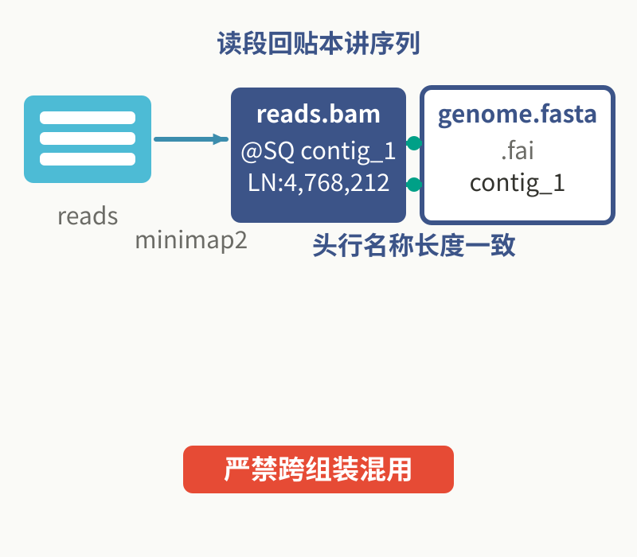

</div>
<div>

- 校内 PacBio 读段：`-ax map-pb`
- 校外 ONT 读段：`-ax map-ont`
- 投递作业的模板见实验指导步骤 4

</div>
</div>

<div class="ref">教材 §9.4.6 ｜ 讲义 ⑤ 5.5（本流程未在集群现跑）</div>

---

## 步 6：准备 IGV 的三样输入

```bash
cd /d3/scratch/${USER}/ngs/anno
qrsh -pe smp 4     # sort/index 也是计算
bash ${REPO_DIR}/03_code/undergraduate/scripts/07_prep_igv_inputs.sh \
     genome.fasta reads.bam prokka_out/mygenome.gff
```

- 产出 `.fai`、切尾的 `mygenome.igv.gff`
- BAM 已排序就跳过重排，索引与它同名
- 脚本逐项比 `@SQ` 与 FASTA 名字、长度
- 切尾副本只给 IGV，分析要用原件

<div class="ref">教材 §9.4.6 ｜ 讲义 ⑤ 5.5</div>

---

## 步 7：IGV 在个人电脑上跑，不在集群

<div class="cols">
<div class="card">

### 先在集群
`scp` 把 `genome.fasta` 与 `.fai`、`mygenome.igv.gff`、BAM 与同名 `.bai` 拉到本机

</div>
<div class="card">

### 再在本机
`Genomes → Load Genome from File`（不是 File 菜单），再 `File → Load from File` 加载 GFF 与 BAM

</div>
</div>

- 放大到看得见单条读段，再按 `read strand` 着色
- 截图前先 Remove 无关轨道，再 `Save PNG Image`

<div class="ref">教材 §9.4.6 ｜ 讲义 ⑤ 5.6</div>

---

<!-- _class: undergraduate divider -->

<div class="num">06</div>

# 结果解读

结果不对时长什么样 · 自查基准 · 簇的边界

---

<!-- @section: interpretation -->
<!-- _class: undergraduate warn -->
## 结果不对时长什么样（一）

<div class="cols">
<div>

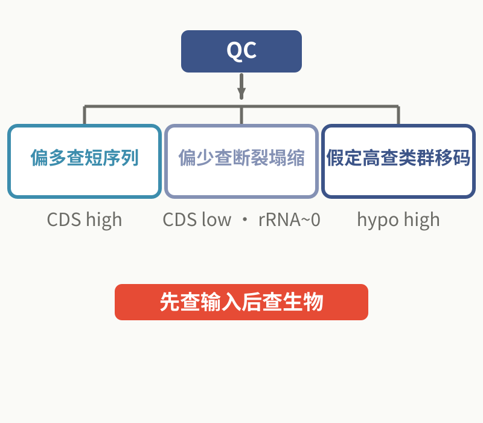

</div>
<div>

- 编码比例偏低：先查 N 缺口、口径
- 每条都先查输入与参数，再谈生物学
- 偏离只触发审查，不是诊断

</div>
</div>

<div class="ref">教材 §9.5.1、§9.6</div>

---

<!-- _class: undergraduate warn -->
## 结果不对时长什么样（二）

| 现象 | 先查什么 |
|---|---|
| 注释轨道空白 | GFF 的 seqid 与 FASTA 头行 |
| 比对轨道没有读段 | 窗口是否过宽、BAM 是否索引 |
| 有读段但位置不对 | BAM 的 `@SQ` 与 FASTA |
| 某区段深度为零 | 断点、缺失、过滤、参考错误 |

<div class="ref">教材 §9.4.6、§9.5.2 ｜ 零深度不是「嵌合」的专利</div>

---

<!-- _class: undergraduate statement -->

这类错误大多不报错。

程序正常退出、文件正常生成；假 ORF 已被计入基因数，下游照样出图。

---

## 自查基准：全部只是预期

- 同株完成图 4,768,212 bp，可与自拼总长对照
- CDS 预期 4,000–4,600，换算约 851–979 个/Mb
- 预期、未实测；落在区间内不等于注释正确
- 落在区间外，也不等于流程一定错

<div class="ref">教材 §9.4.5、§9.6 ｜ 06_data/undergraduate/README.md §四</div>

---

## 预测到基因簇，不等于化合物被合成

<div class="cols">
<div>

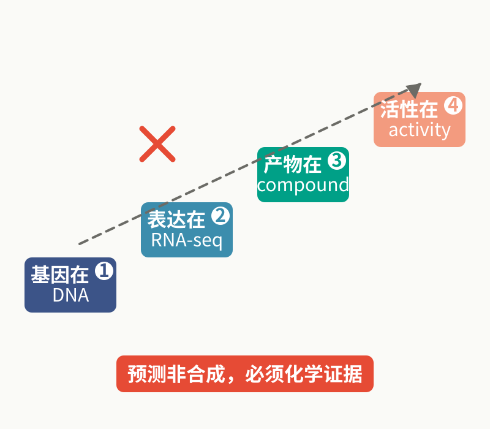

</div>
<div>

- `on contig edge`：簇贴到末端，完整性未知
- 匹配比例的分母是参考簇的基因数
- 即使 100%，也不保证是同一个化合物

</div>
</div>

<div class="ref">教材 §9.4.8、§9.5.4 ｜ 讲义 ⑥ 6.4（不用相似度两档阈值）</div>

---

## 贴边判定按坐标，不按感觉

<div class="cols">
<div>

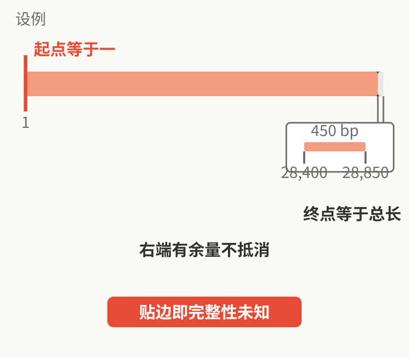

</div>
<div>

- 判据只看两端坐标，余量不折算
- 贴边只说完整性未知，不说已被证明断裂
- 下一步回看第 8 章组装证据

</div>
</div>

<div class="ref">教材 §9.5.4（设例，算术）｜ 习题 6</div>

---

<!-- _class: undergraduate divider -->

<div class="num">07</div>

# 常见错误

四条，都会让你白跑一趟

---

<!-- @section: troubleshooting -->
<!-- _class: undergraduate warn -->
## 错误一：contig 名过长，Prokka 中途退出

<div class="cols">
<div>

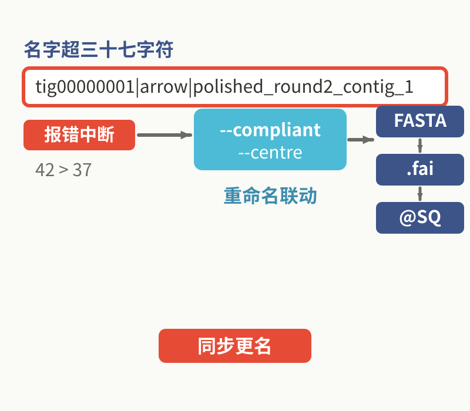

</div>
<div>

- 指纹：Contig ID must <= 37 chars long
- `--compliant` 会连带设置 `mincontiglen=200`
- 上限以所装版本为准

</div>
</div>

<div class="ref">教材 §9.4.4、§9.5.2 ｜ 讲义 ⑨ E1</div>

---

<!-- _class: undergraduate warn -->
## 错误二：antiSMASH 首次运行缺数据库

- 指纹：`Missing data files ...`
- conda 只装程序，库要单独下载一次
- 在登录节点下载，计算节点只读使用
- 预检随版本：`--check-prereqs` 或 `--prepare-data`

<div class="ref">教材 §9.5.5 ｜ 讲义 ⑨ E3</div>

---

<!-- _class: undergraduate warn -->
## 错误三：IGV 加载成功但一片空白

<div class="cols">
<div>

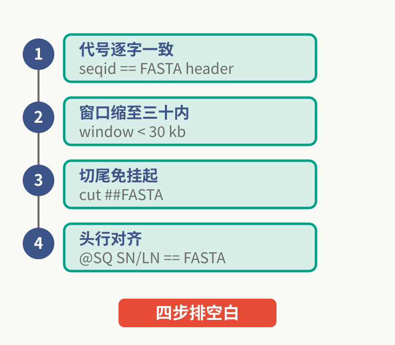

</div>
<div>

- 四步按顺序走，别一次改三处
- 差一个字符，整条轨道就不画
- 四步走完仍空白，再怀疑数据本身

</div>
</div>

<div class="ref">教材 §9.4.6 ｜ 讲义 ⑨ E5</div>

---

<!-- _class: undergraduate warn -->
## 错误四：切尾 GFF 喂给了分析工具

- 先查这个工具要不要带 `##FASTA` 的 GFF3
- 有的工具直接报错，有的跑完但结果无效
- 症状可能是核心基因计数接近 0，也可能报错
- 只改 FASTA 头行还会让坐标与 `@SQ` 错位

<div class="ref">教材 §9.4.4、§9.5.2 ｜ 讲义 ⑨ E8</div>

---

<!-- _class: undergraduate divider -->

<div class="num">08</div>

# 课后

交付清单 · 思考练习 · 实验指导

---

<!-- @section: wrapup -->
## 报告与交付

| 栏目 | 内容 |
|---|---|
| 输入 | contig 数、总长、与 u06 对账 |
| 注释 | 版本与库清单、CDS 数与密度 |
| 指标 | 编码比例（写明口径）、tRNA/rRNA、假定占比 |
| 核查 | 两张 IGV 截图与证据记录 |

- 落点：报告模板 §4.1、§4.2；或手册 §5.1
- 每条结论指到证据等级，写清已知限制

<div class="ref">《学生实验操作手册》§5.1 ｜ 教材 §9.6 ｜ 讲义 ⑩</div>

---

## 思考练习：教材 §9.7 习题

- 习题 1：`p = 3/64` 的假设、21.3 与 20.3 差在哪
- 习题 3：1-based 闭区间怎么算长度，`.` 与 `0` 各是什么
- 习题 5：45× 覆盖、15 条 alt 全正链，能裁决吗（设例）
- 习题 6：28,400 与 28,850 差 450 bp，能写「完整」吗（设例）

<div class="ref">教材 §9.7 ｜ 讲义 ⑩（习题 5、6 为设例）</div>

---

## 实验指导与收尾

- `11_lab_guides/undergraduate/07_annotation_igv_lab.md`
- 上机时手边打开；检查点与出错信号都在里面
- 文献只给指针（讲义 ⑪），本 deck 不重复列

**注释交回的是一份带证据等级的地图，不是一句结论。**

<div class="ref">教材 §9.6、§9.7 ｜ 讲义 ⑩、⑪</div>
